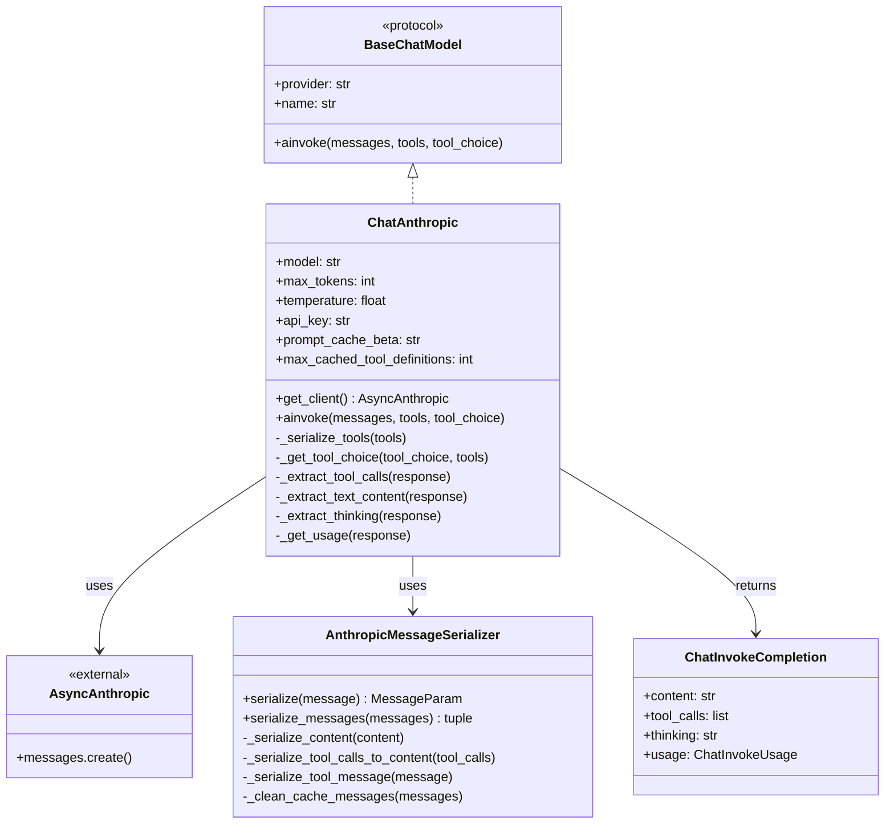
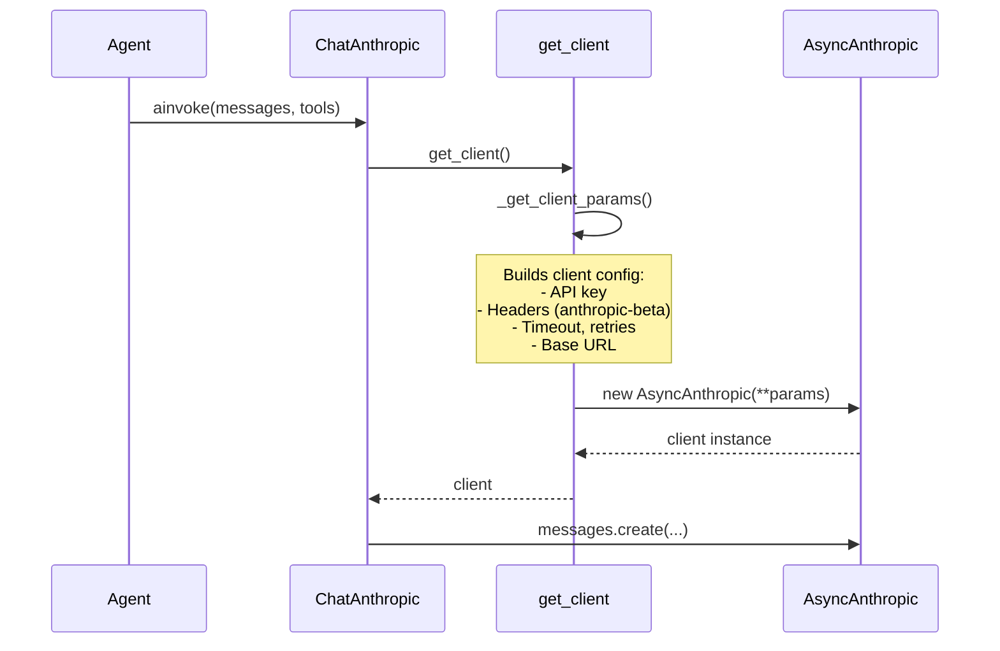
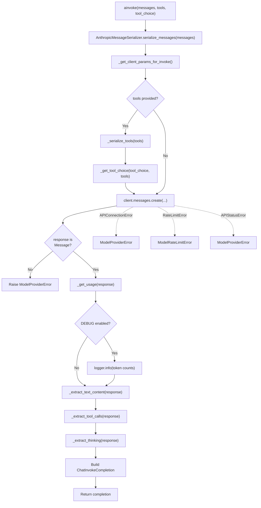
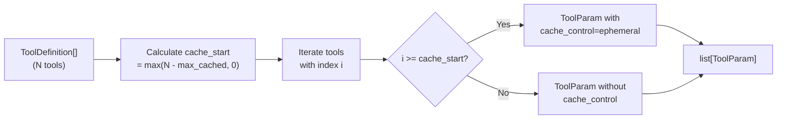
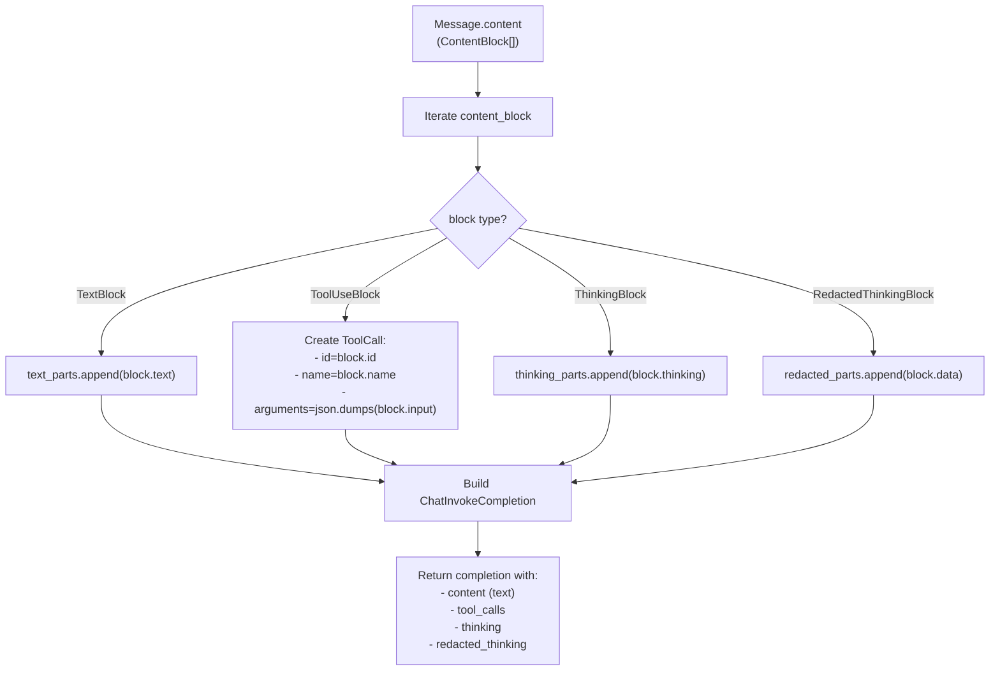
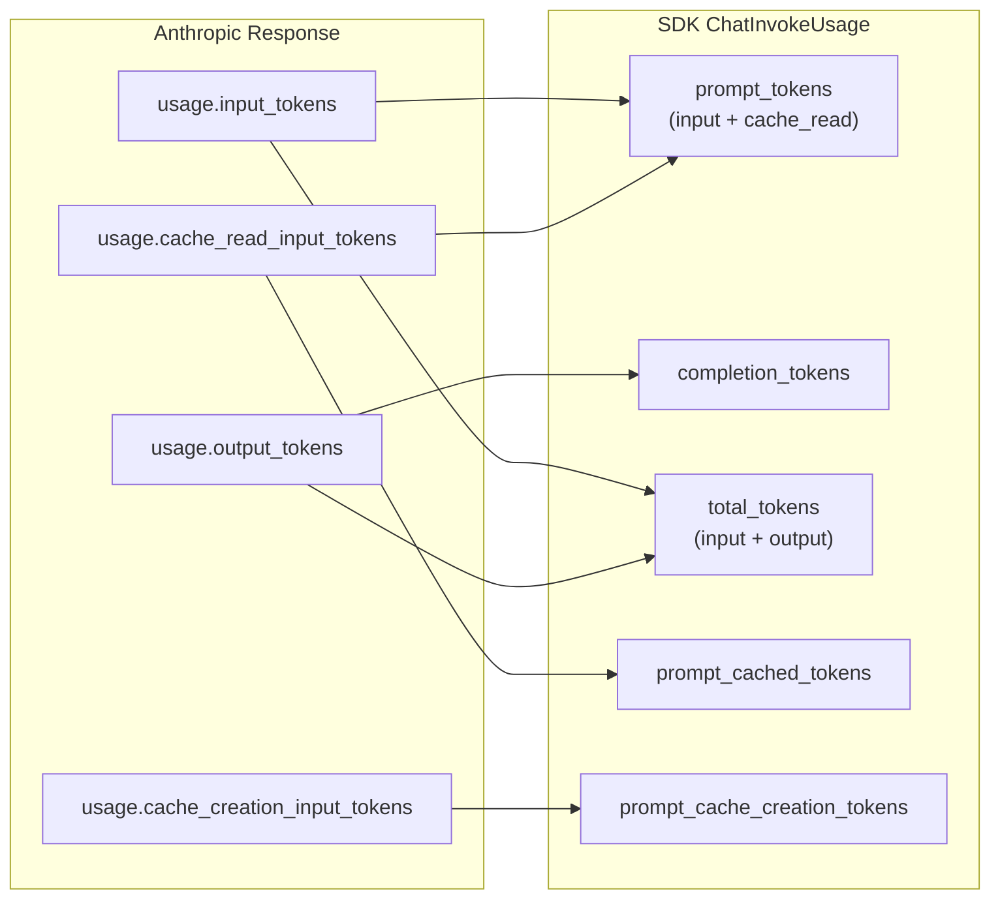
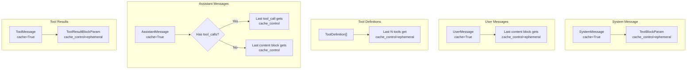
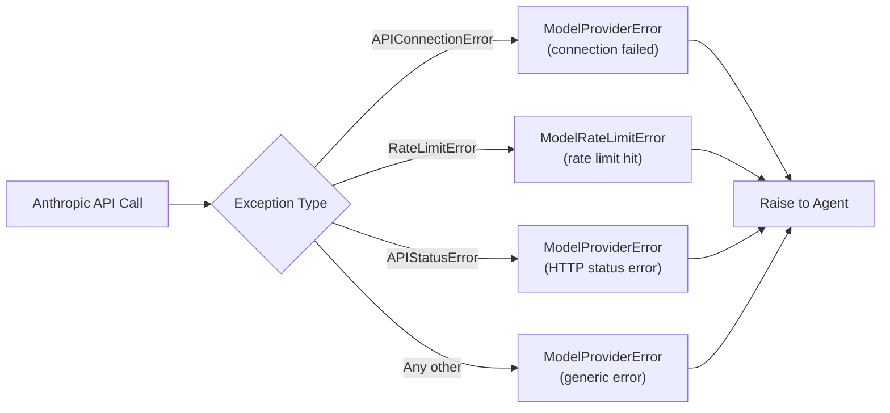
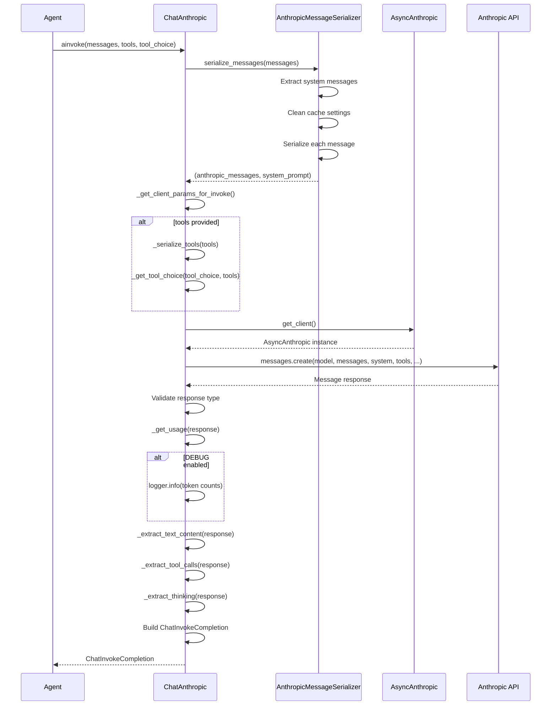

<!-- source: DeepWiki mcp.deepwiki.com · repo browser-use/agent-sdk · page 5.3 Provider Implementation: Anthropic · fetched 2026-10-30 -->

# Provider Implementation: Anthropic

<details>
<summary>Relevant source files</summary>

The following files were used as context for generating this wiki page:

- [bu_agent_sdk/llm/anthropic/chat.py](bu_agent_sdk/llm/anthropic/chat.py)
- [bu_agent_sdk/llm/anthropic/serializer.py](bu_agent_sdk/llm/anthropic/serializer.py)

</details>


This document provides a detailed technical reference for the Anthropic provider implementation in the bu_agent_sdk. It covers the `ChatAnthropic` class, message serialization, tool integration, prompt caching, and API communication patterns.

For the general provider abstraction interface, see [BaseChatModel Protocol](#5.1). For message serialization patterns across providers, see [Message Serialization](#5.4). For error handling patterns, see [Error Handling](#5.5).

## Purpose and Scope

The Anthropic provider implementation demonstrates how the SDK integrates with the Anthropic Claude API. This implementation serves as a reference for understanding:

- How `BaseChatModel` is implemented for a specific provider
- Provider-specific message serialization and deserialization
- Tool definition conversion and caching strategies
- Prompt caching integration
- Thinking protocol support (extended reasoning)
- Error handling and retry logic

## ChatAnthropic Class Structure

The `ChatAnthropic` class at [bu_agent_sdk/llm/anthropic/chat.py:37-346]() implements the `BaseChatModel` protocol for Anthropic's Claude models.

### Class Diagram



**Sources:** [bu_agent_sdk/llm/anthropic/chat.py:37-346](), [bu_agent_sdk/llm/anthropic/serializer.py:35-491]()

### Configuration Parameters

The `ChatAnthropic` class accepts the following configuration parameters:

| Parameter | Type | Default | Description |
|-----------|------|---------|-------------|
| `model` | `str \| ModelParam` | Required | Claude model identifier (e.g., "claude-3-5-sonnet-20241022") |
| `max_tokens` | `int` | 8192 | Maximum tokens in response |
| `temperature` | `float \| None` | None | Sampling temperature (0-1) |
| `top_p` | `float \| None` | None | Nucleus sampling parameter |
| `seed` | `int \| None` | None | Random seed for reproducibility |
| `api_key` | `str \| None` | None | Anthropic API key (defaults to ANTHROPIC_API_KEY env var) |
| `base_url` | `str \| httpx.URL \| None` | None | Override API base URL |
| `timeout` | `float \| Timeout \| None` | NotGiven() | Request timeout configuration |
| `max_retries` | `int` | 10 | Maximum retry attempts for failed requests |
| `prompt_cache_beta` | `str \| None` | "prompt-caching-2024-07-31" | Beta feature flag for prompt caching |
| `max_cached_tool_definitions` | `int` | 3 | Number of tool definitions to cache |

**Sources:** [bu_agent_sdk/llm/anthropic/chat.py:43-60]()

## Client Initialization

The `ChatAnthropic` class creates an `AsyncAnthropic` client instance configured with authentication and request parameters.



The `_get_client_params()` method at [bu_agent_sdk/llm/anthropic/chat.py:67-98]() constructs the client configuration:

1. **Headers Configuration**: Adds `anthropic-beta` header for prompt caching support [bu_agent_sdk/llm/anthropic/chat.py:72-78]()
2. **Parameter Filtering**: Removes `None` and `NotGiven()` values to use defaults [bu_agent_sdk/llm/anthropic/chat.py:93-96]()
3. **Client Creation**: Instantiates `AsyncAnthropic` with filtered parameters [bu_agent_sdk/llm/anthropic/chat.py:119-127]()

**Sources:** [bu_agent_sdk/llm/anthropic/chat.py:67-127]()

## The ainvoke Method Flow

The `ainvoke()` method at [bu_agent_sdk/llm/anthropic/chat.py:264-346]() orchestrates the complete request/response cycle with Anthropic's API.



**Sources:** [bu_agent_sdk/llm/anthropic/chat.py:264-346]()

### Request Preparation

The method prepares the API request in several steps:

1. **Message Serialization**: Converts SDK message types to Anthropic's `MessageParam` format [bu_agent_sdk/llm/anthropic/chat.py:282-284]()
2. **Invoke Parameters**: Gathers model parameters (temperature, max_tokens, etc.) [bu_agent_sdk/llm/anthropic/chat.py:287]()
3. **Tool Serialization**: Converts tool definitions if provided [bu_agent_sdk/llm/anthropic/chat.py:290-295]()
4. **API Call**: Invokes `messages.create()` with prepared parameters [bu_agent_sdk/llm/anthropic/chat.py:297-302]()

### Response Validation

After receiving a response, the method validates and processes it:

1. **Type Validation**: Ensures response is a valid `Message` object [bu_agent_sdk/llm/anthropic/chat.py:305-310]()
2. **Usage Extraction**: Calculates token usage including cache metrics [bu_agent_sdk/llm/anthropic/chat.py:312]()
3. **Debug Logging**: Logs token counts when `bu_agent_sdk_LLM_DEBUG` is enabled [bu_agent_sdk/llm/anthropic/chat.py:315-320]()

**Sources:** [bu_agent_sdk/llm/anthropic/chat.py:282-320]()

## Tool Serialization and Caching

The `_serialize_tools()` method at [bu_agent_sdk/llm/anthropic/chat.py:147-180]() converts SDK `ToolDefinition` objects to Anthropic's `ToolParam` format with intelligent caching.

### Tool Caching Strategy



**Why Cache Only Last N Tools?**

Anthropic's API has a limit of 4 cache blocks per request. The implementation caches only the last `max_cached_tool_definitions` tools (default: 3) to stay within this limit while ensuring the most recently added tools are cached. This is optimized for scenarios where tools are added incrementally during agent execution.

**Schema Preprocessing**

The method removes the `title` field from tool parameter schemas at [bu_agent_sdk/llm/anthropic/chat.py:158-160](), as Anthropic's API does not accept this field in the `input_schema`.

**Sources:** [bu_agent_sdk/llm/anthropic/chat.py:147-180]()

### Tool Choice Mapping

The `_get_tool_choice()` method at [bu_agent_sdk/llm/anthropic/chat.py:182-204]() maps SDK's generic `ToolChoice` values to Anthropic-specific formats:

| SDK ToolChoice | Anthropic Format | Description |
|----------------|------------------|-------------|
| `"auto"` | `ToolChoiceAutoParam(type="auto")` | Model decides whether to use tools |
| `"required"` | `ToolChoiceAnyParam(type="any")` | Model must use at least one tool |
| `"none"` | `ToolChoiceNoneParam(type="none")` | Model cannot use tools |
| `"<tool_name>"` | `ToolChoiceToolParam(type="tool", name=...)` | Model must use specific tool |

**Sources:** [bu_agent_sdk/llm/anthropic/chat.py:182-204]()

## Response Content Extraction

The `ChatAnthropic` class extracts three types of content from Anthropic responses: text, tool calls, and thinking.

### Content Type Extraction Flow



### Text Content Extraction

The `_extract_text_content()` method at [bu_agent_sdk/llm/anthropic/chat.py:234-242]() collects all `TextBlock` instances from the response and joins them with newlines.

**Sources:** [bu_agent_sdk/llm/anthropic/chat.py:234-242]()

### Tool Call Extraction

The `_extract_tool_calls()` method at [bu_agent_sdk/llm/anthropic/chat.py:206-232]() processes `ToolUseBlock` instances:

1. **Extract Tool Use Blocks**: Finds all blocks of type `ToolUseBlock` [bu_agent_sdk/llm/anthropic/chat.py:212-213]()
2. **Convert Arguments**: Serializes input dict to JSON string [bu_agent_sdk/llm/anthropic/chat.py:215-219]()
3. **Create ToolCall**: Constructs SDK's `ToolCall` object with id, function name, and arguments [bu_agent_sdk/llm/anthropic/chat.py:221-230]()

**Sources:** [bu_agent_sdk/llm/anthropic/chat.py:206-232]()

### Thinking Protocol Support

The `_extract_thinking()` method at [bu_agent_sdk/llm/anthropic/chat.py:244-262]() handles Claude's extended thinking capability:

- **ThinkingBlock**: Contains the model's reasoning process [bu_agent_sdk/llm/anthropic/chat.py:254-255]()
- **RedactedThinkingBlock**: Contains encrypted thinking data that was redacted by the model [bu_agent_sdk/llm/anthropic/chat.py:256-257]()

Both types are extracted and returned separately in the `ChatInvokeCompletion` object.

**Sources:** [bu_agent_sdk/llm/anthropic/chat.py:244-262]()

## Token Usage Calculation

The `_get_usage()` method at [bu_agent_sdk/llm/anthropic/chat.py:133-145]() constructs a `ChatInvokeUsage` object from Anthropic's response usage data.

### Usage Fields Mapping



**Note on Anthropic Token Counting**: Anthropic separates cache reads from input tokens, so `prompt_tokens` includes both `input_tokens` and `cache_read_input_tokens` to give the total prompt tokens processed [bu_agent_sdk/llm/anthropic/chat.py:135-138]().

**Sources:** [bu_agent_sdk/llm/anthropic/chat.py:133-145]()

## Prompt Caching Implementation

Anthropic's prompt caching feature allows frequently reused context to be cached, reducing latency and costs. The SDK implements caching at multiple levels.

### Cache Control Placement



### Cache Cleaning Strategy

The `AnthropicMessageSerializer._clean_cache_messages()` method at [bu_agent_sdk/llm/anthropic/serializer.py:411-446]() implements an optimization: since Claude's caching only retains the last cache breakpoint, only the final message with `cache=True` should actually be cached.

**Algorithm**:
1. Iterate messages backwards to find the last message with `cache=True` [bu_agent_sdk/llm/anthropic/serializer.py:433-437]()
2. Disable caching on all other messages [bu_agent_sdk/llm/anthropic/serializer.py:440-444]()
3. Return cleaned messages

This prevents unnecessary cache breakpoints while preserving the caching benefit.

**Sources:** [bu_agent_sdk/llm/anthropic/chat.py:59-60](), [bu_agent_sdk/llm/anthropic/serializer.py:411-446]()

## Message Serialization Overview

The `AnthropicMessageSerializer` class at [bu_agent_sdk/llm/anthropic/serializer.py:35-491]() handles conversion between SDK message types and Anthropic's API format. For detailed serialization logic, see [Message Serialization](#5.4).

### Key Serialization Methods

| Method | Purpose |
|--------|---------|
| `serialize(message)` | Converts a single `BaseMessage` to `MessageParam` |
| `serialize_messages(messages)` | Serializes message list, extracting system messages |
| `_serialize_content(content)` | Converts content parts to Anthropic block format |
| `_serialize_tool_calls_to_content(tool_calls)` | Converts tool calls to `ToolUseBlockParam` |
| `_serialize_tool_message(message)` | Converts tool results to `ToolResultBlockParam` |

### System Message Handling

Anthropic does not support system messages in the conversation array. The serializer extracts `SystemMessage` and `DeveloperMessage` instances and returns them separately at [bu_agent_sdk/llm/anthropic/serializer.py:449-490]():

```python
# Returns: (messages, system_message)
anthropic_messages, system_prompt = AnthropicMessageSerializer.serialize_messages(messages)
```

The `system_prompt` is then passed as the `system` parameter in the API call [bu_agent_sdk/llm/anthropic/chat.py:300]().

**Sources:** [bu_agent_sdk/llm/anthropic/serializer.py:35-491](), [bu_agent_sdk/llm/anthropic/chat.py:282-284]()

## Error Handling

The `ainvoke()` method implements comprehensive error handling with provider-specific exceptions at [bu_agent_sdk/llm/anthropic/chat.py:336-345]().

### Exception Mapping



### Error Types Handled

1. **APIConnectionError**: Network connection failures [bu_agent_sdk/llm/anthropic/chat.py:336-337]()
2. **RateLimitError**: Rate limit exceeded, converted to `ModelRateLimitError` for retry logic [bu_agent_sdk/llm/anthropic/chat.py:338-339]()
3. **APIStatusError**: HTTP status errors (4xx, 5xx) with status code preserved [bu_agent_sdk/llm/anthropic/chat.py:340-343]()
4. **Generic Exceptions**: Catch-all for unexpected errors [bu_agent_sdk/llm/anthropic/chat.py:344-345]()

All exceptions are wrapped in SDK error types (`ModelProviderError` or `ModelRateLimitError`) to provide a consistent error interface across providers. See [Error Handling](#5.5) for details on retry mechanisms.

**Sources:** [bu_agent_sdk/llm/anthropic/chat.py:336-345]()

## Debug Logging

When the `bu_agent_sdk_LLM_DEBUG` environment variable is set, the provider logs detailed token usage information after each API call at [bu_agent_sdk/llm/anthropic/chat.py:315-320]():

```
📊 claude-3-5-sonnet-20241022: 1,234 in + 567 cached + 89 out
```

This logging helps debug token consumption and caching effectiveness during development.

**Sources:** [bu_agent_sdk/llm/anthropic/chat.py:314-320]()

## Complete Request/Response Cycle



**Sources:** [bu_agent_sdk/llm/anthropic/chat.py:264-346](), [bu_agent_sdk/llm/anthropic/serializer.py:449-490]()

---

