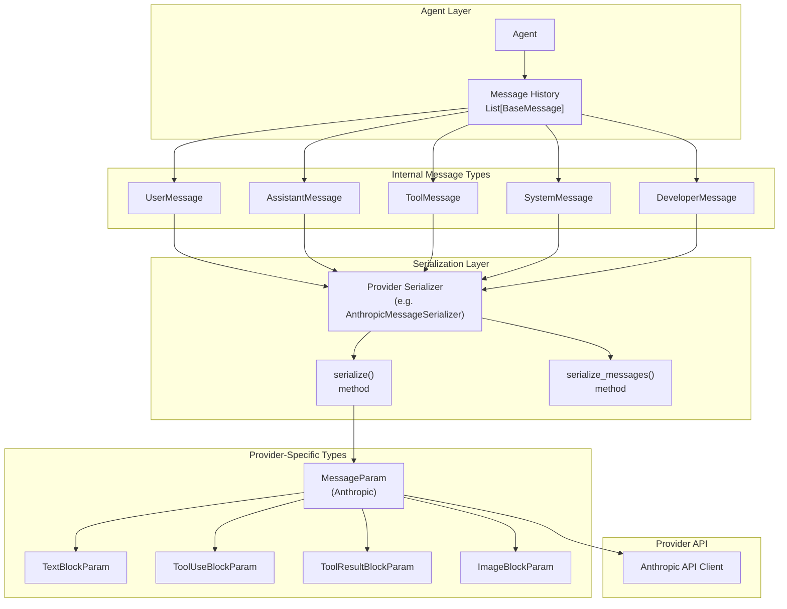
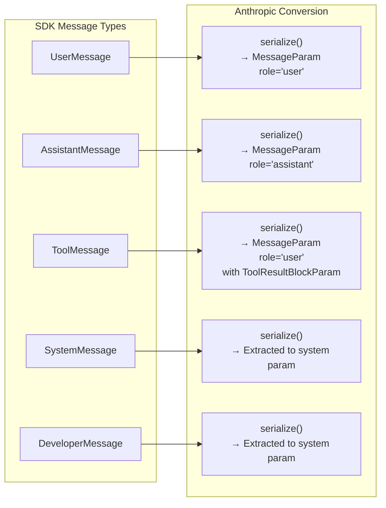
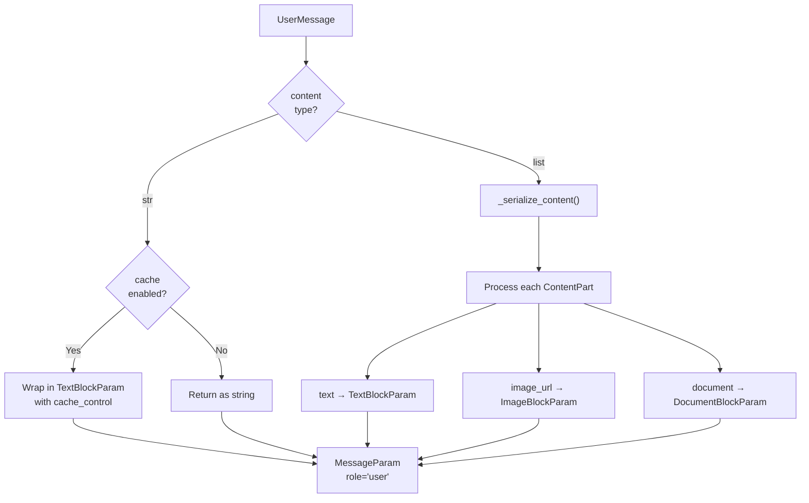
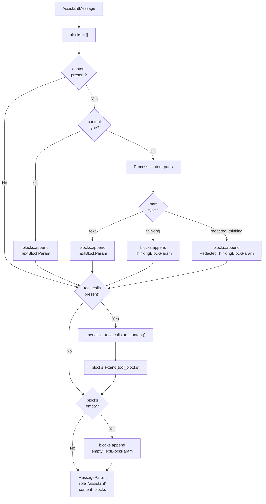
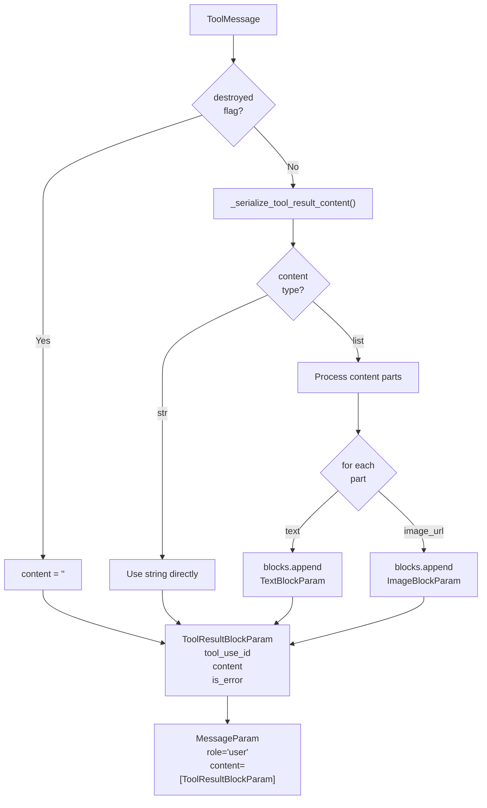
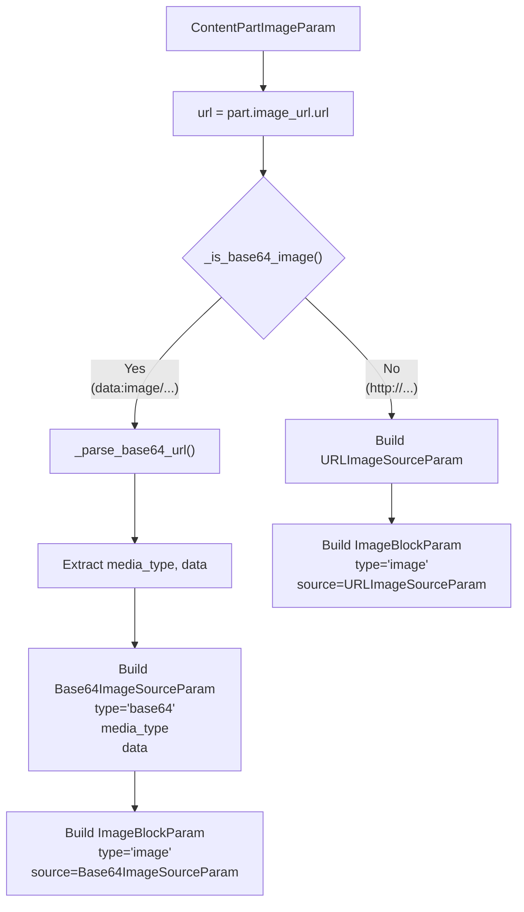
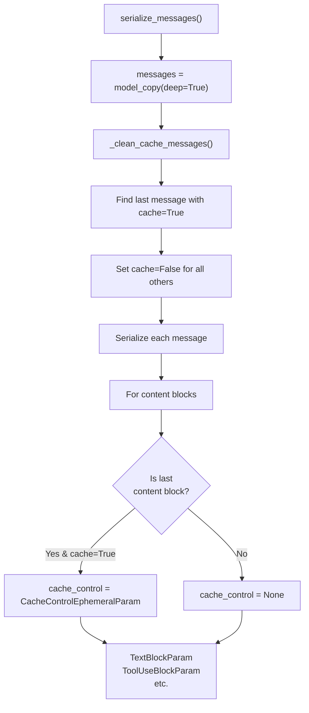
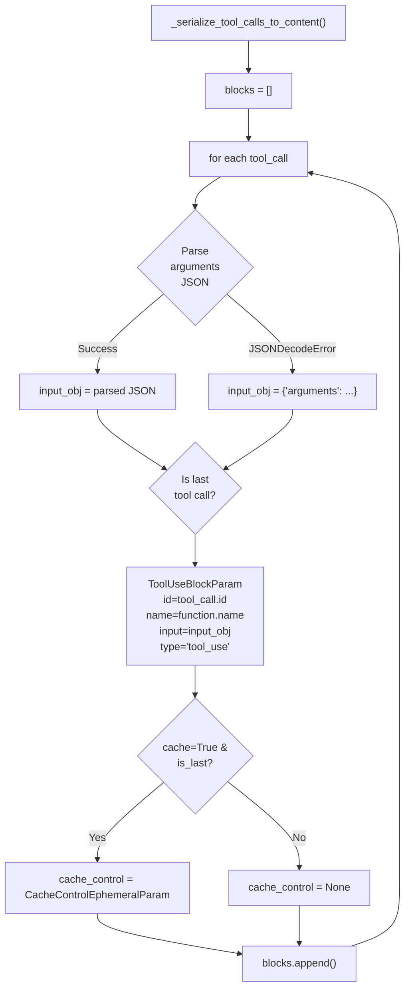
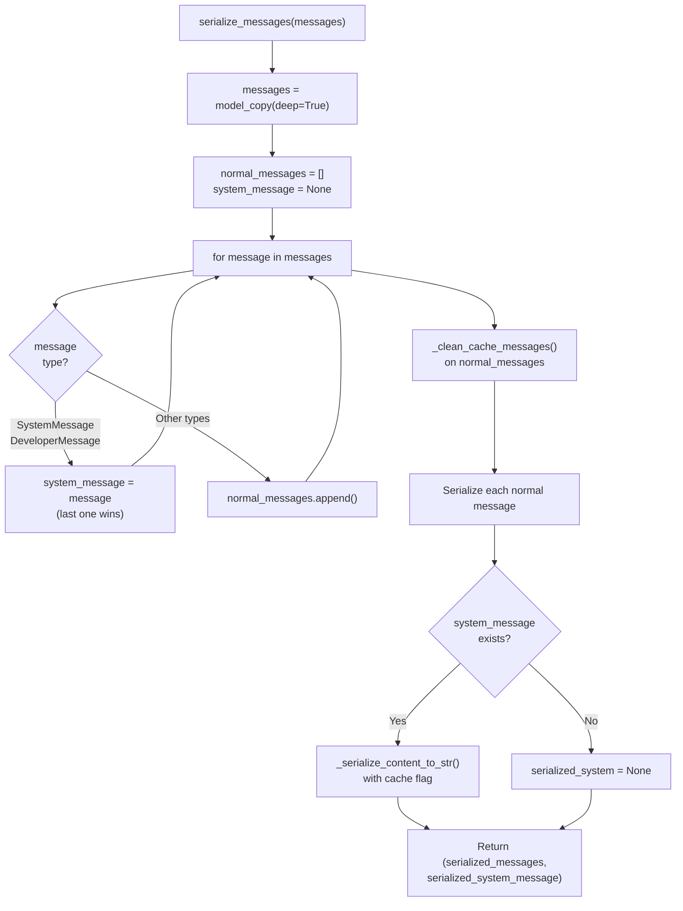

<!-- source: DeepWiki mcp.deepwiki.com · repo browser-use/agent-sdk · page 5.4 Message Serialization · fetched 2026-10-30 -->

# Message Serialization

Relevant source files

The following files were used as context for generating this wiki page:

- [bu_agent_sdk/llm/__init__.py](bu_agent_sdk/llm/__init__.py)
- [bu_agent_sdk/llm/anthropic/serializer.py](bu_agent_sdk/llm/anthropic/serializer.py)

## Purpose and Scope

Message serialization is the process of converting the SDK's unified internal message types (`UserMessage`, `AssistantMessage`, `ToolMessage`, etc.) into provider-specific API formats. Each LLM provider has its own message schema, parameter names, and structural requirements. The serialization layer handles these transformations transparently.

This document focuses on the serialization architecture and uses `AnthropicMessageSerializer` as a reference implementation. For information about the base message types, see [BaseChatModel Protocol](#5.1). For provider-specific implementations, see [Supported Providers](#5.2) and [Provider Implementation: Anthropic](#5.3).

**Sources:** [bu_agent_sdk/llm/anthropic/serializer.py:1-491]()

## Architecture Overview

The serialization layer sits between the Agent's unified message interface and each provider's API client. Each provider implements its own serializer that transforms SDK message types into the provider's expected format.

**Sources:** [bu_agent_sdk/llm/anthropic/serializer.py:35-491]()

## The AnthropicMessageSerializer

The `AnthropicMessageSerializer` class provides a comprehensive reference implementation. It demonstrates all the common patterns used in message serialization across providers.

### Key Methods

| Method | Purpose | Returns |
|--------|---------|---------|
| `serialize()` | Converts a single `BaseMessage` to provider format | `MessageParam \| SystemMessage \| DeveloperMessage` |
| `serialize_messages()` | Converts message list, extracts system messages | `tuple[list[MessageParam], list[TextBlockParam] \| str \| None]` |
| `_serialize_content()` | Converts content parts to provider blocks | `str \| list[TextBlockParam \| ImageBlockParam \| DocumentBlockParam]` |
| `_serialize_tool_calls_to_content()` | Converts tool calls to `ToolUseBlockParam` | `list[ToolUseBlockParam]` |
| `_serialize_tool_message()` | Converts `ToolMessage` to `ToolResultBlockParam` | `ToolResultBlockParam` |

**Sources:** [bu_agent_sdk/llm/anthropic/serializer.py:35-491]()

## Message Type Conversion

Each message type follows a specific conversion pattern based on the provider's API requirements.

**Sources:** [bu_agent_sdk/llm/anthropic/serializer.py:257-409]()

### UserMessage Serialization

`UserMessage` objects are converted to provider messages with `role="user"`. The content field is serialized using `_serialize_content()`.

**Sources:** [bu_agent_sdk/llm/anthropic/serializer.py:287-291](), [bu_agent_sdk/llm/anthropic/serializer.py:146-185]()

### AssistantMessage Serialization

`AssistantMessage` objects contain content (text, thinking) and/or tool calls. Both are serialized into content blocks.

**Sources:** [bu_agent_sdk/llm/anthropic/serializer.py:310-406]()

### ToolMessage Serialization

`ToolMessage` objects are converted to `user` role messages containing `ToolResultBlockParam` blocks. For Anthropic, tool results are always sent as user messages.

**Sources:** [bu_agent_sdk/llm/anthropic/serializer.py:234-255](), [bu_agent_sdk/llm/anthropic/serializer.py:303-308]()

### SystemMessage and DeveloperMessage Handling

Anthropic handles system prompts differently from conversation messages. `SystemMessage` and `DeveloperMessage` objects are not serialized into the message array but are instead extracted and passed as a separate `system` parameter to the API.

**Sources:** [bu_agent_sdk/llm/anthropic/serializer.py:293-301](), [bu_agent_sdk/llm/anthropic/serializer.py:448-490]()

## Content Part Serialization

Content parts represent multimodal elements within messages. Each part type requires specific serialization logic.

### Content Part Types

| SDK Type | Anthropic Type | Handler Method |
|----------|----------------|----------------|
| `ContentPartTextParam` | `TextBlockParam` | `_serialize_content_part_text()` |
| `ContentPartImageParam` | `ImageBlockParam` | `_serialize_content_part_image()` |
| `ContentPartDocumentParam` | `DocumentBlockParam` | `_serialize_content_part_document()` |
| `ContentPartThinkingParam` | `ThinkingBlockParam` | Direct conversion in serialize() |
| `ContentPartRedactedThinkingParam` | `RedactedThinkingBlockParam` | Direct conversion in serialize() |

**Sources:** [bu_agent_sdk/llm/anthropic/serializer.py:68-185]()

### Image Serialization

Images can be provided as base64 data URLs or external URLs. The serializer detects the format and converts accordingly.

**Sources:** [bu_agent_sdk/llm/anthropic/serializer.py:39-101]()

### Document Serialization

Documents (currently PDF only) are serialized as base64-encoded content.

**Sources:** [bu_agent_sdk/llm/anthropic/serializer.py:103-115]()

## Cache Control Management

Anthropic's prompt caching feature allows expensive computations to be cached at specific message boundaries. The SDK's `cache` flag on messages is translated to `cache_control` parameters.

### Caching Rules

1. Only the **last** message with `cache=True` actually gets cached
2. Cache control is applied to the **last content block** within a message
3. Tool calls take precedence: if tool calls exist, they get the cache control, not text content

**Sources:** [bu_agent_sdk/llm/anthropic/serializer.py:411-446](), [bu_agent_sdk/llm/anthropic/serializer.py:62-79]()

## Tool Call Serialization

Tool calls in `AssistantMessage` objects are converted to `ToolUseBlockParam` blocks. The arguments (stored as JSON strings) are parsed into objects.

**Sources:** [bu_agent_sdk/llm/anthropic/serializer.py:187-214]()

## System Message Extraction

The `serialize_messages()` method handles the complete conversion flow, including extracting system/developer messages from the message list.

This method returns a tuple where:
- First element: List of serialized conversation messages
- Second element: Serialized system prompt (or `None`)

The caller (e.g., `ChatAnthropic.ainvoke()`) uses the second element as the `system` parameter in the API call.

**Sources:** [bu_agent_sdk/llm/anthropic/serializer.py:448-490]()

## Provider-Specific Considerations

While `AnthropicMessageSerializer` demonstrates the general patterns, each provider has unique requirements:

| Provider | Key Differences |
|----------|-----------------|
| **Anthropic** | System messages extracted to `system` param; tool results in user messages |
| **OpenAI** | System messages in message array; tool results have `role="tool"` |
| **Google** | Different content part structure; system messages may be converted to user messages |
| **Groq** | Similar to OpenAI but may have different token limits |

Each provider implements its own serializer class following similar patterns but adapted to that provider's API specification.

**Sources:** [bu_agent_sdk/llm/anthropic/serializer.py:1-491](), [bu_agent_sdk/llm/__init__.py:1-194]()

---

