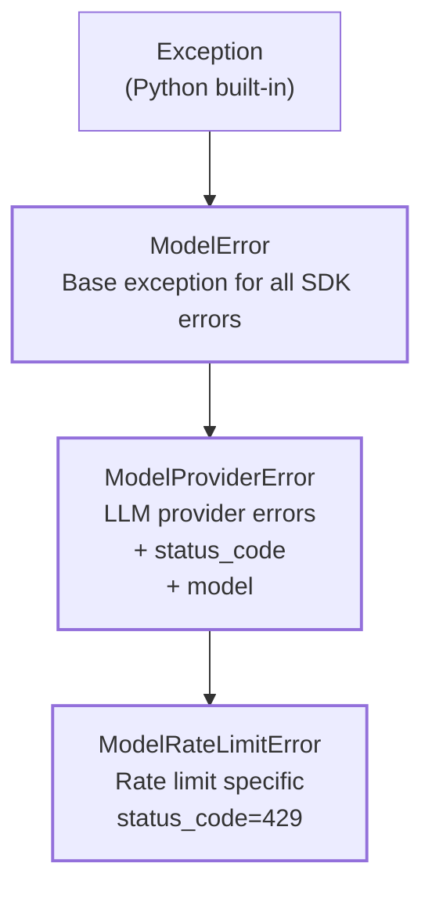
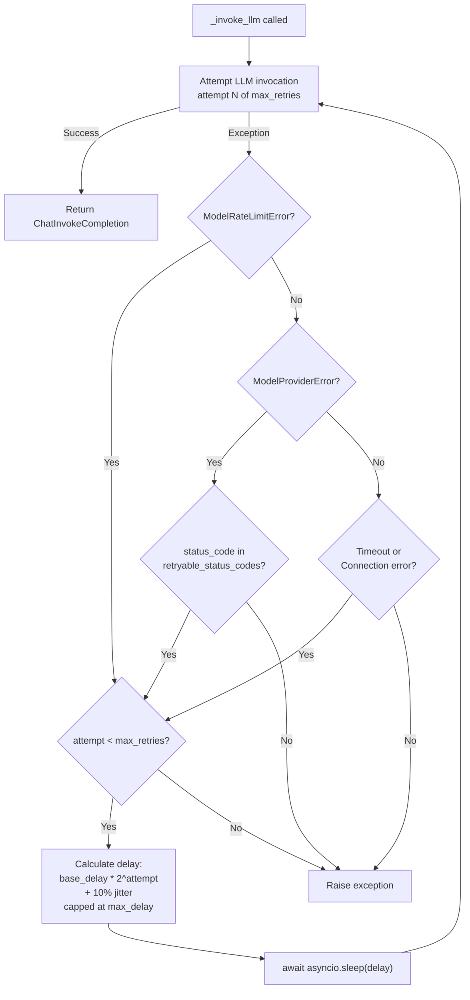
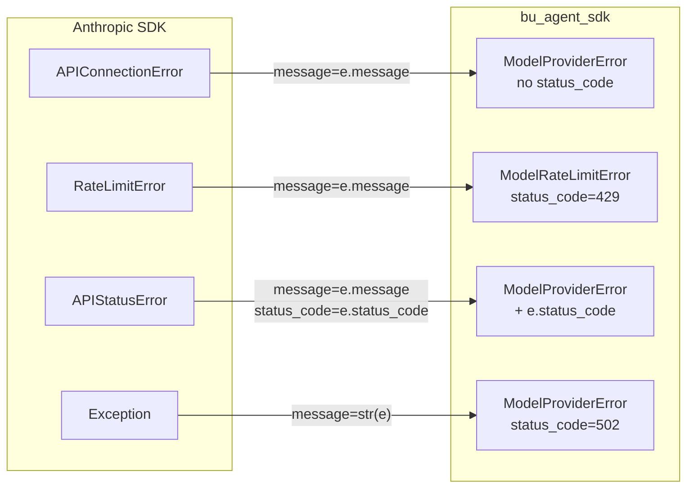
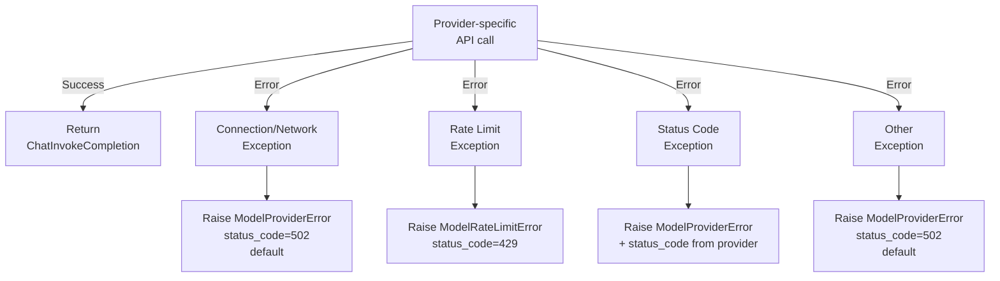
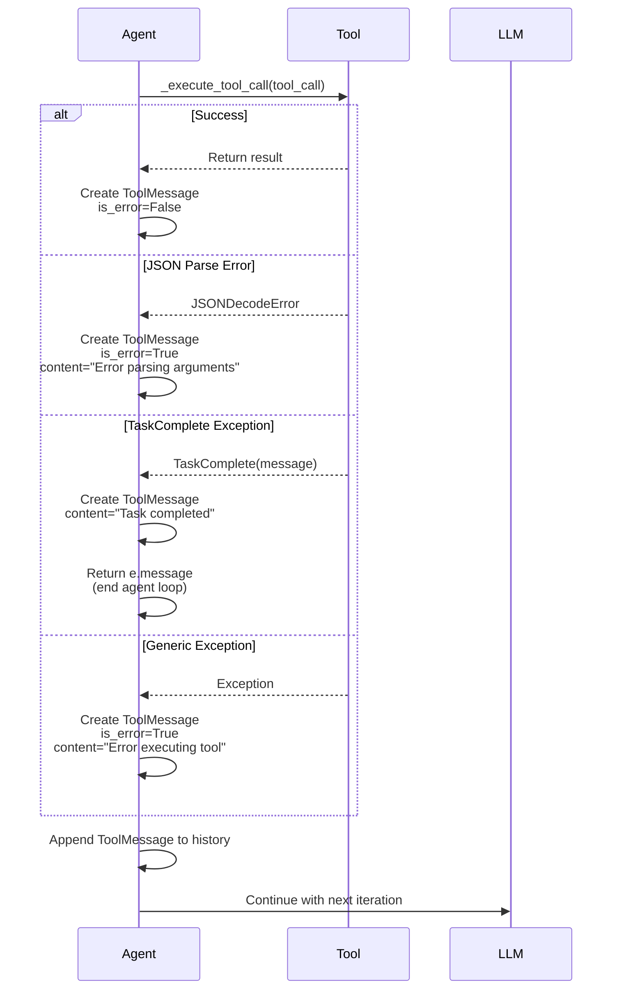

<!-- source: DeepWiki mcp.deepwiki.com · repo browser-use/agent-sdk · page 5.5 Error Handling · fetched 2026-10-30 -->

# Error Handling

<details>
<summary>Relevant source files</summary>

The following files were used as context for generating this wiki page:

- [bu_agent_sdk/agent/service.py](bu_agent_sdk/agent/service.py)
- [bu_agent_sdk/llm/anthropic/chat.py](bu_agent_sdk/llm/anthropic/chat.py)
- [bu_agent_sdk/llm/exceptions.py](bu_agent_sdk/llm/exceptions.py)

</details>


This page documents the error handling system in the bu_agent_sdk, including the exception hierarchy, retry mechanisms, and error translation from LLM providers. The SDK implements a multi-layered error handling approach with automatic retries for transient failures.

For information about the `TaskComplete` exception used for agent task completion, see [TaskComplete Pattern](#2.4). For details on LLM provider implementations, see [Supported Providers](#5.2).

---

## Exception Hierarchy

The SDK defines a three-level exception hierarchy in [bu_agent_sdk/llm/exceptions.py:1-30]():



**Sources:** [bu_agent_sdk/llm/exceptions.py:1-30]()

### ModelError

The base exception class for all SDK-related errors. This allows applications to catch all SDK exceptions with a single handler:

```python
try:
    response = await agent.query("task")
except ModelError as e:
    # Handle any SDK error
    pass
```

**Sources:** [bu_agent_sdk/llm/exceptions.py:1-2]()

### ModelProviderError

Raised when an LLM provider returns an error. Contains three key attributes:

| Attribute | Type | Default | Description |
|-----------|------|---------|-------------|
| `message` | `str` | Required | Human-readable error description |
| `status_code` | `int` | `502` | HTTP status code (or equivalent) |
| `model` | `str \| None` | `None` | Model name that generated the error |

The `status_code` attribute is used by the agent's retry logic to determine if an error is retryable.

**Sources:** [bu_agent_sdk/llm/exceptions.py:5-17]()

### ModelRateLimitError

A specialized subclass of `ModelProviderError` for rate limit errors. Always sets `status_code=429` and is always retryable with exponential backoff.

**Sources:** [bu_agent_sdk/llm/exceptions.py:20-29]()

---

## Agent-Level Retry Logic

The `Agent` class implements automatic retry logic with exponential backoff for LLM invocations in the `_invoke_llm` method.

### Retry Configuration

The agent exposes five configuration parameters for retry behavior:

| Parameter | Type | Default | Description |
|-----------|------|---------|-------------|
| `llm_max_retries` | `int` | `5` | Maximum retry attempts |
| `llm_retry_base_delay` | `float` | `1.0` | Initial delay in seconds |
| `llm_retry_max_delay` | `float` | `60.0` | Maximum delay cap |
| `llm_retryable_status_codes` | `set[int]` | `{429, 500, 502, 503, 504}` | Status codes that trigger retries |

**Sources:** [bu_agent_sdk/agent/service.py:135-144]()

### Retry Flow



**Sources:** [bu_agent_sdk/agent/service.py:436-532]()

### Retry Categories

The retry logic handles three categories of errors:

#### 1. Rate Limit Errors (`ModelRateLimitError`)

Always retryable. These are explicitly raised by providers when the rate limit is exceeded.

```python
except ModelRateLimitError as e:
    last_error = e
    if attempt < self.llm_max_retries - 1:
        delay = min(
            self.llm_retry_base_delay * (2**attempt),
            self.llm_retry_max_delay,
        )
        jitter = random.uniform(0, delay * 0.1)  # 10% jitter
        total_delay = delay + jitter
        logger.warning(
            f"⚠️ Got rate limit error, retrying in {total_delay:.1f}s... "
            f"(attempt {attempt + 1}/{self.llm_max_retries})"
        )
        await asyncio.sleep(total_delay)
        continue
    raise
```

**Sources:** [bu_agent_sdk/agent/service.py:457-475]()

#### 2. Provider Errors with Retryable Status Codes

`ModelProviderError` instances are retried only if their `status_code` is in `llm_retryable_status_codes` (default: 429, 500, 502, 503, 504).

```python
except ModelProviderError as e:
    last_error = e
    # Check if status code is retryable
    is_retryable = (
        hasattr(e, "status_code")
        and e.status_code in self.llm_retryable_status_codes
    )
    if is_retryable and attempt < self.llm_max_retries - 1:
        # ... calculate delay and retry
    # Non-retryable or exhausted retries
    raise
```

**Sources:** [bu_agent_sdk/agent/service.py:477-500]()

#### 3. Timeout and Connection Errors

Generic exceptions are inspected for timeout or connection-related error messages and retried if detected:

```python
except Exception as e:
    last_error = e
    error_message = str(e).lower()
    is_timeout = "timeout" in error_message or "cancelled" in error_message
    is_connection_error = (
        "connection" in error_message or "connect" in error_message
    )

    if (is_timeout or is_connection_error) and attempt < self.llm_max_retries - 1:
        # ... retry with backoff
    # Non-retryable error
    raise
```

**Sources:** [bu_agent_sdk/agent/service.py:502-528]()

### Exponential Backoff with Jitter

The delay calculation uses exponential backoff with 10% random jitter to prevent thundering herd:

```
delay = min(base_delay * (2^attempt), max_delay)
jitter = random.uniform(0, delay * 0.1)
total_delay = delay + jitter
```

**Example delays** with default configuration (`base_delay=1.0`, `max_delay=60.0`):

| Attempt | Base Delay | Max with Jitter |
|---------|------------|-----------------|
| 0 | 1.0s | ~1.1s |
| 1 | 2.0s | ~2.2s |
| 2 | 4.0s | ~4.4s |
| 3 | 8.0s | ~8.8s |
| 4 | 16.0s | ~17.6s |
| 5 | 32.0s | ~35.2s |
| 6+ | 60.0s | ~66.0s |

**Sources:** [bu_agent_sdk/agent/service.py:461-468](), [bu_agent_sdk/agent/service.py:485-491](), [bu_agent_sdk/agent/service.py:514-519]()

---

## Provider Error Translation

Each LLM provider implementation translates provider-specific exceptions into the SDK's exception hierarchy. This ensures consistent error handling across all providers.

### Anthropic Error Translation

The `ChatAnthropic` class catches Anthropic SDK exceptions and translates them:



**Implementation:**

```python
try:
    response = await self.get_client().messages.create(...)
    # ... process response
except APIConnectionError as e:
    raise ModelProviderError(message=e.message, model=self.name) from e
except RateLimitError as e:
    raise ModelRateLimitError(message=e.message, model=self.name) from e
except APIStatusError as e:
    raise ModelProviderError(
        message=e.message, status_code=e.status_code, model=self.name
    ) from e
except Exception as e:
    raise ModelProviderError(message=str(e), model=self.name) from e
```

**Sources:** [bu_agent_sdk/llm/anthropic/chat.py:336-345]()

### Error Translation Pattern

All provider implementations follow this pattern:



This ensures that:
1. All providers raise consistent exception types
2. Rate limits are always identifiable via `ModelRateLimitError`
3. Retryable status codes are preserved
4. Original error context is preserved via exception chaining (`from e`)

**Sources:** [bu_agent_sdk/llm/anthropic/chat.py:264-345]()

---

## Tool Execution Error Handling

Tool execution errors are handled separately from LLM invocation errors. When a tool raises an exception, it is caught and converted to a `ToolMessage` with `is_error=True`, allowing the agent loop to continue.

### Tool Error Flow



**Sources:** [bu_agent_sdk/agent/service.py:300-393]()

### Error Message Creation

The `_execute_tool_call` method creates appropriate error `ToolMessage` instances:

| Error Type | `is_error` | Content Format | Action |
|------------|------------|----------------|--------|
| Unknown tool | `True` | `"Error: Unknown tool '{tool_name}'"` | Continue loop |
| JSON parse error | `True` | `"Error parsing arguments: {error}"` | Continue loop |
| Tool exception | `True` | `"Error executing tool: {error}"` | Continue loop |
| `TaskComplete` | `False` | `"Task completed: {message}"` | Exit loop immediately |

**Example error handling:**

```python
try:
    # Parse arguments
    args = json.loads(tool_call.function.arguments)
    
    # Execute the tool
    result = await tool.execute(_overrides=self.dependency_overrides, **args)
    
    tool_message = ToolMessage(
        tool_call_id=tool_call.id,
        tool_name=tool_name,
        content=result,
        is_error=False,
    )
    return tool_message

except json.JSONDecodeError as e:
    error_msg = f"Error parsing arguments: {e}"
    return ToolMessage(
        tool_call_id=tool_call.id,
        tool_name=tool_name,
        content=error_msg,
        is_error=True,
    )
except TaskComplete as e:
    # Re-raised after span closes
    task_complete_exception = e
except Exception as e:
    error_msg = f"Error executing tool: {e}"
    return ToolMessage(
        tool_call_id=tool_call.id,
        tool_name=tool_name,
        content=error_msg,
        is_error=True,
    )
```

**Sources:** [bu_agent_sdk/agent/service.py:331-386]()

### Error Observability

Tool errors are logged to Laminar observability spans when available:

```python
if Laminar is not None:
    span_context = Laminar.start_as_current_span(
        name=tool_name,
        input={"tool": tool_name, "arguments": tool_call.function.arguments},
        span_type="TOOL",
    )
else:
    span_context = nullcontext()

with span_context:
    try:
        # ... execute tool
        if Laminar is not None:
            Laminar.set_span_output({"result": result[:500]})
    except Exception as e:
        if Laminar is not None:
            Laminar.set_span_output({"error": error_msg})
        return error_tool_message
```

This ensures tool errors are visible in the observability system for debugging.

**Sources:** [bu_agent_sdk/agent/service.py:314-324](), [bu_agent_sdk/agent/service.py:350-365](), [bu_agent_sdk/agent/service.py:379-380]()

---

## Error Handling Best Practices

### Catching Errors in Application Code

Applications should catch errors at the appropriate level:

```python
from bu_agent_sdk.llm.exceptions import ModelError, ModelRateLimitError

try:
    response = await agent.query("Complete this task")
except ModelRateLimitError:
    # Rate limit - already retried 5 times
    # Notify user to try again later
    pass
except ModelError as e:
    # Any other SDK error
    # Log details: e.message, e.status_code, e.model
    pass
```

### Configuring Retry Behavior

Adjust retry parameters based on application requirements:

```python
# Conservative retries for production
agent = Agent(
    llm=llm,
    tools=tools,
    llm_max_retries=3,
    llm_retry_base_delay=2.0,
    llm_retry_max_delay=30.0,
)

# Aggressive retries for batch processing
agent = Agent(
    llm=llm,
    tools=tools,
    llm_max_retries=10,
    llm_retry_max_delay=120.0,
    llm_retryable_status_codes={429, 500, 502, 503, 504, 408},  # Add 408 timeout
)
```

### Monitoring Retry Events

Enable debug logging to monitor retry behavior:

```python
import logging
logging.getLogger("bu_agent_sdk.agent").setLevel(logging.WARNING)

# Logs will show:
# ⚠️ Got rate limit error, retrying in 2.1s... (attempt 1/5)
# ⚠️ Got 503 error, retrying in 4.3s... (attempt 2/5)
```

**Sources:** [bu_agent_sdk/agent/service.py:469-472](), [bu_agent_sdk/agent/service.py:493-496](), [bu_agent_sdk/agent/service.py:521-524]()

---

