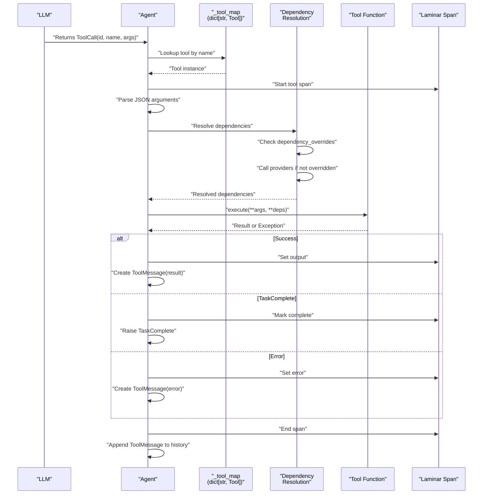
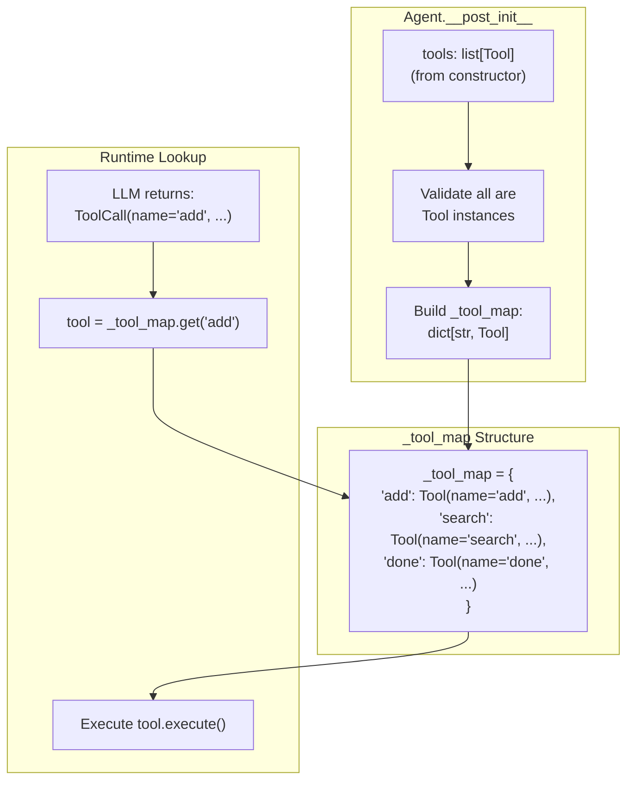
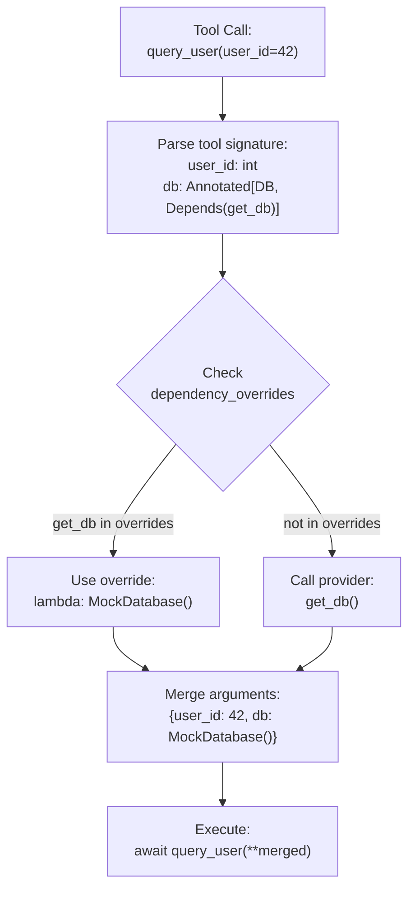
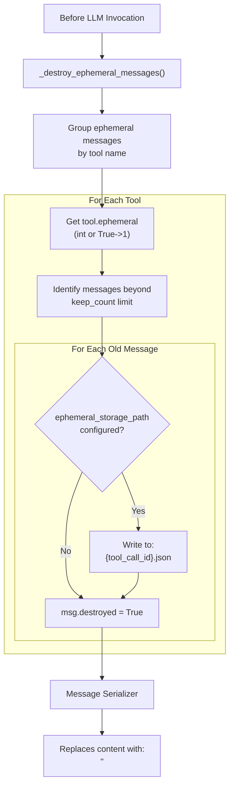
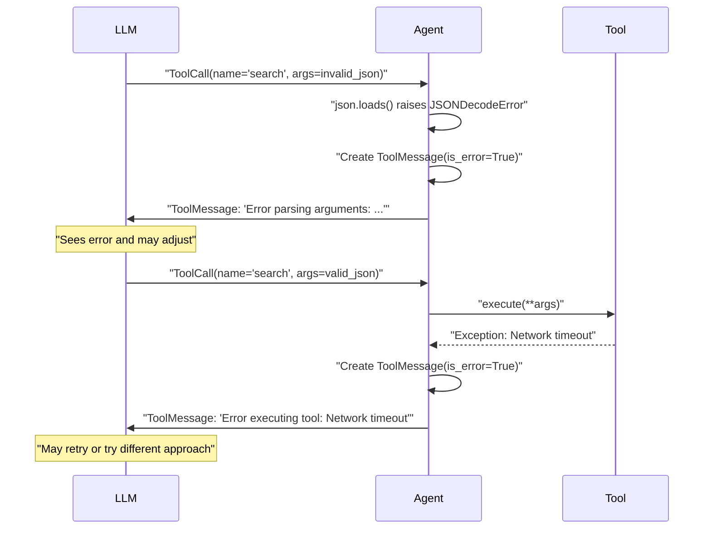
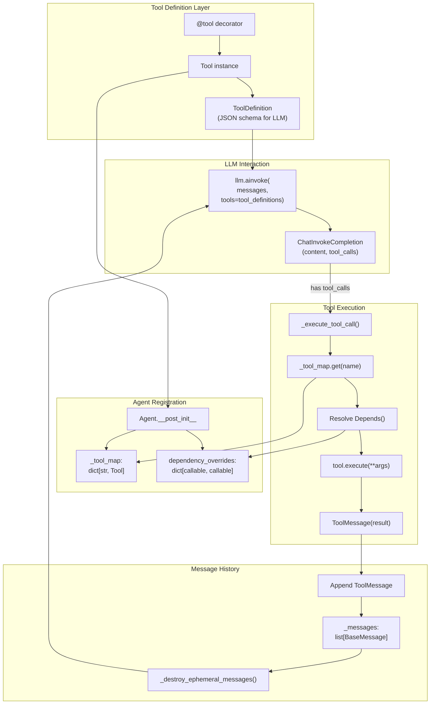

<!-- source: DeepWiki mcp.deepwiki.com · repo browser-use/agent-sdk · page 6 Tool System · fetched 2026-10-30 -->

# Tool System

<details>
<summary>Relevant source files</summary>

The following files were used as context for generating this wiki page:

- [README.md](README.md)
- [bu_agent_sdk/agent/README.md](bu_agent_sdk/agent/README.md)
- [bu_agent_sdk/agent/service.py](bu_agent_sdk/agent/service.py)

</details>


## Purpose and Scope

The Tool System enables LLMs to execute arbitrary Python functions with type-safe parameters and dependency injection. Tools are defined using the `@tool` decorator and automatically exposed to the LLM as callable functions during agent execution.

This page covers tool definition, parameter types, execution flow, and dependency injection. For information about signaling task completion, see [TaskComplete Pattern](#2.4). For message handling and state management, see [Message History and State](#2.3).

**Sources:** [README.md:1-256](), [bu_agent_sdk/agent/README.md:1-90]()

---

## Tool Definition with @tool Decorator

Tools are defined by decorating async functions with `@tool`. The decorator extracts function metadata (name, description, parameters) and converts it into a `ToolDefinition` that the LLM can understand.

```python
from bu_agent_sdk import tool

@tool("Add two numbers")
async def add(a: int, b: int) -> int:
    return a + b
```

The decorator:
1. Captures the function description from the first argument
2. Extracts parameter types from type annotations
3. Converts the function into a `Tool` instance
4. Registers parameter validation and dependency injection

**Key characteristics:**
- Tools must be async functions (`async def`)
- Return values are converted to strings for the LLM
- Type annotations are required for parameters
- Description is used by the LLM to understand when to call the tool

**Sources:** [README.md:28-30](), [bu_agent_sdk/agent/README.md:7-20]()

---

## Tool Parameters

### Simple Parameters

Tools accept Python primitives with type annotations. The LLM receives a JSON schema describing these parameters and provides arguments accordingly.

```python
@tool("Search for information")
async def search(query: str, max_results: int = 10) -> str:
    return f"Searching for '{query}' (limit: {max_results})"
```

**Sources:** [bu_agent_sdk/agent/README.md:13-14]()

### Pydantic Models

Complex parameters can be grouped into Pydantic models. This provides validation, nested structures, and field descriptions:

```python
from pydantic import BaseModel, Field

class EmailParams(BaseModel):
    to: str = Field(description="Recipient email address")
    subject: str
    body: str

@tool("Send an email")
async def send_email(params: EmailParams) -> str:
    return f"Sent to {params.to}"
```

The LLM receives a structured schema for `EmailParams` and provides a nested JSON object that is automatically validated and parsed.

**Sources:** [bu_agent_sdk/agent/README.md:42-56]()

### Dependency Injection with Depends

Tools can declare dependencies using `Annotated[Type, Depends(provider)]`. Dependencies are resolved at execution time and not exposed to the LLM.

```python
from typing import Annotated
from bu_agent_sdk import Depends

def get_db() -> Database:
    return Database()

@tool("Query database")
async def query_user(
    user_id: int,  # LLM provides this
    db: Annotated[Database, Depends(get_db)]  # Agent injects this
) -> str:
    return await db.find(user_id)
```

**Dependency providers** are callable functions that return instances. The Agent can override providers via `dependency_overrides`:

```python
agent = Agent(
    llm=llm,
    tools=[query_user],
    dependency_overrides={
        get_db: lambda: MockDatabase()  # Override for testing
    }
)
```

**Sources:** [README.md:109-123](), [bu_agent_sdk/agent/README.md:58-72]()

---

## Tool Execution Flow



**Execution steps** [bu_agent_sdk/agent/service.py:300-393]():

1. **Tool Lookup**: Agent queries `_tool_map` with tool name from LLM's ToolCall
2. **Span Creation**: If Laminar is available, create observability span [314-324]()
3. **Argument Parsing**: Parse JSON arguments from ToolCall [332]()
4. **Dependency Resolution**: Resolve any `Depends()` parameters (see next section)
5. **Execution**: Call `tool.execute()` with both LLM args and injected deps [335-337]()
6. **Result Handling**:
   - Success: Create `ToolMessage` with result [342-348]()
   - TaskComplete: Set span output and re-raise after span closes [372-390]()
   - Error: Create `ToolMessage` with error flag [362-386]()
7. **Span Closure**: Close observability span cleanly
8. **History Update**: Append ToolMessage to conversation history

**Sources:** [bu_agent_sdk/agent/service.py:300-393]()

---

## Tool Registry

The Agent maintains an internal registry mapping tool names to Tool instances.



**Registry initialization** [bu_agent_sdk/agent/service.py:152-160]():

```python
def __post_init__(self):
    # Validate that all tools are Tool instances
    for t in self.tools:
        assert isinstance(t, Tool), (
            f"Expected Tool instance, got {type(t).__name__}. "
            f"Did you forget to use the @tool decorator?"
        )
    
    # Build tool lookup map
    self._tool_map = {t.name: t for t in self.tools}
```

**Tool lookup during execution** [bu_agent_sdk/agent/service.py:301-311]():

```python
async def _execute_tool_call(self, tool_call: ToolCall) -> ToolMessage:
    tool_name = tool_call.function.name
    tool = self._tool_map.get(tool_name)
    
    if tool is None:
        return ToolMessage(
            tool_call_id=tool_call.id,
            tool_name=tool_name,
            content=f"Error: Unknown tool '{tool_name}'",
            is_error=True,
        )
```

**Tool definitions** are exposed to the LLM via the `tool_definitions` property [176-179]():

```python
@property
def tool_definitions(self) -> list[ToolDefinition]:
    """Get tool definitions for all registered tools."""
    return [t.definition for t in self.tools]
```

**Sources:** [bu_agent_sdk/agent/service.py:152-179](), [bu_agent_sdk/agent/service.py:300-311]()

---

## Dependency Injection Resolution



**Dependency resolution logic** (delegated to Tool.execute):

1. **Identify dependencies**: Tool parses `Annotated[Type, Depends(provider)]` parameters
2. **Check overrides**: If `_overrides` dict contains the provider, use override callable
3. **Call provider**: If no override, call original provider function
4. **Merge arguments**: Combine LLM-provided args with injected dependencies
5. **Execute**: Call tool function with merged arguments

**Agent configuration** [bu_agent_sdk/agent/service.py:120-131]():

```python
@dataclass
class Agent:
    # ...
    dependency_overrides: dict | None = None
```

**Usage in tool execution** [bu_agent_sdk/agent/service.py:334-337]():

```python
# Execute the tool (with dependency overrides if configured)
result = await tool.execute(
    _overrides=self.dependency_overrides, **args
)
```

**Example from Claude Code** [README.md:168-212]():

```python
def get_sandbox() -> SandboxContext:
    raise RuntimeError("Override via dependency_overrides")

@tool("Execute shell command")
async def bash(command: str, ctx: Annotated[SandboxContext, Depends(get_sandbox)]) -> str:
    result = subprocess.run(command, shell=True, cwd=ctx.working_dir)
    return result.stdout + result.stderr

agent = Agent(
    llm=llm,
    tools=[bash],
    dependency_overrides={
        get_sandbox: lambda: SandboxContext(root_dir=Path("./sandbox"))
    }
)
```

**Sources:** [bu_agent_sdk/agent/service.py:120-131](), [bu_agent_sdk/agent/service.py:334-337](), [README.md:168-212]()

---

## Ephemeral Tools

Ephemeral tools produce large outputs (browser state, screenshots) that should not accumulate in conversation history. The Agent keeps only the last N outputs per tool and destroys older ones.

### Configuration

```python
@tool("Get browser state", ephemeral=3)  # Keep last 3 only
async def get_state() -> str:
    return massive_dom_and_screenshot

@tool("Take screenshot", ephemeral=True)  # Keep last 1 (True = 1)
async def screenshot() -> str:
    return base64_screenshot
```

- `ephemeral=N` (int): Keep last N outputs
- `ephemeral=True` (bool): Keep last 1 output
- Default: `ephemeral=False` (not ephemeral)

**Sources:** [README.md:72-79]()

### Destruction Lifecycle



**Destruction implementation** [bu_agent_sdk/agent/service.py:229-298]():

1. **Grouping**: Collect all ephemeral ToolMessages, group by tool name [242-256]()
2. **Determine limit**: Get `tool.ephemeral` value (int or convert True->1) [260-265]()
3. **Identify old messages**: Select messages beyond `keep_count` [268]()
4. **Optional storage**: If `ephemeral_storage_path` set, save content to disk [277-295]()
5. **Mark destroyed**: Set `msg.destroyed = True` [298]()

**When destruction occurs** [bu_agent_sdk/agent/service.py:647-648]():

```python
# Destroy ephemeral messages from previous iteration before LLM sees them again
self._destroy_ephemeral_messages()
```

Called at the start of each iteration, before invoking the LLM [bu_agent_sdk/agent/service.py:750-751]().

**Serialization behavior**: Message serializers check the `destroyed` flag and output `"<removed to save context>"` instead of actual content, reducing tokens sent to LLM.

**Storage format** [bu_agent_sdk/agent/service.py:289-295]():

```json
{
  "tool_call_id": "call_abc123",
  "tool_name": "get_state",
  "content": "...(actual content)...",
  "is_error": false
}
```

**Sources:** [bu_agent_sdk/agent/service.py:229-298](), [bu_agent_sdk/agent/service.py:647-651](), [bu_agent_sdk/agent/service.py:750-751](), [README.md:72-79]()

---

## Error Handling

### Tool Execution Errors

Errors during tool execution are caught and returned as ToolMessages with `is_error=True`. This allows the LLM to see the error and potentially retry or adjust its approach.

**Error types** [bu_agent_sdk/agent/service.py:362-386]():

1. **JSON parsing errors** [362-371](): Invalid arguments from LLM
   ```python
   except json.JSONDecodeError as e:
       return ToolMessage(
           tool_call_id=tool_call.id,
           tool_name=tool_name,
           content=f"Error parsing arguments: {e}",
           is_error=True,
       )
   ```

2. **TaskComplete exception** [372-376](): Handled specially (see [TaskComplete Pattern](#2.4))
   ```python
   except TaskComplete as e:
       # Captured to re-raise after span closes cleanly
       task_complete_exception = e
   ```

3. **General exceptions** [377-386](): Any other errors during execution
   ```python
   except Exception as e:
       return ToolMessage(
           tool_call_id=tool_call.id,
           tool_name=tool_name,
           content=f"Error executing tool: {e}",
           is_error=True,
       )
   ```

### Unknown Tool Errors

If the LLM requests a tool not in `_tool_map`, an error ToolMessage is returned immediately [bu_agent_sdk/agent/service.py:305-311]():

```python
if tool is None:
    return ToolMessage(
        tool_call_id=tool_call.id,
        tool_name=tool_name,
        content=f"Error: Unknown tool '{tool_name}'",
        is_error=True,
    )
```

### Error Flow in Conversation



Error messages are added to conversation history, allowing the LLM to see what went wrong and potentially self-correct.

**Sources:** [bu_agent_sdk/agent/service.py:300-393]()

---

## Tool System Integration

The following diagram shows how the Tool System integrates with other Agent components:



**Key integration points:**

1. **Agent Initialization**: Tools are registered in `_tool_map` during `__post_init__` [bu_agent_sdk/agent/service.py:152-160]()
2. **LLM Invocation**: Tool definitions are passed to LLM [bu_agent_sdk/agent/service.py:445-449]()
3. **Tool Execution**: Triggered by LLM's tool_calls in response [bu_agent_sdk/agent/service.py:680-694]()
4. **History Management**: Results appended as ToolMessages [bu_agent_sdk/agent/service.py:684]()
5. **Ephemeral Cleanup**: Destroyed before next LLM call [bu_agent_sdk/agent/service.py:647-648]()
6. **Event Streaming**: Tool events emitted via query_stream [bu_agent_sdk/agent/service.py:815-838]()

**Sources:** [bu_agent_sdk/agent/service.py:152-873]()

---

