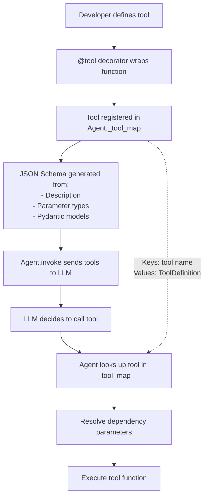
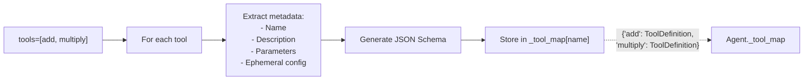

<!-- source: DeepWiki mcp.deepwiki.com · repo browser-use/agent-sdk · page 6.1 Defining Tools · fetched 2026-10-30 -->

# Defining Tools

<details>
<summary>Relevant source files</summary>

The following files were used as context for generating this wiki page:

- [README.md](README.md)
- [bu_agent_sdk/agent/README.md](bu_agent_sdk/agent/README.md)

</details>


## Purpose and Scope

This page explains how to define tools that agents can invoke during execution using the `@tool` decorator. It covers tool descriptions, parameter types (simple types and Pydantic models), and ephemeral message configuration. For information about dependency injection in tools, see [Dependency Injection](#6.2). For details on tool execution flow and the agent's tool calling mechanism, see [Tool Calling and Execution](#2.2).

## The @tool Decorator

The `@tool` decorator transforms an async function into an executable tool that the agent can invoke. The decorator accepts a description string that is sent to the LLM as part of the tool's schema definition.

**Basic Usage:**

```python
from bu_agent_sdk import tool

@tool("Add two numbers")
async def add(a: int, b: int) -> int:
    return a + b
```

The description string is critical—it tells the LLM when and how to use the tool. Clear, specific descriptions improve tool selection accuracy.

**Key Characteristics:**

| Aspect | Requirement |
|--------|-------------|
| Function type | Must be `async def` |
| Description | Required string parameter to `@tool()` |
| Return type | Should be JSON-serializable or str |
| Parameters | Typed using Python type hints |

Sources: [README.md:28-30](), [bu_agent_sdk/agent/README.md:12-14]()

### Tool Description Best Practices

Tool descriptions should be:
- **Action-oriented**: Start with verbs ("Add", "Query", "Send", "Read")
- **Specific**: Clearly state what the tool does and when to use it
- **Concise**: One sentence is usually sufficient

**Examples:**

```python
@tool("Execute shell command in the sandbox environment")
async def bash(command: str) -> str:
    ...

@tool("Read file contents from the specified path")
async def read(path: str) -> str:
    ...

@tool("Signal task completion with a final message")
async def done(message: str) -> str:
    ...
```

Sources: [README.md:172-198]()

## Parameter Types

### Simple Parameters

Tools accept standard Python types, which are automatically converted to JSON Schema for the LLM:

```python
@tool("Calculate power")
async def power(base: int, exponent: int) -> int:
    return base ** exponent

@tool("Search for text")
async def search(query: str, case_sensitive: bool = False) -> str:
    ...

@tool("Filter items")
async def filter_items(items: list[str], min_length: int) -> list[str]:
    ...
```

**Supported Types:**

| Python Type | LLM Schema Type | Notes |
|-------------|-----------------|-------|
| `int` | integer | Whole numbers |
| `float` | number | Decimal numbers |
| `str` | string | Text |
| `bool` | boolean | True/False |
| `list[T]` | array | Lists of typed items |
| `dict` | object | Dictionaries |
| `Optional[T]` | nullable | Optional parameters |

Type hints are **required** for proper schema generation. Without them, the LLM cannot understand the tool's interface.

Sources: [README.md:28-30](), [bu_agent_sdk/agent/README.md:12-14]()

### Pydantic Models for Complex Parameters

For tools with multiple related parameters, use Pydantic `BaseModel` to group them. This improves both readability and the LLM's understanding of the tool's structure:

```python
from pydantic import BaseModel, Field

class EmailParams(BaseModel):
    to: str = Field(description="Recipient email address")
    subject: str = Field(description="Email subject line")
    body: str = Field(description="Email body content")
    cc: list[str] = Field(default_factory=list, description="CC recipients")

@tool("Send an email")
async def send_email(params: EmailParams) -> str:
    return f"Sent email to {params.to} with subject: {params.subject}"
```

**Benefits:**

- **Field-level descriptions**: Use `Field(description=...)` to document individual fields
- **Validation**: Pydantic validates parameters before execution
- **Defaults**: Specify default values for optional fields
- **Nested structures**: Models can contain other models
- **Clear schema**: LLMs see a well-structured object schema

The `EmailParams` model is automatically converted to a JSON Schema that the LLM receives:

```json
{
  "type": "object",
  "properties": {
    "to": {"type": "string", "description": "Recipient email address"},
    "subject": {"type": "string", "description": "Email subject line"},
    "body": {"type": "string", "description": "Email body content"},
    "cc": {"type": "array", "items": {"type": "string"}, "description": "CC recipients"}
  },
  "required": ["to", "subject", "body"]
}
```

Sources: [bu_agent_sdk/agent/README.md:43-56]()

### Dependency Injection Parameters

Tools can declare dependencies using `Annotated[Type, Depends(provider)]`. These parameters are **not** exposed to the LLM—they are injected by the agent at runtime:

```python
from typing import Annotated
from bu_agent_sdk import Depends

def get_db() -> Database:
    return Database()

@tool("Query users")
async def get_user(id: int, db: Annotated[Database, Depends(get_db)]) -> str:
    return await db.find(id)
```

The LLM only sees the `id` parameter. The `db` parameter is resolved by the dependency injection system. For comprehensive coverage of dependency injection, see [Dependency Injection](#6.2).

Sources: [README.md:110-123](), [bu_agent_sdk/agent/README.md:59-72]()

## Tool Definition Flow

The following diagram shows how tool definitions flow from code to LLM invocation:



Sources: [README.md:23-46](), Diagram 4 from high-level architecture

## Ephemeral Tools

Ephemeral tools generate large outputs (browser state, screenshots, file contents) that would quickly consume the context window. The `ephemeral` parameter controls how many recent outputs to retain:

```python
@tool("Get browser state", ephemeral=3)
async def get_state() -> str:
    return massive_dom_and_screenshot  # 100KB+ of HTML/screenshot data

@tool("Read file contents", ephemeral=5)
async def read(path: str) -> str:
    return open(path).read()  # Could be large files
```

**Behavior:**

- When `ephemeral=N` is set, only the last N `ToolMessage` results from this tool are kept in conversation history
- Older messages are removed before the next LLM invocation
- This prevents context window exhaustion from repeated tool calls with large outputs
- The LLM still has access to recent outputs for reasoning

**Use Cases:**

| Tool Type | Why Ephemeral | Typical N |
|-----------|---------------|-----------|
| Browser state | DOM + screenshots = 50-200KB | 2-3 |
| File reading | Large source files | 3-5 |
| Search results | Many results per query | 5-10 |
| Image generation | Base64 image data | 1-2 |

**Implementation Note:**

The agent tracks ephemeral messages by tool name and automatically removes old ones in the `_destroy_old_ephemeral_messages` method before each LLM invocation. For details on ephemeral message management, see [Ephemeral Messages](#10.2).

Sources: [README.md:73-80]()

## Tool Registration and Discovery

Tools are passed to the `Agent` constructor as a list. The agent processes each tool to build its internal registry:

```python
from bu_agent_sdk import Agent, tool
from bu_agent_sdk.llm import ChatAnthropic

@tool("Add numbers")
async def add(a: int, b: int) -> int:
    return a + b

@tool("Multiply numbers")
async def multiply(a: int, b: int) -> int:
    return a * b

agent = Agent(
    llm=ChatAnthropic(model="claude-sonnet-4-20250514"),
    tools=[add, multiply],  # List of decorated functions
)
```

**Internal Process:**



The `_tool_map` dictionary maps tool names (strings) to `ToolDefinition` objects that contain:
- The original function reference
- The JSON Schema for LLM consumption
- Ephemeral configuration (if any)
- Dependency metadata

During execution, when the LLM requests a tool call by name, the agent looks up the tool in `_tool_map` and invokes it with the provided arguments.

Sources: [README.md:36-39](), Diagram 4 from high-level architecture

## Complete Example: File Operations Tool

This example demonstrates all concepts covered:

```python
from typing import Annotated
from pydantic import BaseModel, Field
from bu_agent_sdk import tool, Depends

# Dependency provider (see section 6.2 for details)
def get_sandbox() -> SandboxContext:
    raise RuntimeError("Override via dependency_overrides")

# Pydantic model for complex parameters
class FileOperation(BaseModel):
    path: str = Field(description="File path relative to working directory")
    encoding: str = Field(default="utf-8", description="Text encoding")

# Simple tool with basic types
@tool("List files in directory")
async def list_files(directory: str) -> str:
    return "\n".join(os.listdir(directory))

# Tool with Pydantic model
@tool("Read file with specified encoding")
async def read_file(params: FileOperation) -> str:
    with open(params.path, encoding=params.encoding) as f:
        return f.read()

# Ephemeral tool with large outputs
@tool("Get complete file tree", ephemeral=2)
async def file_tree(root: str) -> str:
    # Returns large directory tree output
    return generate_tree(root)

# Tool with dependency injection
@tool("Write file in sandbox")
async def write_file(
    path: str,
    content: str,
    ctx: Annotated[SandboxContext, Depends(get_sandbox)]
) -> str:
    resolved_path = ctx.resolve_path(path)
    resolved_path.write_text(content)
    return f"Wrote {len(content)} bytes"

# Signal completion
@tool("Signal task completion")
async def done(message: str) -> str:
    from bu_agent_sdk.agent import TaskComplete
    raise TaskComplete(message)
```

Sources: [README.md:144-224]()

## Tool Naming and Collision

Tool names are derived from the function name by default. If two tools have the same function name, the second will overwrite the first in `_tool_map`:

```python
@tool("Calculate sum")
async def calculate(a: int, b: int) -> int:  # Name: "calculate"
    return a + b

@tool("Calculate product")
async def calculate(a: int, b: int) -> int:  # Name: "calculate" - COLLISION!
    return a * b

# Only the second "calculate" will be registered
```

To avoid collisions, use unique function names. The framework does not currently support custom tool name overrides beyond the function name.

## Summary

| Concept | Purpose | Key Syntax |
|---------|---------|------------|
| `@tool` decorator | Define executable tools | `@tool("description")` |
| Simple parameters | Basic typed inputs | `param: int`, `param: str` |
| Pydantic models | Complex parameter groups | `params: EmailParams` |
| `Depends` | Inject dependencies | `Annotated[T, Depends(provider)]` |
| `ephemeral` | Limit message retention | `@tool("...", ephemeral=N)` |
| `TaskComplete` | Signal completion | `raise TaskComplete(msg)` |

Tools form the action space of the agent. Well-defined tools with clear descriptions, proper typing, and appropriate ephemeral configuration enable effective agent behavior.

Sources: [README.md:1-256](), [bu_agent_sdk/agent/README.md:1-90]()

---

