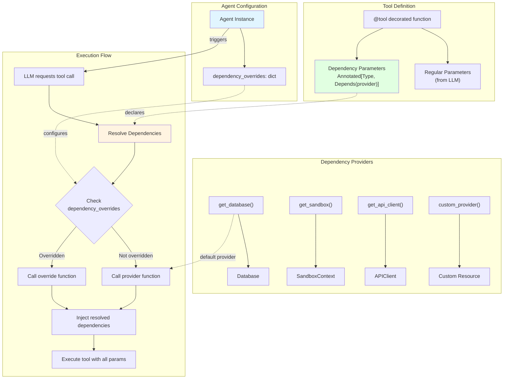
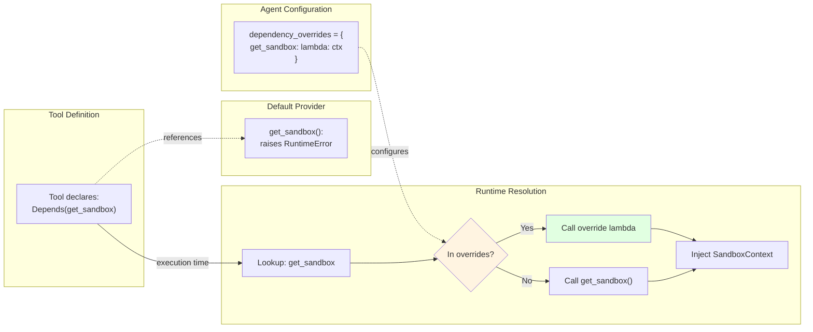
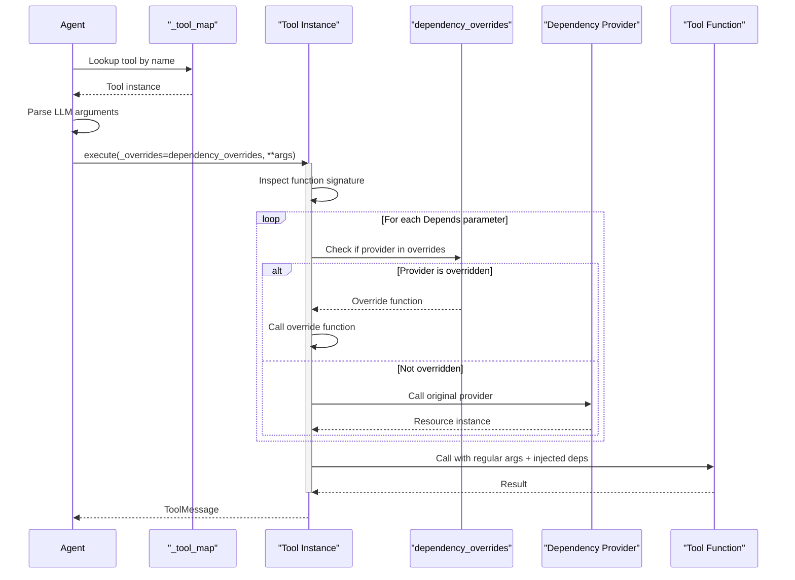
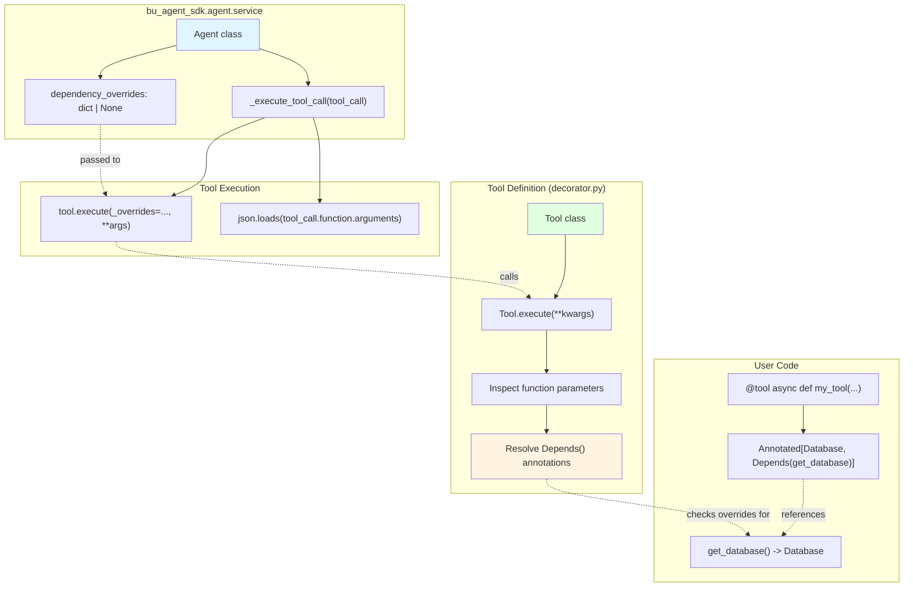

<!-- source: DeepWiki mcp.deepwiki.com · repo browser-use/agent-sdk · page 6.2 Dependency Injection · fetched 2026-10-30 -->

# Dependency Injection

<details>
<summary>Relevant source files</summary>

The following files were used as context for generating this wiki page:

- [README.md](README.md)
- [bu_agent_sdk/agent/service.py](bu_agent_sdk/agent/service.py)
- [bu_agent_sdk/examples/dependency_injection.py](bu_agent_sdk/examples/dependency_injection.py)

</details>


## Purpose and Scope

This document explains the dependency injection (DI) mechanism in bu_agent_sdk's tool system. Dependency injection allows tools to access shared resources (databases, API clients, configuration objects, sandbox contexts) without hardcoding instantiation logic. This pattern promotes modularity, testability, and separation of concerns.

For general information about defining tools, see [Defining Tools](#6.1). For the broader tool system architecture, see [Tool System](#6).

**Sources:** [README.md:109-123](), [bu_agent_sdk/examples/dependency_injection.py:1-109]()

## Overview

The dependency injection system follows a FastAPI-inspired pattern using type annotations and the `Depends` construct. Tools declare dependencies as function parameters with `Annotated[Type, Depends(provider)]`, and the Agent resolves these dependencies at execution time by calling provider functions.

**Key Components:**
- **Dependency Providers**: Functions that return resource instances (e.g., `get_database()`, `get_sandbox()`)
- **`Depends` Annotation**: Marks parameters as dependency-injected
- **`dependency_overrides`**: Agent configuration dict to override providers at runtime
- **Resolution Logic**: Automatic dependency resolution during tool execution

**Sources:** [README.md:109-123](), [bu_agent_sdk/agent/service.py:98-145]()

## Architecture



**Dependency Resolution Flow**

This diagram shows how dependencies flow from tool definition through agent configuration to runtime resolution. The Agent checks `dependency_overrides` first, falling back to the original provider function if no override exists.

**Sources:** [README.md:109-123](), [bu_agent_sdk/agent/service.py:98-145](), [bu_agent_sdk/examples/dependency_injection.py:35-82]()

## Defining Dependency Providers

Dependency providers are functions that return instances of shared resources. They serve as factories for dependencies that tools need.

### Basic Provider Pattern

```python
def get_database() -> Database:
    """Provide the database instance."""
    return Database(connection_string="...")
```

Providers should:
1. Return a concrete instance of the dependency type
2. Have a clear return type annotation
3. Be stateless or manage state appropriately
4. Handle initialization and resource allocation

**Sources:** [bu_agent_sdk/examples/dependency_injection.py:35-54]()

### Provider Examples from the Codebase

#### Database Provider

[bu_agent_sdk/examples/dependency_injection.py:36-54]() demonstrates a database provider:

```python
@dataclass
class Database:
    users: dict[int, dict]
    
    def get_user(self, user_id: int) -> dict | None:
        return self.users.get(user_id)

def get_database() -> Database:
    return Database(users={...})
```

#### Sandbox Context Provider

[README.md:156-169]() shows a sandboxed filesystem provider:

```python
@dataclass
class SandboxContext:
    root_dir: Path
    working_dir: Path
    
    def resolve_path(self, path: str) -> Path:
        resolved = (self.working_dir / path).resolve()
        resolved.relative_to(self.root_dir)  # Raises if escapes
        return resolved

def get_sandbox() -> SandboxContext:
    raise RuntimeError("Override via dependency_overrides")
```

**Sources:** [README.md:156-169](), [bu_agent_sdk/examples/dependency_injection.py:21-54]()

## Declaring Dependencies in Tools

Tools declare dependencies using `Annotated[Type, Depends(provider)]` in their function signatures. These parameters are automatically resolved and injected at execution time.

### Syntax

```python
from typing import Annotated
from bu_agent_sdk.tools import Depends, tool

@tool("Tool description")
async def my_tool(
    regular_param: int,  # From LLM tool call arguments
    db: Annotated[Database, Depends(get_database)]  # Injected dependency
) -> str:
    # Use both regular params and injected dependencies
    user = db.get_user(regular_param)
    return f"Found: {user}"
```

**Key Points:**
- Regular parameters come from LLM tool call arguments
- Dependency parameters are injected automatically
- Dependencies use `Annotated[Type, Depends(provider)]` syntax
- The provider function is called during tool execution
- Multiple dependencies can be declared in a single tool

**Sources:** [README.md:114-123](), [bu_agent_sdk/examples/dependency_injection.py:57-82]()

### Multiple Dependencies Example

Tools can declare multiple dependencies:

```python
@tool("Fetch and cache user data")
async def fetch_user_cached(
    user_id: int,
    db: Annotated[Database, Depends(get_database)],
    cache: Annotated[Cache, Depends(get_cache)],
    logger: Annotated[Logger, Depends(get_logger)]
) -> str:
    logger.info(f"Fetching user {user_id}")
    cached = cache.get(user_id)
    if cached:
        return cached
    user = db.get_user(user_id)
    cache.set(user_id, user)
    return user
```

Each dependency is resolved independently by calling its provider function.

**Sources:** [bu_agent_sdk/examples/dependency_injection.py:57-82]()

## Dependency Overrides

The `dependency_overrides` parameter in the Agent constructor allows runtime configuration of dependency providers. This is essential for:
- Providing actual instances after agent initialization
- Testing with mock dependencies
- Environment-specific configuration
- Sandboxing and isolation

### Configuration

[bu_agent_sdk/agent/service.py:130]() shows the Agent's `dependency_overrides` parameter:

```python
@dataclass
class Agent:
    llm: BaseChatModel
    tools: list[Tool]
    dependency_overrides: dict | None = None
    # ...
```

The `dependency_overrides` dict maps provider functions to replacement functions:

```python
agent = Agent(
    llm=llm,
    tools=[read, write, bash],
    dependency_overrides={
        get_sandbox: lambda: SandboxContext(root_dir=Path("./sandbox"))
    }
)
```

**Sources:** [bu_agent_sdk/agent/service.py:98-145](), [README.md:202-212]()

### Override Pattern



**Dependency Resolution with Overrides**

This diagram shows how the Agent resolves dependencies by first checking `dependency_overrides`, then falling back to the original provider.

**Sources:** [bu_agent_sdk/agent/service.py:334-337](), [README.md:202-212]()

### Real-World Override Example

From [README.md:201-212](), the Claude Code example demonstrates overriding the sandbox provider:

```python
# Define placeholder provider
def get_sandbox() -> SandboxContext:
    raise RuntimeError("Override via dependency_overrides")

# Tools use the dependency
@tool("Read file contents")
async def read(path: str, ctx: Annotated[SandboxContext, Depends(get_sandbox)]) -> str:
    return ctx.resolve_path(path).read_text()

# Agent overrides with actual instance
root = Path("./sandbox")
ctx = SandboxContext(root_dir=root.resolve(), working_dir=root.resolve())

agent = Agent(
    llm=ChatAnthropic(model="claude-sonnet-4-20250514"),
    tools=[bash, read, write, glob, done],
    dependency_overrides={get_sandbox: lambda: ctx},
)
```

This pattern allows tools to be defined generically while the agent provides the concrete instance.

**Sources:** [README.md:144-225]()

## Execution Flow

### Tool Execution with Dependency Resolution

[bu_agent_sdk/agent/service.py:300-393]() shows the `_execute_tool_call` method which handles dependency injection:



**Dependency Resolution During Tool Execution**

This sequence shows the complete flow from LLM tool call to tool execution with dependency injection. The Agent passes `dependency_overrides` to the tool's execute method, which resolves each dependency.

**Sources:** [bu_agent_sdk/agent/service.py:300-393]()

### Code Entity Mapping



**Code Entity Relationships for Dependency Injection**

This diagram maps the natural language concepts to actual code entities in the bu_agent_sdk codebase.

**Sources:** [bu_agent_sdk/agent/service.py:300-337]()

## Use Cases and Patterns

### Database Access

Sharing a database connection across multiple tools:

```python
def get_db() -> Database:
    return Database(connection_string=os.getenv("DB_URL"))

@tool("Query users")
async def get_user(id: int, db: Annotated[Database, Depends(get_db)]) -> str:
    return await db.find(id)

@tool("List all users")
async def list_users(db: Annotated[Database, Depends(get_db)]) -> str:
    return await db.find_all()
```

**Sources:** [bu_agent_sdk/examples/dependency_injection.py:57-82](), [README.md:114-123]()

### Sandboxed Filesystem Operations

Restricting file operations to a specific directory:

```python
@dataclass
class SandboxContext:
    root_dir: Path
    working_dir: Path
    
    def resolve_path(self, path: str) -> Path:
        resolved = (self.working_dir / path).resolve()
        resolved.relative_to(self.root_dir)  # Raises if escapes sandbox
        return resolved

def get_sandbox() -> SandboxContext:
    raise RuntimeError("Override via dependency_overrides")

@tool("Read file contents")
async def read(path: str, ctx: Annotated[SandboxContext, Depends(get_sandbox)]) -> str:
    return ctx.resolve_path(path).read_text()

@tool("Write file contents")
async def write(
    path: str, 
    content: str, 
    ctx: Annotated[SandboxContext, Depends(get_sandbox)]
) -> str:
    ctx.resolve_path(path).write_text(content)
    return f"Wrote {len(content)} bytes"

# At runtime:
agent = Agent(
    llm=llm,
    tools=[read, write],
    dependency_overrides={
        get_sandbox: lambda: SandboxContext(
            root_dir=Path("./sandbox").resolve(),
            working_dir=Path("./sandbox").resolve()
        )
    }
)
```

This pattern ensures all file operations are confined to the sandbox directory, providing security and isolation.

**Sources:** [README.md:156-186]()

### Configuration and API Clients

Injecting configuration or API clients:

```python
@dataclass
class APIClient:
    base_url: str
    api_key: str
    
    async def make_request(self, endpoint: str) -> dict:
        # Implementation...
        pass

def get_api_client() -> APIClient:
    return APIClient(
        base_url=os.getenv("API_BASE_URL"),
        api_key=os.getenv("API_KEY")
    )

@tool("Fetch external data")
async def fetch_data(
    endpoint: str,
    client: Annotated[APIClient, Depends(get_api_client)]
) -> str:
    data = await client.make_request(endpoint)
    return json.dumps(data)
```

**Sources:** [bu_agent_sdk/examples/dependency_injection.py:1-109]()

### Multi-Resource Dependencies

Combining multiple dependencies in a single tool:

```python
@tool("Save user to database and cache")
async def save_user(
    user_id: int,
    name: str,
    db: Annotated[Database, Depends(get_database)],
    cache: Annotated[Cache, Depends(get_cache)],
    logger: Annotated[Logger, Depends(get_logger)]
) -> str:
    logger.info(f"Saving user {user_id}")
    db.save_user(user_id, name)
    cache.invalidate(user_id)
    return f"Saved user {name}"
```

**Sources:** [bu_agent_sdk/examples/dependency_injection.py:57-82]()

## Testing with Dependency Injection

Dependency injection makes testing straightforward by allowing mock dependencies to be injected via `dependency_overrides`.

### Testing Pattern

```python
# Production provider
def get_database() -> Database:
    return Database(connection_string=os.getenv("DB_URL"))

# Test code
def test_user_tool():
    # Mock database
    mock_db = MockDatabase(users={1: {"name": "Test User"}})
    
    agent = Agent(
        llm=mock_llm,
        tools=[get_user, list_users],
        dependency_overrides={
            get_database: lambda: mock_db
        }
    )
    
    result = await agent.query("Get user 1")
    assert "Test User" in result
```

This pattern allows:
- **Isolation**: Tests don't require actual databases or external services
- **Control**: Mock dependencies can return predetermined values
- **Speed**: No network calls or slow I/O operations
- **Determinism**: Tests produce consistent results

**Sources:** [bu_agent_sdk/agent/service.py:130](), [README.md:202-212]()

### Benefits for Testing

| Aspect | Without DI | With DI |
|--------|-----------|---------|
| Setup | Must configure real services | Inject mocks via overrides |
| Isolation | Tests affect shared state | Each test uses isolated mocks |
| Speed | Slow (network, I/O) | Fast (in-memory mocks) |
| Reliability | Flaky (service downtime) | Deterministic |
| Cleanup | Must reset service state | No cleanup needed |

**Sources:** [bu_agent_sdk/examples/dependency_injection.py:1-109]()

## Summary

| Component | Purpose | Location in Code |
|-----------|---------|------------------|
| `Depends` | Marks parameters as dependencies | `typing.Annotated[Type, Depends(provider)]` |
| Dependency Provider | Factory function returning resource instance | User-defined function (e.g., `get_database()`) |
| `dependency_overrides` | Runtime configuration dict | [Agent.dependency_overrides](bu_agent_sdk/agent/service.py:130) |
| Resolution Logic | Checks overrides, calls providers | [Agent._execute_tool_call](bu_agent_sdk/agent/service.py:334-337) |
| Tool Execution | Injects resolved dependencies | [Tool.execute](bu_agent_sdk/tools/decorator.py) (called with `_overrides`) |

**Key Principles:**
1. **Separation of Concerns**: Tools declare what they need, Agent provides it
2. **Testability**: Override dependencies with mocks for testing
3. **Flexibility**: Runtime configuration via `dependency_overrides`
4. **Type Safety**: Full type checking with `Annotated[Type, Depends(...)]`
5. **Reusability**: Share resources across multiple tools

**Sources:** [README.md:109-123](), [bu_agent_sdk/agent/service.py:98-145](), [bu_agent_sdk/examples/dependency_injection.py:1-109]()

---

