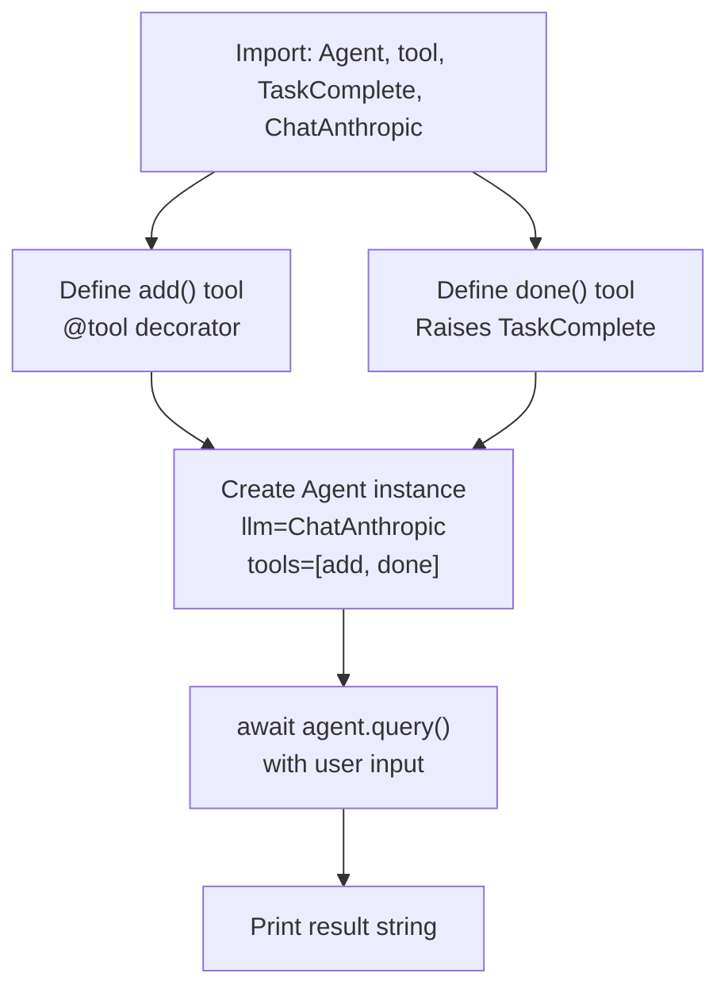
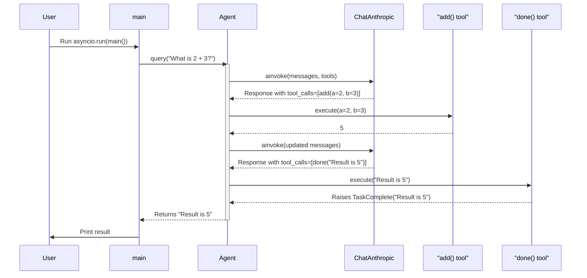
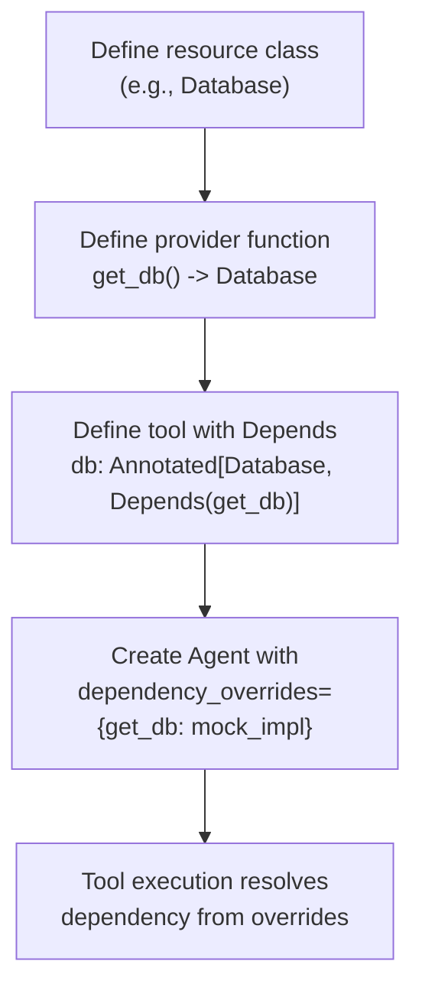
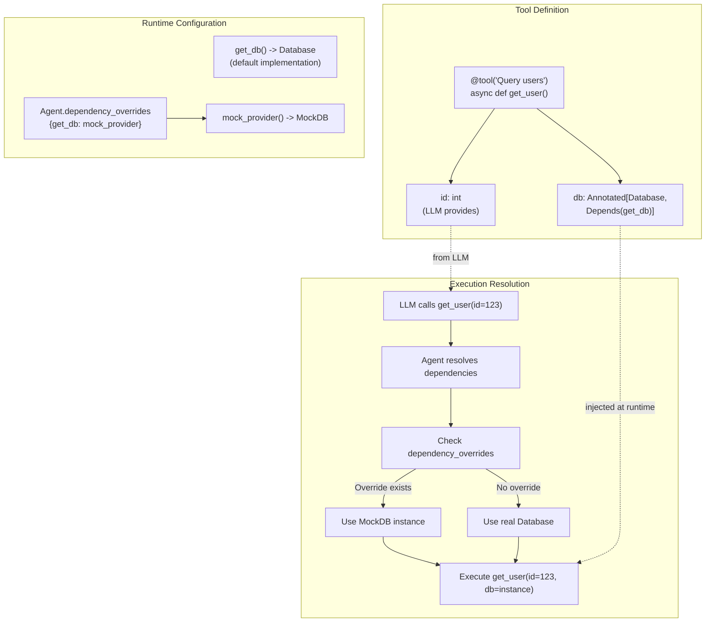
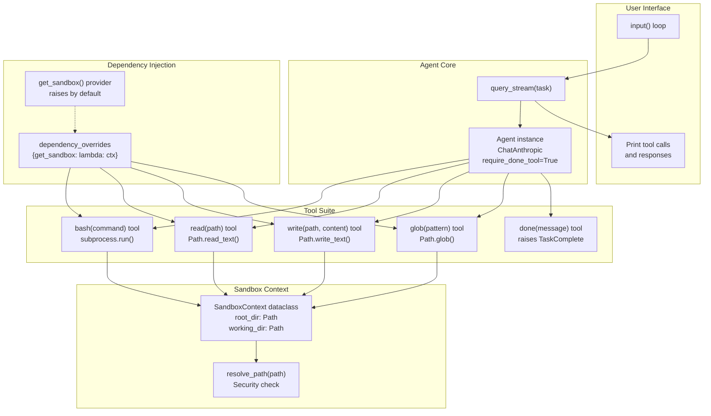
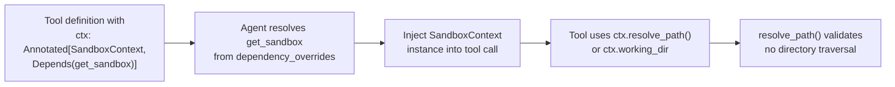
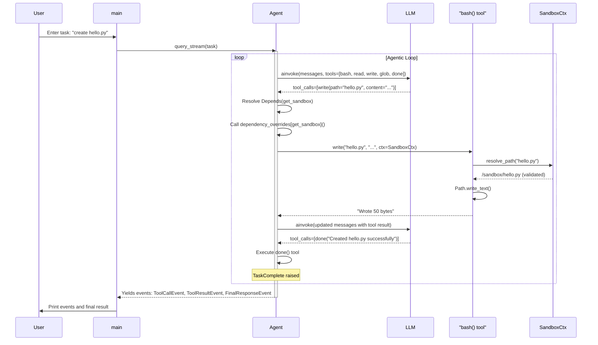
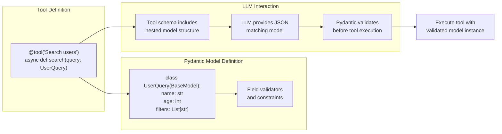
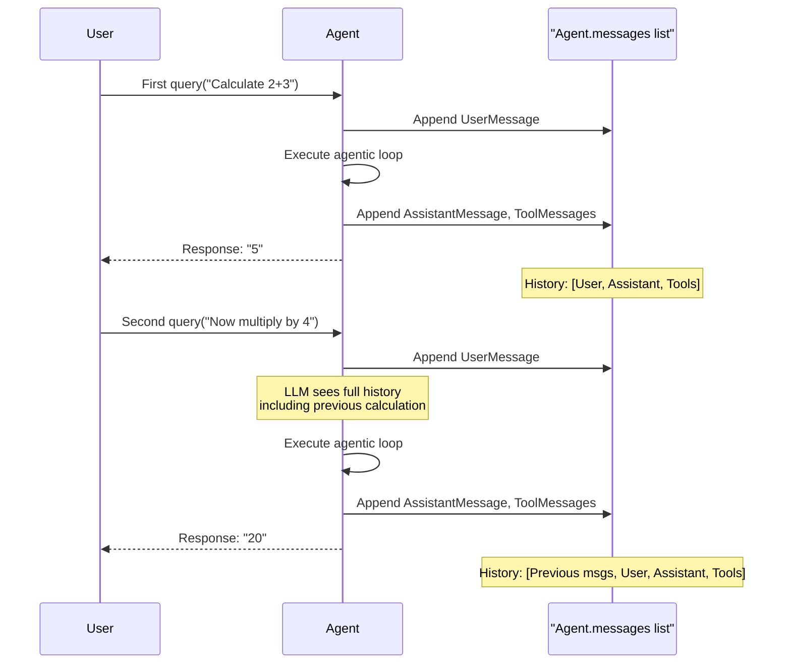

<!-- source: DeepWiki mcp.deepwiki.com · repo browser-use/agent-sdk · page 7 Examples and Guides · fetched 2026-10-30 -->

# Examples and Guides

<details>
<summary>Relevant source files</summary>

The following files were used as context for generating this wiki page:

- [README.md](README.md)
- [bu_agent_sdk/examples/__init__.py](bu_agent_sdk/examples/__init__.py)

</details>


## Purpose and Scope

This document provides practical examples demonstrating the key features and patterns of `bu_agent_sdk`. Each example is designed to illustrate specific concepts, from basic tool definition to advanced patterns like dependency injection and sandboxed execution environments.

For detailed explanations of the underlying systems, see:
- Agent execution mechanics: [Agent System](#2)
- Tool definition and decorator usage: [Tool System](#6)
- Dependency injection details: [Dependency Injection](#6.2)
- Event streaming patterns: [Event System](#3)

## Overview of Available Examples

The SDK includes several example scripts that progressively introduce key concepts:

| Example | Location | Key Concepts |
|---------|----------|-------------|
| Quick Start Calculator | [README.md:23-46]() | Basic agent setup, simple tools, `TaskComplete` pattern |
| Claude Code (100 lines) | [README.md:140-225]() | Dependency injection, sandboxed execution, file operations |
| Full Claude Code | `bu_agent_sdk/examples/claude_code.py` | Complete coding assistant with grep, edit, todo management |
| Dependency Injection | `bu_agent_sdk/examples/dependency_injection.py` | Database mocking, testing patterns |
| Simple Calculator | `bu_agent_sdk/examples/simple_calculator.py` | Minimal agent demonstration |
| Pydantic Models | `bu_agent_sdk/examples/pydantic_models.py` | Complex parameter validation |
| Chat Conversation | `bu_agent_sdk/examples/chat_conversation.py` | Multi-turn conversation management |

**Sources:** [README.md:229-235](), [bu_agent_sdk/examples/__init__.py:1-9]()

## Example 1: Quick Start Calculator

### Purpose

The simplest possible agent demonstrating:
- Basic tool definition with the `@tool` decorator
- `TaskComplete` exception pattern for explicit termination
- Agent initialization with `ChatAnthropic`
- Synchronous query execution

### Code Structure



### Key Components

The example uses these core SDK entities:

| Entity | Purpose | Line Reference |
|--------|---------|----------------|
| `@tool` decorator | Marks async function as agent-callable tool | [README.md:28]() |
| `add(a: int, b: int)` | Simple arithmetic tool demonstrating parameter types | [README.md:29-30]() |
| `done(message: str)` | Completion signal tool using `TaskComplete` exception | [README.md:33-34]() |
| `Agent` class | Core orchestrator initialized with LLM and tools | [README.md:36-39]() |
| `agent.query()` | Blocking method that runs agentic loop until completion | [README.md:42]() |

### Execution Flow



### Running the Example

From the command line:
```bash
python -m bu_agent_sdk.examples.simple_calculator
```

Or by copying the code from [README.md:23-46]() into a new file.

**Sources:** [README.md:21-46]()

## Example 2: Dependency Injection Pattern

### Purpose

Demonstrates FastAPI-style dependency injection for:
- Resource management (database connections, API clients)
- Testing with mock implementations
- Type-safe parameter injection via `Depends`
- Separation of tool logic from resource provisioning

### Code Structure



### Key Components

The dependency injection pattern involves these entities:

| Entity | Purpose | Code Pattern |
|--------|---------|--------------|
| `Depends` | Type annotation for dependency injection | `Annotated[Type, Depends(provider)]` |
| Provider function | Factory that returns resource instances | `def get_db() -> Database: ...` |
| `dependency_overrides` | Agent configuration dict for test/runtime overrides | `{get_db: lambda: MockDB()}` |
| Tool parameter | Injected parameter not exposed to LLM | Excluded from tool schema |

### Example Structure



### Usage Pattern

The pattern from [README.md:112-123]() shows:

1. **Define provider function** that raises or returns default implementation
2. **Annotate tool parameter** with `Depends(provider_func)`
3. **Override at Agent creation** for testing or runtime configuration

Example tool signature:
```python
async def get_user(id: int, db: Annotated[Database, Depends(get_db)]) -> str:
```

The `id` parameter is exposed to the LLM in the tool schema, while `db` is automatically injected by the Agent during execution based on `dependency_overrides` configuration.

**Sources:** [README.md:109-123](), [bu_agent_sdk/examples/__init__.py:6]()

## Example 3: Claude Code - Sandboxed Filesystem Tools

### Purpose

A complete coding assistant demonstrating:
- **Sandboxed execution environment** with path validation
- **Multiple filesystem tools** (read, write, glob, bash)
- **Shared context** via dependency injection (`SandboxContext`)
- **Streaming events** for real-time UI updates
- **Interactive loop** with user prompts

This is the most comprehensive example, showing how all SDK features work together in a production-like scenario.

### Architecture Overview



### SandboxContext Structure

The `SandboxContext` dataclass ([README.md:156-165]()) provides security isolation:

| Field | Type | Purpose |
|-------|------|---------|
| `root_dir` | `Path` | Absolute path to sandbox root, all operations must stay within |
| `working_dir` | `Path` | Current working directory for relative path resolution |
| `resolve_path(path)` | Method | Resolves and validates paths, raises if escape attempt detected |

The security mechanism:
```python
resolved = (self.working_dir / path).resolve()
resolved.relative_to(self.root_dir)  # Raises ValueError if escapes sandbox
```

### Tool Implementations

Each tool receives the `SandboxContext` via dependency injection:



**Tool Catalog:**

| Tool Name | Parameters | Purpose | Key Feature |
|-----------|-----------|---------|-------------|
| `bash` | `command: str` | Execute shell commands | Runs in `ctx.working_dir`, captures stdout/stderr |
| `read` | `path: str` | Read file contents | Path validated via `resolve_path()` |
| `write` | `path: str, content: str` | Write file contents | Creates/overwrites files safely |
| `glob` | `pattern: str` | Find files by pattern | Returns paths relative to `root_dir` |
| `done` | `message: str` | Signal completion | Raises `TaskComplete` exception |

### Execution Flow



### Event Streaming Pattern

The example uses `query_stream()` ([README.md:217-221]()) to display real-time progress:

```python
async for event in agent.query_stream(task):
    if hasattr(event, "tool"):
        print(f"  → {event.tool}")  # ToolCallEvent
    elif hasattr(event, "content") and event.content:
        print(f"\n{event.content}")  # FinalResponseEvent
```

This pattern enables:
- Real-time UI updates as tools execute
- Progress indicators for long-running operations
- Debugging by observing tool call sequence

### Running the Example

Minimal version (100 lines):
```bash
# Copy code from README.md:140-225
python claude_code_minimal.py
```

Full version with additional tools:
```bash
python -m bu_agent_sdk.examples.claude_code
```

The full version adds:
- `grep(pattern: str)` - Search files for text patterns
- `edit(path: str, old: str, new: str)` - Targeted file edits
- `todo_add/todo_list/todo_complete` - Task management tools

**Sources:** [README.md:140-228]()

## Example 4: Pydantic Models for Complex Parameters

### Purpose

Demonstrates using Pydantic models as tool parameters for:
- Complex nested data structures
- Built-in validation
- Documentation generation
- Type safety

### Pattern Overview



The Pydantic model parameter is automatically converted to a JSON schema in the tool definition, and the LLM's JSON response is validated before tool execution.

**Sources:** [bu_agent_sdk/examples/__init__.py:7]()

## Example 5: Chat Conversation Pattern

### Purpose

Demonstrates multi-turn conversations with:
- Maintaining message history across calls
- Adding system prompts mid-conversation
- Handling follow-up queries
- Context management

### Key Difference from Single Query

| Aspect | Single Query | Chat Conversation |
|--------|-------------|-------------------|
| History | No persistent state | Agent maintains `messages` list |
| Method | `agent.query()` | Multiple `agent.query()` calls on same instance |
| Context | Fresh for each call | Accumulates across calls |
| Use Case | One-shot tasks | Interactive dialogs |

### Conversation Flow



The agent automatically maintains context, allowing the LLM to reference previous interactions when responding to follow-up queries.

**Sources:** [bu_agent_sdk/examples/__init__.py:8]()

## Common Patterns Across Examples

### Pattern 1: Agent Initialization

All examples follow this structure:
```python
agent = Agent(
    llm=ChatAnthropic(model="..."),      # LLM provider
    tools=[tool1, tool2, done],           # Tool list
    system_prompt="...",                  # Optional system instructions
    require_done_tool=True,               # Optional: force explicit completion
    dependency_overrides={...},           # Optional: DI overrides
)
```

### Pattern 2: Tool Definition

Standard tool template:
```python
@tool("Tool description for LLM")
async def tool_name(
    param: Type,                                        # Regular parameter
    resource: Annotated[Resource, Depends(provider)]   # Injected parameter
) -> ReturnType:
    # Tool implementation
    return result
```

### Pattern 3: Explicit Termination

The `done` tool pattern for autonomous mode:
```python
@tool("Signal task completion")
async def done(message: str) -> str:
    raise TaskComplete(message)
```

Without this, agents in autonomous mode would continue indefinitely or stop prematurely.

### Pattern 4: Error Handling

Tools should handle expected errors and return descriptive messages:
```python
@tool("Read file")
async def read(path: str) -> str:
    try:
        return Path(path).read_text()
    except FileNotFoundError:
        return f"File not found: {path}"
    except PermissionError:
        return f"Permission denied: {path}"
```

This allows the LLM to understand what went wrong and adjust its strategy.

## Running Examples from Command Line

All examples in `bu_agent_sdk/examples/` can be run as modules:

```bash
# Simple calculator
python -m bu_agent_sdk.examples.simple_calculator

# Dependency injection demo
python -m bu_agent_sdk.examples.dependency_injection

# Pydantic models demo
python -m bu_agent_sdk.examples.pydantic_models

# Chat conversation demo
python -m bu_agent_sdk.examples.chat_conversation

# Full Claude Code with all tools
python -m bu_agent_sdk.examples.claude_code
```

Each example includes inline comments explaining the concepts demonstrated.

**Sources:** [bu_agent_sdk/examples/__init__.py:3-9]()

## Next Steps

After understanding these examples:

- **For production use:** Review [Configuration and Setup](#8) for API keys and environment variables
- **For debugging:** See [Observability and Debugging](#9) for event streaming and logging
- **For advanced patterns:** Explore [Advanced Topics](#10) including retry logic and custom providers
- **For tool design:** Study [Tool System](#6) for complete decorator options and parameter types
- **For context management:** Learn about [Context Management (Compaction)](#4) to handle long conversations

**Sources:** [README.md:1-256](), [bu_agent_sdk/examples/__init__.py:1-9]()

---

