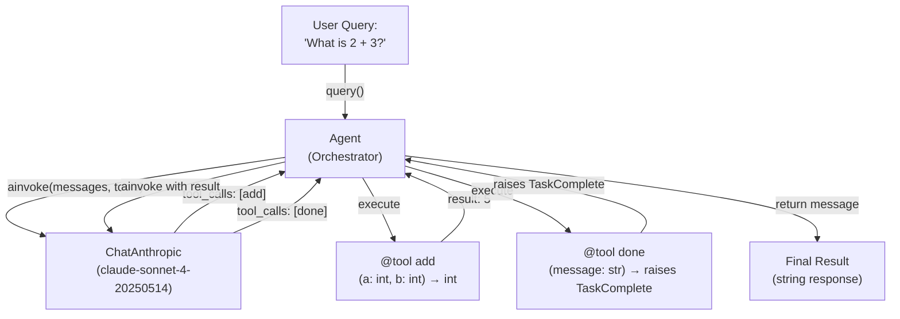
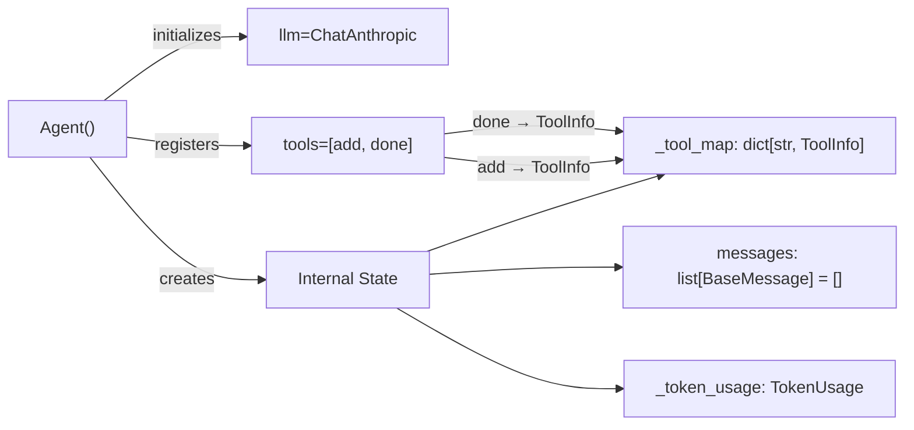
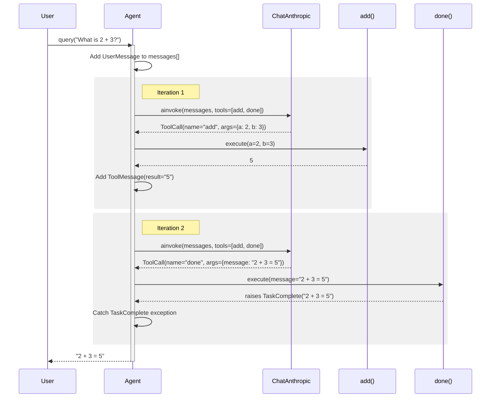

<!-- source: DeepWiki mcp.deepwiki.com · repo browser-use/agent-sdk · page 7.1 Getting Started: Simple Calculator · fetched 2026-10-30 -->

# Getting Started: Simple Calculator

<details>
<summary>Relevant source files</summary>

The following files were used as context for generating this wiki page:

- [README.md](README.md)
- [bu_agent_sdk/agent/README.md](bu_agent_sdk/agent/README.md)

</details>


## Purpose and Scope

This guide demonstrates the fundamental concepts of bu_agent_sdk through a simple calculator agent. It covers tool definition, agent initialization, and basic query execution. For more complex patterns like dependency injection, see [Dependency Injection Example](#7.2). For advanced tool configurations and ephemeral messages, see [Defining Tools](#6.1).

## The Calculator Example

The simplest agent requires three components: tools, an LLM, and the Agent orchestrator. The calculator example in [README.md:21-46]() demonstrates this minimal setup with two tools: `add` for computation and `done` for explicit task completion.

**Example Structure Overview**



**Sources:** [README.md:21-46]()

## Component Breakdown

### Imports

The example requires four imports from bu_agent_sdk:

| Import | Purpose |
|--------|---------|
| `Agent` | Main orchestrator class that manages the agentic loop |
| `tool` | Decorator for defining tools callable by the LLM |
| `TaskComplete` | Exception raised to signal agent completion |
| `ChatAnthropic` | Anthropic LLM provider implementation |

**Sources:** [README.md:24-26]()

### Tool Definitions

Tools are defined using the `@tool` decorator with a description string. The decorator converts regular Python functions into LLM-callable tools by:

1. Extracting type annotations to generate JSON Schema
2. Registering the function in the Agent's tool registry
3. Enabling automatic parameter validation

**The Add Tool**

```python
@tool("Add two numbers")
async def add(a: int, b: int) -> int:
    return a + b
```

- **Decorator argument**: `"Add two numbers"` - passed to the LLM as the tool description
- **Parameters**: Both `a` and `b` are required integers with no defaults
- **Return type**: `int` is used for type validation
- **Implementation**: Direct computation with no side effects

**The Done Tool**

```python
@tool("Signal task completion")
async def done(message: str) -> str:
    raise TaskComplete(message)
```

- **Purpose**: Provides explicit termination mechanism (see [TaskComplete Pattern](#2.4))
- **Behavior**: Raises `TaskComplete` exception to exit the agentic loop
- **Parameter**: `message` becomes the final response returned to the user
- **Return type**: Declared as `str` but never reached due to exception

**Sources:** [README.md:28-34]()

### Agent Initialization

The `Agent` class is initialized with two required parameters and uses default values for others:

```python
agent = Agent(
    llm=ChatAnthropic(model="claude-sonnet-4-20250514"),
    tools=[add, done],
)
```

| Parameter | Value | Description |
|-----------|-------|-------------|
| `llm` | `ChatAnthropic(...)` | LLM provider instance implementing `BaseChatModel` protocol |
| `tools` | `[add, done]` | List of decorated tool functions available to the agent |
| `require_done_tool` | `False` (default) | CLI mode - stops when LLM returns no tool calls |
| `system_prompt` | `None` (default) | No additional system instructions |
| `compaction` | `None` (default) | Context compaction disabled |

**Sources:** [README.md:36-39]()

**Agent Initialization Diagram**



**Sources:** [README.md:36-39]()

### Query Execution

The `query` method provides a simple synchronous-style interface (though it returns an awaitable):

```python
async def main():
    result = await agent.query("What is 2 + 3?")
    print(result)

asyncio.run(main())
```

- **Method**: `agent.query(user_message: str) -> str`
- **Behavior**: Runs the agentic loop until completion and returns final text
- **Alternative**: `agent.query_stream()` yields events for observability (see [Streaming Interface](#3.2))

**Sources:** [README.md:41-45]()

## Execution Flow

When `agent.query("What is 2 + 3?")` is called, the following sequence occurs:



**Sources:** [README.md:41-45](), [bu_agent_sdk/agent/README.md:7-22]()

### Detailed Step-by-Step

**Iteration 1:**
1. Agent adds user message to conversation history
2. Agent invokes LLM with message history and tool definitions
3. LLM responds with a tool call: `add(a=2, b=3)`
4. Agent looks up `add` in `_tool_map`
5. Agent executes `add` function, receives result `5`
6. Agent appends `ToolMessage` with result to history

**Iteration 2:**
1. Agent invokes LLM again with updated history (including tool result)
2. LLM responds with tool call: `done(message="2 + 3 = 5")`
3. Agent executes `done` function
4. `done` raises `TaskComplete("2 + 3 = 5")` exception
5. Agent catches exception and returns the message

**Loop Termination:**
- The agent exits because `TaskComplete` was raised
- In CLI mode (`require_done_tool=False`), the loop would also exit if LLM returns no tool calls
- See [TaskComplete Pattern](#2.4) for details on termination behavior

**Sources:** [README.md:28-45]()

## Expected Output

Running the calculator example produces a simple string response:

```
2 + 3 = 5
```

The actual response text depends on the LLM's phrasing. The LLM decides:
- When to call the `add` tool
- What message to pass to the `done` tool
- The natural language formatting of the result

**Sources:** [README.md:41-45]()

## Key Concepts Demonstrated

| Concept | Demonstrated By |
|---------|-----------------|
| Tool Definition | `@tool` decorator with description |
| Type Annotations | Parameters `a: int`, `b: int` converted to JSON Schema |
| Async Functions | All tools must be `async def` |
| TaskComplete Pattern | `done` tool raises exception to exit loop |
| Agent Orchestration | `Agent` manages LLM invocation and tool execution |
| LLM Abstraction | `ChatAnthropic` implements `BaseChatModel` protocol |
| Message History | Conversation context maintained in `messages` list |

**Sources:** [README.md:21-46](), [bu_agent_sdk/agent/README.md:7-22]()

## Variations and Extensions

**Different LLM Providers:**

The calculator example can use any supported provider by swapping the `llm` parameter:

```python
# OpenAI
from bu_agent_sdk.llm import ChatOpenAI
agent = Agent(llm=ChatOpenAI(model="gpt-4o"), tools=[add, done])

# Google
from bu_agent_sdk.llm import ChatGoogle
agent = Agent(llm=ChatGoogle(model="gemini-2.0-flash"), tools=[add, done])
```

All providers implement the same `BaseChatModel` protocol (see [Supported Providers](#5.2)).

**Additional Math Tools:**

Extend the calculator by adding more tools:

```python
@tool("Subtract two numbers")
async def subtract(a: int, b: int) -> int:
    return a - b

@tool("Multiply two numbers")
async def multiply(a: int, b: int) -> int:
    return a * b

agent = Agent(
    llm=ChatAnthropic(model="claude-sonnet-4-20250514"),
    tools=[add, subtract, multiply, done],
)
```

The LLM automatically selects the appropriate tool based on the query.

**Autonomous Mode:**

Enable `require_done_tool=True` to force explicit completion (see [TaskComplete Pattern](#2.4)):

```python
agent = Agent(
    llm=ChatAnthropic(model="claude-sonnet-4-20250514"),
    tools=[add, done],
    require_done_tool=True,  # Must call done to exit
)
```

**Sources:** [README.md:86-93](), [README.md:60-69]()

## Next Steps

- **Streaming Events**: See [Streaming Interface](#3.2) for real-time observability using `query_stream()`
- **Dependency Injection**: See [Dependency Injection Example](#7.2) for managing shared resources
- **Complex Tools**: See [Defining Tools](#6.1) for Pydantic models, ephemeral tools, and advanced patterns
- **Complete Example**: See [Claude Code: Sandboxed Filesystem Tools](#7.3) for a production-ready agent with file operations

**Sources:** [README.md:1-256](), [bu_agent_sdk/agent/README.md:1-90]()

---

