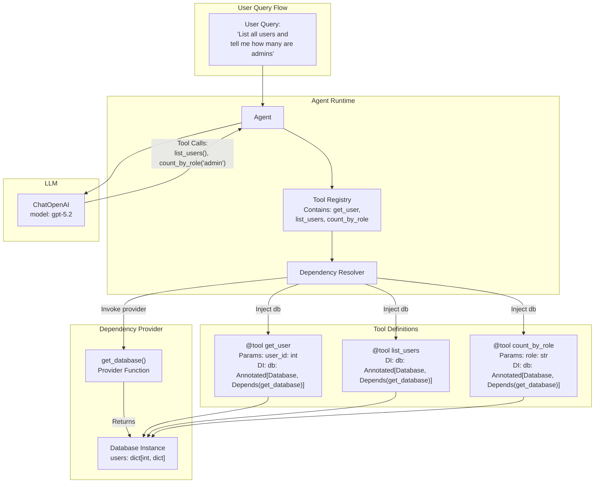
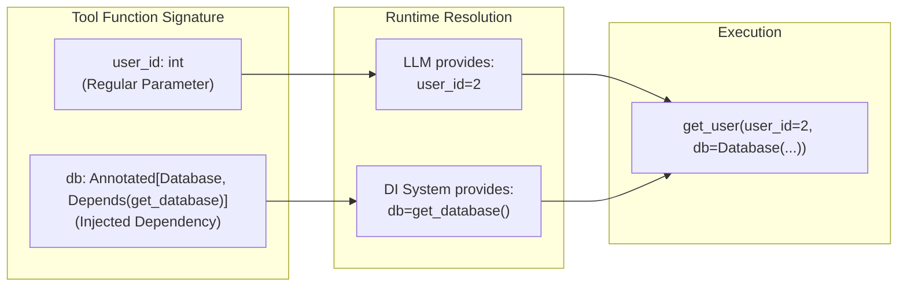
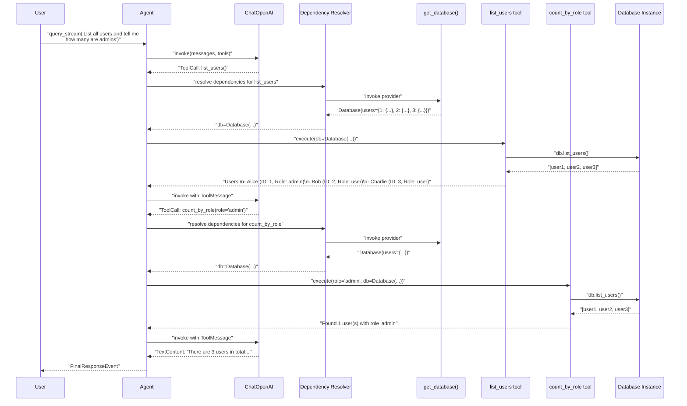

<!-- source: DeepWiki mcp.deepwiki.com · repo browser-use/agent-sdk · page 7.2 Dependency Injection Example · fetched 2026-10-30 -->

# Dependency Injection Example

<details>
<summary>Relevant source files</summary>

The following files were used as context for generating this wiki page:

- [bu_agent_sdk/examples/dependency_injection.py](bu_agent_sdk/examples/dependency_injection.py)

</details>


## Purpose and Scope

This page demonstrates a practical implementation of dependency injection in `bu_agent_sdk` using a simulated database example. It shows how to share resources (such as database connections, API clients, or configuration objects) across multiple tools using the `Depends` mechanism.

For detailed documentation on the dependency injection system architecture and advanced configuration options, see [Dependency Injection](#6.2). For a simpler introductory example without dependency injection, see [Getting Started: Simple Calculator](#7.1).

**Sources:** [bu_agent_sdk/examples/dependency_injection.py:1-9]()

---

## Example Overview

The dependency injection example simulates a user database system with three tools that query user information. The example demonstrates how multiple tools can share a single `Database` instance without passing it explicitly through the Agent's tool execution calls.

### Key Components

| Component | Purpose | Code Reference |
|-----------|---------|----------------|
| `Database` | Simulated database with user records | [bu_agent_sdk/examples/dependency_injection.py:22-32]() |
| `get_database()` | Dependency provider function | [bu_agent_sdk/examples/dependency_injection.py:36-54]() |
| `get_user` | Tool that fetches a user by ID | [bu_agent_sdk/examples/dependency_injection.py:57-63]() |
| `list_users` | Tool that lists all users | [bu_agent_sdk/examples/dependency_injection.py:66-71]() |
| `count_by_role` | Tool that counts users by role | [bu_agent_sdk/examples/dependency_injection.py:74-81]() |

**Sources:** [bu_agent_sdk/examples/dependency_injection.py:1-109]()

---

## System Architecture



**Architecture Overview:** This diagram shows how the dependency injection system connects the agent's tool execution with the shared `Database` resource. The `Agent` uses the `DIResolver` to invoke provider functions and inject dependencies into tools at runtime.

**Sources:** [bu_agent_sdk/examples/dependency_injection.py:36-54](), [bu_agent_sdk/examples/dependency_injection.py:57-81](), [bu_agent_sdk/examples/dependency_injection.py:84-89]()

---

## Dependency Provider Pattern

The dependency provider is a function that returns the resource to be injected. In this example, `get_database()` creates and returns a `Database` instance populated with sample user data.

### Database Resource

The `Database` class is a simple dataclass that simulates a database with three methods:

```python
@dataclass
class Database:
    users: dict[int, dict]
    
    def get_user(self, user_id: int) -> dict | None
    def list_users(self) -> list[dict]
```

The database stores three sample users with IDs 1, 2, and 3, each containing `id`, `name`, `email`, and `role` fields.

**Sources:** [bu_agent_sdk/examples/dependency_injection.py:22-32]()

### Provider Function

The provider function follows a simple pattern:

```python
def get_database() -> Database:
    """Provide the database instance."""
    return Database(users={...})
```

This function is called by the dependency injection system whenever a tool requires a `Database` instance. The provider can:
- Initialize connections or resources
- Load configuration
- Return cached instances
- Perform setup logic

**Sources:** [bu_agent_sdk/examples/dependency_injection.py:36-54]()

---

## Tool Definitions with Dependencies

Each tool declares its dependency using the `Annotated[Type, Depends(provider)]` syntax. This pattern separates the tool's business logic from resource management.

### Dependency Declaration Syntax



**Dependency Declaration Flow:** Regular parameters are provided by the LLM as tool call arguments, while dependency-annotated parameters are resolved and injected by the DI system at runtime.

**Sources:** [bu_agent_sdk/examples/dependency_injection.py:57-63](), [bu_agent_sdk/examples/dependency_injection.py:66-71](), [bu_agent_sdk/examples/dependency_injection.py:74-81]()

### Example Tool Implementations

#### get_user Tool

```python
@tool("Get a user by their ID")
async def get_user(user_id: int, db: Annotated[Database, Depends(get_database)]) -> str:
    """Fetch a user from the database by ID."""
    user = db.get_user(user_id)
    if user:
        return f"User found: {user['name']} ({user['email']}) - Role: {user['role']}"
    return f"No user found with ID {user_id}"
```

This tool accepts:
- `user_id: int` - provided by the LLM as a tool argument
- `db: Annotated[Database, Depends(get_database)]` - injected by the DI system

**Sources:** [bu_agent_sdk/examples/dependency_injection.py:57-63]()

#### list_users Tool

```python
@tool("List all users in the system")
async def list_users(db: Annotated[Database, Depends(get_database)]) -> str:
    """List all users in the database."""
    users = db.list_users()
    lines = [f"- {u['name']} (ID: {u['id']}, Role: {u['role']})" for u in users]
    return "Users:\n" + "\n".join(lines)
```

This tool has no regular parameters—only the injected `db` dependency.

**Sources:** [bu_agent_sdk/examples/dependency_injection.py:66-71]()

#### count_by_role Tool

```python
@tool("Count users with a specific role")
async def count_by_role(role: str, db: Annotated[Database, Depends(get_database)]) -> str:
    """Count how many users have a given role."""
    users = db.list_users()
    count = sum(1 for u in users if u["role"] == role)
    return f"Found {count} user(s) with role '{role}'"
```

This tool demonstrates mixing regular parameters (`role`) with injected dependencies (`db`).

**Sources:** [bu_agent_sdk/examples/dependency_injection.py:74-81]()

---

## Agent Configuration and Execution

The agent is configured with the LLM, tools, and system prompt. The dependency provider is automatically invoked during tool execution.

### Agent Initialization

```python
agent = Agent(
    llm=ChatOpenAI(model="gpt-5.2"),
    tools=[get_user, list_users, count_by_role],
    system_prompt="You are a helpful assistant that can query user information from a database.",
)
```

Note that:
- The `Database` instance is **not** passed to the `Agent` constructor
- The dependency provider `get_database` is referenced only in tool annotations
- The Agent's dependency resolution system automatically discovers and invokes providers

**Sources:** [bu_agent_sdk/examples/dependency_injection.py:85-89]()

### Query Execution with Streaming

The example uses `query_stream()` to process events in real-time:

```python
async for event in agent.query_stream("List all users and tell me how many are admins"):
    match event:
        case ToolCallEvent(tool=name, args=args):
            print(f"🔧 {name}({args})")
        case ToolResultEvent(tool=name, result=result):
            print(f"   → {result}")
        case FinalResponseEvent(content=text):
            print(f"\n✅ {text}")
```

**Sources:** [bu_agent_sdk/examples/dependency_injection.py:92-101]()

---

## Execution Flow



**Execution Sequence:** The agent invokes the LLM, which requests tool calls. For each tool call, the dependency resolver invokes `get_database()` to obtain a `Database` instance, then passes it to the tool along with LLM-provided arguments.

**Sources:** [bu_agent_sdk/examples/dependency_injection.py:84-105]()

---

## Key Concepts Demonstrated

### Resource Sharing

All three tools share the same `Database` resource abstraction without:
- Passing the database through the Agent constructor
- Storing global state
- Manually coordinating resource access

### Type Safety

The `Annotated[Database, Depends(get_database)]` syntax provides:
- Type checking for the injected dependency
- IDE autocomplete support for `db` parameter
- Clear documentation of tool requirements

### Separation of Concerns

The dependency injection pattern separates:
- **Business Logic** (tools) - what the tool does
- **Resource Management** (provider) - how resources are created
- **Orchestration** (agent) - when tools are executed

### Testability

Dependencies can be overridden for testing using `dependency_overrides`:

```python
mock_db = Database(users={1: {"id": 1, "name": "Test User", ...}})
agent = Agent(
    llm=...,
    tools=[get_user, list_users, count_by_role],
    dependency_overrides={get_database: lambda: mock_db}
)
```

This allows testing tools with mock databases without modifying tool code.

**Sources:** [bu_agent_sdk/examples/dependency_injection.py:1-109]()

---

## Running the Example

To execute the dependency injection example:

```bash
python -m bu_agent_sdk.examples.dependency_injection
```

Expected output includes:
- Tool call events showing which tools are invoked with which arguments
- Tool result events showing the data returned by each tool
- Final response event with the LLM's natural language answer
- Token usage summary

Example output:
```
🔧 list_users({})
   → Users:
- Alice (ID: 1, Role: admin)
- Bob (ID: 2, Role: user)
- Charlie (ID: 3, Role: user)
🔧 count_by_role({'role': 'admin'})
   → Found 1 user(s) with role 'admin'

✅ There are 3 users in the system: Alice (admin), Bob (user), and Charlie (user). Only 1 user is an admin - that's Alice.
Token usage: {...}
```

**Sources:** [bu_agent_sdk/examples/dependency_injection.py:7-9](), [bu_agent_sdk/examples/dependency_injection.py:92-104]()

---

## Related Patterns

For more advanced dependency injection patterns and configuration options, including:
- Dependency overrides for testing
- Async dependency providers
- Nested dependencies
- Resource lifecycle management

See [Dependency Injection](#6.2).

**Sources:** [bu_agent_sdk/examples/dependency_injection.py:1-109]()

---

