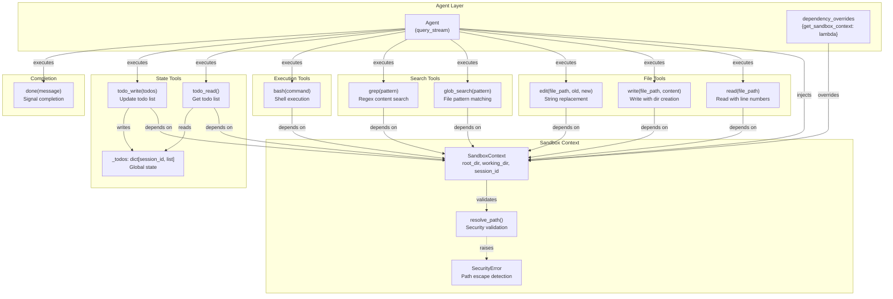
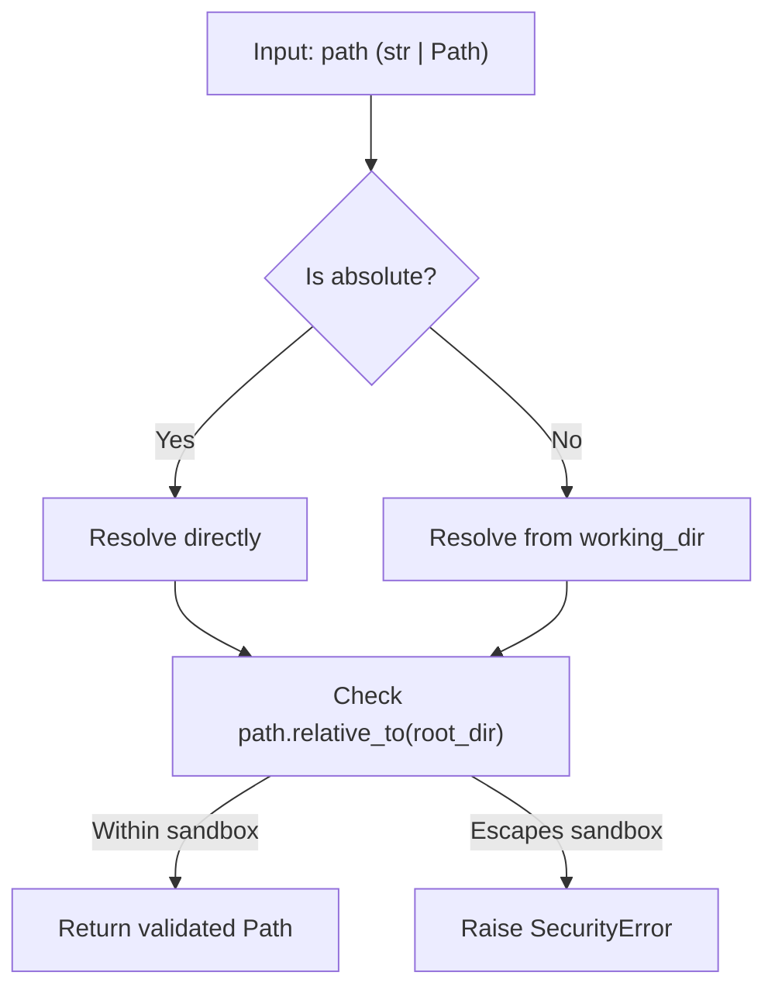
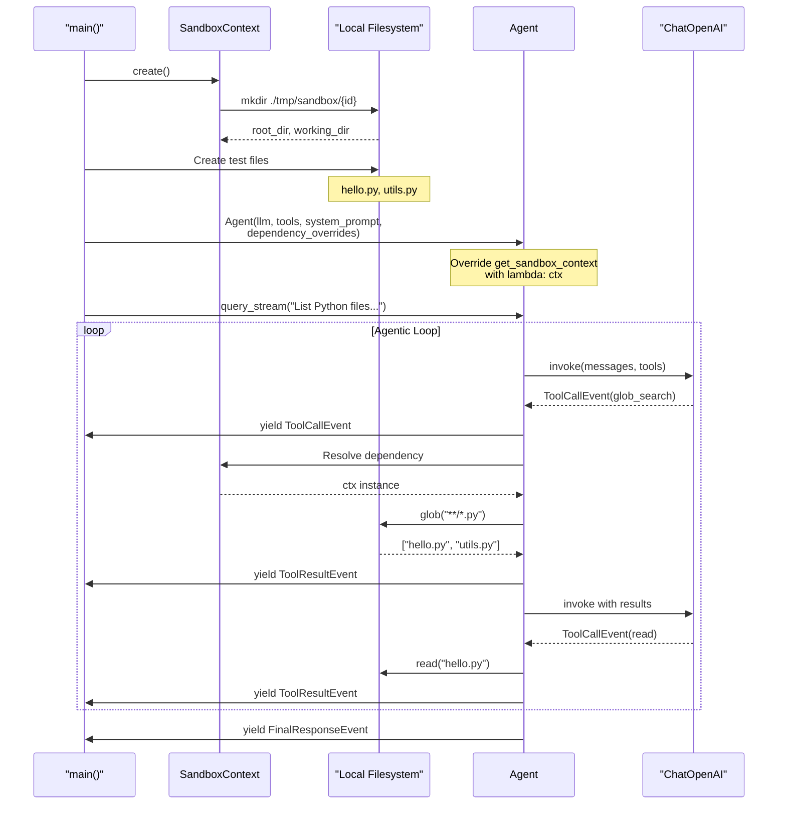
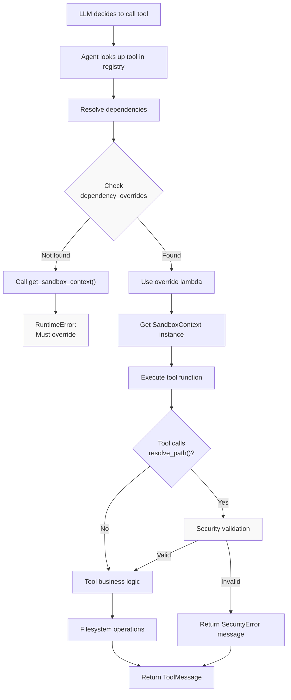

<!-- source: DeepWiki mcp.deepwiki.com · repo browser-use/agent-sdk · page 7.3 Claude Code: Sandboxed Filesystem Tools · fetched 2026-10-30 -->

# Claude Code: Sandboxed Filesystem Tools

<details>
<summary>Relevant source files</summary>

The following files were used as context for generating this wiki page:

- [README.md](README.md)
- [bu_agent_sdk/examples/claude_code.py](bu_agent_sdk/examples/claude_code.py)

</details>


This page demonstrates building a complete coding assistant using the bu_agent_sdk with sandboxed filesystem operations, bash execution, and todo management. The example showcases practical patterns for secure tool development using dependency injection to isolate filesystem access and session-scoped state management.

This is a complete, production-ready example of an agentic system. For basic tool definition patterns, see [Defining Tools](#6.1). For dependency injection fundamentals, see [Dependency Injection](#6.2).

## Overview

The Claude Code example implements a sandboxed coding assistant that provides:
- **Filesystem operations**: read, write, edit files with security constraints
- **Search capabilities**: glob patterns and regex-based grep
- **Shell execution**: bash commands in a restricted environment
- **Todo management**: session-scoped task tracking
- **Security**: all file operations constrained to a sandbox root directory

The implementation uses dependency injection to provide a `SandboxContext` to all tools, ensuring filesystem operations cannot escape the designated sandbox directory.

Sources: [README.md:140-227](), [bu_agent_sdk/examples/claude_code.py:1-341]()

## System Architecture



Sources: [bu_agent_sdk/examples/claude_code.py:26-298]()

## Sandbox Security Model

### SandboxContext Class

The `SandboxContext` dataclass manages filesystem security by constraining all operations to a designated root directory. It maintains three key attributes:

| Attribute | Type | Purpose |
|-----------|------|---------|
| `root_dir` | `Path` | Absolute path to sandbox root; all operations must stay within |
| `working_dir` | `Path` | Current working directory for relative path resolution |
| `session_id` | `str` | Unique session identifier for state isolation |

The `create()` class method initializes a sandbox, defaulting to `./tmp/sandbox/{session_id}` if no root is specified:

[bu_agent_sdk/examples/claude_code.py:37-56]()

### Path Resolution and Security

The `resolve_path()` method is the critical security boundary. It performs two operations:

1. **Path resolution**: Converts relative paths to absolute paths based on `working_dir`
2. **Security validation**: Ensures the resolved path remains within `root_dir`



The security check uses `Path.relative_to()`, which raises `ValueError` if the path is not a subpath of `root_dir`. This prevents directory traversal attacks using `..` or symlinks:

[bu_agent_sdk/examples/claude_code.py:57-71]()

The `SecurityError` exception is a custom exception class that provides clear error messaging when path validation fails:

[bu_agent_sdk/examples/claude_code.py:31-34]()

Sources: [bu_agent_sdk/examples/claude_code.py:31-78]()

## Dependency Injection Pattern

### Dependency Provider

The `get_sandbox_context()` function serves as a dependency provider marker. It intentionally raises `RuntimeError` when called directly, forcing users to override it via `dependency_overrides`:

[bu_agent_sdk/examples/claude_code.py:73-77]()

### Tool Dependency Declaration

Tools declare dependency on `SandboxContext` using `Annotated[SandboxContext, Depends(get_sandbox_context)]`. The Agent's dependency injection system resolves this at runtime:

```python
async def read(
    file_path: str,
    ctx: Annotated[SandboxContext, Depends(get_sandbox_context)],
) -> str:
```

This pattern ensures:
- Tools remain testable (override with mock contexts)
- Security policy is centralized (single `SandboxContext` instance)
- No global state in tool functions

Sources: [bu_agent_sdk/examples/claude_code.py:73-77](), [bu_agent_sdk/examples/claude_code.py:114-118]()

## Filesystem Tools

### Read Tool

The `read` tool returns file contents with line numbers for easier reference. It handles errors gracefully, returning descriptive error messages rather than raising exceptions:

[bu_agent_sdk/examples/claude_code.py:114-134]()

Key features:
- Line numbering (4-digit padded) for precise reference in subsequent `edit` calls
- Security validation via `ctx.resolve_path()`
- Error handling for missing files, directories, and read failures

### Write Tool

The `write` tool creates or overwrites files, automatically creating parent directories:

[bu_agent_sdk/examples/claude_code.py:137-154]()

Features:
- `path.parent.mkdir(parents=True, exist_ok=True)` ensures directory structure exists
- Returns byte count for confirmation
- Security validation prevents path escape

### Edit Tool

The `edit` tool performs string replacement on file contents:

[bu_agent_sdk/examples/claude_code.py:157-181]()

The tool:
- Uses simple string replacement (`str.replace()`) rather than regex for predictability
- Reports occurrence count for confirmation
- Validates string existence before modification to prevent silent failures

Sources: [bu_agent_sdk/examples/claude_code.py:109-182]()

## Search Tools

### Glob Search

The `glob_search` tool finds files matching glob patterns like `**/*.py` or `*.txt`:

[bu_agent_sdk/examples/claude_code.py:189-208]()

Features:
- Defaults to `working_dir` if no path specified
- Filters results to files only (excludes directories)
- Limits results to 50 to prevent context overflow
- Returns relative paths from `root_dir` for clarity

### Grep Tool

The `grep` tool searches file contents using regex patterns:

[bu_agent_sdk/examples/claude_code.py:211-241]()

Implementation details:
- Compiles regex with error handling
- Recursively searches all files via `rglob("*")`
- Truncates matching lines to 100 characters
- Limits results to 50 matches
- Silently skips binary/unreadable files to prevent errors
- Returns file path, line number, and matching line content

Sources: [bu_agent_sdk/examples/claude_code.py:184-242]()

## Bash Execution Tool

The `bash` tool executes shell commands within the sandbox environment:

[bu_agent_sdk/examples/claude_code.py:85-106]()

Key configurations:
- `cwd=str(ctx.working_dir)`: Sets working directory to sandbox location
- `timeout=30`: Prevents infinite-running commands
- `capture_output=True, text=True`: Captures stdout/stderr as text
- `shell=True`: Enables shell features like pipes, wildcards

Error handling:
- `TimeoutExpired`: Returns timeout message
- General exceptions: Returns error description

**Security note**: While the `cwd` is set to `working_dir`, shell commands can still access system utilities. For production use, consider additional sandboxing via containers or restricted shells.

Sources: [bu_agent_sdk/examples/claude_code.py:80-107]()

## Todo Management

### Session-Scoped State

The todo system uses a global dictionary keyed by `session_id` to maintain per-session todo lists:

[bu_agent_sdk/examples/claude_code.py:248]()

This approach:
- Isolates todos between different agent sessions
- Avoids filesystem persistence (suitable for short-lived sessions)
- Simplifies implementation without external dependencies

### Todo Read Tool

The `todo_read` tool retrieves and formats the current todo list:

[bu_agent_sdk/examples/claude_code.py:251-265]()

Todo status mapping:
- `pending`: `[ ]`
- `in_progress`: `[>]`
- `completed`: `[x]`

### Todo Write Tool

The `todo_write` tool updates the entire todo list and returns statistics:

[bu_agent_sdk/examples/claude_code.py:268-280]()

Expected todo structure:
```python
{
    "content": str,      # Description
    "status": str,       # "pending" | "in_progress" | "completed"
    "activeForm": Any    # Additional metadata
}
```

Sources: [bu_agent_sdk/examples/claude_code.py:244-281]()

## Done Tool

The `done` tool signals task completion. In the example, it returns a message rather than raising `TaskComplete`:

[bu_agent_sdk/examples/claude_code.py:288-291]()

**Note**: The README version demonstrates the standard pattern with `raise TaskComplete(message)` for autonomous mode. The example file's simpler approach works for CLI-style interaction where the Agent automatically stops when no more tool calls are made.

Sources: [bu_agent_sdk/examples/claude_code.py:284-292](), [README.md:196-198]()

## Complete Integration Example

The `main()` function demonstrates assembling all components:



[bu_agent_sdk/examples/claude_code.py:306-340]()

Key setup steps:

1. **Create sandbox**: `SandboxContext.create()` initializes a temporary directory
2. **Seed files**: Test files demonstrate filesystem operations
3. **Configure agent**: 
   - Tools: All 9 tools in `ALL_TOOLS` list
   - System prompt: Informs agent of working directory
   - Dependency overrides: Maps `get_sandbox_context` to lambda returning `ctx`
4. **Stream execution**: `query_stream()` yields events for display

The dependency override is critical:
```python
dependency_overrides={get_sandbox_context: lambda: ctx}
```

This maps the dependency provider to a lambda that returns the concrete `ctx` instance, enabling all tools to access the same sandbox configuration.

Sources: [bu_agent_sdk/examples/claude_code.py:298-340]()

## Tool Execution Flow with Security



This flow demonstrates how dependency injection and security validation integrate into tool execution:

1. **Dependency resolution**: Agent checks `dependency_overrides` before calling provider
2. **Security layer**: Tools call `ctx.resolve_path()` which validates paths
3. **Error handling**: Security violations return error messages rather than raising exceptions
4. **Graceful degradation**: Tools continue execution even with validation failures

The pattern ensures security checks are consistent across all tools without duplicating validation logic.

Sources: [bu_agent_sdk/examples/claude_code.py:1-341](), [README.md:140-227]()

## Usage Patterns

### Simple File Operations

```python
# Agent receives: "Create a Python file with a hello world function"
# LLM calls: write(file_path="hello.py", content="def hello():\n    print('Hello')")
# Result: "Wrote 35 bytes to hello.py"
```

### Multi-Step Workflows

```python
# Agent receives: "Find all Python files and add docstrings"
# Step 1: glob_search(pattern="**/*.py") -> ["hello.py", "utils.py"]
# Step 2: read(file_path="hello.py") -> "  1  def hello():\n  2      print('Hello')"
# Step 3: edit(file_path="hello.py", old="def hello():", new='def hello():\n    """Say hello."""')
# Result: Modified file with docstring
```

### Bash Integration

```python
# Agent receives: "Run the Python file and show output"
# LLM calls: bash(command="python hello.py")
# Result: "Hello, World!"
```

### Todo Tracking

```python
# Agent receives: "List all tasks and mark the first one complete"
# Step 1: todo_read() -> "1. [ ] Add docstrings\n2. [ ] Run tests"
# Step 2: todo_write(todos=[
#     {"content": "Add docstrings", "status": "completed", "activeForm": None},
#     {"content": "Run tests", "status": "pending", "activeForm": None}
# ])
# Result: "Updated todos: 1 pending, 0 in progress, 1 completed"
```

Sources: [bu_agent_sdk/examples/claude_code.py:1-341]()

## Extended Example with All Tools

The README provides a condensed version (100 lines) demonstrating the core pattern, while the full example at [bu_agent_sdk/examples/claude_code.py]() includes:

- **Security**: `SecurityError` exception and comprehensive validation
- **Edit tool**: String replacement capability
- **Search tools**: `glob_search` and `grep` with regex
- **Todo management**: Session-scoped state with status tracking
- **Error handling**: Graceful degradation for all tool operations
- **Event streaming**: Real-time display of tool calls and results

The condensed version focuses on core concepts:

[README.md:140-227]()

Both versions demonstrate the same architectural patterns:
- Dependency injection for security context
- Path resolution with sandbox constraints
- Tool execution with error handling
- Event-based observability

Sources: [README.md:140-227](), [bu_agent_sdk/examples/claude_code.py:1-341]()

---

