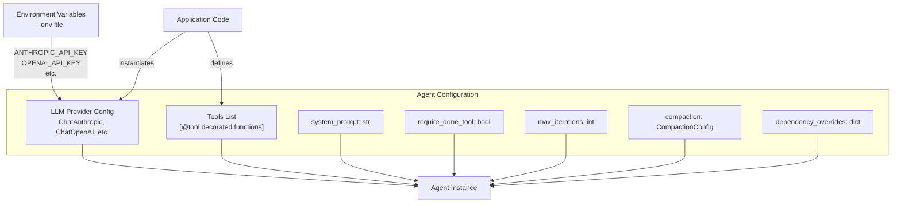
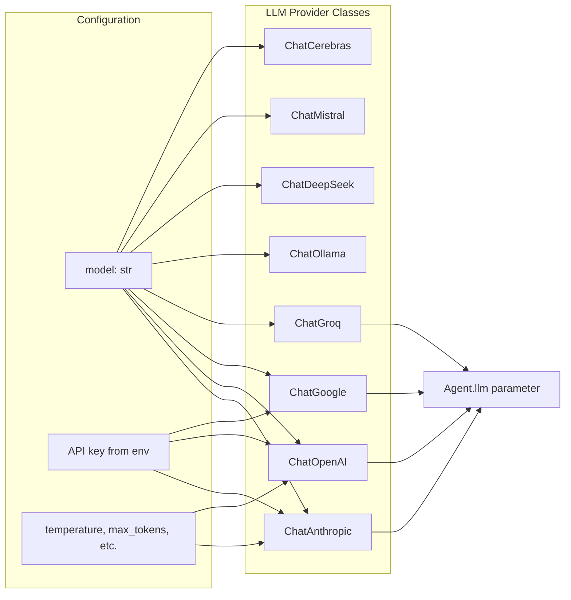
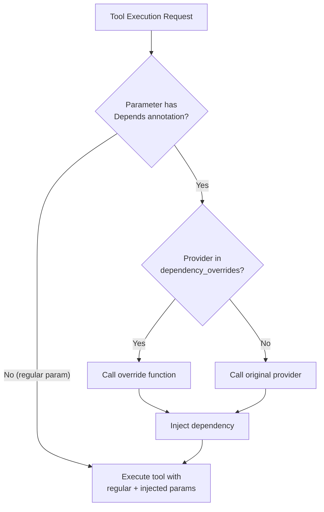
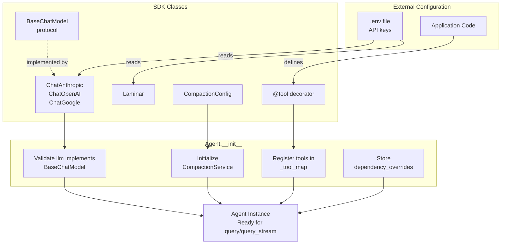

<!-- source: DeepWiki mcp.deepwiki.com · repo browser-use/agent-sdk · page 8 Configuration and Setup · fetched 2026-10-30 -->

# Configuration and Setup

<details>
<summary>Relevant source files</summary>

The following files were used as context for generating this wiki page:

- [.gitignore](.gitignore)
- [README.md](README.md)
- [bu_agent_sdk/__init__.py](bu_agent_sdk/__init__.py)

</details>


This page covers installation, environment configuration, API key setup, and basic project configuration for the bu-agent-sdk. For information about specific LLM provider configurations and implementation details, see [Supported Providers](#5.2). For dependency injection configuration in tools, see [Dependency Injection](#6.2).

## Purpose and Scope

This document provides step-by-step instructions for:
- Installing the SDK using package managers
- Configuring API keys and environment variables
- Setting up basic `Agent` instances
- Configuring LLM providers
- Enabling optional features (compaction, observability)

---

## Installation

The bu-agent-sdk can be installed using `uv` (recommended) or `pip`. The SDK requires Python 3.8 or higher.

### Using uv (Recommended)

For development or when cloning the repository:

```bash
uv sync
```

To add as a dependency to an existing project:

```bash
uv add bu-agent-sdk
```

### Using pip

```bash
pip install bu-agent-sdk
```

**Sources:** [README.md:11-19]()

---

## API Keys and Environment Variables

The SDK requires API keys for LLM providers. These should be stored as environment variables and never committed to version control.

### Environment Variable Configuration

Create a `.env` file in your project root:

```bash
# Anthropic (Claude)
ANTHROPIC_API_KEY=sk-ant-...

# OpenAI (GPT-4, GPT-4o)
OPENAI_API_KEY=sk-proj-...

# Google (Gemini)
GOOGLE_API_KEY=...

# Groq
GROQ_API_KEY=...

# DeepSeek
DEEPSEEK_API_KEY=...

# Mistral
MISTRAL_API_KEY=...

# Cerebras
CEREBRAS_API_KEY=...

# Optional: Laminar observability
LAMINAR_API_KEY=...
```

### Environment Variable Security

The `.gitignore` file explicitly excludes environment files to prevent accidental commits:

```
.env
.envrc
```

**Sources:** [.gitignore:150-152](), [.gitignore:218]()

### Environment Variable Table

| Provider | Environment Variable | Required | Purpose |
|----------|---------------------|----------|---------|
| Anthropic | `ANTHROPIC_API_KEY` | Yes (if using Claude) | Authenticates Claude API requests |
| OpenAI | `OPENAI_API_KEY` | Yes (if using GPT) | Authenticates OpenAI API requests |
| Google | `GOOGLE_API_KEY` | Yes (if using Gemini) | Authenticates Google Gemini requests |
| Groq | `GROQ_API_KEY` | Yes (if using Groq) | Authenticates Groq API requests |
| DeepSeek | `DEEPSEEK_API_KEY` | Yes (if using DeepSeek) | Authenticates DeepSeek API requests |
| Mistral | `MISTRAL_API_KEY` | Yes (if using Mistral) | Authenticates Mistral API requests |
| Cerebras | `CEREBRAS_API_KEY` | Yes (if using Cerebras) | Authenticates Cerebras API requests |
| Laminar | `LAMINAR_API_KEY` | No | Enables observability tracking |

---

## Basic Agent Configuration

### Minimal Agent Setup

The minimal configuration requires an LLM provider and a list of tools:

```python
from bu_agent_sdk import Agent
from bu_agent_sdk.llm import ChatAnthropic
from bu_agent_sdk.tools import tool

@tool("Add two numbers")
async def add(a: int, b: int) -> int:
    return a + b

agent = Agent(
    llm=ChatAnthropic(model="claude-sonnet-4-20250514"),
    tools=[add],
)
```

### Configuration Flow Diagram



**Sources:** [README.md:23-46](), [bu_agent_sdk/__init__.py:1-29]()

---

## Agent Constructor Parameters

### Core Parameters

The `Agent` class constructor accepts the following parameters:

| Parameter | Type | Default | Description |
|-----------|------|---------|-------------|
| `llm` | `BaseChatModel` | Required | LLM provider instance (e.g., `ChatAnthropic`) |
| `tools` | `list[Callable]` | Required | List of tool functions decorated with `@tool` |
| `system_prompt` | `str` | `None` | System message prepended to conversation |
| `require_done_tool` | `bool` | `False` | If `True`, forces explicit `TaskComplete` to finish |
| `max_iterations` | `int` | `50` | Maximum agentic loop iterations |
| `compaction` | `CompactionConfig \| None` | `None` | Context compaction configuration |
| `dependency_overrides` | `dict` | `{}` | Dependency injection overrides |

### Configuration Patterns

#### CLI Mode (Default)

```python
agent = Agent(
    llm=ChatAnthropic(model="claude-sonnet-4-20250514"),
    tools=[add, subtract],
    require_done_tool=False,  # Stops when LLM returns no tool calls
)
```

#### Autonomous Mode

```python
@tool("Signal task completion")
async def done(message: str) -> str:
    from bu_agent_sdk.agent import TaskComplete
    raise TaskComplete(message)

agent = Agent(
    llm=ChatAnthropic(model="claude-sonnet-4-20250514"),
    tools=[add, subtract, done],
    require_done_tool=True,  # Forces explicit completion
)
```

**Sources:** [README.md:56-70]()

---

## LLM Provider Configuration

### Provider Class Mapping



### Provider Examples

#### Anthropic (Claude)

```python
from bu_agent_sdk.llm import ChatAnthropic

llm = ChatAnthropic(
    model="claude-sonnet-4-20250514",
    # Reads ANTHROPIC_API_KEY from environment
)

agent = Agent(llm=llm, tools=tools)
```

#### OpenAI (GPT-4)

```python
from bu_agent_sdk.llm import ChatOpenAI

llm = ChatOpenAI(
    model="gpt-4o",
    # Reads OPENAI_API_KEY from environment
)

agent = Agent(llm=llm, tools=tools)
```

#### Google (Gemini)

```python
from bu_agent_sdk.llm import ChatGoogle

llm = ChatGoogle(
    model="gemini-2.0-flash",
    # Reads GOOGLE_API_KEY from environment
)

agent = Agent(llm=llm, tools=tools)
```

**Sources:** [README.md:83-93]()

---

## Optional Configuration

### Compaction Configuration

Context compaction automatically summarizes conversation history when token usage approaches model limits.

```python
from bu_agent_sdk.agent import CompactionConfig

agent = Agent(
    llm=llm,
    tools=tools,
    compaction=CompactionConfig(
        enabled=True,
        threshold_ratio=0.80,  # Compact at 80% of context window
        summary_prompt="Summarize the conversation so far...",
    ),
)
```

**Configuration Parameters:**

| Parameter | Type | Default | Description |
|-----------|------|---------|-------------|
| `enabled` | `bool` | `True` | Enable/disable compaction |
| `threshold_ratio` | `float` | `0.80` | Token ratio threshold (0.0-1.0) |
| `summary_prompt` | `str` | Built-in | Custom summarization prompt |

For detailed compaction behavior, see [Compaction Configuration](#4.1).

**Sources:** [README.md:95-107]()

### Observability Configuration

Laminar integration provides tracing and debugging capabilities:

```python
from bu_agent_sdk import Laminar

# Initialize once at application start
Laminar.initialize(project_name="my-agent-project")
# Reads LAMINAR_API_KEY from environment

agent = Agent(llm=llm, tools=tools)
# Agent automatically instruments calls if Laminar is initialized
```

For detailed observability features, see [Observability and Debugging](#9).

**Sources:** [bu_agent_sdk/__init__.py:22-28]()

---

## Dependency Injection Configuration

### Dependency Overrides

The `dependency_overrides` parameter allows runtime injection of dependencies into tools:

```python
from pathlib import Path
from dataclasses import dataclass
from typing import Annotated
from bu_agent_sdk.tools import Depends, tool

@dataclass
class SandboxContext:
    root_dir: Path
    working_dir: Path

def get_sandbox() -> SandboxContext:
    raise RuntimeError("Override via dependency_overrides")

@tool("Read file")
async def read_file(
    path: str,
    ctx: Annotated[SandboxContext, Depends(get_sandbox)]
) -> str:
    return ctx.resolve_path(path).read_text()

# Configuration
sandbox = SandboxContext(
    root_dir=Path("./sandbox"),
    working_dir=Path("./sandbox")
)

agent = Agent(
    llm=llm,
    tools=[read_file],
    dependency_overrides={
        get_sandbox: lambda: sandbox
    }
)
```

### Dependency Resolution Flow



For comprehensive dependency injection patterns, see [Dependency Injection](#6.2).

**Sources:** [README.md:109-123](), [README.md:144-224]()

---

## Complete Configuration Example

### Full-Featured Agent Setup

```python
import asyncio
from pathlib import Path
from bu_agent_sdk import Agent, Laminar
from bu_agent_sdk.llm import ChatAnthropic
from bu_agent_sdk.agent import CompactionConfig, TaskComplete
from bu_agent_sdk.tools import tool

# 1. Initialize observability (optional)
Laminar.initialize(project_name="my-agent")

# 2. Define tools
@tool("Calculate sum")
async def add(a: int, b: int) -> int:
    return a + b

@tool("Signal completion")
async def done(message: str) -> str:
    raise TaskComplete(message)

# 3. Configure LLM provider
llm = ChatAnthropic(
    model="claude-sonnet-4-20250514",
    # API key from ANTHROPIC_API_KEY env var
)

# 4. Create agent with full configuration
agent = Agent(
    llm=llm,
    tools=[add, done],
    system_prompt="You are a helpful assistant.",
    require_done_tool=True,
    max_iterations=50,
    compaction=CompactionConfig(
        enabled=True,
        threshold_ratio=0.80,
    ),
    dependency_overrides={},
)

# 5. Execute query
async def main():
    result = await agent.query("What is 10 + 20?")
    print(result)

asyncio.run(main())
```

### Configuration Entity Relationships



**Sources:** [README.md:23-46](), [README.md:144-224]()

---

## Configuration Checklist

Use this checklist to verify proper configuration:

- [ ] **Installation**: SDK installed via `uv` or `pip`
- [ ] **Environment**: `.env` file created with required API keys
- [ ] **Git**: `.env` file listed in `.gitignore`
- [ ] **LLM Provider**: Selected and configured (e.g., `ChatAnthropic`)
- [ ] **Tools**: At least one tool defined with `@tool` decorator
- [ ] **Agent Instance**: `Agent` instantiated with `llm` and `tools`
- [ ] **Mode Selection**: `require_done_tool` set appropriately
- [ ] **Optional - Compaction**: `CompactionConfig` added if needed
- [ ] **Optional - Observability**: `Laminar.initialize()` called if needed
- [ ] **Optional - Dependencies**: `dependency_overrides` configured for injected tools

---

## Troubleshooting

### Common Configuration Issues

| Issue | Cause | Solution |
|-------|-------|----------|
| `ANTHROPIC_API_KEY not found` | Missing environment variable | Add key to `.env` file |
| `Model does not implement BaseChatModel` | Incorrect LLM class | Use official provider classes from `bu_agent_sdk.llm` |
| `Tool not found` | Tool not registered | Ensure tool passed in `tools` list |
| `Dependency provider failed` | No override configured | Add provider to `dependency_overrides` |
| Import error for `bu_agent_sdk` | Package not installed | Run `uv sync` or `pip install bu-agent-sdk` |

**Sources:** [README.md:1-256](), [.gitignore:1-219](), [bu_agent_sdk/__init__.py:1-29]()

---

