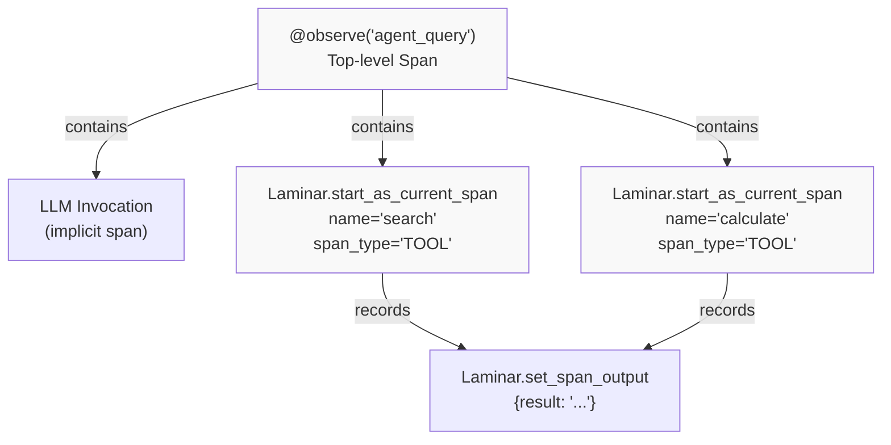
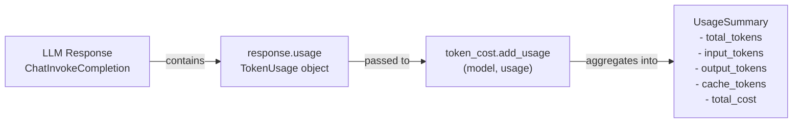
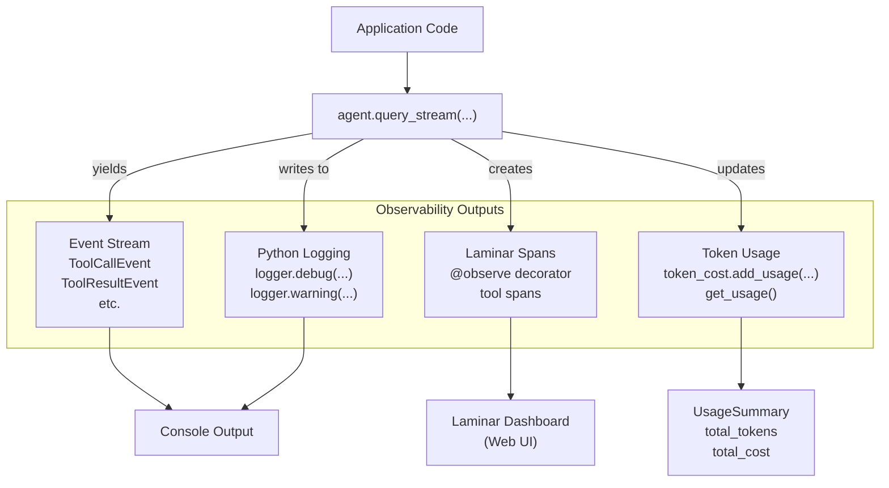

<!-- source: DeepWiki mcp.deepwiki.com · repo browser-use/agent-sdk · page 9 Observability and Debugging · fetched 2026-10-30 -->

# Observability and Debugging

<details>
<summary>Relevant source files</summary>

The following files were used as context for generating this wiki page:

- [bu_agent_sdk/__init__.py](bu_agent_sdk/__init__.py)
- [bu_agent_sdk/agent/README.md](bu_agent_sdk/agent/README.md)
- [bu_agent_sdk/agent/service.py](bu_agent_sdk/agent/service.py)

</details>


## Purpose and Scope

This page covers the observability and debugging capabilities built into `bu_agent_sdk`. These features enable you to monitor agent execution, track resource usage, diagnose issues, and understand agent behavior in production. The SDK provides three primary observability mechanisms:

1. **Laminar Integration** - Distributed tracing and span instrumentation
2. **Token Usage Tracking** - Cost monitoring and resource consumption
3. **Event Streaming** - Real-time execution visibility (covered in detail in [Event System](#3))
4. **Standard Logging** - Diagnostic output for development and debugging

For general agent execution flow and how events are emitted during operation, see [Event System](#3). For understanding message history and conversation state, see [Message History and State](#2.3).

---

## Laminar Integration

The SDK integrates with [Laminar](https://laminar.ai) for observability and distributed tracing. Laminar provides a unified interface to instrument agent operations, track LLM calls, and visualize execution flows.

### The `@observe` Decorator

The agent's main query methods are instrumented with the `@observe` decorator to create top-level spans:

```python
@observe(name="agent_query")
async def query(self, message: str) -> str:
    ...

@observe(name="agent_query_stream")
async def query_stream(self, message: str) -> AsyncIterator[AgentEvent]:
    ...
```

This automatically creates a span for each agent invocation, capturing inputs, outputs, duration, and any errors.

**Sources:** [bu_agent_sdk/agent/service.py:611-612](), [bu_agent_sdk/agent/service.py:702-703]()

### Tool Execution Spans

Each tool execution is wrapped in a Laminar span with type `"TOOL"`. The span captures:
- Tool name
- Input arguments
- Execution result (truncated to 500 chars)
- Error information if the tool fails
- `TaskComplete` signals



**Diagram: Laminar Span Hierarchy**

The implementation creates a span context for each tool execution:

[bu_agent_sdk/agent/service.py:314-324]()

Results are recorded using `Laminar.set_span_output()`:

[bu_agent_sdk/agent/service.py:351-358]()

**Sources:** [bu_agent_sdk/agent/service.py:314-394]()

### TaskComplete Handling

The agent ensures that `TaskComplete` exceptions are logged correctly in Laminar spans without appearing as errors:

[bu_agent_sdk/agent/service.py:372-390]()

The exception is captured, the span output is set with `{"task_complete": True}`, the span context exits cleanly, and then the exception is re-raised.

**Sources:** [bu_agent_sdk/agent/service.py:372-390]()

### Enabling Laminar

Import and configure Laminar observability:

```python
from bu_agent_sdk import Agent, Laminar, observe
from bu_agent_sdk.llm import ChatOpenAI

# Laminar is enabled automatically when imported
# Configure via environment variables:
# LAMINAR_API_KEY=your_key
# LAMINAR_PROJECT_NAME=your_project

agent = Agent(
    llm=ChatOpenAI(model="gpt-4o"),
    tools=[...],
)

result = await agent.query("task")  # Automatically instrumented
```

The `Laminar` class and decorators are exported from the main package:

[bu_agent_sdk/__init__.py:22-29]()

**Sources:** [bu_agent_sdk/__init__.py:22-29]()

---

## Token Usage Tracking

The SDK provides comprehensive token tracking through the `TokenCost` service, which monitors input tokens, output tokens, cached tokens, and calculates costs when enabled.

### TokenCost Service

The `TokenCost` service is initialized automatically in the agent:

[bu_agent_sdk/agent/service.py:162-163]()

Token usage is tracked after each LLM invocation:

[bu_agent_sdk/agent/service.py:451-453]()

**Sources:** [bu_agent_sdk/agent/service.py:162-163](), [bu_agent_sdk/agent/service.py:451-453]()

### Accessing Token Usage

The agent provides methods to access usage information:

| Method | Return Type | Description |
|--------|-------------|-------------|
| `agent.get_usage()` | `UsageSummary` | Returns aggregate token counts and costs |
| `agent.token_cost` | `TokenCost` | Direct access to the tracking service |
| `agent.clear_history()` | None | Resets message history and token usage |

Example usage:

```python
# After agent execution
usage = await agent.get_usage()
print(f"Tokens: {usage.total_tokens}")
print(f"Input: {usage.input_tokens}")
print(f"Output: {usage.output_tokens}")
print(f"Cached: {usage.cache_tokens}")
print(f"Cost: ${usage.total_cost:.4f}")
```

[bu_agent_sdk/agent/service.py:191-197]()

**Sources:** [bu_agent_sdk/agent/service.py:191-197](), [bu_agent_sdk/agent/service.py:199-202]()

### Cost Calculation

Cost calculation is optional and controlled by the `include_cost` parameter:

[bu_agent_sdk/agent/service.py:129]()

When enabled, the SDK fetches pricing data for the LLM model and calculates costs based on token usage. When disabled, only token counts are tracked, avoiding external API calls.



**Diagram: Token Usage Tracking Flow**

**Sources:** [bu_agent_sdk/agent/service.py:129](), [bu_agent_sdk/agent/service.py:162-163](), [bu_agent_sdk/agent/service.py:451-453]()

### Compaction Token Tracking

The compaction service also tracks token usage separately to determine when to trigger compaction:

[bu_agent_sdk/agent/service.py:597]()

This tracking is independent of the agent-level token cost service and focuses on context window management. See [Compaction Configuration](#4.1) for details.

**Sources:** [bu_agent_sdk/agent/service.py:582-609]()

---

## Standard Logging

The SDK uses Python's standard `logging` module for diagnostic output. The main logger is:

```python
logger = logging.getLogger("bu_agent_sdk.agent")
```

[bu_agent_sdk/agent/service.py:68]()

### What Gets Logged

The SDK logs various operational events at different levels:

| Log Level | Events |
|-----------|--------|
| `DEBUG` | Ephemeral message destruction, compaction decisions |
| `WARNING` | LLM retry attempts, rate limit errors, failed summary generation |
| `INFO` | (Reserved for future use) |
| `ERROR` | (Errors are typically raised as exceptions) |

**Example log outputs:**

```
DEBUG - 🗑️  Destroying ephemeral: read_file (keeping last 3)
WARNING - ⚠️ Got rate limit error, retrying in 2.3s... (attempt 1/5)
WARNING - ⚠️ Got 503 error, retrying in 4.6s... (attempt 2/5)
WARNING - Failed to generate max iterations summary: Connection timeout
```

### Key Logged Operations

**Ephemeral Message Destruction:**
[bu_agent_sdk/agent/service.py:271-274]()

**LLM Retry Attempts:**
[bu_agent_sdk/agent/service.py:469-472](), [bu_agent_sdk/agent/service.py:493-496](), [bu_agent_sdk/agent/service.py:521-524]()

**Summary Generation Failures:**
[bu_agent_sdk/agent/service.py:561-562]()

**Sources:** [bu_agent_sdk/agent/service.py:68](), [bu_agent_sdk/agent/service.py:271-274](), [bu_agent_sdk/agent/service.py:469-472](), [bu_agent_sdk/agent/service.py:493-496](), [bu_agent_sdk/agent/service.py:521-524](), [bu_agent_sdk/agent/service.py:561-562]()

### Configuring Logging

Configure logging in your application:

```python
import logging

# Basic configuration
logging.basicConfig(level=logging.DEBUG)

# More specific configuration
logger = logging.getLogger("bu_agent_sdk.agent")
logger.setLevel(logging.DEBUG)

handler = logging.StreamHandler()
handler.setFormatter(logging.Formatter(
    '%(asctime)s - %(name)s - %(levelname)s - %(message)s'
))
logger.addHandler(handler)
```

---

## Event Streaming for Debugging

The `query_stream` method provides real-time visibility into agent execution by yielding typed events. This is the primary debugging interface for understanding what the agent is doing.

For comprehensive documentation on event types and streaming patterns, see [Event System](#3). This section focuses on how to use events for debugging.

### Key Debugging Events

| Event Type | When Emitted | Debugging Use |
|------------|--------------|---------------|
| `ToolCallEvent` | Before tool execution | Inspect which tool is being called and with what arguments |
| `ToolResultEvent` | After tool execution | Verify tool outputs and check for errors |
| `ThinkingEvent` | LLM reasoning (extended thinking) | Understand model's reasoning process |
| `TextEvent` | LLM text output | See intermediate responses |
| `StepStartEvent` / `StepCompleteEvent` | Tool execution boundaries | Measure step duration, track status |
| `FinalResponseEvent` | Task completion | Identify when and why agent stopped |
| `HiddenUserMessageEvent` | Internal prompts | See hidden system messages (e.g., todo checks) |

**Sources:** [bu_agent_sdk/agent/service.py:69-79]()

### Debugging with Events

```python
from bu_agent_sdk.agent import (
    ToolCallEvent,
    ToolResultEvent,
    StepCompleteEvent,
    FinalResponseEvent,
)

async for event in agent.query_stream("complex task"):
    match event:
        case ToolCallEvent(tool=name, args=args, tool_call_id=id):
            print(f"[{id}] Calling {name}")
            print(f"  Args: {args}")
        
        case ToolResultEvent(tool=name, result=result, is_error=error):
            if error:
                print(f"  ERROR in {name}: {result}")
            else:
                print(f"  {name} returned: {result[:100]}...")
        
        case StepCompleteEvent(duration_ms=duration, status=status):
            print(f"  Completed in {duration:.0f}ms [{status}]")
        
        case FinalResponseEvent(content=text):
            print(f"\nFinal: {text}")
```

**Sources:** [bu_agent_sdk/agent/service.py:702-873]()

---

## Debugging Techniques

### 1. Inspecting Message History

Access the agent's conversation history to understand context:

```python
# Read-only access to messages
messages = agent.messages

for msg in messages:
    print(f"{type(msg).__name__}: {msg.content[:100]}...")
    
    if hasattr(msg, 'tool_calls') and msg.tool_calls:
        print(f"  Tool calls: {[tc.function.name for tc in msg.tool_calls]}")
```

The `messages` property returns a copy to prevent accidental modification:

[bu_agent_sdk/agent/service.py:182-184]()

**Sources:** [bu_agent_sdk/agent/service.py:182-184]()

### 2. Monitoring Token Usage in Real-Time

Track token consumption throughout execution:

```python
# Before
usage_before = await agent.get_usage()

await agent.query("task")

# After
usage_after = await agent.get_usage()
print(f"Tokens used: {usage_after.total_tokens - usage_before.total_tokens}")
print(f"Cost: ${usage_after.total_cost - usage_before.total_cost:.4f}")
```

### 3. Using Laminar Dashboard

When Laminar is configured, view traces in the dashboard:
- Navigate to your project in Laminar
- Find the trace by agent query timestamp
- Expand spans to see tool executions
- Inspect inputs/outputs for each operation
- Analyze timing and identify bottlenecks

### 4. Combining Multiple Observability Tools

```python
import logging
from bu_agent_sdk import Agent, Laminar
from bu_agent_sdk.llm import ChatOpenAI

# Enable debug logging
logging.basicConfig(level=logging.DEBUG)

# Agent with cost tracking enabled
agent = Agent(
    llm=ChatOpenAI(model="gpt-4o"),
    tools=[...],
    include_cost=True,  # Enable cost calculation
)

# Stream events for real-time debugging
async for event in agent.query_stream("task"):
    # Process events...
    pass

# Check final usage
usage = await agent.get_usage()
print(f"Total cost: ${usage.total_cost:.4f}")

# View detailed trace in Laminar dashboard
```



**Diagram: Complete Observability Stack**

---

## Common Debugging Scenarios

### Tool Execution Failures

**Symptoms:**
- `ToolResultEvent` with `is_error=True`
- Error messages in tool results
- Agent gets stuck or produces incorrect results

**Debugging approach:**
```python
async for event in agent.query_stream("task"):
    if isinstance(event, ToolResultEvent) and event.is_error:
        print(f"Tool {event.tool} failed:")
        print(f"  Error: {event.result}")
        print(f"  Call ID: {event.tool_call_id}")
        
        # Check message history for context
        messages = agent.messages
        # Find the ToolCallEvent that preceded this error
```

**Common causes:**
- Invalid arguments (JSON parse errors)
- Dependency injection failures
- Exceptions in tool implementation
- Missing `@tool` decorator

**Sources:** [bu_agent_sdk/agent/service.py:362-386]()

### Rate Limiting

**Symptoms:**
- Log messages showing retry attempts
- Slow agent execution with delays
- `ModelRateLimitError` exceptions

**Debugging approach:**
Check logs for retry patterns:
```
WARNING - ⚠️ Got rate limit error, retrying in 2.3s... (attempt 1/5)
WARNING - ⚠️ Got rate limit error, retrying in 4.6s... (attempt 2/5)
```

The agent automatically retries with exponential backoff:

[bu_agent_sdk/agent/service.py:457-475]()

**Configuration:**
```python
agent = Agent(
    llm=ChatOpenAI(model="gpt-4o"),
    tools=[...],
    llm_max_retries=5,  # Default
    llm_retry_base_delay=1.0,  # Seconds
    llm_retry_max_delay=60.0,  # Max delay
)
```

**Sources:** [bu_agent_sdk/agent/service.py:135-144](), [bu_agent_sdk/agent/service.py:457-475]()

### Token Limit Issues

**Symptoms:**
- `ModelProviderError` with context length errors
- Compaction triggers frequently
- Agent fails mid-conversation

**Debugging approach:**
```python
# Check token usage
usage = await agent.get_usage()
print(f"Total tokens: {usage.total_tokens}")

# Check model's context window
model_limit = agent.llm.max_context_tokens  # If available
print(f"Model limit: {model_limit}")

# Monitor compaction
# Check logs for compaction events
```

**Configuration:**
```python
from bu_agent_sdk.agent.compaction import CompactionConfig

agent = Agent(
    llm=ChatOpenAI(model="gpt-4o"),
    tools=[...],
    compaction=CompactionConfig(
        enabled=True,
        threshold_ratio=0.70,  # Trigger at 70% instead of 80%
    ),
)
```

See [Compaction Configuration](#4.1) for details on context management.

**Sources:** [bu_agent_sdk/agent/service.py:23-31]()

### Max Iterations Reached

**Symptoms:**
- Agent stops with a summary message
- `FinalResponseEvent` contains "[Max iterations reached]"
- Task not fully completed

**Debugging approach:**
```python
agent = Agent(
    llm=ChatOpenAI(model="gpt-4o"),
    tools=[...],
    max_iterations=200,  # Increase if needed
)

# The agent generates a summary when max iterations is reached
result = await agent.query("complex task")
if "[Max iterations reached]" in result:
    print("Agent hit iteration limit")
    
    # Check message history to see what happened
    messages = agent.messages
    tool_calls = sum(
        1 for msg in messages 
        if hasattr(msg, 'tool_calls') and msg.tool_calls
    )
    print(f"Tool calls made: {tool_calls}")
```

The summary generation logic:

[bu_agent_sdk/agent/service.py:534-567]()

**Sources:** [bu_agent_sdk/agent/service.py:126](), [bu_agent_sdk/agent/service.py:534-567](), [bu_agent_sdk/agent/service.py:699-700]()

### Ephemeral Message Issues

**Symptoms:**
- Tool outputs show `<removed to save context>`
- Content unexpectedly missing from history
- Context window still fills up despite ephemeral tools

**Debugging approach:**
Check which messages are being destroyed:
```
DEBUG - 🗑️  Destroying ephemeral: read_file (keeping last 3)
```

Configure ephemeral storage to preserve destroyed content:

```python
from pathlib import Path

agent = Agent(
    llm=ChatOpenAI(model="gpt-4o"),
    tools=[...],
    ephemeral_storage_path=Path("./ephemeral_storage"),
)

# After execution, check saved content
storage_path = Path("./ephemeral_storage")
for file in storage_path.glob("*.json"):
    print(f"Saved: {file.name}")
```

The destruction logic with storage:

[bu_agent_sdk/agent/service.py:276-296]()

**Sources:** [bu_agent_sdk/agent/service.py:131-132](), [bu_agent_sdk/agent/service.py:229-299]()

### LLM Provider Errors

**Symptoms:**
- `ModelProviderError` exceptions
- Connection timeouts
- 500/502/503/504 errors

**Debugging approach:**
The agent retries automatically for transient errors:

[bu_agent_sdk/agent/service.py:477-528]()

Check logs for retry patterns. Configure retryable status codes:

```python
agent = Agent(
    llm=ChatOpenAI(model="gpt-4o"),
    tools=[...],
    llm_retryable_status_codes={429, 500, 502, 503, 504},  # Default
)
```

For non-retryable errors, check:
- API key configuration
- Network connectivity
- Provider-specific error messages

**Sources:** [bu_agent_sdk/agent/service.py:141-144](), [bu_agent_sdk/agent/service.py:436-532]()

---

## Summary

The `bu_agent_sdk` provides multiple layers of observability:

| Feature | Purpose | Configuration |
|---------|---------|---------------|
| **Laminar Integration** | Distributed tracing, span visualization | Automatic when imported, requires API key |
| **Token Tracking** | Cost monitoring, usage analysis | `include_cost=True` in Agent |
| **Event Streaming** | Real-time execution visibility | Use `query_stream()` instead of `query()` |
| **Standard Logging** | Development diagnostics | Configure Python `logging` module |

These tools work together to provide comprehensive visibility into agent behavior, from high-level traces in Laminar to detailed event streams and token usage metrics.

**Sources:** [bu_agent_sdk/__init__.py:22-29](), [bu_agent_sdk/agent/service.py:1-873]()

---

