# Page: Overview

# Overview

<details>
<summary>Relevant source files</summary>

The following files were used as context for generating this wiki page:

- [README.md](README.md)
- [bu_agent_sdk/__init__.py](bu_agent_sdk/__init__.py)

</details>


## Purpose and Scope

This page provides a high-level introduction to **bu_agent_sdk**, a minimalist framework for building AI agents powered by Large Language Models (LLMs). The framework implements the philosophy that "an agent is just a for-loop" — a simple iterative process where the LLM repeatedly calls tools until a task is complete.

This overview covers:
- The core design philosophy and architectural principles
- The major system components and how they interact
- Key features that enable practical agent development
- Entry points to more detailed subsystem documentation

For detailed information about specific subsystems, see:
- Agent execution mechanics: [Agentic Loop Execution](#2.1)
- Tool definition and dependency injection: [Tool System](#6)
- Streaming observability: [Event System](#3)
- Context window management: [Context Management (Compaction)](#4)
- Multi-provider LLM support: [LLM Abstraction Layer](#5)

**Sources:** [README.md:1-256](), [bu_agent_sdk/__init__.py:1-30]()

---

## Design Philosophy

The bu_agent_sdk is built on a principle called "The Bitter Lesson": all the value is in the RL'd model, not in thousands of lines of framework abstractions. The framework deliberately minimizes complexity to avoid being a failure point.

**Core principle:** An agent is just a for-loop of tool calls. The LLM decides which tools to call, the agent executes them, and this continues until an explicit completion signal.

This philosophy manifests in the codebase as:
- **No magic abstractions**: The `Agent.query()` and `Agent.query_stream()` methods contain straightforward iterative logic
- **Explicit completion**: The `TaskComplete` exception forces agents to signal when they're done, preventing premature exits
- **Complete action space**: Give the LLM maximum freedom through tools, then restrict based on evaluations
- **Minimal provider abstractions**: Each LLM provider implementation is ~300 lines with full control

**Sources:** [README.md:48-53](), [README.md:236-248]()

---

## System Architecture

The bu_agent_sdk consists of five major subsystems that work together to enable agent execution:

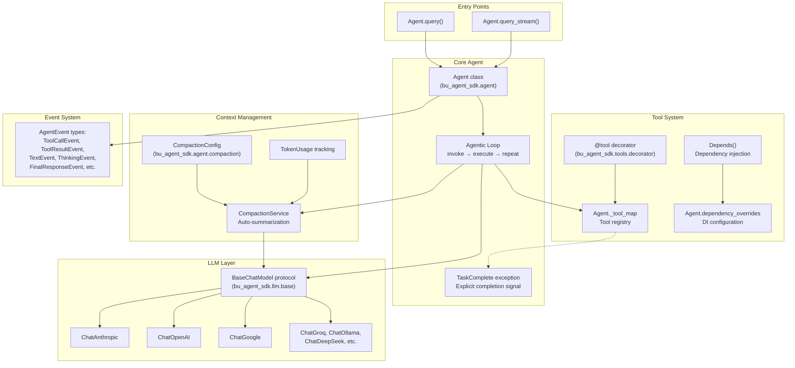

**Diagram: Core System Components and Their Relationships**

This diagram maps high-level concepts to their concrete implementations in the codebase. Each box represents actual classes, methods, or code entities that can be located in the source files.

**Sources:** [README.md:1-256](), [bu_agent_sdk/__init__.py:1-30]()

---

## Core Components

| Component | Primary Classes/Functions | Purpose | Wiki Reference |
|-----------|---------------------------|---------|----------------|
| **Agent** | `Agent` | Orchestrates the agentic loop, manages conversation state, coordinates subsystems | [Agent System](#2) |
| **Tool System** | `@tool`, `Depends`, `Agent._tool_map` | Defines and executes callable functions, handles dependency injection | [Tool System](#6) |
| **LLM Abstraction** | `BaseChatModel`, `ChatAnthropic`, `ChatOpenAI`, etc. | Provides provider-agnostic interface to 8+ LLM services | [LLM Abstraction Layer](#5) |
| **Event System** | `ToolCallEvent`, `ToolResultEvent`, `TextEvent`, `FinalResponseEvent` | Streams execution events for real-time observability | [Event System](#3) |
| **Compaction** | `CompactionConfig`, `CompactionService`, `TokenUsage` | Manages context window limits via automatic summarization | [Context Management](#4) |
| **Task Completion** | `TaskComplete` exception | Signals explicit agent termination | [TaskComplete Pattern](#2.4) |

**Sources:** [README.md:54-138]()

---

## Execution Flow

The following diagram illustrates how a typical agent query flows through the major code entities:

```mermaid
sequenceDiagram
    participant User
    participant Agent["Agent<br/>(bu_agent_sdk.agent.Agent)"]
    participant query_stream["Agent.query_stream()"]
    participant _run_loop["Agent._run_loop()"]
    participant llm["BaseChatModel.ainvoke()"]
    participant _execute_tool_calls["Agent._execute_tool_calls()"]
    participant tool_func["@tool decorated function"]
    participant CompactionService["CompactionService.check_and_compact()"]
    
    User->>Agent: "agent.query_stream(query)"
    Agent->>query_stream: "entry point"
    query_stream->>_run_loop: "start agentic loop"
    
    loop "Until TaskComplete or no tool calls"
        _run_loop->>CompactionService: "check token threshold"
        CompactionService-->>_run_loop: "compacted if needed"
        
        _run_loop->>llm: "invoke with messages + tools"
        llm-->>_run_loop: "response with tool_calls[]"
        
        _run_loop->>query_stream: "yield ToolCallEvent"
        query_stream-->>User: "stream event"
        
        _run_loop->>_execute_tool_calls: "execute each tool"
        _execute_tool_calls->>tool_func: "call with args + injected deps"
        
        alt "tool raises TaskComplete"
            tool_func-->>_execute_tool_calls: "TaskComplete exception"
            _execute_tool_calls-->>_run_loop: "propagate exception"
            _run_loop->>query_stream: "yield FinalResponseEvent"
            query_stream-->>User: "stream final event"
        else "tool returns normally"
            tool_func-->>_execute_tool_calls: "result"
            _execute_tool_calls->>query_stream: "yield ToolResultEvent"
            query_stream-->>User: "stream event"
            _execute_tool_calls-->>_run_loop: "continue loop"
        end
    end
```

**Diagram: Agent Query Execution Flow with Code Entities**

This sequence diagram uses actual method names and class names from the implementation, showing how a user query propagates through the system's major functions.

**Sources:** [README.md:22-46](), [README.md:127-138]()

---

## Key Features

### 1. Done Tool Pattern

Instead of stopping when the LLM produces no tool calls (which causes premature exits), agents use the **`TaskComplete` exception** to signal explicit completion:

```python
@tool("Signal task completion")
async def done(message: str) -> str:
    raise TaskComplete(message)

agent = Agent(
    llm=llm,
    tools=[..., done],
    require_done_tool=True,  # Autonomous mode
)
```

When `require_done_tool=True`, the agent continues executing until a tool raises `TaskComplete`. See [TaskComplete Pattern](#2.4) for details.

**Sources:** [README.md:56-70]()

---

### 2. Ephemeral Messages

Tools that produce large outputs (e.g., browser DOM, screenshots) can use the `ephemeral` parameter to limit message history retention:

```python
@tool("Get browser state", ephemeral=3)  # Keep last 3 only
async def get_state() -> str:
    return massive_dom_and_screenshot
```

The `Agent._destroy_ephemeral_messages()` method removes old ephemeral messages before each LLM invocation. See [Ephemeral Messages](#10.2) for details.

**Sources:** [README.md:72-80]()

---

### 3. Multi-Provider LLM Support

The `BaseChatModel` protocol defines a common interface implemented by 8+ providers:

```python
from bu_agent_sdk.llm import ChatAnthropic, ChatOpenAI, ChatGoogle

agent = Agent(llm=ChatAnthropic(model="claude-sonnet-4-20250514"), tools=tools)
agent = Agent(llm=ChatOpenAI(model="gpt-4o"), tools=tools)
agent = Agent(llm=ChatGoogle(model="gemini-2.0-flash"), tools=tools)
```

Each provider is implemented in ~300 lines with full control. See [LLM Abstraction Layer](#5) for the complete list.

**Sources:** [README.md:82-93]()

---

### 4. Context Compaction

The `CompactionConfig` system automatically summarizes conversation history when approaching context window limits:

```python
from bu_agent_sdk.agent import CompactionConfig

agent = Agent(
    llm=llm,
    tools=tools,
    compaction=CompactionConfig(threshold_ratio=0.80),  # At 80% usage
)
```

The `CompactionService.check_and_compact()` method monitors `TokenUsage` and invokes the LLM to generate summaries. See [Context Management (Compaction)](#4) for implementation details.

**Sources:** [README.md:95-107]()

---

### 5. Dependency Injection

Tools can declare dependencies using `Annotated[Type, Depends(provider)]`, inspired by FastAPI:

```python
from typing import Annotated
from bu_agent_sdk import Depends

def get_db():
    return Database()

@tool("Query users")
async def get_user(id: int, db: Annotated[Database, Depends(get_db)]) -> str:
    return await db.find(id)
```

The `Agent.dependency_overrides` dictionary allows runtime configuration. See [Dependency Injection](#6.2) for details.

**Sources:** [README.md:109-123]()

---

### 6. Streaming Events

The `Agent.query_stream()` method yields typed events throughout execution:

```python
from bu_agent_sdk.agent import ToolCallEvent, ToolResultEvent, FinalResponseEvent

async for event in agent.query_stream("do something"):
    match event:
        case ToolCallEvent(tool=name, args=args):
            print(f"Calling {name}")
        case ToolResultEvent(tool=name, result=result):
            print(f"{name} -> {result[:50]}")
        case FinalResponseEvent(content=text):
            print(f"Done: {text}")
```

Events include unique IDs for correlation (`message_id`, `tool_call_id`, `step_id`). See [Event System](#3) for all event types.

**Sources:** [README.md:125-138]()

---

## Minimal Example: Claude Code in 100 Lines

The framework enables complete coding assistants with minimal code. This example demonstrates sandboxed filesystem operations using dependency injection:

| Component | Implementation |
|-----------|----------------|
| **Sandbox Context** | `SandboxContext` dataclass with `root_dir` and `working_dir` |
| **Dependency Provider** | `get_sandbox()` function, overridden via `Agent.dependency_overrides` |
| **Tools** | `bash()`, `read()`, `write()`, `glob()`, `done()` — all use `Annotated[SandboxContext, Depends(get_sandbox)]` |
| **Security** | `SandboxContext.resolve_path()` validates paths stay within sandbox |

The full implementation is at [bu_agent_sdk/examples/claude_code.py]().

**Sources:** [README.md:140-228]()

---

## Getting Started

The simplest possible agent with two tools:

```python
import asyncio
from bu_agent_sdk import Agent, tool, TaskComplete
from bu_agent_sdk.llm import ChatAnthropic

@tool("Add two numbers")
async def add(a: int, b: int) -> int:
    return a + b

@tool("Signal task completion")
async def done(message: str) -> str:
    raise TaskComplete(message)

agent = Agent(
    llm=ChatAnthropic(model="claude-sonnet-4-20250514"),
    tools=[add, done],
)

async def main():
    result = await agent.query("What is 2 + 3?")
    print(result)

asyncio.run(main())
```

This demonstrates:
- The `@tool` decorator for defining callable functions
- The `TaskComplete` exception pattern
- The `Agent` class as the main orchestrator
- The `ChatAnthropic` LLM provider
- The `Agent.query()` method for simple request-response

For more examples, see [Examples and Guides](#7).

**Sources:** [README.md:22-46]()

---

## Installation

Install via `uv`:

```bash
uv add bu-agent-sdk
```

Or for development:

```bash
uv sync
```

See [Configuration and Setup](#8) for environment variables and API key configuration.

**Sources:** [README.md:9-19]()

---

## Next Steps

To understand how the agent actually works, start with:
1. [Agent System](#2) — the core `Agent` class and agentic loop
2. [Tool System](#6) — defining and executing tools
3. [Event System](#3) — streaming observability
4. [LLM Abstraction Layer](#5) — provider support

For practical guidance:
- [Getting Started: Simple Calculator](#7.1) — basic agent example
- [Claude Code: Sandboxed Filesystem Tools](#7.3) — complete coding assistant
- [Dependency Injection Example](#7.2) — FastAPI-style DI patterns

**Sources:** [README.md:229-235]()

---

# Page: Agent System

# Agent System

<details>
<summary>Relevant source files</summary>

The following files were used as context for generating this wiki page:

- [bu_agent_sdk/agent/README.md](bu_agent_sdk/agent/README.md)
- [bu_agent_sdk/agent/__init__.py](bu_agent_sdk/agent/__init__.py)
- [bu_agent_sdk/agent/service.py](bu_agent_sdk/agent/service.py)

</details>


## Purpose and Scope

The Agent System is the core orchestration layer of the bu_agent_sdk. It implements the fundamental "agent is just a for-loop" philosophy by managing iterative interactions between a language model, a set of tools, and conversation history. This page covers the `Agent` class, its architecture, and how it coordinates the agentic loop.

For detailed information about specific subsystems:
- Agentic loop mechanics and termination conditions: See [Agentic Loop Execution](#2.1)
- Tool definition, dependency injection, and execution details: See [Tool Calling and Execution](#2.2)
- Message types, multi-turn conversations, and ephemeral messages: See [Message History and State](#2.3)
- Task completion patterns and autonomous mode: See [TaskComplete Pattern](#2.4)

**Sources:** [bu_agent_sdk/agent/service.py:1-37](), [bu_agent_sdk/agent/README.md:1-23]()

## The Agent Class

The `Agent` class is implemented as a Python dataclass located in [bu_agent_sdk/agent/service.py:98-175](). It serves as the central orchestrator that maintains state, coordinates LLM invocations, executes tools, and manages conversation history.

### Core Attributes

| Attribute | Type | Purpose |
|-----------|------|---------|
| `llm` | `BaseChatModel` | The language model provider (OpenAI, Anthropic, etc.) |
| `tools` | `list[Tool]` | Tools available for the agent to call |
| `system_prompt` | `str \| None` | Optional system-level instructions |
| `max_iterations` | `int` | Maximum LLM invocation cycles (default: 200) |
| `tool_choice` | `ToolChoice` | How LLM should choose tools: `"auto"`, `"required"`, `"none"` |
| `compaction` | `CompactionConfig \| None` | Context window management configuration |
| `dependency_overrides` | `dict \| None` | Runtime dependency injection overrides |
| `require_done_tool` | `bool` | Whether to use autonomous mode with explicit completion |

### Internal State

The Agent maintains several private attributes for state management:

- `_messages`: `list[BaseMessage]` - Complete conversation history
- `_tool_map`: `dict[str, Tool]` - Fast tool name lookup
- `_compaction_service`: `CompactionService` - Manages context window limits
- `_token_cost`: `TokenCost` - Tracks token usage and costs

**Sources:** [bu_agent_sdk/agent/service.py:98-175]()

## Agent Architecture

The following diagram shows how the `Agent` class integrates with other SDK components:

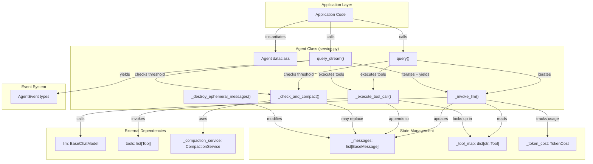

**Sources:** [bu_agent_sdk/agent/service.py:98-873]()

## Initialization and Tool Registration

The `Agent` initialization process, implemented in `__post_init__`, performs several setup tasks:

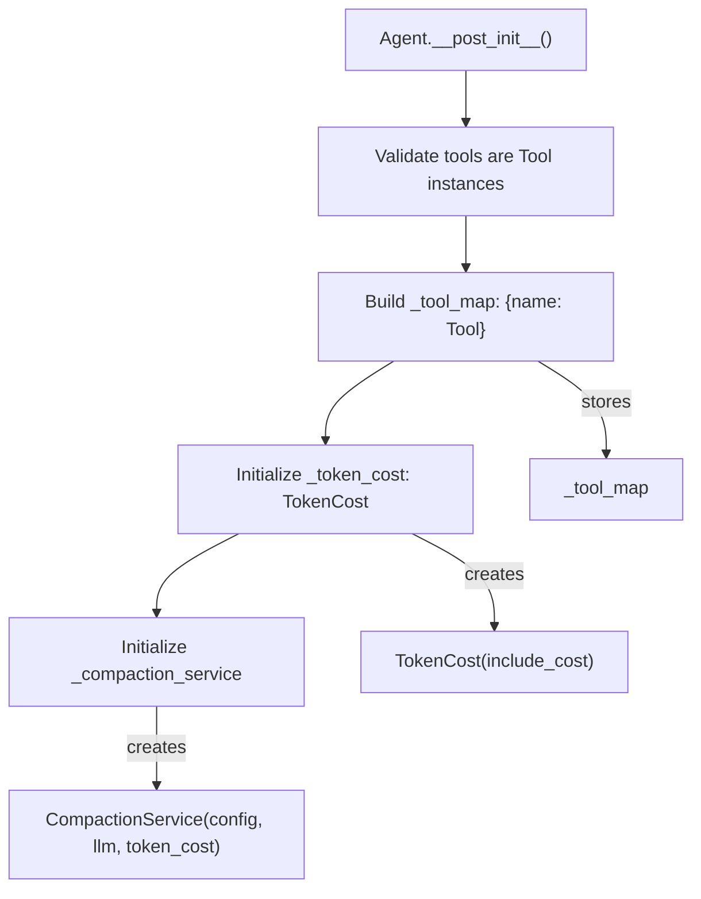

The tool map (`_tool_map`) enables O(1) lookup during tool execution. Each tool must be created with the `@tool` decorator, which wraps functions into `Tool` instances with metadata for LLM tool calling.

**Sources:** [bu_agent_sdk/agent/service.py:152-175]()

## The Agentic Loop

The core agentic loop is implemented in both `query()` and `query_stream()` methods. At a high level, the loop follows this pattern:

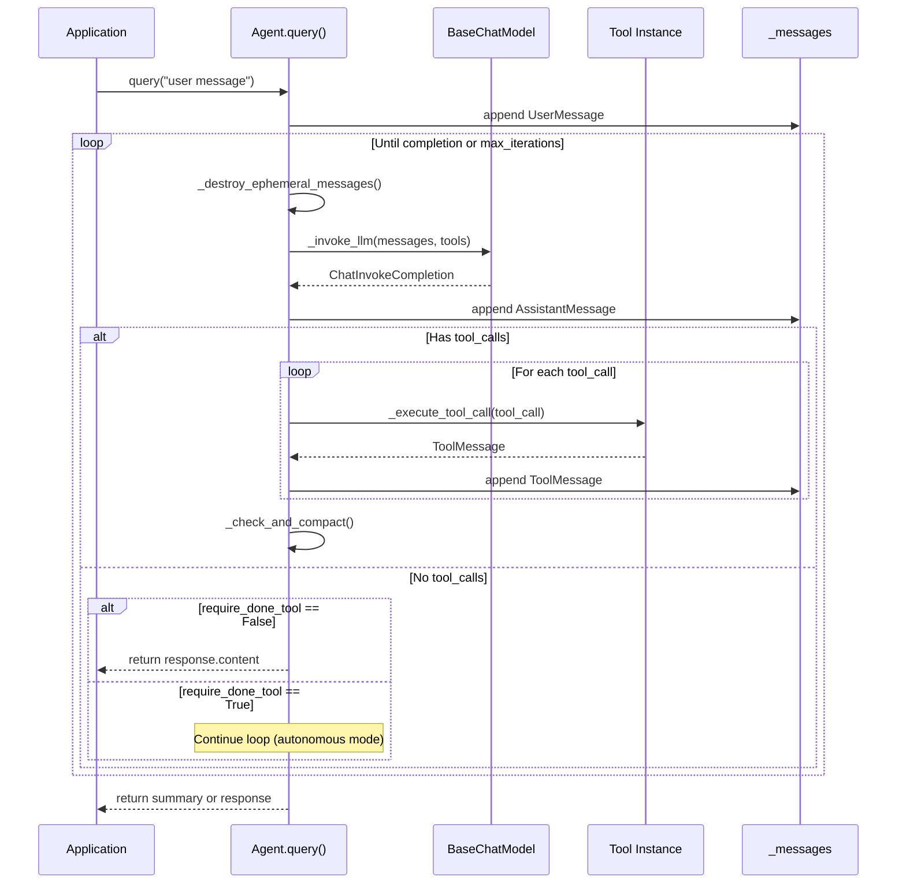

Key aspects:
1. **System Prompt**: Added automatically on first message if `system_prompt` is set
2. **Ephemeral Cleanup**: Old ephemeral tool outputs are removed before each LLM call
3. **Tool Execution**: All tool calls in a response are executed sequentially
4. **Compaction**: Triggered automatically after tool execution if token threshold exceeded
5. **Termination**: Determined by `require_done_tool` flag (CLI vs autonomous mode)

**Sources:** [bu_agent_sdk/agent/service.py:611-700](), [bu_agent_sdk/agent/service.py:702-873]()

## Query Methods

The Agent provides two primary interfaces for interaction:

### query(message: str) → str

Synchronous-style method that returns the final response as a string. Internally uses async/await but presents a simple interface for applications that don't need streaming.

```python
# Example from README
result = await agent.query("What is 2 + 2?")
```

**Key behaviors:**
- Adds `system_prompt` on first call if `_messages` is empty
- Runs agentic loop until completion or `max_iterations`
- Returns final text response or summary
- Handles `TaskComplete` exceptions from tools

**Sources:** [bu_agent_sdk/agent/service.py:611-700](), [bu_agent_sdk/agent/README.md:7-22]()

### query_stream(message: str | list[ContentPartTextParam | ContentPartImageParam]) → AsyncIterator[AgentEvent]

Streaming method that yields events throughout execution, providing real-time visibility into the agent's reasoning and actions.

```python
# Example from README
async for event in agent.query_stream("do something"):
    match event:
        case ToolCallEvent(tool=name, args=args):
            print(f"Calling {name}: {args}")
        case ToolResultEvent(tool=name, result=result):
            print(f"{name} returned: {result}")
        case FinalResponseEvent(content=text):
            print(f"Done: {text}")
```

**Event types yielded:**
- `TextEvent`: LLM text output
- `ThinkingEvent`: Extended thinking content (for models that support it)
- `ToolCallEvent`: Before tool execution
- `ToolResultEvent`: After tool execution
- `StepStartEvent` / `StepCompleteEvent`: Tool execution boundaries
- `FinalResponseEvent`: Always last event

**Sources:** [bu_agent_sdk/agent/service.py:702-873](), [bu_agent_sdk/agent/README.md:24-39]()

## Tool Execution Flow

The following diagram shows the code-level flow for tool execution within the agent loop:

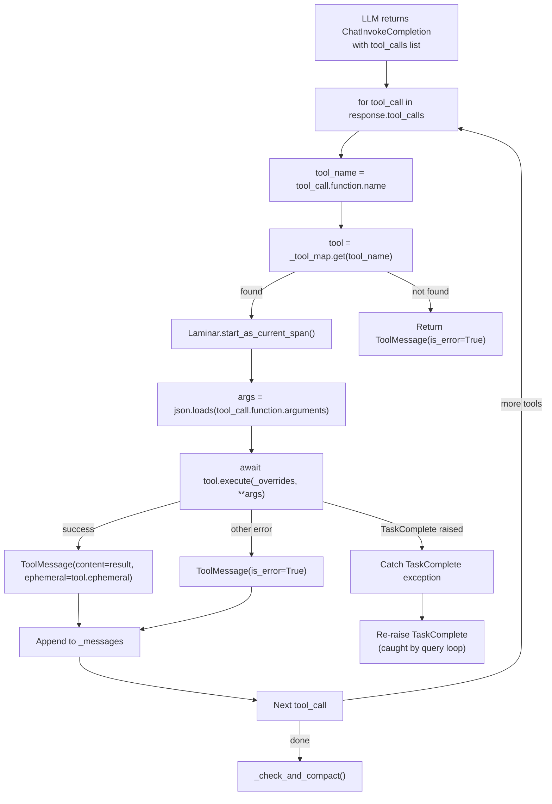

The `_execute_tool_call()` method handles individual tool invocations with proper error handling and observability through Laminar spans.

**Sources:** [bu_agent_sdk/agent/service.py:300-393]()

## Message History Management

The `_messages` list maintains the complete conversation history as a sequence of `BaseMessage` instances. The Agent provides several methods for history management:

| Method | Purpose |
|--------|---------|
| `messages` (property) | Read-only copy of message history |
| `clear_history()` | Reset messages and token usage |
| `load_history(messages)` | Load previously saved conversation state |

### Ephemeral Message Cleanup

Tools marked with `_ephemeral` attribute have their outputs automatically cleaned up to save context window space. The `_destroy_ephemeral_messages()` method:

1. Groups ephemeral messages by tool name
2. Keeps only the last N outputs per tool (configurable via `tool.ephemeral`)
3. Optionally saves discarded content to disk (`ephemeral_storage_path`)
4. Marks messages as `destroyed=True` so serializers use placeholder text

This mechanism is critical for tools with large outputs (e.g., file contents, screenshots).

**Sources:** [bu_agent_sdk/agent/service.py:229-299](), [bu_agent_sdk/agent/README.md:74-82]()

## Configuration Options

The Agent supports extensive runtime configuration:

### Compaction Configuration

```python
from bu_agent_sdk.agent import CompactionConfig

agent = Agent(
    llm=llm,
    tools=tools,
    compaction=CompactionConfig(
        enabled=True,
        threshold_ratio=0.70,  # 70% of context window
    )
)
```

See [Context Management (Compaction)](#4) for details.

### Retry Configuration

The Agent implements exponential backoff retry logic for LLM errors:

| Attribute | Default | Purpose |
|-----------|---------|---------|
| `llm_max_retries` | 5 | Maximum retry attempts |
| `llm_retry_base_delay` | 1.0 | Initial delay in seconds |
| `llm_retry_max_delay` | 60.0 | Maximum delay cap |
| `llm_retryable_status_codes` | {429, 500, 502, 503, 504} | HTTP codes that trigger retries |

The retry logic in `_invoke_llm()` handles rate limits, timeouts, and transient errors automatically.

**Sources:** [bu_agent_sdk/agent/service.py:436-532]()

### Dependency Injection Override

```python
agent = Agent(
    llm=llm,
    tools=[query_db_tool],
    dependency_overrides={
        get_db: lambda: test_database  # Override for testing
    }
)
```

See [Dependency Injection](#6.2) for detailed usage patterns.

**Sources:** [bu_agent_sdk/agent/README.md:58-72]()

## Usage Summary Tracking

The Agent tracks token usage and costs through the `TokenCost` service:

```python
usage = await agent.get_usage()
print(f"Tokens: {usage.total_tokens}")
print(f"Cost: ${usage.total_cost:.4f}")
```

The `_token_cost` instance accumulates usage from all LLM invocations and provides summary statistics. Costs are calculated based on model-specific pricing data when `include_cost=True`.

**Sources:** [bu_agent_sdk/agent/service.py:191-197](), [bu_agent_sdk/agent/README.md:84-89]()

## Key Properties and Methods

### Properties

- `tool_definitions` → `list[ToolDefinition]`: Converts registered tools to LLM tool calling schema
- `messages` → `list[BaseMessage]`: Read-only view of conversation history
- `token_cost` → `TokenCost`: Direct access to usage tracking service

### Private Helper Methods

- `_invoke_llm()`: Wraps LLM calls with retry logic and usage tracking
- `_execute_tool_call()`: Executes a single tool with error handling and Laminar spans
- `_check_and_compact()`: Triggers compaction if token threshold exceeded
- `_destroy_ephemeral_messages()`: Cleans up old ephemeral tool outputs
- `_generate_max_iterations_summary()`: Generates summary when iteration limit reached
- `_get_incomplete_todos_prompt()`: Hook for subclasses to check task completion

**Sources:** [bu_agent_sdk/agent/service.py:176-873]()

---

# Page: Agentic Loop Execution

# Agentic Loop Execution

<details>
<summary>Relevant source files</summary>

The following files were used as context for generating this wiki page:

- [README.md](README.md)
- [bu_agent_sdk/agent/service.py](bu_agent_sdk/agent/service.py)

</details>


This document details the core iterative loop that drives agent execution in bu_agent_sdk. It covers the loop's structure, LLM invocation mechanics, response processing, and termination conditions.

**Scope**: This page focuses on the mechanics of the loop itself - how iterations proceed, when the LLM is invoked, and when the loop terminates. For details about tool execution and dependency injection, see [Tool Calling and Execution](#2.2). For message history management, see [Message History and State](#2.3). For the TaskComplete pattern and mode differences, see [TaskComplete Pattern](#2.4).

---

## Overview

The agent implements the philosophy that "an agent is just a for-loop." The `Agent` class provides two primary methods that execute this loop:

| Method | Purpose | Return Type |
|--------|---------|-------------|
| `query()` | Execute agent loop and return final result | `str` |
| `query_stream()` | Execute agent loop and stream events | `AsyncIterator[AgentEvent]` |

Both methods implement the same underlying loop logic but differ in their output mechanism. The loop continues until one of three termination conditions is met:

1. **CLI Mode Termination**: LLM returns no tool calls (when `require_done_tool=False`)
2. **Autonomous Mode Termination**: A tool raises `TaskComplete` exception (when `require_done_tool=True`)
3. **Max Iterations**: The iteration counter reaches `max_iterations` (default: 200)

**Sources**: [bu_agent_sdk/agent/service.py:99-145](), [README.md:3-6]()

---

## Agent Loop Architecture

The following diagram shows the core components involved in loop execution and their relationships:

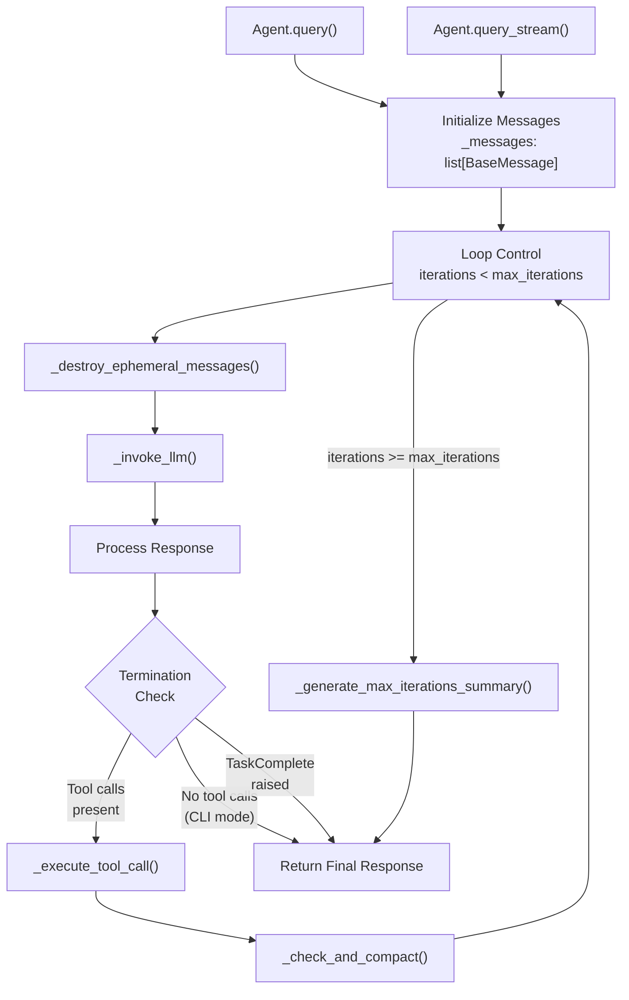

**Sources**: [bu_agent_sdk/agent/service.py:612-700](), [bu_agent_sdk/agent/service.py:702-872]()

---

## Loop Initialization

Before entering the main loop, the agent performs initialization:

### System Prompt Injection

On the first call to `query()` or `query_stream()`, if a system prompt is configured, it is added to the message history:

```python
# From service.py:631-633 (query) and 735-737 (query_stream)
if not self._messages and self.system_prompt:
    self._messages.append(SystemMessage(content=self.system_prompt, cache=True))
```

The `cache=True` flag enables prompt caching for providers that support it (e.g., Anthropic), reducing token costs for the static system prompt.

### User Message Addition

The incoming user message is appended to the message history:

```python
# service.py:636 (query) and 740 (query_stream)
self._messages.append(UserMessage(content=message))
```

Note that `query_stream()` supports multi-modal input via `list[ContentPartTextParam | ContentPartImageParam]` for text + image messages.

### Iteration Tracking

The loop maintains several counters:

| Variable | Purpose | Initial Value |
|----------|---------|---------------|
| `iterations` | Current iteration count | 0 |
| `incomplete_todos_prompted` | Whether incomplete todos prompt was shown | `False` |

**Sources**: [bu_agent_sdk/agent/service.py:631-642](), [bu_agent_sdk/agent/service.py:735-745]()

---

## Main Loop Structure

The core loop executes while `iterations < max_iterations`:

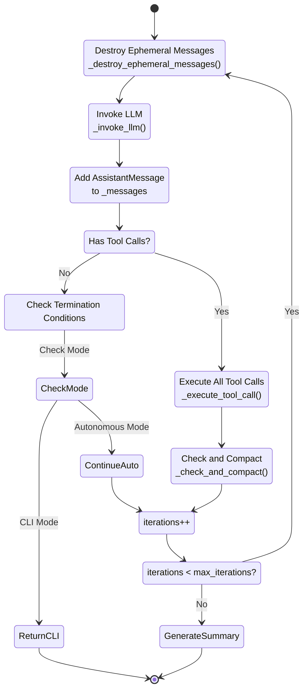

**Sources**: [bu_agent_sdk/agent/service.py:644-700]()

---

## LLM Invocation

The `_invoke_llm()` method handles LLM invocation with retry logic:

```mermaid
flowchart TD
    start["_invoke_llm()"] --> attempt{"Retry Attempt<br/>(max: llm_max_retries)"}
    
    attempt --> call["llm.ainvoke()<br/>messages, tools, tool_choice"]
    
    call --> success{"Success?"}
    success -->|"Yes"| track["Track Token Usage<br/>_token_cost.add_usage()"]
    track --> return_response["Return ChatInvokeCompletion"]
    
    success -->|"ModelRateLimitError"| check_rate["Check Remaining<br/>Retries"]
    success -->|"ModelProviderError"| check_status{"Status Code<br/>in llm_retryable_status_codes?"}
    success -->|"Timeout/Connection"| check_timeout["Check Error Type"]
    
    check_rate -->|"Has retries"| backoff_rate["Exponential Backoff<br/>base: llm_retry_base_delay<br/>max: llm_retry_max_delay"]
    check_rate -->|"Exhausted"| raise_error["Raise Exception"]
    
    check_status -->|"Yes"| backoff_rate
    check_status -->|"No"| raise_error
    
    check_timeout -->|"Retryable"| backoff_rate
    check_timeout -->|"Not retryable"| raise_error
    
    backoff_rate --> sleep["asyncio.sleep()<br/>delay + 10% jitter"]
    sleep --> attempt
    
    raise_error --> end["Exception Propagates"]
    return_response --> end
```

### Retry Configuration

The retry mechanism uses exponential backoff with configurable parameters:

| Parameter | Default | Description |
|-----------|---------|-------------|
| `llm_max_retries` | 5 | Maximum retry attempts |
| `llm_retry_base_delay` | 1.0 | Base delay in seconds |
| `llm_retry_max_delay` | 60.0 | Maximum delay cap |
| `llm_retryable_status_codes` | {429, 500, 502, 503, 504} | HTTP codes triggering retry |

The backoff formula is: `min(base_delay * 2^attempt, max_delay) + jitter`, where jitter is 10% of the delay.

### Retryable Error Types

1. **Rate Limits** (`ModelRateLimitError`): Always retryable
2. **Provider Errors** (`ModelProviderError`): Retryable if status code matches
3. **Timeouts/Connection Errors**: Detected via string matching in error message

**Sources**: [bu_agent_sdk/agent/service.py:436-532](), [bu_agent_sdk/agent/service.py:135-144]()

---

## Response Processing

After LLM invocation, the response is processed and added to message history:

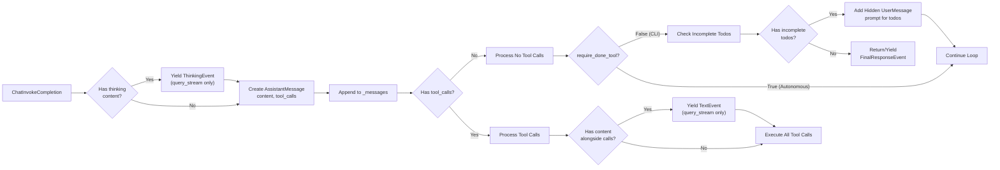

**Sources**: [bu_agent_sdk/agent/service.py:651-697](), [bu_agent_sdk/agent/service.py:753-868]()

---

## Tool Execution Flow

When tool calls are present, each is executed sequentially:

```mermaid
sequenceDiagram
    participant Loop as "Agent Loop"
    participant Execute as "_execute_tool_call()"
    participant Tool as "Tool Instance"
    participant Laminar as "Laminar (Optional)"
    
    Loop->>Loop: Yield StepStartEvent
    Loop->>Loop: Yield ToolCallEvent
    
    Loop->>Execute: tool_call
    
    Execute->>Laminar: start_as_current_span()
    
    Execute->>Execute: json.loads(arguments)
    Execute->>Tool: execute(**args, _overrides)
    
    alt Success
        Tool-->>Execute: result
        Execute->>Execute: Create ToolMessage(ephemeral)
        Execute->>Laminar: set_span_output(result)
    else TaskComplete
        Tool-->>Execute: raise TaskComplete
        Execute->>Laminar: set_span_output(task_complete)
        Execute-->>Loop: re-raise TaskComplete
    else Error
        Tool-->>Execute: raise Exception
        Execute->>Execute: Create ToolMessage(is_error=True)
        Execute->>Laminar: set_span_output(error)
    end
    
    Execute-->>Loop: ToolMessage
    
    Loop->>Loop: Append ToolMessage to _messages
    Loop->>Loop: Yield ToolResultEvent
    Loop->>Loop: Yield StepCompleteEvent
```

The `ephemeral` flag on `ToolMessage` is set based on the tool's `_ephemeral` attribute, which determines whether the message is subject to automatic cleanup (see [Ephemeral Messages](#10.2) for details).

**Sources**: [bu_agent_sdk/agent/service.py:300-393](), [bu_agent_sdk/agent/service.py:796-865]()

---

## Termination Conditions

The loop terminates under three distinct scenarios:

### 1. CLI Mode Completion

When `require_done_tool=False`, the loop terminates when the LLM returns a response without tool calls:

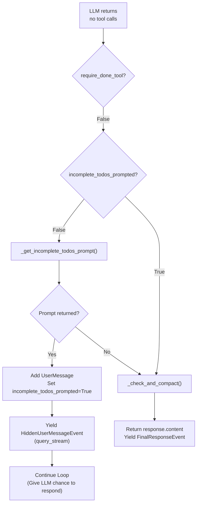

The incomplete todos check provides a hook for subclasses to ensure tasks are completed before finishing (used in browser-use for todo validation).

**Sources**: [bu_agent_sdk/agent/service.py:661-675](), [bu_agent_sdk/agent/service.py:768-786]()

### 2. Autonomous Mode Completion

When `require_done_tool=True`, the loop only terminates via `TaskComplete` exception:

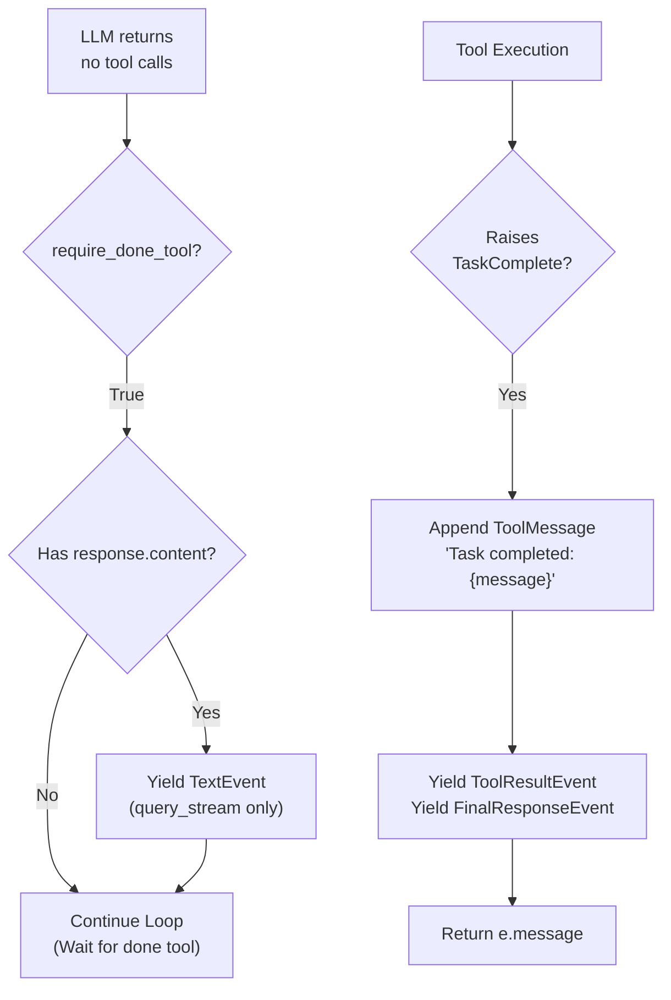

The `TaskComplete` exception is caught during tool execution and converted into a successful completion. See [TaskComplete Pattern](#2.4) for full details.

**Sources**: [bu_agent_sdk/agent/service.py:685-694](), [bu_agent_sdk/agent/service.py:847-865]()

### 3. Max Iterations Reached

When the iteration counter reaches `max_iterations`, the loop generates a summary:

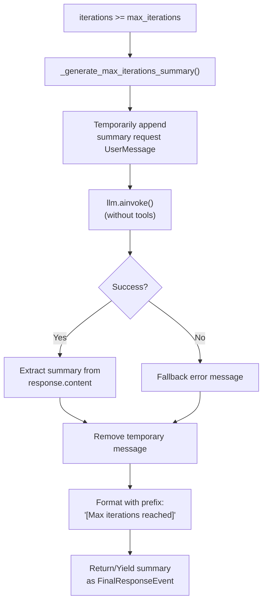

The summary generation uses the same LLM to produce a concise description of what was accomplished and what remains incomplete.

**Sources**: [bu_agent_sdk/agent/service.py:534-567](), [bu_agent_sdk/agent/service.py:699-700](), [bu_agent_sdk/agent/service.py:870-872]()

---

## Integration with Supporting Systems

### Ephemeral Message Cleanup

At the start of each iteration, `_destroy_ephemeral_messages()` is called to manage context window usage:

```python
# service.py:647-648 (query) and 750-751 (query_stream)
self._destroy_ephemeral_messages()
```

This method processes all `ToolMessage` instances marked as ephemeral, keeping only the most recent N outputs per tool (where N is defined by the tool's `_ephemeral` attribute). Older messages have their content replaced with `<removed to save context>` or saved to disk if `ephemeral_storage_path` is configured.

**Sources**: [bu_agent_sdk/agent/service.py:229-298](), [bu_agent_sdk/agent/service.py:647-648]()

### Compaction Check

After tool execution completes, `_check_and_compact()` evaluates whether token usage exceeds the configured threshold:

```python
# service.py:697 (query) and 868 (query_stream)
await self._check_and_compact(response)
```

If compaction is triggered, the conversation history is summarized and replaced with a condensed version. See [Compaction Service Logic](#4.2) for details on the compaction algorithm.

**Sources**: [bu_agent_sdk/agent/service.py:582-609](), [bu_agent_sdk/agent/service.py:697]()

### Event Streaming

The `query_stream()` method yields `AgentEvent` instances at key points:

| Event Type | When Yielded | Purpose |
|------------|--------------|---------|
| `ThinkingEvent` | LLM returns thinking content | Show model's reasoning |
| `TextEvent` | LLM returns text content | Display intermediate responses |
| `StepStartEvent` | Before tool execution | Mark logical operation start |
| `ToolCallEvent` | Tool is about to execute | Show tool name and arguments |
| `ToolResultEvent` | Tool execution completes | Show tool output or error |
| `StepCompleteEvent` | After tool execution | Mark operation end with duration |
| `HiddenUserMessageEvent` | Internal prompt added | Debug incomplete todos prompt |
| `FinalResponseEvent` | Loop terminates | Signal completion |

See [Event System](#3) for comprehensive event documentation.

**Sources**: [bu_agent_sdk/agent/service.py:702-872](), [bu_agent_sdk/agent/events.py]()

---

## Loop Execution Summary

The following table summarizes the key decision points and their outcomes:

| Condition | Action | Next State |
|-----------|--------|------------|
| First message + system_prompt exists | Add SystemMessage(cache=True) | Continue initialization |
| iterations >= max_iterations | Generate summary via LLM | Terminate with summary |
| response.has_tool_calls | Execute all tools sequentially | Continue loop |
| !response.has_tool_calls + !require_done_tool | Check incomplete todos, then return | Terminate with response |
| !response.has_tool_calls + require_done_tool | Yield text if present | Continue loop |
| TaskComplete raised during execution | Return/yield completion message | Terminate with message |
| Token usage > threshold | Invoke compaction service | Continue with compacted history |

**Sources**: [bu_agent_sdk/agent/service.py:612-872]()

---

# Page: Tool Calling and Execution

# Tool Calling and Execution

<details>
<summary>Relevant source files</summary>

The following files were used as context for generating this wiki page:

- [bu_agent_sdk/agent/README.md](bu_agent_sdk/agent/README.md)
- [bu_agent_sdk/agent/service.py](bu_agent_sdk/agent/service.py)
- [bu_agent_sdk/examples/dependency_injection.py](bu_agent_sdk/examples/dependency_injection.py)

</details>


This page explains how tools are defined, registered, and executed within the bu_agent_sdk Agent system. It covers the `@tool` decorator, tool parameter handling, the execution flow from LLM response to tool invocation, dependency injection with `Depends`, and error handling mechanisms.

For information about the broader agentic loop that triggers tool execution, see [Agentic Loop Execution](#2.1). For details on the `TaskComplete` pattern that tools can use to signal completion, see [TaskComplete Pattern](#2.4). For a comprehensive guide on defining tools with various parameter types, see [Defining Tools](#6.1).

## Tool Definition with @tool Decorator

Tools are Python functions decorated with `@tool` that the LLM can invoke during agent execution. The decorator transforms a regular function into a `Tool` instance that provides metadata and execution capabilities.

### Basic Tool Structure

```python
from bu_agent_sdk.tools import tool

@tool("Add two numbers")
async def add(a: int, b: int) -> int:
    return a + b
```

The `@tool` decorator:
- Takes a description string as its argument (used by the LLM to understand the tool's purpose)
- Wraps the function into a `Tool` instance
- Extracts parameter information from function signature
- Creates a `ToolDefinition` for LLM tool calling APIs

**Sources:** [bu_agent_sdk/agent/README.md:12-14]()

### Tool Parameters

Tools support multiple parameter types:

| Parameter Type | Description | Example |
|----------------|-------------|---------|
| Simple types | `str`, `int`, `float`, `bool` | `async def search(query: str)` |
| Pydantic models | Groups related parameters | `async def send_email(params: EmailParams)` |
| Annotated dependencies | Injected resources via `Depends` | `async def query(sql: str, db: Annotated[Database, Depends(get_db)])` |

**Sources:** [bu_agent_sdk/agent/README.md:41-56](), [bu_agent_sdk/agent/README.md:58-72]()

### Pydantic Model Parameters

For tools with multiple related parameters, Pydantic models provide structure:

```python
from pydantic import BaseModel, Field

class EmailParams(BaseModel):
    to: str = Field(description="Recipient")
    subject: str
    body: str

@tool("Send an email")
async def send_email(params: EmailParams) -> str:
    return f"Sent to {params.to}"
```

The agent serializes Pydantic models into the tool definition schema and deserializes JSON arguments back into model instances during execution.

**Sources:** [bu_agent_sdk/agent/README.md:45-56]()

## Tool Registration and Lookup

When an `Agent` is instantiated, tools are registered in an internal lookup map for fast execution.

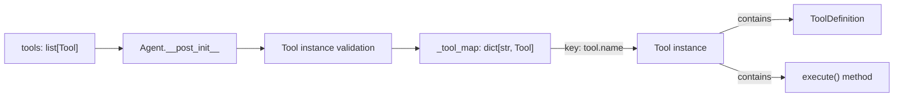

**Tool Registration Process:**

1. **Validation** - Agent validates that all items in `tools` list are `Tool` instances [bu_agent_sdk/agent/service.py:153-157]()
2. **Mapping** - Builds `_tool_map` dictionary keyed by tool name [bu_agent_sdk/agent/service.py:160]()
3. **Definition Extraction** - The `tool_definitions` property provides `ToolDefinition` list for LLM invocation [bu_agent_sdk/agent/service.py:177-179]()

**Sources:** [bu_agent_sdk/agent/service.py:152-160](), [bu_agent_sdk/agent/service.py:177-179]()

## Tool Execution Flow

The complete flow from LLM response to tool execution involves multiple components working together.

### High-Level Execution Sequence

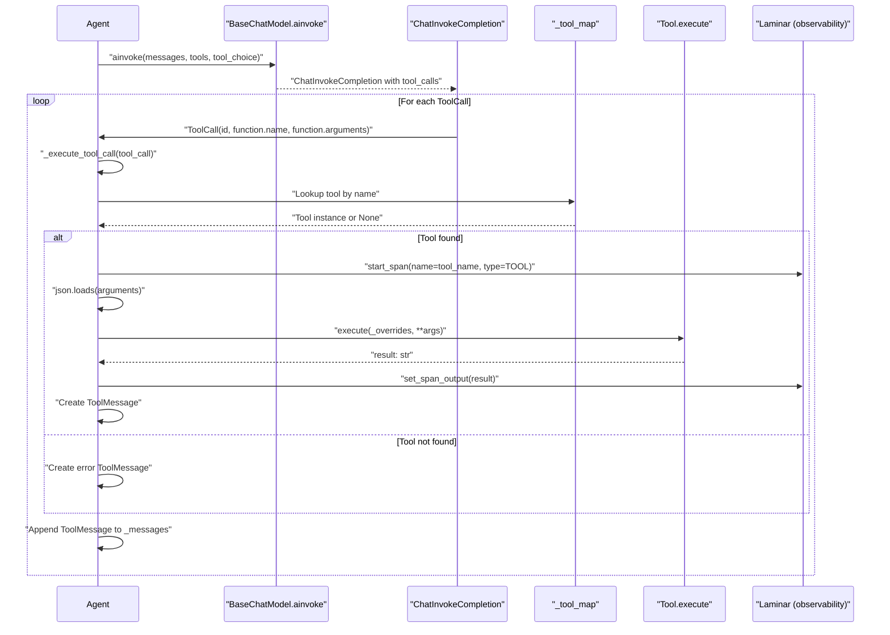

**Sources:** [bu_agent_sdk/agent/service.py:680-695](), [bu_agent_sdk/agent/service.py:300-394]()

### _execute_tool_call Method

The `_execute_tool_call` method at [bu_agent_sdk/agent/service.py:300-394]() handles individual tool invocations:

**Execution Steps:**

1. **Lookup** - Retrieve `Tool` from `_tool_map` by `tool_call.function.name`
2. **Unknown Tool Handling** - Return error `ToolMessage` if tool not found [bu_agent_sdk/agent/service.py:305-311]()
3. **Observability Span** - Create Laminar span for tool execution tracking [bu_agent_sdk/agent/service.py:314-324]()
4. **Argument Parsing** - Deserialize JSON arguments [bu_agent_sdk/agent/service.py:332]()
5. **Tool Execution** - Call `tool.execute(_overrides=dependency_overrides, **args)` [bu_agent_sdk/agent/service.py:335-337]()
6. **Result Packaging** - Create `ToolMessage` with result and metadata [bu_agent_sdk/agent/service.py:342-348]()
7. **Error Handling** - Catch exceptions and return error `ToolMessage` [bu_agent_sdk/agent/service.py:362-386]()

**Sources:** [bu_agent_sdk/agent/service.py:300-394]()

### ToolMessage Construction

Tool execution results are wrapped in `ToolMessage` instances:

```python
ToolMessage(
    tool_call_id=tool_call.id,      # Links to original ToolCall
    tool_name=tool_name,             # Tool identifier
    content=result,                  # String result or error message
    is_error=False,                  # Indicates execution failure
    ephemeral=is_ephemeral,          # Whether content should be destroyed
)
```

These messages are appended to `_messages` history and sent back to the LLM in the next iteration.

**Sources:** [bu_agent_sdk/agent/service.py:342-348](), [bu_agent_sdk/agent/service.py:684]()

## Dependency Injection with Depends

The SDK provides a dependency injection system inspired by FastAPI's `Depends` mechanism, allowing tools to receive shared resources without coupling to specific instances.

### Dependency Definition Pattern

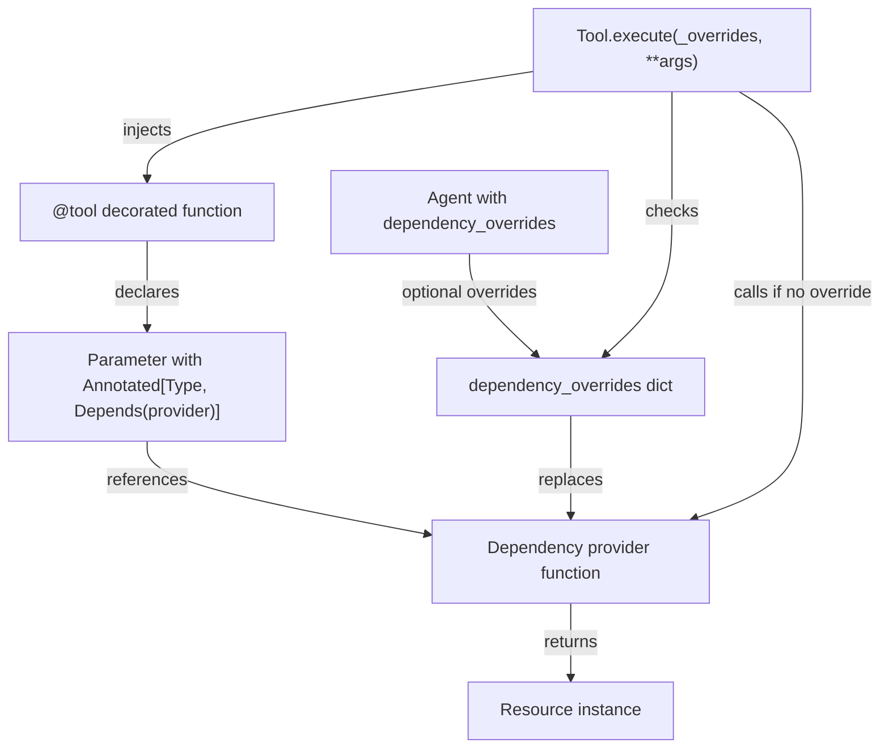

**Example from codebase:**

```python
from typing import Annotated
from bu_agent_sdk.tools import Depends

def get_database() -> Database:
    """Dependency provider - creates/returns Database instance"""
    return Database(users={...})

@tool("Query database")
async def query(sql: str, db: Annotated[Database, Depends(get_database)]) -> str:
    """Tool with injected dependency"""
    return await db.execute(sql)
```

**Sources:** [bu_agent_sdk/examples/dependency_injection.py:36-54](), [bu_agent_sdk/examples/dependency_injection.py:57-64](), [bu_agent_sdk/agent/README.md:62-72]()

### Dependency Resolution Process

1. **Annotation Detection** - Tool decorator extracts `Depends` from `Annotated` type hints
2. **Provider Storage** - Dependency provider functions are stored in the `Tool` instance
3. **Runtime Resolution** - During `tool.execute()`, the SDK:
   - Checks `dependency_overrides` dict first [bu_agent_sdk/agent/service.py:335-337]()
   - If no override, calls the provider function
   - Injects the result as a keyword argument to the tool function
4. **Override Support** - `Agent.dependency_overrides` allows runtime substitution for testing/configuration

**Sources:** [bu_agent_sdk/agent/service.py:335-337](), [bu_agent_sdk/agent/service.py:121](), [bu_agent_sdk/agent/service.py:130]()

### Dependency Overrides for Testing

The `dependency_overrides` parameter on `Agent` enables swapping dependencies without modifying tool definitions:

```python
# Production
agent = Agent(llm=llm, tools=[query_tool])

# Testing with mock DB
mock_db = MockDatabase()
agent = Agent(
    llm=llm, 
    tools=[query_tool],
    dependency_overrides={get_database: lambda: mock_db}
)
```

**Sources:** [bu_agent_sdk/agent/service.py:121](), [bu_agent_sdk/agent/service.py:130]()

## Error Handling

Tool execution includes comprehensive error handling at multiple levels:

### Error Types and Handling

| Error Type | Source | Handling | Result |
|------------|--------|----------|--------|
| Unknown tool | Tool not in `_tool_map` | Return error `ToolMessage` immediately | LLM sees error message [bu_agent_sdk/agent/service.py:305-311]() |
| JSON parse error | Malformed `tool_call.function.arguments` | Catch `json.JSONDecodeError` | Error `ToolMessage` with parse details [bu_agent_sdk/agent/service.py:362-371]() |
| Tool execution error | Exception during `tool.execute()` | Catch `Exception` | Error `ToolMessage` with exception message [bu_agent_sdk/agent/service.py:377-386]() |
| `TaskComplete` | Tool signals task completion | Catch and re-raise after span closes | Agent stops iteration, returns completion message [bu_agent_sdk/agent/service.py:372-390]() |

**Sources:** [bu_agent_sdk/agent/service.py:305-311](), [bu_agent_sdk/agent/service.py:362-386]()

### Error Message Flow

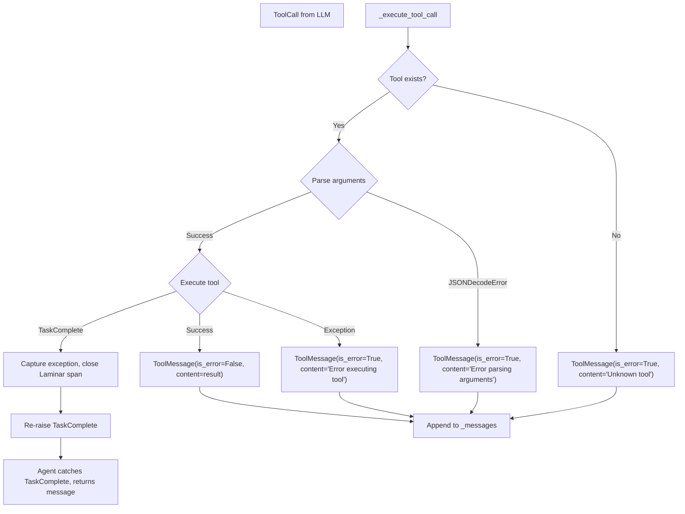

**Sources:** [bu_agent_sdk/agent/service.py:305-311](), [bu_agent_sdk/agent/service.py:362-386](), [bu_agent_sdk/agent/service.py:372-390]()

### Laminar Observability Integration

Each tool execution is wrapped in a Laminar span for tracing:

- **Span Creation** - `Laminar.start_as_current_span(name=tool_name, span_type="TOOL")` [bu_agent_sdk/agent/service.py:315-322]()
- **Input Logging** - Tool name and arguments logged at span start [bu_agent_sdk/agent/service.py:317-320]()
- **Output Logging** - Result or error logged at span completion [bu_agent_sdk/agent/service.py:352-358](), [bu_agent_sdk/agent/service.py:365](), [bu_agent_sdk/agent/service.py:380]()
- **TaskComplete Handling** - Logged as clean completion, not error [bu_agent_sdk/agent/service.py:374-376]()

**Sources:** [bu_agent_sdk/agent/service.py:314-324](), [bu_agent_sdk/agent/service.py:351-358]()

## Ephemeral Tools

Tools can mark their outputs as ephemeral, indicating that the content should be destroyed after a certain number of iterations to save context window space.

### Ephemeral Configuration

Tools specify ephemeral behavior via the `_ephemeral` attribute:
- `_ephemeral = True` - Keep only the last 1 output
- `_ephemeral = 3` - Keep only the last 3 outputs
- `_ephemeral = False` (default) - Keep all outputs

### Destruction Process

The `_destroy_ephemeral_messages` method [bu_agent_sdk/agent/service.py:229-299]() runs before each LLM invocation:

1. **Group by Tool** - Collect all ephemeral `ToolMessage` instances by `tool_name` [bu_agent_sdk/agent/service.py:243-256]()
2. **Determine Keep Count** - Read `tool.ephemeral` value from `_tool_map` [bu_agent_sdk/agent/service.py:260-265]()
3. **Select Messages to Destroy** - Keep last N, destroy older ones [bu_agent_sdk/agent/service.py:268]()
4. **Optional Storage** - If `ephemeral_storage_path` is set, save content to disk [bu_agent_sdk/agent/service.py:277-295]()
5. **Mark Destroyed** - Set `msg.destroyed = True` so serializers use placeholder text [bu_agent_sdk/agent/service.py:298]()

Destroyed messages show `<removed to save context>` to the LLM instead of full content.

**Sources:** [bu_agent_sdk/agent/service.py:229-299](), [bu_agent_sdk/agent/service.py:131-132]()

## Tool Call Iteration Loop

Tools are executed within the agent's main iteration loop. The loop structure at [bu_agent_sdk/agent/service.py:644-698]() operates as follows:

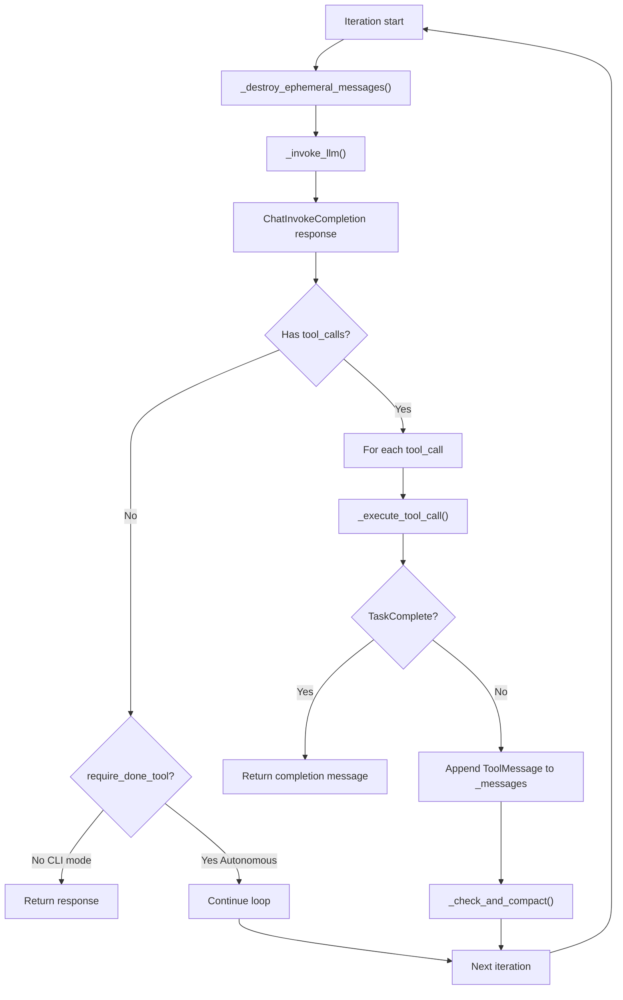

**Key Points:**

- Ephemeral messages destroyed before each LLM invocation [bu_agent_sdk/agent/service.py:648]()
- All tool calls in a response executed sequentially [bu_agent_sdk/agent/service.py:680-694]()
- `TaskComplete` exception breaks the loop immediately [bu_agent_sdk/agent/service.py:685-694]()
- Compaction check runs after all tool executions [bu_agent_sdk/agent/service.py:697]()

**Sources:** [bu_agent_sdk/agent/service.py:644-698](), [bu_agent_sdk/agent/service.py:680-694]()

## Tool Choice Configuration

The `tool_choice` parameter on `Agent` controls how the LLM selects tools:

| Value | Behavior | Use Case |
|-------|----------|----------|
| `"auto"` (default) | LLM decides whether to call tools | General-purpose agents |
| `"required"` | LLM must call at least one tool | Force tool usage |
| `"none"` | LLM cannot call tools | Disable tool calling |

The `tool_choice` is passed to `llm.ainvoke()` at [bu_agent_sdk/agent/service.py:445-449]().

**Sources:** [bu_agent_sdk/agent/service.py:117](), [bu_agent_sdk/agent/service.py:127](), [bu_agent_sdk/agent/service.py:448]()

---

# Page: Message History and State

# Message History and State

<details>
<summary>Relevant source files</summary>

The following files were used as context for generating this wiki page:

- [bu_agent_sdk/agent/README.md](bu_agent_sdk/agent/README.md)
- [bu_agent_sdk/agent/service.py](bu_agent_sdk/agent/service.py)

</details>


## Purpose and Scope

This page describes how the Agent manages conversation history and state across multiple interactions. It covers the internal `_messages` list, different message types, multi-turn conversation support, and ephemeral message management for handling large tool outputs.

For information about how messages are serialized to provider-specific formats, see [Message Serialization](#5.4). For details on the agentic loop that processes messages, see [Agentic Loop Execution](#2.1).

---

## Message History Architecture

The Agent maintains conversation state in an internal `_messages` list that accumulates messages across all interactions. This list serves as the complete conversation history sent to the LLM on each invocation.

### Core Data Structure

The message history is stored in the `_messages` field:

[bu_agent_sdk/agent/service.py:147]()

```python
_messages: list[BaseMessage] = field(default_factory=list, repr=False)
```

This list is append-only during normal operation and contains all messages in chronological order:
- System prompts
- User queries
- Assistant responses
- Tool execution results

### Message Flow Through Agent Loop

The following diagram shows how messages are added to history during agent execution:

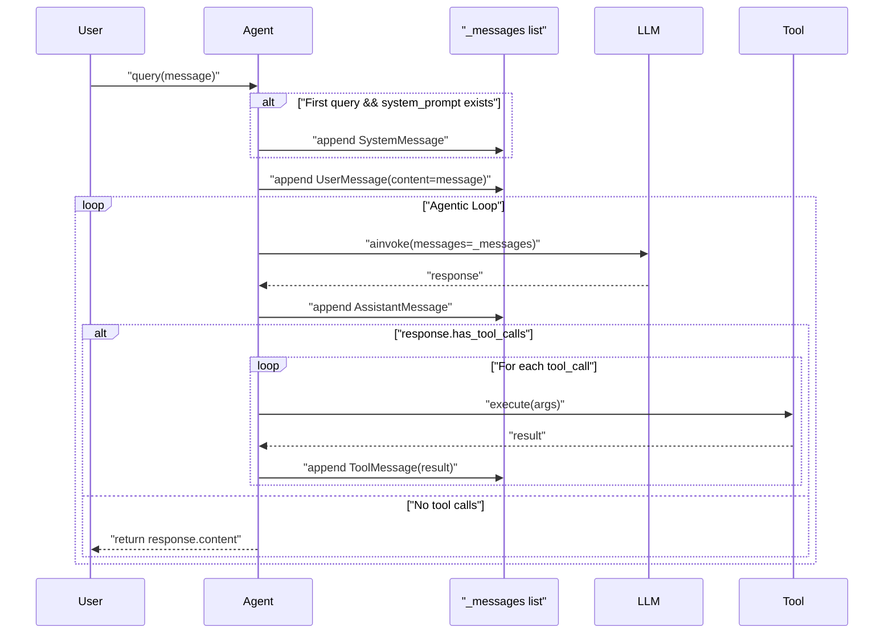

**Sources:** [bu_agent_sdk/agent/service.py:612-700]()

---

## Message Types

The SDK defines four primary message types, all inheriting from `BaseMessage`:

| Message Type | Purpose | Added When | Key Fields |
|-------------|---------|------------|------------|
| `SystemMessage` | System-level instructions | First query (if `system_prompt` set) | `content`, `cache` |
| `UserMessage` | User input | Each `query()` or `query_stream()` call | `content` (string or content parts) |
| `AssistantMessage` | LLM response | After each LLM invocation | `content`, `tool_calls` |
| `ToolMessage` | Tool execution result | After each tool execution | `tool_call_id`, `tool_name`, `content`, `is_error`, `ephemeral` |

### Message Type Hierarchy

```mermaid
classDiagram
    class BaseMessage {
        <<abstract>>
    }
    
    class SystemMessage {
        +content: str
        +cache: bool
    }
    
    class UserMessage {
        +content: str | list
    }
    
    class AssistantMessage {
        +content: str | None
        +tool_calls: list[ToolCall] | None
    }
    
    class ToolMessage {
        +tool_call_id: str
        +tool_name: str
        +content: str | list
        +is_error: bool
        +ephemeral: bool
        +destroyed: bool
    }
    
    BaseMessage <|-- SystemMessage
    BaseMessage <|-- UserMessage
    BaseMessage <|-- AssistantMessage
    BaseMessage <|-- ToolMessage
```

**Sources:** [bu_agent_sdk/llm/messages.py]()

### SystemMessage

System messages configure the LLM's behavior and are added once at the start of a conversation:

[bu_agent_sdk/agent/service.py:631-633]()

```python
if not self._messages and self.system_prompt:
    self._messages.append(SystemMessage(content=self.system_prompt, cache=True))
```

The `cache=True` parameter enables prompt caching on providers that support it (e.g., Anthropic), reducing token costs for repeated system prompts.

### UserMessage

User messages represent input from the application or end user. They support both simple text and multi-modal content:

[bu_agent_sdk/agent/service.py:636]()

```python
self._messages.append(UserMessage(content=message))
```

In `query_stream()`, the content can be a list of `ContentPartTextParam` or `ContentPartImageParam` for multi-modal inputs.

### AssistantMessage

Assistant messages capture LLM responses, including both text content and tool call requests:

[bu_agent_sdk/agent/service.py:654-658]()

```python
assistant_msg = AssistantMessage(
    content=response.content,
    tool_calls=response.tool_calls if response.tool_calls else None,
)
self._messages.append(assistant_msg)
```

When the LLM requests tool calls, `tool_calls` contains a list of `ToolCall` objects specifying which tools to invoke and with what arguments.

### ToolMessage

Tool messages contain the results of tool executions and are always paired with a corresponding `AssistantMessage` that requested the tool call:

[bu_agent_sdk/agent/service.py:342-348]()

```python
tool_message = ToolMessage(
    tool_call_id=tool_call.id,
    tool_name=tool_name,
    content=result,
    is_error=False,
    ephemeral=is_ephemeral,
)
```

The `tool_call_id` links the result back to the specific tool call request. The `ephemeral` flag indicates whether this message should be automatically cleaned up (see Ephemeral Messages section).

**Sources:** [bu_agent_sdk/agent/service.py:300-393](), [bu_agent_sdk/llm/messages.py]()

---

## Multi-turn Conversations

The Agent preserves conversation history across multiple `query()` calls, enabling context-aware follow-up interactions.

### Conversation Continuity

```mermaid
graph TD
    Q1["query('My name is Alice')"]
    M1["_messages: [SystemMessage, UserMessage]"]
    R1["LLM Response: 'Nice to meet you, Alice'"]
    M2["_messages: [SystemMessage, UserMessage, AssistantMessage]"]
    
    Q2["query('What is my name?')"]
    M3["_messages: [SystemMessage, UserMessage, AssistantMessage, UserMessage]"]
    R2["LLM Response: 'Your name is Alice'"]
    M4["_messages: [... AssistantMessage]"]
    
    Q1 --> M1
    M1 --> R1
    R1 --> M2
    M2 --> Q2
    Q2 --> M3
    M3 --> R2
    R2 --> M4
```

**Example from documentation:**

[bu_agent_sdk/agent/README.md:74-82]()

```python
await agent.query("My name is Alice")
await agent.query("What's my name?")  # Remembers "Alice"
agent.clear_history()  # Reset
```

The system prompt is only added once, on the first query:

[bu_agent_sdk/agent/service.py:631-633]()

```python
if not self._messages and self.system_prompt:
    self._messages.append(SystemMessage(content=self.system_prompt, cache=True))
```

Subsequent queries simply append new `UserMessage` instances to the existing history.

**Sources:** [bu_agent_sdk/agent/README.md:74-82](), [bu_agent_sdk/agent/service.py:631-637]()

---

## Ephemeral Messages

Ephemeral messages are tool results that can be automatically removed from conversation history to conserve context window space. This is critical for tools that produce large outputs (e.g., file contents, screenshots).

### Ephemeral Message Configuration

Tools declare themselves as ephemeral using the `_ephemeral` attribute:

```python
@tool("Read file contents", _ephemeral=3)
async def read_file(path: str) -> str:
    return file_contents  # May be very large
```

The `_ephemeral` value controls retention:
- `_ephemeral=True`: Keep last 1 result
- `_ephemeral=N` (integer): Keep last N results
- `_ephemeral=False` or unset: Never destroy

### Ephemeral Message Lifecycle

```mermaid
stateDiagram-v2
    [*] --> Created: "Tool executes, returns large output"
    Created --> InHistory: "ToolMessage(ephemeral=True) appended"
    InHistory --> CheckLimit: "Next iteration: _destroy_ephemeral_messages()"
    
    CheckLimit --> Retained: "Within keep limit (last N)"
    CheckLimit --> ToDestroy: "Beyond keep limit (older)"
    
    ToDestroy --> SavedToDisk: "If ephemeral_storage_path set"
    ToDestroy --> Destroyed: "If ephemeral_storage_path=None"
    
    SavedToDisk --> Destroyed: "msg.destroyed = True"
    Destroyed --> Placeholder: "Serializers use '<removed to save context>'"
    
    Retained --> InHistory: "Remains in conversation"
    Placeholder --> InHistory: "Minimal context usage"
```

### Destruction Process

The `_destroy_ephemeral_messages()` method is called before each LLM invocation:

[bu_agent_sdk/agent/service.py:647-648]()

```python
# Destroy ephemeral messages from previous iteration before LLM sees them again
self._destroy_ephemeral_messages()
```

The destruction process:

1. **Group by tool name**: [bu_agent_sdk/agent/service.py:243-256]()
   ```python
   for msg in self._messages:
       if isinstance(msg, ToolMessage) and msg.ephemeral and not msg.destroyed:
           ephemeral_by_tool[msg.tool_name].append(msg)
   ```

2. **Determine keep count**: [bu_agent_sdk/agent/service.py:261-265]()
   ```python
   tool = self._tool_map.get(tool_name)
   keep_count = tool.ephemeral if isinstance(tool.ephemeral, int) else 1
   ```

3. **Identify messages to destroy**: [bu_agent_sdk/agent/service.py:267-268]()
   ```python
   messages_to_destroy = messages[:-keep_count] if keep_count > 0 else messages
   ```

4. **Optional disk storage**: [bu_agent_sdk/agent/service.py:276-295]()
   ```python
   if self.ephemeral_storage_path is not None:
       filepath = self.ephemeral_storage_path / f"{msg.tool_call_id}.json"
       filepath.write_text(json.dumps(saved_data, indent=2))
   ```

5. **Mark as destroyed**: [bu_agent_sdk/agent/service.py:298]()
   ```python
   msg.destroyed = True
   ```

When a message is marked `destroyed=True`, message serializers replace its content with a placeholder string to minimize context usage while maintaining the conversation structure.

**Sources:** [bu_agent_sdk/agent/service.py:229-298](), [bu_agent_sdk/agent/service.py:647-648]()

---

## History Management Operations

The Agent provides methods to inspect and manipulate conversation history.

### Reading Message History

The `messages` property provides read-only access to the current history:

[bu_agent_sdk/agent/service.py:182-184]()

```python
@property
def messages(self) -> list[BaseMessage]:
    """Get the current message history (read-only copy)."""
    return list(self._messages)
```

This returns a copy to prevent external modifications that could corrupt internal state.

### Clearing History

The `clear_history()` method resets both message history and token usage tracking:

[bu_agent_sdk/agent/service.py:199-202]()

```python
def clear_history(self):
    """Clear the message history and token usage."""
    self._messages = []
    self._token_cost.clear_history()
```

This is useful for starting fresh conversations or implementing session boundaries.

### Loading Previous Conversations

The `load_history()` method restores a previously saved conversation state:

[bu_agent_sdk/agent/service.py:204-227]()

```python
def load_history(self, messages: list[BaseMessage]) -> None:
    """Load message history to continue a previous conversation.
    
    Note: The system prompt will NOT be re-added on the next query()
    call since _messages will be non-empty.
    """
    self._messages = list(messages)
    self._token_cost.clear_history()
```

**Important:** When loading history, the system prompt is NOT automatically re-added because `_messages` is non-empty. If the loaded history doesn't include the system prompt, you must add it manually:

```python
messages = load_from_database()
agent.load_history(messages)
# If messages[0] is not a SystemMessage, you may need to prepend it
```

### History Management Flow

```mermaid
graph LR
    subgraph "Query Flow"
        Q[query]
        A[append messages]
        H[_messages]
    end
    
    subgraph "Management"
        R[messages property]
        C[clear_history]
        L[load_history]
    end
    
    Q --> A
    A --> H
    H -.read.-> R
    H -.reset.-> C
    H -.restore.-> L
    L --> H
    C --> H
```

**Sources:** [bu_agent_sdk/agent/service.py:182-227]()

---

## State Preservation Across Compaction

When the Compaction service triggers (see [Context Management](#4)), the message history is replaced with a summary, but the conversation state is logically preserved:

[bu_agent_sdk/agent/service.py:599-609]()

```python
new_messages, result = await self._compaction_service.check_and_compact(
    self._messages,
    self.llm,
)

if result.compacted:
    self._messages = list(new_messages)
    return True
```

After compaction, `_messages` contains a single summary message that captures the essence of the previous conversation, allowing the agent to continue with reduced token usage while maintaining context.

For details on how compaction works, see [Compaction Service Logic](#4.2).

**Sources:** [bu_agent_sdk/agent/service.py:582-609]()

---

# Page: TaskComplete Pattern

# TaskComplete Pattern

<details>
<summary>Relevant source files</summary>

The following files were used as context for generating this wiki page:

- [README.md](README.md)
- [bu_agent_sdk/agent/service.py](bu_agent_sdk/agent/service.py)

</details>


## Purpose and Scope

This document explains the TaskComplete pattern used in bu_agent_sdk to control when an agent stops executing. It covers the `TaskComplete` exception, the "Done Tool Pattern" for explicit task completion, and the distinction between CLI mode and autonomous mode. For information about the broader agent execution loop, see [Agentic Loop Execution](#2.1). For details on tool definition and execution, see [Tool Calling and Execution](#2.2).

---

## Overview

The TaskComplete pattern addresses a fundamental problem in agentic systems: **determining when a task is truly complete**. The naive approach—stopping when the LLM returns no tool calls—fails because agents frequently finish prematurely before completing their objectives.

The bu_agent_sdk implements two termination strategies:

| Mode | Parameter | Termination Condition |
|------|-----------|----------------------|
| **CLI Mode** | `require_done_tool=False` (default) | LLM stops calling tools |
| **Autonomous Mode** | `require_done_tool=True` | Explicit `done` tool raises `TaskComplete` |

CLI mode is suitable for interactive chat interfaces where the user controls the conversation flow. Autonomous mode is designed for long-running tasks where the agent must explicitly signal completion.

**Sources:** [README.md:56-69](), [bu_agent_sdk/agent/service.py:133-134]()

---

## The TaskComplete Exception

### Exception Definition

The `TaskComplete` exception provides explicit task completion signaling instead of relying on the absence of tool calls.

```python
class TaskComplete(Exception):
    """Exception raised when a task is completed via the done tool.
    
    This provides explicit task completion signaling instead of relying on
    the absence of tool calls. The agent loop catches this exception and
    returns the completion message.
    
    Attributes:
        message: A description of why the task is complete and what was accomplished.
    """
    
    def __init__(self, message: str):
        self.message = message
        super().__init__(message)
```

The exception carries a single attribute:
- **`message`**: A human-readable description of what was accomplished and why the task is complete

**Sources:** [bu_agent_sdk/agent/service.py:40-53]()

### Exception Flow

```mermaid
flowchart TB
    Tool["Tool execution<br/>_execute_tool_call()"] --> Try["try: execute tool"]
    Try --> Raises{Tool raises<br/>TaskComplete?}
    
    Raises -->|No| Success["Return ToolMessage<br/>(normal result)"]
    Raises -->|Yes| Catch["except TaskComplete as e"]
    
    Catch --> AppendMsg["Append ToolMessage:<br/>content='Task completed: {message}'"]
    AppendMsg --> ReturnMsg["Return e.message<br/>(exits agent loop)"]
    
    Success --> Continue["Agent loop continues"]
    ReturnMsg --> Done["Agent stops<br/>(task complete)"]
    
    style Raises fill:#f9f9f9
    style Catch fill:#f9f9f9
    style Done fill:#f9f9f9
```

**Diagram: TaskComplete Exception Propagation**

The agent's `_execute_tool_call` method catches `TaskComplete` exceptions and converts them into completion signals. The exception is caught at [bu_agent_sdk/agent/service.py:685-694]() in the `query` method and [bu_agent_sdk/agent/service.py:847-865]() in the `query_stream` method.

**Sources:** [bu_agent_sdk/agent/service.py:300-393](), [bu_agent_sdk/agent/service.py:682-694](), [bu_agent_sdk/agent/service.py:847-865]()

---

## The Done Tool Pattern

### Implementing a Done Tool

The recommended pattern is to create a dedicated `done` tool that raises `TaskComplete`:

```python
from bu_agent_sdk import tool, TaskComplete

@tool("Signal task completion")
async def done(message: str) -> str:
    raise TaskComplete(message)
```

This tool should be included in the agent's tool list:

```python
agent = Agent(
    llm=ChatAnthropic(model="claude-sonnet-4-20250514"),
    tools=[..., done],
    require_done_tool=True,  # Autonomous mode
)
```

**Sources:** [README.md:32-34](), [README.md:62-63](), [README.md:195-198]()

### Why Explicit Completion Matters

The README emphasizes: *"The naive 'stop when no tool calls' approach fails. Agents finish prematurely."*

Without explicit completion:
1. The LLM may stop calling tools before the task is complete
2. Partial results may be returned as if the task succeeded
3. Multi-step workflows may terminate after the first step
4. The agent has no mechanism to verify task completion

With the Done Tool Pattern:
1. The LLM must explicitly call `done` to finish
2. The completion message describes what was accomplished
3. The agent can verify preconditions before calling `done` (e.g., checking for incomplete subtasks)
4. Task boundaries are clear and auditable

**Sources:** [README.md:56-58]()

---

## CLI Mode vs Autonomous Mode

### Mode Comparison

```mermaid
flowchart TB
    subgraph CLI["CLI Mode (require_done_tool=False)"]
        direction TB
        CLIStart["LLM invocation"] --> CLIToolCalls{Has tool calls?}
        CLIToolCalls -->|Yes| CLIExecute["Execute tools"]
        CLIExecute --> CLIStart
        CLIToolCalls -->|No| CLIPrompt{Incomplete todos?}
        CLIPrompt -->|Yes| CLIAddPrompt["Add hidden prompt"]
        CLIAddPrompt --> CLIStart
        CLIPrompt -->|No| CLIFinish["Return response<br/>(agent stops)"]
    end
    
    subgraph Auto["Autonomous Mode (require_done_tool=True)"]
        direction TB
        AutoStart["LLM invocation"] --> AutoToolCalls{Has tool calls?}
        AutoToolCalls -->|Yes| AutoExecute["Execute tools"]
        AutoExecute --> AutoTC{TaskComplete<br/>raised?}
        AutoTC -->|Yes| AutoFinish["Return message<br/>(agent stops)"]
        AutoTC -->|No| AutoStart
        AutoToolCalls -->|No| AutoContinue["Continue loop<br/>(ignore text response)"]
        AutoContinue --> AutoStart
    end
    
    style CLIFinish fill:#f9f9f9
    style AutoFinish fill:#f9f9f9
```

**Diagram: Termination Logic by Mode**

**Sources:** [bu_agent_sdk/agent/service.py:660-677]()

### CLI Mode (Default)

Enabled with `require_done_tool=False` (the default).

**Termination condition:** The LLM returns no tool calls.

**Behavior:**
1. Agent invokes the LLM with messages and tools
2. If LLM returns tool calls, execute them and repeat
3. If LLM returns no tool calls:
   - Check for incomplete todos via `_get_incomplete_todos_prompt()` hook
   - If incomplete todos exist, add a hidden prompt and continue
   - Otherwise, return the LLM's text response

**Use cases:**
- Interactive chat interfaces
- User-driven conversations
- Exploratory tasks where the user provides guidance

**Implementation:** [bu_agent_sdk/agent/service.py:662-675]()

### Autonomous Mode

Enabled with `require_done_tool=True`.

**Termination condition:** A tool raises `TaskComplete`.

**Behavior:**
1. Agent invokes the LLM with messages and tools
2. If LLM returns tool calls, execute them:
   - If a tool raises `TaskComplete`, catch it and return the message
   - Otherwise, add results and continue
3. If LLM returns no tool calls:
   - **Ignore the response** and continue the loop
   - Force the LLM to call tools (including `done`)

**Use cases:**
- Long-running autonomous tasks
- Multi-step workflows with clear completion criteria
- Tasks that must execute to completion without user intervention

**Implementation:** [bu_agent_sdk/agent/service.py:676-677](), [bu_agent_sdk/agent/service.py:682-694]()

**Sources:** [bu_agent_sdk/agent/service.py:133-134](), [bu_agent_sdk/agent/service.py:660-694]()

---

## Implementation Details

### Agent Loop Integration

The agent's core loop handles `TaskComplete` at two levels:

#### Level 1: Tool Execution

The `_execute_tool_call` method wraps tool execution in a try-except block:

**Key code flow:**
1. Execute the tool with `await tool.execute(_overrides=..., **args)`
2. If the tool raises `TaskComplete`, capture it outside the Laminar span context
3. Re-raise after the observability span closes cleanly
4. The exception propagates to the query/query_stream caller

**Sources:** [bu_agent_sdk/agent/service.py:300-393](), specifically [bu_agent_sdk/agent/service.py:372-390]()

#### Level 2: Query Methods

Both `query` and `query_stream` catch `TaskComplete` during tool execution:

**In `query` (non-streaming):**
```python
for tool_call in response.tool_calls:
    tool_calls_made += 1
    try:
        tool_result = await self._execute_tool_call(tool_call)
        self._messages.append(tool_result)
    except TaskComplete as e:
        self._messages.append(
            ToolMessage(
                tool_call_id=tool_call.id,
                tool_name=tool_call.function.name,
                content=f"Task completed: {e.message}",
                is_error=False,
            )
        )
        return e.message
```

**In `query_stream` (streaming):**
```python
try:
    tool_result = await self._execute_tool_call(tool_call)
    self._messages.append(tool_result)
    # ... yield ToolResultEvent ...
except TaskComplete as e:
    self._messages.append(...)
    yield ToolResultEvent(...)
    yield FinalResponseEvent(content=e.message)
    return
```

**Sources:** [bu_agent_sdk/agent/service.py:682-694](), [bu_agent_sdk/agent/service.py:847-865]()

### Message History Management

When `TaskComplete` is raised:
1. A `ToolMessage` is appended to history with `content="Task completed: {message}"`
2. The message is marked as `is_error=False` (success)
3. The agent loop exits immediately after appending the message
4. The completion message is returned to the caller

This ensures the conversation history accurately reflects task completion, even though the exception short-circuits the loop.

**Sources:** [bu_agent_sdk/agent/service.py:686-693](), [bu_agent_sdk/agent/service.py:850-856]()

### Event Streaming with TaskComplete

In streaming mode, the sequence of events when a `done` tool is called:

```mermaid
sequenceDiagram
    participant Agent
    participant LLM
    participant DoneTool as "done tool"
    participant EventStream as "Event Stream"
    
    Agent->>LLM: ainvoke(messages, tools)
    LLM-->>Agent: response with tool_calls=[done]
    
    Agent->>EventStream: StepStartEvent(tool_call_id)
    Agent->>EventStream: ToolCallEvent(tool="done", args={message: "..."})
    
    Agent->>DoneTool: execute(message="...")
    DoneTool-->>Agent: raise TaskComplete("...")
    
    Agent->>Agent: catch TaskComplete
    Agent->>Agent: append ToolMessage to history
    
    Agent->>EventStream: ToolResultEvent(result="Task completed: ...")
    Agent->>EventStream: FinalResponseEvent(content="...")
    
    Agent-->>Agent: return (exit loop)
```

**Diagram: TaskComplete Event Sequence**

The key distinction is that `FinalResponseEvent` is **always** the last event yielded, signaling to consumers that the agent has finished.

**Sources:** [bu_agent_sdk/agent/service.py:847-865](), [bu_agent_sdk/agent/events.py]()

---

## Incomplete Todos Hook

The agent provides a hook for checking incomplete work before termination in CLI mode:

```python
async def _get_incomplete_todos_prompt(self) -> str | None:
    """Hook for subclasses to check for incomplete todos before finishing.
    
    This method is called when the LLM is about to stop (no more tool calls in CLI mode,
    or done tool called in autonomous mode).
    
    The prompt should ask the LLM to:
    1. Continue working on incomplete tasks
    2. Mark completed tasks as done
    3. Revise the todo list if tasks are no longer relevant
    """
    return None
```

**When it's called:**
- In CLI mode, when the LLM returns no tool calls
- Before returning the final response
- Only once per query (tracked by `incomplete_todos_prompted` flag)

**Purpose:**
- Prevent premature termination when subtasks remain incomplete
- Give the agent a chance to clean up or complete remaining work
- Support complex workflows with implicit task dependencies

**Usage pattern:**
Subclasses can override this method to check for incomplete todos (e.g., from a todo management tool) and return a prompt asking the LLM to continue.

**Sources:** [bu_agent_sdk/agent/service.py:569-580](), [bu_agent_sdk/agent/service.py:664-671](), [bu_agent_sdk/agent/service.py:772-779]()

---

## Best Practices

### 1. Use Autonomous Mode for Goal-Oriented Tasks

When the agent must accomplish a specific objective:
```python
agent = Agent(
    llm=llm,
    tools=[..., done],
    require_done_tool=True,
)
```

### 2. Provide Descriptive Completion Messages

The `done` tool message should explain what was accomplished:
```python
@tool("Signal task completion")
async def done(message: str) -> str:
    """Call when the task is fully complete.
    
    Args:
        message: Summary of what was accomplished and any important results.
    """
    raise TaskComplete(message)
```

### 3. Validate Preconditions Before Completing

For complex workflows, check that all subtasks are done:
```python
@tool("Mark task as complete")
async def done_with_validation(
    message: str,
    todos: Annotated[TodoManager, Depends(get_todos)]
) -> str:
    incomplete = todos.get_incomplete()
    if incomplete:
        return f"Cannot complete: {len(incomplete)} tasks remain: {incomplete}"
    
    raise TaskComplete(message)
```

### 4. Use CLI Mode for Interactive Sessions

For chat interfaces where the user drives the conversation:
```python
agent = Agent(
    llm=llm,
    tools=[search, calculate, write_file],
    require_done_tool=False,  # Explicit default
)
```

### 5. Handle TaskComplete in Custom Tools Carefully

If you need to raise `TaskComplete` from a tool that performs cleanup:
```python
@tool("Finish and cleanup")
async def done_with_cleanup(
    message: str,
    ctx: Annotated[Context, Depends(get_context)]
) -> str:
    # Perform cleanup BEFORE raising TaskComplete
    await ctx.save_state()
    await ctx.close_connections()
    
    # Now signal completion
    raise TaskComplete(message)
```

**Sources:** [README.md:56-69](), [bu_agent_sdk/agent/service.py:133-134]()

---

## Summary

The TaskComplete pattern provides deterministic task termination through:

| Component | Purpose | Code Entity |
|-----------|---------|-------------|
| **TaskComplete Exception** | Signal task completion explicitly | `TaskComplete` class at [bu_agent_sdk/agent/service.py:40-53]() |
| **Done Tool** | LLM-callable completion trigger | `@tool` decorated function that raises `TaskComplete` |
| **require_done_tool Parameter** | Mode selector (CLI vs Autonomous) | `Agent.require_done_tool` at [bu_agent_sdk/agent/service.py:133-134]() |
| **CLI Mode** | Stops when LLM returns no tool calls | `require_done_tool=False` behavior at [bu_agent_sdk/agent/service.py:662-675]() |
| **Autonomous Mode** | Requires explicit `done` tool call | `require_done_tool=True` behavior at [bu_agent_sdk/agent/service.py:676-677]() |

This design ensures agents can reliably complete tasks without premature termination, while still supporting interactive chat workflows where natural conversation endings are appropriate.

**Sources:** [README.md:56-69](), [bu_agent_sdk/agent/service.py:40-53](), [bu_agent_sdk/agent/service.py:133-134](), [bu_agent_sdk/agent/service.py:660-694]()

---

# Page: Event System

# Event System

<details>
<summary>Relevant source files</summary>

The following files were used as context for generating this wiki page:

- [bu_agent_sdk/agent/README.md](bu_agent_sdk/agent/README.md)
- [bu_agent_sdk/agent/__init__.py](bu_agent_sdk/agent/__init__.py)
- [bu_agent_sdk/agent/events.py](bu_agent_sdk/agent/events.py)

</details>


## Purpose and Scope

The Event System provides streaming observability for agent execution, enabling real-time monitoring and UI construction. This page covers the event streaming architecture, event flow, correlation mechanisms, and integration patterns. For detailed documentation of individual event types, see [Event Types](#3.1). For implementation guidance on consuming the event stream, see [Streaming Interface](#3.2).

## Overview

The Event System implements a streaming architecture that yields typed events throughout agent execution. Rather than waiting for the agent to complete, applications can observe the agent's internal operations in real-time, including LLM interactions, tool calls, and reasoning steps. This enables responsive user interfaces, debugging, logging, and custom monitoring without blocking agent execution.

The system is built on Python's async iterator protocol, exposing events through the `Agent.query_stream()` method. Events are strongly typed dataclasses that represent discrete agent operations, emitted at precise execution points.

**Sources:** [bu_agent_sdk/agent/events.py:1-20]()

## Architecture

### Event Flow

Events flow from the agent's internal execution loop to external consumers through an async generator pattern:

```mermaid
graph TB
    subgraph AgentCore["Agent Core (service.py)"]
        AgentLoop["Agent._run_stream()"]
        LLMInvoke["LLM Invocation"]
        ToolExec["Tool Execution"]
        StateManage["State Management"]
    end
    
    subgraph EventGeneration["Event Generation"]
        EmitText["yield TextEvent"]
        EmitThinking["yield ThinkingEvent"]
        EmitToolCall["yield ToolCallEvent"]
        EmitToolResult["yield ToolResultEvent"]
        EmitStep["yield StepStartEvent/<br/>StepCompleteEvent"]
        EmitMessage["yield MessageStartEvent/<br/>MessageCompleteEvent"]
        EmitFinal["yield FinalResponseEvent"]
        EmitHidden["yield HiddenUserMessageEvent"]
    end
    
    subgraph StreamInterface["query_stream() Interface"]
        AsyncIterator["AsyncIterator[AgentEvent]"]
    end
    
    subgraph Consumers["Event Consumers"]
        UI["User Interface<br/>(Real-time Display)"]
        Logger["Logging System"]
        Monitor["Monitoring/Metrics"]
        Custom["Custom Handlers"]
    end
    
    AgentLoop --> LLMInvoke
    AgentLoop --> ToolExec
    AgentLoop --> StateManage
    
    LLMInvoke --> EmitText
    LLMInvoke --> EmitThinking
    LLMInvoke --> EmitToolCall
    ToolExec --> EmitToolResult
    AgentLoop --> EmitStep
    AgentLoop --> EmitMessage
    AgentLoop --> EmitFinal
    StateManage --> EmitHidden
    
    EmitText --> AsyncIterator
    EmitThinking --> AsyncIterator
    EmitToolCall --> AsyncIterator
    EmitToolResult --> AsyncIterator
    EmitStep --> AsyncIterator
    EmitMessage --> AsyncIterator
    EmitFinal --> AsyncIterator
    EmitHidden --> AsyncIterator
    
    AsyncIterator --> UI
    AsyncIterator --> Logger
    AsyncIterator --> Monitor
    AsyncIterator --> Custom
```

**Sources:** [bu_agent_sdk/agent/events.py:1-206](), [bu_agent_sdk/agent/README.md:24-39]()

### Event Categories

Events are organized into five functional categories:

| Category | Event Types | Purpose |
|----------|-------------|---------|
| **Content Events** | `TextEvent`, `ThinkingEvent` | LLM-generated content (text output and reasoning) |
| **Tool Events** | `ToolCallEvent`, `ToolResultEvent` | Tool invocation and results |
| **Message Lifecycle** | `MessageStartEvent`, `MessageCompleteEvent` | Conversation turn boundaries |
| **Step Events** | `StepStartEvent`, `StepCompleteEvent` | Logical grouping of operations |
| **Special Events** | `FinalResponseEvent`, `HiddenUserMessageEvent` | Completion markers and internal messages |

The union type `AgentEvent` encompasses all event types:

```python
AgentEvent = (
    TextEvent
    | ThinkingEvent
    | ToolCallEvent
    | ToolResultEvent
    | FinalResponseEvent
    | MessageStartEvent
    | MessageCompleteEvent
    | StepStartEvent
    | StepCompleteEvent
    | HiddenUserMessageEvent
)
```

**Sources:** [bu_agent_sdk/agent/events.py:194-206](), [bu_agent_sdk/agent/__init__.py:10-29]()

## Event Lifecycle

The following diagram illustrates the typical sequence of events during a single agent query:

```mermaid
sequenceDiagram
    participant Consumer
    participant Agent as Agent.query_stream()
    participant LLM
    participant Tool
    
    Consumer->>Agent: iterate events
    activate Agent
    
    Agent->>Consumer: MessageStartEvent(role='user')
    Note over Agent: User message added to history
    
    Agent->>Consumer: MessageStartEvent(role='assistant')
    
    Agent->>LLM: invoke with tools
    activate LLM
    
    alt LLM produces thinking
        LLM-->>Agent: thinking content
        Agent->>Consumer: ThinkingEvent(content)
    end
    
    alt LLM produces text
        LLM-->>Agent: text content
        Agent->>Consumer: TextEvent(content)
    end
    
    alt LLM calls tools
        LLM-->>Agent: tool_calls
        deactivate LLM
        
        loop For each tool call
            Agent->>Consumer: StepStartEvent(step_id, title)
            Agent->>Consumer: ToolCallEvent(tool, args, tool_call_id)
            
            Agent->>Tool: execute(args)
            activate Tool
            Tool-->>Agent: result
            deactivate Tool
            
            Agent->>Consumer: ToolResultEvent(tool, result, tool_call_id)
            Agent->>Consumer: StepCompleteEvent(step_id, status)
        end
        
        Note over Agent: Loop continues with next LLM call
    else No tool calls
        Agent->>Consumer: MessageCompleteEvent(message_id, content)
        Agent->>Consumer: FinalResponseEvent(content)
        deactivate Agent
    end
```

**Sources:** [bu_agent_sdk/agent/events.py:1-206](), [bu_agent_sdk/agent/README.md:24-39]()

## Correlation Mechanisms

Events use unique identifiers to enable correlation across the event stream:

### Identifier Types

```mermaid
graph LR
    subgraph IDs["Event Identifiers"]
        MessageID["message_id<br/>(MessageStartEvent,<br/>MessageCompleteEvent)"]
        ToolCallID["tool_call_id<br/>(ToolCallEvent,<br/>ToolResultEvent)"]
        StepID["step_id<br/>(StepStartEvent,<br/>StepCompleteEvent)"]
    end
    
    subgraph Relationships["ID Relationships"]
        MessageScope["message_id scopes<br/>an entire conversation turn"]
        StepScope["step_id typically equals<br/>tool_call_id for steps"]
        ToolScope["tool_call_id links call<br/>to result"]
    end
    
    MessageID --> MessageScope
    ToolCallID --> ToolScope
    StepID --> StepScope
    
    MessageScope -.contains.- StepScope
    StepScope -.contains.- ToolScope
```

### ID Usage Patterns

**Message Correlation:**
- `MessageStartEvent.message_id` marks the beginning of a message
- `MessageCompleteEvent.message_id` marks completion using the same ID
- All events between these boundaries belong to the same message

**Tool Call Correlation:**
- `ToolCallEvent.tool_call_id` uniquely identifies a tool invocation
- `ToolResultEvent.tool_call_id` references the same ID to link the result
- Essential for parallel tool execution and async result handling

**Step Correlation:**
- `StepStartEvent.step_id` groups related operations (often same as `tool_call_id`)
- `StepCompleteEvent.step_id` marks step completion
- `StepStartEvent.step_number` provides sequential ordering within a query

**Sources:** [bu_agent_sdk/agent/events.py:117-178](), [bu_agent_sdk/agent/events.py:52-99]()

## Streaming Interface Overview

The primary interface for consuming events is `Agent.query_stream()`, which returns an `AsyncIterator[AgentEvent]`:

```python
async for event in agent.query_stream("do something"):
    match event:
        case ToolCallEvent(tool=name, args=args):
            print(f"Calling {name}: {args}")
        case ToolResultEvent(tool=name, result=result):
            print(f"{name} returned: {result}")
        case FinalResponseEvent(content=text):
            print(f"Done: {text}")
```

This pattern enables:
- **Non-blocking consumption:** Events are yielded as they occur
- **Type-safe pattern matching:** Structural pattern matching on event types
- **Selective processing:** Consumers can filter for specific event types
- **Stream transformation:** Events can be mapped, filtered, or aggregated

For detailed implementation patterns, see [Streaming Interface](#3.2).

**Sources:** [bu_agent_sdk/agent/README.md:24-39](), [bu_agent_sdk/agent/events.py:7-20]()

## Code Entity Mapping

The following diagram maps high-level system concepts to concrete code entities:

```mermaid
graph TB
    subgraph PublicAPI["Public API (bu_agent_sdk.agent)"]
        AgentClass["Agent class<br/>(service.py)"]
        QueryStream["Agent.query_stream()<br/>→ AsyncIterator[AgentEvent]"]
        Query["Agent.query()<br/>→ str"]
    end
    
    subgraph EventTypes["Event Types (events.py)"]
        TextEventClass["TextEvent<br/>(line 28-36)"]
        ThinkingEventClass["ThinkingEvent<br/>(line 40-48)"]
        ToolCallEventClass["ToolCallEvent<br/>(line 52-73)"]
        ToolResultEventClass["ToolResultEvent<br/>(line 77-99)"]
        StepStartEventClass["StepStartEvent<br/>(line 146-159)"]
        StepCompleteEventClass["StepCompleteEvent<br/>(line 163-177)"]
        MessageStartEventClass["MessageStartEvent<br/>(line 117-127)"]
        MessageCompleteEventClass["MessageCompleteEvent<br/>(line 131-142)"]
        FinalResponseEventClass["FinalResponseEvent<br/>(line 103-110)"]
        HiddenUserMessageEventClass["HiddenUserMessageEvent<br/>(line 181-191)"]
        AgentEventUnion["AgentEvent<br/>(line 195-206)<br/>Union type"]
    end
    
    subgraph Exports["__init__.py Exports"]
        ExportedEvents["AgentEvent<br/>FinalResponseEvent<br/>TextEvent<br/>ThinkingEvent<br/>ToolCallEvent<br/>ToolResultEvent"]
    end
    
    AgentClass --> QueryStream
    AgentClass --> Query
    QueryStream --> AgentEventUnion
    Query -.internally uses.- QueryStream
    
    AgentEventUnion --> TextEventClass
    AgentEventUnion --> ThinkingEventClass
    AgentEventUnion --> ToolCallEventClass
    AgentEventUnion --> ToolResultEventClass
    AgentEventUnion --> StepStartEventClass
    AgentEventUnion --> StepCompleteEventClass
    AgentEventUnion --> MessageStartEventClass
    AgentEventUnion --> MessageCompleteEventClass
    AgentEventUnion --> FinalResponseEventClass
    AgentEventUnion --> HiddenUserMessageEventClass
    
    ExportedEvents --> AgentEventUnion
```

**Sources:** [bu_agent_sdk/agent/events.py:1-206](), [bu_agent_sdk/agent/__init__.py:1-34]()

## Use Cases

### Real-Time User Interfaces

Events enable responsive UIs that display agent progress:

- **Step-by-step visualization:** Show `StepStartEvent` titles as the agent progresses
- **Tool execution feedback:** Display `ToolCallEvent` arguments and `ToolResultEvent` results
- **Thinking transparency:** Render `ThinkingEvent` content to show reasoning
- **Progress indicators:** Use `MessageStartEvent`/`MessageCompleteEvent` for state transitions

### Logging and Debugging

The event stream provides complete execution traces:

- **Structured logging:** Each event is a structured dataclass with typed fields
- **Execution replay:** Event sequences can be recorded and replayed for debugging
- **Error tracking:** `ToolResultEvent.is_error` flag identifies failed operations
- **Performance profiling:** `StepCompleteEvent.duration_ms` tracks step durations

### Monitoring and Observability

Events integrate with observability systems:

- **Metrics collection:** Count tool calls, measure response times, track error rates
- **Custom instrumentation:** Filter and aggregate events for specific monitoring needs
- **Alert triggers:** React to specific event patterns or error conditions
- **Audit trails:** Maintain complete records of agent decisions and actions

### Custom Event Handlers

Applications can implement specialized event processing:

- **State management:** Maintain application state synchronized with agent progress
- **Side effects:** Trigger external actions based on specific events
- **Event transformation:** Convert events to different formats or protocols
- **Conditional logic:** Implement business rules based on event patterns

**Sources:** [bu_agent_sdk/agent/events.py:1-20](), [bu_agent_sdk/agent/README.md:24-39]()

## Event Data Structures

All events are immutable dataclasses with string representations for debugging:

```mermaid
classDiagram
    class TextEvent {
        +str content
        +__str__() str
    }
    
    class ThinkingEvent {
        +str content
        +__str__() str
    }
    
    class ToolCallEvent {
        +str tool
        +dict args
        +str tool_call_id
        +str display_name
        +__str__() str
    }
    
    class ToolResultEvent {
        +str tool
        +str result
        +str tool_call_id
        +bool is_error
        +str|None screenshot_base64
        +__str__() str
    }
    
    class StepStartEvent {
        +str step_id
        +str title
        +int step_number
        +__str__() str
    }
    
    class StepCompleteEvent {
        +str step_id
        +Literal status
        +float duration_ms
        +__str__() str
    }
    
    class MessageStartEvent {
        +str message_id
        +Literal role
        +__str__() str
    }
    
    class MessageCompleteEvent {
        +str message_id
        +str content
        +__str__() str
    }
    
    class FinalResponseEvent {
        +str content
        +__str__() str
    }
    
    class HiddenUserMessageEvent {
        +str content
        +__str__() str
    }
```

Each event implements `__str__()` for human-readable console output with emoji prefixes (e.g., `💬` for text, `🔧` for tools, `✅` for completion).

**Sources:** [bu_agent_sdk/agent/events.py:28-191]()

## Integration with Agent Execution

Events are emitted at specific points in the agent's execution flow:

| Execution Point | Event(s) Emitted | Location in Code |
|----------------|------------------|------------------|
| Query starts | `MessageStartEvent(role='user')` | Agent initialization |
| Assistant turn begins | `MessageStartEvent(role='assistant')` | Before LLM invocation |
| LLM outputs text | `TextEvent` | During response streaming |
| LLM reasoning | `ThinkingEvent` | When thinking content detected |
| Tool call requested | `StepStartEvent`, `ToolCallEvent` | After LLM response parsed |
| Tool execution completes | `ToolResultEvent`, `StepCompleteEvent` | After tool function returns |
| Hidden prompt injected | `HiddenUserMessageEvent` | State management (e.g., incomplete todos) |
| Query completes | `MessageCompleteEvent`, `FinalResponseEvent` | End of agentic loop |

For detailed agent execution flow, see [Agentic Loop Execution](#2.1).

**Sources:** [bu_agent_sdk/agent/events.py:1-206]()

---

# Page: Event Types

# Event Types

<details>
<summary>Relevant source files</summary>

The following files were used as context for generating this wiki page:

- [bu_agent_sdk/agent/events.py](bu_agent_sdk/agent/events.py)

</details>


## Purpose and Scope

This page documents all event types emitted by the Agent during execution. These events enable real-time observability into the agent's behavior and are yielded through the `query_stream` method. For information about consuming these events and building streaming interfaces, see [Streaming Interface](#3.2). For broader context on the event system architecture, see [Event System](#3).

All event types are defined in [bu_agent_sdk/agent/events.py:1-207]() and are exposed as a union type `AgentEvent` for type-safe consumption.

---

## Event Type Categories

The SDK defines 10 distinct event types, organized into five functional categories:

### Event Type Classification Diagram

```mermaid
graph TB
    AgentEvent["AgentEvent<br/>(Union Type)"]
    
    subgraph Content["Content Events"]
        TextEvent["TextEvent"]
        ThinkingEvent["ThinkingEvent"]
    end
    
    subgraph Tool["Tool Events"]
        ToolCallEvent["ToolCallEvent"]
        ToolResultEvent["ToolResultEvent"]
    end
    
    subgraph Message["Message Lifecycle Events"]
        MessageStartEvent["MessageStartEvent"]
        MessageCompleteEvent["MessageCompleteEvent"]
    end
    
    subgraph Step["Step Events"]
        StepStartEvent["StepStartEvent"]
        StepCompleteEvent["StepCompleteEvent"]
    end
    
    subgraph Special["Special Events"]
        FinalResponseEvent["FinalResponseEvent"]
        HiddenUserMessageEvent["HiddenUserMessageEvent"]
    end
    
    AgentEvent --> Content
    AgentEvent --> Tool
    AgentEvent --> Message
    AgentEvent --> Step
    AgentEvent --> Special
```

**Sources:** [bu_agent_sdk/agent/events.py:27-206]()

---

## Content Events

### TextEvent

Emitted when the LLM produces text content intended for the user. This represents the assistant's visible response text.

**Class Definition:** [bu_agent_sdk/agent/events.py:27-36]()

| Field | Type | Description |
|-------|------|-------------|
| `content` | `str` | The text content from the assistant |

**When Emitted:** During LLM response parsing when the model returns text content blocks.

**String Representation:** `💬 {preview}` (truncated to 100 characters)

**Example:**
```python
TextEvent(content="I'll help you calculate that...")
# String output: 💬 I'll help you calculate that...
```

---

### ThinkingEvent

Emitted when the model produces extended thinking or reasoning content (e.g., Claude's thinking blocks). This represents internal reasoning that may or may not be displayed to users.

**Class Definition:** [bu_agent_sdk/agent/events.py:39-48]()

| Field | Type | Description |
|-------|------|-------------|
| `content` | `str` | The thinking/reasoning content |

**When Emitted:** During LLM response parsing when the model returns thinking content blocks.

**String Representation:** `🧠 {preview}` (truncated to 80 characters)

**Example:**
```python
ThinkingEvent(content="Let me break down this problem step by step...")
# String output: 🧠 Let me break down this problem step by step...
```

**Sources:** [bu_agent_sdk/agent/events.py:27-48]()

---

## Tool Events

### ToolCallEvent

Emitted when the LLM requests a tool execution. This event is emitted before the tool is actually executed.

**Class Definition:** [bu_agent_sdk/agent/events.py:51-73]()

| Field | Type | Description |
|-------|------|-------------|
| `tool` | `str` | The name of the tool being called |
| `args` | `dict[str, Any]` | The arguments passed to the tool |
| `tool_call_id` | `str` | Unique ID for this specific tool call |
| `display_name` | `str` | Human-readable description (default: `''`) |

**When Emitted:** During LLM response parsing when the model requests tool execution, before the tool is actually invoked.

**String Representation:** 
- If `display_name` is set: `🔧 {display_name}`
- Otherwise: `🔧 {tool}({args_json})` (truncated to 80 characters)

**Example:**
```python
ToolCallEvent(
    tool="calculate",
    args={"expression": "2 + 2"},
    tool_call_id="call_abc123",
    display_name="Calculating 2 + 2"
)
# String output: 🔧 Calculating 2 + 2
```

---

### ToolResultEvent

Emitted when a tool execution completes and returns a result (or error).

**Class Definition:** [bu_agent_sdk/agent/events.py:76-99]()

| Field | Type | Description |
|-------|------|-------------|
| `tool` | `str` | The name of the tool that was called |
| `result` | `str` | The result returned by the tool |
| `tool_call_id` | `str` | The unique ID matching the corresponding `ToolCallEvent` |
| `is_error` | `bool` | Whether the tool execution resulted in an error (default: `False`) |
| `screenshot_base64` | `str \| None` | Base64-encoded screenshot for browser tools (default: `None`) |

**When Emitted:** Immediately after tool execution completes, whether successful or failed.

**String Representation:** `{prefix} {tool}: {preview}{screenshot_indicator}` where prefix is `✓` for success or `❌` for errors

**Example:**
```python
ToolResultEvent(
    tool="calculate",
    result="4",
    tool_call_id="call_abc123",
    is_error=False
)
# String output:    ✓ calculate: 4
```

**Sources:** [bu_agent_sdk/agent/events.py:51-99]()

---

## Message Lifecycle Events

### MessageStartEvent

Emitted when a new message begins in the conversation, whether from the user or assistant.

**Class Definition:** [bu_agent_sdk/agent/events.py:116-127]()

| Field | Type | Description |
|-------|------|-------------|
| `message_id` | `str` | Unique ID for this message |
| `role` | `Literal['user', 'assistant']` | The role of the message sender |

**When Emitted:** At the beginning of processing a new user query or when the agent starts generating an assistant response.

**String Representation:** `📨 Message started ({role})`

**Example:**
```python
MessageStartEvent(message_id="msg_001", role="assistant")
# String output: 📨 Message started (assistant)
```

---

### MessageCompleteEvent

Emitted when a message has been fully processed and is ready to be stored in history.

**Class Definition:** [bu_agent_sdk/agent/events.py:130-142]()

| Field | Type | Description |
|-------|------|-------------|
| `message_id` | `str` | The ID of the completed message |
| `content` | `str` | The full message content |

**When Emitted:** After all content for a message has been collected and processed.

**String Representation:** `📩 Message complete: {preview}` (truncated to 80 characters)

**Example:**
```python
MessageCompleteEvent(
    message_id="msg_001",
    content="The result is 4"
)
# String output: 📩 Message complete: The result is 4
```

**Sources:** [bu_agent_sdk/agent/events.py:116-142]()

---

## Step Events

### StepStartEvent

Emitted when the agent begins a logical step, typically corresponding to a tool execution group. Steps represent higher-level operations that may involve multiple tool calls.

**Class Definition:** [bu_agent_sdk/agent/events.py:145-159]()

| Field | Type | Description |
|-------|------|-------------|
| `step_id` | `str` | Unique ID for this step (typically same as `tool_call_id`) |
| `title` | `str` | Human-readable title for the step |
| `step_number` | `int` | Sequential step number within the query (default: `0`) |

**When Emitted:** Before executing a tool or tool group, providing a high-level description of the operation.

**String Representation:** `▶️  Step {step_number}: {title}`

**Example:**
```python
StepStartEvent(
    step_id="step_001",
    title="Navigate to website",
    step_number=1
)
# String output: ▶️  Step 1: Navigate to website
```

---

### StepCompleteEvent

Emitted when a step finishes execution, indicating success or failure.

**Class Definition:** [bu_agent_sdk/agent/events.py:162-177]()

| Field | Type | Description |
|-------|------|-------------|
| `step_id` | `str` | The ID of the completed step |
| `status` | `Literal['completed', 'error']` | The final status of the step |
| `duration_ms` | `float` | Duration of the step in milliseconds (default: `0.0`) |

**When Emitted:** After a step's tool execution(s) complete.

**String Representation:** `{icon} Step complete ({duration_ms}ms)` where icon is `✅` for completed or `❌` for error

**Example:**
```python
StepCompleteEvent(
    step_id="step_001",
    status="completed",
    duration_ms=1234.5
)
# String output: ✅ Step complete (1235ms)
```

**Sources:** [bu_agent_sdk/agent/events.py:145-177]()

---

## Special Events

### FinalResponseEvent

Emitted when the agent produces its final response to the user query, indicating that the agentic loop has completed.

**Class Definition:** [bu_agent_sdk/agent/events.py:102-110]()

| Field | Type | Description |
|-------|------|-------------|
| `content` | `str` | The final response content |

**When Emitted:** When the agent determines the task is complete and provides the final answer.

**String Representation:** `✅ Final: {preview}` (truncated to 100 characters)

**Example:**
```python
FinalResponseEvent(content="The calculation is complete: 2 + 2 = 4")
# String output: ✅ Final: The calculation is complete: 2 + 2 = 4
```

---

### HiddenUserMessageEvent

Emitted when the agent injects a hidden system message into the conversation. These messages are saved to history and sent to the LLM but are not displayed in the UI. This is commonly used for autonomous mode prompts (e.g., incomplete todos reminders).

**Class Definition:** [bu_agent_sdk/agent/events.py:180-191]()

| Field | Type | Description |
|-------|------|-------------|
| `content` | `str` | The content of the hidden user message |

**When Emitted:** When the agent needs to inject guidance to the LLM without exposing it to the user interface.

**String Representation:** `👻 Hidden: {preview}` (truncated to 80 characters)

**Example:**
```python
HiddenUserMessageEvent(
    content="You have incomplete todos. Continue working on them."
)
# String output: 👻 Hidden: You have incomplete todos. Continue working on them.
```

**Sources:** [bu_agent_sdk/agent/events.py:102-191]()

---

## Event Correlation

Events are correlated through unique identifiers, enabling consumers to track relationships between events across the execution lifecycle.

### Event Correlation Diagram

```mermaid
graph TB
    subgraph Conversation["Conversation Level"]
        msg_id["message_id<br/>'msg_001'"]
    end
    
    subgraph MessageFlow["Message Events"]
        MessageStartEvent["MessageStartEvent<br/>message_id: 'msg_001'"]
        MessageCompleteEvent["MessageCompleteEvent<br/>message_id: 'msg_001'"]
    end
    
    subgraph StepFlow["Step Events"]
        StepStartEvent["StepStartEvent<br/>step_id: 'step_001'"]
        StepCompleteEvent["StepCompleteEvent<br/>step_id: 'step_001'"]
    end
    
    subgraph ToolFlow["Tool Events"]
        ToolCallEvent["ToolCallEvent<br/>tool_call_id: 'call_abc123'"]
        ToolResultEvent["ToolResultEvent<br/>tool_call_id: 'call_abc123'"]
    end
    
    subgraph ContentFlow["Content Events"]
        TextEvent["TextEvent"]
        ThinkingEvent["ThinkingEvent"]
    end
    
    msg_id -.->|"groups"| MessageFlow
    MessageStartEvent -->|"begins"| StepFlow
    MessageStartEvent -->|"begins"| ContentFlow
    
    StepStartEvent -.->|"step_id often equals tool_call_id"| ToolCallEvent
    ToolCallEvent -->|"matches via tool_call_id"| ToolResultEvent
    
    MessageCompleteEvent -.->|"ends"| MessageFlow
    StepCompleteEvent -.->|"ends"| StepFlow
```

### Correlation Identifiers

| Identifier | Scope | Used By | Purpose |
|------------|-------|---------|---------|
| `message_id` | Message lifecycle | `MessageStartEvent`, `MessageCompleteEvent` | Correlate the start and completion of a single message |
| `tool_call_id` | Tool execution | `ToolCallEvent`, `ToolResultEvent` | Match tool invocations with their results |
| `step_id` | Logical step | `StepStartEvent`, `StepCompleteEvent` | Group related operations; often equals `tool_call_id` |

**Example Correlation:**
```python
# Step starts
StepStartEvent(step_id="step_001", title="Calculate", step_number=1)

# Tool called (step_id typically matches tool_call_id)
ToolCallEvent(tool="calculate", args={...}, tool_call_id="step_001")

# Tool result
ToolResultEvent(tool="calculate", result="4", tool_call_id="step_001")

# Step completes
StepCompleteEvent(step_id="step_001", status="completed", duration_ms=125.0)
```

**Sources:** [bu_agent_sdk/agent/events.py:116-177]()

---

## AgentEvent Union Type

All event types are combined into a union type for type-safe event handling.

**Definition:** [bu_agent_sdk/agent/events.py:194-206]()

```python
AgentEvent = (
    TextEvent
    | ThinkingEvent
    | ToolCallEvent
    | ToolResultEvent
    | FinalResponseEvent
    | MessageStartEvent
    | MessageCompleteEvent
    | StepStartEvent
    | StepCompleteEvent
    | HiddenUserMessageEvent
)
```

This union type is the return type of `agent.query_stream()` and enables pattern matching:

```python
async for event in agent.query_stream("solve this problem"):
    match event:
        case ToolCallEvent(tool=name, args=args):
            print(f"Calling {name} with {args}")
        case ToolResultEvent(tool=name, result=result):
            print(f"{name} returned: {result}")
        case TextEvent(content=text):
            print(f"Assistant: {text}")
        case FinalResponseEvent(content=final):
            print(f"Done: {final}")
```

**Sources:** [bu_agent_sdk/agent/events.py:194-206]()

---

## Event Emission Sequence

The following diagram illustrates the typical sequence of events during a single agent query execution:

### Typical Event Flow Diagram

```mermaid
sequenceDiagram
    participant Agent as "Agent.query_stream()"
    participant Stream as "Event Stream"
    
    Note over Agent,Stream: User query received
    Agent->>Stream: MessageStartEvent(role='user')
    Agent->>Stream: MessageCompleteEvent
    
    Note over Agent,Stream: Assistant response begins
    Agent->>Stream: MessageStartEvent(role='assistant')
    
    Note over Agent,Stream: LLM thinking (optional)
    Agent->>Stream: ThinkingEvent
    
    Note over Agent,Stream: LLM decides to use tools
    Agent->>Stream: StepStartEvent(step_id='step_001', title='Calculate')
    Agent->>Stream: ToolCallEvent(tool_call_id='step_001', tool='calculate')
    
    Note over Agent,Stream: Tool executes
    Agent->>Stream: ToolResultEvent(tool_call_id='step_001', result='4')
    Agent->>Stream: StepCompleteEvent(step_id='step_001', status='completed')
    
    Note over Agent,Stream: LLM produces final text
    Agent->>Stream: TextEvent(content='The result is 4')
    Agent->>Stream: FinalResponseEvent(content='The result is 4')
    Agent->>Stream: MessageCompleteEvent
```

**Sources:** [bu_agent_sdk/agent/events.py:1-207]()

---

## Event Type Reference Table

| Event Type | Category | Key Fields | Correlation ID | Purpose |
|------------|----------|------------|----------------|---------|
| `TextEvent` | Content | `content` | - | LLM text output |
| `ThinkingEvent` | Content | `content` | - | LLM reasoning content |
| `ToolCallEvent` | Tool | `tool`, `args`, `tool_call_id`, `display_name` | `tool_call_id` | Tool invocation |
| `ToolResultEvent` | Tool | `tool`, `result`, `tool_call_id`, `is_error`, `screenshot_base64` | `tool_call_id` | Tool execution result |
| `FinalResponseEvent` | Special | `content` | - | Task completion |
| `MessageStartEvent` | Message | `message_id`, `role` | `message_id` | Message begins |
| `MessageCompleteEvent` | Message | `message_id`, `content` | `message_id` | Message ends |
| `StepStartEvent` | Step | `step_id`, `title`, `step_number` | `step_id` | Logical operation begins |
| `StepCompleteEvent` | Step | `step_id`, `status`, `duration_ms` | `step_id` | Logical operation ends |
| `HiddenUserMessageEvent` | Special | `content` | - | System-injected message |

**Sources:** [bu_agent_sdk/agent/events.py:27-206]()

---

# Page: Streaming Interface

# Streaming Interface

<details>
<summary>Relevant source files</summary>

The following files were used as context for generating this wiki page:

- [bu_agent_sdk/agent/README.md](bu_agent_sdk/agent/README.md)
- [bu_agent_sdk/agent/events.py](bu_agent_sdk/agent/events.py)
- [bu_agent_sdk/agent/service.py](bu_agent_sdk/agent/service.py)

</details>


## Purpose and Scope

This page documents the streaming interface provided by the `query_stream` method, which enables real-time observation of agent execution through typed events. Unlike the blocking `query` method which returns only the final result, `query_stream` yields granular events as the agent processes tasks, executes tools, and generates responses.

For details on individual event types and their properties, see [Event Types](#3.1). For information about the core agent loop execution, see [Agentic Loop Execution](#2.1).

**Sources:** [bu_agent_sdk/agent/service.py:702-873]()

---

## The query_stream Method

### Method Signature

The `query_stream` method is defined in the `Agent` class and returns an async iterator:

```python
async def query_stream(
    self, message: str | list[ContentPartTextParam | ContentPartImageParam]
) -> AsyncIterator[AgentEvent]
```

**Key characteristics:**
- **Input:** Accepts either a string message or a list of content parts for multi-modal input (text + images)
- **Return type:** `AsyncIterator[AgentEvent]` - yields events as they occur
- **Decorated with:** `@observe(name="agent_query_stream")` for Laminar observability integration
- **Non-blocking:** Events are yielded immediately as execution progresses

**Sources:** [bu_agent_sdk/agent/service.py:702-733]()

### Comparison: query vs query_stream

| Aspect | `query(message: str)` | `query_stream(message)` |
|--------|---------------------|------------------------|
| **Return Type** | `str` (final response) | `AsyncIterator[AgentEvent]` |
| **Execution** | Blocking until complete | Yields events as they occur |
| **Visibility** | Only final result | All intermediate steps |
| **Use Case** | Simple CLI tools | Real-time UIs, monitoring |
| **Input Types** | String only | String or multi-modal content |
| **Event Access** | None | Full event stream |

**Sources:** [bu_agent_sdk/agent/service.py:611-700](), [bu_agent_sdk/agent/service.py:702-873]()

---

## Event Consumption Patterns

### Basic Async Iteration

The simplest consumption pattern uses `async for` to iterate over events:

```python
async for event in agent.query_stream("do something"):
    print(event)  # Each event has a __str__ method for basic display
```

**Sources:** [bu_agent_sdk/agent/README.md:28-39]()

### Pattern Matching

Python's `match/case` syntax provides type-safe event handling:

```python
async for event in agent.query_stream("Schedule a meeting"):
    match event:
        case ToolCallEvent(tool=name, args=args):
            print(f"Calling {name}: {args}")
        case ToolResultEvent(tool=name, result=result, is_error=False):
            print(f"{name} returned: {result[:50]}")
        case ToolResultEvent(is_error=True):
            print(f"Tool error: {event.result}")
        case TextEvent(content=text):
            print(f"Assistant: {text}")
        case ThinkingEvent(content=thinking):
            print(f"Thinking: {thinking}")
        case FinalResponseEvent(content=text):
            print(f"Done: {text}")
```

**Sources:** [bu_agent_sdk/agent/README.md:28-39](), [bu_agent_sdk/agent/events.py:1-20]()

### Event Filtering

Filter specific event types for targeted processing:

```python
tool_calls = []
async for event in agent.query_stream("analyze data"):
    if isinstance(event, ToolCallEvent):
        tool_calls.append((event.tool, event.args))
    elif isinstance(event, FinalResponseEvent):
        print(f"Made {len(tool_calls)} tool calls")
        print(f"Result: {event.content}")
```

### Event Collection

Collect all events for post-processing or logging:

```python
events = []
async for event in agent.query_stream("complex task"):
    events.append(event)
    # Process in real-time if needed

# Post-process collected events
tool_errors = [e for e in events if isinstance(e, ToolResultEvent) and e.is_error]
steps_completed = [e for e in events if isinstance(e, StepCompleteEvent)]
```

**Sources:** [bu_agent_sdk/agent/events.py:1-206]()

---

## Event Lifecycle and Ordering

```mermaid
sequenceDiagram
    participant User
    participant Agent as Agent.query_stream
    participant LLM
    participant Tool
    
    User->>Agent: query_stream("task")
    activate Agent
    
    Note over Agent: Add user message to history
    Note over Agent: Destroy ephemeral messages
    
    Agent->>LLM: ainvoke(messages, tools)
    LLM-->>Agent: response with tool_calls
    
    opt Has thinking content
        Agent-->>User: ThinkingEvent(content)
    end
    
    opt Has text content
        Agent-->>User: TextEvent(content)
    end
    
    loop For each tool_call
        Agent-->>User: StepStartEvent(step_id, title, step_number)
        Agent-->>User: ToolCallEvent(tool, args, tool_call_id)
        
        Agent->>Tool: execute(args)
        activate Tool
        Tool-->>Agent: result
        deactivate Tool
        
        Agent-->>User: ToolResultEvent(tool, result, tool_call_id, is_error)
        Agent-->>User: StepCompleteEvent(step_id, status, duration_ms)
    end
    
    alt No more tool calls (CLI mode)
        Agent-->>User: TextEvent(content) [if present]
        Agent-->>User: FinalResponseEvent(content)
    else Has tool calls
        Note over Agent,LLM: Loop continues
    end
    
    deactivate Agent
```

**Event Correlation IDs:**

| ID Type | Purpose | Scope | Example Usage |
|---------|---------|-------|---------------|
| `tool_call_id` | Links ToolCallEvent → ToolResultEvent | Single tool invocation | Match results to calls |
| `step_id` | Links StepStartEvent → StepCompleteEvent | Logical step (usually = tool_call_id) | Track step duration |
| `message_id` | Links MessageStartEvent → MessageCompleteEvent | Message boundaries | UI message grouping |

**Sources:** [bu_agent_sdk/agent/service.py:747-872](), [bu_agent_sdk/agent/events.py:52-99]()

### Event Emission Points in Code

```mermaid
flowchart TD
    Start["query_stream invoked"] --> AddMsg["Add UserMessage to _messages"]
    AddMsg --> Loop{iterations < max_iterations}
    
    Loop -->|Yes| Destroy["_destroy_ephemeral_messages()"]
    Destroy --> Invoke["await _invoke_llm()"]
    
    Invoke --> CheckThinking{response.thinking?}
    CheckThinking -->|Yes| YieldThinking["yield ThinkingEvent"]
    CheckThinking -->|No| CheckTools
    YieldThinking --> CheckTools
    
    CheckTools{response.has_tool_calls?}
    
    CheckTools -->|No| CheckMode{require_done_tool?}
    CheckMode -->|No CLI mode| CheckIncomplete{incomplete todos?}
    CheckIncomplete -->|Yes first time| YieldHidden["yield HiddenUserMessageEvent"]
    CheckIncomplete -->|No| YieldText1["yield TextEvent if content"]
    YieldHidden --> Loop
    YieldText1 --> YieldFinal["yield FinalResponseEvent"]
    YieldFinal --> End["Return"]
    
    CheckMode -->|Yes Autonomous| YieldText2["yield TextEvent if content"]
    YieldText2 --> Loop
    
    CheckTools -->|Yes| YieldText3["yield TextEvent if content"]
    YieldText3 --> ToolLoop["For each tool_call"]
    
    ToolLoop --> YieldStepStart["yield StepStartEvent"]
    YieldStepStart --> YieldToolCall["yield ToolCallEvent"]
    YieldToolCall --> ExecTool["await _execute_tool_call()"]
    
    ExecTool --> CheckTaskComplete{TaskComplete?}
    CheckTaskComplete -->|Yes| YieldTaskResult["yield ToolResultEvent<br/>yield FinalResponseEvent"]
    CheckTaskComplete -->|No| YieldResult["yield ToolResultEvent"]
    
    YieldResult --> YieldStepComplete["yield StepCompleteEvent"]
    YieldStepComplete --> MoreTools{More tools?}
    MoreTools -->|Yes| ToolLoop
    MoreTools -->|No| Compact["await _check_and_compact()"]
    Compact --> Loop
    
    YieldTaskResult --> End
    Loop -->|No max reached| GenSummary["Generate max iterations summary"]
    GenSummary --> YieldFinalSummary["yield FinalResponseEvent"]
    YieldFinalSummary --> End
    
    style Start fill:#e1f5ff
    style End fill:#e1ffe1
    style YieldThinking fill:#fff4e1
    style YieldToolCall fill:#fff4e1
    style YieldResult fill:#fff4e1
    style YieldFinal fill:#e1ffe1
```

**Sources:** [bu_agent_sdk/agent/service.py:747-872]()

---

## Building Real-time UIs

### Progress Tracking with Steps

`StepStartEvent` and `StepCompleteEvent` provide structured progress information:

```python
active_steps = {}

async for event in agent.query_stream("complex task"):
    match event:
        case StepStartEvent(step_id=sid, title=title, step_number=num):
            active_steps[sid] = {
                'title': title,
                'number': num,
                'start_time': time.time()
            }
            print(f"▶️  Step {num}: {title}")
        
        case StepCompleteEvent(step_id=sid, status=status, duration_ms=duration):
            step = active_steps.pop(sid)
            icon = '✅' if status == 'completed' else '❌'
            print(f"{icon} {step['title']} ({duration:.0f}ms)")
```

**Sources:** [bu_agent_sdk/agent/events.py:146-178]()

### Streaming Text Display

Display assistant text as it becomes available:

```python
current_message = ""

async for event in agent.query_stream("write an essay"):
    match event:
        case TextEvent(content=text):
            current_message += text
            # Update UI with current_message
            print(text, end='', flush=True)
        
        case ThinkingEvent(content=thinking):
            # Display thinking in collapsed/expandable section
            print(f"\n🧠 [Thinking: {thinking[:100]}...]")
        
        case FinalResponseEvent():
            print("\n✅ Complete")
```

**Sources:** [bu_agent_sdk/agent/events.py:28-48]()

### Tool Execution Visualization

```mermaid
graph TB
    subgraph "UI Components"
        ToolList["Active Tools List"]
        ToolDetails["Tool Details Panel"]
        Results["Results Display"]
    end
    
    subgraph "Event Stream Processing"
        ToolCallEvent --> AddToList["Add to active_tools dict"]
        AddToList --> ShowSpinner["Show spinner in UI"]
        
        ToolResultEvent --> UpdateResult["Update tool result"]
        UpdateResult --> CheckError{is_error?}
        CheckError -->|Yes| ShowError["Display error with ❌"]
        CheckError -->|No| ShowSuccess["Display success with ✓"]
        
        StepCompleteEvent --> RemoveSpinner["Remove spinner"]
        RemoveSpinner --> ShowDuration["Show duration"]
    end
    
    ShowSpinner --> ToolList
    ShowError --> Results
    ShowSuccess --> Results
    ShowDuration --> ToolDetails
    
    style ToolCallEvent fill:#fff4e1
    style ToolResultEvent fill:#fff4e1
    style StepCompleteEvent fill:#fff4e1
```

Example implementation:

```python
import time

class UIState:
    def __init__(self):
        self.active_tools = {}
        self.completed_steps = []
    
    async def process_stream(self, agent, message):
        async for event in agent.query_stream(message):
            match event:
                case ToolCallEvent(tool=name, args=args, tool_call_id=tid):
                    self.active_tools[tid] = {
                        'name': name,
                        'args': args,
                        'start': time.time()
                    }
                    self.render_tool_started(name, args)
                
                case ToolResultEvent(tool=name, result=result, tool_call_id=tid, 
                                     is_error=error, screenshot_base64=screenshot):
                    tool_info = self.active_tools.get(tid, {})
                    duration = time.time() - tool_info.get('start', 0)
                    
                    self.render_tool_completed(
                        name=name,
                        result=result,
                        is_error=error,
                        duration=duration,
                        screenshot=screenshot
                    )
                
                case TextEvent(content=text):
                    self.render_assistant_text(text)
                
                case FinalResponseEvent(content=final):
                    self.render_completion(final)
    
    def render_tool_started(self, name, args):
        print(f"🔧 {name}({args}) ⏳")
    
    def render_tool_completed(self, name, result, is_error, duration, screenshot):
        icon = '❌' if is_error else '✓'
        print(f"   {icon} {name}: {result[:80]} ({duration:.2f}s)")
        if screenshot:
            print(f"   📸 Screenshot available")
```

**Sources:** [bu_agent_sdk/agent/events.py:52-99]()

### Screenshot Handling

Browser tools may return screenshots as base64-encoded images in `ToolResultEvent`:

```python
async for event in agent.query_stream("browse website"):
    match event:
        case ToolResultEvent(screenshot_base64=screenshot) if screenshot:
            # Decode and display screenshot
            import base64
            image_data = base64.b64decode(screenshot)
            # Display in UI or save to file
            with open("screenshot.png", "wb") as f:
                f.write(image_data)
```

**Screenshot extraction logic:**
The agent extracts screenshots from `ToolMessage.content` when it contains `ContentPartImageParam` with base64 data URLs.

**Sources:** [bu_agent_sdk/agent/service.py:395-434](), [bu_agent_sdk/agent/events.py:76-99]()

---

## Hidden Messages and Special Events

### HiddenUserMessageEvent

Emitted when the agent injects hidden prompts (e.g., incomplete todos check):

```python
async for event in agent.query_stream("work on tasks"):
    match event:
        case HiddenUserMessageEvent(content=prompt):
            # Log for debugging but don't show in UI
            logger.debug(f"Hidden prompt: {prompt}")
        case TextEvent(content=text):
            # Show normal text
            print(text)
```

**When hidden messages occur:**
- In CLI mode (`require_done_tool=False`), when the LLM stops calling tools but `_get_incomplete_todos_prompt()` returns a prompt
- The prompt is added to message history and sent to LLM but not displayed

**Sources:** [bu_agent_sdk/agent/service.py:769-779](), [bu_agent_sdk/agent/events.py:181-192]()

### TaskComplete Exception Handling

When a tool raises `TaskComplete`, the stream immediately yields final events and terminates:

```python
async for event in agent.query_stream("autonomous task"):
    match event:
        case ToolResultEvent(tool="done", result=result):
            # Tool called 'done' and raised TaskComplete
            print(f"Task complete: {result}")
        case FinalResponseEvent(content=message):
            # This is the TaskComplete message
            print(f"Final: {message}")
            # Stream ends here
```

**Sources:** [bu_agent_sdk/agent/service.py:847-865]()

---

## Implementation Details

### Message History Management

The `query_stream` method maintains state in `_messages`:

1. **System prompt added:** Only on first call when `_messages` is empty
2. **User message added:** At the start of each `query_stream` call
3. **Assistant messages added:** After each LLM invocation
4. **Tool messages added:** After each tool execution
5. **Ephemeral cleanup:** `_destroy_ephemeral_messages()` called before each LLM invocation

**Sources:** [bu_agent_sdk/agent/service.py:734-751]()

### Compaction During Streaming

Compaction happens transparently during event streaming:

```python
# After tool execution in the loop
await self._check_and_compact(response)
```

This means the message history may be compacted mid-stream without any event being emitted. The compaction is invisible to event consumers.

**Sources:** [bu_agent_sdk/agent/service.py:867-868](), [bu_agent_sdk/agent/service.py:582-609]()

### Error Propagation

Errors during streaming propagate as exceptions, not events:

```python
try:
    async for event in agent.query_stream("task"):
        # Process events
        pass
except ModelRateLimitError as e:
    print(f"Rate limited: {e}")
except ModelProviderError as e:
    print(f"LLM error: {e}")
except Exception as e:
    print(f"Unexpected error: {e}")
```

**Tool execution errors** are captured and yielded as `ToolResultEvent(is_error=True)` rather than raising exceptions.

**Sources:** [bu_agent_sdk/agent/service.py:822-846]()

### Retry Logic in Streaming

The `_invoke_llm` method includes retry logic with exponential backoff that applies during streaming:

- **Retryable errors:** Rate limits (429), server errors (500, 502, 503, 504), timeouts, connection errors
- **Retry behavior:** Up to `llm_max_retries` attempts (default 5) with exponential backoff
- **No event emitted:** Retries happen internally; consumers don't see retry events

```python
# Retry delays follow this pattern:
# Attempt 1: 1.0s + jitter
# Attempt 2: 2.0s + jitter  
# Attempt 3: 4.0s + jitter
# Attempt 4: 8.0s + jitter
# Attempt 5: 16.0s + jitter (capped at llm_retry_max_delay=60s)
```

**Sources:** [bu_agent_sdk/agent/service.py:436-532]()

---

## Complete Event Flow Example

```mermaid
sequenceDiagram
    participant App as Application Code
    participant Stream as query_stream
    participant Events as Event Yields
    
    App->>Stream: query_stream("analyze data")
    activate Stream
    
    Note over Stream: System prompt added (first call)
    Note over Stream: UserMessage added
    
    loop iterations < max_iterations
        Note over Stream: Destroy ephemeral messages
        Note over Stream: await _invoke_llm()
        
        Stream->>Events: ThinkingEvent (if present)
        Stream->>Events: TextEvent (if content)
        
        loop For each tool_call
            Stream->>Events: StepStartEvent
            Stream->>Events: ToolCallEvent
            Note over Stream: Execute tool
            Stream->>Events: ToolResultEvent
            Stream->>Events: StepCompleteEvent
        end
        
        alt No tool calls & CLI mode
            Stream->>Events: FinalResponseEvent
            Note over Stream: Return (stream ends)
        else Has tool calls or Autonomous mode
            Note over Stream: Continue loop
        end
    end
    
    Stream->>Events: FinalResponseEvent (max iterations)
    deactivate Stream
```

**Comprehensive example consuming all event types:**

```python
import time
from bu_agent_sdk import Agent
from bu_agent_sdk.llm import ChatOpenAI
from bu_agent_sdk.agent import (
    TextEvent, ThinkingEvent, ToolCallEvent, ToolResultEvent,
    StepStartEvent, StepCompleteEvent, FinalResponseEvent,
    HiddenUserMessageEvent
)

agent = Agent(llm=ChatOpenAI(model="gpt-4o"), tools=[...])

# Track execution metrics
metrics = {
    'total_steps': 0,
    'tool_calls': 0,
    'errors': 0,
    'start_time': time.time()
}

async for event in agent.query_stream("analyze and report"):
    match event:
        case ThinkingEvent(content=thinking):
            print(f"🧠 Thinking: {thinking[:100]}...")
        
        case TextEvent(content=text):
            print(f"💬 {text}")
        
        case StepStartEvent(step_number=num, title=title):
            metrics['total_steps'] += 1
            print(f"\n▶️  Step {num}: {title}")
        
        case ToolCallEvent(tool=name, args=args, tool_call_id=tid):
            metrics['tool_calls'] += 1
            print(f"   🔧 {name}({args})")
        
        case ToolResultEvent(tool=name, result=result, is_error=error, 
                           screenshot_base64=screenshot):
            if error:
                metrics['errors'] += 1
                print(f"   ❌ Error: {result}")
            else:
                preview = result[:80] + '...' if len(result) > 80 else result
                print(f"   ✓ {preview}")
                if screenshot:
                    print(f"   📸 Screenshot captured")
        
        case StepCompleteEvent(status=status, duration_ms=duration):
            print(f"   {'✅' if status == 'completed' else '❌'} ({duration:.0f}ms)")
        
        case HiddenUserMessageEvent(content=prompt):
            print(f"👻 [Hidden prompt injected]")
        
        case FinalResponseEvent(content=final):
            duration = time.time() - metrics['start_time']
            print(f"\n✅ Complete in {duration:.1f}s")
            print(f"   Steps: {metrics['total_steps']}")
            print(f"   Tool calls: {metrics['tool_calls']}")
            print(f"   Errors: {metrics['errors']}")
            print(f"\n{final}")
```

**Sources:** [bu_agent_sdk/agent/service.py:702-873](), [bu_agent_sdk/agent/events.py:1-206]()

---

# Page: Context Management (Compaction)

# Context Management (Compaction)

<details>
<summary>Relevant source files</summary>

The following files were used as context for generating this wiki page:

- [bu_agent_sdk/agent/compaction/__init__.py](bu_agent_sdk/agent/compaction/__init__.py)
- [bu_agent_sdk/agent/compaction/models.py](bu_agent_sdk/agent/compaction/models.py)
- [bu_agent_sdk/agent/compaction/service.py](bu_agent_sdk/agent/compaction/service.py)

</details>


**Purpose**: This document explains the compaction system, which automatically manages conversation context by summarizing message history when token usage approaches a model's context window limit. Compaction prevents context overflow errors in long-running conversations.

For information about message history management in general, see [Message History and State](#2.3). For details about the agentic loop that invokes compaction, see [Agentic Loop Execution](#2.1).

---

## Overview

The compaction system is a subsystem of the agent that monitors cumulative token usage and automatically compresses conversation history when it exceeds a configurable threshold (default: 80% of the model's context window). When triggered, the system uses the LLM itself to generate a structured summary of the conversation, then replaces the entire message history with a single summary message.

This approach enables indefinitely long conversations without manual intervention or context window errors.

**Key characteristics**:
- Automatic threshold detection based on model's context window
- LLM-generated summaries using a structured prompt
- Complete message history replacement (not incremental)
- Caching of model limits to minimize API calls
- Integration with token cost tracking system

Sources: [bu_agent_sdk/agent/compaction/__init__.py:1-6](), [bu_agent_sdk/agent/compaction/service.py:1-6]()

---

## Core Components

The compaction system consists of four primary classes:

| Class | Purpose | Location |
|-------|---------|----------|
| `CompactionService` | Main service that monitors usage and performs compaction | [service.py:38-313]() |
| `CompactionConfig` | Configuration for compaction behavior | [models.py:49-66]() |
| `TokenUsage` | Tracks cumulative token consumption | [models.py:87-127]() |
| `CompactionResult` | Return value containing compaction outcome | [models.py:70-83]() |

### Architecture Diagram

```mermaid
graph TB
    subgraph "Agent Integration"
        Agent["Agent"]
        AgentLoop["Agent Loop<br/>(query/query_stream)"]
    end
    
    subgraph "CompactionService"
        Service["CompactionService"]
        Config["CompactionConfig<br/>enabled<br/>threshold_ratio<br/>model<br/>summary_prompt"]
        TokenUsage["TokenUsage<br/>input_tokens<br/>output_tokens<br/>cache_creation_tokens<br/>cache_read_tokens"]
        Result["CompactionResult<br/>compacted<br/>original_tokens<br/>new_tokens<br/>summary"]
    end
    
    subgraph "Supporting Services"
        TokenCost["TokenCost Service<br/>get_model_pricing()"]
        LLM["BaseChatModel<br/>ainvoke()"]
    end
    
    subgraph "Caches"
        ContextCache["_context_limit_cache<br/>dict[model, limit]"]
        ThresholdCache["_threshold_cache<br/>dict[model, threshold]"]
    end
    
    AgentLoop -->|"update_usage()"| Service
    AgentLoop -->|"check_and_compact()"| Service
    
    Service -->|uses| Config
    Service -->|tracks| TokenUsage
    Service -->|returns| Result
    Service -->|queries| TokenCost
    Service -->|invokes| LLM
    Service -->|maintains| ContextCache
    Service -->|maintains| ThresholdCache
    
    Agent -->|configures| Config
    Agent -->|provides| LLM
```

Sources: [bu_agent_sdk/agent/compaction/service.py:38-64](), [bu_agent_sdk/agent/compaction/models.py:49-127]()

---

## Token Usage Tracking

The `TokenUsage` class tracks cumulative token consumption across all LLM invocations. This is the foundation for compaction decisions.

### TokenUsage Structure

```mermaid
classDiagram
    class TokenUsage {
        +int input_tokens
        +int output_tokens
        +int cache_creation_tokens
        +int cache_read_tokens
        +total_tokens() int
        +from_usage(ChatInvokeUsage) TokenUsage
    }
    
    class ChatInvokeUsage {
        int prompt_tokens
        int completion_tokens
        int prompt_cache_creation_tokens
        int prompt_cached_tokens
    }
    
    TokenUsage ..> ChatInvokeUsage : converts from
```

**Token calculation**: The `total_tokens` property sums all token types, matching Anthropic SDK's calculation:

```
total_tokens = input_tokens + cache_creation_tokens + cache_read_tokens + output_tokens
```

This total is compared against the model's context window threshold to determine when compaction should trigger.

**Update flow**: After each LLM response, the agent calls `CompactionService.update_usage(usage)`, which converts the response's `ChatInvokeUsage` to a `TokenUsage` instance and stores it in `_last_usage`.

Sources: [bu_agent_sdk/agent/compaction/models.py:87-127](), [bu_agent_sdk/agent/compaction/service.py:66-72]()

---

## Compaction Configuration

The `CompactionConfig` dataclass controls compaction behavior:

| Field | Type | Default | Description |
|-------|------|---------|-------------|
| `enabled` | `bool` | `True` | Whether compaction is active |
| `threshold_ratio` | `float` | `0.80` | Ratio of context window at which to trigger (0.0-1.0) |
| `model` | `str \| None` | `None` | Optional model for summarization (defaults to agent's model) |
| `summary_prompt` | `str` | `DEFAULT_SUMMARY_PROMPT` | Prompt template for summary generation |

### Threshold Calculation

The compaction threshold is calculated dynamically per model:

```
threshold = context_window * threshold_ratio
```

For example, with a model that has a 128K token context window and default `threshold_ratio=0.80`:

```
threshold = 128,000 * 0.80 = 102,400 tokens
```

Compaction triggers when `TokenUsage.total_tokens >= 102,400`.

### Summary Prompt Structure

The `DEFAULT_SUMMARY_PROMPT` (defined at [models.py:16-45]()) instructs the LLM to generate a structured continuation summary with five sections:

1. **Task Overview**: Core request and success criteria
2. **Current State**: What's been completed, files modified
3. **Important Discoveries**: Technical constraints, decisions, errors
4. **Next Steps**: Specific actions needed to complete the task
5. **Context to Preserve**: User preferences, domain details, promises

The summary must be wrapped in `<summary></summary>` tags for extraction.

Sources: [bu_agent_sdk/agent/compaction/models.py:49-66](), [bu_agent_sdk/agent/compaction/service.py:99-113]()

---

## Compaction Process Flow

### High-Level Flow

```mermaid
sequenceDiagram
    participant Agent
    participant CompactionService
    participant TokenCost
    participant LLM
    participant Messages as "Message History"
    
    Note over Agent: After tool execution
    
    Agent->>CompactionService: update_usage(usage)
    CompactionService->>CompactionService: Store TokenUsage in _last_usage
    
    Agent->>CompactionService: check_and_compact(messages, llm)
    
    CompactionService->>TokenCost: get_model_pricing(model)
    TokenCost-->>CompactionService: pricing (with max_input_tokens)
    CompactionService->>CompactionService: Cache context limit
    
    CompactionService->>CompactionService: Calculate threshold<br/>(limit * ratio)
    CompactionService->>CompactionService: Cache threshold
    
    CompactionService->>CompactionService: should_compact()?<br/>(total_tokens >= threshold)
    
    alt Threshold exceeded
        CompactionService->>CompactionService: _prepare_messages_for_summary()<br/>(remove tool_calls from last msg)
        
        CompactionService->>Messages: Append UserMessage(summary_prompt)
        
        CompactionService->>LLM: ainvoke(prepared_messages)
        LLM-->>CompactionService: response with summary
        
        CompactionService->>CompactionService: _extract_summary()<br/>(parse <summary> tags)
        
        CompactionService->>Messages: Replace with [UserMessage(summary)]
        
        CompactionService-->>Agent: (new_messages, CompactionResult)
    else Below threshold
        CompactionService-->>Agent: (original_messages, CompactionResult(compacted=False))
    end
```

Sources: [bu_agent_sdk/agent/compaction/service.py:197-231]()

### Detailed Method Flow

The compaction process involves these key methods in `CompactionService`:

```mermaid
graph TD
    UpdateUsage["update_usage(usage)<br/>[service.py:66-72]"]
    CheckAndCompact["check_and_compact(messages, llm)<br/>[service.py:197-231]"]
    ShouldCompact["should_compact(model)<br/>[service.py:115-133]"]
    GetThreshold["get_threshold_for_model(model)<br/>[service.py:99-113]"]
    GetContextLimit["get_model_context_limit(model)<br/>[service.py:74-97]"]
    Compact["compact(messages, llm)<br/>[service.py:135-195]"]
    PrepareMessages["_prepare_messages_for_summary(messages)<br/>[service.py:244-282]"]
    ExtractSummary["_extract_summary(text)<br/>[service.py:284-303]"]
    
    UpdateUsage -->|Sets _last_usage| CheckAndCompact
    CheckAndCompact --> ShouldCompact
    ShouldCompact --> GetThreshold
    GetThreshold --> GetContextLimit
    GetContextLimit -->|Checks _context_limit_cache| GetContextLimit
    GetContextLimit -->|Queries TokenCost| GetContextLimit
    GetThreshold -->|Checks _threshold_cache| GetThreshold
    
    ShouldCompact -->|If True| Compact
    Compact --> PrepareMessages
    PrepareMessages -->|Clean messages| Compact
    Compact -->|Append summary_prompt| Compact
    Compact -->|Invoke LLM| ExtractSummary
    ExtractSummary -->|Parse tags| Compact
    Compact -->|Returns CompactionResult| CheckAndCompact
    CheckAndCompact -->|Returns new messages| UpdateUsage
```

Sources: [bu_agent_sdk/agent/compaction/service.py:66-313]()

---

## Context Limit Discovery

The compaction service dynamically discovers each model's context window limit through the `TokenCost` service:

### Context Limit Resolution Flow

```mermaid
graph LR
    Request["get_model_context_limit(model)"]
    CheckCache{Check<br/>_context_limit_cache}
    FetchPricing["TokenCost.get_model_pricing(model)"]
    ParsePricing{Parse Pricing}
    UseMaxInput["Use max_input_tokens"]
    UseMaxTokens["Use max_tokens"]
    UseDefault["Use DEFAULT_CONTEXT_WINDOW<br/>(128,000)"]
    CacheResult["Cache in _context_limit_cache"]
    Return["Return context_limit"]
    
    Request --> CheckCache
    CheckCache -->|Hit| Return
    CheckCache -->|Miss| FetchPricing
    FetchPricing --> ParsePricing
    ParsePricing -->|Has max_input_tokens| UseMaxInput
    ParsePricing -->|Has max_tokens| UseMaxTokens
    ParsePricing -->|Neither| UseDefault
    UseMaxInput --> CacheResult
    UseMaxTokens --> CacheResult
    UseDefault --> CacheResult
    CacheResult --> Return
```

**Caching strategy**: Both context limits and computed thresholds are cached in dictionaries keyed by model name:
- `_context_limit_cache: dict[str, int]` - Model name to context window size
- `_threshold_cache: dict[str, int]` - Model name to compaction threshold

This minimizes redundant pricing API calls during a conversation.

Sources: [bu_agent_sdk/agent/compaction/service.py:74-113]()

---

## Message Preparation for Summarization

Before sending messages to the LLM for summarization, the service performs cleanup via `_prepare_messages_for_summary()`:

### Preparation Logic

**Problem**: If the last message in history is an `AssistantMessage` with `tool_calls`, sending it to the LLM would create an API error because the LLM expects corresponding `ToolMessage` results, which won't be present in the summary context.

**Solution**: Remove `tool_calls` from the last assistant message:

```mermaid
graph TD
    Start["_prepare_messages_for_summary(messages)"]
    IterateMessages["Iterate through messages"]
    CheckLast{Is last message?}
    CheckAssistant{Is AssistantMessage<br/>with tool_calls?}
    HasContent{Has content text?}
    AddWithoutTools["Add AssistantMessage<br/>(content only, no tool_calls)"]
    SkipMessage["Skip message entirely"]
    AddNormal["Add message as-is"]
    Continue["Continue iteration"]
    Return["Return prepared messages"]
    
    Start --> IterateMessages
    IterateMessages --> CheckLast
    CheckLast -->|Yes| CheckAssistant
    CheckLast -->|No| AddNormal
    CheckAssistant -->|Yes| HasContent
    CheckAssistant -->|No| AddNormal
    HasContent -->|Yes| AddWithoutTools
    HasContent -->|No| SkipMessage
    AddWithoutTools --> Continue
    SkipMessage --> Continue
    AddNormal --> Continue
    Continue --> IterateMessages
    IterateMessages -->|Done| Return
```

This ensures the message history sent for summarization is valid for LLM processing.

Sources: [bu_agent_sdk/agent/compaction/service.py:244-282]()

---

## Summary Extraction

After the LLM generates a summary, the service extracts the content from `<summary></summary>` tags using `_extract_summary()`:

```python
# Regex pattern
pattern = r"<summary>(.*?)</summary>"
```

**Behavior**:
- **If tags found**: Extract and return content between tags (stripped)
- **If no tags**: Return the entire response text (stripped)

This provides flexibility if the LLM doesn't follow the exact tag format, while encouraging structured output.

Sources: [bu_agent_sdk/agent/compaction/service.py:284-303]()

---

## Integration with Agent

The agent integrates compaction at two points in its execution loop:

### Integration Points

```mermaid
graph TD
    subgraph "Agent.query_stream() Method"
        Start["Start agentic loop"]
        InvokeLLM["Invoke LLM"]
        UpdateUsage["compaction_service.update_usage(response.usage)"]
        ExecuteTools["Execute tool calls"]
        CheckCompact["compaction_service.check_and_compact(messages, llm)"]
        ReplaceMessages["messages = compacted_messages"]
        ContinueLoop["Continue loop"]
    end
    
    Start --> InvokeLLM
    InvokeLLM --> UpdateUsage
    UpdateUsage --> ExecuteTools
    ExecuteTools --> CheckCompact
    CheckCompact --> ReplaceMessages
    ReplaceMessages --> ContinueLoop
    ContinueLoop --> InvokeLLM
```

### Invocation Pattern

**After LLM response** (every iteration):
```python
# Update token tracking
self.compaction_service.update_usage(response.usage)
```

**After tool execution** (before next LLM call):
```python
# Check and perform compaction if needed
self.messages, compaction_result = await self.compaction_service.check_and_compact(
    messages=self.messages,
    llm=self.llm
)
```

This ensures:
1. Token usage is always current before compaction decisions
2. Compaction happens after tools complete but before the next LLM invocation
3. Message history is updated in place if compaction occurs

Sources: [bu_agent_sdk/agent/compaction/service.py:197-231]()

---

## Compaction Result

The `CompactionResult` dataclass provides information about the compaction operation:

| Field | Type | Description |
|-------|------|-------------|
| `compacted` | `bool` | Whether compaction was actually performed |
| `original_tokens` | `int` | Token count before compaction |
| `new_tokens` | `int` | Estimated token count after (from summary output) |
| `summary` | `str \| None` | The generated summary text (if compacted) |

**Usage example**:
```python
messages, result = await compaction_service.check_and_compact(messages, llm)

if result.compacted:
    logger.info(f"Compacted {result.original_tokens} → {result.new_tokens} tokens")
    logger.info(f"Summary: {result.summary}")
```

Sources: [bu_agent_sdk/agent/compaction/models.py:70-83]()

---

## State Management

The `CompactionService` maintains internal state:

| Field | Type | Purpose |
|-------|------|---------|
| `_last_usage` | `TokenUsage` | Most recent token usage from LLM response |
| `_context_limit_cache` | `dict[str, int]` | Model name → context window size |
| `_threshold_cache` | `dict[str, int]` | Model name → compaction threshold |

### Reset Method

The `reset()` method clears all internal state:

```python
def reset(self) -> None:
    """Reset the service state."""
    self._last_usage = TokenUsage()
    self._context_limit_cache.clear()
    self._threshold_cache.clear()
```

This is useful when starting a new conversation or testing.

Sources: [bu_agent_sdk/agent/compaction/service.py:305-312]()

---

## Complete Example Flow

Here's a concrete example of compaction in action:

```mermaid
sequenceDiagram
    participant User
    participant Agent
    participant CompactionService as Compaction
    participant LLM
    
    Note over Agent: Conversation has 100K tokens<br/>(threshold: 102K)
    
    User->>Agent: query("continue task")
    Agent->>LLM: ainvoke(messages)
    LLM-->>Agent: response (uses 5K tokens)
    
    Agent->>Compaction: update_usage(5K tokens)
    Note over Compaction: _last_usage.total_tokens = 105K
    
    Agent->>Agent: Execute tools
    
    Agent->>Compaction: check_and_compact(messages, llm)
    
    Compaction->>Compaction: should_compact()?<br/>105K >= 102K → True
    
    Note over Compaction: Preparing messages...
    Compaction->>Compaction: _prepare_messages_for_summary()<br/>(remove tool_calls from last msg)
    
    Note over Compaction: Adding summary prompt
    Compaction->>LLM: ainvoke([...messages, summary_prompt])
    LLM-->>Compaction: "Summary:<summary>Task: Build API...<br/>Progress: Created endpoints...<br/>Next: Add auth...</summary>"
    
    Compaction->>Compaction: _extract_summary()<br/>(parse tags)
    
    Compaction->>Compaction: Create [UserMessage(summary)]
    
    Compaction-->>Agent: (new_messages=[UserMessage], CompactionResult)
    
    Note over Agent: Message history replaced<br/>New token count: ~2K
    
    Agent->>LLM: ainvoke(new_messages)
    Note over Agent: Conversation continues<br/>with summary context
```

Sources: [bu_agent_sdk/agent/compaction/service.py:135-231]()

---

## Configuration Examples

### Disable Compaction

```python
from bu_agent_sdk.agent.compaction import CompactionConfig

config = CompactionConfig(enabled=False)
agent = Agent(
    llm=llm,
    compaction_config=config
)
```

### Adjust Threshold

```python
# Trigger at 90% instead of 80%
config = CompactionConfig(threshold_ratio=0.90)
```

### Custom Summary Prompt

```python
custom_prompt = """Summarize the conversation focusing only on:
1. User's main goal
2. Current progress
3. Next immediate action

Keep it under 500 tokens. Wrap in <summary> tags."""

config = CompactionConfig(summary_prompt=custom_prompt)
```

### Use Different Model for Summarization

```python
from bu_agent_sdk.llm import ChatOpenAI

# Use faster/cheaper model for summaries
summary_llm = ChatOpenAI(model="gpt-4o-mini")

config = CompactionConfig(model="gpt-4o-mini")
agent = Agent(
    llm=main_llm,
    compaction_config=config
)
```

Sources: [bu_agent_sdk/agent/compaction/models.py:49-66]()

---

## Logging and Observability

The compaction service emits log messages at key points:

| Level | Location | Message Pattern |
|-------|----------|-----------------|
| `DEBUG` | Context limit resolution | `"Model {model} context limit: {limit}"` |
| `DEBUG` | Threshold calculation | `"Model {model} compaction threshold: {threshold} ({ratio}% of {limit})"` |
| `INFO` | Threshold exceeded | `"Compaction triggered: {tokens} tokens >= {threshold} threshold"` |
| `INFO` | Compaction start | `"Token usage {original} has exceeded threshold of {threshold}. Performing compaction."` |
| `INFO` | Compaction complete | `"Compaction complete. New token usage: {new_tokens}"` |

These logs help diagnose compaction behavior and token usage patterns.

Sources: [bu_agent_sdk/agent/compaction/service.py:96](), [bu_agent_sdk/agent/compaction/service.py:110-112](), [bu_agent_sdk/agent/compaction/service.py:128-131](), [bu_agent_sdk/agent/compaction/service.py:167-170](), [bu_agent_sdk/agent/compaction/service.py:188]()

---

## Key Design Decisions

### Complete History Replacement

When compaction occurs, the **entire** message history is replaced with a single `UserMessage` containing the summary. This design:

**Advantages**:
- Maximizes token savings
- Simplifies state management
- Matches Anthropic SDK behavior
- Prevents gradual context degradation

**Trade-offs**:
- Loss of message-level granularity
- Cannot selectively preserve specific exchanges

### Threshold as Ratio

Using a `threshold_ratio` instead of absolute token count allows the system to automatically adapt to different models:

- GPT-4 Turbo (128K): threshold = 102,400 tokens
- Claude 3.5 Sonnet (200K): threshold = 160,000 tokens
- GPT-3.5 (16K): threshold = 12,800 tokens

This prevents manual configuration per model.

### LLM-Generated Summaries

Rather than rule-based summarization (e.g., truncating old messages), the system uses the LLM itself to generate intelligent summaries. This:

- Preserves semantic meaning
- Maintains task continuity
- Adapts to conversation context
- Produces natural language output

The trade-off is one additional LLM call per compaction.

Sources: [bu_agent_sdk/agent/compaction/service.py:225-230](), [bu_agent_sdk/agent/compaction/models.py:57-58]()

---

# Page: Compaction Configuration

# Compaction Configuration

<details>
<summary>Relevant source files</summary>

The following files were used as context for generating this wiki page:

- [bu_agent_sdk/agent/compaction/models.py](bu_agent_sdk/agent/compaction/models.py)
- [bu_agent_sdk/agent/compaction/service.py](bu_agent_sdk/agent/compaction/service.py)

</details>


## Purpose and Scope

This document details the configuration options for the compaction system, including the `CompactionConfig` dataclass, token usage tracking via `TokenUsage`, and the threshold logic that determines when compaction triggers. For information about the compaction process itself (summarization, message replacement), see [Compaction Service Logic](#4.2). For the overall context management architecture, see [Context Management (Compaction)](#4).

---

## CompactionConfig Dataclass

The `CompactionConfig` class controls compaction behavior through four configuration attributes:

```mermaid
classDiagram
    class CompactionConfig {
        +bool enabled
        +float threshold_ratio
        +str|None model
        +str summary_prompt
    }
    
    class Agent {
        -CompactionService _compaction_service
    }
    
    class CompactionService {
        +CompactionConfig config
        +update_usage(usage)
        +should_compact(model) bool
        +check_and_compact(messages)
    }
    
    Agent --> CompactionService
    CompactionService --> CompactionConfig
    
    note for CompactionConfig "Default: enabled=True\nthreshold_ratio=0.80\nmodel=None\nsummary_prompt=DEFAULT_SUMMARY_PROMPT"
```

**Sources:** [bu_agent_sdk/agent/compaction/models.py:48-67]()

### Configuration Attributes

| Attribute | Type | Default | Description |
|-----------|------|---------|-------------|
| `enabled` | `bool` | `True` | Master switch for compaction functionality |
| `threshold_ratio` | `float` | `0.80` | Ratio (0.0-1.0) of context window that triggers compaction |
| `model` | `str \| None` | `None` | Optional model override for summarization (uses agent's model if `None`) |
| `summary_prompt` | `str` | `DEFAULT_SUMMARY_PROMPT` | Prompt template for generating summaries |

**Sources:** [bu_agent_sdk/agent/compaction/models.py:55-66]()

### threshold_ratio Behavior

The `threshold_ratio` determines when compaction activates relative to the model's context window:

- `0.80` (default): Compact when reaching 80% of context limit
- `0.90`: More aggressive, allows closer to limit before compacting
- `0.50`: Conservative, compacts earlier to maintain buffer

**Threshold calculation:**
```
threshold = context_window * threshold_ratio
```

For example, with a 128K token model and `threshold_ratio=0.80`:
- Context window: 128,000 tokens
- Threshold: 102,400 tokens
- Compaction triggers when `total_tokens >= 102,400`

**Sources:** [bu_agent_sdk/agent/compaction/service.py:99-113](), [bu_agent_sdk/agent/compaction/models.py:13-14]()

### DEFAULT_SUMMARY_PROMPT

The `DEFAULT_SUMMARY_PROMPT` provides a structured template that guides the LLM to generate comprehensive continuation summaries. The prompt instructs the model to produce a summary wrapped in `<summary></summary>` tags containing:

1. **Task Overview** - Core request and success criteria
2. **Current State** - Completed work and artifacts
3. **Important Discoveries** - Technical constraints and decisions
4. **Next Steps** - Specific actions needed
5. **Context to Preserve** - User preferences and domain details

**Sources:** [bu_agent_sdk/agent/compaction/models.py:16-45]()

---

## TokenUsage Tracking

The `TokenUsage` dataclass tracks token consumption across LLM interactions to determine when compaction is needed:

```mermaid
classDiagram
    class TokenUsage {
        +int input_tokens
        +int output_tokens
        +int cache_creation_tokens
        +int cache_read_tokens
        +total_tokens() int
        +from_usage(usage) TokenUsage
    }
    
    class ChatInvokeUsage {
        +int prompt_tokens
        +int completion_tokens
        +int|None prompt_cache_creation_tokens
        +int|None prompt_cached_tokens
    }
    
    class CompactionService {
        -TokenUsage _last_usage
        +update_usage(usage)
    }
    
    TokenUsage --> ChatInvokeUsage : "created from"
    CompactionService --> TokenUsage : "tracks"
    
    note for TokenUsage "total_tokens = input_tokens +\n  cache_creation_tokens +\n  cache_read_tokens +\n  output_tokens"
```

**Sources:** [bu_agent_sdk/agent/compaction/models.py:86-128]()

### Token Fields

| Field | Description | Source |
|-------|-------------|--------|
| `input_tokens` | Tokens in prompt/messages | `ChatInvokeUsage.prompt_tokens` |
| `output_tokens` | Tokens generated by model | `ChatInvokeUsage.completion_tokens` |
| `cache_creation_tokens` | Tokens used to create cache (Anthropic) | `ChatInvokeUsage.prompt_cache_creation_tokens` |
| `cache_read_tokens` | Cached tokens read | `ChatInvokeUsage.prompt_cached_tokens` |

**Sources:** [bu_agent_sdk/agent/compaction/models.py:90-100](), [bu_agent_sdk/agent/compaction/models.py:116-127]()

### total_tokens Calculation

The `total_tokens` property computes the cumulative token usage that's compared against the threshold:

```python
@property
def total_tokens(self) -> int:
    return (
        self.input_tokens
        + self.cache_creation_tokens
        + self.cache_read_tokens
        + self.output_tokens
    )
```

This calculation matches the Anthropic SDK's token counting methodology, ensuring accurate threshold comparisons across providers that support prompt caching.

**Sources:** [bu_agent_sdk/agent/compaction/models.py:102-114]()

### from_usage Method

The `from_usage` class method converts `ChatInvokeUsage` (returned from LLM invocations) into `TokenUsage`:

```mermaid
sequenceDiagram
    participant Agent
    participant LLM
    participant CompactionService
    participant TokenUsage
    
    Agent->>LLM: ainvoke(messages)
    LLM-->>Agent: ChatInvokeResponse(usage=...)
    Agent->>CompactionService: update_usage(response.usage)
    CompactionService->>TokenUsage: from_usage(usage)
    TokenUsage-->>CompactionService: TokenUsage(...)
    CompactionService->>CompactionService: _last_usage = TokenUsage
```

**Sources:** [bu_agent_sdk/agent/compaction/models.py:116-127](), [bu_agent_sdk/agent/compaction/service.py:66-72]()

---

## Threshold Calculation and Caching

The `CompactionService` computes and caches thresholds dynamically based on each model's context window:

```mermaid
graph TB
    UpdateUsage["CompactionService.update_usage()"]
    ShouldCompact["CompactionService.should_compact(model)"]
    GetThreshold["get_threshold_for_model(model)"]
    CheckCache{"model in\n_threshold_cache?"}
    GetContextLimit["get_model_context_limit(model)"]
    CheckLimitCache{"model in\n_context_limit_cache?"}
    FetchPricing["token_cost.get_model_pricing(model)"]
    CalcThreshold["threshold = context_limit * threshold_ratio"]
    CacheThreshold["Cache threshold"]
    ReturnThreshold["Return threshold"]
    CompareUsage{"_last_usage.total_tokens\n>= threshold?"}
    TriggerCompaction["Return True"]
    NoCompaction["Return False"]
    
    UpdateUsage --> ShouldCompact
    ShouldCompact --> GetThreshold
    GetThreshold --> CheckCache
    CheckCache -->|Yes| ReturnThreshold
    CheckCache -->|No| GetContextLimit
    GetContextLimit --> CheckLimitCache
    CheckLimitCache -->|Yes| CalcThreshold
    CheckLimitCache -->|No| FetchPricing
    FetchPricing --> CalcThreshold
    CalcThreshold --> CacheThreshold
    CacheThreshold --> ReturnThreshold
    ReturnThreshold --> CompareUsage
    CompareUsage -->|Yes| TriggerCompaction
    CompareUsage -->|No| NoCompaction
```

**Sources:** [bu_agent_sdk/agent/compaction/service.py:99-133]()

### Context Window Resolution

The `get_model_context_limit` method determines a model's context window through:

1. **Cache lookup**: Check `_context_limit_cache` dictionary
2. **TokenCost service**: Query pricing information via `token_cost.get_model_pricing(model)`
3. **Fallback**: Use `DEFAULT_CONTEXT_WINDOW = 128_000` if unavailable

Priority for context limit selection:
- `pricing.max_input_tokens` (preferred)
- `pricing.max_tokens` (fallback)
- `DEFAULT_CONTEXT_WINDOW` (default fallback)

**Sources:** [bu_agent_sdk/agent/compaction/service.py:74-97](), [bu_agent_sdk/agent/compaction/service.py:33-34]()

### Caching Strategy

Two cache dictionaries optimize repeated threshold lookups:

| Cache | Key | Value | Purpose |
|-------|-----|-------|---------|
| `_context_limit_cache` | `model: str` | `context_window: int` | Avoid redundant pricing API calls |
| `_threshold_cache` | `model: str` | `threshold: int` | Avoid recalculating threshold |

Both caches are cleared by `CompactionService.reset()`.

**Sources:** [bu_agent_sdk/agent/compaction/service.py:63-64](), [bu_agent_sdk/agent/compaction/service.py:305-312]()

---

## When Compaction Triggers

Compaction triggers when all conditions are met:

```mermaid
flowchart TD
    Start["Agent invokes LLM"]
    ResponseReceived["Response received with usage"]
    UpdateUsage["CompactionService.update_usage(response.usage)"]
    StoreUsage["Store as _last_usage"]
    ToolsExecuted["Tools executed (if any)"]
    CheckAndCompact["CompactionService.check_and_compact(messages)"]
    EnabledCheck{"config.enabled\n== True?"}
    ThresholdCheck{"_last_usage.total_tokens\n>= threshold?"}
    PerformCompaction["Perform compaction:\nGenerate summary"]
    NoCompaction["Return original messages"]
    ReturnMessages["Continue agent loop"]
    
    Start --> ResponseReceived
    ResponseReceived --> UpdateUsage
    UpdateUsage --> StoreUsage
    StoreUsage --> ToolsExecuted
    ToolsExecuted --> CheckAndCompact
    CheckAndCompact --> EnabledCheck
    EnabledCheck -->|No| NoCompaction
    EnabledCheck -->|Yes| ThresholdCheck
    ThresholdCheck -->|No| NoCompaction
    ThresholdCheck -->|Yes| PerformCompaction
    PerformCompaction --> ReturnMessages
    NoCompaction --> ReturnMessages
```

**Sources:** [bu_agent_sdk/agent/compaction/service.py:115-133](), [bu_agent_sdk/agent/compaction/service.py:197-231]()

### Integration Points

The agent integrates compaction at specific points in the execution flow:

1. **After LLM Response**: `update_usage()` called with `response.usage`
2. **After Tool Execution**: `check_and_compact()` called with current message history
3. **Before Next Iteration**: Messages potentially replaced with summary

**Timing Rationale:** Compaction occurs after tools execute (not immediately after LLM response) because tool results add additional tokens to the context. This ensures the threshold check accounts for the complete state before the next LLM call.

**Sources:** [bu_agent_sdk/agent/compaction/service.py:66-72](), [bu_agent_sdk/agent/compaction/service.py:197-231]()

---

## Configuration Examples

### Example 1: Conservative Compaction (50% Threshold)

```python
from bu_agent_sdk import Agent
from bu_agent_sdk.agent.compaction.models import CompactionConfig

config = CompactionConfig(
    enabled=True,
    threshold_ratio=0.50,  # Compact at 50% of context window
)

agent = Agent(
    model="claude-3-5-sonnet-20241022",
    compaction_config=config,
)
```

With a 200K context model:
- Context window: 200,000 tokens
- Threshold: 100,000 tokens (50%)
- More frequent compactions, smaller context preserved

**Sources:** [bu_agent_sdk/agent/compaction/models.py:48-67]()

### Example 2: Aggressive Compaction (90% Threshold)

```python
config = CompactionConfig(
    enabled=True,
    threshold_ratio=0.90,  # Allow 90% utilization before compacting
)

agent = Agent(
    model="gpt-4-turbo",
    compaction_config=config,
)
```

With a 128K context model:
- Context window: 128,000 tokens
- Threshold: 115,200 tokens (90%)
- Fewer compactions, maximizes context retention

**Sources:** [bu_agent_sdk/agent/compaction/models.py:48-67]()

### Example 3: Custom Summary Prompt

```python
custom_prompt = """Summarize the conversation focusing on:
1. User's goal
2. Actions taken
3. Current status
4. Next steps

Keep it under 500 tokens. Output in <summary></summary> tags."""

config = CompactionConfig(
    enabled=True,
    threshold_ratio=0.80,
    summary_prompt=custom_prompt,
)

agent = Agent(
    model="claude-3-5-sonnet-20241022",
    compaction_config=config,
)
```

**Sources:** [bu_agent_sdk/agent/compaction/models.py:48-67]()

### Example 4: Disabled Compaction

```python
config = CompactionConfig(
    enabled=False,  # Disable automatic compaction
)

agent = Agent(
    model="claude-3-5-sonnet-20241022",
    compaction_config=config,
)
```

Use cases for disabling:
- Short conversations that won't exceed context limits
- Testing/debugging where full history is needed
- Custom context management implementations

**Sources:** [bu_agent_sdk/agent/compaction/models.py:48-67]()

---

## CompactionResult

The `CompactionResult` dataclass captures the outcome of a compaction operation:

| Field | Type | Description |
|-------|------|-------------|
| `compacted` | `bool` | Whether compaction was performed |
| `original_tokens` | `int` | Token count before compaction |
| `new_tokens` | `int` | Token count after compaction (from summary) |
| `summary` | `str \| None` | Generated summary text (if compacted) |

**Usage in Agent:**
```python
new_messages, result = await compaction_service.check_and_compact(messages)

if result.compacted:
    print(f"Compacted: {result.original_tokens} → {result.new_tokens} tokens")
    print(f"Reduction: {result.original_tokens - result.new_tokens} tokens")
```

**Sources:** [bu_agent_sdk/agent/compaction/models.py:69-84](), [bu_agent_sdk/agent/compaction/service.py:197-231]()

---

## Default Values Reference

```mermaid
graph LR
    subgraph "Default Constants"
        DT["DEFAULT_THRESHOLD_RATIO<br/>0.80"]
        DCW["DEFAULT_CONTEXT_WINDOW<br/>128,000 tokens"]
        DSP["DEFAULT_SUMMARY_PROMPT<br/>(structured template)"]
    end
    
    subgraph "CompactionConfig Defaults"
        E["enabled: True"]
        TR["threshold_ratio: 0.80"]
        M["model: None"]
        SP["summary_prompt: DEFAULT_SUMMARY_PROMPT"]
    end
    
    DT -.->|"used by"| TR
    DSP -.->|"used by"| SP
    DCW -.->|"fallback for"| ContextLimit["Context Limit Resolution"]
```

**Sources:** [bu_agent_sdk/agent/compaction/models.py:13-45](), [bu_agent_sdk/agent/compaction/service.py:33-34]()

---

# Page: Compaction Service Logic

# Compaction Service Logic

<details>
<summary>Relevant source files</summary>

The following files were used as context for generating this wiki page:

- [bu_agent_sdk/agent/compaction/models.py](bu_agent_sdk/agent/compaction/models.py)
- [bu_agent_sdk/agent/compaction/service.py](bu_agent_sdk/agent/compaction/service.py)

</details>


This page documents the internal logic of the `CompactionService` class, including the step-by-step compaction process flow, context window calculation with caching, and summary generation mechanics. For configuration options and when compaction triggers, see [Compaction Configuration](#4.1). For how the agent integrates compaction into its execution loop, see [Agent System](#2).

---

## Compaction Process Overview

The `CompactionService` class in [bu_agent_sdk/agent/compaction/service.py]() orchestrates the automatic summarization of conversation history when token usage exceeds configured thresholds. The process involves four key phases: threshold checking, message preparation, LLM invocation for summarization, and history replacement.

```mermaid
flowchart TD
    Start["check_and_compact() called"] --> CheckEnabled{"config.enabled?"}
    CheckEnabled -->|No| ReturnOriginal["Return original messages<br/>CompactionResult(compacted=False)"]
    CheckEnabled -->|Yes| GetThreshold["get_threshold_for_model(model)"]
    
    GetThreshold --> CheckCache1{"model in<br/>_threshold_cache?"}
    CheckCache1 -->|Yes| UseCached["Use cached threshold"]
    CheckCache1 -->|No| GetContextLimit["get_model_context_limit(model)"]
    
    GetContextLimit --> CheckCache2{"model in<br/>_context_limit_cache?"}
    CheckCache2 -->|Yes| UseCachedLimit["Use cached context limit"]
    CheckCache2 -->|No| FetchPricing["token_cost.get_model_pricing(model)"]
    
    FetchPricing --> CalcLimit["context_limit = pricing.max_input_tokens<br/>or pricing.max_tokens<br/>or DEFAULT_CONTEXT_WINDOW"]
    CalcLimit --> CacheLimit["_context_limit_cache[model] = context_limit"]
    
    UseCachedLimit --> CalcThreshold["threshold = int(context_limit * threshold_ratio)"]
    CacheLimit --> CalcThreshold
    CalcThreshold --> CacheThreshold["_threshold_cache[model] = threshold"]
    
    UseCached --> CheckUsage{"_last_usage.total_tokens<br/>>= threshold?"}
    CacheThreshold --> CheckUsage
    
    CheckUsage -->|No| ReturnOriginal
    CheckUsage -->|Yes| PrepareMessages["_prepare_messages_for_summary(messages)"]
    
    PrepareMessages --> RemoveToolCalls["Remove tool_calls from last<br/>AssistantMessage if present"]
    RemoveToolCalls --> AppendPrompt["Append UserMessage with<br/>config.summary_prompt"]
    
    AppendPrompt --> InvokeLLM["model.ainvoke(prepared_messages)"]
    InvokeLLM --> ExtractSummary["_extract_summary(response.content)"]
    
    ExtractSummary --> ParseTags["Extract text between<br/><summary></summary> tags"]
    ParseTags --> CreateResult["CompactionResult(<br/>compacted=True,<br/>summary=extracted_summary)"]
    
    CreateResult --> ReplaceHistory["new_messages = [UserMessage(summary)]"]
    ReplaceHistory --> ReturnCompacted["Return new_messages, result"]
    
    style Start fill:#e1f5ff
    style CheckUsage fill:#fff4e1
    style InvokeLLM fill:#ffe1e1
    style ReplaceHistory fill:#e1ffe1
```

**Figure 1: Complete Compaction Flow in `CompactionService`**

Sources: [bu_agent_sdk/agent/compaction/service.py:197-231](), [bu_agent_sdk/agent/compaction/service.py:135-195]()

---

## Entry Point: check_and_compact

The `check_and_compact` method [bu_agent_sdk/agent/compaction/service.py:197-231]() is the primary interface for triggering compaction. It orchestrates the entire process:

```mermaid
sequenceDiagram
    participant Agent
    participant CService as CompactionService
    participant TokenCost
    participant LLM as BaseChatModel
    
    Agent->>CService: check_and_compact(messages, llm)
    
    CService->>CService: should_compact(model.model)
    CService->>CService: get_threshold_for_model(model.model)
    
    alt Threshold not cached
        CService->>CService: get_model_context_limit(model.model)
        
        alt Context limit not cached
            CService->>TokenCost: get_model_pricing(model)
            TokenCost-->>CService: ModelPricing with max_input_tokens
            CService->>CService: Cache in _context_limit_cache
        end
        
        CService->>CService: threshold = context_limit * threshold_ratio
        CService->>CService: Cache in _threshold_cache
    end
    
    CService->>CService: Check: _last_usage.total_tokens >= threshold?
    
    alt Below threshold
        CService-->>Agent: (messages, CompactionResult(compacted=False))
    else Above threshold
        CService->>CService: compact(messages, llm)
        CService->>CService: _prepare_messages_for_summary(messages)
        CService->>CService: Append UserMessage(summary_prompt)
        CService->>LLM: ainvoke(prepared_messages)
        LLM-->>CService: ChatInvokeResponse with summary
        CService->>CService: _extract_summary(response.content)
        CService->>CService: Create [UserMessage(summary)]
        CService-->>Agent: (new_messages, CompactionResult(compacted=True, summary=...))
    end
```

**Figure 2: Sequence Diagram of `check_and_compact` Execution**

The method returns a tuple of `(list[BaseMessage], CompactionResult)`. If compaction occurs, the message list contains a single `UserMessage` with the summary. Otherwise, the original messages are returned unchanged.

Sources: [bu_agent_sdk/agent/compaction/service.py:197-231](), [bu_agent_sdk/agent/compaction/service.py:115-133]()

---

## Context Window Calculation

The `CompactionService` determines when to compact based on the model's context window limit. This calculation involves fetching model metadata and applying the configured threshold ratio.

### Model Context Limit Resolution

The `get_model_context_limit` method [bu_agent_sdk/agent/compaction/service.py:74-97]() determines the maximum token capacity for a given model:

| Priority | Source | Field | Fallback |
|----------|--------|-------|----------|
| 1 | Cache | `_context_limit_cache[model]` | - |
| 2 | TokenCost service | `pricing.max_input_tokens` | Next priority |
| 3 | TokenCost service | `pricing.max_tokens` | Next priority |
| 4 | Default constant | `DEFAULT_CONTEXT_WINDOW` | 128,000 tokens |

```mermaid
flowchart LR
    GetLimit["get_model_context_limit(model)"] --> CheckCache{"model in<br/>_context_limit_cache?"}
    
    CheckCache -->|Yes| ReturnCached["Return cached limit"]
    CheckCache -->|No| CheckTokenCost{"token_cost<br/>available?"}
    
    CheckTokenCost -->|No| UseDefault["context_limit =<br/>DEFAULT_CONTEXT_WINDOW<br/>(128,000)"]
    CheckTokenCost -->|Yes| FetchPricing["await token_cost.get_model_pricing(model)"]
    
    FetchPricing --> CheckPricing{"pricing<br/>available?"}
    CheckPricing -->|No| UseDefault
    CheckPricing -->|Yes| CheckMaxInput{"pricing.max_input_tokens<br/>exists?"}
    
    CheckMaxInput -->|Yes| UseMaxInput["context_limit =<br/>pricing.max_input_tokens"]
    CheckMaxInput -->|No| CheckMaxTokens{"pricing.max_tokens<br/>exists?"}
    
    CheckMaxTokens -->|Yes| UseMaxTokens["context_limit =<br/>pricing.max_tokens"]
    CheckMaxTokens -->|No| UseDefault
    
    UseMaxInput --> Cache["_context_limit_cache[model] =<br/>context_limit"]
    UseMaxTokens --> Cache
    UseDefault --> Cache
    
    Cache --> Return["Return context_limit"]
```

**Figure 3: Context Limit Resolution Logic in `get_model_context_limit`**

The `DEFAULT_CONTEXT_WINDOW` constant is defined at [bu_agent_sdk/agent/compaction/service.py:34]() as 128,000 tokens.

Sources: [bu_agent_sdk/agent/compaction/service.py:74-97](), [bu_agent_sdk/agent/compaction/service.py:34]()

### Threshold Calculation

The `get_threshold_for_model` method [bu_agent_sdk/agent/compaction/service.py:99-113]() calculates the token threshold at which compaction triggers:

**Formula**: `threshold = int(context_limit × threshold_ratio)`

Where:
- `context_limit` is obtained from `get_model_context_limit(model)`
- `threshold_ratio` defaults to `0.80` (80%) from `DEFAULT_THRESHOLD_RATIO` [bu_agent_sdk/agent/compaction/models.py:14]()

**Example**: For a model with a 128,000 token context window and the default 0.80 ratio:
- Threshold = 128,000 × 0.80 = 102,400 tokens

Sources: [bu_agent_sdk/agent/compaction/service.py:99-113](), [bu_agent_sdk/agent/compaction/models.py:14]()

---

## Caching Strategies

The `CompactionService` implements two levels of caching to avoid redundant API calls and calculations:

### Cache Structure

| Cache Dictionary | Key Type | Value Type | Purpose |
|-----------------|----------|------------|---------|
| `_context_limit_cache` | `str` (model name) | `int` (token limit) | Cache model context window limits |
| `_threshold_cache` | `str` (model name) | `int` (token threshold) | Cache calculated compaction thresholds |

Both caches are defined as instance variables [bu_agent_sdk/agent/compaction/service.py:63-64]():

```python
_context_limit_cache: dict[str, int] = field(default_factory=dict, repr=False)
_threshold_cache: dict[str, int] = field(default_factory=dict, repr=False)
```

### Cache Lifecycle

```mermaid
graph TB
    subgraph "First Call for Model"
        FirstCall["get_threshold_for_model('claude-3-5-sonnet')"]
        CheckThresh1["Check _threshold_cache"]
        Miss1["Cache miss"]
        GetContext1["get_model_context_limit('claude-3-5-sonnet')"]
        CheckLimit1["Check _context_limit_cache"]
        Miss2["Cache miss"]
        FetchAPI["Call token_cost.get_model_pricing()"]
        CalcLimit["Calculate context_limit"]
        StoreLimit["_context_limit_cache['claude-3-5-sonnet'] = context_limit"]
        CalcThresh["threshold = context_limit * 0.80"]
        StoreThresh["_threshold_cache['claude-3-5-sonnet'] = threshold"]
        Return1["Return threshold"]
        
        FirstCall --> CheckThresh1
        CheckThresh1 --> Miss1
        Miss1 --> GetContext1
        GetContext1 --> CheckLimit1
        CheckLimit1 --> Miss2
        Miss2 --> FetchAPI
        FetchAPI --> CalcLimit
        CalcLimit --> StoreLimit
        StoreLimit --> CalcThresh
        CalcThresh --> StoreThresh
        StoreThresh --> Return1
    end
    
    subgraph "Subsequent Calls"
        SecondCall["get_threshold_for_model('claude-3-5-sonnet')"]
        CheckThresh2["Check _threshold_cache"]
        Hit["Cache hit!"]
        Return2["Return cached threshold"]
        
        SecondCall --> CheckThresh2
        CheckThresh2 --> Hit
        Hit --> Return2
    end
    
    Return1 -.->|"Later..."| SecondCall
    
    style FetchAPI fill:#ffe1e1
    style Hit fill:#e1ffe1
```

**Figure 4: Two-Level Caching for Model Thresholds**

### Cache Invalidation

The `reset` method [bu_agent_sdk/agent/compaction/service.py:305-312]() clears all cached data:

```python
def reset(self) -> None:
    """Reset the service state."""
    self._last_usage = TokenUsage()
    self._context_limit_cache.clear()
    self._threshold_cache.clear()
```

This is useful when switching between different agent configurations or model deployments.

Sources: [bu_agent_sdk/agent/compaction/service.py:63-64](), [bu_agent_sdk/agent/compaction/service.py:305-312]()

---

## Summary Generation Process

The `compact` method [bu_agent_sdk/agent/compaction/service.py:135-195]() generates summaries by invoking the LLM with a specialized prompt.

### Message Preparation

Before summarization, messages are cleaned by `_prepare_messages_for_summary` [bu_agent_sdk/agent/compaction/service.py:244-282](). This method handles a critical edge case:

**Problem**: If the last message is an `AssistantMessage` with pending `tool_calls`, the LLM API will error because it expects corresponding `ToolMessage` results.

**Solution**: Remove `tool_calls` from the final `AssistantMessage` while preserving its text content.

```mermaid
graph TD
    PrepStart["_prepare_messages_for_summary(messages)"] --> InitList["prepared = []"]
    InitList --> LoopStart["For each message"]
    
    LoopStart --> CheckLast{"Is last message<br/>AND<br/>isinstance(AssistantMessage)<br/>AND<br/>has tool_calls?"}
    
    CheckLast -->|Yes| CheckContent{"Has content<br/>text?"}
    CheckContent -->|Yes| AddWithoutTools["Add AssistantMessage(<br/>content=msg.content,<br/>tool_calls=None)"]
    CheckContent -->|No| Skip["Skip message entirely"]
    
    CheckLast -->|No| AddOriginal["Add original message"]
    
    AddWithoutTools --> LoopEnd
    Skip --> LoopEnd
    AddOriginal --> LoopEnd
    
    LoopEnd --> MoreMessages{"More messages?"}
    MoreMessages -->|Yes| LoopStart
    MoreMessages -->|No| Return["Return prepared"]
```

**Figure 5: Message Preparation Logic in `_prepare_messages_for_summary`**

Sources: [bu_agent_sdk/agent/compaction/service.py:244-282]()

### Summary Prompt Structure

The `DEFAULT_SUMMARY_PROMPT` [bu_agent_sdk/agent/compaction/models.py:16-45]() instructs the LLM to generate a structured continuation summary with five sections:

1. **Task Overview** - Core request and success criteria
2. **Current State** - Completed work and artifacts
3. **Important Discoveries** - Technical constraints, decisions, errors
4. **Next Steps** - Specific actions needed
5. **Context to Preserve** - User preferences and promises

The prompt requests the summary be wrapped in `<summary></summary>` tags for reliable extraction.

### LLM Invocation

The prepared messages plus the summary prompt are sent to the LLM [bu_agent_sdk/agent/compaction/service.py:179]():

```python
response = await model.ainvoke(messages=prepared_messages)
```

The `model` parameter can be:
- The compaction-specific model from `config.model` [bu_agent_sdk/agent/compaction/models.py:65]()
- The agent's primary model (fallback via `self.llm`)

### Summary Extraction

The `_extract_summary` method [bu_agent_sdk/agent/compaction/service.py:284-303]() extracts the summary from the LLM response:

```python
pattern = r"<summary>(.*?)</summary>"
match = re.search(pattern, text, re.DOTALL)

if match:
    return match.group(1).strip()

return text.strip()  # Fallback if no tags
```

The regex uses `re.DOTALL` to match across newlines, capturing multi-line summaries.

Sources: [bu_agent_sdk/agent/compaction/service.py:135-195](), [bu_agent_sdk/agent/compaction/service.py:284-303](), [bu_agent_sdk/agent/compaction/models.py:16-45]()

---

## History Replacement

After successful summarization, the entire message history is replaced with a single `UserMessage` containing the summary [bu_agent_sdk/agent/compaction/service.py:227-229]():

```python
new_messages: list[BaseMessage] = [
    UserMessage(content=result.summary or ""),
]
```

This replacement strategy:
- **Drastically reduces token count** from potentially 100K+ tokens to the summary size (~1-3K tokens)
- **Preserves conversation context** through the structured summary
- **Enables continued execution** as the agent resumes with fresh token budget
- **Maintains user message format** for compatibility with LLM APIs

The `CompactionResult` [bu_agent_sdk/agent/compaction/models.py:69-83]() returned alongside the new messages contains:

| Field | Type | Description |
|-------|------|-------------|
| `compacted` | `bool` | Whether compaction was performed |
| `original_tokens` | `int` | Token count before compaction |
| `new_tokens` | `int` | Estimated tokens after compaction (from `response.usage.completion_tokens`) |
| `summary` | `str \| None` | The generated summary text |

Sources: [bu_agent_sdk/agent/compaction/service.py:227-229](), [bu_agent_sdk/agent/compaction/models.py:69-83]()

---

## Token Usage Tracking

The `update_usage` method [bu_agent_sdk/agent/compaction/service.py:66-72]() is called by the agent after each LLM response to update the internal `_last_usage` tracker:

```python
def update_usage(self, usage: ChatInvokeUsage | None) -> None:
    """Update the tracked token usage from a response."""
    self._last_usage = TokenUsage.from_usage(usage)
```

The `TokenUsage` class [bu_agent_sdk/agent/compaction/models.py:86-127]() tracks four token categories:

- `input_tokens` - Regular input tokens
- `output_tokens` - Generated output tokens
- `cache_creation_tokens` - Tokens used to create prompt cache (Anthropic)
- `cache_read_tokens` - Cached tokens read from storage

The `total_tokens` property [bu_agent_sdk/agent/compaction/models.py:102-114]() sums all categories for threshold comparison:

```python
@property
def total_tokens(self) -> int:
    return (
        self.input_tokens
        + self.cache_creation_tokens
        + self.cache_read_tokens
        + self.output_tokens
    )
```

This comprehensive tracking ensures accurate threshold detection even with provider-specific caching features.

Sources: [bu_agent_sdk/agent/compaction/service.py:66-72](), [bu_agent_sdk/agent/compaction/models.py:86-127](), [bu_agent_sdk/agent/compaction/models.py:102-114]()

---

## Error Handling

The compaction process includes error handling at multiple levels:

### Missing LLM Configuration

If no LLM is provided to `compact()`, a `ValueError` is raised [bu_agent_sdk/agent/compaction/service.py:159-162]():

```python
model = llm or self.llm
if model is None:
    raise ValueError(
        "No LLM available for compaction. Provide an LLM or set self.llm."
    )
```

### Model Pricing Failures

When fetching model pricing fails, the service logs a debug message and falls back to `DEFAULT_CONTEXT_WINDOW` [bu_agent_sdk/agent/compaction/service.py:91-92]():

```python
except Exception as e:
    log.debug(f"Failed to fetch model pricing for {model}: {e}")
```

### Summary Extraction Fallback

If the LLM response doesn't include `<summary>` tags, `_extract_summary` returns the raw response text [bu_agent_sdk/agent/compaction/service.py:302-303]():

```python
# No tags found, return original text
return text.strip()
```

This ensures compaction completes even with non-compliant LLM outputs.

Sources: [bu_agent_sdk/agent/compaction/service.py:159-162](), [bu_agent_sdk/agent/compaction/service.py:91-92](), [bu_agent_sdk/agent/compaction/service.py:302-303]()

---

# Page: LLM Abstraction Layer

# LLM Abstraction Layer

<details>
<summary>Relevant source files</summary>

The following files were used as context for generating this wiki page:

- [bu_agent_sdk/llm/README.md](bu_agent_sdk/llm/README.md)
- [bu_agent_sdk/llm/__init__.py](bu_agent_sdk/llm/__init__.py)
- [bu_agent_sdk/llm/base.py](bu_agent_sdk/llm/base.py)

</details>


## Purpose and Scope

The LLM Abstraction Layer provides a unified, provider-agnostic interface for interacting with multiple Language Model providers. This layer enables the Agent system to work seamlessly with OpenAI, Anthropic, Google, and other LLM providers without requiring provider-specific code at the application level. The abstraction handles message serialization, tool calling protocols, and error handling across different provider APIs.

For detailed information about specific components:
- Protocol specification: see [BaseChatModel Protocol](#5.1)
- Provider configurations: see [Supported Providers](#5.2)
- Serialization details: see [Message Serialization](#5.4)
- Error handling: see [Error Handling](#5.5)

## Architecture Overview

The LLM abstraction layer follows a protocol-based design where all provider implementations conform to the `BaseChatModel` protocol. This ensures consistent behavior across providers while allowing provider-specific optimizations.

```mermaid
graph TB
    subgraph "Application Layer"
        Agent["Agent class"]
        CompactionService["CompactionService"]
    end
    
    subgraph "Abstraction Layer - bu_agent_sdk/llm/"
        BaseChatModel["BaseChatModel Protocol<br/>(base.py)"]
        ToolDefinition["ToolDefinition<br/>(base.py:16-41)"]
        MessageTypes["Message Types<br/>BaseMessage, UserMessage, etc.<br/>(messages.py)"]
    end
    
    subgraph "Provider Implementations"
        ChatOpenAI["ChatOpenAI<br/>(openai/chat.py)"]
        ChatAnthropic["ChatAnthropic<br/>(anthropic/chat.py)"]
        ChatGoogle["ChatGoogle<br/>(google/chat.py)"]
        ChatGroq["ChatGroq<br/>(groq/chat.py)"]
        ChatOllama["ChatOllama<br/>(ollama/chat.py)"]
        ChatDeepSeek["ChatDeepSeek<br/>(deepseek/chat.py)"]
        ChatMistral["ChatMistral<br/>(mistral/chat.py)"]
        ChatCerebras["ChatCerebras<br/>(cerebras/chat.py)"]
        Others["ChatAzureOpenAI<br/>ChatAWSBedrock<br/>ChatVercel<br/>etc."]
    end
    
    subgraph "Provider APIs"
        OpenAIAPI["OpenAI API"]
        AnthropicAPI["Anthropic API"]
        GoogleAPI["Google API"]
        OtherAPIs["Other Provider APIs"]
    end
    
    Agent -->|"configures with"| BaseChatModel
    CompactionService -->|"uses for summarization"| BaseChatModel
    
    BaseChatModel <|.."implements"| ChatOpenAI
    BaseChatModel <|.."implements"| ChatAnthropic
    BaseChatModel <|.."implements"| ChatGoogle
    BaseChatModel <|.."implements"| ChatGroq
    BaseChatModel <|.."implements"| ChatOllama
    BaseChatModel <|.."implements"| ChatDeepSeek
    BaseChatModel <|.."implements"| ChatMistral
    BaseChatModel <|.."implements"| ChatCerebras
    BaseChatModel <|.."implements"| Others
    
    BaseChatModel -->|"uses"| MessageTypes
    BaseChatModel -->|"uses"| ToolDefinition
    
    ChatOpenAI -->|"HTTP requests"| OpenAIAPI
    ChatAnthropic -->|"HTTP requests"| AnthropicAPI
    ChatGoogle -->|"HTTP requests"| GoogleAPI
    Others -->|"HTTP requests"| OtherAPIs
```

**Architecture Diagram: LLM Abstraction Layer Components**

The diagram shows how application code interacts with a unified protocol while provider implementations handle the specifics of each LLM service.

Sources: [bu_agent_sdk/llm/__init__.py:1-194](), [bu_agent_sdk/llm/base.py:1-151]()

## Core Components

### BaseChatModel Protocol

The `BaseChatModel` protocol defines the contract that all provider implementations must satisfy. The key method is `ainvoke`, which accepts messages and tools, returning a standardized response.

```mermaid
classDiagram
    class BaseChatModel {
        <<Protocol>>
        +str model
        +bool _verified_api_keys
        +str provider
        +str name
        +ainvoke(messages, tools, tool_choice) ChatInvokeCompletion
    }
    
    class ToolDefinition {
        +str name
        +str description
        +dict parameters
        +bool strict
    }
    
    class ChatInvokeCompletion {
        +str content
        +list tool_calls
        +bool has_tool_calls
        +ChatInvokeUsage usage
    }
    
    class ChatInvokeUsage {
        +int input_tokens
        +int output_tokens
        +int total_tokens
        +int cache_creation_input_tokens
        +int cache_read_input_tokens
    }
    
    BaseChatModel --> ToolDefinition : "accepts"
    BaseChatModel --> ChatInvokeCompletion : "returns"
    ChatInvokeCompletion --> ChatInvokeUsage : "contains"
```

**Protocol and Data Types**

The protocol ensures all providers expose the same interface. The `ainvoke` method signature is identical across all implementations, accepting `list[BaseMessage]`, optional `list[ToolDefinition]`, and a `ToolChoice` parameter.

Sources: [bu_agent_sdk/llm/base.py:54-151]()

### Message Types

The abstraction layer defines unified message types that are serialized differently for each provider:

| Message Type | Purpose | Key Fields |
|-------------|---------|------------|
| `UserMessage` | User input to the LLM | `content` (text or multipart) |
| `AssistantMessage` | LLM response | `content`, `tool_calls`, `thinking` |
| `ToolMessage` | Tool execution result | `tool_call_id`, `tool_name`, `content` |
| `SystemMessage` | System-level instructions | `content` |
| `DeveloperMessage` | Developer instructions (Claude-specific) | `content` |

These types are defined in [bu_agent_sdk/llm/messages.py]() and exported via [bu_agent_sdk/llm/__init__.py:15-41]().

Sources: [bu_agent_sdk/llm/__init__.py:15-41](), [bu_agent_sdk/llm/messages.py]()

### Tool Calling Support

The `ToolDefinition` class provides a provider-agnostic representation of callable tools:

```python
class ToolDefinition(BaseModel):
    name: str                    # Unique tool identifier
    description: str             # What the tool does (for LLM decision-making)
    parameters: dict[str, Any]   # JSON Schema for parameters
    strict: bool = True          # Enforce strict schema (OpenAI-specific)
```

The `tool_choice` parameter controls tool invocation behavior:

```mermaid
graph LR
    ToolChoice["ToolChoice parameter"]
    
    Auto["'auto'<br/>Model decides"]
    Required["'required'<br/>Must call tool"]
    None["'none'<br/>No tool calls"]
    Specific["Specific tool name<br/>Force that tool"]
    
    ToolChoice --> Auto
    ToolChoice --> Required
    ToolChoice --> None
    ToolChoice --> Specific
```

**Tool Choice Options**

Each option controls whether and how the LLM can invoke tools during a response.

Sources: [bu_agent_sdk/llm/base.py:16-51]()

## Lazy Import Mechanism

To minimize startup time and memory usage, provider implementations are imported on-demand via a custom `__getattr__` mechanism:

```mermaid
sequenceDiagram
    participant App as "Application Code"
    participant Module as "__init__.py __getattr__"
    participant Cache as "_model_cache dict"
    participant Lazy as "_LAZY_IMPORTS dict"
    participant Import as "importlib.import_module"
    participant Provider as "Provider Module"
    
    App->>Module: "from llm import ChatOpenAI"
    Module->>Cache: "Check _model_cache"
    Cache-->>Module: "Not found"
    
    Module->>Lazy: "Lookup in _LAZY_IMPORTS"
    Lazy-->>Module: "('bu_agent_sdk.llm.openai.chat', 'ChatOpenAI')"
    
    Module->>Import: "import_module(module_path)"
    Import->>Provider: "Load provider module"
    Provider-->>Import: "Module loaded"
    Import-->>Module: "Module object"
    
    Module->>Provider: "getattr(module, 'ChatOpenAI')"
    Provider-->>Module: "ChatOpenAI class"
    
    Module->>Cache: "Store in _model_cache"
    Module-->>App: "ChatOpenAI class"
```

**Lazy Import Flow**

The `_LAZY_IMPORTS` dictionary maps class names to their module paths. When a class is first accessed, it's imported and cached for subsequent use.

Sources: [bu_agent_sdk/llm/__init__.py:98-151]()

The lazy import mapping:

```python
_LAZY_IMPORTS = {
    "ChatAnthropic": ("bu_agent_sdk.llm.anthropic.chat", "ChatAnthropic"),
    "ChatOpenAI": ("bu_agent_sdk.llm.openai.chat", "ChatOpenAI"),
    "ChatGoogle": ("bu_agent_sdk.llm.google.chat", "ChatGoogle"),
    # ... 13 total providers
}
```

This design means importing `bu_agent_sdk.llm` only loads core types (`BaseMessage`, `ToolDefinition`, etc.) without loading heavy provider SDKs until needed.

Sources: [bu_agent_sdk/llm/__init__.py:98-117]()

## Provider Implementations

The SDK officially supports 8+ providers. Each implements `BaseChatModel` protocol:

| Provider | Class Name | Module Path | Environment Variable |
|----------|-----------|-------------|---------------------|
| OpenAI | `ChatOpenAI` | `bu_agent_sdk.llm.openai.chat` | `OPENAI_API_KEY` |
| Anthropic | `ChatAnthropic` | `bu_agent_sdk.llm.anthropic.chat` | `ANTHROPIC_API_KEY` |
| Google | `ChatGoogle` | `bu_agent_sdk.llm.google.chat` | `GOOGLE_API_KEY` |
| Groq | `ChatGroq` | `bu_agent_sdk.llm.groq.chat` | `GROQ_API_KEY` |
| Ollama | `ChatOllama` | `bu_agent_sdk.llm.ollama.chat` | `OLLAMA_BASE_URL` |
| DeepSeek | `ChatDeepSeek` | `bu_agent_sdk.llm.deepseek.chat` | `DEEPSEEK_API_KEY` |
| Mistral | `ChatMistral` | `bu_agent_sdk.llm.mistral.chat` | `MISTRAL_API_KEY` |
| Cerebras | `ChatCerebras` | `bu_agent_sdk.llm.cerebras.chat` | `CEREBRAS_API_KEY` |

Additional providers include `ChatAzureOpenAI`, `ChatAWSBedrock`, `ChatAnthropicBedrock`, `ChatVercel`, `ChatOpenRouter`, and others.

For provider-specific configurations and model names, see [Supported Providers](#5.2).

Sources: [bu_agent_sdk/llm/README.md:1-26](), [bu_agent_sdk/llm/__init__.py:98-117]()

### Provider-Specific Adaptations

While all providers implement the same protocol, each handles provider-specific requirements:

- **Mistral**: Automatically strips unsupported JSON schema keywords (`minLength`, `maxLength`, `pattern`, `format`) from structured outputs ([bu_agent_sdk/llm/README.md:14-16]())
- **Anthropic**: Uses `DeveloperMessage` for system-like instructions with extended thinking ([bu_agent_sdk/llm/messages.py]())
- **OpenAI**: Supports `strict` parameter for schema enforcement ([bu_agent_sdk/llm/base.py:36-40]())

## Integration with Agent System

The Agent system depends on the LLM abstraction layer through the `BaseChatModel` protocol:

```mermaid
graph TB
    subgraph "Agent Initialization"
        AgentInit["Agent.__init__"]
        LLMParam["llm: BaseChatModel parameter"]
        StoreLLM["self.llm = llm"]
    end
    
    subgraph "Agent Execution Loop"
        InvokeLLM["self.llm.ainvoke()"]
        Messages["messages: list[BaseMessage]"]
        Tools["tools: list[ToolDefinition]"]
        Response["ChatInvokeCompletion"]
    end
    
    subgraph "Compaction Service"
        CheckThreshold["Check token threshold"]
        SummarizeCall["self.llm.ainvoke() for summary"]
        ReplaceHistory["Replace messages with summary"]
    end
    
    AgentInit -->|"accepts any"| LLMParam
    LLMParam -->|"stores"| StoreLLM
    
    StoreLLM -.->|"runtime"| InvokeLLM
    InvokeLLM -->|"passes"| Messages
    InvokeLLM -->|"passes"| Tools
    InvokeLLM -->|"returns"| Response
    
    Response -->|"triggers"| CheckThreshold
    CheckThreshold -->|"if exceeded"| SummarizeCall
    SummarizeCall -->|"produces"| ReplaceHistory
```

**Agent and Compaction Integration with LLM Layer**

The Agent accepts any `BaseChatModel` implementation, allowing users to swap providers without changing Agent code. The Compaction Service also uses the same LLM instance for summarization.

Sources: [bu_agent_sdk/llm/base.py:54-135]()

## Pre-configured Model Instances

The SDK provides pre-configured model instances for convenience:

```python
from bu_agent_sdk.llm import openai_gpt_4o, azure_gpt_4o_mini, google_gemini_2_0_flash

# Use pre-configured instances directly
agent = Agent(llm=openai_gpt_4o, tools=[...])
```

Available instances include:
- **OpenAI**: `openai_gpt_4o`, `openai_gpt_4o_mini`, `openai_o1`, `openai_o1_mini`, etc.
- **Azure**: `azure_gpt_4o`, `azure_gpt_4o_mini`, `azure_o1`, etc.
- **Google**: `google_gemini_2_0_flash`, `google_gemini_2_0_pro`, etc.

These instances are created on-demand via the lazy import mechanism ([bu_agent_sdk/llm/__init__.py:136-149]()) and cached in `_model_cache` for reuse.

Sources: [bu_agent_sdk/llm/__init__.py:63-93](), [bu_agent_sdk/llm/__init__.py:136-149]()

## Message and Response Flow

The complete flow from application code through the abstraction layer to the provider:

```mermaid
sequenceDiagram
    participant Agent as "Agent"
    participant Protocol as "BaseChatModel Protocol"
    participant Provider as "ChatOpenAI/ChatAnthropic/etc"
    participant Serializer as "Provider Serializer"
    participant API as "Provider API"
    
    Agent->>Protocol: "ainvoke(messages, tools, tool_choice)"
    Protocol->>Provider: "ainvoke() implementation"
    
    Provider->>Serializer: "Serialize messages to provider format"
    Serializer-->>Provider: "Provider-specific message format"
    
    Provider->>Serializer: "Serialize tools to provider format"
    Serializer-->>Provider: "Provider-specific tool format"
    
    Provider->>API: "HTTP POST with serialized data"
    API-->>Provider: "Provider-specific response"
    
    Provider->>Provider: "Parse response into ChatInvokeCompletion"
    Provider-->>Protocol: "ChatInvokeCompletion"
    Protocol-->>Agent: "ChatInvokeCompletion"
    
    Agent->>Agent: "Process tool_calls if present"
```

**Message Flow Through Abstraction Layer**

Each provider implementation handles serialization of the unified message types to its specific API format, then deserializes the response back to `ChatInvokeCompletion`.

Sources: [bu_agent_sdk/llm/base.py:80-135]()

## Environment Configuration

The LLM module automatically loads environment variables from `.env` files via `dotenv`:

```python
# bu_agent_sdk/llm/__init__.py:10-13
from dotenv import load_dotenv
load_dotenv()
```

This ensures API keys are available when provider classes are instantiated. Each provider looks for specific environment variables (e.g., `OPENAI_API_KEY`, `ANTHROPIC_API_KEY`).

Sources: [bu_agent_sdk/llm/__init__.py:10-13]()

## Usage Example

Typical usage pattern showing provider-agnostic code:

```python
from bu_agent_sdk.llm import ChatOpenAI, ChatAnthropic, ToolDefinition
from bu_agent_sdk.llm.messages import UserMessage

# Define a tool once
tool = ToolDefinition(
    name="get_weather",
    description="Get weather for a location",
    parameters={"type": "object", "properties": {"location": {"type": "string"}}}
)

# Use with any provider - same interface
async def query_weather(llm, city):
    response = await llm.ainvoke(
        messages=[UserMessage(content=f"What's the weather in {city}?")],
        tools=[tool]
    )
    return response

# Works with OpenAI
result1 = await query_weather(ChatOpenAI(model="gpt-4o"), "Tokyo")

# Works with Anthropic
result2 = await query_weather(ChatAnthropic(model="claude-3-5-sonnet-20241022"), "Tokyo")
```

The abstraction ensures the same code works across providers without modification.

Sources: [bu_agent_sdk/llm/base.py:104-133]()

## Summary

The LLM Abstraction Layer provides:

1. **Unified Interface**: `BaseChatModel` protocol for consistent interaction across providers
2. **Lazy Loading**: On-demand imports minimize startup overhead
3. **Tool Calling Support**: Provider-agnostic tool definitions and invocation
4. **Message Standardization**: Unified message types with provider-specific serialization
5. **Pre-configured Instances**: Ready-to-use model instances for common providers
6. **Environment Integration**: Automatic `.env` loading for API keys

This design allows the Agent system and other components to work with any LLM provider without provider-specific code, while each provider implementation handles the nuances of its API.

For detailed implementation information, see the child pages:
- [BaseChatModel Protocol](#5.1) - Protocol specification and contract
- [Supported Providers](#5.2) - Provider list and configurations
- [Provider Implementation: Anthropic](#5.3) - Reference implementation
- [Message Serialization](#5.4) - Serialization mechanics
- [Error Handling](#5.5) - Error types and retry logic

Sources: [bu_agent_sdk/llm/__init__.py:1-194](), [bu_agent_sdk/llm/base.py:1-151](), [bu_agent_sdk/llm/README.md:1-26]()

---

# Page: BaseChatModel Protocol

# BaseChatModel Protocol

<details>
<summary>Relevant source files</summary>

The following files were used as context for generating this wiki page:

- [bu_agent_sdk/llm/__init__.py](bu_agent_sdk/llm/__init__.py)
- [bu_agent_sdk/llm/base.py](bu_agent_sdk/llm/base.py)

</details>


## Purpose and Scope

The `BaseChatModel` protocol defines the standard interface that all LLM provider implementations must implement in the bu_agent_sdk. This protocol enables provider-agnostic agent development by ensuring that `ChatOpenAI`, `ChatAnthropic`, `ChatGoogle`, and all other providers expose a consistent API for message passing and tool calling.

This document covers the protocol definition, required methods and properties, and the supporting types (`ToolDefinition` and `ToolChoice`). For details on specific provider implementations, see [Supported Providers](#5.2). For message serialization specifics, see [Message Serialization](#5.4).

**Sources:** [bu_agent_sdk/llm/base.py:1-151]()

## Protocol Architecture

The `BaseChatModel` protocol sits at the heart of the LLM abstraction layer, enabling the Agent to interact with any LLM provider through a unified interface:

```mermaid
graph TB
    Agent["Agent<br/>(Agent class)"]
    Protocol["BaseChatModel<br/>(Protocol)"]
    
    subgraph "Provider Implementations"
        OpenAI["ChatOpenAI"]
        Anthropic["ChatAnthropic"]
        Google["ChatGoogle"]
        Groq["ChatGroq"]
        Ollama["ChatOllama"]
        DeepSeek["ChatDeepSeek"]
        Mistral["ChatMistral"]
        Cerebras["ChatCerebras"]
        Azure["ChatAzureOpenAI"]
        Bedrock["ChatAWSBedrock"]
        Vercel["ChatVercel"]
        OpenRouter["ChatOpenRouter"]
    end
    
    Agent -->|"uses via protocol"| Protocol
    
    OpenAI -.->|"implements"| Protocol
    Anthropic -.->|"implements"| Protocol
    Google -.->|"implements"| Protocol
    Groq -.->|"implements"| Protocol
    Ollama -.->|"implements"| Protocol
    DeepSeek -.->|"implements"| Protocol
    Mistral -.->|"implements"| Protocol
    Cerebras -.->|"implements"| Protocol
    Azure -.->|"implements"| Protocol
    Bedrock -.->|"implements"| Protocol
    Vercel -.->|"implements"| Protocol
    OpenRouter -.->|"implements"| Protocol
```

**Figure 1:** Protocol-based architecture enables Agent to work with any provider implementation

**Sources:** [bu_agent_sdk/llm/base.py:54-151](), [bu_agent_sdk/llm/__init__.py:98-117]()

## Protocol Definition

The `BaseChatModel` protocol is defined using Python's `Protocol` with `@runtime_checkable` decorator, enabling both static type checking and runtime validation:

```mermaid
classDiagram
    class BaseChatModel {
        <<Protocol>>
        +_verified_api_keys: bool
        +model: str
        +provider: str
        +name: str
        +model_name: str
        +ainvoke(messages, tools, tool_choice, **kwargs) ChatInvokeCompletion
    }
    
    class ToolDefinition {
        <<BaseModel>>
        +name: str
        +description: str
        +parameters: dict
        +strict: bool
    }
    
    class ToolChoice {
        <<TypeAlias>>
        "auto" | "required" | "none" | str
    }
    
    class ChatInvokeCompletion {
        <<Return Type>>
        +has_tool_calls: bool
        +tool_calls: list
        +content: str
        +usage: ChatInvokeUsage
    }
    
    BaseChatModel ..> ToolDefinition: accepts list of
    BaseChatModel ..> ToolChoice: accepts
    BaseChatModel ..> ChatInvokeCompletion: returns
```

**Figure 2:** BaseChatModel protocol structure and associated types

**Sources:** [bu_agent_sdk/llm/base.py:54-151]()

## Required Properties

All implementations of `BaseChatModel` must provide the following properties:

| Property | Type | Description |
|----------|------|-------------|
| `_verified_api_keys` | `bool` | Internal flag indicating whether API keys have been validated (default: `False`) |
| `model` | `str` | The model identifier string (e.g., `"gpt-4o"`, `"claude-3-5-sonnet-20241022"`) |
| `provider` | `str` | The provider name (e.g., `"openai"`, `"anthropic"`, `"google"`) |
| `name` | `str` | The model name/identifier (typically same as `model`) |
| `model_name` | `str` | Legacy alias for `model` property (use `name` instead) |

### Property Implementation Example

```python
class ChatOpenAI(BaseChatModel):
    model: str = "gpt-4o"
    
    @property
    def provider(self) -> str:
        return "openai"
    
    @property
    def name(self) -> str:
        return self.model
```

**Sources:** [bu_agent_sdk/llm/base.py:61-78]()

## The ainvoke Method

The `ainvoke` method is the core interface for interacting with LLM providers. It accepts conversation messages, optional tool definitions, and returns a completion response:

```mermaid
sequenceDiagram
    participant Agent
    participant BaseChatModel
    participant Provider["Provider API"]
    
    Agent->>BaseChatModel: ainvoke(messages, tools, tool_choice)
    activate BaseChatModel
    
    Note over BaseChatModel: Serialize messages to<br/>provider format
    Note over BaseChatModel: Serialize tools to<br/>provider format
    
    BaseChatModel->>Provider: API request
    Provider-->>BaseChatModel: API response
    
    Note over BaseChatModel: Parse response
    Note over BaseChatModel: Extract tool calls
    Note over BaseChatModel: Track token usage
    
    BaseChatModel-->>Agent: ChatInvokeCompletion
    deactivate BaseChatModel
```

**Figure 3:** ainvoke method execution flow

### Method Signature

```python
async def ainvoke(
    self,
    messages: list[BaseMessage],
    tools: list[ToolDefinition] | None = None,
    tool_choice: ToolChoice | None = None,
    **kwargs: Any,
) -> ChatInvokeCompletion:
```

### Parameters

| Parameter | Type | Description |
|-----------|------|-------------|
| `messages` | `list[BaseMessage]` | Conversation history including `UserMessage`, `AssistantMessage`, `ToolMessage`, `SystemMessage`, and `DeveloperMessage` |
| `tools` | `list[ToolDefinition] \| None` | Optional list of tools the model can call. If `None`, model operates without tool calling |
| `tool_choice` | `ToolChoice \| None` | Controls tool calling behavior (see Tool Choice section below) |
| `**kwargs` | `Any` | Provider-specific parameters (e.g., `temperature`, `max_tokens`, `top_p`) |

### Return Value

Returns a `ChatInvokeCompletion` object containing:
- `has_tool_calls`: Boolean indicating if the model wants to call tools
- `tool_calls`: List of `ToolCall` objects if any tools were requested
- `content`: Text content of the response
- `usage`: `ChatInvokeUsage` object with token counts and cost information
- Additional provider-specific metadata

**Sources:** [bu_agent_sdk/llm/base.py:80-135]()

## ToolDefinition Type

The `ToolDefinition` class provides a provider-agnostic representation of callable tools that gets serialized to each provider's specific format:

```mermaid
classDiagram
    class ToolDefinition {
        +name: str
        +description: str
        +parameters: dict[str, Any]
        +strict: bool
    }
    
    class JSONSchema {
        <<dict>>
        type: "object"
        properties: dict
        required: list
    }
    
    ToolDefinition --> JSONSchema: parameters field
```

**Figure 4:** ToolDefinition structure with JSON Schema parameters

### Fields

| Field | Type | Required | Description |
|-------|------|----------|-------------|
| `name` | `str` | Yes | Unique tool name (used by model to invoke the tool) |
| `description` | `str` | Yes | Description of tool functionality (model uses this to decide when to call) |
| `parameters` | `dict[str, Any]` | Yes | JSON Schema object describing tool parameters |
| `strict` | `bool` | No (default: `True`) | Whether to enforce strict schema validation (OpenAI-specific feature) |

### Example Usage

```python
from bu_agent_sdk.llm.base import ToolDefinition

weather_tool = ToolDefinition(
    name="get_weather",
    description="Get the current weather for a location",
    parameters={
        "type": "object",
        "properties": {
            "location": {
                "type": "string",
                "description": "City name"
            }
        },
        "required": ["location"]
    },
    strict=True
)
```

**Note:** The Agent system automatically generates `ToolDefinition` objects from functions decorated with `@tool`. Manual creation is typically only needed for custom integrations.

**Sources:** [bu_agent_sdk/llm/base.py:16-41]()

## ToolChoice Type

`ToolChoice` is a type alias that controls how the model uses available tools:

```python
ToolChoice = Literal["auto", "required", "none"] | str
```

### Values and Behavior

| Value | Behavior | Use Case |
|-------|----------|----------|
| `"auto"` | Model decides whether to call tools | Default - lets model choose based on context |
| `"required"` | Model must call at least one tool | Force tool usage (useful for autonomous agents) |
| `"none"` | Model cannot call any tools | Prevent tool calling (useful for final responses) |
| `str` (tool name) | Force specific tool by name | Guarantee a specific tool is called (e.g., `"done"`) |

### Control Flow Example

```mermaid
graph TB
    Start["ainvoke called"]
    CheckChoice{"tool_choice<br/>value?"}
    
    Auto["Model decides<br/>autonomously"]
    Required["Model must call<br/>≥1 tool"]
    None["Model cannot<br/>call tools"]
    Specific["Model must call<br/>specific tool"]
    
    Start --> CheckChoice
    CheckChoice -->|"'auto' or None"| Auto
    CheckChoice -->|"'required'"| Required
    CheckChoice -->|"'none'"| None
    CheckChoice -->|"tool name"| Specific
    
    Auto --> Response["ChatInvokeCompletion"]
    Required --> Response
    None --> Response
    Specific --> Response
```

**Figure 5:** ToolChoice control flow in ainvoke

### Usage Example

```python
# Let model decide
response = await llm.ainvoke(messages, tools=tools, tool_choice="auto")

# Force tool usage
response = await llm.ainvoke(messages, tools=tools, tool_choice="required")

# Prevent tool usage
response = await llm.ainvoke(messages, tools=tools, tool_choice="none")

# Force specific tool
response = await llm.ainvoke(messages, tools=tools, tool_choice="done")
```

**Sources:** [bu_agent_sdk/llm/base.py:43-51]()

## Pydantic Integration

The `BaseChatModel` protocol includes special support for Pydantic validation, allowing it to be used as a type in Pydantic models:

```python
@classmethod
def __get_pydantic_core_schema__(
    cls,
    source_type: type,
    handler: Any,
) -> Any:
    """Allow this Protocol to be used in Pydantic models."""
    from pydantic_core import core_schema
    return core_schema.any_schema()
```

This enables type-safe agent configuration:

```python
from pydantic import BaseModel
from bu_agent_sdk.llm import BaseChatModel

class AgentConfig(BaseModel):
    llm: BaseChatModel  # Accepts any BaseChatModel implementation
    max_iterations: int = 10
```

**Sources:** [bu_agent_sdk/llm/base.py:137-151]()

## Implementation Requirements

To implement a custom LLM provider, a class must:

1. **Define required properties:**
   - `model: str` - Model identifier
   - `provider: str` - Provider name
   - `name: str` - Model name
   - `_verified_api_keys: bool` - API key validation status

2. **Implement the `ainvoke` method:**
   - Accept `messages`, `tools`, and `tool_choice` parameters
   - Serialize messages to provider-specific format (see [Message Serialization](#5.4))
   - Serialize tools to provider-specific format
   - Make API call to provider
   - Parse response and extract tool calls
   - Track token usage
   - Return `ChatInvokeCompletion` object

3. **Handle errors appropriately:**
   - Raise `ModelProviderError` for provider-specific errors
   - Raise `ModelRateLimitError` for rate limit errors
   - See [Error Handling](#5.5) for details

### Minimal Implementation Example

```mermaid
graph LR
    Custom["CustomProvider<br/>class"]
    Protocol["BaseChatModel<br/>Protocol"]
    
    Properties["Properties:<br/>model<br/>provider<br/>name"]
    Method["Method:<br/>ainvoke()"]
    Serialization["Message &<br/>Tool Serialization"]
    APIClient["API Client"]
    
    Custom -.->|implements| Protocol
    Custom --> Properties
    Custom --> Method
    Method --> Serialization
    Method --> APIClient
```

**Figure 6:** Required components for BaseChatModel implementation

**Sources:** [bu_agent_sdk/llm/base.py:54-151]()

## Integration with Agent System

The Agent class uses `BaseChatModel` as a protocol-typed dependency, enabling provider-agnostic operation:

```mermaid
sequenceDiagram
    participant Agent
    participant llm["llm: BaseChatModel"]
    participant Tools["Tool Registry"]
    
    Note over Agent: Agent initialized with<br/>any BaseChatModel impl
    
    loop Agentic Loop
        Agent->>llm: ainvoke(messages, tools, tool_choice)
        llm-->>Agent: ChatInvokeCompletion
        
        alt has_tool_calls
            Agent->>Tools: Execute tool calls
            Tools-->>Agent: ToolMessage results
            Note over Agent: Add results to messages
        else no tool calls
            Note over Agent: Task complete
        end
    end
```

**Figure 7:** Agent-LLM interaction through BaseChatModel protocol

The protocol abstraction allows agents to be configured with any provider without code changes:

```python
from bu_agent_sdk import Agent
from bu_agent_sdk.llm import ChatOpenAI, ChatAnthropic, ChatGoogle

# All of these work identically
agent1 = Agent(llm=ChatOpenAI(model="gpt-4o"))
agent2 = Agent(llm=ChatAnthropic(model="claude-3-5-sonnet-20241022"))
agent3 = Agent(llm=ChatGoogle(model="gemini-2.0-flash-exp"))
```

**Sources:** [bu_agent_sdk/llm/base.py:54-151](), [bu_agent_sdk/llm/__init__.py:1-193]()

## Runtime Type Checking

The `@runtime_checkable` decorator enables runtime validation that an object implements the protocol:

```python
from bu_agent_sdk.llm import BaseChatModel

def validate_llm(llm: object) -> bool:
    return isinstance(llm, BaseChatModel)

# Works at runtime
assert validate_llm(ChatOpenAI(model="gpt-4o"))
assert validate_llm(ChatAnthropic(model="claude-3-5-sonnet-20241022"))
```

This is particularly useful for:
- Dynamic provider loading
- Configuration validation
- Testing and debugging

**Sources:** [bu_agent_sdk/llm/base.py:54-59]()

## Lazy Import Mechanism

The SDK uses a lazy import mechanism to avoid loading heavy provider dependencies until they're actually used:

```mermaid
graph TB
    Import["from bu_agent_sdk.llm<br/>import ChatOpenAI"]
    GetAttr["__getattr__<br/>called"]
    Cache{"In<br/>cache?"}
    LazyImports{"In<br/>_LAZY_IMPORTS?"}
    ImportModule["import_module<br/>(bu_agent_sdk.llm.openai.chat)"]
    Return["Return<br/>ChatOpenAI class"]
    
    Import --> GetAttr
    GetAttr --> Cache
    Cache -->|Yes| Return
    Cache -->|No| LazyImports
    LazyImports -->|Yes| ImportModule
    ImportModule --> Return
```

**Figure 8:** Lazy import flow for BaseChatModel implementations

This approach ensures:
- Fast initial import times
- Reduced memory footprint
- Only required dependencies are loaded

**Sources:** [bu_agent_sdk/llm/__init__.py:98-151]()

---

# Page: Supported Providers

# Supported Providers

<details>
<summary>Relevant source files</summary>

The following files were used as context for generating this wiki page:

- [bu_agent_sdk/llm/README.md](bu_agent_sdk/llm/README.md)
- [bu_agent_sdk/llm/__init__.py](bu_agent_sdk/llm/__init__.py)

</details>


This page documents all LLM providers supported by bu_agent_sdk, including officially supported providers, pre-configured model instances, and unofficial integrations. For details on the common interface all providers implement, see [BaseChatModel Protocol](#5.1). For an in-depth look at a specific provider implementation, see [Provider Implementation: Anthropic](#5.3).

## Official Provider Support

The bu_agent_sdk officially supports eight LLM providers out of the box, with lazy-loading to minimize import overhead. Each provider implements the `BaseChatModel` protocol [bu_agent_sdk/llm/base.py]() and provides a unified interface for tool calling.

**Sources:** [bu_agent_sdk/llm/README.md:1-26](), [bu_agent_sdk/llm/__init__.py:98-117]()

### Provider Class Mapping

```mermaid
graph TB
    subgraph "Provider Classes"
        ChatOpenAI["ChatOpenAI<br/>bu_agent_sdk.llm.openai.chat"]
        ChatAnthropic["ChatAnthropic<br/>bu_agent_sdk.llm.anthropic.chat"]
        ChatGoogle["ChatGoogle<br/>bu_agent_sdk.llm.google.chat"]
        ChatGroq["ChatGroq<br/>bu_agent_sdk.llm.groq.chat"]
        ChatOllama["ChatOllama<br/>bu_agent_sdk.llm.ollama.chat"]
        ChatDeepSeek["ChatDeepSeek<br/>bu_agent_sdk.llm.deepseek.chat"]
        ChatMistral["ChatMistral<br/>bu_agent_sdk.llm.mistral.chat"]
        ChatCerebras["ChatCerebras<br/>bu_agent_sdk.llm.cerebras.chat"]
    end
    
    subgraph "Extended Provider Classes"
        ChatAzureOpenAI["ChatAzureOpenAI<br/>bu_agent_sdk.llm.azure.chat"]
        ChatAWSBedrock["ChatAWSBedrock<br/>bu_agent_sdk.llm.aws.chat_bedrock"]
        ChatAnthropicBedrock["ChatAnthropicBedrock<br/>bu_agent_sdk.llm.aws.chat_anthropic"]
        ChatOpenRouter["ChatOpenRouter<br/>bu_agent_sdk.llm.openrouter.chat"]
        ChatVercel["ChatVercel<br/>bu_agent_sdk.llm.vercel.chat"]
        ChatOCIRaw["ChatOCIRaw<br/>bu_agent_sdk.llm.oci_raw.chat"]
        ChatBrowserUse["ChatBrowserUse<br/>bu_agent_sdk.llm.bu_agent_sdk.chat"]
    end
    
    BaseChatModel["BaseChatModel Protocol<br/>bu_agent_sdk.llm.base"]
    
    BaseChatModel -.->|implements| ChatOpenAI
    BaseChatModel -.->|implements| ChatAnthropic
    BaseChatModel -.->|implements| ChatGoogle
    BaseChatModel -.->|implements| ChatGroq
    BaseChatModel -.->|implements| ChatOllama
    BaseChatModel -.->|implements| ChatDeepSeek
    BaseChatModel -.->|implements| ChatMistral
    BaseChatModel -.->|implements| ChatCerebras
    
    BaseChatModel -.->|implements| ChatAzureOpenAI
    BaseChatModel -.->|implements| ChatAWSBedrock
    BaseChatModel -.->|implements| ChatAnthropicBedrock
    BaseChatModel -.->|implements| ChatOpenRouter
    BaseChatModel -.->|implements| ChatVercel
    BaseChatModel -.->|implements| ChatOCIRaw
    BaseChatModel -.->|implements| ChatBrowserUse
```

**Sources:** [bu_agent_sdk/llm/__init__.py:98-117]()

## Core Providers

The following table lists all officially supported providers with their configuration requirements and key characteristics:

| Provider | Class Name | API Key Env Variable | Base URL Env Variable | Notes |
|----------|-----------|---------------------|----------------------|-------|
| OpenAI | `ChatOpenAI` | `OPENAI_API_KEY` | `OPENAI_BASE_URL` (optional) | Default provider, full feature support |
| Anthropic | `ChatAnthropic` | `ANTHROPIC_API_KEY` | `ANTHROPIC_BASE_URL` (optional) | Extended thinking, prompt caching |
| Google | `ChatGoogle` | `GOOGLE_API_KEY` | `GOOGLE_BASE_URL` (optional) | Gemini models |
| Groq | `ChatGroq` | `GROQ_API_KEY` | `GROQ_BASE_URL` (optional) | Fast inference |
| Ollama | `ChatOllama` | N/A | `OLLAMA_BASE_URL` (default: `http://localhost:11434`) | Local models |
| DeepSeek | `ChatDeepSeek` | `DEEPSEEK_API_KEY` | `DEEPSEEK_BASE_URL` (optional) | DeepSeek models |
| Mistral | `ChatMistral` | `MISTRAL_API_KEY` | `MISTRAL_BASE_URL` (optional) | See Mistral-specific notes below |
| Cerebras | `ChatCerebras` | `CEREBRAS_API_KEY` | `CEREBRAS_BASE_URL` (optional) | Ultra-fast inference |

**Sources:** [bu_agent_sdk/llm/__init__.py:98-117](), [bu_agent_sdk/llm/README.md:3-18]()

### Import Pattern

All providers use lazy-loading via `__getattr__` to minimize import overhead. Providers are imported on first access:

```python
from bu_agent_sdk.llm import ChatOpenAI, ChatAnthropic, ChatGoogle

# Provider classes are imported on-demand when accessed
model = ChatOpenAI(model="gpt-4o")
```

The lazy import mechanism is implemented in [bu_agent_sdk/llm/__init__.py:123-151]():

```mermaid
sequenceDiagram
    participant User as "User Code"
    participant GetAttr as "__getattr__"
    participant LazyImports as "_LAZY_IMPORTS dict"
    participant ImportModule as "importlib.import_module"
    participant ProviderModule as "Provider Module"
    
    User->>GetAttr: "from bu_agent_sdk.llm import ChatOpenAI"
    GetAttr->>LazyImports: "Check if 'ChatOpenAI' in _LAZY_IMPORTS"
    LazyImports-->>GetAttr: "('bu_agent_sdk.llm.openai.chat', 'ChatOpenAI')"
    GetAttr->>ImportModule: "import_module('bu_agent_sdk.llm.openai.chat')"
    ImportModule->>ProviderModule: "Import module"
    ProviderModule-->>ImportModule: "Module object"
    ImportModule-->>GetAttr: "Module object"
    GetAttr->>ProviderModule: "getattr(module, 'ChatOpenAI')"
    ProviderModule-->>GetAttr: "ChatOpenAI class"
    GetAttr-->>User: "ChatOpenAI class"
```

**Sources:** [bu_agent_sdk/llm/__init__.py:123-151]()

## Extended Providers

In addition to the core providers, bu_agent_sdk includes extended provider support for specific platforms and services:

### Azure OpenAI

`ChatAzureOpenAI` provides integration with Azure OpenAI Service deployments.

**Class:** `ChatAzureOpenAI` [bu_agent_sdk/llm/azure/chat.py]()  
**Import:** `from bu_agent_sdk.llm import ChatAzureOpenAI`

### AWS Bedrock

Two AWS Bedrock integrations are available:

1. **ChatAWSBedrock** - Generic AWS Bedrock provider [bu_agent_sdk/llm/aws/chat_bedrock.py]()
2. **ChatAnthropicBedrock** - Anthropic models via AWS Bedrock [bu_agent_sdk/llm/aws/chat_anthropic.py]()

### Other Extended Providers

| Provider | Class Name | Purpose |
|----------|-----------|---------|
| OpenRouter | `ChatOpenRouter` | Access to multiple models via OpenRouter API |
| Vercel AI | `ChatVercel` | Vercel AI SDK integration |
| Oracle Cloud | `ChatOCIRaw` | Oracle Cloud Infrastructure models |
| Browser Use | `ChatBrowserUse` | Internal bu_agent_sdk hosted models |

**Sources:** [bu_agent_sdk/llm/__init__.py:100-116]()

## Pre-configured Model Instances

The SDK provides pre-configured model instances for common models, accessible directly from the `bu_agent_sdk.llm` module. These instances are created on-demand and cached:

### OpenAI Models

```python
from bu_agent_sdk.llm import (
    openai_gpt_4o,
    openai_gpt_4o_mini,
    openai_gpt_4_1_mini,
    openai_o1,
    openai_o1_mini,
    openai_o1_pro,
    openai_o3,
    openai_o3_mini,
    openai_o3_pro,
    openai_o4_mini,
    openai_gpt_5,
    openai_gpt_5_mini,
    openai_gpt_5_nano,
)
```

### Azure OpenAI Models

```python
from bu_agent_sdk.llm import (
    azure_gpt_4o,
    azure_gpt_4o_mini,
    azure_gpt_4_1_mini,
    azure_o1,
    azure_o1_mini,
    azure_o1_pro,
    azure_o3,
    azure_o3_mini,
    azure_o3_pro,
    azure_gpt_5,
    azure_gpt_5_mini,
)
```

### Google Gemini Models

```python
from bu_agent_sdk.llm import (
    google_gemini_2_0_flash,
    google_gemini_2_0_pro,
    google_gemini_2_5_pro,
    google_gemini_2_5_flash,
    google_gemini_2_5_flash_lite,
)
```

**Sources:** [bu_agent_sdk/llm/__init__.py:63-93]()

### Model Instance Caching

Pre-configured instances are cached in `_model_cache` [bu_agent_sdk/llm/__init__.py:120]() and retrieved via the `__getattr__` mechanism:

```mermaid
graph LR
    UserCode["User Code:<br/>from bu_agent_sdk.llm import openai_gpt_4o"]
    GetAttr["__getattr__('openai_gpt_4o')"]
    ModelCache["_model_cache dict"]
    ModelsModule["bu_agent_sdk.llm.models"]
    
    UserCode --> GetAttr
    GetAttr --> CheckCache{"Check<br/>_model_cache"}
    CheckCache -->|Hit| ReturnCached["Return cached instance"]
    CheckCache -->|Miss| ModelsModule
    ModelsModule --> CreateInstance["Create ChatOpenAI instance"]
    CreateInstance --> CacheIt["Cache in _model_cache"]
    CacheIt --> ReturnCached
    ReturnCached --> UserCode
```

**Sources:** [bu_agent_sdk/llm/__init__.py:136-151]()

## Provider-Specific Configuration

### Mistral Specifics

The `ChatMistral` provider has special handling for structured outputs:

- **Structured Output Compatibility:** Automatically strips unsupported JSON schema keywords (`minLength`, `maxLength`, `pattern`, `format`) when using structured outputs
- **Generation Parameters:** Uses `max_tokens` parameter and supports optional `safe_prompt` flag
- **Environment Variables:** `MISTRAL_API_KEY` (required), `MISTRAL_BASE_URL` (optional)

**Sources:** [bu_agent_sdk/llm/README.md:14-16]()

### Ollama Local Models

`ChatOllama` is designed for local model deployment:

- **No API Key Required:** Connects to local Ollama server
- **Default Base URL:** `http://localhost:11434`
- **Custom URL:** Set via `OLLAMA_BASE_URL` environment variable

**Sources:** [bu_agent_sdk/llm/__init__.py:112]()

## Unofficial Provider Support

### LangChain Integration

The SDK provides a `ChatLangchain` class (not officially supported) that wraps LangChain models:

```python
# Example location (not officially supported)
# examples/models/langchain/example.py
```

This allows use of any LangChain-compatible model, but it is not officially maintained by the bu_agent_sdk team. Users should reference the example code and adapt it as needed.

**Sources:** [bu_agent_sdk/llm/README.md:21-25]()

## Environment Configuration

All providers automatically load environment variables from `.env` files via `load_dotenv()` [bu_agent_sdk/llm/__init__.py:10-13](). This allows convenient API key management:

```bash
# .env file example
OPENAI_API_KEY=sk-...
ANTHROPIC_API_KEY=sk-ant-...
GOOGLE_API_KEY=...
GROQ_API_KEY=gsk_...
DEEPSEEK_API_KEY=...
MISTRAL_API_KEY=...
CEREBRAS_API_KEY=...
```

For details on general configuration and setup, see [Configuration and Setup](#8).

**Sources:** [bu_agent_sdk/llm/__init__.py:10-13]()

## Provider Selection Diagram

```mermaid
graph TB
    Start["Select LLM Provider"]
    
    Start --> Q1{"Need local<br/>deployment?"}
    Q1 -->|Yes| Ollama["ChatOllama<br/>Local Ollama server"]
    Q1 -->|No| Q2{"Cloud provider?"}
    
    Q2 --> OpenAI["OpenAI:<br/>ChatOpenAI"]
    Q2 --> Anthropic["Anthropic:<br/>ChatAnthropic"]
    Q2 --> Google["Google:<br/>ChatGoogle"]
    Q2 --> Other["Other Cloud:<br/>Groq, DeepSeek, Mistral, Cerebras"]
    
    Q2 --> Q3{"Enterprise<br/>platform?"}
    Q3 --> Azure["Azure:<br/>ChatAzureOpenAI"]
    Q3 --> AWS["AWS Bedrock:<br/>ChatAWSBedrock or<br/>ChatAnthropicBedrock"]
    Q3 --> Oracle["Oracle Cloud:<br/>ChatOCIRaw"]
    
    Q2 --> Q4{"Need multi-provider<br/>access?"}
    Q4 --> OpenRouter["OpenRouter:<br/>ChatOpenRouter"]
    Q4 --> Vercel["Vercel AI:<br/>ChatVercel"]
    
    OpenAI --> UseModel["Use pre-configured instances<br/>or create custom ChatOpenAI"]
    Anthropic --> UseModel
    Google --> UseModel
    Other --> UseModel
    Azure --> UseModel
    AWS --> UseModel
    Oracle --> UseModel
    OpenRouter --> UseModel
    Vercel --> UseModel
    Ollama --> UseModel
```

**Sources:** [bu_agent_sdk/llm/__init__.py:98-117](), [bu_agent_sdk/llm/README.md:3-18]()

---

# Page: Provider Implementation: Anthropic

# Provider Implementation: Anthropic

<details>
<summary>Relevant source files</summary>

The following files were used as context for generating this wiki page:

- [bu_agent_sdk/llm/anthropic/chat.py](bu_agent_sdk/llm/anthropic/chat.py)
- [bu_agent_sdk/llm/anthropic/serializer.py](bu_agent_sdk/llm/anthropic/serializer.py)

</details>


This document provides a detailed technical reference for the Anthropic provider implementation in the bu_agent_sdk. It covers the `ChatAnthropic` class, message serialization, tool integration, prompt caching, and API communication patterns.

For the general provider abstraction interface, see [BaseChatModel Protocol](#5.1). For message serialization patterns across providers, see [Message Serialization](#5.4). For error handling patterns, see [Error Handling](#5.5).

## Purpose and Scope

The Anthropic provider implementation demonstrates how the SDK integrates with the Anthropic Claude API. This implementation serves as a reference for understanding:

- How `BaseChatModel` is implemented for a specific provider
- Provider-specific message serialization and deserialization
- Tool definition conversion and caching strategies
- Prompt caching integration
- Thinking protocol support (extended reasoning)
- Error handling and retry logic

## ChatAnthropic Class Structure

The `ChatAnthropic` class at [bu_agent_sdk/llm/anthropic/chat.py:37-346]() implements the `BaseChatModel` protocol for Anthropic's Claude models.

### Class Diagram

```mermaid
classDiagram
    class BaseChatModel {
        <<protocol>>
        +ainvoke(messages, tools, tool_choice)
        +provider: str
        +name: str
    }
    
    class ChatAnthropic {
        +model: str
        +max_tokens: int
        +temperature: float
        +api_key: str
        +prompt_cache_beta: str
        +max_cached_tool_definitions: int
        +get_client() AsyncAnthropic
        +ainvoke(messages, tools, tool_choice)
        -_serialize_tools(tools)
        -_get_tool_choice(tool_choice, tools)
        -_extract_tool_calls(response)
        -_extract_text_content(response)
        -_extract_thinking(response)
        -_get_usage(response)
    }
    
    class AsyncAnthropic {
        <<external>>
        +messages.create()
    }
    
    class AnthropicMessageSerializer {
        +serialize(message) MessageParam
        +serialize_messages(messages) tuple
        -_serialize_content(content)
        -_serialize_tool_calls_to_content(tool_calls)
        -_serialize_tool_message(message)
        -_clean_cache_messages(messages)
    }
    
    class ChatInvokeCompletion {
        +content: str
        +tool_calls: list
        +thinking: str
        +usage: ChatInvokeUsage
    }
    
    BaseChatModel <|.. ChatAnthropic
    ChatAnthropic --> AsyncAnthropic : uses
    ChatAnthropic --> AnthropicMessageSerializer : uses
    ChatAnthropic --> ChatInvokeCompletion : returns
```

**Sources:** [bu_agent_sdk/llm/anthropic/chat.py:37-346](), [bu_agent_sdk/llm/anthropic/serializer.py:35-491]()

### Configuration Parameters

The `ChatAnthropic` class accepts the following configuration parameters:

| Parameter | Type | Default | Description |
|-----------|------|---------|-------------|
| `model` | `str \| ModelParam` | Required | Claude model identifier (e.g., "claude-3-5-sonnet-20241022") |
| `max_tokens` | `int` | 8192 | Maximum tokens in response |
| `temperature` | `float \| None` | None | Sampling temperature (0-1) |
| `top_p` | `float \| None` | None | Nucleus sampling parameter |
| `seed` | `int \| None` | None | Random seed for reproducibility |
| `api_key` | `str \| None` | None | Anthropic API key (defaults to ANTHROPIC_API_KEY env var) |
| `base_url` | `str \| httpx.URL \| None` | None | Override API base URL |
| `timeout` | `float \| Timeout \| None` | NotGiven() | Request timeout configuration |
| `max_retries` | `int` | 10 | Maximum retry attempts for failed requests |
| `prompt_cache_beta` | `str \| None` | "prompt-caching-2024-07-31" | Beta feature flag for prompt caching |
| `max_cached_tool_definitions` | `int` | 3 | Number of tool definitions to cache |

**Sources:** [bu_agent_sdk/llm/anthropic/chat.py:43-60]()

## Client Initialization

The `ChatAnthropic` class creates an `AsyncAnthropic` client instance configured with authentication and request parameters.

```mermaid
sequenceDiagram
    participant Agent
    participant ChatAnthropic
    participant get_client
    participant AsyncAnthropic
    
    Agent->>ChatAnthropic: ainvoke(messages, tools)
    ChatAnthropic->>get_client: get_client()
    get_client->>get_client: _get_client_params()
    Note over get_client: Builds client config:<br/>- API key<br/>- Headers (anthropic-beta)<br/>- Timeout, retries<br/>- Base URL
    get_client->>AsyncAnthropic: new AsyncAnthropic(**params)
    AsyncAnthropic-->>get_client: client instance
    get_client-->>ChatAnthropic: client
    ChatAnthropic->>AsyncAnthropic: messages.create(...)
```

The `_get_client_params()` method at [bu_agent_sdk/llm/anthropic/chat.py:67-98]() constructs the client configuration:

1. **Headers Configuration**: Adds `anthropic-beta` header for prompt caching support [bu_agent_sdk/llm/anthropic/chat.py:72-78]()
2. **Parameter Filtering**: Removes `None` and `NotGiven()` values to use defaults [bu_agent_sdk/llm/anthropic/chat.py:93-96]()
3. **Client Creation**: Instantiates `AsyncAnthropic` with filtered parameters [bu_agent_sdk/llm/anthropic/chat.py:119-127]()

**Sources:** [bu_agent_sdk/llm/anthropic/chat.py:67-127]()

## The ainvoke Method Flow

The `ainvoke()` method at [bu_agent_sdk/llm/anthropic/chat.py:264-346]() orchestrates the complete request/response cycle with Anthropic's API.

```mermaid
flowchart TD
    Start["ainvoke(messages, tools, tool_choice)"] --> Serialize["AnthropicMessageSerializer.serialize_messages(messages)"]
    Serialize --> GetParams["_get_client_params_for_invoke()"]
    GetParams --> CheckTools{tools provided?}
    
    CheckTools -->|Yes| SerializeTools["_serialize_tools(tools)"]
    SerializeTools --> GetToolChoice["_get_tool_choice(tool_choice, tools)"]
    GetToolChoice --> CallAPI
    
    CheckTools -->|No| CallAPI["client.messages.create(...)"]
    
    CallAPI --> ValidateResp{response is<br/>Message?}
    ValidateResp -->|No| RaiseError["Raise ModelProviderError"]
    ValidateResp -->|Yes| ExtractUsage["_get_usage(response)"]
    
    ExtractUsage --> LogUsage{DEBUG enabled?}
    LogUsage -->|Yes| LogTokens["logger.info(token counts)"]
    LogUsage -->|No| ExtractContent
    LogTokens --> ExtractContent
    
    ExtractContent["_extract_text_content(response)"] --> ExtractTools["_extract_tool_calls(response)"]
    ExtractTools --> ExtractThinking["_extract_thinking(response)"]
    ExtractThinking --> BuildCompletion["Build ChatInvokeCompletion"]
    
    BuildCompletion --> Return["Return completion"]
    
    CallAPI -.->|APIConnectionError| CatchConn["ModelProviderError"]
    CallAPI -.->|RateLimitError| CatchRate["ModelRateLimitError"]
    CallAPI -.->|APIStatusError| CatchStatus["ModelProviderError"]
```

**Sources:** [bu_agent_sdk/llm/anthropic/chat.py:264-346]()

### Request Preparation

The method prepares the API request in several steps:

1. **Message Serialization**: Converts SDK message types to Anthropic's `MessageParam` format [bu_agent_sdk/llm/anthropic/chat.py:282-284]()
2. **Invoke Parameters**: Gathers model parameters (temperature, max_tokens, etc.) [bu_agent_sdk/llm/anthropic/chat.py:287]()
3. **Tool Serialization**: Converts tool definitions if provided [bu_agent_sdk/llm/anthropic/chat.py:290-295]()
4. **API Call**: Invokes `messages.create()` with prepared parameters [bu_agent_sdk/llm/anthropic/chat.py:297-302]()

### Response Validation

After receiving a response, the method validates and processes it:

1. **Type Validation**: Ensures response is a valid `Message` object [bu_agent_sdk/llm/anthropic/chat.py:305-310]()
2. **Usage Extraction**: Calculates token usage including cache metrics [bu_agent_sdk/llm/anthropic/chat.py:312]()
3. **Debug Logging**: Logs token counts when `bu_agent_sdk_LLM_DEBUG` is enabled [bu_agent_sdk/llm/anthropic/chat.py:315-320]()

**Sources:** [bu_agent_sdk/llm/anthropic/chat.py:282-320]()

## Tool Serialization and Caching

The `_serialize_tools()` method at [bu_agent_sdk/llm/anthropic/chat.py:147-180]() converts SDK `ToolDefinition` objects to Anthropic's `ToolParam` format with intelligent caching.

### Tool Caching Strategy

```mermaid
flowchart LR
    Tools["ToolDefinition[]<br/>(N tools)"] --> Calculate["Calculate cache_start<br/>= max(N - max_cached, 0)"]
    Calculate --> Loop["Iterate tools<br/>with index i"]
    
    Loop --> Check{i >= cache_start?}
    Check -->|Yes| AddCached["ToolParam with<br/>cache_control=ephemeral"]
    Check -->|No| AddUncached["ToolParam without<br/>cache_control"]
    
    AddCached --> Result["list[ToolParam]"]
    AddUncached --> Result
```

**Why Cache Only Last N Tools?**

Anthropic's API has a limit of 4 cache blocks per request. The implementation caches only the last `max_cached_tool_definitions` tools (default: 3) to stay within this limit while ensuring the most recently added tools are cached. This is optimized for scenarios where tools are added incrementally during agent execution.

**Schema Preprocessing**

The method removes the `title` field from tool parameter schemas at [bu_agent_sdk/llm/anthropic/chat.py:158-160](), as Anthropic's API does not accept this field in the `input_schema`.

**Sources:** [bu_agent_sdk/llm/anthropic/chat.py:147-180]()

### Tool Choice Mapping

The `_get_tool_choice()` method at [bu_agent_sdk/llm/anthropic/chat.py:182-204]() maps SDK's generic `ToolChoice` values to Anthropic-specific formats:

| SDK ToolChoice | Anthropic Format | Description |
|----------------|------------------|-------------|
| `"auto"` | `ToolChoiceAutoParam(type="auto")` | Model decides whether to use tools |
| `"required"` | `ToolChoiceAnyParam(type="any")` | Model must use at least one tool |
| `"none"` | `ToolChoiceNoneParam(type="none")` | Model cannot use tools |
| `"<tool_name>"` | `ToolChoiceToolParam(type="tool", name=...)` | Model must use specific tool |

**Sources:** [bu_agent_sdk/llm/anthropic/chat.py:182-204]()

## Response Content Extraction

The `ChatAnthropic` class extracts three types of content from Anthropic responses: text, tool calls, and thinking.

### Content Type Extraction Flow

```mermaid
flowchart TB
    Response["Message.content<br/>(ContentBlock[])"] --> Iterate["Iterate content_block"]
    
    Iterate --> CheckType{block type?}
    
    CheckType -->|TextBlock| ExtractText["text_parts.append(block.text)"]
    CheckType -->|ToolUseBlock| ExtractTool["Create ToolCall:<br/>- id=block.id<br/>- name=block.name<br/>- arguments=json.dumps(block.input)"]
    CheckType -->|ThinkingBlock| ExtractThink["thinking_parts.append(block.thinking)"]
    CheckType -->|RedactedThinkingBlock| ExtractRedact["redacted_parts.append(block.data)"]
    
    ExtractText --> BuildResp["Build ChatInvokeCompletion"]
    ExtractTool --> BuildResp
    ExtractThink --> BuildResp
    ExtractRedact --> BuildResp
    
    BuildResp --> Return["Return completion with:<br/>- content (text)<br/>- tool_calls<br/>- thinking<br/>- redacted_thinking"]
```

### Text Content Extraction

The `_extract_text_content()` method at [bu_agent_sdk/llm/anthropic/chat.py:234-242]() collects all `TextBlock` instances from the response and joins them with newlines.

**Sources:** [bu_agent_sdk/llm/anthropic/chat.py:234-242]()

### Tool Call Extraction

The `_extract_tool_calls()` method at [bu_agent_sdk/llm/anthropic/chat.py:206-232]() processes `ToolUseBlock` instances:

1. **Extract Tool Use Blocks**: Finds all blocks of type `ToolUseBlock` [bu_agent_sdk/llm/anthropic/chat.py:212-213]()
2. **Convert Arguments**: Serializes input dict to JSON string [bu_agent_sdk/llm/anthropic/chat.py:215-219]()
3. **Create ToolCall**: Constructs SDK's `ToolCall` object with id, function name, and arguments [bu_agent_sdk/llm/anthropic/chat.py:221-230]()

**Sources:** [bu_agent_sdk/llm/anthropic/chat.py:206-232]()

### Thinking Protocol Support

The `_extract_thinking()` method at [bu_agent_sdk/llm/anthropic/chat.py:244-262]() handles Claude's extended thinking capability:

- **ThinkingBlock**: Contains the model's reasoning process [bu_agent_sdk/llm/anthropic/chat.py:254-255]()
- **RedactedThinkingBlock**: Contains encrypted thinking data that was redacted by the model [bu_agent_sdk/llm/anthropic/chat.py:256-257]()

Both types are extracted and returned separately in the `ChatInvokeCompletion` object.

**Sources:** [bu_agent_sdk/llm/anthropic/chat.py:244-262]()

## Token Usage Calculation

The `_get_usage()` method at [bu_agent_sdk/llm/anthropic/chat.py:133-145]() constructs a `ChatInvokeUsage` object from Anthropic's response usage data.

### Usage Fields Mapping

```mermaid
graph LR
    subgraph "Anthropic Response"
        AU["usage.input_tokens"]
        CRT["usage.cache_read_input_tokens"]
        CCT["usage.cache_creation_input_tokens"]
        OUT["usage.output_tokens"]
    end
    
    subgraph "SDK ChatInvokeUsage"
        PT["prompt_tokens<br/>(input + cache_read)"]
        CT["completion_tokens"]
        TT["total_tokens<br/>(input + output)"]
        PCT["prompt_cached_tokens"]
        PCCT["prompt_cache_creation_tokens"]
    end
    
    AU --> PT
    CRT --> PT
    CRT --> PCT
    CCT --> PCCT
    OUT --> CT
    AU --> TT
    OUT --> TT
```

**Note on Anthropic Token Counting**: Anthropic separates cache reads from input tokens, so `prompt_tokens` includes both `input_tokens` and `cache_read_input_tokens` to give the total prompt tokens processed [bu_agent_sdk/llm/anthropic/chat.py:135-138]().

**Sources:** [bu_agent_sdk/llm/anthropic/chat.py:133-145]()

## Prompt Caching Implementation

Anthropic's prompt caching feature allows frequently reused context to be cached, reducing latency and costs. The SDK implements caching at multiple levels.

### Cache Control Placement

```mermaid
flowchart TB
    subgraph "System Message"
        SM["SystemMessage<br/>cache=True"] --> SMBlock["TextBlockParam<br/>cache_control=ephemeral"]
    end
    
    subgraph "User Messages"
        UM["UserMessage<br/>cache=True"] --> UMBlock["Last content block gets<br/>cache_control=ephemeral"]
    end
    
    subgraph "Tool Definitions"
        TD["ToolDefinition[]"] --> CacheLogic["Last N tools get<br/>cache_control=ephemeral"]
    end
    
    subgraph "Assistant Messages"
        AM["AssistantMessage<br/>cache=True"] --> AMLogic{Has tool_calls?}
        AMLogic -->|Yes| AMTool["Last tool_call gets<br/>cache_control"]
        AMLogic -->|No| AMText["Last content block gets<br/>cache_control"]
    end
    
    subgraph "Tool Results"
        TR["ToolMessage<br/>cache=True"] --> TRBlock["ToolResultBlockParam<br/>cache_control=ephemeral"]
    end
```

### Cache Cleaning Strategy

The `AnthropicMessageSerializer._clean_cache_messages()` method at [bu_agent_sdk/llm/anthropic/serializer.py:411-446]() implements an optimization: since Claude's caching only retains the last cache breakpoint, only the final message with `cache=True` should actually be cached.

**Algorithm**:
1. Iterate messages backwards to find the last message with `cache=True` [bu_agent_sdk/llm/anthropic/serializer.py:433-437]()
2. Disable caching on all other messages [bu_agent_sdk/llm/anthropic/serializer.py:440-444]()
3. Return cleaned messages

This prevents unnecessary cache breakpoints while preserving the caching benefit.

**Sources:** [bu_agent_sdk/llm/anthropic/chat.py:59-60](), [bu_agent_sdk/llm/anthropic/serializer.py:411-446]()

## Message Serialization Overview

The `AnthropicMessageSerializer` class at [bu_agent_sdk/llm/anthropic/serializer.py:35-491]() handles conversion between SDK message types and Anthropic's API format. For detailed serialization logic, see [Message Serialization](#5.4).

### Key Serialization Methods

| Method | Purpose |
|--------|---------|
| `serialize(message)` | Converts a single `BaseMessage` to `MessageParam` |
| `serialize_messages(messages)` | Serializes message list, extracting system messages |
| `_serialize_content(content)` | Converts content parts to Anthropic block format |
| `_serialize_tool_calls_to_content(tool_calls)` | Converts tool calls to `ToolUseBlockParam` |
| `_serialize_tool_message(message)` | Converts tool results to `ToolResultBlockParam` |

### System Message Handling

Anthropic does not support system messages in the conversation array. The serializer extracts `SystemMessage` and `DeveloperMessage` instances and returns them separately at [bu_agent_sdk/llm/anthropic/serializer.py:449-490]():

```python
# Returns: (messages, system_message)
anthropic_messages, system_prompt = AnthropicMessageSerializer.serialize_messages(messages)
```

The `system_prompt` is then passed as the `system` parameter in the API call [bu_agent_sdk/llm/anthropic/chat.py:300]().

**Sources:** [bu_agent_sdk/llm/anthropic/serializer.py:35-491](), [bu_agent_sdk/llm/anthropic/chat.py:282-284]()

## Error Handling

The `ainvoke()` method implements comprehensive error handling with provider-specific exceptions at [bu_agent_sdk/llm/anthropic/chat.py:336-345]().

### Exception Mapping

```mermaid
flowchart LR
    API["Anthropic API Call"] --> Catch1{Exception Type}
    
    Catch1 -->|APIConnectionError| MPE1["ModelProviderError<br/>(connection failed)"]
    Catch1 -->|RateLimitError| MRLE["ModelRateLimitError<br/>(rate limit hit)"]
    Catch1 -->|APIStatusError| MPE2["ModelProviderError<br/>(HTTP status error)"]
    Catch1 -->|Any other| MPE3["ModelProviderError<br/>(generic error)"]
    
    MPE1 --> Raise["Raise to Agent"]
    MRLE --> Raise
    MPE2 --> Raise
    MPE3 --> Raise
```

### Error Types Handled

1. **APIConnectionError**: Network connection failures [bu_agent_sdk/llm/anthropic/chat.py:336-337]()
2. **RateLimitError**: Rate limit exceeded, converted to `ModelRateLimitError` for retry logic [bu_agent_sdk/llm/anthropic/chat.py:338-339]()
3. **APIStatusError**: HTTP status errors (4xx, 5xx) with status code preserved [bu_agent_sdk/llm/anthropic/chat.py:340-343]()
4. **Generic Exceptions**: Catch-all for unexpected errors [bu_agent_sdk/llm/anthropic/chat.py:344-345]()

All exceptions are wrapped in SDK error types (`ModelProviderError` or `ModelRateLimitError`) to provide a consistent error interface across providers. See [Error Handling](#5.5) for details on retry mechanisms.

**Sources:** [bu_agent_sdk/llm/anthropic/chat.py:336-345]()

## Debug Logging

When the `bu_agent_sdk_LLM_DEBUG` environment variable is set, the provider logs detailed token usage information after each API call at [bu_agent_sdk/llm/anthropic/chat.py:315-320]():

```
📊 claude-3-5-sonnet-20241022: 1,234 in + 567 cached + 89 out
```

This logging helps debug token consumption and caching effectiveness during development.

**Sources:** [bu_agent_sdk/llm/anthropic/chat.py:314-320]()

## Complete Request/Response Cycle

```mermaid
sequenceDiagram
    participant Agent
    participant ChatAnthropic
    participant Serializer as AnthropicMessageSerializer
    participant Client as AsyncAnthropic
    participant API as Anthropic API
    
    Agent->>ChatAnthropic: ainvoke(messages, tools, tool_choice)
    
    ChatAnthropic->>Serializer: serialize_messages(messages)
    Serializer->>Serializer: Extract system messages
    Serializer->>Serializer: Clean cache settings
    Serializer->>Serializer: Serialize each message
    Serializer-->>ChatAnthropic: (anthropic_messages, system_prompt)
    
    ChatAnthropic->>ChatAnthropic: _get_client_params_for_invoke()
    
    alt tools provided
        ChatAnthropic->>ChatAnthropic: _serialize_tools(tools)
        ChatAnthropic->>ChatAnthropic: _get_tool_choice(tool_choice, tools)
    end
    
    ChatAnthropic->>Client: get_client()
    Client-->>ChatAnthropic: AsyncAnthropic instance
    
    ChatAnthropic->>API: messages.create(model, messages, system, tools, ...)
    API-->>ChatAnthropic: Message response
    
    ChatAnthropic->>ChatAnthropic: Validate response type
    ChatAnthropic->>ChatAnthropic: _get_usage(response)
    
    alt DEBUG enabled
        ChatAnthropic->>ChatAnthropic: logger.info(token counts)
    end
    
    ChatAnthropic->>ChatAnthropic: _extract_text_content(response)
    ChatAnthropic->>ChatAnthropic: _extract_tool_calls(response)
    ChatAnthropic->>ChatAnthropic: _extract_thinking(response)
    
    ChatAnthropic->>ChatAnthropic: Build ChatInvokeCompletion
    ChatAnthropic-->>Agent: ChatInvokeCompletion
```

**Sources:** [bu_agent_sdk/llm/anthropic/chat.py:264-346](), [bu_agent_sdk/llm/anthropic/serializer.py:449-490]()

---

# Page: Message Serialization

# Message Serialization

<details>
<summary>Relevant source files</summary>

The following files were used as context for generating this wiki page:

- [bu_agent_sdk/llm/__init__.py](bu_agent_sdk/llm/__init__.py)
- [bu_agent_sdk/llm/anthropic/serializer.py](bu_agent_sdk/llm/anthropic/serializer.py)

</details>


## Purpose and Scope

Message serialization is the process of converting the SDK's unified internal message types (`UserMessage`, `AssistantMessage`, `ToolMessage`, etc.) into provider-specific API formats. Each LLM provider has its own message schema, parameter names, and structural requirements. The serialization layer handles these transformations transparently.

This document focuses on the serialization architecture and uses `AnthropicMessageSerializer` as a reference implementation. For information about the base message types, see [BaseChatModel Protocol](#5.1). For provider-specific implementations, see [Supported Providers](#5.2) and [Provider Implementation: Anthropic](#5.3).

**Sources:** [bu_agent_sdk/llm/anthropic/serializer.py:1-491]()

## Architecture Overview

The serialization layer sits between the Agent's unified message interface and each provider's API client. Each provider implements its own serializer that transforms SDK message types into the provider's expected format.

```mermaid
graph TB
    subgraph "Agent Layer"
        Agent["Agent"]
        MessageHistory["Message History<br/>List[BaseMessage]"]
    end
    
    subgraph "Internal Message Types"
        UserMessage["UserMessage"]
        AssistantMessage["AssistantMessage"]
        ToolMessage["ToolMessage"]
        SystemMessage["SystemMessage"]
        DeveloperMessage["DeveloperMessage"]
    end
    
    subgraph "Serialization Layer"
        Serializer["Provider Serializer<br/>(e.g. AnthropicMessageSerializer)"]
        SerializeMethod["serialize()<br/>method"]
        SerializeMessages["serialize_messages()<br/>method"]
    end
    
    subgraph "Provider-Specific Types"
        MessageParam["MessageParam<br/>(Anthropic)"]
        TextBlock["TextBlockParam"]
        ToolUseBlock["ToolUseBlockParam"]
        ToolResultBlock["ToolResultBlockParam"]
        ImageBlock["ImageBlockParam"]
    end
    
    subgraph "Provider API"
        ProviderAPI["Anthropic API Client"]
    end
    
    Agent --> MessageHistory
    MessageHistory --> UserMessage
    MessageHistory --> AssistantMessage
    MessageHistory --> ToolMessage
    MessageHistory --> SystemMessage
    MessageHistory --> DeveloperMessage
    
    UserMessage --> Serializer
    AssistantMessage --> Serializer
    ToolMessage --> Serializer
    SystemMessage --> Serializer
    DeveloperMessage --> Serializer
    
    Serializer --> SerializeMethod
    Serializer --> SerializeMessages
    
    SerializeMethod --> MessageParam
    MessageParam --> TextBlock
    MessageParam --> ToolUseBlock
    MessageParam --> ToolResultBlock
    MessageParam --> ImageBlock
    
    MessageParam --> ProviderAPI
```

**Sources:** [bu_agent_sdk/llm/anthropic/serializer.py:35-491]()

## The AnthropicMessageSerializer

The `AnthropicMessageSerializer` class provides a comprehensive reference implementation. It demonstrates all the common patterns used in message serialization across providers.

### Key Methods

| Method | Purpose | Returns |
|--------|---------|---------|
| `serialize()` | Converts a single `BaseMessage` to provider format | `MessageParam \| SystemMessage \| DeveloperMessage` |
| `serialize_messages()` | Converts message list, extracts system messages | `tuple[list[MessageParam], list[TextBlockParam] \| str \| None]` |
| `_serialize_content()` | Converts content parts to provider blocks | `str \| list[TextBlockParam \| ImageBlockParam \| DocumentBlockParam]` |
| `_serialize_tool_calls_to_content()` | Converts tool calls to `ToolUseBlockParam` | `list[ToolUseBlockParam]` |
| `_serialize_tool_message()` | Converts `ToolMessage` to `ToolResultBlockParam` | `ToolResultBlockParam` |

**Sources:** [bu_agent_sdk/llm/anthropic/serializer.py:35-491]()

## Message Type Conversion

Each message type follows a specific conversion pattern based on the provider's API requirements.

```mermaid
graph LR
    subgraph "SDK Message Types"
        UM["UserMessage"]
        AM["AssistantMessage"]
        TM["ToolMessage"]
        SM["SystemMessage"]
        DM["DeveloperMessage"]
    end
    
    subgraph "Anthropic Conversion"
        UMConvert["serialize()<br/>→ MessageParam role='user'"]
        AMConvert["serialize()<br/>→ MessageParam role='assistant'"]
        TMConvert["serialize()<br/>→ MessageParam role='user'<br/>with ToolResultBlockParam"]
        SMConvert["serialize()<br/>→ Extracted to system param"]
        DMConvert["serialize()<br/>→ Extracted to system param"]
    end
    
    UM --> UMConvert
    AM --> AMConvert
    TM --> TMConvert
    SM --> SMConvert
    DM --> DMConvert
```

**Sources:** [bu_agent_sdk/llm/anthropic/serializer.py:257-409]()

### UserMessage Serialization

`UserMessage` objects are converted to provider messages with `role="user"`. The content field is serialized using `_serialize_content()`.

```mermaid
flowchart TD
    Start["UserMessage"] --> CheckType{"content<br/>type?"}
    CheckType -->|"str"| CheckCache{"cache<br/>enabled?"}
    CheckType -->|"list"| SerializeList["_serialize_content()"]
    
    CheckCache -->|"Yes"| WrapStr["Wrap in TextBlockParam<br/>with cache_control"]
    CheckCache -->|"No"| ReturnStr["Return as string"]
    
    SerializeList --> ProcessParts["Process each ContentPart"]
    ProcessParts --> TextPart["text → TextBlockParam"]
    ProcessParts --> ImagePart["image_url → ImageBlockParam"]
    ProcessParts --> DocPart["document → DocumentBlockParam"]
    
    WrapStr --> BuildParam["MessageParam<br/>role='user'"]
    ReturnStr --> BuildParam
    TextPart --> BuildParam
    ImagePart --> BuildParam
    DocPart --> BuildParam
```

**Sources:** [bu_agent_sdk/llm/anthropic/serializer.py:287-291](), [bu_agent_sdk/llm/anthropic/serializer.py:146-185]()

### AssistantMessage Serialization

`AssistantMessage` objects contain content (text, thinking) and/or tool calls. Both are serialized into content blocks.

```mermaid
flowchart TD
    Start["AssistantMessage"] --> InitBlocks["blocks = []"]
    
    InitBlocks --> HasContent{"content<br/>present?"}
    
    HasContent -->|"Yes"| ContentType{"content<br/>type?"}
    HasContent -->|"No"| HasToolCalls
    
    ContentType -->|"str"| AddText["blocks.append<br/>TextBlockParam"]
    ContentType -->|"list"| ProcessList["Process content parts"]
    
    ProcessList --> PartType{"part<br/>type?"}
    PartType -->|"text"| AddTextPart["blocks.append<br/>TextBlockParam"]
    PartType -->|"thinking"| AddThinking["blocks.append<br/>ThinkingBlockParam"]
    PartType -->|"redacted_thinking"| AddRedacted["blocks.append<br/>RedactedThinkingBlockParam"]
    
    AddText --> HasToolCalls
    AddTextPart --> HasToolCalls
    AddThinking --> HasToolCalls
    AddRedacted --> HasToolCalls
    
    HasToolCalls{"tool_calls<br/>present?"} -->|"Yes"| SerializeTools["_serialize_tool_calls_to_content()"]
    HasToolCalls -->|"No"| CheckEmpty
    
    SerializeTools --> ExtendBlocks["blocks.extend(tool_blocks)"]
    ExtendBlocks --> CheckEmpty
    
    CheckEmpty{"blocks<br/>empty?"} -->|"Yes"| AddEmpty["blocks.append<br/>empty TextBlockParam"]
    CheckEmpty -->|"No"| BuildParam["MessageParam<br/>role='assistant'<br/>content=blocks"]
    
    AddEmpty --> BuildParam
```

**Sources:** [bu_agent_sdk/llm/anthropic/serializer.py:310-406]()

### ToolMessage Serialization

`ToolMessage` objects are converted to `user` role messages containing `ToolResultBlockParam` blocks. For Anthropic, tool results are always sent as user messages.

```mermaid
flowchart TD
    Start["ToolMessage"] --> CheckDestroyed{"destroyed<br/>flag?"}
    
    CheckDestroyed -->|"Yes"| Placeholder["content = '<removed to save context>'"]
    CheckDestroyed -->|"No"| SerializeContent["_serialize_tool_result_content()"]
    
    SerializeContent --> ContentType{"content<br/>type?"}
    ContentType -->|"str"| UseString["Use string directly"]
    ContentType -->|"list"| ProcessParts["Process content parts"]
    
    ProcessParts --> PartLoop{"for each<br/>part"}
    PartLoop -->|"text"| AddText["blocks.append<br/>TextBlockParam"]
    PartLoop -->|"image_url"| AddImage["blocks.append<br/>ImageBlockParam"]
    
    Placeholder --> BuildBlock
    UseString --> BuildBlock
    AddText --> BuildBlock
    AddImage --> BuildBlock
    
    BuildBlock["ToolResultBlockParam<br/>tool_use_id<br/>content<br/>is_error"] --> BuildMessage["MessageParam<br/>role='user'<br/>content=[ToolResultBlockParam]"]
```

**Sources:** [bu_agent_sdk/llm/anthropic/serializer.py:234-255](), [bu_agent_sdk/llm/anthropic/serializer.py:303-308]()

### SystemMessage and DeveloperMessage Handling

Anthropic handles system prompts differently from conversation messages. `SystemMessage` and `DeveloperMessage` objects are not serialized into the message array but are instead extracted and passed as a separate `system` parameter to the API.

**Sources:** [bu_agent_sdk/llm/anthropic/serializer.py:293-301](), [bu_agent_sdk/llm/anthropic/serializer.py:448-490]()

## Content Part Serialization

Content parts represent multimodal elements within messages. Each part type requires specific serialization logic.

### Content Part Types

| SDK Type | Anthropic Type | Handler Method |
|----------|----------------|----------------|
| `ContentPartTextParam` | `TextBlockParam` | `_serialize_content_part_text()` |
| `ContentPartImageParam` | `ImageBlockParam` | `_serialize_content_part_image()` |
| `ContentPartDocumentParam` | `DocumentBlockParam` | `_serialize_content_part_document()` |
| `ContentPartThinkingParam` | `ThinkingBlockParam` | Direct conversion in serialize() |
| `ContentPartRedactedThinkingParam` | `RedactedThinkingBlockParam` | Direct conversion in serialize() |

**Sources:** [bu_agent_sdk/llm/anthropic/serializer.py:68-185]()

### Image Serialization

Images can be provided as base64 data URLs or external URLs. The serializer detects the format and converts accordingly.

```mermaid
flowchart TD
    Start["ContentPartImageParam"] --> GetURL["url = part.image_url.url"]
    
    GetURL --> CheckFormat{"_is_base64_image()"}
    
    CheckFormat -->|"Yes<br/>(data:image/...)"| ParseB64["_parse_base64_url()"]
    CheckFormat -->|"No<br/>(http://...)"| BuildURL["Build URLImageSourceParam"]
    
    ParseB64 --> ExtractParts["Extract media_type, data"]
    ExtractParts --> BuildB64["Build Base64ImageSourceParam<br/>type='base64'<br/>media_type<br/>data"]
    
    BuildURL --> BuildURLBlock["Build ImageBlockParam<br/>type='image'<br/>source=URLImageSourceParam"]
    BuildB64 --> BuildB64Block["Build ImageBlockParam<br/>type='image'<br/>source=Base64ImageSourceParam"]
```

**Sources:** [bu_agent_sdk/llm/anthropic/serializer.py:39-101]()

### Document Serialization

Documents (currently PDF only) are serialized as base64-encoded content.

**Sources:** [bu_agent_sdk/llm/anthropic/serializer.py:103-115]()

## Cache Control Management

Anthropic's prompt caching feature allows expensive computations to be cached at specific message boundaries. The SDK's `cache` flag on messages is translated to `cache_control` parameters.

### Caching Rules

1. Only the **last** message with `cache=True` actually gets cached
2. Cache control is applied to the **last content block** within a message
3. Tool calls take precedence: if tool calls exist, they get the cache control, not text content

```mermaid
flowchart TD
    Start["serialize_messages()"] --> CopyDeep["messages = model_copy(deep=True)"]
    
    CopyDeep --> CleanCache["_clean_cache_messages()"]
    
    CleanCache --> FindLast["Find last message with cache=True"]
    FindLast --> SetFalse["Set cache=False for all others"]
    
    SetFalse --> Serialize["Serialize each message"]
    
    Serialize --> ContentBlock["For content blocks"]
    ContentBlock --> LastBlock{"Is last<br/>content block?"}
    LastBlock -->|"Yes & cache=True"| AddCache["cache_control = CacheControlEphemeralParam"]
    LastBlock -->|"No"| NoCache["cache_control = None"]
    
    AddCache --> BuildBlock["TextBlockParam<br/>ToolUseBlockParam<br/>etc."]
    NoCache --> BuildBlock
```

**Sources:** [bu_agent_sdk/llm/anthropic/serializer.py:411-446](), [bu_agent_sdk/llm/anthropic/serializer.py:62-79]()

## Tool Call Serialization

Tool calls in `AssistantMessage` objects are converted to `ToolUseBlockParam` blocks. The arguments (stored as JSON strings) are parsed into objects.

```mermaid
flowchart TD
    Start["_serialize_tool_calls_to_content()"] --> InitBlocks["blocks = []"]
    
    InitBlocks --> LoopCalls["for each tool_call"]
    
    LoopCalls --> ParseArgs{"Parse<br/>arguments<br/>JSON"}
    
    ParseArgs -->|"Success"| UseObject["input_obj = parsed JSON"]
    ParseArgs -->|"JSONDecodeError"| WrapString["input_obj = {'arguments': ...}"]
    
    UseObject --> CheckLast
    WrapString --> CheckLast
    
    CheckLast{"Is last<br/>tool call?"} --> BuildBlock["ToolUseBlockParam<br/>id=tool_call.id<br/>name=function.name<br/>input=input_obj<br/>type='tool_use'"]
    
    BuildBlock --> AddCache{"cache=True &<br/>is_last?"}
    AddCache -->|"Yes"| SetCache["cache_control = CacheControlEphemeralParam"]
    AddCache -->|"No"| NoCache["cache_control = None"]
    
    SetCache --> AppendBlock["blocks.append()"]
    NoCache --> AppendBlock
    
    AppendBlock --> LoopCalls
```

**Sources:** [bu_agent_sdk/llm/anthropic/serializer.py:187-214]()

## System Message Extraction

The `serialize_messages()` method handles the complete conversion flow, including extracting system/developer messages from the message list.

```mermaid
flowchart TD
    Start["serialize_messages(messages)"] --> DeepCopy["messages = model_copy(deep=True)"]
    
    DeepCopy --> InitLists["normal_messages = []<br/>system_message = None"]
    
    InitLists --> LoopMessages["for message in messages"]
    
    LoopMessages --> CheckType{"message<br/>type?"}
    
    CheckType -->|"SystemMessage<br/>DeveloperMessage"| UpdateSystem["system_message = message<br/>(last one wins)"]
    CheckType -->|"Other types"| AddNormal["normal_messages.append()"]
    
    UpdateSystem --> LoopMessages
    AddNormal --> LoopMessages
    
    LoopMessages --> CleanCache["_clean_cache_messages()<br/>on normal_messages"]
    
    CleanCache --> SerializeNormal["Serialize each normal message"]
    
    SerializeNormal --> SerializeSystem{"system_message<br/>exists?"}
    
    SerializeSystem -->|"Yes"| ConvertSystem["_serialize_content_to_str()<br/>with cache flag"]
    SerializeSystem -->|"No"| ReturnNone["serialized_system = None"]
    
    ConvertSystem --> Return["Return (serialized_messages,<br/>serialized_system_message)"]
    ReturnNone --> Return
```

This method returns a tuple where:
- First element: List of serialized conversation messages
- Second element: Serialized system prompt (or `None`)

The caller (e.g., `ChatAnthropic.ainvoke()`) uses the second element as the `system` parameter in the API call.

**Sources:** [bu_agent_sdk/llm/anthropic/serializer.py:448-490]()

## Provider-Specific Considerations

While `AnthropicMessageSerializer` demonstrates the general patterns, each provider has unique requirements:

| Provider | Key Differences |
|----------|-----------------|
| **Anthropic** | System messages extracted to `system` param; tool results in user messages |
| **OpenAI** | System messages in message array; tool results have `role="tool"` |
| **Google** | Different content part structure; system messages may be converted to user messages |
| **Groq** | Similar to OpenAI but may have different token limits |

Each provider implements its own serializer class following similar patterns but adapted to that provider's API specification.

**Sources:** [bu_agent_sdk/llm/anthropic/serializer.py:1-491](), [bu_agent_sdk/llm/__init__.py:1-194]()

---

# Page: Error Handling

# Error Handling

<details>
<summary>Relevant source files</summary>

The following files were used as context for generating this wiki page:

- [bu_agent_sdk/agent/service.py](bu_agent_sdk/agent/service.py)
- [bu_agent_sdk/llm/anthropic/chat.py](bu_agent_sdk/llm/anthropic/chat.py)
- [bu_agent_sdk/llm/exceptions.py](bu_agent_sdk/llm/exceptions.py)

</details>


This page documents the error handling system in the bu_agent_sdk, including the exception hierarchy, retry mechanisms, and error translation from LLM providers. The SDK implements a multi-layered error handling approach with automatic retries for transient failures.

For information about the `TaskComplete` exception used for agent task completion, see [TaskComplete Pattern](#2.4). For details on LLM provider implementations, see [Supported Providers](#5.2).

---

## Exception Hierarchy

The SDK defines a three-level exception hierarchy in [bu_agent_sdk/llm/exceptions.py:1-30]():

```mermaid
graph TB
    Exception["Exception<br/>(Python built-in)"]
    ModelError["ModelError<br/>Base exception for all SDK errors"]
    ModelProviderError["ModelProviderError<br/>LLM provider errors<br/>+ status_code<br/>+ model"]
    ModelRateLimitError["ModelRateLimitError<br/>Rate limit specific<br/>status_code=429"]
    
    Exception --> ModelError
    ModelError --> ModelProviderError
    ModelProviderError --> ModelRateLimitError
    
    style ModelError stroke-width:2px
    style ModelProviderError stroke-width:2px
    style ModelRateLimitError stroke-width:2px
```

**Sources:** [bu_agent_sdk/llm/exceptions.py:1-30]()

### ModelError

The base exception class for all SDK-related errors. This allows applications to catch all SDK exceptions with a single handler:

```python
try:
    response = await agent.query("task")
except ModelError as e:
    # Handle any SDK error
    pass
```

**Sources:** [bu_agent_sdk/llm/exceptions.py:1-2]()

### ModelProviderError

Raised when an LLM provider returns an error. Contains three key attributes:

| Attribute | Type | Default | Description |
|-----------|------|---------|-------------|
| `message` | `str` | Required | Human-readable error description |
| `status_code` | `int` | `502` | HTTP status code (or equivalent) |
| `model` | `str \| None` | `None` | Model name that generated the error |

The `status_code` attribute is used by the agent's retry logic to determine if an error is retryable.

**Sources:** [bu_agent_sdk/llm/exceptions.py:5-17]()

### ModelRateLimitError

A specialized subclass of `ModelProviderError` for rate limit errors. Always sets `status_code=429` and is always retryable with exponential backoff.

**Sources:** [bu_agent_sdk/llm/exceptions.py:20-29]()

---

## Agent-Level Retry Logic

The `Agent` class implements automatic retry logic with exponential backoff for LLM invocations in the `_invoke_llm` method.

### Retry Configuration

The agent exposes five configuration parameters for retry behavior:

| Parameter | Type | Default | Description |
|-----------|------|---------|-------------|
| `llm_max_retries` | `int` | `5` | Maximum retry attempts |
| `llm_retry_base_delay` | `float` | `1.0` | Initial delay in seconds |
| `llm_retry_max_delay` | `float` | `60.0` | Maximum delay cap |
| `llm_retryable_status_codes` | `set[int]` | `{429, 500, 502, 503, 504}` | Status codes that trigger retries |

**Sources:** [bu_agent_sdk/agent/service.py:135-144]()

### Retry Flow

```mermaid
flowchart TD
    Start["_invoke_llm called"]
    Attempt["Attempt LLM invocation<br/>attempt N of max_retries"]
    Success["Return ChatInvokeCompletion"]
    
    CheckRateLimit{"ModelRateLimitError?"}
    CheckProvider{"ModelProviderError?"}
    CheckGeneric{"Timeout or<br/>Connection error?"}
    
    CheckAttempts{"attempt < max_retries?"}
    CheckStatus{"status_code in<br/>retryable_status_codes?"}
    
    CalcDelay["Calculate delay:<br/>base_delay * 2^attempt<br/>+ 10% jitter<br/>capped at max_delay"]
    Sleep["await asyncio.sleep(delay)"]
    
    RaiseError["Raise exception"]
    
    Start --> Attempt
    Attempt -->|Success| Success
    Attempt -->|Exception| CheckRateLimit
    
    CheckRateLimit -->|Yes| CheckAttempts
    CheckRateLimit -->|No| CheckProvider
    
    CheckProvider -->|Yes| CheckStatus
    CheckProvider -->|No| CheckGeneric
    
    CheckStatus -->|Yes| CheckAttempts
    CheckStatus -->|No| RaiseError
    
    CheckGeneric -->|Yes| CheckAttempts
    CheckGeneric -->|No| RaiseError
    
    CheckAttempts -->|Yes| CalcDelay
    CheckAttempts -->|No| RaiseError
    
    CalcDelay --> Sleep
    Sleep --> Attempt
```

**Sources:** [bu_agent_sdk/agent/service.py:436-532]()

### Retry Categories

The retry logic handles three categories of errors:

#### 1. Rate Limit Errors (`ModelRateLimitError`)

Always retryable. These are explicitly raised by providers when the rate limit is exceeded.

```python
except ModelRateLimitError as e:
    last_error = e
    if attempt < self.llm_max_retries - 1:
        delay = min(
            self.llm_retry_base_delay * (2**attempt),
            self.llm_retry_max_delay,
        )
        jitter = random.uniform(0, delay * 0.1)  # 10% jitter
        total_delay = delay + jitter
        logger.warning(
            f"⚠️ Got rate limit error, retrying in {total_delay:.1f}s... "
            f"(attempt {attempt + 1}/{self.llm_max_retries})"
        )
        await asyncio.sleep(total_delay)
        continue
    raise
```

**Sources:** [bu_agent_sdk/agent/service.py:457-475]()

#### 2. Provider Errors with Retryable Status Codes

`ModelProviderError` instances are retried only if their `status_code` is in `llm_retryable_status_codes` (default: 429, 500, 502, 503, 504).

```python
except ModelProviderError as e:
    last_error = e
    # Check if status code is retryable
    is_retryable = (
        hasattr(e, "status_code")
        and e.status_code in self.llm_retryable_status_codes
    )
    if is_retryable and attempt < self.llm_max_retries - 1:
        # ... calculate delay and retry
    # Non-retryable or exhausted retries
    raise
```

**Sources:** [bu_agent_sdk/agent/service.py:477-500]()

#### 3. Timeout and Connection Errors

Generic exceptions are inspected for timeout or connection-related error messages and retried if detected:

```python
except Exception as e:
    last_error = e
    error_message = str(e).lower()
    is_timeout = "timeout" in error_message or "cancelled" in error_message
    is_connection_error = (
        "connection" in error_message or "connect" in error_message
    )

    if (is_timeout or is_connection_error) and attempt < self.llm_max_retries - 1:
        # ... retry with backoff
    # Non-retryable error
    raise
```

**Sources:** [bu_agent_sdk/agent/service.py:502-528]()

### Exponential Backoff with Jitter

The delay calculation uses exponential backoff with 10% random jitter to prevent thundering herd:

```
delay = min(base_delay * (2^attempt), max_delay)
jitter = random.uniform(0, delay * 0.1)
total_delay = delay + jitter
```

**Example delays** with default configuration (`base_delay=1.0`, `max_delay=60.0`):

| Attempt | Base Delay | Max with Jitter |
|---------|------------|-----------------|
| 0 | 1.0s | ~1.1s |
| 1 | 2.0s | ~2.2s |
| 2 | 4.0s | ~4.4s |
| 3 | 8.0s | ~8.8s |
| 4 | 16.0s | ~17.6s |
| 5 | 32.0s | ~35.2s |
| 6+ | 60.0s | ~66.0s |

**Sources:** [bu_agent_sdk/agent/service.py:461-468](), [bu_agent_sdk/agent/service.py:485-491](), [bu_agent_sdk/agent/service.py:514-519]()

---

## Provider Error Translation

Each LLM provider implementation translates provider-specific exceptions into the SDK's exception hierarchy. This ensures consistent error handling across all providers.

### Anthropic Error Translation

The `ChatAnthropic` class catches Anthropic SDK exceptions and translates them:

```mermaid
graph LR
    subgraph "Anthropic SDK"
        APIConnectionError["APIConnectionError"]
        RateLimitError["RateLimitError"]
        APIStatusError["APIStatusError"]
        GenericException["Exception"]
    end
    
    subgraph "bu_agent_sdk"
        ModelProviderError1["ModelProviderError<br/>no status_code"]
        ModelRateLimitError1["ModelRateLimitError<br/>status_code=429"]
        ModelProviderError2["ModelProviderError<br/>+ e.status_code"]
        ModelProviderError3["ModelProviderError<br/>status_code=502"]
    end
    
    APIConnectionError -->|"message=e.message"| ModelProviderError1
    RateLimitError -->|"message=e.message"| ModelRateLimitError1
    APIStatusError -->|"message=e.message<br/>status_code=e.status_code"| ModelProviderError2
    GenericException -->|"message=str(e)"| ModelProviderError3
```

**Implementation:**

```python
try:
    response = await self.get_client().messages.create(...)
    # ... process response
except APIConnectionError as e:
    raise ModelProviderError(message=e.message, model=self.name) from e
except RateLimitError as e:
    raise ModelRateLimitError(message=e.message, model=self.name) from e
except APIStatusError as e:
    raise ModelProviderError(
        message=e.message, status_code=e.status_code, model=self.name
    ) from e
except Exception as e:
    raise ModelProviderError(message=str(e), model=self.name) from e
```

**Sources:** [bu_agent_sdk/llm/anthropic/chat.py:336-345]()

### Error Translation Pattern

All provider implementations follow this pattern:

```mermaid
flowchart TD
    ProviderCall["Provider-specific<br/>API call"]
    
    Success["Return<br/>ChatInvokeCompletion"]
    
    ConnectionErr["Connection/Network<br/>Exception"]
    RateLimitErr["Rate Limit<br/>Exception"]
    StatusErr["Status Code<br/>Exception"]
    GenericErr["Other<br/>Exception"]
    
    ToProviderErr1["Raise ModelProviderError<br/>status_code=502<br/>default"]
    ToRateLimitErr["Raise ModelRateLimitError<br/>status_code=429"]
    ToProviderErr2["Raise ModelProviderError<br/>+ status_code from provider"]
    ToProviderErr3["Raise ModelProviderError<br/>status_code=502<br/>default"]
    
    ProviderCall -->|Success| Success
    ProviderCall -->|Error| ConnectionErr
    ProviderCall -->|Error| RateLimitErr
    ProviderCall -->|Error| StatusErr
    ProviderCall -->|Error| GenericErr
    
    ConnectionErr --> ToProviderErr1
    RateLimitErr --> ToRateLimitErr
    StatusErr --> ToProviderErr2
    GenericErr --> ToProviderErr3
```

This ensures that:
1. All providers raise consistent exception types
2. Rate limits are always identifiable via `ModelRateLimitError`
3. Retryable status codes are preserved
4. Original error context is preserved via exception chaining (`from e`)

**Sources:** [bu_agent_sdk/llm/anthropic/chat.py:264-345]()

---

## Tool Execution Error Handling

Tool execution errors are handled separately from LLM invocation errors. When a tool raises an exception, it is caught and converted to a `ToolMessage` with `is_error=True`, allowing the agent loop to continue.

### Tool Error Flow

```mermaid
sequenceDiagram
    participant Agent
    participant Tool
    participant LLM
    
    Agent->>Tool: _execute_tool_call(tool_call)
    
    alt Success
        Tool-->>Agent: Return result
        Agent->>Agent: Create ToolMessage<br/>is_error=False
    else JSON Parse Error
        Tool-->>Agent: JSONDecodeError
        Agent->>Agent: Create ToolMessage<br/>is_error=True<br/>content="Error parsing arguments"
    else TaskComplete Exception
        Tool-->>Agent: TaskComplete(message)
        Agent->>Agent: Create ToolMessage<br/>content="Task completed"
        Agent->>Agent: Return e.message<br/>(end agent loop)
    else Generic Exception
        Tool-->>Agent: Exception
        Agent->>Agent: Create ToolMessage<br/>is_error=True<br/>content="Error executing tool"
    end
    
    Agent->>Agent: Append ToolMessage to history
    Agent->>LLM: Continue with next iteration
```

**Sources:** [bu_agent_sdk/agent/service.py:300-393]()

### Error Message Creation

The `_execute_tool_call` method creates appropriate error `ToolMessage` instances:

| Error Type | `is_error` | Content Format | Action |
|------------|------------|----------------|--------|
| Unknown tool | `True` | `"Error: Unknown tool '{tool_name}'"` | Continue loop |
| JSON parse error | `True` | `"Error parsing arguments: {error}"` | Continue loop |
| Tool exception | `True` | `"Error executing tool: {error}"` | Continue loop |
| `TaskComplete` | `False` | `"Task completed: {message}"` | Exit loop immediately |

**Example error handling:**

```python
try:
    # Parse arguments
    args = json.loads(tool_call.function.arguments)
    
    # Execute the tool
    result = await tool.execute(_overrides=self.dependency_overrides, **args)
    
    tool_message = ToolMessage(
        tool_call_id=tool_call.id,
        tool_name=tool_name,
        content=result,
        is_error=False,
    )
    return tool_message

except json.JSONDecodeError as e:
    error_msg = f"Error parsing arguments: {e}"
    return ToolMessage(
        tool_call_id=tool_call.id,
        tool_name=tool_name,
        content=error_msg,
        is_error=True,
    )
except TaskComplete as e:
    # Re-raised after span closes
    task_complete_exception = e
except Exception as e:
    error_msg = f"Error executing tool: {e}"
    return ToolMessage(
        tool_call_id=tool_call.id,
        tool_name=tool_name,
        content=error_msg,
        is_error=True,
    )
```

**Sources:** [bu_agent_sdk/agent/service.py:331-386]()

### Error Observability

Tool errors are logged to Laminar observability spans when available:

```python
if Laminar is not None:
    span_context = Laminar.start_as_current_span(
        name=tool_name,
        input={"tool": tool_name, "arguments": tool_call.function.arguments},
        span_type="TOOL",
    )
else:
    span_context = nullcontext()

with span_context:
    try:
        # ... execute tool
        if Laminar is not None:
            Laminar.set_span_output({"result": result[:500]})
    except Exception as e:
        if Laminar is not None:
            Laminar.set_span_output({"error": error_msg})
        return error_tool_message
```

This ensures tool errors are visible in the observability system for debugging.

**Sources:** [bu_agent_sdk/agent/service.py:314-324](), [bu_agent_sdk/agent/service.py:350-365](), [bu_agent_sdk/agent/service.py:379-380]()

---

## Error Handling Best Practices

### Catching Errors in Application Code

Applications should catch errors at the appropriate level:

```python
from bu_agent_sdk.llm.exceptions import ModelError, ModelRateLimitError

try:
    response = await agent.query("Complete this task")
except ModelRateLimitError:
    # Rate limit - already retried 5 times
    # Notify user to try again later
    pass
except ModelError as e:
    # Any other SDK error
    # Log details: e.message, e.status_code, e.model
    pass
```

### Configuring Retry Behavior

Adjust retry parameters based on application requirements:

```python
# Conservative retries for production
agent = Agent(
    llm=llm,
    tools=tools,
    llm_max_retries=3,
    llm_retry_base_delay=2.0,
    llm_retry_max_delay=30.0,
)

# Aggressive retries for batch processing
agent = Agent(
    llm=llm,
    tools=tools,
    llm_max_retries=10,
    llm_retry_max_delay=120.0,
    llm_retryable_status_codes={429, 500, 502, 503, 504, 408},  # Add 408 timeout
)
```

### Monitoring Retry Events

Enable debug logging to monitor retry behavior:

```python
import logging
logging.getLogger("bu_agent_sdk.agent").setLevel(logging.WARNING)

# Logs will show:
# ⚠️ Got rate limit error, retrying in 2.1s... (attempt 1/5)
# ⚠️ Got 503 error, retrying in 4.3s... (attempt 2/5)
```

**Sources:** [bu_agent_sdk/agent/service.py:469-472](), [bu_agent_sdk/agent/service.py:493-496](), [bu_agent_sdk/agent/service.py:521-524]()

---

# Page: Tool System

# Tool System

<details>
<summary>Relevant source files</summary>

The following files were used as context for generating this wiki page:

- [README.md](README.md)
- [bu_agent_sdk/agent/README.md](bu_agent_sdk/agent/README.md)
- [bu_agent_sdk/agent/service.py](bu_agent_sdk/agent/service.py)

</details>


## Purpose and Scope

The Tool System enables LLMs to execute arbitrary Python functions with type-safe parameters and dependency injection. Tools are defined using the `@tool` decorator and automatically exposed to the LLM as callable functions during agent execution.

This page covers tool definition, parameter types, execution flow, and dependency injection. For information about signaling task completion, see [TaskComplete Pattern](#2.4). For message handling and state management, see [Message History and State](#2.3).

**Sources:** [README.md:1-256](), [bu_agent_sdk/agent/README.md:1-90]()

---

## Tool Definition with @tool Decorator

Tools are defined by decorating async functions with `@tool`. The decorator extracts function metadata (name, description, parameters) and converts it into a `ToolDefinition` that the LLM can understand.

```python
from bu_agent_sdk import tool

@tool("Add two numbers")
async def add(a: int, b: int) -> int:
    return a + b
```

The decorator:
1. Captures the function description from the first argument
2. Extracts parameter types from type annotations
3. Converts the function into a `Tool` instance
4. Registers parameter validation and dependency injection

**Key characteristics:**
- Tools must be async functions (`async def`)
- Return values are converted to strings for the LLM
- Type annotations are required for parameters
- Description is used by the LLM to understand when to call the tool

**Sources:** [README.md:28-30](), [bu_agent_sdk/agent/README.md:7-20]()

---

## Tool Parameters

### Simple Parameters

Tools accept Python primitives with type annotations. The LLM receives a JSON schema describing these parameters and provides arguments accordingly.

```python
@tool("Search for information")
async def search(query: str, max_results: int = 10) -> str:
    return f"Searching for '{query}' (limit: {max_results})"
```

**Sources:** [bu_agent_sdk/agent/README.md:13-14]()

### Pydantic Models

Complex parameters can be grouped into Pydantic models. This provides validation, nested structures, and field descriptions:

```python
from pydantic import BaseModel, Field

class EmailParams(BaseModel):
    to: str = Field(description="Recipient email address")
    subject: str
    body: str

@tool("Send an email")
async def send_email(params: EmailParams) -> str:
    return f"Sent to {params.to}"
```

The LLM receives a structured schema for `EmailParams` and provides a nested JSON object that is automatically validated and parsed.

**Sources:** [bu_agent_sdk/agent/README.md:42-56]()

### Dependency Injection with Depends

Tools can declare dependencies using `Annotated[Type, Depends(provider)]`. Dependencies are resolved at execution time and not exposed to the LLM.

```python
from typing import Annotated
from bu_agent_sdk import Depends

def get_db() -> Database:
    return Database()

@tool("Query database")
async def query_user(
    user_id: int,  # LLM provides this
    db: Annotated[Database, Depends(get_db)]  # Agent injects this
) -> str:
    return await db.find(user_id)
```

**Dependency providers** are callable functions that return instances. The Agent can override providers via `dependency_overrides`:

```python
agent = Agent(
    llm=llm,
    tools=[query_user],
    dependency_overrides={
        get_db: lambda: MockDatabase()  # Override for testing
    }
)
```

**Sources:** [README.md:109-123](), [bu_agent_sdk/agent/README.md:58-72]()

---

## Tool Execution Flow

```mermaid
sequenceDiagram
    participant LLM as "LLM"
    participant Agent as "Agent"
    participant Registry as "_tool_map<br/>(dict[str, Tool])"
    participant DI as "Dependency<br/>Resolution"
    participant Tool as "Tool Function"
    participant Span as "Laminar Span"
    
    LLM->>Agent: "Returns ToolCall(id, name, args)"
    Agent->>Registry: "Lookup tool by name"
    Registry-->>Agent: "Tool instance"
    
    Agent->>Span: "Start tool span"
    Agent->>Agent: "Parse JSON arguments"
    
    Agent->>DI: "Resolve dependencies"
    DI->>DI: "Check dependency_overrides"
    DI->>DI: "Call providers if not overridden"
    DI-->>Agent: "Resolved dependencies"
    
    Agent->>Tool: "execute(**args, **deps)"
    Tool-->>Agent: "Result or Exception"
    
    alt Success
        Agent->>Span: "Set output"
        Agent->>Agent: "Create ToolMessage(result)"
    else TaskComplete
        Agent->>Span: "Mark complete"
        Agent->>Agent: "Raise TaskComplete"
    else Error
        Agent->>Span: "Set error"
        Agent->>Agent: "Create ToolMessage(error)"
    end
    
    Agent->>Span: "End span"
    Agent->>Agent: "Append ToolMessage to history"
```

**Execution steps** [bu_agent_sdk/agent/service.py:300-393]():

1. **Tool Lookup**: Agent queries `_tool_map` with tool name from LLM's ToolCall
2. **Span Creation**: If Laminar is available, create observability span [314-324]()
3. **Argument Parsing**: Parse JSON arguments from ToolCall [332]()
4. **Dependency Resolution**: Resolve any `Depends()` parameters (see next section)
5. **Execution**: Call `tool.execute()` with both LLM args and injected deps [335-337]()
6. **Result Handling**:
   - Success: Create `ToolMessage` with result [342-348]()
   - TaskComplete: Set span output and re-raise after span closes [372-390]()
   - Error: Create `ToolMessage` with error flag [362-386]()
7. **Span Closure**: Close observability span cleanly
8. **History Update**: Append ToolMessage to conversation history

**Sources:** [bu_agent_sdk/agent/service.py:300-393]()

---

## Tool Registry

The Agent maintains an internal registry mapping tool names to Tool instances.

```mermaid
graph TB
    subgraph "Agent.__post_init__"
        Tools["tools: list[Tool]<br/>(from constructor)"]
        Validate["Validate all are<br/>Tool instances"]
        BuildMap["Build _tool_map:<br/>dict[str, Tool]"]
    end
    
    subgraph "_tool_map Structure"
        Map["_tool_map = {<br/>'add': Tool(name='add', ...),<br/>'search': Tool(name='search', ...),<br/>'done': Tool(name='done', ...)<br/>}"]
    end
    
    subgraph "Runtime Lookup"
        ToolCall["LLM returns:<br/>ToolCall(name='add', ...)"]
        Lookup["tool = _tool_map.get('add')"]
        Execute["Execute tool.execute()"]
    end
    
    Tools-->Validate
    Validate-->BuildMap
    BuildMap-->Map
    
    ToolCall-->Lookup
    Lookup-->Map
    Map-->Execute
```

**Registry initialization** [bu_agent_sdk/agent/service.py:152-160]():

```python
def __post_init__(self):
    # Validate that all tools are Tool instances
    for t in self.tools:
        assert isinstance(t, Tool), (
            f"Expected Tool instance, got {type(t).__name__}. "
            f"Did you forget to use the @tool decorator?"
        )
    
    # Build tool lookup map
    self._tool_map = {t.name: t for t in self.tools}
```

**Tool lookup during execution** [bu_agent_sdk/agent/service.py:301-311]():

```python
async def _execute_tool_call(self, tool_call: ToolCall) -> ToolMessage:
    tool_name = tool_call.function.name
    tool = self._tool_map.get(tool_name)
    
    if tool is None:
        return ToolMessage(
            tool_call_id=tool_call.id,
            tool_name=tool_name,
            content=f"Error: Unknown tool '{tool_name}'",
            is_error=True,
        )
```

**Tool definitions** are exposed to the LLM via the `tool_definitions` property [176-179]():

```python
@property
def tool_definitions(self) -> list[ToolDefinition]:
    """Get tool definitions for all registered tools."""
    return [t.definition for t in self.tools]
```

**Sources:** [bu_agent_sdk/agent/service.py:152-179](), [bu_agent_sdk/agent/service.py:300-311]()

---

## Dependency Injection Resolution

```mermaid
graph TB
    ToolCall["Tool Call:<br/>query_user(user_id=42)"]
    ParseSig["Parse tool signature:<br/>user_id: int<br/>db: Annotated[DB, Depends(get_db)]"]
    
    CheckOverride{"Check<br/>dependency_overrides"}
    UseOverride["Use override:<br/>lambda: MockDatabase()"]
    CallProvider["Call provider:<br/>get_db()"]
    
    MergeArgs["Merge arguments:<br/>{user_id: 42, db: MockDatabase()}"]
    Execute["Execute:<br/>await query_user(**merged)"]
    
    ToolCall-->ParseSig
    ParseSig-->CheckOverride
    
    CheckOverride-->|"get_db in overrides"|UseOverride
    CheckOverride-->|"not in overrides"|CallProvider
    
    UseOverride-->MergeArgs
    CallProvider-->MergeArgs
    MergeArgs-->Execute
```

**Dependency resolution logic** (delegated to Tool.execute):

1. **Identify dependencies**: Tool parses `Annotated[Type, Depends(provider)]` parameters
2. **Check overrides**: If `_overrides` dict contains the provider, use override callable
3. **Call provider**: If no override, call original provider function
4. **Merge arguments**: Combine LLM-provided args with injected dependencies
5. **Execute**: Call tool function with merged arguments

**Agent configuration** [bu_agent_sdk/agent/service.py:120-131]():

```python
@dataclass
class Agent:
    # ...
    dependency_overrides: dict | None = None
```

**Usage in tool execution** [bu_agent_sdk/agent/service.py:334-337]():

```python
# Execute the tool (with dependency overrides if configured)
result = await tool.execute(
    _overrides=self.dependency_overrides, **args
)
```

**Example from Claude Code** [README.md:168-212]():

```python
def get_sandbox() -> SandboxContext:
    raise RuntimeError("Override via dependency_overrides")

@tool("Execute shell command")
async def bash(command: str, ctx: Annotated[SandboxContext, Depends(get_sandbox)]) -> str:
    result = subprocess.run(command, shell=True, cwd=ctx.working_dir)
    return result.stdout + result.stderr

agent = Agent(
    llm=llm,
    tools=[bash],
    dependency_overrides={
        get_sandbox: lambda: SandboxContext(root_dir=Path("./sandbox"))
    }
)
```

**Sources:** [bu_agent_sdk/agent/service.py:120-131](), [bu_agent_sdk/agent/service.py:334-337](), [README.md:168-212]()

---

## Ephemeral Tools

Ephemeral tools produce large outputs (browser state, screenshots) that should not accumulate in conversation history. The Agent keeps only the last N outputs per tool and destroys older ones.

### Configuration

```python
@tool("Get browser state", ephemeral=3)  # Keep last 3 only
async def get_state() -> str:
    return massive_dom_and_screenshot

@tool("Take screenshot", ephemeral=True)  # Keep last 1 (True = 1)
async def screenshot() -> str:
    return base64_screenshot
```

- `ephemeral=N` (int): Keep last N outputs
- `ephemeral=True` (bool): Keep last 1 output
- Default: `ephemeral=False` (not ephemeral)

**Sources:** [README.md:72-79]()

### Destruction Lifecycle

```mermaid
graph TB
    BeforeLLM["Before LLM Invocation"]
    Destroy["_destroy_ephemeral_messages()"]
    GroupByTool["Group ephemeral messages<br/>by tool name"]
    
    subgraph "For Each Tool"
        GetLimit["Get tool.ephemeral<br/>(int or True->1)"]
        IdentifyOld["Identify messages beyond<br/>keep_count limit"]
        
        subgraph "For Each Old Message"
            SaveDisk{"ephemeral_storage_path<br/>configured?"}
            WriteDisk["Write to:<br/>{tool_call_id}.json"]
            MarkDestroyed["msg.destroyed = True"]
        end
    end
    
    Serializer["Message Serializer"]
    Placeholder["Replaces content with:<br/>'<removed to save context>'"]
    
    BeforeLLM-->Destroy
    Destroy-->GroupByTool
    GroupByTool-->GetLimit
    GetLimit-->IdentifyOld
    
    IdentifyOld-->SaveDisk
    SaveDisk-->|Yes|WriteDisk
    SaveDisk-->|No|MarkDestroyed
    WriteDisk-->MarkDestroyed
    
    MarkDestroyed-->Serializer
    Serializer-->Placeholder
```

**Destruction implementation** [bu_agent_sdk/agent/service.py:229-298]():

1. **Grouping**: Collect all ephemeral ToolMessages, group by tool name [242-256]()
2. **Determine limit**: Get `tool.ephemeral` value (int or convert True->1) [260-265]()
3. **Identify old messages**: Select messages beyond `keep_count` [268]()
4. **Optional storage**: If `ephemeral_storage_path` set, save content to disk [277-295]()
5. **Mark destroyed**: Set `msg.destroyed = True` [298]()

**When destruction occurs** [bu_agent_sdk/agent/service.py:647-648]():

```python
# Destroy ephemeral messages from previous iteration before LLM sees them again
self._destroy_ephemeral_messages()
```

Called at the start of each iteration, before invoking the LLM [bu_agent_sdk/agent/service.py:750-751]().

**Serialization behavior**: Message serializers check the `destroyed` flag and output `"<removed to save context>"` instead of actual content, reducing tokens sent to LLM.

**Storage format** [bu_agent_sdk/agent/service.py:289-295]():

```json
{
  "tool_call_id": "call_abc123",
  "tool_name": "get_state",
  "content": "...(actual content)...",
  "is_error": false
}
```

**Sources:** [bu_agent_sdk/agent/service.py:229-298](), [bu_agent_sdk/agent/service.py:647-651](), [bu_agent_sdk/agent/service.py:750-751](), [README.md:72-79]()

---

## Error Handling

### Tool Execution Errors

Errors during tool execution are caught and returned as ToolMessages with `is_error=True`. This allows the LLM to see the error and potentially retry or adjust its approach.

**Error types** [bu_agent_sdk/agent/service.py:362-386]():

1. **JSON parsing errors** [362-371](): Invalid arguments from LLM
   ```python
   except json.JSONDecodeError as e:
       return ToolMessage(
           tool_call_id=tool_call.id,
           tool_name=tool_name,
           content=f"Error parsing arguments: {e}",
           is_error=True,
       )
   ```

2. **TaskComplete exception** [372-376](): Handled specially (see [TaskComplete Pattern](#2.4))
   ```python
   except TaskComplete as e:
       # Captured to re-raise after span closes cleanly
       task_complete_exception = e
   ```

3. **General exceptions** [377-386](): Any other errors during execution
   ```python
   except Exception as e:
       return ToolMessage(
           tool_call_id=tool_call.id,
           tool_name=tool_name,
           content=f"Error executing tool: {e}",
           is_error=True,
       )
   ```

### Unknown Tool Errors

If the LLM requests a tool not in `_tool_map`, an error ToolMessage is returned immediately [bu_agent_sdk/agent/service.py:305-311]():

```python
if tool is None:
    return ToolMessage(
        tool_call_id=tool_call.id,
        tool_name=tool_name,
        content=f"Error: Unknown tool '{tool_name}'",
        is_error=True,
    )
```

### Error Flow in Conversation

```mermaid
sequenceDiagram
    participant LLM
    participant Agent
    participant Tool
    
    LLM->>Agent: "ToolCall(name='search', args=invalid_json)"
    Agent->>Agent: "json.loads() raises JSONDecodeError"
    Agent->>Agent: "Create ToolMessage(is_error=True)"
    Agent->>LLM: "ToolMessage: 'Error parsing arguments: ...'"
    
    Note over LLM: "Sees error and may adjust"
    
    LLM->>Agent: "ToolCall(name='search', args=valid_json)"
    Agent->>Tool: "execute(**args)"
    Tool-->>Agent: "Exception: Network timeout"
    Agent->>Agent: "Create ToolMessage(is_error=True)"
    Agent->>LLM: "ToolMessage: 'Error executing tool: Network timeout'"
    
    Note over LLM: "May retry or try different approach"
```

Error messages are added to conversation history, allowing the LLM to see what went wrong and potentially self-correct.

**Sources:** [bu_agent_sdk/agent/service.py:300-393]()

---

## Tool System Integration

The following diagram shows how the Tool System integrates with other Agent components:

```mermaid
graph TB
    subgraph "Tool Definition Layer"
        ToolDecorator["@tool decorator"]
        ToolInstance["Tool instance"]
        ToolDef["ToolDefinition<br/>(JSON schema for LLM)"]
        
        ToolDecorator-->ToolInstance
        ToolInstance-->ToolDef
    end
    
    subgraph "Agent Registration"
        AgentInit["Agent.__post_init__"]
        ToolMap["_tool_map:<br/>dict[str, Tool]"]
        DepOverrides["dependency_overrides:<br/>dict[callable, callable]"]
        
        AgentInit-->ToolMap
        AgentInit-->DepOverrides
    end
    
    subgraph "LLM Interaction"
        LLMInvoke["llm.ainvoke(<br/>messages,<br/>tools=tool_definitions)"]
        LLMResponse["ChatInvokeCompletion<br/>(content, tool_calls)"]
    end
    
    subgraph "Tool Execution"
        ExecuteCall["_execute_tool_call()"]
        LookupTool["_tool_map.get(name)"]
        ResolveDeps["Resolve Depends()"]
        CallTool["tool.execute(**args)"]
        CreateMsg["ToolMessage(result)"]
    end
    
    subgraph "Message History"
        MsgHistory["_messages:<br/>list[BaseMessage]"]
        AppendMsg["Append ToolMessage"]
        DestroyEph["_destroy_ephemeral_messages()"]
    end
    
    ToolInstance-->AgentInit
    ToolDef-->LLMInvoke
    
    LLMInvoke-->LLMResponse
    LLMResponse-->|"has tool_calls"|ExecuteCall
    
    ExecuteCall-->LookupTool
    LookupTool-->ToolMap
    LookupTool-->ResolveDeps
    ResolveDeps-->DepOverrides
    ResolveDeps-->CallTool
    CallTool-->CreateMsg
    
    CreateMsg-->AppendMsg
    AppendMsg-->MsgHistory
    MsgHistory-->DestroyEph
    DestroyEph-->LLMInvoke
```

**Key integration points:**

1. **Agent Initialization**: Tools are registered in `_tool_map` during `__post_init__` [bu_agent_sdk/agent/service.py:152-160]()
2. **LLM Invocation**: Tool definitions are passed to LLM [bu_agent_sdk/agent/service.py:445-449]()
3. **Tool Execution**: Triggered by LLM's tool_calls in response [bu_agent_sdk/agent/service.py:680-694]()
4. **History Management**: Results appended as ToolMessages [bu_agent_sdk/agent/service.py:684]()
5. **Ephemeral Cleanup**: Destroyed before next LLM call [bu_agent_sdk/agent/service.py:647-648]()
6. **Event Streaming**: Tool events emitted via query_stream [bu_agent_sdk/agent/service.py:815-838]()

**Sources:** [bu_agent_sdk/agent/service.py:152-873]()

---

# Page: Defining Tools

# Defining Tools

<details>
<summary>Relevant source files</summary>

The following files were used as context for generating this wiki page:

- [README.md](README.md)
- [bu_agent_sdk/agent/README.md](bu_agent_sdk/agent/README.md)

</details>


## Purpose and Scope

This page explains how to define tools that agents can invoke during execution using the `@tool` decorator. It covers tool descriptions, parameter types (simple types and Pydantic models), and ephemeral message configuration. For information about dependency injection in tools, see [Dependency Injection](#6.2). For details on tool execution flow and the agent's tool calling mechanism, see [Tool Calling and Execution](#2.2).

## The @tool Decorator

The `@tool` decorator transforms an async function into an executable tool that the agent can invoke. The decorator accepts a description string that is sent to the LLM as part of the tool's schema definition.

**Basic Usage:**

```python
from bu_agent_sdk import tool

@tool("Add two numbers")
async def add(a: int, b: int) -> int:
    return a + b
```

The description string is critical—it tells the LLM when and how to use the tool. Clear, specific descriptions improve tool selection accuracy.

**Key Characteristics:**

| Aspect | Requirement |
|--------|-------------|
| Function type | Must be `async def` |
| Description | Required string parameter to `@tool()` |
| Return type | Should be JSON-serializable or str |
| Parameters | Typed using Python type hints |

Sources: [README.md:28-30](), [bu_agent_sdk/agent/README.md:12-14]()

### Tool Description Best Practices

Tool descriptions should be:
- **Action-oriented**: Start with verbs ("Add", "Query", "Send", "Read")
- **Specific**: Clearly state what the tool does and when to use it
- **Concise**: One sentence is usually sufficient

**Examples:**

```python
@tool("Execute shell command in the sandbox environment")
async def bash(command: str) -> str:
    ...

@tool("Read file contents from the specified path")
async def read(path: str) -> str:
    ...

@tool("Signal task completion with a final message")
async def done(message: str) -> str:
    ...
```

Sources: [README.md:172-198]()

## Parameter Types

### Simple Parameters

Tools accept standard Python types, which are automatically converted to JSON Schema for the LLM:

```python
@tool("Calculate power")
async def power(base: int, exponent: int) -> int:
    return base ** exponent

@tool("Search for text")
async def search(query: str, case_sensitive: bool = False) -> str:
    ...

@tool("Filter items")
async def filter_items(items: list[str], min_length: int) -> list[str]:
    ...
```

**Supported Types:**

| Python Type | LLM Schema Type | Notes |
|-------------|-----------------|-------|
| `int` | integer | Whole numbers |
| `float` | number | Decimal numbers |
| `str` | string | Text |
| `bool` | boolean | True/False |
| `list[T]` | array | Lists of typed items |
| `dict` | object | Dictionaries |
| `Optional[T]` | nullable | Optional parameters |

Type hints are **required** for proper schema generation. Without them, the LLM cannot understand the tool's interface.

Sources: [README.md:28-30](), [bu_agent_sdk/agent/README.md:12-14]()

### Pydantic Models for Complex Parameters

For tools with multiple related parameters, use Pydantic `BaseModel` to group them. This improves both readability and the LLM's understanding of the tool's structure:

```python
from pydantic import BaseModel, Field

class EmailParams(BaseModel):
    to: str = Field(description="Recipient email address")
    subject: str = Field(description="Email subject line")
    body: str = Field(description="Email body content")
    cc: list[str] = Field(default_factory=list, description="CC recipients")

@tool("Send an email")
async def send_email(params: EmailParams) -> str:
    return f"Sent email to {params.to} with subject: {params.subject}"
```

**Benefits:**

- **Field-level descriptions**: Use `Field(description=...)` to document individual fields
- **Validation**: Pydantic validates parameters before execution
- **Defaults**: Specify default values for optional fields
- **Nested structures**: Models can contain other models
- **Clear schema**: LLMs see a well-structured object schema

The `EmailParams` model is automatically converted to a JSON Schema that the LLM receives:

```json
{
  "type": "object",
  "properties": {
    "to": {"type": "string", "description": "Recipient email address"},
    "subject": {"type": "string", "description": "Email subject line"},
    "body": {"type": "string", "description": "Email body content"},
    "cc": {"type": "array", "items": {"type": "string"}, "description": "CC recipients"}
  },
  "required": ["to", "subject", "body"]
}
```

Sources: [bu_agent_sdk/agent/README.md:43-56]()

### Dependency Injection Parameters

Tools can declare dependencies using `Annotated[Type, Depends(provider)]`. These parameters are **not** exposed to the LLM—they are injected by the agent at runtime:

```python
from typing import Annotated
from bu_agent_sdk import Depends

def get_db() -> Database:
    return Database()

@tool("Query users")
async def get_user(id: int, db: Annotated[Database, Depends(get_db)]) -> str:
    return await db.find(id)
```

The LLM only sees the `id` parameter. The `db` parameter is resolved by the dependency injection system. For comprehensive coverage of dependency injection, see [Dependency Injection](#6.2).

Sources: [README.md:110-123](), [bu_agent_sdk/agent/README.md:59-72]()

## Tool Definition Flow

The following diagram shows how tool definitions flow from code to LLM invocation:

```mermaid
flowchart TB
    Dev["Developer defines tool"]
    Decorator["@tool decorator wraps function"]
    Registry["Tool registered in Agent._tool_map"]
    Schema["JSON Schema generated from:<br/>- Description<br/>- Parameter types<br/>- Pydantic models"]
    LLMCall["Agent.invoke sends tools to LLM"]
    LLMDecision["LLM decides to call tool"]
    Lookup["Agent looks up tool in _tool_map"]
    DIResolve["Resolve dependency parameters"]
    Execute["Execute tool function"]
    
    Dev --> Decorator
    Decorator --> Registry
    Registry --> Schema
    Schema --> LLMCall
    LLMCall --> LLMDecision
    LLMDecision --> Lookup
    Lookup --> DIResolve
    DIResolve --> Execute
    
    Registry -.->|"Keys: tool name<br/>Values: ToolDefinition"| Lookup
```

Sources: [README.md:23-46](), Diagram 4 from high-level architecture

## Ephemeral Tools

Ephemeral tools generate large outputs (browser state, screenshots, file contents) that would quickly consume the context window. The `ephemeral` parameter controls how many recent outputs to retain:

```python
@tool("Get browser state", ephemeral=3)
async def get_state() -> str:
    return massive_dom_and_screenshot  # 100KB+ of HTML/screenshot data

@tool("Read file contents", ephemeral=5)
async def read(path: str) -> str:
    return open(path).read()  # Could be large files
```

**Behavior:**

- When `ephemeral=N` is set, only the last N `ToolMessage` results from this tool are kept in conversation history
- Older messages are removed before the next LLM invocation
- This prevents context window exhaustion from repeated tool calls with large outputs
- The LLM still has access to recent outputs for reasoning

**Use Cases:**

| Tool Type | Why Ephemeral | Typical N |
|-----------|---------------|-----------|
| Browser state | DOM + screenshots = 50-200KB | 2-3 |
| File reading | Large source files | 3-5 |
| Search results | Many results per query | 5-10 |
| Image generation | Base64 image data | 1-2 |

**Implementation Note:**

The agent tracks ephemeral messages by tool name and automatically removes old ones in the `_destroy_old_ephemeral_messages` method before each LLM invocation. For details on ephemeral message management, see [Ephemeral Messages](#10.2).

Sources: [README.md:73-80]()

## Tool Registration and Discovery

Tools are passed to the `Agent` constructor as a list. The agent processes each tool to build its internal registry:

```python
from bu_agent_sdk import Agent, tool
from bu_agent_sdk.llm import ChatAnthropic

@tool("Add numbers")
async def add(a: int, b: int) -> int:
    return a + b

@tool("Multiply numbers")
async def multiply(a: int, b: int) -> int:
    return a * b

agent = Agent(
    llm=ChatAnthropic(model="claude-sonnet-4-20250514"),
    tools=[add, multiply],  # List of decorated functions
)
```

**Internal Process:**

```mermaid
flowchart LR
    ToolList["tools=[add, multiply]"]
    ProcessLoop["For each tool"]
    ExtractMeta["Extract metadata:<br/>- Name<br/>- Description<br/>- Parameters<br/>- Ephemeral config"]
    GenerateSchema["Generate JSON Schema"]
    StoreMap["Store in _tool_map[name]"]
    
    ToolList --> ProcessLoop
    ProcessLoop --> ExtractMeta
    ExtractMeta --> GenerateSchema
    GenerateSchema --> StoreMap
    
    StoreMap -.->|"{'add': ToolDefinition,<br/>'multiply': ToolDefinition}"| Registry["Agent._tool_map"]
```

The `_tool_map` dictionary maps tool names (strings) to `ToolDefinition` objects that contain:
- The original function reference
- The JSON Schema for LLM consumption
- Ephemeral configuration (if any)
- Dependency metadata

During execution, when the LLM requests a tool call by name, the agent looks up the tool in `_tool_map` and invokes it with the provided arguments.

Sources: [README.md:36-39](), Diagram 4 from high-level architecture

## Complete Example: File Operations Tool

This example demonstrates all concepts covered:

```python
from typing import Annotated
from pydantic import BaseModel, Field
from bu_agent_sdk import tool, Depends

# Dependency provider (see section 6.2 for details)
def get_sandbox() -> SandboxContext:
    raise RuntimeError("Override via dependency_overrides")

# Pydantic model for complex parameters
class FileOperation(BaseModel):
    path: str = Field(description="File path relative to working directory")
    encoding: str = Field(default="utf-8", description="Text encoding")

# Simple tool with basic types
@tool("List files in directory")
async def list_files(directory: str) -> str:
    return "\n".join(os.listdir(directory))

# Tool with Pydantic model
@tool("Read file with specified encoding")
async def read_file(params: FileOperation) -> str:
    with open(params.path, encoding=params.encoding) as f:
        return f.read()

# Ephemeral tool with large outputs
@tool("Get complete file tree", ephemeral=2)
async def file_tree(root: str) -> str:
    # Returns large directory tree output
    return generate_tree(root)

# Tool with dependency injection
@tool("Write file in sandbox")
async def write_file(
    path: str,
    content: str,
    ctx: Annotated[SandboxContext, Depends(get_sandbox)]
) -> str:
    resolved_path = ctx.resolve_path(path)
    resolved_path.write_text(content)
    return f"Wrote {len(content)} bytes"

# Signal completion
@tool("Signal task completion")
async def done(message: str) -> str:
    from bu_agent_sdk.agent import TaskComplete
    raise TaskComplete(message)
```

Sources: [README.md:144-224]()

## Tool Naming and Collision

Tool names are derived from the function name by default. If two tools have the same function name, the second will overwrite the first in `_tool_map`:

```python
@tool("Calculate sum")
async def calculate(a: int, b: int) -> int:  # Name: "calculate"
    return a + b

@tool("Calculate product")
async def calculate(a: int, b: int) -> int:  # Name: "calculate" - COLLISION!
    return a * b

# Only the second "calculate" will be registered
```

To avoid collisions, use unique function names. The framework does not currently support custom tool name overrides beyond the function name.

## Summary

| Concept | Purpose | Key Syntax |
|---------|---------|------------|
| `@tool` decorator | Define executable tools | `@tool("description")` |
| Simple parameters | Basic typed inputs | `param: int`, `param: str` |
| Pydantic models | Complex parameter groups | `params: EmailParams` |
| `Depends` | Inject dependencies | `Annotated[T, Depends(provider)]` |
| `ephemeral` | Limit message retention | `@tool("...", ephemeral=N)` |
| `TaskComplete` | Signal completion | `raise TaskComplete(msg)` |

Tools form the action space of the agent. Well-defined tools with clear descriptions, proper typing, and appropriate ephemeral configuration enable effective agent behavior.

Sources: [README.md:1-256](), [bu_agent_sdk/agent/README.md:1-90]()

---

# Page: Dependency Injection

# Dependency Injection

<details>
<summary>Relevant source files</summary>

The following files were used as context for generating this wiki page:

- [README.md](README.md)
- [bu_agent_sdk/agent/service.py](bu_agent_sdk/agent/service.py)
- [bu_agent_sdk/examples/dependency_injection.py](bu_agent_sdk/examples/dependency_injection.py)

</details>


## Purpose and Scope

This document explains the dependency injection (DI) mechanism in bu_agent_sdk's tool system. Dependency injection allows tools to access shared resources (databases, API clients, configuration objects, sandbox contexts) without hardcoding instantiation logic. This pattern promotes modularity, testability, and separation of concerns.

For general information about defining tools, see [Defining Tools](#6.1). For the broader tool system architecture, see [Tool System](#6).

**Sources:** [README.md:109-123](), [bu_agent_sdk/examples/dependency_injection.py:1-109]()

## Overview

The dependency injection system follows a FastAPI-inspired pattern using type annotations and the `Depends` construct. Tools declare dependencies as function parameters with `Annotated[Type, Depends(provider)]`, and the Agent resolves these dependencies at execution time by calling provider functions.

**Key Components:**
- **Dependency Providers**: Functions that return resource instances (e.g., `get_database()`, `get_sandbox()`)
- **`Depends` Annotation**: Marks parameters as dependency-injected
- **`dependency_overrides`**: Agent configuration dict to override providers at runtime
- **Resolution Logic**: Automatic dependency resolution during tool execution

**Sources:** [README.md:109-123](), [bu_agent_sdk/agent/service.py:98-145]()

## Architecture

```mermaid
graph TB
    subgraph "Tool Definition"
        ToolFunc["@tool decorated function"]
        RegularParams["Regular Parameters<br/>(from LLM)"]
        DepParams["Dependency Parameters<br/>Annotated[Type, Depends(provider)]"]
        
        ToolFunc --> RegularParams
        ToolFunc --> DepParams
    end
    
    subgraph "Agent Configuration"
        Agent["Agent Instance"]
        DepOverrides["dependency_overrides: dict"]
        
        Agent --> DepOverrides
    end
    
    subgraph "Dependency Providers"
        Provider1["get_database()"]
        Provider2["get_sandbox()"]
        Provider3["get_api_client()"]
        ProviderN["custom_provider()"]
        
        Provider1 --> Resource1["Database"]
        Provider2 --> Resource2["SandboxContext"]
        Provider3 --> Resource3["APIClient"]
        ProviderN --> ResourceN["Custom Resource"]
    end
    
    subgraph "Execution Flow"
        LLMCall["LLM requests tool call"]
        ResolveDeps["Resolve Dependencies"]
        CheckOverrides{"Check<br/>dependency_overrides"}
        CallProvider["Call provider function"]
        CallOverride["Call override function"]
        InjectDeps["Inject resolved dependencies"]
        ExecuteTool["Execute tool with all params"]
        
        LLMCall --> ResolveDeps
        ResolveDeps --> CheckOverrides
        CheckOverrides -->|"Not overridden"| CallProvider
        CheckOverrides -->|"Overridden"| CallOverride
        CallProvider --> InjectDeps
        CallOverride --> InjectDeps
        InjectDeps --> ExecuteTool
    end
    
    Agent -->|"triggers"| LLMCall
    DepOverrides -.->|"configures"| CheckOverrides
    DepParams -.->|"declares"| ResolveDeps
    Provider1 -.->|"default provider"| CallProvider
    
    style Agent fill:#e1f5ff
    style ResolveDeps fill:#fff4e1
    style DepParams fill:#e1ffe1
```

**Dependency Resolution Flow**

This diagram shows how dependencies flow from tool definition through agent configuration to runtime resolution. The Agent checks `dependency_overrides` first, falling back to the original provider function if no override exists.

**Sources:** [README.md:109-123](), [bu_agent_sdk/agent/service.py:98-145](), [bu_agent_sdk/examples/dependency_injection.py:35-82]()

## Defining Dependency Providers

Dependency providers are functions that return instances of shared resources. They serve as factories for dependencies that tools need.

### Basic Provider Pattern

```python
def get_database() -> Database:
    """Provide the database instance."""
    return Database(connection_string="...")
```

Providers should:
1. Return a concrete instance of the dependency type
2. Have a clear return type annotation
3. Be stateless or manage state appropriately
4. Handle initialization and resource allocation

**Sources:** [bu_agent_sdk/examples/dependency_injection.py:35-54]()

### Provider Examples from the Codebase

#### Database Provider

[bu_agent_sdk/examples/dependency_injection.py:36-54]() demonstrates a database provider:

```python
@dataclass
class Database:
    users: dict[int, dict]
    
    def get_user(self, user_id: int) -> dict | None:
        return self.users.get(user_id)

def get_database() -> Database:
    return Database(users={...})
```

#### Sandbox Context Provider

[README.md:156-169]() shows a sandboxed filesystem provider:

```python
@dataclass
class SandboxContext:
    root_dir: Path
    working_dir: Path
    
    def resolve_path(self, path: str) -> Path:
        resolved = (self.working_dir / path).resolve()
        resolved.relative_to(self.root_dir)  # Raises if escapes
        return resolved

def get_sandbox() -> SandboxContext:
    raise RuntimeError("Override via dependency_overrides")
```

**Sources:** [README.md:156-169](), [bu_agent_sdk/examples/dependency_injection.py:21-54]()

## Declaring Dependencies in Tools

Tools declare dependencies using `Annotated[Type, Depends(provider)]` in their function signatures. These parameters are automatically resolved and injected at execution time.

### Syntax

```python
from typing import Annotated
from bu_agent_sdk.tools import Depends, tool

@tool("Tool description")
async def my_tool(
    regular_param: int,  # From LLM tool call arguments
    db: Annotated[Database, Depends(get_database)]  # Injected dependency
) -> str:
    # Use both regular params and injected dependencies
    user = db.get_user(regular_param)
    return f"Found: {user}"
```

**Key Points:**
- Regular parameters come from LLM tool call arguments
- Dependency parameters are injected automatically
- Dependencies use `Annotated[Type, Depends(provider)]` syntax
- The provider function is called during tool execution
- Multiple dependencies can be declared in a single tool

**Sources:** [README.md:114-123](), [bu_agent_sdk/examples/dependency_injection.py:57-82]()

### Multiple Dependencies Example

Tools can declare multiple dependencies:

```python
@tool("Fetch and cache user data")
async def fetch_user_cached(
    user_id: int,
    db: Annotated[Database, Depends(get_database)],
    cache: Annotated[Cache, Depends(get_cache)],
    logger: Annotated[Logger, Depends(get_logger)]
) -> str:
    logger.info(f"Fetching user {user_id}")
    cached = cache.get(user_id)
    if cached:
        return cached
    user = db.get_user(user_id)
    cache.set(user_id, user)
    return user
```

Each dependency is resolved independently by calling its provider function.

**Sources:** [bu_agent_sdk/examples/dependency_injection.py:57-82]()

## Dependency Overrides

The `dependency_overrides` parameter in the Agent constructor allows runtime configuration of dependency providers. This is essential for:
- Providing actual instances after agent initialization
- Testing with mock dependencies
- Environment-specific configuration
- Sandboxing and isolation

### Configuration

[bu_agent_sdk/agent/service.py:130]() shows the Agent's `dependency_overrides` parameter:

```python
@dataclass
class Agent:
    llm: BaseChatModel
    tools: list[Tool]
    dependency_overrides: dict | None = None
    # ...
```

The `dependency_overrides` dict maps provider functions to replacement functions:

```python
agent = Agent(
    llm=llm,
    tools=[read, write, bash],
    dependency_overrides={
        get_sandbox: lambda: SandboxContext(root_dir=Path("./sandbox"))
    }
)
```

**Sources:** [bu_agent_sdk/agent/service.py:98-145](), [README.md:202-212]()

### Override Pattern

```mermaid
graph LR
    subgraph "Tool Definition"
        ToolDef["Tool declares:<br/>Depends(get_sandbox)"]
    end
    
    subgraph "Default Provider"
        DefaultProvider["get_sandbox():<br/>raises RuntimeError"]
    end
    
    subgraph "Agent Configuration"
        OverrideMap["dependency_overrides = {<br/>  get_sandbox: lambda: ctx<br/>}"]
    end
    
    subgraph "Runtime Resolution"
        LookupKey["Lookup: get_sandbox"]
        CheckMap{"In overrides?"}
        UseOverride["Call override lambda"]
        UseDefault["Call get_sandbox()"]
        Inject["Inject SandboxContext"]
    end
    
    ToolDef -.->|"references"| DefaultProvider
    ToolDef -->|"execution time"| LookupKey
    OverrideMap -.->|"configures"| CheckMap
    
    LookupKey --> CheckMap
    CheckMap -->|"Yes"| UseOverride
    CheckMap -->|"No"| UseDefault
    UseOverride --> Inject
    UseDefault --> Inject
    
    style CheckMap fill:#fff4e1
    style UseOverride fill:#e1ffe1
```

**Dependency Resolution with Overrides**

This diagram shows how the Agent resolves dependencies by first checking `dependency_overrides`, then falling back to the original provider.

**Sources:** [bu_agent_sdk/agent/service.py:334-337](), [README.md:202-212]()

### Real-World Override Example

From [README.md:201-212](), the Claude Code example demonstrates overriding the sandbox provider:

```python
# Define placeholder provider
def get_sandbox() -> SandboxContext:
    raise RuntimeError("Override via dependency_overrides")

# Tools use the dependency
@tool("Read file contents")
async def read(path: str, ctx: Annotated[SandboxContext, Depends(get_sandbox)]) -> str:
    return ctx.resolve_path(path).read_text()

# Agent overrides with actual instance
root = Path("./sandbox")
ctx = SandboxContext(root_dir=root.resolve(), working_dir=root.resolve())

agent = Agent(
    llm=ChatAnthropic(model="claude-sonnet-4-20250514"),
    tools=[bash, read, write, glob, done],
    dependency_overrides={get_sandbox: lambda: ctx},
)
```

This pattern allows tools to be defined generically while the agent provides the concrete instance.

**Sources:** [README.md:144-225]()

## Execution Flow

### Tool Execution with Dependency Resolution

[bu_agent_sdk/agent/service.py:300-393]() shows the `_execute_tool_call` method which handles dependency injection:

```mermaid
sequenceDiagram
    participant Agent
    participant ToolRegistry as "_tool_map"
    participant Tool as "Tool Instance"
    participant DepsOverrides as "dependency_overrides"
    participant Provider as "Dependency Provider"
    participant ToolFunc as "Tool Function"
    
    Agent->>ToolRegistry: Lookup tool by name
    ToolRegistry-->>Agent: Tool instance
    
    Agent->>Agent: Parse LLM arguments
    
    Agent->>Tool: execute(_overrides=dependency_overrides, **args)
    activate Tool
    
    Tool->>Tool: Inspect function signature
    
    loop For each Depends parameter
        Tool->>DepsOverrides: Check if provider in overrides
        alt Provider is overridden
            DepsOverrides-->>Tool: Override function
            Tool->>Tool: Call override function
        else Not overridden
            Tool->>Provider: Call original provider
            Provider-->>Tool: Resource instance
        end
    end
    
    Tool->>ToolFunc: Call with regular args + injected deps
    ToolFunc-->>Tool: Result
    deactivate Tool
    
    Tool-->>Agent: ToolMessage
```

**Dependency Resolution During Tool Execution**

This sequence shows the complete flow from LLM tool call to tool execution with dependency injection. The Agent passes `dependency_overrides` to the tool's execute method, which resolves each dependency.

**Sources:** [bu_agent_sdk/agent/service.py:300-393]()

### Code Entity Mapping

```mermaid
graph TB
    subgraph "bu_agent_sdk.agent.service"
        AgentClass["Agent class"]
        ExecuteToolCall["_execute_tool_call(tool_call)"]
        DepOverridesAttr["dependency_overrides: dict | None"]
        
        AgentClass --> DepOverridesAttr
        AgentClass --> ExecuteToolCall
    end
    
    subgraph "Tool Execution"
        ToolExecute["tool.execute(_overrides=..., **args)"]
        ParseArgs["json.loads(tool_call.function.arguments)"]
        
        ExecuteToolCall --> ParseArgs
        ExecuteToolCall --> ToolExecute
    end
    
    subgraph "Tool Definition (decorator.py)"
        ToolClass["Tool class"]
        ToolExecuteMethod["Tool.execute(**kwargs)"]
        InspectParams["Inspect function parameters"]
        ResolveDepends["Resolve Depends() annotations"]
        
        ToolClass --> ToolExecuteMethod
        ToolExecuteMethod --> InspectParams
        InspectParams --> ResolveDepends
    end
    
    subgraph "User Code"
        ProviderFunc["get_database() -> Database"]
        ToolFunc["@tool async def my_tool(...)"]
        DependsAnnotation["Annotated[Database, Depends(get_database)]"]
        
        ToolFunc --> DependsAnnotation
        DependsAnnotation -.->|"references"| ProviderFunc
    end
    
    DepOverridesAttr -.->|"passed to"| ToolExecute
    ToolExecute -.->|"calls"| ToolExecuteMethod
    ResolveDepends -.->|"checks overrides for"| ProviderFunc
    
    style AgentClass fill:#e1f5ff
    style ToolClass fill:#e1ffe1
    style ResolveDepends fill:#fff4e1
```

**Code Entity Relationships for Dependency Injection**

This diagram maps the natural language concepts to actual code entities in the bu_agent_sdk codebase.

**Sources:** [bu_agent_sdk/agent/service.py:300-337]()

## Use Cases and Patterns

### Database Access

Sharing a database connection across multiple tools:

```python
def get_db() -> Database:
    return Database(connection_string=os.getenv("DB_URL"))

@tool("Query users")
async def get_user(id: int, db: Annotated[Database, Depends(get_db)]) -> str:
    return await db.find(id)

@tool("List all users")
async def list_users(db: Annotated[Database, Depends(get_db)]) -> str:
    return await db.find_all()
```

**Sources:** [bu_agent_sdk/examples/dependency_injection.py:57-82](), [README.md:114-123]()

### Sandboxed Filesystem Operations

Restricting file operations to a specific directory:

```python
@dataclass
class SandboxContext:
    root_dir: Path
    working_dir: Path
    
    def resolve_path(self, path: str) -> Path:
        resolved = (self.working_dir / path).resolve()
        resolved.relative_to(self.root_dir)  # Raises if escapes sandbox
        return resolved

def get_sandbox() -> SandboxContext:
    raise RuntimeError("Override via dependency_overrides")

@tool("Read file contents")
async def read(path: str, ctx: Annotated[SandboxContext, Depends(get_sandbox)]) -> str:
    return ctx.resolve_path(path).read_text()

@tool("Write file contents")
async def write(
    path: str, 
    content: str, 
    ctx: Annotated[SandboxContext, Depends(get_sandbox)]
) -> str:
    ctx.resolve_path(path).write_text(content)
    return f"Wrote {len(content)} bytes"

# At runtime:
agent = Agent(
    llm=llm,
    tools=[read, write],
    dependency_overrides={
        get_sandbox: lambda: SandboxContext(
            root_dir=Path("./sandbox").resolve(),
            working_dir=Path("./sandbox").resolve()
        )
    }
)
```

This pattern ensures all file operations are confined to the sandbox directory, providing security and isolation.

**Sources:** [README.md:156-186]()

### Configuration and API Clients

Injecting configuration or API clients:

```python
@dataclass
class APIClient:
    base_url: str
    api_key: str
    
    async def make_request(self, endpoint: str) -> dict:
        # Implementation...
        pass

def get_api_client() -> APIClient:
    return APIClient(
        base_url=os.getenv("API_BASE_URL"),
        api_key=os.getenv("API_KEY")
    )

@tool("Fetch external data")
async def fetch_data(
    endpoint: str,
    client: Annotated[APIClient, Depends(get_api_client)]
) -> str:
    data = await client.make_request(endpoint)
    return json.dumps(data)
```

**Sources:** [bu_agent_sdk/examples/dependency_injection.py:1-109]()

### Multi-Resource Dependencies

Combining multiple dependencies in a single tool:

```python
@tool("Save user to database and cache")
async def save_user(
    user_id: int,
    name: str,
    db: Annotated[Database, Depends(get_database)],
    cache: Annotated[Cache, Depends(get_cache)],
    logger: Annotated[Logger, Depends(get_logger)]
) -> str:
    logger.info(f"Saving user {user_id}")
    db.save_user(user_id, name)
    cache.invalidate(user_id)
    return f"Saved user {name}"
```

**Sources:** [bu_agent_sdk/examples/dependency_injection.py:57-82]()

## Testing with Dependency Injection

Dependency injection makes testing straightforward by allowing mock dependencies to be injected via `dependency_overrides`.

### Testing Pattern

```python
# Production provider
def get_database() -> Database:
    return Database(connection_string=os.getenv("DB_URL"))

# Test code
def test_user_tool():
    # Mock database
    mock_db = MockDatabase(users={1: {"name": "Test User"}})
    
    agent = Agent(
        llm=mock_llm,
        tools=[get_user, list_users],
        dependency_overrides={
            get_database: lambda: mock_db
        }
    )
    
    result = await agent.query("Get user 1")
    assert "Test User" in result
```

This pattern allows:
- **Isolation**: Tests don't require actual databases or external services
- **Control**: Mock dependencies can return predetermined values
- **Speed**: No network calls or slow I/O operations
- **Determinism**: Tests produce consistent results

**Sources:** [bu_agent_sdk/agent/service.py:130](), [README.md:202-212]()

### Benefits for Testing

| Aspect | Without DI | With DI |
|--------|-----------|---------|
| Setup | Must configure real services | Inject mocks via overrides |
| Isolation | Tests affect shared state | Each test uses isolated mocks |
| Speed | Slow (network, I/O) | Fast (in-memory mocks) |
| Reliability | Flaky (service downtime) | Deterministic |
| Cleanup | Must reset service state | No cleanup needed |

**Sources:** [bu_agent_sdk/examples/dependency_injection.py:1-109]()

## Summary

| Component | Purpose | Location in Code |
|-----------|---------|------------------|
| `Depends` | Marks parameters as dependencies | `typing.Annotated[Type, Depends(provider)]` |
| Dependency Provider | Factory function returning resource instance | User-defined function (e.g., `get_database()`) |
| `dependency_overrides` | Runtime configuration dict | [Agent.dependency_overrides](bu_agent_sdk/agent/service.py:130) |
| Resolution Logic | Checks overrides, calls providers | [Agent._execute_tool_call](bu_agent_sdk/agent/service.py:334-337) |
| Tool Execution | Injects resolved dependencies | [Tool.execute](bu_agent_sdk/tools/decorator.py) (called with `_overrides`) |

**Key Principles:**
1. **Separation of Concerns**: Tools declare what they need, Agent provides it
2. **Testability**: Override dependencies with mocks for testing
3. **Flexibility**: Runtime configuration via `dependency_overrides`
4. **Type Safety**: Full type checking with `Annotated[Type, Depends(...)]`
5. **Reusability**: Share resources across multiple tools

**Sources:** [README.md:109-123](), [bu_agent_sdk/agent/service.py:98-145](), [bu_agent_sdk/examples/dependency_injection.py:1-109]()

---

# Page: Examples and Guides

# Examples and Guides

<details>
<summary>Relevant source files</summary>

The following files were used as context for generating this wiki page:

- [README.md](README.md)
- [bu_agent_sdk/examples/__init__.py](bu_agent_sdk/examples/__init__.py)

</details>


## Purpose and Scope

This document provides practical examples demonstrating the key features and patterns of `bu_agent_sdk`. Each example is designed to illustrate specific concepts, from basic tool definition to advanced patterns like dependency injection and sandboxed execution environments.

For detailed explanations of the underlying systems, see:
- Agent execution mechanics: [Agent System](#2)
- Tool definition and decorator usage: [Tool System](#6)
- Dependency injection details: [Dependency Injection](#6.2)
- Event streaming patterns: [Event System](#3)

## Overview of Available Examples

The SDK includes several example scripts that progressively introduce key concepts:

| Example | Location | Key Concepts |
|---------|----------|-------------|
| Quick Start Calculator | [README.md:23-46]() | Basic agent setup, simple tools, `TaskComplete` pattern |
| Claude Code (100 lines) | [README.md:140-225]() | Dependency injection, sandboxed execution, file operations |
| Full Claude Code | `bu_agent_sdk/examples/claude_code.py` | Complete coding assistant with grep, edit, todo management |
| Dependency Injection | `bu_agent_sdk/examples/dependency_injection.py` | Database mocking, testing patterns |
| Simple Calculator | `bu_agent_sdk/examples/simple_calculator.py` | Minimal agent demonstration |
| Pydantic Models | `bu_agent_sdk/examples/pydantic_models.py` | Complex parameter validation |
| Chat Conversation | `bu_agent_sdk/examples/chat_conversation.py` | Multi-turn conversation management |

**Sources:** [README.md:229-235](), [bu_agent_sdk/examples/__init__.py:1-9]()

## Example 1: Quick Start Calculator

### Purpose

The simplest possible agent demonstrating:
- Basic tool definition with the `@tool` decorator
- `TaskComplete` exception pattern for explicit termination
- Agent initialization with `ChatAnthropic`
- Synchronous query execution

### Code Structure

```mermaid
flowchart TD
    Import["Import: Agent, tool, TaskComplete, ChatAnthropic"]
    DefineAdd["Define add() tool<br/>@tool decorator"]
    DefineDone["Define done() tool<br/>Raises TaskComplete"]
    CreateAgent["Create Agent instance<br/>llm=ChatAnthropic<br/>tools=[add, done]"]
    ExecuteQuery["await agent.query()<br/>with user input"]
    ReturnResult["Print result string"]
    
    Import --> DefineAdd
    Import --> DefineDone
    DefineAdd --> CreateAgent
    DefineDone --> CreateAgent
    CreateAgent --> ExecuteQuery
    ExecuteQuery --> ReturnResult
```

### Key Components

The example uses these core SDK entities:

| Entity | Purpose | Line Reference |
|--------|---------|----------------|
| `@tool` decorator | Marks async function as agent-callable tool | [README.md:28]() |
| `add(a: int, b: int)` | Simple arithmetic tool demonstrating parameter types | [README.md:29-30]() |
| `done(message: str)` | Completion signal tool using `TaskComplete` exception | [README.md:33-34]() |
| `Agent` class | Core orchestrator initialized with LLM and tools | [README.md:36-39]() |
| `agent.query()` | Blocking method that runs agentic loop until completion | [README.md:42]() |

### Execution Flow

```mermaid
sequenceDiagram
    participant User
    participant main
    participant Agent
    participant ChatAnthropic
    participant add_tool as "add() tool"
    participant done_tool as "done() tool"
    
    User->>main: Run asyncio.run(main())
    main->>Agent: query("What is 2 + 3?")
    activate Agent
    
    Agent->>ChatAnthropic: ainvoke(messages, tools)
    ChatAnthropic-->>Agent: Response with tool_calls=[add(a=2, b=3)]
    
    Agent->>add_tool: execute(a=2, b=3)
    add_tool-->>Agent: 5
    
    Agent->>ChatAnthropic: ainvoke(updated messages)
    ChatAnthropic-->>Agent: Response with tool_calls=[done("Result is 5")]
    
    Agent->>done_tool: execute("Result is 5")
    done_tool-->>Agent: Raises TaskComplete("Result is 5")
    
    Agent-->>main: Returns "Result is 5"
    deactivate Agent
    main->>User: Print result
```

### Running the Example

From the command line:
```bash
python -m bu_agent_sdk.examples.simple_calculator
```

Or by copying the code from [README.md:23-46]() into a new file.

**Sources:** [README.md:21-46]()

## Example 2: Dependency Injection Pattern

### Purpose

Demonstrates FastAPI-style dependency injection for:
- Resource management (database connections, API clients)
- Testing with mock implementations
- Type-safe parameter injection via `Depends`
- Separation of tool logic from resource provisioning

### Code Structure

```mermaid
flowchart TD
    DefineResource["Define resource class<br/>(e.g., Database)"]
    DefineProvider["Define provider function<br/>get_db() -> Database"]
    DefineToolWithDep["Define tool with Depends<br/>db: Annotated[Database, Depends(get_db)]"]
    CreateAgentWithOverride["Create Agent with<br/>dependency_overrides={get_db: mock_impl}"]
    ToolExecution["Tool execution resolves<br/>dependency from overrides"]
    
    DefineResource --> DefineProvider
    DefineProvider --> DefineToolWithDep
    DefineToolWithDep --> CreateAgentWithOverride
    CreateAgentWithOverride --> ToolExecution
```

### Key Components

The dependency injection pattern involves these entities:

| Entity | Purpose | Code Pattern |
|--------|---------|--------------|
| `Depends` | Type annotation for dependency injection | `Annotated[Type, Depends(provider)]` |
| Provider function | Factory that returns resource instances | `def get_db() -> Database: ...` |
| `dependency_overrides` | Agent configuration dict for test/runtime overrides | `{get_db: lambda: MockDB()}` |
| Tool parameter | Injected parameter not exposed to LLM | Excluded from tool schema |

### Example Structure

```mermaid
graph TB
    subgraph "Tool Definition"
        ToolFunc["@tool('Query users')<br/>async def get_user()"]
        RegularParam["id: int<br/>(LLM provides)"]
        InjectedParam["db: Annotated[Database,<br/>Depends(get_db)]"]
        ToolFunc --> RegularParam
        ToolFunc --> InjectedParam
    end
    
    subgraph "Runtime Configuration"
        ProviderDefault["get_db() -> Database<br/>(default implementation)"]
        OverrideDict["Agent.dependency_overrides<br/>{get_db: mock_provider}"]
        MockProvider["mock_provider() -> MockDB"]
        
        OverrideDict --> MockProvider
    end
    
    subgraph "Execution Resolution"
        LLMCall["LLM calls get_user(id=123)"]
        DIResolution["Agent resolves dependencies"]
        CheckOverride["Check dependency_overrides"]
        UseOverride["Use MockDB instance"]
        UseDefault["Use real Database"]
        ExecuteTool["Execute get_user(id=123, db=instance)"]
        
        LLMCall --> DIResolution
        DIResolution --> CheckOverride
        CheckOverride -->|"Override exists"| UseOverride
        CheckOverride -->|"No override"| UseDefault
        UseOverride --> ExecuteTool
        UseDefault --> ExecuteTool
    end
    
    InjectedParam -.->|"injected at runtime"| ExecuteTool
    RegularParam -.->|"from LLM"| LLMCall
```

### Usage Pattern

The pattern from [README.md:112-123]() shows:

1. **Define provider function** that raises or returns default implementation
2. **Annotate tool parameter** with `Depends(provider_func)`
3. **Override at Agent creation** for testing or runtime configuration

Example tool signature:
```python
async def get_user(id: int, db: Annotated[Database, Depends(get_db)]) -> str:
```

The `id` parameter is exposed to the LLM in the tool schema, while `db` is automatically injected by the Agent during execution based on `dependency_overrides` configuration.

**Sources:** [README.md:109-123](), [bu_agent_sdk/examples/__init__.py:6]()

## Example 3: Claude Code - Sandboxed Filesystem Tools

### Purpose

A complete coding assistant demonstrating:
- **Sandboxed execution environment** with path validation
- **Multiple filesystem tools** (read, write, glob, bash)
- **Shared context** via dependency injection (`SandboxContext`)
- **Streaming events** for real-time UI updates
- **Interactive loop** with user prompts

This is the most comprehensive example, showing how all SDK features work together in a production-like scenario.

### Architecture Overview

```mermaid
graph TB
    subgraph "User Interface"
        UserInput["input() loop"]
        EventDisplay["Print tool calls<br/>and responses"]
    end
    
    subgraph "Agent Core"
        AgentInstance["Agent instance<br/>ChatAnthropic<br/>require_done_tool=True"]
        QueryStream["query_stream(task)"]
    end
    
    subgraph "Sandbox Context"
        SandboxCtx["SandboxContext dataclass<br/>root_dir: Path<br/>working_dir: Path"]
        ResolvePath["resolve_path(path)<br/>Security check"]
        
        SandboxCtx --> ResolvePath
    end
    
    subgraph "Tool Suite"
        BashTool["bash(command) tool<br/>subprocess.run()"]
        ReadTool["read(path) tool<br/>Path.read_text()"]
        WriteTool["write(path, content) tool<br/>Path.write_text()"]
        GlobTool["glob(pattern) tool<br/>Path.glob()"]
        DoneTool["done(message) tool<br/>raises TaskComplete"]
        
        BashTool --> SandboxCtx
        ReadTool --> SandboxCtx
        WriteTool --> SandboxCtx
        GlobTool --> SandboxCtx
    end
    
    subgraph "Dependency Injection"
        GetSandbox["get_sandbox() provider<br/>raises by default"]
        Override["dependency_overrides<br/>{get_sandbox: lambda: ctx}"]
        
        GetSandbox -.-> Override
    end
    
    UserInput --> QueryStream
    QueryStream --> AgentInstance
    AgentInstance --> BashTool
    AgentInstance --> ReadTool
    AgentInstance --> WriteTool
    AgentInstance --> GlobTool
    AgentInstance --> DoneTool
    
    Override --> BashTool
    Override --> ReadTool
    Override --> WriteTool
    Override --> GlobTool
    
    QueryStream --> EventDisplay
```

### SandboxContext Structure

The `SandboxContext` dataclass ([README.md:156-165]()) provides security isolation:

| Field | Type | Purpose |
|-------|------|---------|
| `root_dir` | `Path` | Absolute path to sandbox root, all operations must stay within |
| `working_dir` | `Path` | Current working directory for relative path resolution |
| `resolve_path(path)` | Method | Resolves and validates paths, raises if escape attempt detected |

The security mechanism:
```python
resolved = (self.working_dir / path).resolve()
resolved.relative_to(self.root_dir)  # Raises ValueError if escapes sandbox
```

### Tool Implementations

Each tool receives the `SandboxContext` via dependency injection:

```mermaid
flowchart LR
    ToolDef["Tool definition with<br/>ctx: Annotated[SandboxContext,<br/>Depends(get_sandbox)]"]
    AgentResolves["Agent resolves get_sandbox<br/>from dependency_overrides"]
    InjectCtx["Inject SandboxContext<br/>instance into tool call"]
    ToolExecutes["Tool uses ctx.resolve_path()<br/>or ctx.working_dir"]
    SecurityCheck["resolve_path() validates<br/>no directory traversal"]
    
    ToolDef --> AgentResolves
    AgentResolves --> InjectCtx
    InjectCtx --> ToolExecutes
    ToolExecutes --> SecurityCheck
```

**Tool Catalog:**

| Tool Name | Parameters | Purpose | Key Feature |
|-----------|-----------|---------|-------------|
| `bash` | `command: str` | Execute shell commands | Runs in `ctx.working_dir`, captures stdout/stderr |
| `read` | `path: str` | Read file contents | Path validated via `resolve_path()` |
| `write` | `path: str, content: str` | Write file contents | Creates/overwrites files safely |
| `glob` | `pattern: str` | Find files by pattern | Returns paths relative to `root_dir` |
| `done` | `message: str` | Signal completion | Raises `TaskComplete` exception |

### Execution Flow

```mermaid
sequenceDiagram
    participant User
    participant main
    participant Agent
    participant LLM
    participant bash_tool as "bash() tool"
    participant SandboxCtx
    
    User->>main: Enter task: "create hello.py"
    main->>Agent: query_stream(task)
    activate Agent
    
    loop Agentic Loop
        Agent->>LLM: ainvoke(messages, tools=[bash, read, write, glob, done])
        LLM-->>Agent: tool_calls=[write(path="hello.py", content="...")]
        
        Agent->>Agent: Resolve Depends(get_sandbox)
        Agent->>Agent: Call dependency_overrides[get_sandbox]()
        
        Agent->>bash_tool: write("hello.py", "...", ctx=SandboxCtx)
        bash_tool->>SandboxCtx: resolve_path("hello.py")
        SandboxCtx-->>bash_tool: /sandbox/hello.py (validated)
        bash_tool->>bash_tool: Path.write_text()
        bash_tool-->>Agent: "Wrote 50 bytes"
        
        Agent->>LLM: ainvoke(updated messages with tool result)
        LLM-->>Agent: tool_calls=[done("Created hello.py successfully")]
        
        Agent->>Agent: Execute done() tool
        Note over Agent: TaskComplete raised
    end
    
    Agent-->>main: Yields events: ToolCallEvent, ToolResultEvent, FinalResponseEvent
    deactivate Agent
    
    main->>User: Print events and final result
```

### Event Streaming Pattern

The example uses `query_stream()` ([README.md:217-221]()) to display real-time progress:

```python
async for event in agent.query_stream(task):
    if hasattr(event, "tool"):
        print(f"  → {event.tool}")  # ToolCallEvent
    elif hasattr(event, "content") and event.content:
        print(f"\n{event.content}")  # FinalResponseEvent
```

This pattern enables:
- Real-time UI updates as tools execute
- Progress indicators for long-running operations
- Debugging by observing tool call sequence

### Running the Example

Minimal version (100 lines):
```bash
# Copy code from README.md:140-225
python claude_code_minimal.py
```

Full version with additional tools:
```bash
python -m bu_agent_sdk.examples.claude_code
```

The full version adds:
- `grep(pattern: str)` - Search files for text patterns
- `edit(path: str, old: str, new: str)` - Targeted file edits
- `todo_add/todo_list/todo_complete` - Task management tools

**Sources:** [README.md:140-228]()

## Example 4: Pydantic Models for Complex Parameters

### Purpose

Demonstrates using Pydantic models as tool parameters for:
- Complex nested data structures
- Built-in validation
- Documentation generation
- Type safety

### Pattern Overview

```mermaid
graph LR
    subgraph "Pydantic Model Definition"
        Model["class UserQuery(BaseModel):<br/>name: str<br/>age: int<br/>filters: List[str]"]
        Validators["Field validators<br/>and constraints"]
        Model --> Validators
    end
    
    subgraph "Tool Definition"
        ToolDef["@tool('Search users')<br/>async def search(query: UserQuery)"]
        ToolDef --> Model
    end
    
    subgraph "LLM Interaction"
        Schema["Tool schema includes<br/>nested model structure"]
        LLMCall["LLM provides JSON<br/>matching model"]
        Validation["Pydantic validates<br/>before tool execution"]
        
        Schema --> LLMCall
        LLMCall --> Validation
    end
    
    ToolDef --> Schema
    Validation --> Execute["Execute tool with<br/>validated model instance"]
```

The Pydantic model parameter is automatically converted to a JSON schema in the tool definition, and the LLM's JSON response is validated before tool execution.

**Sources:** [bu_agent_sdk/examples/__init__.py:7]()

## Example 5: Chat Conversation Pattern

### Purpose

Demonstrates multi-turn conversations with:
- Maintaining message history across calls
- Adding system prompts mid-conversation
- Handling follow-up queries
- Context management

### Key Difference from Single Query

| Aspect | Single Query | Chat Conversation |
|--------|-------------|-------------------|
| History | No persistent state | Agent maintains `messages` list |
| Method | `agent.query()` | Multiple `agent.query()` calls on same instance |
| Context | Fresh for each call | Accumulates across calls |
| Use Case | One-shot tasks | Interactive dialogs |

### Conversation Flow

```mermaid
sequenceDiagram
    participant User
    participant Agent
    participant messages as "Agent.messages list"
    
    User->>Agent: First query("Calculate 2+3")
    Agent->>messages: Append UserMessage
    Agent->>Agent: Execute agentic loop
    Agent->>messages: Append AssistantMessage, ToolMessages
    Agent-->>User: Response: "5"
    
    Note over messages: History: [User, Assistant, Tools]
    
    User->>Agent: Second query("Now multiply by 4")
    Agent->>messages: Append UserMessage
    Note over Agent: LLM sees full history<br/>including previous calculation
    Agent->>Agent: Execute agentic loop
    Agent->>messages: Append AssistantMessage, ToolMessages
    Agent-->>User: Response: "20"
    
    Note over messages: History: [Previous msgs, User, Assistant, Tools]
```

The agent automatically maintains context, allowing the LLM to reference previous interactions when responding to follow-up queries.

**Sources:** [bu_agent_sdk/examples/__init__.py:8]()

## Common Patterns Across Examples

### Pattern 1: Agent Initialization

All examples follow this structure:
```python
agent = Agent(
    llm=ChatAnthropic(model="..."),      # LLM provider
    tools=[tool1, tool2, done],           # Tool list
    system_prompt="...",                  # Optional system instructions
    require_done_tool=True,               # Optional: force explicit completion
    dependency_overrides={...},           # Optional: DI overrides
)
```

### Pattern 2: Tool Definition

Standard tool template:
```python
@tool("Tool description for LLM")
async def tool_name(
    param: Type,                                        # Regular parameter
    resource: Annotated[Resource, Depends(provider)]   # Injected parameter
) -> ReturnType:
    # Tool implementation
    return result
```

### Pattern 3: Explicit Termination

The `done` tool pattern for autonomous mode:
```python
@tool("Signal task completion")
async def done(message: str) -> str:
    raise TaskComplete(message)
```

Without this, agents in autonomous mode would continue indefinitely or stop prematurely.

### Pattern 4: Error Handling

Tools should handle expected errors and return descriptive messages:
```python
@tool("Read file")
async def read(path: str) -> str:
    try:
        return Path(path).read_text()
    except FileNotFoundError:
        return f"File not found: {path}"
    except PermissionError:
        return f"Permission denied: {path}"
```

This allows the LLM to understand what went wrong and adjust its strategy.

## Running Examples from Command Line

All examples in `bu_agent_sdk/examples/` can be run as modules:

```bash
# Simple calculator
python -m bu_agent_sdk.examples.simple_calculator

# Dependency injection demo
python -m bu_agent_sdk.examples.dependency_injection

# Pydantic models demo
python -m bu_agent_sdk.examples.pydantic_models

# Chat conversation demo
python -m bu_agent_sdk.examples.chat_conversation

# Full Claude Code with all tools
python -m bu_agent_sdk.examples.claude_code
```

Each example includes inline comments explaining the concepts demonstrated.

**Sources:** [bu_agent_sdk/examples/__init__.py:3-9]()

## Next Steps

After understanding these examples:

- **For production use:** Review [Configuration and Setup](#8) for API keys and environment variables
- **For debugging:** See [Observability and Debugging](#9) for event streaming and logging
- **For advanced patterns:** Explore [Advanced Topics](#10) including retry logic and custom providers
- **For tool design:** Study [Tool System](#6) for complete decorator options and parameter types
- **For context management:** Learn about [Context Management (Compaction)](#4) to handle long conversations

**Sources:** [README.md:1-256](), [bu_agent_sdk/examples/__init__.py:1-9]()

---

# Page: Getting Started: Simple Calculator

# Getting Started: Simple Calculator

<details>
<summary>Relevant source files</summary>

The following files were used as context for generating this wiki page:

- [README.md](README.md)
- [bu_agent_sdk/agent/README.md](bu_agent_sdk/agent/README.md)

</details>


## Purpose and Scope

This guide demonstrates the fundamental concepts of bu_agent_sdk through a simple calculator agent. It covers tool definition, agent initialization, and basic query execution. For more complex patterns like dependency injection, see [Dependency Injection Example](#7.2). For advanced tool configurations and ephemeral messages, see [Defining Tools](#6.1).

## The Calculator Example

The simplest agent requires three components: tools, an LLM, and the Agent orchestrator. The calculator example in [README.md:21-46]() demonstrates this minimal setup with two tools: `add` for computation and `done` for explicit task completion.

**Example Structure Overview**

```mermaid
graph TB
    User["User Query:<br/>'What is 2 + 3?'"]
    Agent["Agent<br/>(Orchestrator)"]
    LLM["ChatAnthropic<br/>(claude-sonnet-4-20250514)"]
    AddTool["@tool add<br/>(a: int, b: int) → int"]
    DoneTool["@tool done<br/>(message: str) → raises TaskComplete"]
    Result["Final Result<br/>(string response)"]
    
    User -->|"query()"| Agent
    Agent -->|"ainvoke(messages, tools)"| LLM
    LLM -->|"tool_calls: [add]"| Agent
    Agent -->|"execute"| AddTool
    AddTool -->|"result: 5"| Agent
    Agent -->|"ainvoke with result"| LLM
    LLM -->|"tool_calls: [done]"| Agent
    Agent -->|"execute"| DoneTool
    DoneTool -->|"raises TaskComplete"| Agent
    Agent -->|"return message"| Result
```

**Sources:** [README.md:21-46]()

## Component Breakdown

### Imports

The example requires four imports from bu_agent_sdk:

| Import | Purpose |
|--------|---------|
| `Agent` | Main orchestrator class that manages the agentic loop |
| `tool` | Decorator for defining tools callable by the LLM |
| `TaskComplete` | Exception raised to signal agent completion |
| `ChatAnthropic` | Anthropic LLM provider implementation |

**Sources:** [README.md:24-26]()

### Tool Definitions

Tools are defined using the `@tool` decorator with a description string. The decorator converts regular Python functions into LLM-callable tools by:

1. Extracting type annotations to generate JSON Schema
2. Registering the function in the Agent's tool registry
3. Enabling automatic parameter validation

**The Add Tool**

```python
@tool("Add two numbers")
async def add(a: int, b: int) -> int:
    return a + b
```

- **Decorator argument**: `"Add two numbers"` - passed to the LLM as the tool description
- **Parameters**: Both `a` and `b` are required integers with no defaults
- **Return type**: `int` is used for type validation
- **Implementation**: Direct computation with no side effects

**The Done Tool**

```python
@tool("Signal task completion")
async def done(message: str) -> str:
    raise TaskComplete(message)
```

- **Purpose**: Provides explicit termination mechanism (see [TaskComplete Pattern](#2.4))
- **Behavior**: Raises `TaskComplete` exception to exit the agentic loop
- **Parameter**: `message` becomes the final response returned to the user
- **Return type**: Declared as `str` but never reached due to exception

**Sources:** [README.md:28-34]()

### Agent Initialization

The `Agent` class is initialized with two required parameters and uses default values for others:

```python
agent = Agent(
    llm=ChatAnthropic(model="claude-sonnet-4-20250514"),
    tools=[add, done],
)
```

| Parameter | Value | Description |
|-----------|-------|-------------|
| `llm` | `ChatAnthropic(...)` | LLM provider instance implementing `BaseChatModel` protocol |
| `tools` | `[add, done]` | List of decorated tool functions available to the agent |
| `require_done_tool` | `False` (default) | CLI mode - stops when LLM returns no tool calls |
| `system_prompt` | `None` (default) | No additional system instructions |
| `compaction` | `None` (default) | Context compaction disabled |

**Sources:** [README.md:36-39]()

**Agent Initialization Diagram**

```mermaid
graph LR
    AgentClass["Agent()"]
    LLMArg["llm=ChatAnthropic"]
    ToolsArg["tools=[add, done]"]
    
    Internal["Internal State"]
    Messages["messages: list[BaseMessage] = []"]
    ToolMap["_tool_map: dict[str, ToolInfo]"]
    TokenUsage["_token_usage: TokenUsage"]
    
    AgentClass -->|"initializes"| LLMArg
    AgentClass -->|"registers"| ToolsArg
    AgentClass -->|"creates"| Internal
    
    Internal --> Messages
    Internal --> ToolMap
    Internal --> TokenUsage
    
    ToolsArg -->|"add → ToolInfo"| ToolMap
    ToolsArg -->|"done → ToolInfo"| ToolMap
```

**Sources:** [README.md:36-39]()

### Query Execution

The `query` method provides a simple synchronous-style interface (though it returns an awaitable):

```python
async def main():
    result = await agent.query("What is 2 + 3?")
    print(result)

asyncio.run(main())
```

- **Method**: `agent.query(user_message: str) -> str`
- **Behavior**: Runs the agentic loop until completion and returns final text
- **Alternative**: `agent.query_stream()` yields events for observability (see [Streaming Interface](#3.2))

**Sources:** [README.md:41-45]()

## Execution Flow

When `agent.query("What is 2 + 3?")` is called, the following sequence occurs:

```mermaid
sequenceDiagram
    participant User
    participant Agent
    participant LLM as ChatAnthropic
    participant AddTool as add()
    participant DoneTool as done()
    
    User->>Agent: query("What is 2 + 3?")
    activate Agent
    
    Agent->>Agent: Add UserMessage to messages[]
    
    rect rgb(240, 240, 240)
        note right of Agent: Iteration 1
        Agent->>LLM: ainvoke(messages, tools=[add, done])
        LLM-->>Agent: ToolCall(name="add", args={a: 2, b: 3})
        
        Agent->>AddTool: execute(a=2, b=3)
        AddTool-->>Agent: 5
        
        Agent->>Agent: Add ToolMessage(result="5")
    end
    
    rect rgb(240, 240, 240)
        note right of Agent: Iteration 2
        Agent->>LLM: ainvoke(messages, tools=[add, done])
        LLM-->>Agent: ToolCall(name="done", args={message: "2 + 3 = 5"})
        
        Agent->>DoneTool: execute(message="2 + 3 = 5")
        DoneTool-->>Agent: raises TaskComplete("2 + 3 = 5")
        
        Agent->>Agent: Catch TaskComplete exception
    end
    
    Agent-->>User: "2 + 3 = 5"
    deactivate Agent
```

**Sources:** [README.md:41-45](), [bu_agent_sdk/agent/README.md:7-22]()

### Detailed Step-by-Step

**Iteration 1:**
1. Agent adds user message to conversation history
2. Agent invokes LLM with message history and tool definitions
3. LLM responds with a tool call: `add(a=2, b=3)`
4. Agent looks up `add` in `_tool_map`
5. Agent executes `add` function, receives result `5`
6. Agent appends `ToolMessage` with result to history

**Iteration 2:**
1. Agent invokes LLM again with updated history (including tool result)
2. LLM responds with tool call: `done(message="2 + 3 = 5")`
3. Agent executes `done` function
4. `done` raises `TaskComplete("2 + 3 = 5")` exception
5. Agent catches exception and returns the message

**Loop Termination:**
- The agent exits because `TaskComplete` was raised
- In CLI mode (`require_done_tool=False`), the loop would also exit if LLM returns no tool calls
- See [TaskComplete Pattern](#2.4) for details on termination behavior

**Sources:** [README.md:28-45]()

## Expected Output

Running the calculator example produces a simple string response:

```
2 + 3 = 5
```

The actual response text depends on the LLM's phrasing. The LLM decides:
- When to call the `add` tool
- What message to pass to the `done` tool
- The natural language formatting of the result

**Sources:** [README.md:41-45]()

## Key Concepts Demonstrated

| Concept | Demonstrated By |
|---------|-----------------|
| Tool Definition | `@tool` decorator with description |
| Type Annotations | Parameters `a: int`, `b: int` converted to JSON Schema |
| Async Functions | All tools must be `async def` |
| TaskComplete Pattern | `done` tool raises exception to exit loop |
| Agent Orchestration | `Agent` manages LLM invocation and tool execution |
| LLM Abstraction | `ChatAnthropic` implements `BaseChatModel` protocol |
| Message History | Conversation context maintained in `messages` list |

**Sources:** [README.md:21-46](), [bu_agent_sdk/agent/README.md:7-22]()

## Variations and Extensions

**Different LLM Providers:**

The calculator example can use any supported provider by swapping the `llm` parameter:

```python
# OpenAI
from bu_agent_sdk.llm import ChatOpenAI
agent = Agent(llm=ChatOpenAI(model="gpt-4o"), tools=[add, done])

# Google
from bu_agent_sdk.llm import ChatGoogle
agent = Agent(llm=ChatGoogle(model="gemini-2.0-flash"), tools=[add, done])
```

All providers implement the same `BaseChatModel` protocol (see [Supported Providers](#5.2)).

**Additional Math Tools:**

Extend the calculator by adding more tools:

```python
@tool("Subtract two numbers")
async def subtract(a: int, b: int) -> int:
    return a - b

@tool("Multiply two numbers")
async def multiply(a: int, b: int) -> int:
    return a * b

agent = Agent(
    llm=ChatAnthropic(model="claude-sonnet-4-20250514"),
    tools=[add, subtract, multiply, done],
)
```

The LLM automatically selects the appropriate tool based on the query.

**Autonomous Mode:**

Enable `require_done_tool=True` to force explicit completion (see [TaskComplete Pattern](#2.4)):

```python
agent = Agent(
    llm=ChatAnthropic(model="claude-sonnet-4-20250514"),
    tools=[add, done],
    require_done_tool=True,  # Must call done to exit
)
```

**Sources:** [README.md:86-93](), [README.md:60-69]()

## Next Steps

- **Streaming Events**: See [Streaming Interface](#3.2) for real-time observability using `query_stream()`
- **Dependency Injection**: See [Dependency Injection Example](#7.2) for managing shared resources
- **Complex Tools**: See [Defining Tools](#6.1) for Pydantic models, ephemeral tools, and advanced patterns
- **Complete Example**: See [Claude Code: Sandboxed Filesystem Tools](#7.3) for a production-ready agent with file operations

**Sources:** [README.md:1-256](), [bu_agent_sdk/agent/README.md:1-90]()

---

# Page: Dependency Injection Example

# Dependency Injection Example

<details>
<summary>Relevant source files</summary>

The following files were used as context for generating this wiki page:

- [bu_agent_sdk/examples/dependency_injection.py](bu_agent_sdk/examples/dependency_injection.py)

</details>


## Purpose and Scope

This page demonstrates a practical implementation of dependency injection in `bu_agent_sdk` using a simulated database example. It shows how to share resources (such as database connections, API clients, or configuration objects) across multiple tools using the `Depends` mechanism.

For detailed documentation on the dependency injection system architecture and advanced configuration options, see [Dependency Injection](#6.2). For a simpler introductory example without dependency injection, see [Getting Started: Simple Calculator](#7.1).

**Sources:** [bu_agent_sdk/examples/dependency_injection.py:1-9]()

---

## Example Overview

The dependency injection example simulates a user database system with three tools that query user information. The example demonstrates how multiple tools can share a single `Database` instance without passing it explicitly through the Agent's tool execution calls.

### Key Components

| Component | Purpose | Code Reference |
|-----------|---------|----------------|
| `Database` | Simulated database with user records | [bu_agent_sdk/examples/dependency_injection.py:22-32]() |
| `get_database()` | Dependency provider function | [bu_agent_sdk/examples/dependency_injection.py:36-54]() |
| `get_user` | Tool that fetches a user by ID | [bu_agent_sdk/examples/dependency_injection.py:57-63]() |
| `list_users` | Tool that lists all users | [bu_agent_sdk/examples/dependency_injection.py:66-71]() |
| `count_by_role` | Tool that counts users by role | [bu_agent_sdk/examples/dependency_injection.py:74-81]() |

**Sources:** [bu_agent_sdk/examples/dependency_injection.py:1-109]()

---

## System Architecture

```mermaid
graph TB
    subgraph "User Query Flow"
        Query["User Query:<br/>'List all users and<br/>tell me how many are admins'"]
    end
    
    subgraph "Agent Runtime"
        Agent["Agent"]
        ToolRegistry["Tool Registry<br/>Contains: get_user,<br/>list_users, count_by_role"]
        DIResolver["Dependency Resolver"]
    end
    
    subgraph "Dependency Provider"
        GetDatabase["get_database()<br/>Provider Function"]
        DatabaseInstance["Database Instance<br/>users: dict[int, dict]"]
    end
    
    subgraph "Tool Definitions"
        GetUserTool["@tool get_user<br/>Params: user_id: int<br/>DI: db: Annotated[Database, Depends(get_database)]"]
        ListUsersTool["@tool list_users<br/>DI: db: Annotated[Database, Depends(get_database)]"]
        CountByRoleTool["@tool count_by_role<br/>Params: role: str<br/>DI: db: Annotated[Database, Depends(get_database)]"]
    end
    
    subgraph "LLM"
        LLMModel["ChatOpenAI<br/>model: gpt-5.2"]
    end
    
    Query --> Agent
    Agent --> LLMModel
    LLMModel -->|"Tool Calls:<br/>list_users(), count_by_role('admin')"| Agent
    Agent --> ToolRegistry
    ToolRegistry --> DIResolver
    
    DIResolver -->|"Invoke provider"| GetDatabase
    GetDatabase -->|"Returns"| DatabaseInstance
    
    DIResolver -->|"Inject db"| GetUserTool
    DIResolver -->|"Inject db"| ListUsersTool
    DIResolver -->|"Inject db"| CountByRoleTool
    
    GetUserTool --> DatabaseInstance
    ListUsersTool --> DatabaseInstance
    CountByRoleTool --> DatabaseInstance
```

**Architecture Overview:** This diagram shows how the dependency injection system connects the agent's tool execution with the shared `Database` resource. The `Agent` uses the `DIResolver` to invoke provider functions and inject dependencies into tools at runtime.

**Sources:** [bu_agent_sdk/examples/dependency_injection.py:36-54](), [bu_agent_sdk/examples/dependency_injection.py:57-81](), [bu_agent_sdk/examples/dependency_injection.py:84-89]()

---

## Dependency Provider Pattern

The dependency provider is a function that returns the resource to be injected. In this example, `get_database()` creates and returns a `Database` instance populated with sample user data.

### Database Resource

The `Database` class is a simple dataclass that simulates a database with three methods:

```python
@dataclass
class Database:
    users: dict[int, dict]
    
    def get_user(self, user_id: int) -> dict | None
    def list_users(self) -> list[dict]
```

The database stores three sample users with IDs 1, 2, and 3, each containing `id`, `name`, `email`, and `role` fields.

**Sources:** [bu_agent_sdk/examples/dependency_injection.py:22-32]()

### Provider Function

The provider function follows a simple pattern:

```python
def get_database() -> Database:
    """Provide the database instance."""
    return Database(users={...})
```

This function is called by the dependency injection system whenever a tool requires a `Database` instance. The provider can:
- Initialize connections or resources
- Load configuration
- Return cached instances
- Perform setup logic

**Sources:** [bu_agent_sdk/examples/dependency_injection.py:36-54]()

---

## Tool Definitions with Dependencies

Each tool declares its dependency using the `Annotated[Type, Depends(provider)]` syntax. This pattern separates the tool's business logic from resource management.

### Dependency Declaration Syntax

```mermaid
graph LR
    subgraph "Tool Function Signature"
        Param1["user_id: int<br/>(Regular Parameter)"]
        Param2["db: Annotated[Database, Depends(get_database)]<br/>(Injected Dependency)"]
    end
    
    subgraph "Runtime Resolution"
        LLMArgs["LLM provides:<br/>user_id=2"]
        DISystem["DI System provides:<br/>db=get_database()"]
    end
    
    subgraph "Execution"
        ToolExecution["get_user(user_id=2, db=Database(...))"]
    end
    
    Param1 --> LLMArgs
    Param2 --> DISystem
    
    LLMArgs --> ToolExecution
    DISystem --> ToolExecution
```

**Dependency Declaration Flow:** Regular parameters are provided by the LLM as tool call arguments, while dependency-annotated parameters are resolved and injected by the DI system at runtime.

**Sources:** [bu_agent_sdk/examples/dependency_injection.py:57-63](), [bu_agent_sdk/examples/dependency_injection.py:66-71](), [bu_agent_sdk/examples/dependency_injection.py:74-81]()

### Example Tool Implementations

#### get_user Tool

```python
@tool("Get a user by their ID")
async def get_user(user_id: int, db: Annotated[Database, Depends(get_database)]) -> str:
    """Fetch a user from the database by ID."""
    user = db.get_user(user_id)
    if user:
        return f"User found: {user['name']} ({user['email']}) - Role: {user['role']}"
    return f"No user found with ID {user_id}"
```

This tool accepts:
- `user_id: int` - provided by the LLM as a tool argument
- `db: Annotated[Database, Depends(get_database)]` - injected by the DI system

**Sources:** [bu_agent_sdk/examples/dependency_injection.py:57-63]()

#### list_users Tool

```python
@tool("List all users in the system")
async def list_users(db: Annotated[Database, Depends(get_database)]) -> str:
    """List all users in the database."""
    users = db.list_users()
    lines = [f"- {u['name']} (ID: {u['id']}, Role: {u['role']})" for u in users]
    return "Users:\n" + "\n".join(lines)
```

This tool has no regular parameters—only the injected `db` dependency.

**Sources:** [bu_agent_sdk/examples/dependency_injection.py:66-71]()

#### count_by_role Tool

```python
@tool("Count users with a specific role")
async def count_by_role(role: str, db: Annotated[Database, Depends(get_database)]) -> str:
    """Count how many users have a given role."""
    users = db.list_users()
    count = sum(1 for u in users if u["role"] == role)
    return f"Found {count} user(s) with role '{role}'"
```

This tool demonstrates mixing regular parameters (`role`) with injected dependencies (`db`).

**Sources:** [bu_agent_sdk/examples/dependency_injection.py:74-81]()

---

## Agent Configuration and Execution

The agent is configured with the LLM, tools, and system prompt. The dependency provider is automatically invoked during tool execution.

### Agent Initialization

```python
agent = Agent(
    llm=ChatOpenAI(model="gpt-5.2"),
    tools=[get_user, list_users, count_by_role],
    system_prompt="You are a helpful assistant that can query user information from a database.",
)
```

Note that:
- The `Database` instance is **not** passed to the `Agent` constructor
- The dependency provider `get_database` is referenced only in tool annotations
- The Agent's dependency resolution system automatically discovers and invokes providers

**Sources:** [bu_agent_sdk/examples/dependency_injection.py:85-89]()

### Query Execution with Streaming

The example uses `query_stream()` to process events in real-time:

```python
async for event in agent.query_stream("List all users and tell me how many are admins"):
    match event:
        case ToolCallEvent(tool=name, args=args):
            print(f"🔧 {name}({args})")
        case ToolResultEvent(tool=name, result=result):
            print(f"   → {result}")
        case FinalResponseEvent(content=text):
            print(f"\n✅ {text}")
```

**Sources:** [bu_agent_sdk/examples/dependency_injection.py:92-101]()

---

## Execution Flow

```mermaid
sequenceDiagram
    participant User
    participant Agent
    participant LLM as ChatOpenAI
    participant DIResolver as Dependency Resolver
    participant GetDatabase as get_database()
    participant ListUsersTool as list_users tool
    participant CountTool as count_by_role tool
    participant DB as Database Instance
    
    User->>Agent: "query_stream('List all users and tell me<br/>how many are admins')"
    Agent->>LLM: "invoke(messages, tools)"
    
    LLM-->>Agent: "ToolCall: list_users()"
    Agent->>DIResolver: "resolve dependencies for list_users"
    DIResolver->>GetDatabase: "invoke provider"
    GetDatabase-->>DIResolver: "Database(users={1: {...}, 2: {...}, 3: {...}})"
    DIResolver-->>Agent: "db=Database(...)"
    
    Agent->>ListUsersTool: "execute(db=Database(...))"
    ListUsersTool->>DB: "db.list_users()"
    DB-->>ListUsersTool: "[user1, user2, user3]"
    ListUsersTool-->>Agent: "Users:\n- Alice (ID: 1, Role: admin)\n- Bob (ID: 2, Role: user)\n- Charlie (ID: 3, Role: user)"
    
    Agent->>LLM: "invoke with ToolMessage"
    LLM-->>Agent: "ToolCall: count_by_role(role='admin')"
    
    Agent->>DIResolver: "resolve dependencies for count_by_role"
    DIResolver->>GetDatabase: "invoke provider"
    GetDatabase-->>DIResolver: "Database(users={...})"
    DIResolver-->>Agent: "db=Database(...)"
    
    Agent->>CountTool: "execute(role='admin', db=Database(...))"
    CountTool->>DB: "db.list_users()"
    DB-->>CountTool: "[user1, user2, user3]"
    CountTool-->>Agent: "Found 1 user(s) with role 'admin'"
    
    Agent->>LLM: "invoke with ToolMessage"
    LLM-->>Agent: "TextContent: 'There are 3 users in total...'"
    Agent-->>User: "FinalResponseEvent"
```

**Execution Sequence:** The agent invokes the LLM, which requests tool calls. For each tool call, the dependency resolver invokes `get_database()` to obtain a `Database` instance, then passes it to the tool along with LLM-provided arguments.

**Sources:** [bu_agent_sdk/examples/dependency_injection.py:84-105]()

---

## Key Concepts Demonstrated

### Resource Sharing

All three tools share the same `Database` resource abstraction without:
- Passing the database through the Agent constructor
- Storing global state
- Manually coordinating resource access

### Type Safety

The `Annotated[Database, Depends(get_database)]` syntax provides:
- Type checking for the injected dependency
- IDE autocomplete support for `db` parameter
- Clear documentation of tool requirements

### Separation of Concerns

The dependency injection pattern separates:
- **Business Logic** (tools) - what the tool does
- **Resource Management** (provider) - how resources are created
- **Orchestration** (agent) - when tools are executed

### Testability

Dependencies can be overridden for testing using `dependency_overrides`:

```python
mock_db = Database(users={1: {"id": 1, "name": "Test User", ...}})
agent = Agent(
    llm=...,
    tools=[get_user, list_users, count_by_role],
    dependency_overrides={get_database: lambda: mock_db}
)
```

This allows testing tools with mock databases without modifying tool code.

**Sources:** [bu_agent_sdk/examples/dependency_injection.py:1-109]()

---

## Running the Example

To execute the dependency injection example:

```bash
python -m bu_agent_sdk.examples.dependency_injection
```

Expected output includes:
- Tool call events showing which tools are invoked with which arguments
- Tool result events showing the data returned by each tool
- Final response event with the LLM's natural language answer
- Token usage summary

Example output:
```
🔧 list_users({})
   → Users:
- Alice (ID: 1, Role: admin)
- Bob (ID: 2, Role: user)
- Charlie (ID: 3, Role: user)
🔧 count_by_role({'role': 'admin'})
   → Found 1 user(s) with role 'admin'

✅ There are 3 users in the system: Alice (admin), Bob (user), and Charlie (user). Only 1 user is an admin - that's Alice.
Token usage: {...}
```

**Sources:** [bu_agent_sdk/examples/dependency_injection.py:7-9](), [bu_agent_sdk/examples/dependency_injection.py:92-104]()

---

## Related Patterns

For more advanced dependency injection patterns and configuration options, including:
- Dependency overrides for testing
- Async dependency providers
- Nested dependencies
- Resource lifecycle management

See [Dependency Injection](#6.2).

**Sources:** [bu_agent_sdk/examples/dependency_injection.py:1-109]()

---

# Page: Claude Code: Sandboxed Filesystem Tools

# Claude Code: Sandboxed Filesystem Tools

<details>
<summary>Relevant source files</summary>

The following files were used as context for generating this wiki page:

- [README.md](README.md)
- [bu_agent_sdk/examples/claude_code.py](bu_agent_sdk/examples/claude_code.py)

</details>


This page demonstrates building a complete coding assistant using the bu_agent_sdk with sandboxed filesystem operations, bash execution, and todo management. The example showcases practical patterns for secure tool development using dependency injection to isolate filesystem access and session-scoped state management.

This is a complete, production-ready example of an agentic system. For basic tool definition patterns, see [Defining Tools](#6.1). For dependency injection fundamentals, see [Dependency Injection](#6.2).

## Overview

The Claude Code example implements a sandboxed coding assistant that provides:
- **Filesystem operations**: read, write, edit files with security constraints
- **Search capabilities**: glob patterns and regex-based grep
- **Shell execution**: bash commands in a restricted environment
- **Todo management**: session-scoped task tracking
- **Security**: all file operations constrained to a sandbox root directory

The implementation uses dependency injection to provide a `SandboxContext` to all tools, ensuring filesystem operations cannot escape the designated sandbox directory.

Sources: [README.md:140-227](), [bu_agent_sdk/examples/claude_code.py:1-341]()

## System Architecture

```mermaid
graph TB
    subgraph "Agent Layer"
        Agent["Agent<br/>(query_stream)"]
        DependencyOverrides["dependency_overrides<br/>{get_sandbox_context: lambda}"]
    end
    
    subgraph "Sandbox Context"
        SandboxContext["SandboxContext<br/>root_dir, working_dir, session_id"]
        ResolvePath["resolve_path()<br/>Security validation"]
        SecurityError["SecurityError<br/>Path escape detection"]
    end
    
    subgraph "File Tools"
        Read["read(file_path)<br/>Read with line numbers"]
        Write["write(file_path, content)<br/>Write with dir creation"]
        Edit["edit(file_path, old, new)<br/>String replacement"]
    end
    
    subgraph "Search Tools"
        GlobSearch["glob_search(pattern)<br/>File pattern matching"]
        Grep["grep(pattern)<br/>Regex content search"]
    end
    
    subgraph "Execution Tools"
        Bash["bash(command)<br/>Shell execution"]
    end
    
    subgraph "State Tools"
        TodoRead["todo_read()<br/>Get todo list"]
        TodoWrite["todo_write(todos)<br/>Update todo list"]
        TodosDict["_todos: dict[session_id, list]<br/>Global state"]
    end
    
    subgraph "Completion"
        Done["done(message)<br/>Signal completion"]
    end
    
    Agent -->|injects| SandboxContext
    DependencyOverrides -->|overrides| SandboxContext
    
    SandboxContext -->|validates| ResolvePath
    ResolvePath -.->|raises| SecurityError
    
    Read -->|depends on| SandboxContext
    Write -->|depends on| SandboxContext
    Edit -->|depends on| SandboxContext
    GlobSearch -->|depends on| SandboxContext
    Grep -->|depends on| SandboxContext
    Bash -->|depends on| SandboxContext
    TodoRead -->|depends on| SandboxContext
    TodoWrite -->|depends on| SandboxContext
    
    TodoRead -->|reads| TodosDict
    TodoWrite -->|writes| TodosDict
    
    Agent -->|executes| Read
    Agent -->|executes| Write
    Agent -->|executes| Edit
    Agent -->|executes| GlobSearch
    Agent -->|executes| Grep
    Agent -->|executes| Bash
    Agent -->|executes| TodoRead
    Agent -->|executes| TodoWrite
    Agent -->|executes| Done
```

Sources: [bu_agent_sdk/examples/claude_code.py:26-298]()

## Sandbox Security Model

### SandboxContext Class

The `SandboxContext` dataclass manages filesystem security by constraining all operations to a designated root directory. It maintains three key attributes:

| Attribute | Type | Purpose |
|-----------|------|---------|
| `root_dir` | `Path` | Absolute path to sandbox root; all operations must stay within |
| `working_dir` | `Path` | Current working directory for relative path resolution |
| `session_id` | `str` | Unique session identifier for state isolation |

The `create()` class method initializes a sandbox, defaulting to `./tmp/sandbox/{session_id}` if no root is specified:

[bu_agent_sdk/examples/claude_code.py:37-56]()

### Path Resolution and Security

The `resolve_path()` method is the critical security boundary. It performs two operations:

1. **Path resolution**: Converts relative paths to absolute paths based on `working_dir`
2. **Security validation**: Ensures the resolved path remains within `root_dir`

```mermaid
flowchart TB
    Input["Input: path (str | Path)"]
    CheckAbsolute{"Is absolute?"}
    ResolveAbsolute["Resolve directly"]
    ResolveRelative["Resolve from working_dir"]
    SecurityCheck["Check path.relative_to(root_dir)"]
    Success["Return validated Path"]
    Failure["Raise SecurityError"]
    
    Input --> CheckAbsolute
    CheckAbsolute -->|Yes| ResolveAbsolute
    CheckAbsolute -->|No| ResolveRelative
    ResolveAbsolute --> SecurityCheck
    ResolveRelative --> SecurityCheck
    SecurityCheck -->|Within sandbox| Success
    SecurityCheck -->|Escapes sandbox| Failure
```

The security check uses `Path.relative_to()`, which raises `ValueError` if the path is not a subpath of `root_dir`. This prevents directory traversal attacks using `..` or symlinks:

[bu_agent_sdk/examples/claude_code.py:57-71]()

The `SecurityError` exception is a custom exception class that provides clear error messaging when path validation fails:

[bu_agent_sdk/examples/claude_code.py:31-34]()

Sources: [bu_agent_sdk/examples/claude_code.py:31-78]()

## Dependency Injection Pattern

### Dependency Provider

The `get_sandbox_context()` function serves as a dependency provider marker. It intentionally raises `RuntimeError` when called directly, forcing users to override it via `dependency_overrides`:

[bu_agent_sdk/examples/claude_code.py:73-77]()

### Tool Dependency Declaration

Tools declare dependency on `SandboxContext` using `Annotated[SandboxContext, Depends(get_sandbox_context)]`. The Agent's dependency injection system resolves this at runtime:

```python
async def read(
    file_path: str,
    ctx: Annotated[SandboxContext, Depends(get_sandbox_context)],
) -> str:
```

This pattern ensures:
- Tools remain testable (override with mock contexts)
- Security policy is centralized (single `SandboxContext` instance)
- No global state in tool functions

Sources: [bu_agent_sdk/examples/claude_code.py:73-77](), [bu_agent_sdk/examples/claude_code.py:114-118]()

## Filesystem Tools

### Read Tool

The `read` tool returns file contents with line numbers for easier reference. It handles errors gracefully, returning descriptive error messages rather than raising exceptions:

[bu_agent_sdk/examples/claude_code.py:114-134]()

Key features:
- Line numbering (4-digit padded) for precise reference in subsequent `edit` calls
- Security validation via `ctx.resolve_path()`
- Error handling for missing files, directories, and read failures

### Write Tool

The `write` tool creates or overwrites files, automatically creating parent directories:

[bu_agent_sdk/examples/claude_code.py:137-154]()

Features:
- `path.parent.mkdir(parents=True, exist_ok=True)` ensures directory structure exists
- Returns byte count for confirmation
- Security validation prevents path escape

### Edit Tool

The `edit` tool performs string replacement on file contents:

[bu_agent_sdk/examples/claude_code.py:157-181]()

The tool:
- Uses simple string replacement (`str.replace()`) rather than regex for predictability
- Reports occurrence count for confirmation
- Validates string existence before modification to prevent silent failures

Sources: [bu_agent_sdk/examples/claude_code.py:109-182]()

## Search Tools

### Glob Search

The `glob_search` tool finds files matching glob patterns like `**/*.py` or `*.txt`:

[bu_agent_sdk/examples/claude_code.py:189-208]()

Features:
- Defaults to `working_dir` if no path specified
- Filters results to files only (excludes directories)
- Limits results to 50 to prevent context overflow
- Returns relative paths from `root_dir` for clarity

### Grep Tool

The `grep` tool searches file contents using regex patterns:

[bu_agent_sdk/examples/claude_code.py:211-241]()

Implementation details:
- Compiles regex with error handling
- Recursively searches all files via `rglob("*")`
- Truncates matching lines to 100 characters
- Limits results to 50 matches
- Silently skips binary/unreadable files to prevent errors
- Returns file path, line number, and matching line content

Sources: [bu_agent_sdk/examples/claude_code.py:184-242]()

## Bash Execution Tool

The `bash` tool executes shell commands within the sandbox environment:

[bu_agent_sdk/examples/claude_code.py:85-106]()

Key configurations:
- `cwd=str(ctx.working_dir)`: Sets working directory to sandbox location
- `timeout=30`: Prevents infinite-running commands
- `capture_output=True, text=True`: Captures stdout/stderr as text
- `shell=True`: Enables shell features like pipes, wildcards

Error handling:
- `TimeoutExpired`: Returns timeout message
- General exceptions: Returns error description

**Security note**: While the `cwd` is set to `working_dir`, shell commands can still access system utilities. For production use, consider additional sandboxing via containers or restricted shells.

Sources: [bu_agent_sdk/examples/claude_code.py:80-107]()

## Todo Management

### Session-Scoped State

The todo system uses a global dictionary keyed by `session_id` to maintain per-session todo lists:

[bu_agent_sdk/examples/claude_code.py:248]()

This approach:
- Isolates todos between different agent sessions
- Avoids filesystem persistence (suitable for short-lived sessions)
- Simplifies implementation without external dependencies

### Todo Read Tool

The `todo_read` tool retrieves and formats the current todo list:

[bu_agent_sdk/examples/claude_code.py:251-265]()

Todo status mapping:
- `pending`: `[ ]`
- `in_progress`: `[>]`
- `completed`: `[x]`

### Todo Write Tool

The `todo_write` tool updates the entire todo list and returns statistics:

[bu_agent_sdk/examples/claude_code.py:268-280]()

Expected todo structure:
```python
{
    "content": str,      # Description
    "status": str,       # "pending" | "in_progress" | "completed"
    "activeForm": Any    # Additional metadata
}
```

Sources: [bu_agent_sdk/examples/claude_code.py:244-281]()

## Done Tool

The `done` tool signals task completion. In the example, it returns a message rather than raising `TaskComplete`:

[bu_agent_sdk/examples/claude_code.py:288-291]()

**Note**: The README version demonstrates the standard pattern with `raise TaskComplete(message)` for autonomous mode. The example file's simpler approach works for CLI-style interaction where the Agent automatically stops when no more tool calls are made.

Sources: [bu_agent_sdk/examples/claude_code.py:284-292](), [README.md:196-198]()

## Complete Integration Example

The `main()` function demonstrates assembling all components:

```mermaid
sequenceDiagram
    participant Main as "main()"
    participant SandboxContext
    participant Filesystem as "Local Filesystem"
    participant Agent
    participant LLM as "ChatOpenAI"
    
    Main->>SandboxContext: create()
    SandboxContext->>Filesystem: mkdir ./tmp/sandbox/{id}
    Filesystem-->>SandboxContext: root_dir, working_dir
    
    Main->>Filesystem: Create test files
    Note over Filesystem: hello.py, utils.py
    
    Main->>Agent: Agent(llm, tools, system_prompt,<br/>dependency_overrides)
    Note over Agent: Override get_sandbox_context<br/>with lambda: ctx
    
    Main->>Agent: query_stream("List Python files...")
    
    loop Agentic Loop
        Agent->>LLM: invoke(messages, tools)
        LLM-->>Agent: ToolCallEvent(glob_search)
        Agent->>Main: yield ToolCallEvent
        
        Agent->>SandboxContext: Resolve dependency
        SandboxContext-->>Agent: ctx instance
        
        Agent->>Filesystem: glob("**/*.py")
        Filesystem-->>Agent: ["hello.py", "utils.py"]
        Agent->>Main: yield ToolResultEvent
        
        Agent->>LLM: invoke with results
        LLM-->>Agent: ToolCallEvent(read)
        Agent->>Filesystem: read("hello.py")
        Agent->>Main: yield ToolResultEvent
    end
    
    Agent->>Main: yield FinalResponseEvent
```

[bu_agent_sdk/examples/claude_code.py:306-340]()

Key setup steps:

1. **Create sandbox**: `SandboxContext.create()` initializes a temporary directory
2. **Seed files**: Test files demonstrate filesystem operations
3. **Configure agent**: 
   - Tools: All 9 tools in `ALL_TOOLS` list
   - System prompt: Informs agent of working directory
   - Dependency overrides: Maps `get_sandbox_context` to lambda returning `ctx`
4. **Stream execution**: `query_stream()` yields events for display

The dependency override is critical:
```python
dependency_overrides={get_sandbox_context: lambda: ctx}
```

This maps the dependency provider to a lambda that returns the concrete `ctx` instance, enabling all tools to access the same sandbox configuration.

Sources: [bu_agent_sdk/examples/claude_code.py:298-340]()

## Tool Execution Flow with Security

```mermaid
flowchart TB
    LLM["LLM decides to call tool"]
    AgentLookup["Agent looks up tool in registry"]
    ResolveDeps["Resolve dependencies"]
    CheckOverride{"Check<br/>dependency_overrides"}
    UseOverride["Use override lambda"]
    CallProvider["Call get_sandbox_context()"]
    Error["RuntimeError:<br/>Must override"]
    
    GetContext["Get SandboxContext instance"]
    ExecuteTool["Execute tool function"]
    PathValidation{"Tool calls<br/>resolve_path()?"}
    SecurityCheck["Security validation"]
    SecurityFail["Return SecurityError message"]
    ToolLogic["Tool business logic"]
    FileSystem["Filesystem operations"]
    ReturnResult["Return ToolMessage"]
    
    LLM --> AgentLookup
    AgentLookup --> ResolveDeps
    ResolveDeps --> CheckOverride
    
    CheckOverride -->|Found| UseOverride
    CheckOverride -->|Not found| CallProvider
    CallProvider --> Error
    
    UseOverride --> GetContext
    GetContext --> ExecuteTool
    
    ExecuteTool --> PathValidation
    PathValidation -->|Yes| SecurityCheck
    PathValidation -->|No| ToolLogic
    
    SecurityCheck -->|Valid| ToolLogic
    SecurityCheck -->|Invalid| SecurityFail
    
    ToolLogic --> FileSystem
    FileSystem --> ReturnResult
    SecurityFail --> ReturnResult
    
    style SecurityCheck fill:#f9f9f9
    style CheckOverride fill:#f9f9f9
    style Error fill:#f9f9f9
```

This flow demonstrates how dependency injection and security validation integrate into tool execution:

1. **Dependency resolution**: Agent checks `dependency_overrides` before calling provider
2. **Security layer**: Tools call `ctx.resolve_path()` which validates paths
3. **Error handling**: Security violations return error messages rather than raising exceptions
4. **Graceful degradation**: Tools continue execution even with validation failures

The pattern ensures security checks are consistent across all tools without duplicating validation logic.

Sources: [bu_agent_sdk/examples/claude_code.py:1-341](), [README.md:140-227]()

## Usage Patterns

### Simple File Operations

```python
# Agent receives: "Create a Python file with a hello world function"
# LLM calls: write(file_path="hello.py", content="def hello():\n    print('Hello')")
# Result: "Wrote 35 bytes to hello.py"
```

### Multi-Step Workflows

```python
# Agent receives: "Find all Python files and add docstrings"
# Step 1: glob_search(pattern="**/*.py") -> ["hello.py", "utils.py"]
# Step 2: read(file_path="hello.py") -> "  1  def hello():\n  2      print('Hello')"
# Step 3: edit(file_path="hello.py", old="def hello():", new='def hello():\n    """Say hello."""')
# Result: Modified file with docstring
```

### Bash Integration

```python
# Agent receives: "Run the Python file and show output"
# LLM calls: bash(command="python hello.py")
# Result: "Hello, World!"
```

### Todo Tracking

```python
# Agent receives: "List all tasks and mark the first one complete"
# Step 1: todo_read() -> "1. [ ] Add docstrings\n2. [ ] Run tests"
# Step 2: todo_write(todos=[
#     {"content": "Add docstrings", "status": "completed", "activeForm": None},
#     {"content": "Run tests", "status": "pending", "activeForm": None}
# ])
# Result: "Updated todos: 1 pending, 0 in progress, 1 completed"
```

Sources: [bu_agent_sdk/examples/claude_code.py:1-341]()

## Extended Example with All Tools

The README provides a condensed version (100 lines) demonstrating the core pattern, while the full example at [bu_agent_sdk/examples/claude_code.py]() includes:

- **Security**: `SecurityError` exception and comprehensive validation
- **Edit tool**: String replacement capability
- **Search tools**: `glob_search` and `grep` with regex
- **Todo management**: Session-scoped state with status tracking
- **Error handling**: Graceful degradation for all tool operations
- **Event streaming**: Real-time display of tool calls and results

The condensed version focuses on core concepts:

[README.md:140-227]()

Both versions demonstrate the same architectural patterns:
- Dependency injection for security context
- Path resolution with sandbox constraints
- Tool execution with error handling
- Event-based observability

Sources: [README.md:140-227](), [bu_agent_sdk/examples/claude_code.py:1-341]()

---

# Page: Configuration and Setup

# Configuration and Setup

<details>
<summary>Relevant source files</summary>

The following files were used as context for generating this wiki page:

- [.gitignore](.gitignore)
- [README.md](README.md)
- [bu_agent_sdk/__init__.py](bu_agent_sdk/__init__.py)

</details>


This page covers installation, environment configuration, API key setup, and basic project configuration for the bu-agent-sdk. For information about specific LLM provider configurations and implementation details, see [Supported Providers](#5.2). For dependency injection configuration in tools, see [Dependency Injection](#6.2).

## Purpose and Scope

This document provides step-by-step instructions for:
- Installing the SDK using package managers
- Configuring API keys and environment variables
- Setting up basic `Agent` instances
- Configuring LLM providers
- Enabling optional features (compaction, observability)

---

## Installation

The bu-agent-sdk can be installed using `uv` (recommended) or `pip`. The SDK requires Python 3.8 or higher.

### Using uv (Recommended)

For development or when cloning the repository:

```bash
uv sync
```

To add as a dependency to an existing project:

```bash
uv add bu-agent-sdk
```

### Using pip

```bash
pip install bu-agent-sdk
```

**Sources:** [README.md:11-19]()

---

## API Keys and Environment Variables

The SDK requires API keys for LLM providers. These should be stored as environment variables and never committed to version control.

### Environment Variable Configuration

Create a `.env` file in your project root:

```bash
# Anthropic (Claude)
ANTHROPIC_API_KEY=sk-ant-...

# OpenAI (GPT-4, GPT-4o)
OPENAI_API_KEY=sk-proj-...

# Google (Gemini)
GOOGLE_API_KEY=...

# Groq
GROQ_API_KEY=...

# DeepSeek
DEEPSEEK_API_KEY=...

# Mistral
MISTRAL_API_KEY=...

# Cerebras
CEREBRAS_API_KEY=...

# Optional: Laminar observability
LAMINAR_API_KEY=...
```

### Environment Variable Security

The `.gitignore` file explicitly excludes environment files to prevent accidental commits:

```
.env
.envrc
```

**Sources:** [.gitignore:150-152](), [.gitignore:218]()

### Environment Variable Table

| Provider | Environment Variable | Required | Purpose |
|----------|---------------------|----------|---------|
| Anthropic | `ANTHROPIC_API_KEY` | Yes (if using Claude) | Authenticates Claude API requests |
| OpenAI | `OPENAI_API_KEY` | Yes (if using GPT) | Authenticates OpenAI API requests |
| Google | `GOOGLE_API_KEY` | Yes (if using Gemini) | Authenticates Google Gemini requests |
| Groq | `GROQ_API_KEY` | Yes (if using Groq) | Authenticates Groq API requests |
| DeepSeek | `DEEPSEEK_API_KEY` | Yes (if using DeepSeek) | Authenticates DeepSeek API requests |
| Mistral | `MISTRAL_API_KEY` | Yes (if using Mistral) | Authenticates Mistral API requests |
| Cerebras | `CEREBRAS_API_KEY` | Yes (if using Cerebras) | Authenticates Cerebras API requests |
| Laminar | `LAMINAR_API_KEY` | No | Enables observability tracking |

---

## Basic Agent Configuration

### Minimal Agent Setup

The minimal configuration requires an LLM provider and a list of tools:

```python
from bu_agent_sdk import Agent
from bu_agent_sdk.llm import ChatAnthropic
from bu_agent_sdk.tools import tool

@tool("Add two numbers")
async def add(a: int, b: int) -> int:
    return a + b

agent = Agent(
    llm=ChatAnthropic(model="claude-sonnet-4-20250514"),
    tools=[add],
)
```

### Configuration Flow Diagram

```mermaid
graph TB
    EnvVars["Environment Variables<br/>.env file"]
    AppCode["Application Code"]
    
    subgraph AgentConfig["Agent Configuration"]
        LLMConfig["LLM Provider Config<br/>ChatAnthropic, ChatOpenAI, etc."]
        ToolsList["Tools List<br/>[@tool decorated functions]"]
        SystemPrompt["system_prompt: str"]
        RequireDone["require_done_tool: bool"]
        MaxIterations["max_iterations: int"]
        CompactionCfg["compaction: CompactionConfig"]
        DepOverrides["dependency_overrides: dict"]
    end
    
    AgentInstance["Agent Instance"]
    
    EnvVars -->|"ANTHROPIC_API_KEY<br/>OPENAI_API_KEY<br/>etc."| LLMConfig
    AppCode -->|defines| ToolsList
    AppCode -->|instantiates| LLMConfig
    
    LLMConfig --> AgentInstance
    ToolsList --> AgentInstance
    SystemPrompt --> AgentInstance
    RequireDone --> AgentInstance
    MaxIterations --> AgentInstance
    CompactionCfg --> AgentInstance
    DepOverrides --> AgentInstance
```

**Sources:** [README.md:23-46](), [bu_agent_sdk/__init__.py:1-29]()

---

## Agent Constructor Parameters

### Core Parameters

The `Agent` class constructor accepts the following parameters:

| Parameter | Type | Default | Description |
|-----------|------|---------|-------------|
| `llm` | `BaseChatModel` | Required | LLM provider instance (e.g., `ChatAnthropic`) |
| `tools` | `list[Callable]` | Required | List of tool functions decorated with `@tool` |
| `system_prompt` | `str` | `None` | System message prepended to conversation |
| `require_done_tool` | `bool` | `False` | If `True`, forces explicit `TaskComplete` to finish |
| `max_iterations` | `int` | `50` | Maximum agentic loop iterations |
| `compaction` | `CompactionConfig \| None` | `None` | Context compaction configuration |
| `dependency_overrides` | `dict` | `{}` | Dependency injection overrides |

### Configuration Patterns

#### CLI Mode (Default)

```python
agent = Agent(
    llm=ChatAnthropic(model="claude-sonnet-4-20250514"),
    tools=[add, subtract],
    require_done_tool=False,  # Stops when LLM returns no tool calls
)
```

#### Autonomous Mode

```python
@tool("Signal task completion")
async def done(message: str) -> str:
    from bu_agent_sdk.agent import TaskComplete
    raise TaskComplete(message)

agent = Agent(
    llm=ChatAnthropic(model="claude-sonnet-4-20250514"),
    tools=[add, subtract, done],
    require_done_tool=True,  # Forces explicit completion
)
```

**Sources:** [README.md:56-70]()

---

## LLM Provider Configuration

### Provider Class Mapping

```mermaid
graph LR
    subgraph ProviderClasses["LLM Provider Classes"]
        ChatAnthropic["ChatAnthropic"]
        ChatOpenAI["ChatOpenAI"]
        ChatGoogle["ChatGoogle"]
        ChatGroq["ChatGroq"]
        ChatOllama["ChatOllama"]
        ChatDeepSeek["ChatDeepSeek"]
        ChatMistral["ChatMistral"]
        ChatCerebras["ChatCerebras"]
    end
    
    subgraph Config["Configuration"]
        ModelParam["model: str"]
        APIKeyEnv["API key from env"]
        OptionalParams["temperature, max_tokens, etc."]
    end
    
    AgentLLM["Agent.llm parameter"]
    
    ModelParam --> ChatAnthropic
    ModelParam --> ChatOpenAI
    ModelParam --> ChatGoogle
    ModelParam --> ChatGroq
    ModelParam --> ChatOllama
    ModelParam --> ChatDeepSeek
    ModelParam --> ChatMistral
    ModelParam --> ChatCerebras
    
    APIKeyEnv --> ChatAnthropic
    APIKeyEnv --> ChatOpenAI
    APIKeyEnv --> ChatGoogle
    
    OptionalParams --> ChatAnthropic
    OptionalParams --> ChatOpenAI
    
    ChatAnthropic --> AgentLLM
    ChatOpenAI --> AgentLLM
    ChatGoogle --> AgentLLM
    ChatGroq --> AgentLLM
```

### Provider Examples

#### Anthropic (Claude)

```python
from bu_agent_sdk.llm import ChatAnthropic

llm = ChatAnthropic(
    model="claude-sonnet-4-20250514",
    # Reads ANTHROPIC_API_KEY from environment
)

agent = Agent(llm=llm, tools=tools)
```

#### OpenAI (GPT-4)

```python
from bu_agent_sdk.llm import ChatOpenAI

llm = ChatOpenAI(
    model="gpt-4o",
    # Reads OPENAI_API_KEY from environment
)

agent = Agent(llm=llm, tools=tools)
```

#### Google (Gemini)

```python
from bu_agent_sdk.llm import ChatGoogle

llm = ChatGoogle(
    model="gemini-2.0-flash",
    # Reads GOOGLE_API_KEY from environment
)

agent = Agent(llm=llm, tools=tools)
```

**Sources:** [README.md:83-93]()

---

## Optional Configuration

### Compaction Configuration

Context compaction automatically summarizes conversation history when token usage approaches model limits.

```python
from bu_agent_sdk.agent import CompactionConfig

agent = Agent(
    llm=llm,
    tools=tools,
    compaction=CompactionConfig(
        enabled=True,
        threshold_ratio=0.80,  # Compact at 80% of context window
        summary_prompt="Summarize the conversation so far...",
    ),
)
```

**Configuration Parameters:**

| Parameter | Type | Default | Description |
|-----------|------|---------|-------------|
| `enabled` | `bool` | `True` | Enable/disable compaction |
| `threshold_ratio` | `float` | `0.80` | Token ratio threshold (0.0-1.0) |
| `summary_prompt` | `str` | Built-in | Custom summarization prompt |

For detailed compaction behavior, see [Compaction Configuration](#4.1).

**Sources:** [README.md:95-107]()

### Observability Configuration

Laminar integration provides tracing and debugging capabilities:

```python
from bu_agent_sdk import Laminar

# Initialize once at application start
Laminar.initialize(project_name="my-agent-project")
# Reads LAMINAR_API_KEY from environment

agent = Agent(llm=llm, tools=tools)
# Agent automatically instruments calls if Laminar is initialized
```

For detailed observability features, see [Observability and Debugging](#9).

**Sources:** [bu_agent_sdk/__init__.py:22-28]()

---

## Dependency Injection Configuration

### Dependency Overrides

The `dependency_overrides` parameter allows runtime injection of dependencies into tools:

```python
from pathlib import Path
from dataclasses import dataclass
from typing import Annotated
from bu_agent_sdk.tools import Depends, tool

@dataclass
class SandboxContext:
    root_dir: Path
    working_dir: Path

def get_sandbox() -> SandboxContext:
    raise RuntimeError("Override via dependency_overrides")

@tool("Read file")
async def read_file(
    path: str,
    ctx: Annotated[SandboxContext, Depends(get_sandbox)]
) -> str:
    return ctx.resolve_path(path).read_text()

# Configuration
sandbox = SandboxContext(
    root_dir=Path("./sandbox"),
    working_dir=Path("./sandbox")
)

agent = Agent(
    llm=llm,
    tools=[read_file],
    dependency_overrides={
        get_sandbox: lambda: sandbox
    }
)
```

### Dependency Resolution Flow

```mermaid
graph TB
    ToolExec["Tool Execution Request"]
    CheckParam{"Parameter has<br/>Depends annotation?"}
    CheckOverride{"Provider in<br/>dependency_overrides?"}
    CallOverride["Call override function"]
    CallProvider["Call original provider"]
    InjectDep["Inject dependency"]
    ExecuteTool["Execute tool with<br/>regular + injected params"]
    
    ToolExec --> CheckParam
    CheckParam -->|"Yes"| CheckOverride
    CheckParam -->|"No (regular param)"| ExecuteTool
    
    CheckOverride -->|"Yes"| CallOverride
    CheckOverride -->|"No"| CallProvider
    
    CallOverride --> InjectDep
    CallProvider --> InjectDep
    InjectDep --> ExecuteTool
```

For comprehensive dependency injection patterns, see [Dependency Injection](#6.2).

**Sources:** [README.md:109-123](), [README.md:144-224]()

---

## Complete Configuration Example

### Full-Featured Agent Setup

```python
import asyncio
from pathlib import Path
from bu_agent_sdk import Agent, Laminar
from bu_agent_sdk.llm import ChatAnthropic
from bu_agent_sdk.agent import CompactionConfig, TaskComplete
from bu_agent_sdk.tools import tool

# 1. Initialize observability (optional)
Laminar.initialize(project_name="my-agent")

# 2. Define tools
@tool("Calculate sum")
async def add(a: int, b: int) -> int:
    return a + b

@tool("Signal completion")
async def done(message: str) -> str:
    raise TaskComplete(message)

# 3. Configure LLM provider
llm = ChatAnthropic(
    model="claude-sonnet-4-20250514",
    # API key from ANTHROPIC_API_KEY env var
)

# 4. Create agent with full configuration
agent = Agent(
    llm=llm,
    tools=[add, done],
    system_prompt="You are a helpful assistant.",
    require_done_tool=True,
    max_iterations=50,
    compaction=CompactionConfig(
        enabled=True,
        threshold_ratio=0.80,
    ),
    dependency_overrides={},
)

# 5. Execute query
async def main():
    result = await agent.query("What is 10 + 20?")
    print(result)

asyncio.run(main())
```

### Configuration Entity Relationships

```mermaid
graph TB
    subgraph External["External Configuration"]
        EnvFile[".env file<br/>API keys"]
        ProjectCode["Application Code"]
    end
    
    subgraph SDKClasses["SDK Classes"]
        BaseChatModel["BaseChatModel<br/>protocol"]
        ChatAnthropic["ChatAnthropic<br/>ChatOpenAI<br/>ChatGoogle"]
        ToolDecorator["@tool decorator"]
        CompactionConfig["CompactionConfig"]
        Laminar["Laminar"]
    end
    
    subgraph AgentInit["Agent.__init__"]
        ValidateLLM["Validate llm implements<br/>BaseChatModel"]
        RegisterTools["Register tools in<br/>_tool_map"]
        SetupCompaction["Initialize<br/>CompactionService"]
        ConfigDeps["Store<br/>dependency_overrides"]
    end
    
    AgentInstance["Agent Instance<br/>Ready for query/query_stream"]
    
    EnvFile -->|"reads"| ChatAnthropic
    EnvFile -->|"reads"| Laminar
    ProjectCode -->|"defines"| ToolDecorator
    
    BaseChatModel -.->|"implemented by"| ChatAnthropic
    ChatAnthropic --> ValidateLLM
    ToolDecorator --> RegisterTools
    CompactionConfig --> SetupCompaction
    
    ValidateLLM --> AgentInstance
    RegisterTools --> AgentInstance
    SetupCompaction --> AgentInstance
    ConfigDeps --> AgentInstance
```

**Sources:** [README.md:23-46](), [README.md:144-224]()

---

## Configuration Checklist

Use this checklist to verify proper configuration:

- [ ] **Installation**: SDK installed via `uv` or `pip`
- [ ] **Environment**: `.env` file created with required API keys
- [ ] **Git**: `.env` file listed in `.gitignore`
- [ ] **LLM Provider**: Selected and configured (e.g., `ChatAnthropic`)
- [ ] **Tools**: At least one tool defined with `@tool` decorator
- [ ] **Agent Instance**: `Agent` instantiated with `llm` and `tools`
- [ ] **Mode Selection**: `require_done_tool` set appropriately
- [ ] **Optional - Compaction**: `CompactionConfig` added if needed
- [ ] **Optional - Observability**: `Laminar.initialize()` called if needed
- [ ] **Optional - Dependencies**: `dependency_overrides` configured for injected tools

---

## Troubleshooting

### Common Configuration Issues

| Issue | Cause | Solution |
|-------|-------|----------|
| `ANTHROPIC_API_KEY not found` | Missing environment variable | Add key to `.env` file |
| `Model does not implement BaseChatModel` | Incorrect LLM class | Use official provider classes from `bu_agent_sdk.llm` |
| `Tool not found` | Tool not registered | Ensure tool passed in `tools` list |
| `Dependency provider failed` | No override configured | Add provider to `dependency_overrides` |
| Import error for `bu_agent_sdk` | Package not installed | Run `uv sync` or `pip install bu-agent-sdk` |

**Sources:** [README.md:1-256](), [.gitignore:1-219](), [bu_agent_sdk/__init__.py:1-29]()

---

# Page: Observability and Debugging

# Observability and Debugging

<details>
<summary>Relevant source files</summary>

The following files were used as context for generating this wiki page:

- [bu_agent_sdk/__init__.py](bu_agent_sdk/__init__.py)
- [bu_agent_sdk/agent/README.md](bu_agent_sdk/agent/README.md)
- [bu_agent_sdk/agent/service.py](bu_agent_sdk/agent/service.py)

</details>


## Purpose and Scope

This page covers the observability and debugging capabilities built into `bu_agent_sdk`. These features enable you to monitor agent execution, track resource usage, diagnose issues, and understand agent behavior in production. The SDK provides three primary observability mechanisms:

1. **Laminar Integration** - Distributed tracing and span instrumentation
2. **Token Usage Tracking** - Cost monitoring and resource consumption
3. **Event Streaming** - Real-time execution visibility (covered in detail in [Event System](#3))
4. **Standard Logging** - Diagnostic output for development and debugging

For general agent execution flow and how events are emitted during operation, see [Event System](#3). For understanding message history and conversation state, see [Message History and State](#2.3).

---

## Laminar Integration

The SDK integrates with [Laminar](https://laminar.ai) for observability and distributed tracing. Laminar provides a unified interface to instrument agent operations, track LLM calls, and visualize execution flows.

### The `@observe` Decorator

The agent's main query methods are instrumented with the `@observe` decorator to create top-level spans:

```python
@observe(name="agent_query")
async def query(self, message: str) -> str:
    ...

@observe(name="agent_query_stream")
async def query_stream(self, message: str) -> AsyncIterator[AgentEvent]:
    ...
```

This automatically creates a span for each agent invocation, capturing inputs, outputs, duration, and any errors.

**Sources:** [bu_agent_sdk/agent/service.py:611-612](), [bu_agent_sdk/agent/service.py:702-703]()

### Tool Execution Spans

Each tool execution is wrapped in a Laminar span with type `"TOOL"`. The span captures:
- Tool name
- Input arguments
- Execution result (truncated to 500 chars)
- Error information if the tool fails
- `TaskComplete` signals

```mermaid
graph TB
    AgentQuerySpan["@observe('agent_query')<br/>Top-level Span"]
    LLMInvoke["LLM Invocation<br/>(implicit span)"]
    ToolSpan1["Laminar.start_as_current_span<br/>name='search'<br/>span_type='TOOL'"]
    ToolSpan2["Laminar.start_as_current_span<br/>name='calculate'<br/>span_type='TOOL'"]
    SetOutput["Laminar.set_span_output<br/>{result: '...'}"]
    
    AgentQuerySpan -->|"contains"| LLMInvoke
    AgentQuerySpan -->|"contains"| ToolSpan1
    AgentQuerySpan -->|"contains"| ToolSpan2
    ToolSpan1 -->|"records"| SetOutput
    ToolSpan2 -->|"records"| SetOutput
    
    style AgentQuerySpan fill:#f9f9f9
    style ToolSpan1 fill:#f9f9f9
    style ToolSpan2 fill:#f9f9f9
```

**Diagram: Laminar Span Hierarchy**

The implementation creates a span context for each tool execution:

[bu_agent_sdk/agent/service.py:314-324]()

Results are recorded using `Laminar.set_span_output()`:

[bu_agent_sdk/agent/service.py:351-358]()

**Sources:** [bu_agent_sdk/agent/service.py:314-394]()

### TaskComplete Handling

The agent ensures that `TaskComplete` exceptions are logged correctly in Laminar spans without appearing as errors:

[bu_agent_sdk/agent/service.py:372-390]()

The exception is captured, the span output is set with `{"task_complete": True}`, the span context exits cleanly, and then the exception is re-raised.

**Sources:** [bu_agent_sdk/agent/service.py:372-390]()

### Enabling Laminar

Import and configure Laminar observability:

```python
from bu_agent_sdk import Agent, Laminar, observe
from bu_agent_sdk.llm import ChatOpenAI

# Laminar is enabled automatically when imported
# Configure via environment variables:
# LAMINAR_API_KEY=your_key
# LAMINAR_PROJECT_NAME=your_project

agent = Agent(
    llm=ChatOpenAI(model="gpt-4o"),
    tools=[...],
)

result = await agent.query("task")  # Automatically instrumented
```

The `Laminar` class and decorators are exported from the main package:

[bu_agent_sdk/__init__.py:22-29]()

**Sources:** [bu_agent_sdk/__init__.py:22-29]()

---

## Token Usage Tracking

The SDK provides comprehensive token tracking through the `TokenCost` service, which monitors input tokens, output tokens, cached tokens, and calculates costs when enabled.

### TokenCost Service

The `TokenCost` service is initialized automatically in the agent:

[bu_agent_sdk/agent/service.py:162-163]()

Token usage is tracked after each LLM invocation:

[bu_agent_sdk/agent/service.py:451-453]()

**Sources:** [bu_agent_sdk/agent/service.py:162-163](), [bu_agent_sdk/agent/service.py:451-453]()

### Accessing Token Usage

The agent provides methods to access usage information:

| Method | Return Type | Description |
|--------|-------------|-------------|
| `agent.get_usage()` | `UsageSummary` | Returns aggregate token counts and costs |
| `agent.token_cost` | `TokenCost` | Direct access to the tracking service |
| `agent.clear_history()` | None | Resets message history and token usage |

Example usage:

```python
# After agent execution
usage = await agent.get_usage()
print(f"Tokens: {usage.total_tokens}")
print(f"Input: {usage.input_tokens}")
print(f"Output: {usage.output_tokens}")
print(f"Cached: {usage.cache_tokens}")
print(f"Cost: ${usage.total_cost:.4f}")
```

[bu_agent_sdk/agent/service.py:191-197]()

**Sources:** [bu_agent_sdk/agent/service.py:191-197](), [bu_agent_sdk/agent/service.py:199-202]()

### Cost Calculation

Cost calculation is optional and controlled by the `include_cost` parameter:

[bu_agent_sdk/agent/service.py:129]()

When enabled, the SDK fetches pricing data for the LLM model and calculates costs based on token usage. When disabled, only token counts are tracked, avoiding external API calls.

```mermaid
graph LR
    LLMResponse["LLM Response<br/>ChatInvokeCompletion"]
    UsageData["response.usage<br/>TokenUsage object"]
    TokenCostAdd["token_cost.add_usage<br/>(model, usage)"]
    Summary["UsageSummary<br/>- total_tokens<br/>- input_tokens<br/>- output_tokens<br/>- cache_tokens<br/>- total_cost"]
    
    LLMResponse -->|"contains"| UsageData
    UsageData -->|"passed to"| TokenCostAdd
    TokenCostAdd -->|"aggregates into"| Summary
```

**Diagram: Token Usage Tracking Flow**

**Sources:** [bu_agent_sdk/agent/service.py:129](), [bu_agent_sdk/agent/service.py:162-163](), [bu_agent_sdk/agent/service.py:451-453]()

### Compaction Token Tracking

The compaction service also tracks token usage separately to determine when to trigger compaction:

[bu_agent_sdk/agent/service.py:597]()

This tracking is independent of the agent-level token cost service and focuses on context window management. See [Compaction Configuration](#4.1) for details.

**Sources:** [bu_agent_sdk/agent/service.py:582-609]()

---

## Standard Logging

The SDK uses Python's standard `logging` module for diagnostic output. The main logger is:

```python
logger = logging.getLogger("bu_agent_sdk.agent")
```

[bu_agent_sdk/agent/service.py:68]()

### What Gets Logged

The SDK logs various operational events at different levels:

| Log Level | Events |
|-----------|--------|
| `DEBUG` | Ephemeral message destruction, compaction decisions |
| `WARNING` | LLM retry attempts, rate limit errors, failed summary generation |
| `INFO` | (Reserved for future use) |
| `ERROR` | (Errors are typically raised as exceptions) |

**Example log outputs:**

```
DEBUG - 🗑️  Destroying ephemeral: read_file (keeping last 3)
WARNING - ⚠️ Got rate limit error, retrying in 2.3s... (attempt 1/5)
WARNING - ⚠️ Got 503 error, retrying in 4.6s... (attempt 2/5)
WARNING - Failed to generate max iterations summary: Connection timeout
```

### Key Logged Operations

**Ephemeral Message Destruction:**
[bu_agent_sdk/agent/service.py:271-274]()

**LLM Retry Attempts:**
[bu_agent_sdk/agent/service.py:469-472](), [bu_agent_sdk/agent/service.py:493-496](), [bu_agent_sdk/agent/service.py:521-524]()

**Summary Generation Failures:**
[bu_agent_sdk/agent/service.py:561-562]()

**Sources:** [bu_agent_sdk/agent/service.py:68](), [bu_agent_sdk/agent/service.py:271-274](), [bu_agent_sdk/agent/service.py:469-472](), [bu_agent_sdk/agent/service.py:493-496](), [bu_agent_sdk/agent/service.py:521-524](), [bu_agent_sdk/agent/service.py:561-562]()

### Configuring Logging

Configure logging in your application:

```python
import logging

# Basic configuration
logging.basicConfig(level=logging.DEBUG)

# More specific configuration
logger = logging.getLogger("bu_agent_sdk.agent")
logger.setLevel(logging.DEBUG)

handler = logging.StreamHandler()
handler.setFormatter(logging.Formatter(
    '%(asctime)s - %(name)s - %(levelname)s - %(message)s'
))
logger.addHandler(handler)
```

---

## Event Streaming for Debugging

The `query_stream` method provides real-time visibility into agent execution by yielding typed events. This is the primary debugging interface for understanding what the agent is doing.

For comprehensive documentation on event types and streaming patterns, see [Event System](#3). This section focuses on how to use events for debugging.

### Key Debugging Events

| Event Type | When Emitted | Debugging Use |
|------------|--------------|---------------|
| `ToolCallEvent` | Before tool execution | Inspect which tool is being called and with what arguments |
| `ToolResultEvent` | After tool execution | Verify tool outputs and check for errors |
| `ThinkingEvent` | LLM reasoning (extended thinking) | Understand model's reasoning process |
| `TextEvent` | LLM text output | See intermediate responses |
| `StepStartEvent` / `StepCompleteEvent` | Tool execution boundaries | Measure step duration, track status |
| `FinalResponseEvent` | Task completion | Identify when and why agent stopped |
| `HiddenUserMessageEvent` | Internal prompts | See hidden system messages (e.g., todo checks) |

**Sources:** [bu_agent_sdk/agent/service.py:69-79]()

### Debugging with Events

```python
from bu_agent_sdk.agent import (
    ToolCallEvent,
    ToolResultEvent,
    StepCompleteEvent,
    FinalResponseEvent,
)

async for event in agent.query_stream("complex task"):
    match event:
        case ToolCallEvent(tool=name, args=args, tool_call_id=id):
            print(f"[{id}] Calling {name}")
            print(f"  Args: {args}")
        
        case ToolResultEvent(tool=name, result=result, is_error=error):
            if error:
                print(f"  ERROR in {name}: {result}")
            else:
                print(f"  {name} returned: {result[:100]}...")
        
        case StepCompleteEvent(duration_ms=duration, status=status):
            print(f"  Completed in {duration:.0f}ms [{status}]")
        
        case FinalResponseEvent(content=text):
            print(f"\nFinal: {text}")
```

**Sources:** [bu_agent_sdk/agent/service.py:702-873]()

---

## Debugging Techniques

### 1. Inspecting Message History

Access the agent's conversation history to understand context:

```python
# Read-only access to messages
messages = agent.messages

for msg in messages:
    print(f"{type(msg).__name__}: {msg.content[:100]}...")
    
    if hasattr(msg, 'tool_calls') and msg.tool_calls:
        print(f"  Tool calls: {[tc.function.name for tc in msg.tool_calls]}")
```

The `messages` property returns a copy to prevent accidental modification:

[bu_agent_sdk/agent/service.py:182-184]()

**Sources:** [bu_agent_sdk/agent/service.py:182-184]()

### 2. Monitoring Token Usage in Real-Time

Track token consumption throughout execution:

```python
# Before
usage_before = await agent.get_usage()

await agent.query("task")

# After
usage_after = await agent.get_usage()
print(f"Tokens used: {usage_after.total_tokens - usage_before.total_tokens}")
print(f"Cost: ${usage_after.total_cost - usage_before.total_cost:.4f}")
```

### 3. Using Laminar Dashboard

When Laminar is configured, view traces in the dashboard:
- Navigate to your project in Laminar
- Find the trace by agent query timestamp
- Expand spans to see tool executions
- Inspect inputs/outputs for each operation
- Analyze timing and identify bottlenecks

### 4. Combining Multiple Observability Tools

```python
import logging
from bu_agent_sdk import Agent, Laminar
from bu_agent_sdk.llm import ChatOpenAI

# Enable debug logging
logging.basicConfig(level=logging.DEBUG)

# Agent with cost tracking enabled
agent = Agent(
    llm=ChatOpenAI(model="gpt-4o"),
    tools=[...],
    include_cost=True,  # Enable cost calculation
)

# Stream events for real-time debugging
async for event in agent.query_stream("task"):
    # Process events...
    pass

# Check final usage
usage = await agent.get_usage()
print(f"Total cost: ${usage.total_cost:.4f}")

# View detailed trace in Laminar dashboard
```

```mermaid
graph TB
    Application["Application Code"]
    AgentQuery["agent.query_stream(...)"]
    
    subgraph "Observability Outputs"
        Events["Event Stream<br/>ToolCallEvent<br/>ToolResultEvent<br/>etc."]
        Logs["Python Logging<br/>logger.debug(...)<br/>logger.warning(...)"]
        LaminarSpans["Laminar Spans<br/>@observe decorator<br/>tool spans"]
        TokenTracking["Token Usage<br/>token_cost.add_usage(...)<br/>get_usage()"]
    end
    
    Console["Console Output"]
    LaminarDashboard["Laminar Dashboard<br/>(Web UI)"]
    UsageSummary["UsageSummary<br/>total_tokens<br/>total_cost"]
    
    Application --> AgentQuery
    AgentQuery -->|"yields"| Events
    AgentQuery -->|"writes to"| Logs
    AgentQuery -->|"creates"| LaminarSpans
    AgentQuery -->|"updates"| TokenTracking
    
    Events --> Console
    Logs --> Console
    LaminarSpans --> LaminarDashboard
    TokenTracking --> UsageSummary
```

**Diagram: Complete Observability Stack**

---

## Common Debugging Scenarios

### Tool Execution Failures

**Symptoms:**
- `ToolResultEvent` with `is_error=True`
- Error messages in tool results
- Agent gets stuck or produces incorrect results

**Debugging approach:**
```python
async for event in agent.query_stream("task"):
    if isinstance(event, ToolResultEvent) and event.is_error:
        print(f"Tool {event.tool} failed:")
        print(f"  Error: {event.result}")
        print(f"  Call ID: {event.tool_call_id}")
        
        # Check message history for context
        messages = agent.messages
        # Find the ToolCallEvent that preceded this error
```

**Common causes:**
- Invalid arguments (JSON parse errors)
- Dependency injection failures
- Exceptions in tool implementation
- Missing `@tool` decorator

**Sources:** [bu_agent_sdk/agent/service.py:362-386]()

### Rate Limiting

**Symptoms:**
- Log messages showing retry attempts
- Slow agent execution with delays
- `ModelRateLimitError` exceptions

**Debugging approach:**
Check logs for retry patterns:
```
WARNING - ⚠️ Got rate limit error, retrying in 2.3s... (attempt 1/5)
WARNING - ⚠️ Got rate limit error, retrying in 4.6s... (attempt 2/5)
```

The agent automatically retries with exponential backoff:

[bu_agent_sdk/agent/service.py:457-475]()

**Configuration:**
```python
agent = Agent(
    llm=ChatOpenAI(model="gpt-4o"),
    tools=[...],
    llm_max_retries=5,  # Default
    llm_retry_base_delay=1.0,  # Seconds
    llm_retry_max_delay=60.0,  # Max delay
)
```

**Sources:** [bu_agent_sdk/agent/service.py:135-144](), [bu_agent_sdk/agent/service.py:457-475]()

### Token Limit Issues

**Symptoms:**
- `ModelProviderError` with context length errors
- Compaction triggers frequently
- Agent fails mid-conversation

**Debugging approach:**
```python
# Check token usage
usage = await agent.get_usage()
print(f"Total tokens: {usage.total_tokens}")

# Check model's context window
model_limit = agent.llm.max_context_tokens  # If available
print(f"Model limit: {model_limit}")

# Monitor compaction
# Check logs for compaction events
```

**Configuration:**
```python
from bu_agent_sdk.agent.compaction import CompactionConfig

agent = Agent(
    llm=ChatOpenAI(model="gpt-4o"),
    tools=[...],
    compaction=CompactionConfig(
        enabled=True,
        threshold_ratio=0.70,  # Trigger at 70% instead of 80%
    ),
)
```

See [Compaction Configuration](#4.1) for details on context management.

**Sources:** [bu_agent_sdk/agent/service.py:23-31]()

### Max Iterations Reached

**Symptoms:**
- Agent stops with a summary message
- `FinalResponseEvent` contains "[Max iterations reached]"
- Task not fully completed

**Debugging approach:**
```python
agent = Agent(
    llm=ChatOpenAI(model="gpt-4o"),
    tools=[...],
    max_iterations=200,  # Increase if needed
)

# The agent generates a summary when max iterations is reached
result = await agent.query("complex task")
if "[Max iterations reached]" in result:
    print("Agent hit iteration limit")
    
    # Check message history to see what happened
    messages = agent.messages
    tool_calls = sum(
        1 for msg in messages 
        if hasattr(msg, 'tool_calls') and msg.tool_calls
    )
    print(f"Tool calls made: {tool_calls}")
```

The summary generation logic:

[bu_agent_sdk/agent/service.py:534-567]()

**Sources:** [bu_agent_sdk/agent/service.py:126](), [bu_agent_sdk/agent/service.py:534-567](), [bu_agent_sdk/agent/service.py:699-700]()

### Ephemeral Message Issues

**Symptoms:**
- Tool outputs show `<removed to save context>`
- Content unexpectedly missing from history
- Context window still fills up despite ephemeral tools

**Debugging approach:**
Check which messages are being destroyed:
```
DEBUG - 🗑️  Destroying ephemeral: read_file (keeping last 3)
```

Configure ephemeral storage to preserve destroyed content:

```python
from pathlib import Path

agent = Agent(
    llm=ChatOpenAI(model="gpt-4o"),
    tools=[...],
    ephemeral_storage_path=Path("./ephemeral_storage"),
)

# After execution, check saved content
storage_path = Path("./ephemeral_storage")
for file in storage_path.glob("*.json"):
    print(f"Saved: {file.name}")
```

The destruction logic with storage:

[bu_agent_sdk/agent/service.py:276-296]()

**Sources:** [bu_agent_sdk/agent/service.py:131-132](), [bu_agent_sdk/agent/service.py:229-299]()

### LLM Provider Errors

**Symptoms:**
- `ModelProviderError` exceptions
- Connection timeouts
- 500/502/503/504 errors

**Debugging approach:**
The agent retries automatically for transient errors:

[bu_agent_sdk/agent/service.py:477-528]()

Check logs for retry patterns. Configure retryable status codes:

```python
agent = Agent(
    llm=ChatOpenAI(model="gpt-4o"),
    tools=[...],
    llm_retryable_status_codes={429, 500, 502, 503, 504},  # Default
)
```

For non-retryable errors, check:
- API key configuration
- Network connectivity
- Provider-specific error messages

**Sources:** [bu_agent_sdk/agent/service.py:141-144](), [bu_agent_sdk/agent/service.py:436-532]()

---

## Summary

The `bu_agent_sdk` provides multiple layers of observability:

| Feature | Purpose | Configuration |
|---------|---------|---------------|
| **Laminar Integration** | Distributed tracing, span visualization | Automatic when imported, requires API key |
| **Token Tracking** | Cost monitoring, usage analysis | `include_cost=True` in Agent |
| **Event Streaming** | Real-time execution visibility | Use `query_stream()` instead of `query()` |
| **Standard Logging** | Development diagnostics | Configure Python `logging` module |

These tools work together to provide comprehensive visibility into agent behavior, from high-level traces in Laminar to detailed event streams and token usage metrics.

**Sources:** [bu_agent_sdk/__init__.py:22-29](), [bu_agent_sdk/agent/service.py:1-873]()

---

# Page: Advanced Topics

# Advanced Topics

<details>
<summary>Relevant source files</summary>

The following files were used as context for generating this wiki page:

- [bu_agent_sdk/agent/compaction/service.py](bu_agent_sdk/agent/compaction/service.py)
- [bu_agent_sdk/agent/service.py](bu_agent_sdk/agent/service.py)
- [bu_agent_sdk/llm/anthropic/chat.py](bu_agent_sdk/llm/anthropic/chat.py)

</details>


This page covers advanced patterns, optimization techniques, and extension mechanisms in the bu_agent_sdk. These topics go beyond basic agent setup and explore sophisticated features for production deployments, performance tuning, and custom integrations.

**Scope**: This page introduces advanced capabilities including retry logic, ephemeral message management, custom provider integration, caching strategies, and performance optimization. For foundational concepts, see [Agent System](#2). For observability and debugging basics, see [Observability and Debugging](#9).

**Child pages**: 
- [Retry Logic and Error Recovery](#10.1) - Detailed coverage of LLM invocation retry mechanisms
- [Ephemeral Messages](#10.2) - Managing large tool outputs and context optimization
- [Custom LLM Provider Integration](#10.3) - Implementing custom provider adapters

---

## Overview of Advanced Features

The bu_agent_sdk includes several advanced systems designed for production reliability and extensibility:

| Feature | Purpose | Primary Use Case |
|---------|---------|------------------|
| LLM Retry Logic | Handle transient API failures | Production deployments with API rate limits |
| Ephemeral Messages | Manage large tool outputs | Tools with file contents, screenshots, logs |
| Dynamic Compaction | Context window management | Long-running conversations |
| Prompt Caching | Reduce API costs | Repeated system prompts and tool definitions |
| Custom Providers | Extend LLM support | Proprietary or unofficial model APIs |
| Dependency Overrides | Runtime configuration | Testing, mocking, multi-environment setup |

Sources: [bu_agent_sdk/agent/service.py:98-145]()

---

## Advanced Agent Architecture

The following diagram shows how advanced features integrate with the core agent system:

```mermaid
graph TB
    subgraph "Agent Core"
        Agent[Agent]
        AgentLoop[Agentic Loop]
    end
    
    subgraph "Advanced Retry System"
        InvokeLLM["_invoke_llm()"]
        RetryLogic["Retry Loop<br/>1-5 attempts"]
        BackoffCalc["Exponential Backoff<br/>1s → 60s max"]
        ErrorDetection["Error Classification<br/>429, 500, 502, 503, 504"]
    end
    
    subgraph "Ephemeral Message System"
        DestroyEphemeral["_destroy_ephemeral_messages()"]
        EphemeralStorage["ephemeral_storage_path"]
        ToolMap["_tool_map<br/>ephemeral config"]
        MessageCleanup["Mark destroyed=True<br/>Save to disk"]
    end
    
    subgraph "Context Management"
        CompactionService["CompactionService"]
        TokenUsage["TokenUsage tracking"]
        ThresholdCalc["Dynamic threshold<br/>model context * ratio"]
        CompactionCache["_context_limit_cache<br/>_threshold_cache"]
    end
    
    subgraph "Prompt Caching"
        SystemMessage["SystemMessage<br/>cache=True"]
        AnthropicCache["CacheControlEphemeralParam"]
        ToolCache["max_cached_tool_definitions"]
    end
    
    Agent -->|calls| AgentLoop
    AgentLoop -->|invokes| InvokeLLM
    InvokeLLM -->|implements| RetryLogic
    RetryLogic -->|calculates| BackoffCalc
    RetryLogic -->|checks| ErrorDetection
    
    AgentLoop -->|before LLM call| DestroyEphemeral
    DestroyEphemeral -->|writes to| EphemeralStorage
    DestroyEphemeral -->|reads config| ToolMap
    DestroyEphemeral -->|updates| MessageCleanup
    
    AgentLoop -->|after tool exec| CompactionService
    CompactionService -->|tracks| TokenUsage
    CompactionService -->|calculates| ThresholdCalc
    CompactionService -->|uses| CompactionCache
    
    Agent -->|configures| SystemMessage
    SystemMessage -->|enables| AnthropicCache
    Agent -->|configures| ToolCache
```

**Diagram: Advanced Systems Integration** - Shows how retry logic, ephemeral messages, context management, and caching interact with the core agent loop.

Sources: [bu_agent_sdk/agent/service.py:436-533](), [bu_agent_sdk/agent/service.py:229-299](), [bu_agent_sdk/agent/compaction/service.py:38-98]()

---

## LLM Invocation Retry System

The agent implements a comprehensive retry mechanism for LLM invocations, handling transient failures with exponential backoff.

### Retry Flow

```mermaid
sequenceDiagram
    participant Agent
    participant InvokeLLM as "_invoke_llm()"
    participant LLM as "BaseChatModel"
    participant ErrorHandler as "Error Classification"
    participant BackoffCalc as "Backoff Calculator"
    
    Agent->>InvokeLLM: Call LLM
    
    loop Retry Loop (max 5 attempts)
        InvokeLLM->>LLM: ainvoke(messages, tools)
        
        alt Success
            LLM-->>InvokeLLM: ChatInvokeCompletion
            InvokeLLM-->>Agent: Return response
        else ModelRateLimitError
            LLM-->>ErrorHandler: 429 Rate Limit
            ErrorHandler->>BackoffCalc: Calculate delay
            Note over BackoffCalc: delay = min(1 * 2^attempt, 60)
            BackoffCalc->>BackoffCalc: Add 10% jitter
            BackoffCalc-->>InvokeLLM: Wait delay seconds
            Note over InvokeLLM: Retry if attempts remain
        else ModelProviderError
            LLM-->>ErrorHandler: 500/502/503/504
            ErrorHandler->>ErrorHandler: Check status in<br/>llm_retryable_status_codes
            alt Retryable
                ErrorHandler->>BackoffCalc: Calculate delay
                BackoffCalc-->>InvokeLLM: Wait delay seconds
            else Non-retryable
                ErrorHandler-->>InvokeLLM: Raise error
                InvokeLLM-->>Agent: Propagate exception
            end
        else Timeout/Connection Error
            LLM-->>ErrorHandler: Network error
            ErrorHandler->>ErrorHandler: Check error message<br/>"timeout", "connection"
            alt Retryable
                ErrorHandler->>BackoffCalc: Calculate delay
                BackoffCalc-->>InvokeLLM: Wait delay seconds
            else Non-retryable
                ErrorHandler-->>InvokeLLM: Raise error
            end
        end
    end
    
    Note over InvokeLLM: If all retries exhausted
    InvokeLLM-->>Agent: Raise last error
```

**Diagram: LLM Retry Flow** - Sequence showing retry logic with exponential backoff and error classification.

### Configuration Parameters

The retry system is configured via Agent initialization parameters:

| Parameter | Default | Description |
|-----------|---------|-------------|
| `llm_max_retries` | 5 | Maximum retry attempts for LLM errors |
| `llm_retry_base_delay` | 1.0 | Base delay in seconds for exponential backoff |
| `llm_retry_max_delay` | 60.0 | Maximum delay between retry attempts |
| `llm_retryable_status_codes` | {429, 500, 502, 503, 504} | HTTP status codes that trigger retries |

Example configuration:

```python
agent = Agent(
    llm=ChatOpenAI(model="gpt-4"),
    tools=[...],
    llm_max_retries=10,  # More aggressive retries
    llm_retry_base_delay=2.0,  # Start with 2s delay
    llm_retry_max_delay=120.0,  # Allow up to 2min delays
)
```

The backoff calculation follows: `delay = min(base_delay * (2 ** attempt), max_delay) + jitter`

Where jitter is a random value between 0 and 10% of the calculated delay to prevent thundering herd problems.

Sources: [bu_agent_sdk/agent/service.py:136-144](), [bu_agent_sdk/agent/service.py:436-532]()

**Note**: For detailed implementation and error handling patterns, see [Retry Logic and Error Recovery](#10.1).

---

## Ephemeral Message Management

Ephemeral messages are tool outputs that are automatically destroyed after a configurable number of iterations to save context space. This is critical for tools that return large outputs like file contents, screenshots, or log dumps.

### Ephemeral Message Lifecycle

```mermaid
stateDiagram-v2
    [*] --> ToolExecution: Tool called
    ToolExecution --> ToolMessage: Result stored
    
    state ToolMessage {
        [*] --> Active: ephemeral=True
        Active --> Tracked: Added to history
    }
    
    Tracked --> EvaluateRetention: Next iteration
    
    state EvaluateRetention {
        [*] --> CountMessages: Group by tool_name
        CountMessages --> CheckLimit: Get tool.ephemeral value
        CheckLimit --> KeepRecent: If within limit
        CheckLimit --> Destroy: If exceeds limit
    }
    
    KeepRecent --> Tracked: Preserve content
    
    state Destroy {
        [*] --> SaveToDisk: If ephemeral_storage_path set
        SaveToDisk --> MarkDestroyed: destroyed=True
        [*] --> MarkDestroyed: If no storage
    }
    
    MarkDestroyed --> Placeholder: Serializers use<br/>"<removed to save context>"
    Placeholder --> [*]
```

**Diagram: Ephemeral Message State Transitions** - Shows lifecycle from creation to destruction with optional persistence.

### Configuration

Ephemeral behavior is configured at both the tool level and agent level:

**Tool-level configuration:**

```python
@tool("Read large file", _ephemeral=3)  # Keep last 3 outputs
async def read_file(path: str) -> str:
    return Path(path).read_text()

@tool("Take screenshot", _ephemeral=True)  # Keep last 1 (shorthand)
async def screenshot() -> ContentPartImageParam:
    return capture_screenshot()
```

**Agent-level configuration:**

```python
agent = Agent(
    llm=llm,
    tools=[read_file, screenshot],
    ephemeral_storage_path=Path("./ephemeral_backups"),  # Optional persistence
)
```

### Destruction Process

The `_destroy_ephemeral_messages()` method is called before each LLM invocation:

1. **Group messages by tool name**: Collect all `ToolMessage` instances with `ephemeral=True`
2. **Get retention limit**: Check `tool.ephemeral` value (int for count, True for 1)
3. **Identify old messages**: Select messages beyond the retention limit (oldest first)
4. **Optional persistence**: If `ephemeral_storage_path` is set, save content to JSON files named by `tool_call_id`
5. **Mark as destroyed**: Set `message.destroyed = True`
6. **Serialization**: Provider serializers replace destroyed content with placeholder text

Sources: [bu_agent_sdk/agent/service.py:131-132](), [bu_agent_sdk/agent/service.py:229-299]()

**Note**: For detailed implementation and storage strategies, see [Ephemeral Messages](#10.2).

---

## Dynamic Context Management

The compaction service automatically manages context window limits through dynamic threshold calculation and intelligent caching.

### Context Limit Resolution

```mermaid
graph LR
    subgraph "Context Limit Lookup"
        Request["get_model_context_limit(model)"]
        CheckCache{"model in<br/>_context_limit_cache?"}
        CacheHit["Return cached value"]
        
        Request --> CheckCache
        CheckCache -->|Yes| CacheHit
        CheckCache -->|No| FetchPricing
    end
    
    subgraph "Token Cost Service"
        FetchPricing["TokenCost.get_model_pricing()"]
        PricingData["ModelPricing:<br/>max_input_tokens<br/>max_tokens"]
        ExtractLimit["Extract context limit"]
        
        FetchPricing --> PricingData
        PricingData --> ExtractLimit
    end
    
    subgraph "Fallback"
        DefaultLimit["DEFAULT_CONTEXT_WINDOW<br/>128,000 tokens"]
        ExtractLimit -->|Pricing unavailable| DefaultLimit
    end
    
    subgraph "Caching"
        CacheResult["Store in<br/>_context_limit_cache"]
        ExtractLimit --> CacheResult
        DefaultLimit --> CacheResult
    end
    
    CacheResult --> Return["Return context limit"]
    CacheHit --> Return
```

**Diagram: Context Limit Resolution** - Shows caching strategy for model context limits with fallback to default values.

### Threshold Calculation

The compaction threshold is calculated as: `threshold = context_limit * threshold_ratio`

Default ratio is 0.80 (80% of context window). The service maintains separate caches for context limits and thresholds:

| Cache | Purpose | Key | Value |
|-------|---------|-----|-------|
| `_context_limit_cache` | Model context windows | model name | token limit |
| `_threshold_cache` | Compaction thresholds | model name | threshold tokens |

Example threshold calculations:

| Model | Context Window | Ratio | Threshold |
|-------|---------------|-------|-----------|
| gpt-4o | 128,000 | 0.80 | 102,400 |
| claude-3-5-sonnet | 200,000 | 0.80 | 160,000 |
| gpt-4o-mini | 128,000 | 0.70 | 89,600 |

Sources: [bu_agent_sdk/agent/compaction/service.py:74-113]()

---

## Prompt Caching Strategies

Prompt caching reduces API costs by caching static parts of requests. The SDK supports provider-specific caching mechanisms.

### Anthropic Prompt Caching

Anthropic's prompt caching allows up to 4 cache blocks. The SDK strategically places cache controls:

1. **System prompt caching**: `SystemMessage(content=prompt, cache=True)`
2. **Tool definition caching**: Last N tools get `cache_control=CacheControlEphemeralParam`

```mermaid
graph TB
    subgraph "Message Preparation"
        SystemPrompt["SystemMessage<br/>cache=True"]
        UserMessages["UserMessage list"]
        AssistantMessages["AssistantMessage list"]
        ToolMessages["ToolMessage list"]
    end
    
    subgraph "Tool Definition Caching"
        AllTools["tool_definitions<br/>(N tools)"]
        CacheLogic["Cache last<br/>max_cached_tool_definitions"]
        NonCachedTools["Tools 0 to N-M:<br/>no cache_control"]
        CachedTools["Tools N-M to N:<br/>cache_control=ephemeral"]
    end
    
    subgraph "Anthropic API"
        Serializer["AnthropicMessageSerializer"]
        SystemBlock["System block<br/>with cache_control"]
        MessageBlocks["Message blocks"]
        ToolBlocks["Tool blocks<br/>with cache_control"]
    end
    
    SystemPrompt --> Serializer
    Serializer --> SystemBlock
    
    AllTools --> CacheLogic
    CacheLogic --> NonCachedTools
    CacheLogic --> CachedTools
    
    NonCachedTools --> ToolBlocks
    CachedTools --> ToolBlocks
    
    UserMessages --> Serializer
    AssistantMessages --> Serializer
    ToolMessages --> Serializer
    Serializer --> MessageBlocks
    
    SystemBlock --> APIRequest["messages.create()"]
    MessageBlocks --> APIRequest
    ToolBlocks --> APIRequest
```

**Diagram: Anthropic Prompt Caching** - Shows how system prompts and tool definitions are marked for caching within Anthropic's 4-block limit.

### Cache Configuration

Configure caching behavior via `ChatAnthropic` parameters:

| Parameter | Default | Description |
|-----------|---------|-------------|
| `prompt_cache_beta` | "prompt-caching-2024-07-31" | Beta header for prompt caching |
| `max_cached_tool_definitions` | 3 | Number of tool definitions to cache (last N) |

Example:

```python
llm = ChatAnthropic(
    model="claude-3-5-sonnet-20241022",
    max_cached_tool_definitions=5,  # Cache last 5 tools
)

agent = Agent(
    llm=llm,
    tools=[...],  # If 10 tools, last 5 will be cached
    system_prompt="...",  # Automatically cached
)
```

**Cache hit rates**: System prompts typically achieve >95% cache hits. Tool definitions achieve high hit rates when tools don't change between iterations.

Sources: [bu_agent_sdk/llm/anthropic/chat.py:59-60](), [bu_agent_sdk/llm/anthropic/chat.py:147-180]()

---

## Performance Optimization Patterns

### Token Usage Tracking

The `TokenCost` service tracks cumulative token usage across all LLM calls:

```python
# Access usage statistics
usage = await agent.get_usage()
print(f"Total tokens: {usage.total_tokens:,}")
print(f"Total cost: ${usage.total_cost:.4f}")

# Per-model breakdown
for model_usage in usage.models:
    print(f"{model_usage.model}: {model_usage.total_tokens:,} tokens")
```

### Compaction Tuning

Adjust compaction behavior based on use case:

| Use Case | Recommended Ratio | Reason |
|----------|------------------|--------|
| Short tasks | 0.90 | Minimize compaction overhead |
| Long conversations | 0.70 | More aggressive compaction |
| Cost-sensitive | 0.80 (default) | Balance cost and quality |
| Quality-critical | 0.85 | Preserve more context |

```python
from bu_agent_sdk.agent.compaction import CompactionConfig

# Aggressive compaction for long tasks
agent = Agent(
    llm=llm,
    tools=tools,
    compaction=CompactionConfig(
        enabled=True,
        threshold_ratio=0.70,  # Compact at 70% of context
    )
)

# Disable for short tasks
agent = Agent(
    llm=llm,
    tools=tools,
    compaction=CompactionConfig(enabled=False)
)
```

### Max Iterations with Summary

When `max_iterations` is reached, the agent automatically generates a summary using the LLM:

```python
agent = Agent(
    llm=llm,
    tools=tools,
    max_iterations=50,  # Lower limit for bounded tasks
)
```

The `_generate_max_iterations_summary()` method creates a temporary summary prompt, invokes the LLM without tools, and returns a structured completion message.

Sources: [bu_agent_sdk/agent/service.py:534-567](), [bu_agent_sdk/agent/compaction/service.py:99-113]()

---

## Custom Provider Integration

The SDK supports custom LLM providers through the `BaseChatModel` protocol.

### Provider Implementation Requirements

```mermaid
classDiagram
    class BaseChatModel {
        <<protocol>>
        +model: str
        +provider: str
        +name: str
        +ainvoke(messages, tools, tool_choice) ChatInvokeCompletion*
    }
    
    class CustomProvider {
        +model: str
        +provider: str
        +name: str
        +api_key: str
        +base_url: str
        +_get_client() AsyncClient
        +_serialize_messages(messages) ProviderFormat
        +_serialize_tools(tools) ProviderFormat
        +_extract_response(response) ChatInvokeCompletion
        +ainvoke(messages, tools, tool_choice) ChatInvokeCompletion
    }
    
    class ChatAnthropic {
        +model: str
        +provider: str = "anthropic"
        +max_tokens: int
        +temperature: float
        +get_client() AsyncAnthropic
        +_serialize_tools(tools) list~ToolParam~
        +_get_tool_choice(tool_choice) ToolChoiceParam
        +_extract_tool_calls(response) list~ToolCall~
        +ainvoke(messages, tools, tool_choice) ChatInvokeCompletion
    }
    
    class MessageSerializer {
        +serialize_messages(messages) tuple
    }
    
    BaseChatModel <|.. CustomProvider
    BaseChatModel <|.. ChatAnthropic
    CustomProvider --> MessageSerializer: uses
    ChatAnthropic --> MessageSerializer: uses
```

**Diagram: Custom Provider Class Structure** - Shows protocol implementation requirements and reference implementation structure.

### Minimal Implementation

```python
from bu_agent_sdk.llm.base import BaseChatModel, ToolDefinition, ToolChoice
from bu_agent_sdk.llm.messages import BaseMessage
from bu_agent_sdk.llm.views import ChatInvokeCompletion, ChatInvokeUsage

class CustomProvider(BaseChatModel):
    model: str
    api_key: str
    
    @property
    def provider(self) -> str:
        return "custom"
    
    @property
    def name(self) -> str:
        return self.model
    
    async def ainvoke(
        self,
        messages: list[BaseMessage],
        tools: list[ToolDefinition] | None = None,
        tool_choice: ToolChoice | None = None,
        **kwargs,
    ) -> ChatInvokeCompletion:
        # 1. Serialize messages to provider format
        # 2. Call provider API
        # 3. Parse response
        # 4. Return ChatInvokeCompletion
        ...
```

**Key responsibilities**:
1. Message serialization (BaseMessage → Provider format)
2. Tool serialization (ToolDefinition → Provider format)
3. API communication
4. Response parsing (Provider format → ChatInvokeCompletion)
5. Error handling (Provider errors → ModelError hierarchy)

Sources: [bu_agent_sdk/llm/anthropic/chat.py:37-346]()

**Note**: For complete implementation guide and LangChain integration, see [Custom LLM Provider Integration](#10.3).

---

## Testing and Mocking

### Dependency Overrides for Testing

The dependency injection system supports runtime overrides for testing:

```python
from unittest.mock import AsyncMock

# Mock database dependency
mock_db = AsyncMock()
mock_db.execute.return_value = [{"id": 1, "name": "Test"}]

agent = Agent(
    llm=llm,
    tools=[query_database],
    dependency_overrides={
        "get_database": lambda: mock_db
    }
)

# Tool will receive mocked database
result = await agent.query("Find user by id")
```

### Testing Ephemeral Messages

Test ephemeral message destruction with temporary storage:

```python
import tempfile
from pathlib import Path

with tempfile.TemporaryDirectory() as tmpdir:
    agent = Agent(
        llm=llm,
        tools=[read_large_file],
        ephemeral_storage_path=Path(tmpdir)
    )
    
    # Run agent
    await agent.query("Read file")
    
    # Verify ephemeral content was saved
    saved_files = list(Path(tmpdir).glob("*.json"))
    assert len(saved_files) > 0
```

Sources: [bu_agent_sdk/agent/service.py:130](), [bu_agent_sdk/agent/service.py:276-296]()

---

## Summary

This page introduced advanced bu_agent_sdk features for production deployments:

- **Retry Logic**: Exponential backoff with configurable status codes and delays
- **Ephemeral Messages**: Automatic context management for large tool outputs
- **Dynamic Compaction**: Model-aware context window management with caching
- **Prompt Caching**: Provider-specific optimization for repeated prompts and tools
- **Custom Providers**: Extensible architecture for new LLM integrations
- **Testing Support**: Dependency injection and mocking patterns

For detailed implementation guides, see:
- [Retry Logic and Error Recovery](#10.1)
- [Ephemeral Messages](#10.2)
- [Custom LLM Provider Integration](#10.3)

---

# Page: Retry Logic and Error Recovery

# Retry Logic and Error Recovery

<details>
<summary>Relevant source files</summary>

The following files were used as context for generating this wiki page:

- [bu_agent_sdk/agent/service.py](bu_agent_sdk/agent/service.py)
- [bu_agent_sdk/llm/anthropic/chat.py](bu_agent_sdk/llm/anthropic/chat.py)

</details>


## Purpose and Scope

This page documents the retry logic and error recovery mechanisms built into the bu_agent_sdk Agent system. The SDK implements automatic retry with exponential backoff for transient LLM provider errors, ensuring robust operation in production environments.

The retry logic applies specifically to LLM invocations within the agent loop. For general LLM abstraction layer error handling, see [Error Handling](#5.5). For compaction-specific error handling, see [Compaction Service Logic](#4.2).

## Configuration

The `Agent` class provides configurable retry parameters that control how LLM invocation errors are handled:

| Parameter | Type | Default | Description |
|-----------|------|---------|-------------|
| `llm_max_retries` | `int` | `5` | Maximum number of retry attempts for LLM errors |
| `llm_retry_base_delay` | `float` | `1.0` | Base delay in seconds for exponential backoff |
| `llm_retry_max_delay` | `float` | `60.0` | Maximum delay between retry attempts in seconds |
| `llm_retryable_status_codes` | `set[int]` | `{429, 500, 502, 503, 504}` | HTTP status codes that trigger automatic retries |

These parameters are defined as dataclass fields in the `Agent` class and can be configured during instantiation:

```python
agent = Agent(
    llm=ChatOpenAI(model="gpt-4o"),
    tools=[...],
    llm_max_retries=3,
    llm_retry_base_delay=2.0,
    llm_retry_max_delay=30.0,
)
```

**Sources:** [bu_agent_sdk/agent/service.py:135-144]()

## Error Type Hierarchy

The SDK defines a hierarchy of exception types for LLM errors:

```mermaid
graph TB
    Exception["Exception"]
    ModelProviderError["ModelProviderError<br/>(provider-level errors)"]
    ModelRateLimitError["ModelRateLimitError<br/>(rate limit specific)"]
    
    Exception --> ModelProviderError
    ModelProviderError --> ModelRateLimitError
    
    ModelProviderError --> |"attributes"| Attrs["• message: str<br/>• status_code: int | None<br/>• model: str"]
```

### ModelProviderError

Generic exception for LLM provider errors, including:
- API connection failures
- HTTP status errors (4xx, 5xx)
- Invalid responses
- Authentication failures

Contains optional `status_code` attribute used to determine retry eligibility.

### ModelRateLimitError

Specialized exception for rate limit errors. Always triggers retry logic regardless of `llm_retryable_status_codes` configuration.

**Sources:** [bu_agent_sdk/agent/service.py:81](), [bu_agent_sdk/llm/anthropic/chat.py:336-345]()

## Retry Mechanism

The retry logic is implemented in the `_invoke_llm` method, which wraps all LLM invocations in the agent loop:

```mermaid
sequenceDiagram
    participant Agent
    participant _invoke_llm as "_invoke_llm()"
    participant LLM as "BaseChatModel"
    participant BackoffLogic as "Exponential Backoff"
    
    Agent->>_invoke_llm: Call LLM
    
    loop For each retry attempt (0 to llm_max_retries-1)
        _invoke_llm->>LLM: ainvoke(messages, tools, tool_choice)
        
        alt Success
            LLM-->>_invoke_llm: ChatInvokeCompletion
            _invoke_llm->>_invoke_llm: Track token usage
            _invoke_llm-->>Agent: Return response
        else ModelRateLimitError
            LLM-->>_invoke_llm: RateLimitError
            _invoke_llm->>BackoffLogic: Calculate delay with jitter
            BackoffLogic-->>_invoke_llm: delay_seconds
            _invoke_llm->>_invoke_llm: Log warning
            _invoke_llm->>_invoke_llm: await asyncio.sleep(delay)
            Note over _invoke_llm: Continue to next attempt
        else ModelProviderError (retryable status)
            LLM-->>_invoke_llm: ProviderError with 429/500/502/503/504
            _invoke_llm->>_invoke_llm: Check status_code in retryable_status_codes
            _invoke_llm->>BackoffLogic: Calculate delay with jitter
            BackoffLogic-->>_invoke_llm: delay_seconds
            _invoke_llm->>_invoke_llm: Log warning
            _invoke_llm->>_invoke_llm: await asyncio.sleep(delay)
            Note over _invoke_llm: Continue to next attempt
        else ModelProviderError (non-retryable)
            LLM-->>_invoke_llm: ProviderError with other status
            _invoke_llm-->>Agent: Raise exception immediately
        else Connection/Timeout Error
            LLM-->>_invoke_llm: Generic exception
            _invoke_llm->>_invoke_llm: Check error message for "timeout"/"connection"
            alt Is timeout/connection error
                _invoke_llm->>BackoffLogic: Calculate delay with jitter
                BackoffLogic-->>_invoke_llm: delay_seconds
                _invoke_llm->>_invoke_llm: Log warning
                _invoke_llm->>_invoke_llm: await asyncio.sleep(delay)
                Note over _invoke_llm: Continue to next attempt
            else Other exception
                _invoke_llm-->>Agent: Raise exception immediately
            end
        end
    end
    
    _invoke_llm-->>Agent: Raise last_error (all retries exhausted)
```

The method maintains a `last_error` reference and raises it after all retry attempts are exhausted.

**Sources:** [bu_agent_sdk/agent/service.py:436-532]()

## Exponential Backoff Strategy

The retry delay calculation uses exponential backoff with jitter:

```python
delay = min(
    llm_retry_base_delay * (2 ** attempt),
    llm_retry_max_delay
)
jitter = random.uniform(0, delay * 0.1)  # 10% jitter
total_delay = delay + jitter
```

### Backoff Sequence Example

With default configuration (`base_delay=1.0`, `max_delay=60.0`):

| Attempt | Base Delay | With Max Cap | Jitter Range | Total Range |
|---------|-----------|--------------|--------------|-------------|
| 0 | 1.0s | 1.0s | 0.0-0.1s | 1.0-1.1s |
| 1 | 2.0s | 2.0s | 0.0-0.2s | 2.0-2.2s |
| 2 | 4.0s | 4.0s | 0.0-0.4s | 4.0-4.4s |
| 3 | 8.0s | 8.0s | 0.0-0.8s | 8.0-8.8s |
| 4 | 16.0s | 16.0s | 0.0-1.6s | 16.0-17.6s |
| 5 | 32.0s | 32.0s | 0.0-3.2s | 32.0-35.2s |
| 6 | 64.0s | **60.0s** | 0.0-6.0s | 60.0-66.0s |

The jitter (10% of delay) prevents thundering herd problems when multiple agents retry simultaneously.

**Sources:** [bu_agent_sdk/agent/service.py:461-473](), [bu_agent_sdk/agent/service.py:485-497](), [bu_agent_sdk/agent/service.py:514-526]()

## Retryable Error Conditions

### Always Retryable

**Rate Limit Errors (`ModelRateLimitError`)**
- Caught explicitly and always retried
- Indicates temporary capacity constraint
- Example log: `⚠️ Got rate limit error, retrying in 2.1s... (attempt 2/5)`

**Sources:** [bu_agent_sdk/agent/service.py:457-475]()

### Conditionally Retryable

**Provider Errors with Retryable Status Codes (`ModelProviderError`)**

Default retryable status codes:
- `429` - Too Many Requests (rate limiting at HTTP level)
- `500` - Internal Server Error
- `502` - Bad Gateway
- `503` - Service Unavailable
- `504` - Gateway Timeout

Checked via: `e.status_code in self.llm_retryable_status_codes`

Example log: `⚠️ Got 503 error, retrying in 4.3s... (attempt 3/5)`

**Sources:** [bu_agent_sdk/agent/service.py:477-500]()

**Connection and Timeout Errors (Generic Exceptions)**

Detected by string matching on error message:
```python
error_message = str(e).lower()
is_timeout = "timeout" in error_message or "cancelled" in error_message
is_connection_error = "connection" in error_message or "connect" in error_message
```

Example log: `⚠️ Got timeout, retrying in 8.2s... (attempt 4/5)`

**Sources:** [bu_agent_sdk/agent/service.py:502-528]()

### Never Retryable

- `ModelProviderError` with non-retryable status codes (e.g., 400, 401, 404)
- Generic exceptions that don't match timeout/connection patterns
- Any exception type not explicitly handled

These errors are raised immediately without retry.

## Provider Error Mapping

Each LLM provider implementation maps its native exceptions to the SDK's error hierarchy. This mapping occurs in the provider's `ainvoke` method.

### Anthropic Provider Example

```mermaid
graph LR
    subgraph "Anthropic Native Exceptions"
        APIConnectionError["APIConnectionError"]
        RateLimitError["RateLimitError"]
        APIStatusError["APIStatusError<br/>(with status_code)"]
        GenericException["Exception"]
    end
    
    subgraph "SDK Exception Hierarchy"
        ModelProviderError1["ModelProviderError<br/>(no status_code)"]
        ModelRateLimitError1["ModelRateLimitError"]
        ModelProviderError2["ModelProviderError<br/>(with status_code)"]
        ModelProviderError3["ModelProviderError<br/>(no status_code)"]
    end
    
    APIConnectionError -->|"message"| ModelProviderError1
    RateLimitError -->|"message"| ModelRateLimitError1
    APIStatusError -->|"message + status_code"| ModelProviderError2
    GenericException -->|"str(e)"| ModelProviderError3
```

The mapping in `ChatAnthropic.ainvoke`:

```python
try:
    response = await self.get_client().messages.create(...)
    # ... process response
except APIConnectionError as e:
    raise ModelProviderError(message=e.message, model=self.name) from e
except RateLimitError as e:
    raise ModelRateLimitError(message=e.message, model=self.name) from e
except APIStatusError as e:
    raise ModelProviderError(
        message=e.message, status_code=e.status_code, model=self.name
    ) from e
except Exception as e:
    raise ModelProviderError(message=str(e), model=self.name) from e
```

The `status_code` attribute preserved from `APIStatusError` enables the retry logic to determine if the error is retryable.

**Sources:** [bu_agent_sdk/llm/anthropic/chat.py:336-345]()

## Integration with Agent Loop

The retry mechanism integrates transparently into the agent's query execution flow:

```mermaid
graph TB
    query["Agent.query(message)"]
    query_stream["Agent.query_stream(message)"]
    loop_start["Agentic Loop Start<br/>(iterations < max_iterations)"]
    destroy_ephemeral["_destroy_ephemeral_messages()"]
    invoke_llm["_invoke_llm()<br/>(with retry logic)"]
    track_usage["Track token usage"]
    execute_tools["Execute tool calls"]
    check_compact["Check and compact"]
    loop_end{"More iterations?"}
    return_result["Return result"]
    
    query --> loop_start
    query_stream --> loop_start
    loop_start --> destroy_ephemeral
    destroy_ephemeral --> invoke_llm
    
    invoke_llm -->|"Success after<br/>0-N retries"| track_usage
    invoke_llm -->|"Failure after<br/>all retries"| raise_error["Raise exception<br/>to caller"]
    
    track_usage --> execute_tools
    execute_tools --> check_compact
    check_compact --> loop_end
    
    loop_end -->|"Yes"| loop_start
    loop_end -->|"No"| return_result
    
    style invoke_llm fill:#f9f9f9,stroke:#333,stroke-width:2px
```

### Key Integration Points

1. **Every LLM invocation is protected**: Both `Agent.query()` and `Agent.query_stream()` call `_invoke_llm()`, which wraps `llm.ainvoke()` with retry logic.

2. **Token usage tracking occurs after successful retry**: The token cost tracking happens only after a successful LLM response, ensuring usage statistics reflect actual successful API calls.

3. **Compaction is independent**: The compaction system (which also calls the LLM) may trigger retries, but operates on the same retry configuration.

4. **Transparent to tools**: Tool execution occurs after successful LLM invocation, so tools never see LLM retry failures unless all retries are exhausted.

5. **Event streaming is not interrupted**: For `query_stream()`, events are only emitted after successful LLM invocation, so consumers don't see retry attempts.

**Sources:** [bu_agent_sdk/agent/service.py:644-700](), [bu_agent_sdk/agent/service.py:747-868]()

## Logging and Observability

The retry mechanism logs warnings on each retry attempt:

```
⚠️ Got rate limit error, retrying in 2.1s... (attempt 1/5)
⚠️ Got 503 error, retrying in 4.3s... (attempt 2/5)
⚠️ Got timeout, retrying in 8.7s... (attempt 3/5)
```

These logs:
- Use the `bu_agent_sdk.agent` logger
- Include the error type (rate limit, status code, timeout, connection error)
- Display the calculated delay including jitter
- Show current attempt number and max retries

The logs are emitted at `WARNING` level, making them visible in default logging configurations while not cluttering debug logs.

**Sources:** [bu_agent_sdk/agent/service.py:469-472](), [bu_agent_sdk/agent/service.py:493-496](), [bu_agent_sdk/agent/service.py:521-524]()

---

# Page: Ephemeral Messages

# Ephemeral Messages

<details>
<summary>Relevant source files</summary>

The following files were used as context for generating this wiki page:

- [README.md](README.md)
- [bu_agent_sdk/agent/service.py](bu_agent_sdk/agent/service.py)

</details>


## Purpose and Scope

Ephemeral messages provide a mechanism to manage tool outputs that produce large content (e.g., browser DOM snapshots, screenshots, file system listings) that would otherwise consume excessive context window space. This system automatically removes old tool outputs while preserving recent ones, with optional persistence to disk.

This page covers the ephemeral message lifecycle, configuration options, and storage mechanisms. For information about tool definition and execution, see [Tool System](#6). For context management through summarization, see [Context Management (Compaction)](#4).

**Sources:** [README.md:72-79](), [bu_agent_sdk/agent/service.py:131-132]()

## Core Concept

Tools that produce large outputs can be marked as ephemeral, specifying how many recent outputs to retain. When the agent prepares messages for LLM invocation, it automatically destroys older ephemeral messages beyond the retention limit, replacing their content with a placeholder.

```mermaid
graph TB
    subgraph "Tool Execution"
        TE["Tool Execution"]
        TM["ToolMessage created<br/>ephemeral=True"]
        TE --> TM
    end
    
    subgraph "Message History"
        MH["_messages list"]
        TM1["ToolMessage 1<br/>destroyed=False"]
        TM2["ToolMessage 2<br/>destroyed=False"]
        TM3["ToolMessage 3<br/>destroyed=False"]
        TM4["ToolMessage 4<br/>destroyed=False"]
        
        MH --> TM1
        MH --> TM2
        MH --> TM3
        MH --> TM4
    end
    
    subgraph "Before LLM Invocation"
        Destroy["_destroy_ephemeral_messages()"]
        Check["Check ephemeral attribute<br/>keep_count=2"]
        Apply["Destroy messages beyond limit<br/>Keep last 2"]
    end
    
    subgraph "After Destruction"
        TM1_D["ToolMessage 1<br/>destroyed=True<br/>content='<removed>'"]
        TM2_D["ToolMessage 2<br/>destroyed=True<br/>content='<removed>'"]
        TM3_K["ToolMessage 3<br/>destroyed=False<br/>content preserved"]
        TM4_K["ToolMessage 4<br/>destroyed=False<br/>content preserved"]
    end
    
    TM --> MH
    MH --> Destroy
    Destroy --> Check
    Check --> Apply
    Apply --> TM1_D
    Apply --> TM2_D
    Apply --> TM3_K
    Apply --> TM4_K
```

**Sources:** [bu_agent_sdk/agent/service.py:229-299]()

## Defining Ephemeral Tools

Tools are marked as ephemeral using the `ephemeral` parameter in the `@tool` decorator. The parameter accepts either a boolean or an integer:

| Parameter Value | Behavior |
|----------------|----------|
| `False` (default) | Tool outputs are never destroyed |
| `True` | Keep last 1 output, destroy older ones |
| `int` (e.g., `3`) | Keep last N outputs, destroy older ones |

```python
@tool("Get browser state", ephemeral=3)  # Keep last 3 outputs
async def get_browser_state() -> str:
    return massive_dom_content

@tool("Take screenshot", ephemeral=True)  # Keep last 1 output  
async def screenshot() -> str:
    return large_image_data
```

The `ephemeral` attribute is stored on the `Tool` instance and accessed during message destruction.

**Sources:** [README.md:72-79](), [bu_agent_sdk/agent/service.py:339-348](), [bu_agent_sdk/agent/service.py:260-265]()

## Message Lifecycle

### Creation Phase

When a tool marked as ephemeral executes, the resulting `ToolMessage` has its `ephemeral` attribute set to `True`:

```mermaid
sequenceDiagram
    participant Agent
    participant Tool
    participant TM as ToolMessage
    
    Agent->>Tool: _execute_tool_call(tool_call)
    Tool->>Tool: Execute function
    Tool->>Tool: Check tool.ephemeral attribute
    Tool->>TM: Create ToolMessage<br/>ephemeral=bool(tool.ephemeral)
    TM->>Agent: Return ToolMessage
    Agent->>Agent: Append to _messages
```

**Sources:** [bu_agent_sdk/agent/service.py:300-360]()

### Destruction Phase

Before each LLM invocation, `_destroy_ephemeral_messages()` processes the message history:

```mermaid
flowchart TD
    Start["_destroy_ephemeral_messages()"] --> Scan["Scan _messages for ToolMessage"]
    Scan --> Filter{"Is ephemeral=True<br/>AND destroyed=False?"}
    Filter -->|No| Skip["Skip message"]
    Filter -->|Yes| Group["Add to ephemeral_by_tool[tool_name]"]
    
    Group --> ProcessTools["For each tool's messages"]
    ProcessTools --> GetLimit["Get keep_count from tool.ephemeral"]
    GetLimit --> Slice["messages_to_destroy = messages[:-keep_count]"]
    
    Slice --> Loop["For each message to destroy"]
    Loop --> SaveCheck{"ephemeral_storage_path<br/>configured?"}
    SaveCheck -->|Yes| Save["Save content to disk<br/>{tool_call_id}.json"]
    SaveCheck -->|No| MarkDestroyed["Set msg.destroyed = True"]
    Save --> MarkDestroyed
    
    MarkDestroyed --> Placeholder["Serializers will use<br/>'<removed to save context>'"]
```

The destruction process groups messages by tool name, retrieves each tool's retention limit, and marks older messages as destroyed. The `destroyed` flag is checked by message serializers to replace content with a placeholder.

**Sources:** [bu_agent_sdk/agent/service.py:229-299]()

### Key Implementation Points

| Aspect | Implementation Detail | Location |
|--------|----------------------|----------|
| When destroyed | Before every LLM invocation | [service.py:647-648](), [service.py:750-751]() |
| Grouping | By `tool_name` field on ToolMessage | [service.py:243-256]() |
| Keep count | From `Tool.ephemeral` attribute, defaults to 1 if True | [service.py:260-265]() |
| Destruction flag | `ToolMessage.destroyed = True` | [service.py:298]() |
| Content replacement | Handled by provider-specific serializers | Referenced in service.py |

**Sources:** [bu_agent_sdk/agent/service.py:229-299]()

## Storage Options

### In-Memory Only (Default)

When `ephemeral_storage_path` is `None`, destroyed message content is simply marked and replaced with a placeholder during serialization. The original content is not persisted.

```python
agent = Agent(
    llm=llm,
    tools=[get_browser_state, screenshot],
    ephemeral_storage_path=None,  # Default - no persistence
)
```

**Sources:** [bu_agent_sdk/agent/service.py:131-132]()

### Disk Persistence

When `ephemeral_storage_path` is configured, destroyed message content is saved to disk before being marked as destroyed:

```python
from pathlib import Path

agent = Agent(
    llm=llm,
    tools=[get_browser_state, screenshot],
    ephemeral_storage_path=Path("./ephemeral_storage"),
)
```

#### Storage Format

Each destroyed message is saved as a JSON file named `{tool_call_id}.json`:

```json
{
  "tool_call_id": "call_abc123",
  "tool_name": "get_browser_state",
  "content": "...large content...",
  "is_error": false
}
```

For `ToolMessage` instances with list-based content (e.g., mixed text and images), the content is serialized as an array of content part dictionaries.

**Sources:** [bu_agent_sdk/agent/service.py:276-295]()

### Storage Directory Structure

```
ephemeral_storage/
├── call_abc123.json
├── call_def456.json
└── call_ghi789.json
```

The directory is created automatically if it doesn't exist. Files are named by `tool_call_id` for easy correlation with message history.

**Sources:** [bu_agent_sdk/agent/service.py:277-280]()

## Implementation Details

### Data Structures

```mermaid
classDiagram
    class Agent {
        +Path ephemeral_storage_path
        +list~BaseMessage~ _messages
        +dict~str,Tool~ _tool_map
        +_destroy_ephemeral_messages()
    }
    
    class Tool {
        +str name
        +bool|int ephemeral
    }
    
    class ToolMessage {
        +str tool_call_id
        +str tool_name
        +str|list content
        +bool ephemeral
        +bool destroyed
        +bool is_error
    }
    
    Agent --> Tool : "_tool_map"
    Agent --> ToolMessage : "_messages"
    Tool --> ToolMessage : "creates with ephemeral"
```

**Sources:** [bu_agent_sdk/agent/service.py:98-150]()

### Message Grouping Algorithm

The destruction logic groups ephemeral messages by tool name while preserving insertion order:

```python
# Pseudocode representation of service.py:242-256
ephemeral_by_tool = {}

for msg in self._messages:
    if not isinstance(msg, ToolMessage):
        continue
    if not msg.ephemeral or msg.destroyed:
        continue
    
    if msg.tool_name not in ephemeral_by_tool:
        ephemeral_by_tool[msg.tool_name] = []
    ephemeral_by_tool[msg.tool_name].append(msg)
```

This ensures that destruction is per-tool, allowing different tools to have different retention policies.

**Sources:** [bu_agent_sdk/agent/service.py:242-256]()

### Keep Count Resolution

For each tool's message group, the keep count is resolved from the tool's `ephemeral` attribute:

```python
# Pseudocode representation of service.py:260-265
tool = self._tool_map.get(tool_name)
if tool is None:
    keep_count = 1
else:
    keep_count = tool.ephemeral if isinstance(tool.ephemeral, int) else 1
```

If the tool is no longer in the agent's tool map (e.g., after agent reconfiguration), a default of 1 is used.

**Sources:** [bu_agent_sdk/agent/service.py:260-265]()

### Slicing and Destruction

Messages are sliced to identify those beyond the retention limit:

```python
# Pseudocode representation of service.py:267-268
messages_to_destroy = messages[:-keep_count] if keep_count > 0 else messages
```

Each message to destroy is then processed for optional disk persistence and flag marking.

**Sources:** [bu_agent_sdk/agent/service.py:267-298]()

## Use Cases

### Browser Automation

Browser state tools return large DOM snapshots and screenshots that quickly exhaust context:

```python
@tool("Get current page state", ephemeral=2)
async def get_page_state() -> str:
    return {
        "dom": massive_html_tree,
        "screenshot": base64_encoded_image,
        "accessibility_tree": large_a11y_data
    }
```

Keeping only the last 2 states allows the agent to compare before/after while managing context.

**Sources:** [README.md:72-79]()

### File System Operations

Directory listings in large codebases can produce thousands of lines:

```python
@tool("List directory contents recursively", ephemeral=1)
async def ls_recursive(path: str) -> str:
    # Returns potentially massive directory tree
    return recursive_file_listing
```

Only the most recent listing is needed for context.

### Long-Running Tasks

Tasks that repeatedly check status produce redundant outputs:

```python
@tool("Check build status", ephemeral=3)
async def check_build() -> str:
    # Returns build logs, potentially very large
    return full_build_output
```

Keeping the last 3 checks provides trend visibility without context bloat.

## Best Practices

| Practice | Rationale |
|----------|-----------|
| Mark tools with >1KB outputs as ephemeral | Large outputs quickly approach context limits |
| Use higher keep counts (3-5) for state comparison | Enables before/after analysis |
| Use lower keep counts (1-2) for status checks | Recent status is usually sufficient |
| Configure `ephemeral_storage_path` for debugging | Allows post-hoc analysis of destroyed content |
| Review token usage after configuring ephemeral tools | Verify context savings are achieved |

**Sources:** [README.md:72-79](), [bu_agent_sdk/agent/service.py:229-299]()

## Integration with Context Management

Ephemeral messages work complementarily with the compaction system (see [Context Management](#4)):

- **Ephemeral messages**: Remove old tool outputs on a per-tool basis before each LLM call
- **Compaction**: Summarize entire conversation history when approaching context limits

Both systems use the `TokenCost` service to track token usage, but operate independently:

```mermaid
graph LR
    subgraph "Before LLM Call"
        EPH["_destroy_ephemeral_messages()<br/>Per-tool cleanup"]
    end
    
    subgraph "After Tool Execution"
        COMPACT["_check_and_compact()<br/>Conversation summarization"]
    end
    
    subgraph "Token Tracking"
        TC["TokenCost service<br/>Monitors cumulative usage"]
    end
    
    EPH --> LLM["LLM Invocation"]
    LLM --> COMPACT
    LLM --> TC
    TC --> COMPACT
```

Ephemeral message destruction happens proactively (every iteration), while compaction happens reactively (when threshold exceeded).

**Sources:** [bu_agent_sdk/agent/service.py:647-648](), [bu_agent_sdk/agent/service.py:696-697]()

---

# Page: Custom LLM Provider Integration

# Custom LLM Provider Integration

<details>
<summary>Relevant source files</summary>

The following files were used as context for generating this wiki page:

- [bu_agent_sdk/llm/README.md](bu_agent_sdk/llm/README.md)
- [bu_agent_sdk/llm/__init__.py](bu_agent_sdk/llm/__init__.py)
- [bu_agent_sdk/llm/base.py](bu_agent_sdk/llm/base.py)

</details>


This document explains how to integrate custom LLM providers into the bu_agent_sdk. While the SDK officially supports 8+ providers (OpenAI, Anthropic, Google, Groq, Ollama, DeepSeek, Mistral, Cerebras), developers can add support for additional providers by implementing the `BaseChatModel` protocol. This page covers the protocol requirements, implementation patterns, and uses the LangChain integration as a reference example.

For information about officially supported providers and their configurations, see [Supported Providers](#5.2). For details on the `BaseChatModel` protocol interface, see [BaseChatModel Protocol](#5.1).

## Provider Integration Architecture

Custom providers integrate into the SDK by implementing the `BaseChatModel` protocol, which defines a unified interface that the Agent uses for all LLM interactions. The protocol ensures that custom providers can participate in tool calling, conversation management, and event streaming without requiring changes to the Agent's core logic.

```mermaid
graph TB
    Agent["Agent"]
    BaseChatModel["BaseChatModel Protocol"]
    
    subgraph "Official Providers"
        ChatOpenAI["ChatOpenAI"]
        ChatAnthropic["ChatAnthropic"]
        ChatGoogle["ChatGoogle"]
        Others["8+ other providers"]
    end
    
    subgraph "Custom Provider"
        CustomProvider["Custom LLM<br/>(e.g., ChatLangchain)"]
        ProviderAPI["Provider's Native API<br/>(e.g., LangChain)"]
        MessageAdapter["Message Serializer"]
        ErrorHandler["Error Handler"]
    end
    
    Agent -->|"uses"| BaseChatModel
    BaseChatModel <|..|"implements"| ChatOpenAI
    BaseChatModel <|..|"implements"| ChatAnthropic
    BaseChatModel <|..|"implements"| ChatGoogle
    BaseChatModel <|..|"implements"| Others
    BaseChatModel <|..|"implements"| CustomProvider
    
    CustomProvider -->|"calls"| ProviderAPI
    CustomProvider -->|"uses"| MessageAdapter
    CustomProvider -->|"raises"| ErrorHandler
    
    MessageAdapter -->|"converts"| Messages["BaseMessage types"]
    MessageAdapter -->|"converts"| Tools["ToolDefinition"]
```

**Sources:** [bu_agent_sdk/llm/base.py:54-151](), [bu_agent_sdk/llm/__init__.py:1-194]()

## BaseChatModel Protocol Requirements

The `BaseChatModel` protocol defines the minimum interface that all LLM providers must implement. This is a runtime-checkable protocol using Python's `Protocol` type.

### Required Properties

| Property | Type | Description |
|----------|------|-------------|
| `_verified_api_keys` | `bool` | Internal flag for API key verification status |
| `model` | `str` | Model identifier (e.g., "gpt-4o", "claude-3-5-sonnet") |
| `provider` | `str` | Provider name (e.g., "openai", "anthropic") |
| `name` | `str` | The model name/identifier (same as `model`) |
| `model_name` | `str` | Legacy alias for `model` (deprecated, use `name`) |

### Required Methods

The core method that must be implemented is `ainvoke`:

```python
async def ainvoke(
    self,
    messages: list[BaseMessage],
    tools: list[ToolDefinition] | None = None,
    tool_choice: ToolChoice | None = None,
    **kwargs: Any,
) -> ChatInvokeCompletion
```

This method must:
1. Accept a list of `BaseMessage` objects representing the conversation history
2. Accept an optional list of `ToolDefinition` objects that the model can call
3. Accept an optional `tool_choice` parameter to control tool usage behavior
4. Return a `ChatInvokeCompletion` object containing the model's response

**Sources:** [bu_agent_sdk/llm/base.py:54-151]()

## Implementation Flow

```mermaid
sequenceDiagram
    participant Agent
    participant CustomProvider as "Custom Provider"
    participant Serializer as "Message Serializer"
    participant API as "Provider API"
    participant Deserializer as "Response Parser"
    
    Agent->>CustomProvider: "ainvoke(messages, tools)"
    
    CustomProvider->>Serializer: "serialize_messages(messages)"
    Serializer->>Serializer: "Convert BaseMessage to provider format"
    Serializer-->>CustomProvider: "provider_messages"
    
    CustomProvider->>Serializer: "serialize_tools(tools)"
    Serializer->>Serializer: "Convert ToolDefinition to provider format"
    Serializer-->>CustomProvider: "provider_tools"
    
    CustomProvider->>API: "call_api(provider_messages, provider_tools)"
    API-->>CustomProvider: "raw_response"
    
    CustomProvider->>Deserializer: "parse_response(raw_response)"
    Deserializer->>Deserializer: "Extract content, tool_calls, usage"
    Deserializer-->>CustomProvider: "ChatInvokeCompletion"
    
    CustomProvider-->>Agent: "ChatInvokeCompletion"
```

**Sources:** [bu_agent_sdk/llm/base.py:80-135]()

## Implementation Steps

### Step 1: Define Provider Class

Create a class that implements the `BaseChatModel` protocol:

```python
class ChatCustomProvider:
    """Custom LLM provider implementation."""
    
    _verified_api_keys: bool = False
    model: str
    
    def __init__(self, model: str, api_key: str | None = None, **kwargs):
        self.model = model
        self.api_key = api_key or os.getenv("CUSTOM_PROVIDER_API_KEY")
        # Initialize provider client...
    
    @property
    def provider(self) -> str:
        return "custom_provider"
    
    @property
    def name(self) -> str:
        return self.model
```

**Sources:** [bu_agent_sdk/llm/base.py:54-79]()

### Step 2: Implement Message Serialization

Create a serializer to convert SDK message types to your provider's format:

```python
class CustomMessageSerializer:
    """Converts BaseMessage to provider-specific format."""
    
    def serialize_messages(self, messages: list[BaseMessage]) -> list[dict]:
        """Convert SDK messages to provider format."""
        # Handle UserMessage, AssistantMessage, ToolMessage, SystemMessage
        # Map content types: text, images, tool calls, etc.
        pass
    
    def serialize_tools(self, tools: list[ToolDefinition]) -> list[dict]:
        """Convert ToolDefinition to provider's tool format."""
        pass
```

The serializer must handle all message types defined in [bu_agent_sdk/llm/messages.py]():
- `UserMessage`: User input with text or multimodal content
- `AssistantMessage`: Model responses with text, thinking, and tool calls
- `ToolMessage`: Tool execution results
- `SystemMessage`: System-level instructions
- `DeveloperMessage`: Provider-specific developer messages

**Sources:** [bu_agent_sdk/llm/messages.py:1-300](), [bu_agent_sdk/llm/__init__.py:17-41]()

### Step 3: Implement ainvoke Method

Implement the core `ainvoke` method that the Agent calls:

```python
async def ainvoke(
    self,
    messages: list[BaseMessage],
    tools: list[ToolDefinition] | None = None,
    tool_choice: ToolChoice | None = None,
    **kwargs: Any,
) -> ChatInvokeCompletion:
    """Invoke the custom provider."""
    
    # 1. Serialize messages
    serializer = CustomMessageSerializer()
    provider_messages = serializer.serialize_messages(messages)
    
    # 2. Serialize tools if provided
    provider_tools = None
    if tools:
        provider_tools = serializer.serialize_tools(tools)
    
    # 3. Call provider API
    response = await self._call_api(
        messages=provider_messages,
        tools=provider_tools,
        tool_choice=tool_choice,
        **kwargs
    )
    
    # 4. Parse response into ChatInvokeCompletion
    return self._parse_response(response)
```

**Sources:** [bu_agent_sdk/llm/base.py:80-135]()

### Step 4: Parse Response to ChatInvokeCompletion

The `ainvoke` method must return a `ChatInvokeCompletion` object:

```python
def _parse_response(self, raw_response) -> ChatInvokeCompletion:
    """Parse provider response into SDK format."""
    
    # Extract message with content and tool calls
    message = AssistantMessage(
        content=raw_response.text,
        tool_calls=[
            ToolCall(
                id=tc.id,
                function=Function(
                    name=tc.name,
                    arguments=tc.arguments
                )
            )
            for tc in raw_response.tool_calls
        ] if raw_response.tool_calls else None
    )
    
    # Extract usage statistics
    usage = ChatInvokeUsage(
        input_tokens=raw_response.usage.input_tokens,
        output_tokens=raw_response.usage.output_tokens,
        cache_read_input_tokens=raw_response.usage.cache_read_tokens,
        cache_creation_input_tokens=raw_response.usage.cache_write_tokens,
    )
    
    return ChatInvokeCompletion(
        message=message,
        usage=usage,
    )
```

**Sources:** [bu_agent_sdk/llm/views.py:1-100]()

## LangChain Integration Example

The SDK provides unofficial LangChain support as a reference implementation for custom providers. This demonstrates how to wrap an external LLM library.

### Architecture

```mermaid
graph TB
    Agent["Agent"]
    ChatLangchain["ChatLangchain<br/>(Custom Provider)"]
    LangchainModel["LangChain ChatModel<br/>(e.g., ChatOllama, ChatGroq)"]
    
    LangchainSerializer["LangChain Serializer"]
    
    subgraph "Conversion Layer"
        ToLangchain["SDK → LangChain<br/>Message Converter"]
        FromLangchain["LangChain → SDK<br/>Response Converter"]
    end
    
    Agent -->|"ainvoke()"| ChatLangchain
    ChatLangchain -->|"serializes"| ToLangchain
    ToLangchain -->|"LangChain messages"| LangchainModel
    LangchainModel -->|"raw response"| FromLangchain
    FromLangchain -->|"ChatInvokeCompletion"| ChatLangchain
    ChatLangchain -->|"returns"| Agent
    
    ChatLangchain -.->|"wraps"| LangchainSerializer
```

The LangChain integration wraps any LangChain `ChatModel` instance and adapts it to the `BaseChatModel` protocol. This allows users to leverage LangChain's extensive provider ecosystem without maintaining duplicate implementations.

**Key files:**
- Example usage: [examples/models/langchain/example.py]()
- Implementation reference (if exists): Look for `ChatLangchain` class

**Sources:** [bu_agent_sdk/llm/README.md:21-26]()

### Usage Pattern

```python
from langchain_community.chat_models import ChatOllama
from bu_agent_sdk.llm import ChatLangchain  # Hypothetical wrapper
from bu_agent_sdk import Agent

# Create LangChain model
langchain_llm = ChatOllama(model="llama2")

# Wrap in SDK adapter
sdk_llm = ChatLangchain(llm=langchain_llm)

# Use with Agent
agent = Agent(
    task="Example task",
    llm=sdk_llm,
    tools=[...]
)
```

**Sources:** [bu_agent_sdk/llm/README.md:21-26]()

## Tool Calling Support

Custom providers must support tool calling to work with the Agent's tool execution system. This involves:

### Tool Definition Serialization

Convert `ToolDefinition` objects to the provider's tool schema format:

```python
def serialize_tools(self, tools: list[ToolDefinition]) -> list[dict]:
    """Convert SDK ToolDefinition to provider format."""
    return [
        {
            "type": "function",  # Provider-specific type
            "function": {
                "name": tool.name,
                "description": tool.description,
                "parameters": tool.parameters,
                "strict": tool.strict  # If provider supports strict mode
            }
        }
        for tool in tools
    ]
```

**Sources:** [bu_agent_sdk/llm/base.py:16-41]()

### Tool Choice Mapping

Map the SDK's `ToolChoice` values to provider-specific options:

| SDK Value | Meaning | Provider Mapping Example |
|-----------|---------|------------------------|
| `"auto"` | Model decides | OpenAI: `"auto"`, Anthropic: `{"type": "auto"}` |
| `"required"` | Must call at least one tool | OpenAI: `"required"`, Anthropic: `{"type": "any"}` |
| `"none"` | Cannot call tools | OpenAI: `"none"`, Anthropic: omit `tools` parameter |
| `str` (tool name) | Force specific tool | OpenAI: `{"type": "function", "function": {"name": ...}}` |

**Sources:** [bu_agent_sdk/llm/base.py:43-51]()

### Tool Call Response Parsing

Parse the provider's tool call format into SDK `ToolCall` objects:

```python
def parse_tool_calls(self, raw_tool_calls) -> list[ToolCall]:
    """Parse provider tool calls into SDK format."""
    return [
        ToolCall(
            id=tc.id,  # Provider-specific ID
            function=Function(
                name=tc.function.name,
                arguments=tc.function.arguments  # JSON string or dict
            )
        )
        for tc in raw_tool_calls
    ]
```

The parsed `ToolCall` objects must include:
- `id`: Unique identifier for correlation with `ToolMessage` responses
- `function.name`: Tool name matching a `ToolDefinition.name`
- `function.arguments`: JSON-encoded or dict of tool parameters

**Sources:** [bu_agent_sdk/llm/messages.py:100-150]()

## Error Handling

Custom providers should raise appropriate errors from the SDK's error hierarchy to enable retry logic and proper error handling.

### ModelError Hierarchy

```mermaid
graph TB
    ModelError["ModelError<br/>(Base Exception)"]
    
    ModelProviderError["ModelProviderError<br/>(Generic provider errors)"]
    ModelRateLimitError["ModelRateLimitError<br/>(Rate limiting)"]
    ModelTimeoutError["ModelTimeoutError<br/>(Timeouts)"]
    ModelAuthError["ModelAuthError<br/>(Authentication)"]
    
    ModelError --> ModelProviderError
    ModelError --> ModelRateLimitError
    ModelError --> ModelTimeoutError
    ModelError --> ModelAuthError
    
    RetryLogic["Agent Retry Logic"]
    
    ModelRateLimitError -.->|"retryable"| RetryLogic
    ModelTimeoutError -.->|"retryable"| RetryLogic
    ModelProviderError -.->|"check status"| RetryLogic
```

### Error Mapping

Map provider-specific errors to SDK error types:

```python
async def ainvoke(...) -> ChatInvokeCompletion:
    try:
        response = await self.provider_client.invoke(...)
    except ProviderRateLimitError as e:
        raise ModelRateLimitError(
            message=str(e),
            provider=self.provider,
            model=self.model,
        )
    except ProviderTimeoutError as e:
        raise ModelTimeoutError(
            message=str(e),
            provider=self.provider,
            model=self.model,
        )
    except ProviderAPIError as e:
        raise ModelProviderError(
            message=str(e),
            provider=self.provider,
            model=self.model,
            status_code=e.status_code,
        )
```

For details on error types and retry mechanisms, see [Error Handling](#5.5) and [Retry Logic and Error Recovery](#10.1).

**Sources:** [bu_agent_sdk/llm/base.py:1-151]()

## Registration and Usage

Once implemented, custom providers can be used directly with the Agent:

```python
from bu_agent_sdk import Agent
from my_custom_provider import ChatCustomProvider

# Initialize custom provider
llm = ChatCustomProvider(
    model="custom-model-v1",
    api_key="...",
    custom_param="..."
)

# Use with Agent
agent = Agent(
    task="Solve complex problem",
    llm=llm,
    tools=[...]
)

# Execute
result = await agent.query("What is the answer?")
```

### Lazy Loading Integration

For official inclusion in the SDK, providers can be added to the lazy import system:

1. Add the provider class to [bu_agent_sdk/llm/__init__.py:98-117]() `_LAZY_IMPORTS` dictionary
2. Add type hints for IDE support in [bu_agent_sdk/llm/__init__.py:45-61]()
3. Add to `__all__` exports in [bu_agent_sdk/llm/__init__.py:154-193]()

This enables users to import the provider directly from `bu_agent_sdk.llm`:

```python
from bu_agent_sdk.llm import ChatCustomProvider
```

**Sources:** [bu_agent_sdk/llm/__init__.py:95-152]()

## Testing Custom Providers

Custom providers should be tested for:

1. **Message Type Support**: Verify all `BaseMessage` types serialize correctly
2. **Tool Calling**: Test tool definition serialization, tool choice options, and tool call parsing
3. **Error Handling**: Verify proper error type raising for rate limits, timeouts, and API errors
4. **Token Usage Tracking**: Ensure `ChatInvokeUsage` accurately reports token consumption
5. **Streaming Support** (if applicable): Test streaming responses if the provider supports it
6. **Content Types**: Test text, images, thinking, and other content types
7. **Context Window Limits**: Verify behavior near provider's context limits

**Sources:** [bu_agent_sdk/llm/base.py:54-151](), [bu_agent_sdk/llm/messages.py:1-300]()

## Provider-Specific Considerations

### Context Window Limits

Set the appropriate context window limit for the Compaction service:

```python
class ChatCustomProvider:
    @property
    def context_window(self) -> int:
        """Maximum tokens the model can handle."""
        return 128000  # Example: 128K tokens
```

This informs the Compaction service when to trigger automatic summarization. See [Compaction Configuration](#4.1) for details.

### Caching Support

If the provider supports prompt caching (like Anthropic), include cache tokens in usage tracking:

```python
usage = ChatInvokeUsage(
    input_tokens=response.usage.input_tokens,
    output_tokens=response.usage.output_tokens,
    cache_read_input_tokens=response.usage.cache_read_tokens,
    cache_creation_input_tokens=response.usage.cache_write_tokens,
)
```

### Structured Output Support

Some providers support strict schema validation. If supported, respect the `ToolDefinition.strict` flag:

```python
if tool.strict and provider_supports_strict:
    provider_tool["strict"] = True
```

**Sources:** [bu_agent_sdk/llm/base.py:36-40](), [bu_agent_sdk/llm/README.md:14-17]()

## Summary

Custom LLM provider integration requires:

1. Implementing the `BaseChatModel` protocol with `ainvoke` method
2. Creating message serializers for SDK ↔ provider format conversion
3. Supporting tool calling with proper serialization and parsing
4. Raising appropriate error types from the `ModelError` hierarchy
5. Returning `ChatInvokeCompletion` objects with usage statistics
6. Testing all message types, tool calling scenarios, and error conditions

The LangChain integration example at [examples/models/langchain/example.py]() demonstrates a complete implementation pattern. While not officially supported, it serves as a reference for wrapping external LLM libraries.

**Sources:** [bu_agent_sdk/llm/base.py:1-151](), [bu_agent_sdk/llm/__init__.py:1-194](), [bu_agent_sdk/llm/README.md:1-26]()