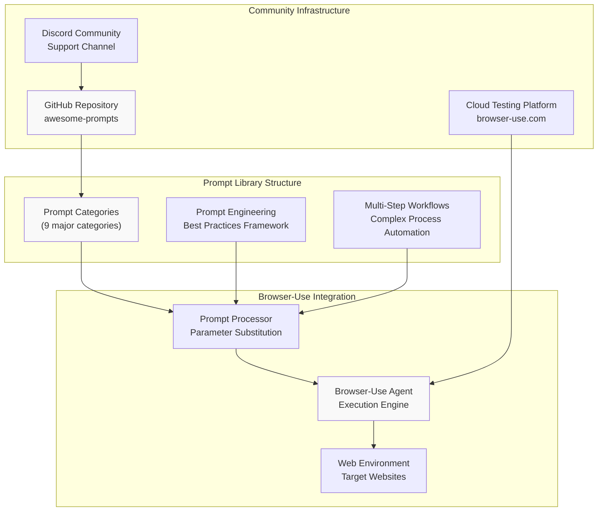
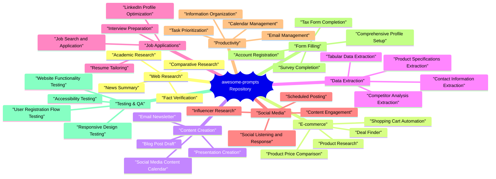
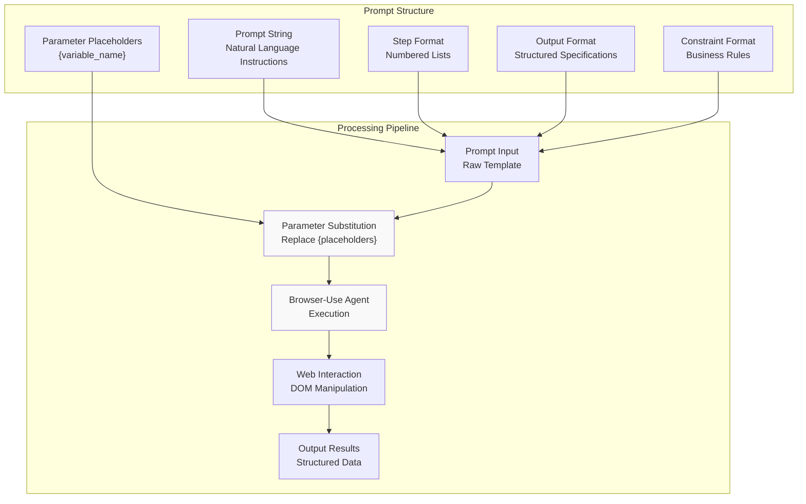
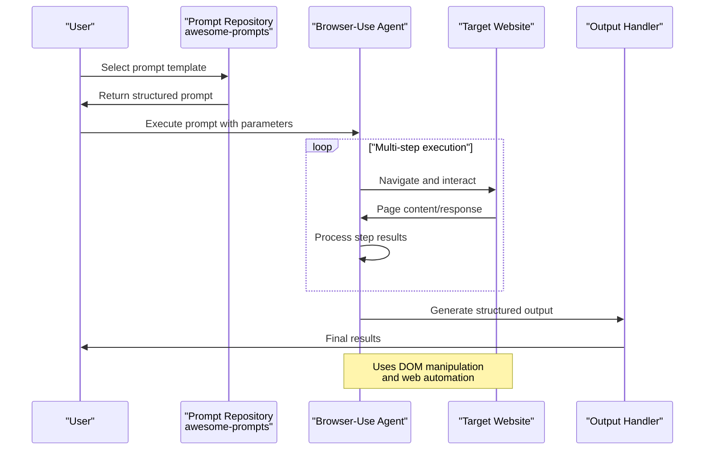
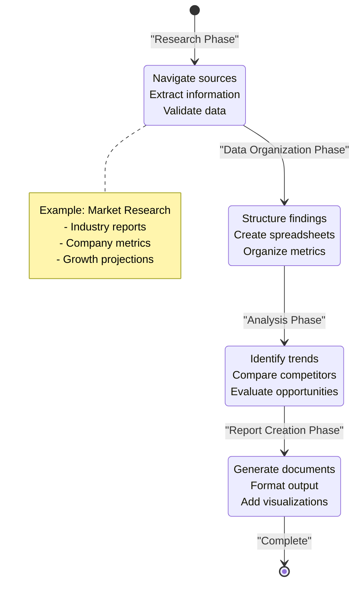
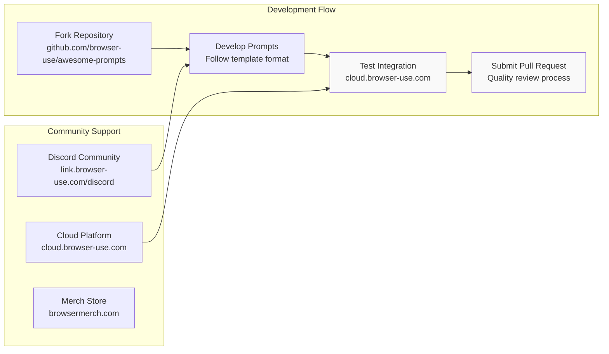

<!-- source: DeepWiki mcp.deepwiki.com · repo browser-use/awesome-prompts · page 1 Overview · fetched 2026-10-30 -->

# Overview

Relevant source files

The following files were used as context for generating this wiki page:

- [README.md](README.md)
- [static/awesome-prompts.png](static/awesome-prompts.png)

This document provides a comprehensive overview of the Browser-Use Awesome Prompts repository, which serves as a curated collection of effective prompts designed for Browser-Use automation agents. The repository contains over 30 specialized prompts organized into 9 major categories, along with engineering best practices and multi-step workflow capabilities for complex business process automation.

For detailed information about individual prompt categories, see [Prompt Categories](#2). For prompt engineering principles and implementation guidelines, see [Prompt Engineering](#3). For complex automation workflows, see [Multi-Step Workflows](#4). For community contribution processes, see [Community and Contribution](#5).

## System Architecture

The Browser-Use Awesome Prompts system operates as a structured prompt library that interfaces with Browser-Use agents to automate web-based tasks across multiple domains.

### Core System Components

**Core System Components Architecture**

Sources: [README.md:1-30]()

### Prompt Category Taxonomy

The system organizes prompts into a structured taxonomy that covers major automation use cases:

**Prompt Category Taxonomy and Organization**

Sources: [README.md:15-30](), [README.md:31-864]()

## Prompt Structure and Processing

### Prompt Format Specification

Each prompt in the repository follows a standardized structure that enables consistent processing by Browser-Use agents:

**Prompt Structure and Processing Pipeline**

Sources: [README.md:35-45](), [README.md:1054-1087]()

### Parameter Substitution System

The prompt system uses curly brace notation for parameter substitution, enabling dynamic customization:

| Parameter Type | Example | Usage Context |
|---|---|---|
| Industry/Domain | `{industry}` | Market research, competitive analysis |
| Target Entities | `{competitor1}`, `{product}` | Specific business targets |
| User Preferences | `{preference}`, `{budget}` | Customization options |
| Temporal Constraints | `{date}`, `{time_period}` | Time-bounded operations |
| Output Specifications | `{format}`, `{tone}` | Result formatting |

Sources: [README.md:36](), [README.md:113-128]()

## Integration with Browser-Use Agents

### Agent Execution Model

**Browser-Use Agent Integration Sequence**

Sources: [README.md:7-12](), [README.md:867-1053]()

### Multi-Step Workflow Architecture

Complex prompts implement multi-phase execution patterns:

**Multi-Step Workflow State Machine**

Sources: [README.md:866-904](), [README.md:909-1008]()

## Community and Quality Framework

### Contribution Quality Standards

The repository implements a five-pillar quality framework for prompt acceptance:

| Quality Criterion | Description | Implementation |
|---|---|---|
| Format Consistency | Standardized template structure | Established template format in contributions |
| Actionable Content | Clear, executable instructions | Specific steps and measurable outcomes |
| Well-Structured Design | Logical flow and organization | Numbered lists and clear hierarchies |
| Browser-Use Compatible | Integration with automation agents | Tested with Browser-Use platform |
| Business Value | Practical utility for users | Real-world use cases and ROI |

Sources: [README.md:1088-1105]()

### Community Resources Integration

**Community Development and Support Ecosystem**

Sources: [README.md:9-12](), [README.md:1088-1105]()

The Browser-Use Awesome Prompts repository serves as the central hub for browser automation prompt engineering, providing a structured approach to web task automation through carefully crafted natural language instructions that integrate seamlessly with Browser-Use agents.

---

