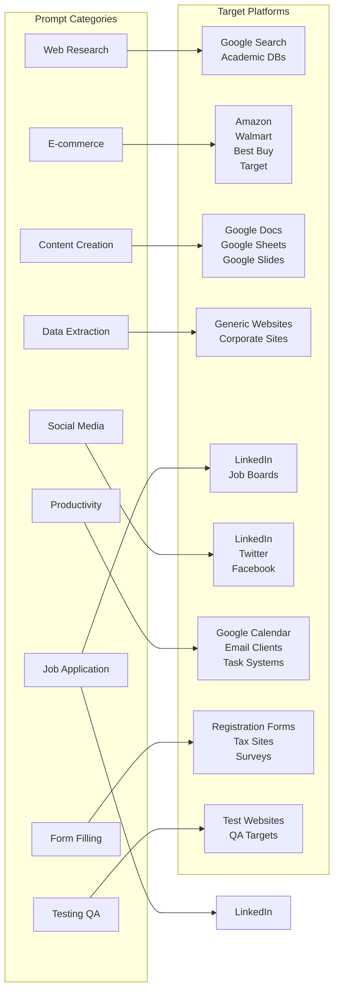

<!-- source: DeepWiki mcp.deepwiki.com · repo browser-use/awesome-prompts · page 2 Prompt Categories · fetched 2026-10-30 -->

# Prompt Categories

<details>
<summary>Relevant source files</summary>

The following files were used as context for generating this wiki page:

- [README.md](README.md)

</details>


## Purpose and Scope

This document provides a comprehensive overview of the nine major prompt categories in the Browser-Use Awesome Prompts repository and their role in the browser automation ecosystem. It explains how prompts are organized, structured, and categorized to facilitate effective browser automation tasks across different business domains.

For detailed information about individual category implementations, see the respective category pages ([Web Research](#2.1), [E-commerce](#2.2), [Content Creation](#2.3), [Data Extraction](#2.4), [Job Application](#2.5), [Social Media](#2.6), [Productivity](#2.7), [Form Filling](#2.8), [Testing and QA](#2.9)). For information about prompt engineering principles and best practices, see [Prompt Engineering](#3). For complex automation workflows, see [Multi-Step Workflows](#4).

## Category Taxonomy and Organization

The prompt collection is organized into a hierarchical taxonomy designed to cover the primary use cases for browser automation. Each category addresses specific business functions while maintaining consistent structural patterns.

### Primary Category Structure

```mermaid
graph TB
    subgraph "Browser-Use Prompt Categories"
        WR[WebResearch<br/>"Web Research Prompts"]
        EC[ECommerce<br/>"E-commerce Prompts"] 
        CC[ContentCreation<br/>"Content Creation Prompts"]
        DE[DataExtraction<br/>"Data Extraction Prompts"]
        JA[JobApplication<br/>"Job Application Prompts"]
        SM[SocialMedia<br/>"Social Media Prompts"]
        PR[Productivity<br/>"Productivity Prompts"]
        FF[FormFilling<br/>"Form Filling Prompts"]
        QA[TestingQA<br/>"Testing and QA Prompts"]
        MW[MultiStep<br/>"Multi-Step Workflows"]
    end
    
    WR --> WR1["comparative_research"]
    WR --> WR2["academic_research"] 
    WR --> WR3["news_summary"]
    WR --> WR4["fact_verification"]
    
    EC --> EC1["price_comparison"]
    EC --> EC2["cart_automation"]
    EC --> EC3["deal_finder"]
    EC --> EC4["product_research"]
    
    CC --> CC1["blog_post_draft"]
    CC --> CC2["social_calendar"]
    CC --> CC3["email_newsletter"]
    CC --> CC4["presentation_creation"]
    
    DE --> DE1["tabular_extraction"]
    DE --> DE2["contact_extraction"]
    DE --> DE3["spec_extraction"]
    DE --> DE4["competitor_analysis"]
```

Sources: [README.md:15-29](), [README.md:31-302]()

### Category-to-Platform Mapping



Sources: [README.md:96-169](), [README.md:304-399](), [README.md:401-498]()

## Prompt Structure Architecture

All prompts follow a consistent structural pattern that enables reliable browser automation while maintaining flexibility for parameter substitution.

### Parameter Substitution System

The prompt system uses curly brace notation `{parameter}` for dynamic value insertion. This pattern is consistent across all categories:

| Parameter Type | Example | Usage Pattern |
|---------------|---------|---------------|
| Target Entities | `{company_name}`, `{product}`, `{website}` | Primary automation targets |
| Behavioral Modifiers | `{industry}`, `{topic}`, `{preferences}` | Context-specific parameters |
| Output Specifications | `{format}`, `{tone}`, `{brand_voice}` | Result formatting controls |
| Constraint Parameters | `{budget}`, `{time_period}`, `{max_results}` | Operational boundaries |
| Fallback Options | `{alternative1}`, `{preferred_retailer}` | Error handling paths |

Sources: [README.md:36-44](), [README.md:113-127](), [README.md:175-185]()

### Prompt Component Architecture

```mermaid
graph TD
    PROMPT[PromptTemplate] --> HEADER[TaskDescription<br/>"Research and compare..."]
    PROMPT --> PARAMS[ParameterList<br/>"{industry}, {competitor1}"]
    PROMPT --> STEPS[ExecutionSteps<br/>"1. Navigate to...<br/>2. Extract..."]
    PROMPT --> OUTPUT[OutputFormat<br/>"Present in structured format"]
    PROMPT --> CONSTRAINTS[Constraints<br/>"at least 3 sources"]
    PROMPT --> FALLBACKS[FallbackOptions<br/>"if unavailable, find alternatives"]
    
    STEPS --> STEP1[NavigationStep<br/>"Navigate to pricing page"]
    STEPS --> STEP2[ExtractionStep<br/>"Extract pricing tiers"]  
    STEPS --> STEP3[ValidationStep<br/>"Note special offers"]
    STEPS --> STEP4[FormattingStep<br/>"Present in comparison table"]
    
    OUTPUT --> FORMAT1[StructuredData<br/>"comparison table"]
    OUTPUT --> FORMAT2[ListFormat<br/>"numbered lists"]
    OUTPUT --> FORMAT3[DocumentFormat<br/>"CSV-compatible format"]
```

Sources: [README.md:35-45](), [README.md:243-251](), [README.md:556-576]()

## Category Functional Mapping

Each category is designed to address specific business automation needs with distinct operational patterns and target platforms.

### Information Processing Categories

| Category | Primary Function | Input Types | Output Types |
|----------|-----------------|-------------|--------------|
| Web Research | Information gathering and synthesis | Search terms, topics, claims | Reports, summaries, fact-checks |
| Data Extraction | Structured data retrieval | Websites, databases | CSV files, contact lists, specifications |
| Testing QA | Functionality verification | Websites, user flows | Test reports, bug documentation |

### Transaction and Interaction Categories

| Category | Primary Function | Input Types | Output Types |
|----------|-----------------|-------------|--------------|
| E-commerce | Shopping automation | Product names, retailers, budgets | Price comparisons, cart states |
| Form Filling | Data entry automation | Personal info, preferences | Completed registrations, profiles |
| Job Application | Career process automation | Job criteria, resume data | Applications, optimized profiles |

### Content and Communication Categories  

| Category | Primary Function | Input Types | Output Types |
|----------|-----------------|-------------|--------------|
| Content Creation | Document and media generation | Topics, brand guidelines | Blog posts, presentations, calendars |
| Social Media | Social platform automation | Brand voice, engagement targets | Posts, responses, analytics |
| Productivity | Workflow optimization | Calendar data, tasks, emails | Organized schedules, processed inboxes |

Sources: [README.md:31-302](), [README.md:500-602](), [README.md:604-715]()

## Multi-Step Workflow Integration

Complex prompts can be composed from multiple categories to create sophisticated automation workflows.

### Workflow Composition Pattern

```mermaid
flowchart TD
    START[WorkflowInitiation] --> PHASE1[ResearchPhase]
    PHASE1 --> PHASE2[DataOrganization] 
    PHASE2 --> PHASE3[AnalysisPhase]
    PHASE3 --> PHASE4[OutputGeneration]
    
    subgraph "Category Integration"
        PHASE1 --> WR[WebResearch<br/>"market_research"]
        PHASE1 --> DE[DataExtraction<br/>"competitor_data"]
        
        PHASE2 --> PR[Productivity<br/>"information_organization"]
        
        PHASE3 --> DE2[DataExtraction<br/>"tabular_analysis"]
        
        PHASE4 --> CC[ContentCreation<br/>"report_generation"]
    end
    
    PHASE4 --> COMPLETE[WorkflowComplete<br/>"10-15 page report"]
    
    subgraph "Quality Checkpoints"
        QC1[DataValidation]
        QC2[FormatVerification] 
        QC3[OutputQuality]
    end
    
    PHASE1 --> QC1
    PHASE2 --> QC2  
    PHASE4 --> QC3
```

Sources: [README.md:866-905](), [README.md:909-1052]()

## Parameter Standardization Patterns

Across all categories, certain parameter patterns provide consistency and interoperability between prompts.

### Common Parameter Schemas

```mermaid
graph TB
    subgraph "Parameter Categories"
        TARGETS[TargetEntities<br/>"{website}, {company_name}, {product}"]
        CONTEXT[ContextModifiers<br/>"{industry}, {topic}, {audience_type}"]
        BEHAVIOR[BehaviorControls<br/>"{preferences}, {tone}, {format}"]
        LIMITS[ConstraintParams<br/>"{budget}, {time_period}, {max_results}"]
        FALLBACK[FallbackOptions<br/>"{alternative1}, {preferred_option}"]
    end
    
    subgraph "Category Usage"
        WR_PARAMS["{topic}, {date}, {competitor1}"]
        EC_PARAMS["{product}, {budget}, {preferred_retailer}"]
        CC_PARAMS["{brand_voice}, {audience_type}, {format}"]
        JA_PARAMS["{job_title}, {company_name}, {experience_level}"]
    end
    
    TARGETS --> WR_PARAMS
    CONTEXT --> WR_PARAMS
    TARGETS --> EC_PARAMS
    LIMITS --> EC_PARAMS
    CONTEXT --> CC_PARAMS
    BEHAVIOR --> CC_PARAMS
    TARGETS --> JA_PARAMS
    CONTEXT --> JA_PARAMS
```

Sources: [README.md:309-328](), [README.md:376-398](), [README.md:428-444]()

## Category Implementation Standards

Each category implements consistent quality standards and structural requirements as defined in the best practices framework.

### Quality Criteria by Category

| Category | Structure Requirements | Actionable Content | Browser Compatibility | Business Value |
|----------|----------------------|-------------------|---------------------|----------------|
| Web Research | Multi-step navigation, source verification | Specific search terms, extraction targets | Search engine optimization | Market intelligence, fact verification |
| E-commerce | Cart manipulation, price comparison | Product specifications, retailer targeting | E-commerce platform APIs | Purchase optimization, cost savings |
| Content Creation | Document templates, format specifications | Brand guidelines, content requirements | Google Workspace integration | Marketing automation, content scaling |
| Data Extraction | Table parsing, structured output | Field specifications, validation rules | Generic web scraping patterns | Data collection, competitor analysis |

Sources: [README.md:1054-1087](), [README.md:1089-1105]()

The prompt categories system provides a comprehensive framework for browser automation across business domains while maintaining consistency in structure, parameter handling, and quality standards. Each category serves specific automation needs while integrating seamlessly with others for complex workflow composition.

---

