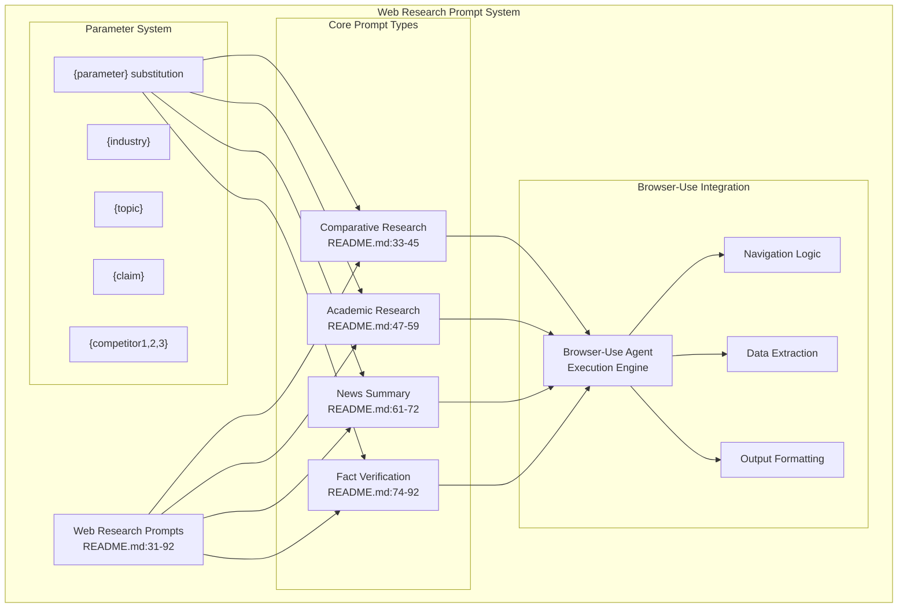
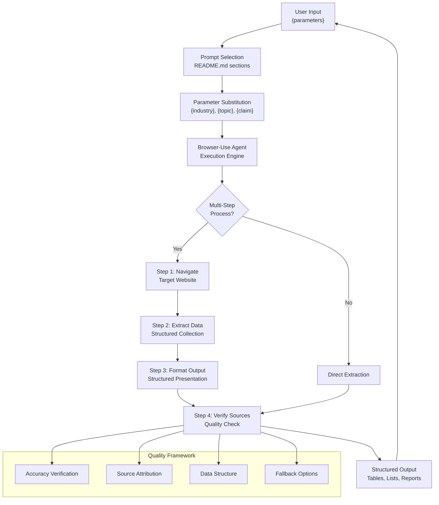
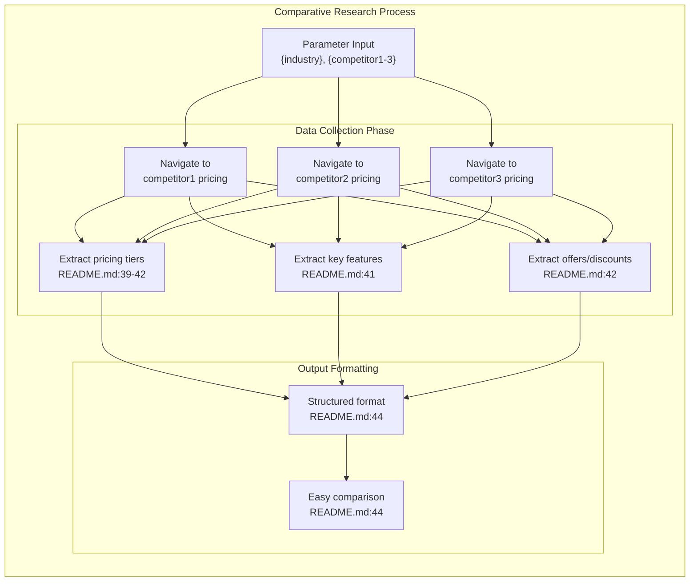
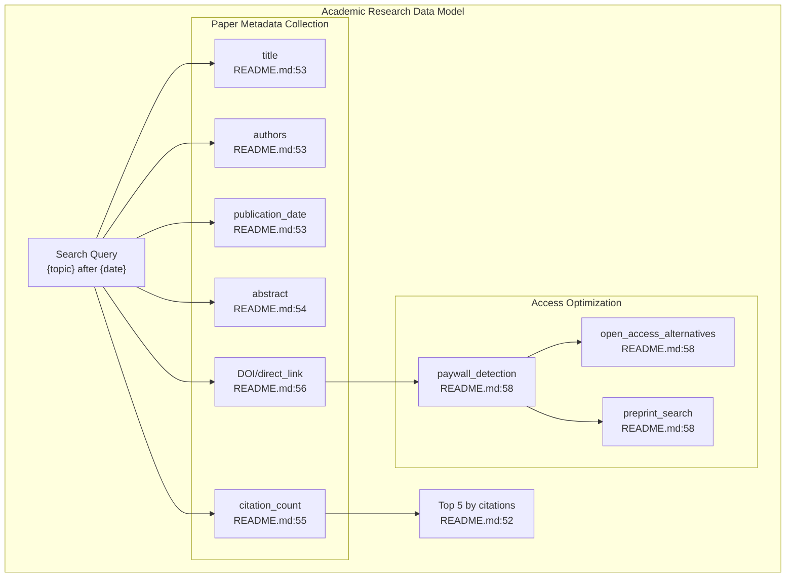
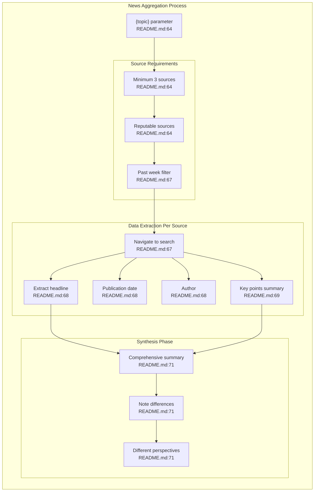
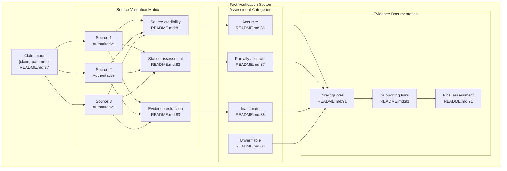

<!-- source: DeepWiki mcp.deepwiki.com · repo browser-use/awesome-prompts · page 2.1 Web Research Prompts · fetched 2026-10-30 -->

# Web Research Prompts

<details>
<summary>Relevant source files</summary>

The following files were used as context for generating this wiki page:

- [README.md](README.md)

</details>


This page documents prompts designed for automated information gathering, competitive analysis, academic research, news synthesis, and fact verification tasks using Browser-Use agents. These prompts enable structured data collection from web sources through automated browser interactions.

For general prompt engineering principles, see [Best Practices Framework](#3.1). For multi-step research workflows, see [Complex Process Examples](#4.2).

## Overview

Web research prompts form the foundation of information gathering automation within the Browser-Use ecosystem. These prompts are structured to extract, analyze, and synthesize information from multiple web sources while maintaining accuracy and providing verifiable results.

### Prompt Categories Architecture



Sources: [README.md:31-92]()

### Execution Flow Architecture



Sources: [README.md:31-92](), [README.md:1054-1087]()

## Comparative Research Prompts

Comparative research prompts automate the process of gathering and comparing information across multiple competitors or options within a specific industry or market segment.

### Structure and Parameters

The comparative research prompt uses the following parameter structure:

| Parameter | Purpose | Example Value |
|-----------|---------|---------------|
| `{industry}` | Target market or industry | "SaaS project management" |
| `{competitor1}` | First comparison target | "Asana" |
| `{competitor2}` | Second comparison target | "Monday.com" |
| `{competitor3}` | Third comparison target | "Trello" |

### Implementation Details



Sources: [README.md:33-45]()

The prompt follows a systematic 4-step process:
1. **Navigation**: Direct browser to each competitor's pricing page
2. **Pricing Extraction**: Capture pricing tiers and costs
3. **Feature Extraction**: List key features in each tier
4. **Offer Detection**: Note special offers or discounts

## Academic Research Prompts

Academic research prompts facilitate automated discovery and analysis of scholarly publications, focusing on citation metrics and open-access availability.

### Research Parameters

| Parameter | Purpose | Validation |
|-----------|---------|------------|
| `{topic}` | Research subject | Must be specific enough for targeted search |
| `{date}` | Publication threshold | ISO date format (YYYY-MM-DD) |

### Data Extraction Schema



Sources: [README.md:47-59]()

The academic research process prioritizes papers by citation count and implements fallback mechanisms for accessing paywalled content through open-access alternatives or preprint repositories.

## News Summary Prompts

News summary prompts aggregate and synthesize information from multiple reputable news sources, providing comparative analysis of different reporting perspectives.

### Source Diversification Strategy

The prompt enforces source diversity through a minimum threshold requirement:



Sources: [README.md:61-72]()

The synthesis phase specifically identifies reporting differences and perspective variations between sources, providing users with a balanced view of the topic coverage.

## Fact Verification Prompts

Fact verification prompts implement a systematic approach to claim validation using multiple authoritative sources and evidence-based assessment.

### Verification Framework



Sources: [README.md:74-92]()

### Verification Decision Matrix

| Source Consensus | Evidence Quality | Final Assessment |
|------------------|------------------|------------------|
| All sources confirm | Strong evidence | Accurate |
| Majority confirm | Mixed evidence | Partially accurate |
| Sources contradict | Weak evidence | Inaccurate |
| No sources found | No evidence | Unverifiable |

The verification process requires documentation of supporting quotes and links for transparency and further investigation.

## Integration with Browser-Use Framework

Web research prompts integrate with the Browser-Use execution engine through standardized parameter substitution and multi-step workflow management.

### Parameter Substitution System

All web research prompts use curly brace notation for parameter injection:

```
{industry} → "fintech"
{topic} → "machine learning ethics"
{claim} → "AI will replace 50% of jobs by 2030"
{competitor1} → "Stripe"
```

### Quality Assurance Framework

Web research prompts implement built-in quality controls:

1. **Source Attribution**: All extracted information includes source URLs
2. **Verification Steps**: Multiple source cross-referencing
3. **Structured Output**: Consistent formatting for easy consumption
4. **Error Handling**: Fallback options for inaccessible content
5. **Time Constraints**: Reasonable scope limitations

Sources: [README.md:31-92](), [README.md:1054-1087]()

## Best Practices for Web Research Prompts

### Structure Guidelines

- **Specify exact parameter requirements**: Use descriptive parameter names with clear validation criteria
- **Include source diversity requirements**: Minimum source counts and quality thresholds
- **Define output format explicitly**: Tables, lists, or structured reports
- **Implement verification steps**: Cross-reference information across sources

### Adaptability Patterns

- **Paywall handling**: Alternative source identification for academic content
- **Search result variation**: Flexible extraction for different website structures
- **Source unavailability**: Fallback options when primary sources are inaccessible
- **Content format diversity**: Adaptation to different information presentation formats

Sources: [README.md:1054-1087]()

---

