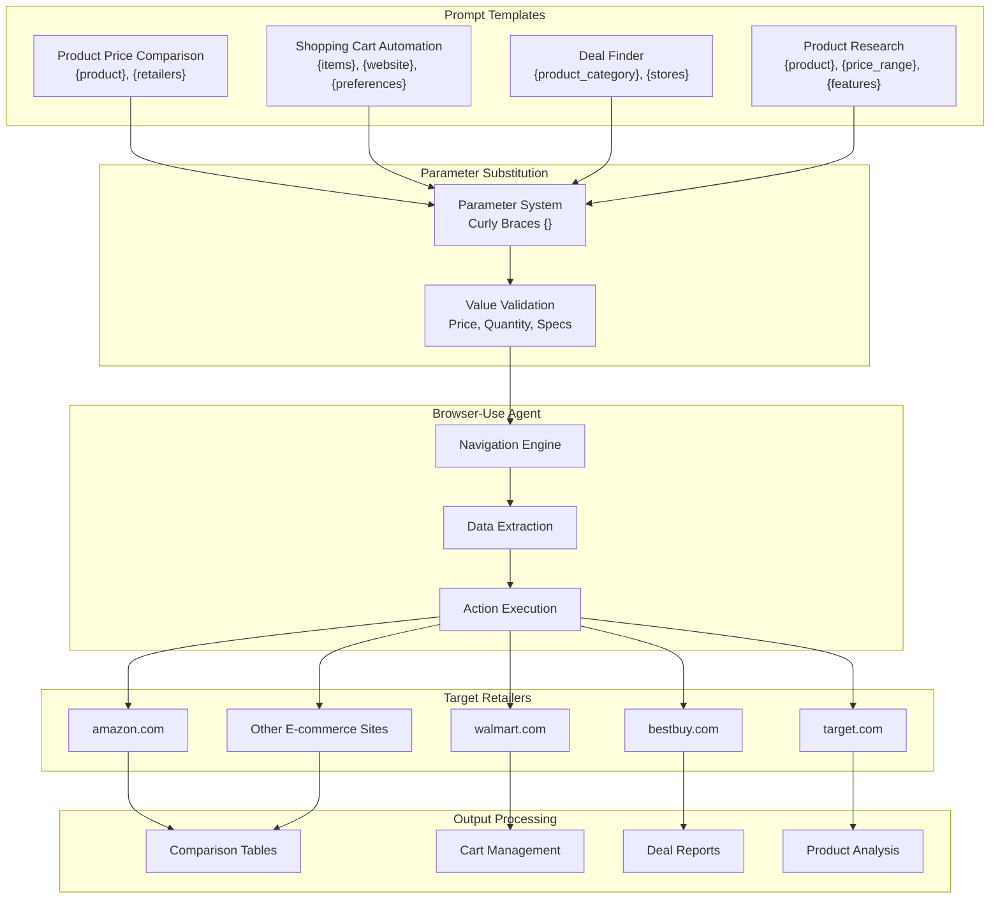
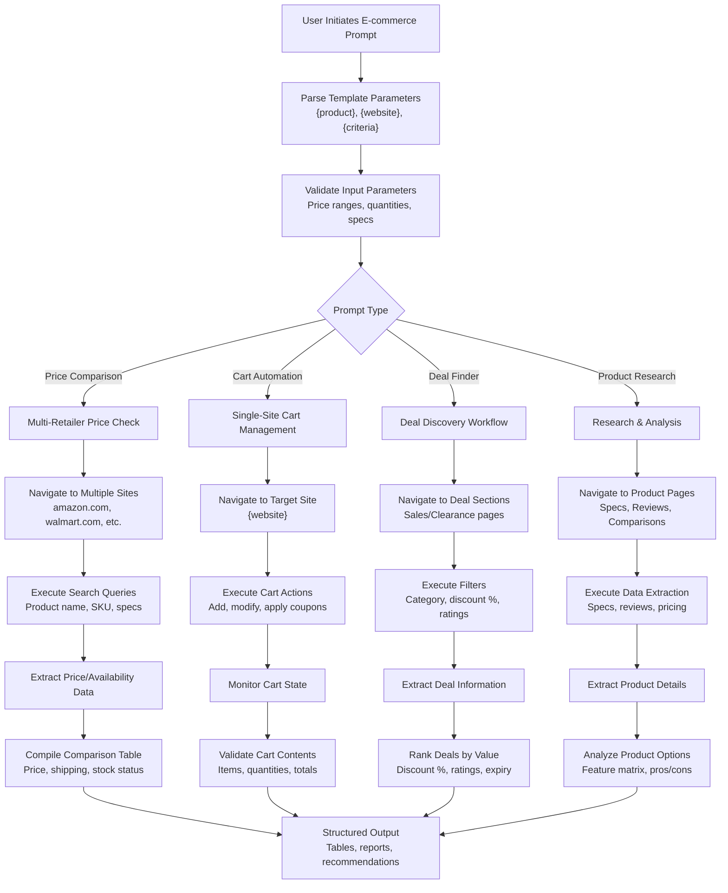

<!-- source: DeepWiki mcp.deepwiki.com · repo browser-use/awesome-prompts · page 2.2 E-commerce Prompts · fetched 2026-10-30 -->

# E-commerce Prompts

<details>
<summary>Relevant source files</summary>

The following files were used as context for generating this wiki page:

- [README.md](README.md)

</details>


This document covers the e-commerce automation prompts available in the Browser-Use Awesome Prompts collection. These prompts enable automated interactions with e-commerce platforms including price comparison, shopping cart management, deal discovery, and product research across major retailers like Amazon, Walmart, Best Buy, and Target.

For web research automation, see [Web Research Prompts](#2.1). For general productivity automation, see [Productivity Prompts](#2.7).

## E-commerce Automation Architecture

The e-commerce prompts operate through a structured automation framework that interfaces with multiple retailer websites:



Sources: [README.md:94-168]()

## E-commerce Prompt Execution Flow

The execution model for e-commerce prompts follows a systematic approach to ensure reliable automation across different retailer interfaces:



Sources: [README.md:94-168]()

## Product Price Comparison

The `Product Price Comparison` prompt automates price discovery across major retailers with structured data extraction and comparison analysis.

### Template Structure

```
Find the best price for {product} across major retailers including Amazon, Walmart, Best Buy, and Target.

For each retailer:
1. Navigate to their website and search for the exact product
2. Record the current price, original price if on sale, and any available discounts
3. Note shipping costs and estimated delivery time
4. Check if the product is in stock

Compile the information into a comparison table and identify the best overall deal considering price, shipping, and delivery time.
```

### Parameters

| Parameter | Type | Description | Example |
|-----------|------|-------------|---------|
| `{product}` | String | Exact product name or model | `"iPhone 15 Pro 256GB"` |

### Data Extraction Points

- **Current Price**: Active selling price
- **Original Price**: Pre-discount price if applicable  
- **Available Discounts**: Coupons, promotions, member pricing
- **Shipping Costs**: Standard and expedited options
- **Delivery Time**: Estimated arrival dates
- **Stock Status**: In stock, limited quantity, out of stock

Sources: [README.md:96-108]()

## Shopping Cart Automation

The `Shopping Cart Automation` prompt handles multi-item cart management with preference-based selection and budget constraints.

### Template Structure

```
Add the following items to my shopping cart on {website}:

1. {item1} - {specifications1} - quantity: {quantity1}
2. {item2} - {specifications2} - quantity: {quantity2}
3. {item3} - {specifications3} - quantity: {quantity3}

For each item:
- If the exact item is unavailable, find the closest alternative
- If there are multiple options (size, color, etc.), select {preference}
- If the price is above {budget} for any item, look for a more affordable alternative

Once all items are in the cart:
- Apply coupon code: {coupon_code} if available
- Select the standard shipping option
- Proceed to checkout but stop before payment
```

### Parameters

| Parameter | Type | Description | Example |
|-----------|------|-------------|---------|
| `{website}` | String | Target e-commerce site | `"amazon.com"` |
| `{item1}`, `{item2}`, `{item3}` | String | Product names | `"Wireless headphones"` |
| `{specifications1}`, etc. | String | Product specifications | `"Black, over-ear, noise cancelling"` |
| `{quantity1}`, etc. | Integer | Item quantities | `2` |
| `{preference}` | String | Selection criteria | `"lowest price"` or `"highest rated"` |
| `{budget}` | Number | Price threshold per item | `150.00` |
| `{coupon_code}` | String | Promotional code | `"SAVE20"` |

### Automation Logic

- **Exact Match Priority**: Search for exact product specifications first
- **Alternative Selection**: Use closest match algorithm when exact item unavailable
- **Budget Enforcement**: Automatic filtering by price constraints
- **Coupon Application**: Validation and application of discount codes
- **Checkout Boundary**: Stop execution before payment processing

Sources: [README.md:110-128]()

## Deal Finder

The `Deal Finder` prompt discovers and ranks current promotions across multiple retailer sale sections.

### Template Structure

```
Find the best current deals on {product_category} from {store1}, {store2}, and {store3}.

For each store:
1. Navigate to their deals/sale section
2. Filter for {product_category} items
3. Sort by discount percentage (highest first) if possible
4. Record the top 5 deals, including:
   - Product name
   - Original price
   - Current price
   - Discount percentage
   - Link to the product

For each product, verify customer ratings are above 4 stars if available. Exclude any deals that expire within 24 hours.
```

### Parameters

| Parameter | Type | Description | Example |
|-----------|------|-------------|---------|
| `{product_category}` | String | Product category filter | `"laptops"` or `"kitchen appliances"` |
| `{store1}`, `{store2}`, `{store3}` | String | Target retailer websites | `"bestbuy.com"`, `"target.com"`, `"walmart.com"` |

### Quality Filters

- **Rating Threshold**: Minimum 4-star customer rating
- **Expiry Filter**: Exclude deals expiring within 24 hours
- **Discount Ranking**: Sort by highest discount percentage
- **Top N Selection**: Extract top 5 deals per store

### Output Schema

```
Deal Record:
- Product Name: String
- Original Price: Currency
- Current Price: Currency  
- Discount Percentage: Number
- Product Link: URL
- Customer Rating: Number (1-5)
- Deal Expiry: Date
```

Sources: [README.md:130-147]()

## Product Research

The `Product Research` prompt performs comprehensive product analysis with feature comparison and expert review synthesis.

### Template Structure

```
Research {product} and help me make an informed purchase decision.

1. Find at least 3 different models/brands that match these criteria:
   - Price range: {min_price} to {max_price}
   - Must have features: {required_features}
   - Preferred but optional: {optional_features}

2. For each product, find:
   - Detailed specifications
   - At least 2 expert reviews
   - Summary of customer reviews (pros and cons)
   - Warranty information

3. Check availability at {preferred_retailer} and {alternate_retailer}

4. Create a comparison highlighting the key differences in features, performance, and value.
```

### Parameters

| Parameter | Type | Description | Example |
|-----------|------|-------------|---------|
| `{product}` | String | Product category or specific item | `"gaming laptop"` |
| `{min_price}` | Currency | Minimum price threshold | `$800` |
| `{max_price}` | Currency | Maximum price threshold | `$2000` |
| `{required_features}` | Array | Must-have features | `"RTX 4060, 16GB RAM, SSD"` |
| `{optional_features}` | Array | Nice-to-have features | `"RGB keyboard, high refresh display"` |
| `{preferred_retailer}` | String | Primary retailer choice | `"bestbuy.com"` |
| `{alternate_retailer}` | String | Fallback retailer | `"amazon.com"` |

### Research Methodology

1. **Product Discovery**: Match products to criteria using feature filtering
2. **Specification Extraction**: Parse technical specifications from product pages
3. **Expert Review Aggregation**: Collect and summarize professional reviews
4. **Customer Sentiment Analysis**: Analyze customer review patterns for pros/cons
5. **Warranty Documentation**: Extract warranty terms and coverage details
6. **Availability Verification**: Check stock status across retailers
7. **Comparison Matrix**: Generate feature/performance/value comparison table

Sources: [README.md:149-168]()

## Parameter Substitution System

All e-commerce prompts use the curly braces `{}` parameter substitution system for dynamic content injection:

### Syntax Rules

- **Parameter Format**: `{parameter_name}`
- **Case Sensitivity**: Parameters are case-sensitive
- **Nesting**: Parameters cannot be nested
- **Required vs Optional**: All parameters in template are required unless specified

### Validation Types

| Parameter Type | Validation Rules | Example |
|----------------|------------------|---------|
| Currency | Numeric with currency symbol | `$99.99`, `€150.00` |
| URL | Valid domain format | `amazon.com`, `bestbuy.com` |
| Product Name | Non-empty string | `"MacBook Pro M3"` |
| Quantity | Positive integer | `1`, `5`, `10` |
| Features | Comma-separated list | `"WiFi 6, USB-C, 1TB SSD"` |

### Error Handling

- **Missing Parameters**: Prompt execution fails with parameter list
- **Invalid Format**: Type conversion attempted with fallback defaults
- **Out of Range**: Numeric parameters clamped to reasonable bounds

Sources: [README.md:94-168]()

---

