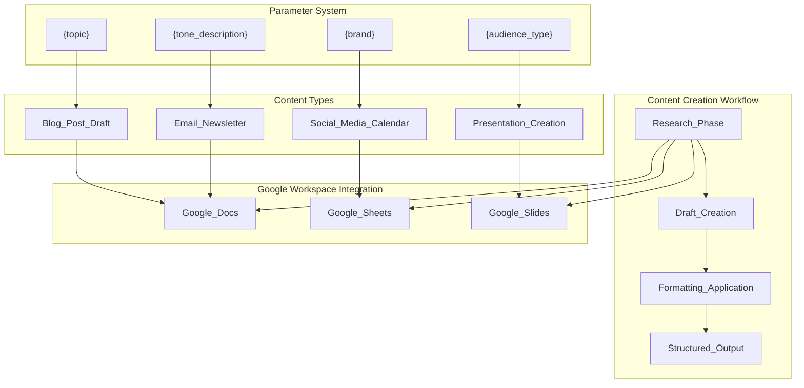
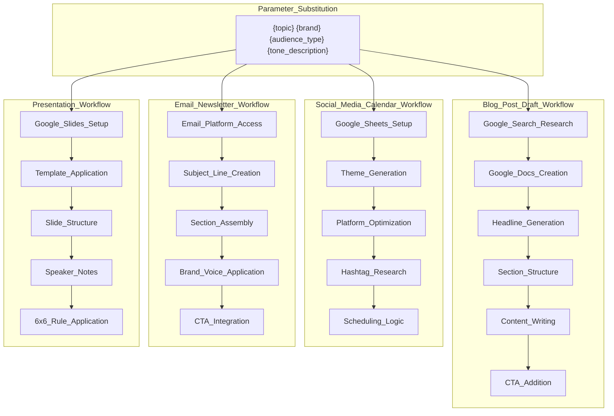
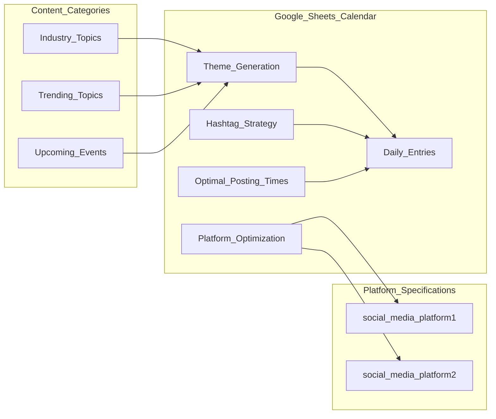
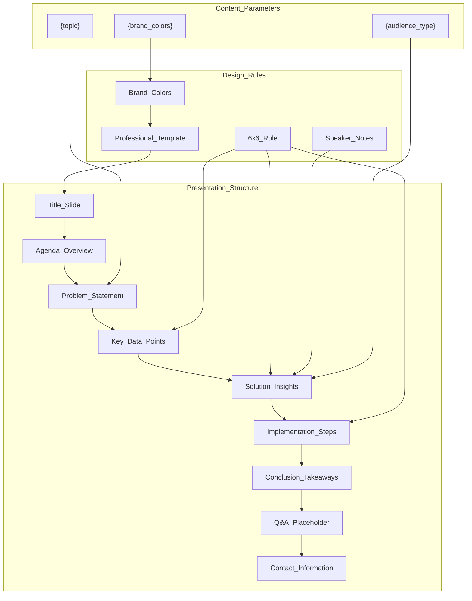

<!-- source: DeepWiki mcp.deepwiki.com · repo browser-use/awesome-prompts · page 2.3 Content Creation Prompts · fetched 2026-10-30 -->

# Content Creation Prompts

Relevant source files

The following files were used as context for generating this wiki page:

- [README.md](README.md)

This document covers the content creation prompt category within the Browser-Use awesome-prompts system. Content creation prompts are designed to automate the generation of various content types including blog posts, social media calendars, email newsletters, and presentations through Google Workspace integration and structured content development workflows.

For information about social media engagement and interaction prompts, see [Social Media Prompts](#2.6). For general productivity automation beyond content creation, see [Productivity Prompts](#2.7).

## Content Creation System Architecture

The content creation prompt system integrates with Google Workspace tools and follows a research-driven, multi-phase content development approach.

**Sources:** [README.md:170-236]()

## Content Creation Prompt Categories and Workflows

Each content creation prompt type follows specific structural patterns and integrates with designated Google Workspace applications.

**Sources:** [README.md:172-236]()

## Blog Post Draft Creation

The blog post draft prompt creates structured content in Google Docs through a research-driven approach with specific formatting requirements.

### Structure and Components

| Component | Description | Implementation |
|-----------|-------------|----------------|
| Research Phase | Google search for top 5 articles | `Research the top 5 articles on Google about {topic}` |
| Document Creation | New Google Docs document | `Go to Google Docs and create a new document` |
| Content Structure | 3-5 main sections with subheadings | Structured section generation |
| Word Count Target | 1000-1200 words | Length specification |
| Tone Application | Configurable voice | `{formal/conversational/educational} tone` |
| Visual Integration | Image placeholder descriptions | 2-3 relevant image suggestions |

### Parameter Structure

The blog post prompt uses the following parameter substitution pattern:

- `{topic}` - Primary subject matter
- `{formal/conversational/educational}` - Tone selection
- Image placeholder descriptions for visual content planning

### Workflow Phases

1. **Research Phase**: Google search analysis for current perspectives
2. **Headline Generation**: SEO-optimized title with primary keyword
3. **Structure Creation**: Introduction, 3-5 main sections, conclusion
4. **Content Development**: Bullet points, numbered lists, structured content
5. **CTA Integration**: Clear call-to-action in conclusion

**Sources:** [README.md:172-186]()

## Social Media Content Calendar

The social media calendar prompt generates structured posting schedules in Google Sheets with platform-specific optimization.

### Calendar Structure

### Parameter Configuration

- `{brand}` - Brand identity for content alignment
- `{social_media_platform1}` - Primary platform specification
- `{social_media_platform2}` - Secondary platform specification
- `{industry}` - Industry context for theme generation
- `{upcoming_event/holiday}` - Specific event integration

### Content Generation Rules

- Daily posts for each specified platform
- Platform-appropriate content length
- 3-5 hashtags per post
- Industry trend incorporation
- Event-specific content inclusion

**Sources:** [README.md:188-201]()

## Email Newsletter Creation

The email newsletter prompt structures multi-section newsletters with brand voice consistency and engagement optimization.

### Newsletter Architecture

| Section | Word Count | Purpose | Parameters |
|---------|------------|---------|------------|
| Subject Line | Variable | 25%+ open rate target | Personalization elements |
| Main Article | 250-300 words | Primary content focus | `{current_topic}` |
| Secondary Content | 150 words | Product/service highlight | `{product/service/news}` |
| What's New | 100 words | Recent developments | `{recent_development}` |
| Call-to-Action | Variable | Conversion focus | `{offer/event}` |
| Footer | Standard | Compliance and social links | Unsubscribe + social media |

### Brand Voice Integration

- `{business}` - Business identity parameter
- `{brand_voice_description}` - Voice specification
- `{email_platform}` - Platform integration target
- Consistent voice application across all sections

### Technical Implementation

- Direct integration with specified email platform
- Structured section assembly
- Visual content planning with image placements
- Footer compliance with unsubscribe requirements

**Sources:** [README.md:203-217]()

## Presentation Creation

The presentation prompt generates professional slide decks in Google Slides with structured information architecture.

### Slide Structure Framework

### 6x6 Rule Implementation

The presentation prompt enforces the 6x6 rule for content density:
- Maximum 6 bullet points per slide
- Maximum 6 words per bullet point
- Applied to data, solution, and implementation slides

### Speaker Notes Integration

Each slide includes expanded speaker notes with detailed information beyond the visual content, supporting presentation delivery.

### Template and Branding

- Professional template selection
- `{brand_colors}` parameter for visual consistency
- Structured slide progression for audience engagement

**Sources:** [README.md:219-236]()

## Parameter Substitution System

All content creation prompts utilize curly brace parameter substitution for customization and reusability.

### Common Parameters

| Parameter | Usage Context | Example Values |
|-----------|---------------|----------------|
| `{topic}` | Content subject matter | "Content Marketing Strategies" |
| `{brand}` | Brand identity | "TechCorp" |
| `{audience_type}` | Target audience | "executives", "developers" |
| `{tone_description}` | Content voice | "professional", "conversational" |
| `{brand_colors}` | Visual branding | "#0066CC, #FF6600" |

### Platform-Specific Parameters

- `{social_media_platform1}` - Primary social platform
- `{email_platform}` - Email service provider
- `{current_topic}` - Timely subject matter
- `{upcoming_event/holiday}` - Calendar-based content

The parameter system enables prompt reusability across different brands, topics, and contexts while maintaining structural consistency.

**Sources:** [README.md:170-236]()

---

