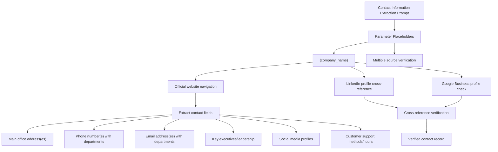
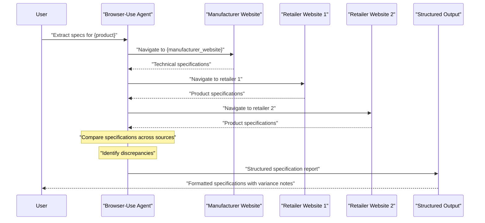
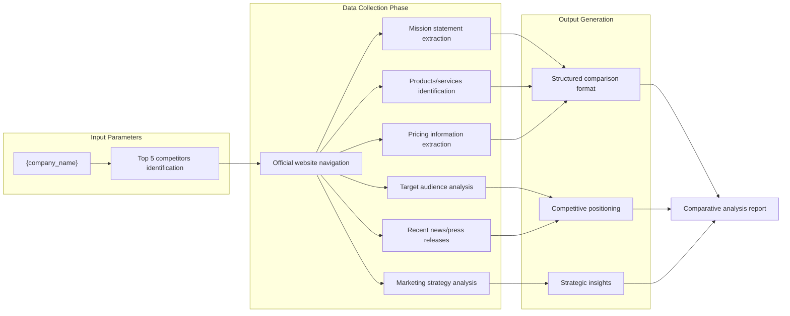
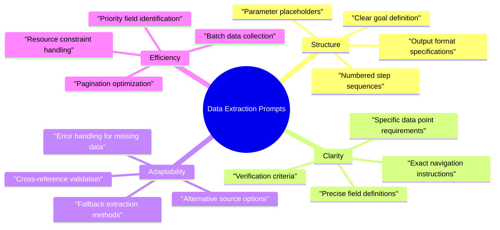

<!-- source: DeepWiki mcp.deepwiki.com · repo browser-use/awesome-prompts · page 2.4 Data Extraction Prompts · fetched 2026-10-30 -->

# Data Extraction Prompts

<details>
<summary>Relevant source files</summary>

The following files were used as context for generating this wiki page:

- [README.md](README.md)

</details>


## Purpose and Scope

Data extraction prompts are specialized automation templates designed to systematically extract structured and unstructured information from web pages, applications, and online databases using Browser-Use agents. These prompts handle complex data collection scenarios including tabular data, contact information, product specifications, and competitive intelligence gathering.

This document covers the four primary data extraction prompt categories and their implementation patterns. For web research and information gathering tasks, see [Web Research Prompts](#2.1). For automation of e-commerce data collection, see [E-commerce Prompts](#2.2).

## Data Extraction Prompt Categories

### Core Extraction Types

The data extraction prompt system provides four specialized prompt templates, each optimized for different data collection scenarios:

| Prompt Type | Target Data | Output Format | Use Cases |
|-------------|-------------|---------------|-----------|
| Tabular Data Extraction | Structured tables, lists | CSV-compatible format | Price lists, inventory, metrics |
| Contact Information | Business contact details | Structured contact records | Lead generation, verification |
| Product Specifications | Technical specifications | Organized spec sheets | Product comparison, research |
| Competitor Analysis | Business intelligence | Comparative analysis reports | Market research, positioning |

**Tabular Data Extraction Architecture**

```mermaid
flowchart TD
    INPUT[Input: "website, data_category, specific_page_or_search_query"] --> NAVIGATE["Navigate to target page"]
    NAVIGATE --> IDENTIFY["Identify table/structured data"]
    IDENTIFY --> EXTRACT["Extract rows/columns"]
    EXTRACT --> PAGINATE{"Pagination exists?"}
    PAGINATE -->|Yes| NEXTPAGE["Navigate through pages 1-3"]
    PAGINATE -->|No| FILTER["Apply filter_criteria if available"]
    NEXTPAGE --> FILTER
    FILTER --> FORMAT["Format as CSV-compatible"]
    FORMAT --> OUTPUT["Structured data with headers"]
    
    EXTRACT --> PRESERVE["Preserve data relationships"]
    PRESERVE --> MISSING["Mark missing data as 'N/A'"]
```

Sources: [README.md:240-252]()

### Parameter Substitution Patterns

Data extraction prompts utilize curly brace parameter substitution to enable flexible, reusable automation templates:

**Contact Information Extraction Parameters**



Sources: [README.md:254-268]()

## Data Extraction Workflow Architecture

### Multi-Step Extraction Process

Data extraction prompts follow a standardized workflow pattern that ensures comprehensive data collection and verification:

**Product Specifications Extraction Workflow**



Sources: [README.md:270-285]()

### Competitive Intelligence Automation

The competitor analysis extraction prompt implements a comprehensive business intelligence workflow:

**Competitor Analysis Data Flow**



Sources: [README.md:287-302]()

## Integration with Browser-Use Ecosystem

### Prompt Engineering Framework Integration

Data extraction prompts implement the four pillars of effective prompt engineering established in the Browser-Use framework:

**Data Extraction Prompt Structure Analysis**



Sources: [README.md:1054-1087]()

### Multi-Step Workflow Integration

Data extraction prompts serve as building blocks for complex multi-step workflows in research and analysis scenarios:

| Workflow Type | Data Extraction Role | Integration Points |
|---------------|---------------------|-------------------|
| Market Research Reports | Competitor data collection | Research Phase → Data Organization |
| Product Launch Campaigns | Market intelligence gathering | Research Phase → Strategy Development |
| Website Migration | Content and asset inventory | Content Audit → Technical Planning |

Sources: [README.md:866-1052]()

## Quality Assurance and Validation

### Data Integrity Mechanisms

Data extraction prompts include built-in quality assurance patterns:

- **Cross-source verification**: Multiple website validation for contact information
- **Discrepancy identification**: Specification variance detection across retailer sites  
- **Completeness validation**: "N/A" marking for missing data points rather than blank fields
- **Format standardization**: CSV-compatible output formatting for tabular data

### Error Handling Patterns

Each data extraction prompt type implements specific error handling strategies:

- **Pagination handling**: Automatic navigation through multiple pages with defined limits
- **Filter application**: Conditional filtering based on available website functionality
- **Alternative source fallback**: Secondary extraction methods when primary sources fail
- **Data relationship preservation**: Maintaining structural relationships during extraction

Sources: [README.md:238-302]()

---

