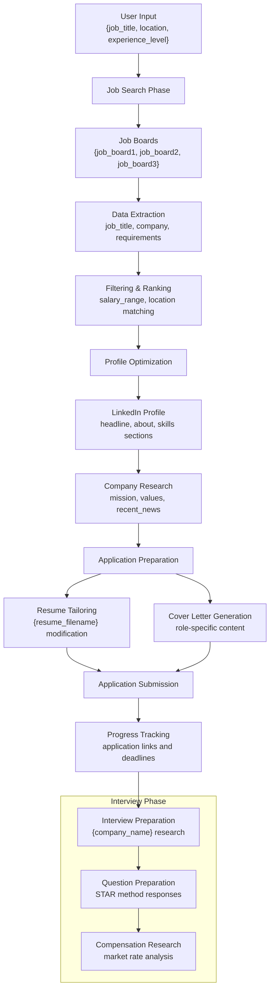
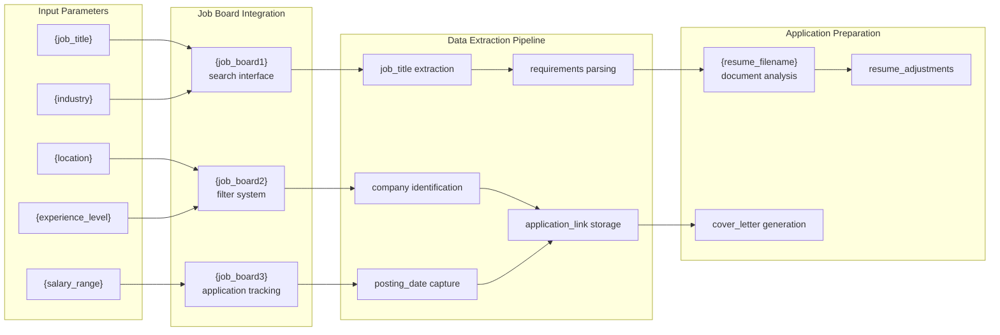
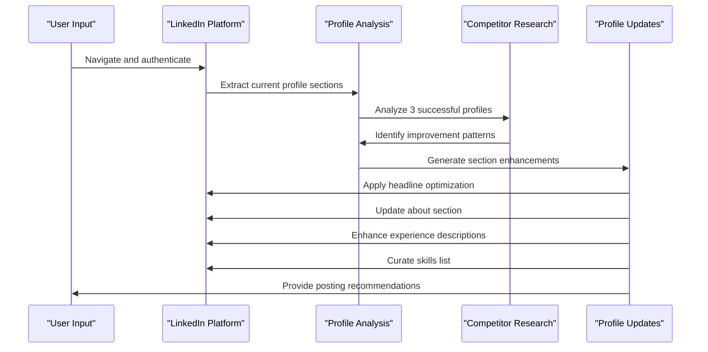
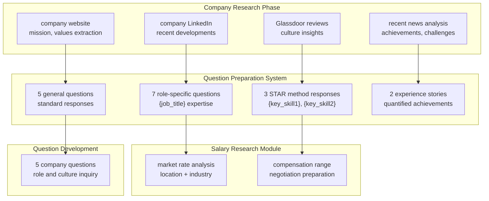
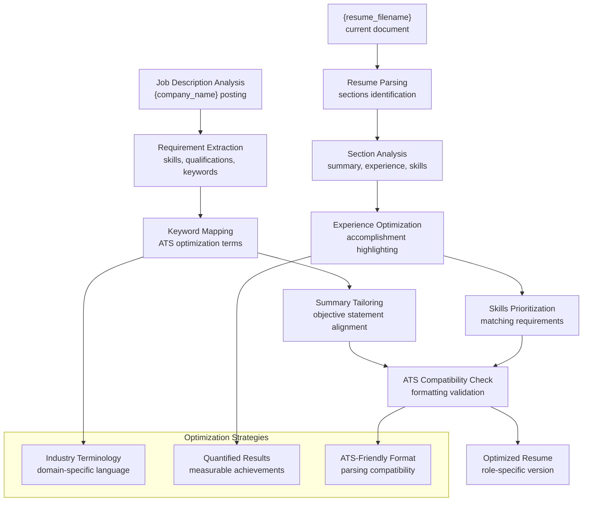
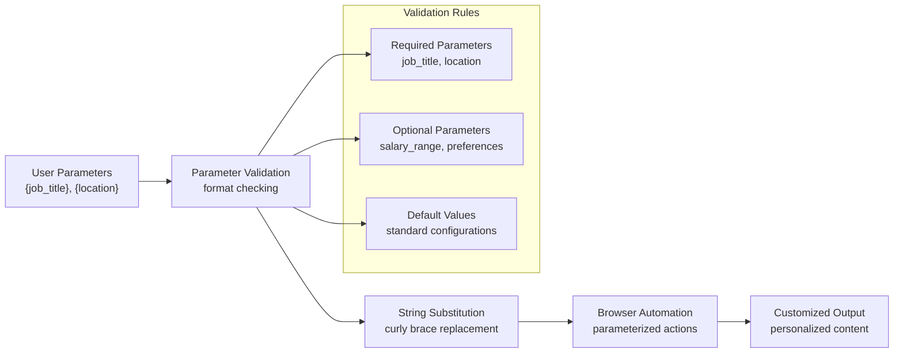
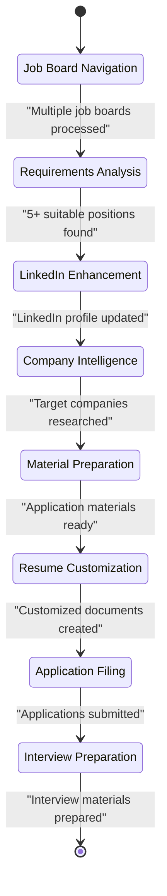

<!-- source: DeepWiki mcp.deepwiki.com · repo browser-use/awesome-prompts · page 2.5 Job Application Prompts · fetched 2026-10-30 -->

# Job Application Prompts

Relevant source files

The following files were used as context for generating this wiki page:

- [README.md](README.md)

## Purpose and Scope

This document covers the job application automation prompts within the Browser-Use Awesome Prompts collection. These prompts enable automated job searching, application submission, LinkedIn profile optimization, interview preparation, and resume customization through browser automation agents.

The job application prompts focus on streamlining the job search process by automating repetitive tasks while maintaining personalization and quality. For broader productivity automation, see [Productivity Prompts](#2.7). For social media engagement beyond LinkedIn, see [Social Media Prompts](#2.6).

## Job Application Workflow Architecture

The job application automation system follows a structured multi-phase approach that coordinates between different platforms and data sources.

**Job Application Automation Flow**

Sources: [README.md:304-399]()

## Core Prompt Components

### Job Search and Application Prompt

The job search prompt orchestrates multi-platform job discovery and application preparation through structured browser automation.

**Job Search Data Flow**

The prompt implements a comprehensive job search workflow that processes multiple job boards simultaneously, extracts structured data, and prepares customized application materials.

Sources: [README.md:307-328]()

### LinkedIn Profile Optimization System

The LinkedIn optimization prompt automates profile enhancement through systematic section-by-section improvements aligned with target job requirements.

| Profile Section | Automation Focus | Parameter Dependencies |
|-----------------|-------------------|----------------------|
| `headline` | Keyword integration | `{target_job_title}` |
| `about` | Skills highlighting | `{target_job_title}`, `{industry}` |
| `experience` | Accomplishment metrics | Job history analysis |
| `skills` | Top 10 skill curation | `{target_job_title}` requirements |
| `groups` | Industry networking | `{industry}` related communities |

**LinkedIn Profile Enhancement Pipeline**

Sources: [README.md:331-349]()

### Interview Preparation Framework

The interview preparation prompt creates a comprehensive research and response preparation system tailored to specific companies and roles.

**Interview Preparation Data Architecture**

The system integrates multiple data sources to create comprehensive interview preparation materials, emphasizing the STAR (Situation, Task, Action, Result) methodology for behavioral questions.

Sources: [README.md:352-371]()

### Resume Tailoring Engine

The resume tailoring prompt implements an ATS (Applicant Tracking System) optimization strategy that aligns resume content with specific job requirements.

**Resume Optimization Workflow**

The resume tailoring system analyzes job descriptions to extract key requirements and systematically modifies resume content to maximize ATS compatibility and recruiter engagement.

Sources: [README.md:374-399]()

## Parameter Substitution System

The job application prompts utilize a comprehensive parameter substitution system using curly brace notation to enable customization and reusability.

| Parameter Category | Examples | Usage Context |
|-------------------|----------|---------------|
| Job Targeting | `{job_title}`, `{industry}`, `{experience_level}` | Search filtering and content alignment |
| Location | `{location}`, `{preferred_retailer}`, `{central_location}` | Geographic constraints and preferences |
| Personal Data | `{resume_filename}`, `{key_skill1}`, `{key_skill2}` | Document references and skill highlighting |
| Company Data | `{company_name}`, `{target_job_title}` | Company-specific customization |
| Platform Integration | `{job_board1}`, `{job_board2}`, `{job_board3}` | Multi-platform coordination |

**Parameter Processing Pipeline**

Sources: [README.md:307-399]()

## Multi-Step Workflow Integration

The job application prompts demonstrate sophisticated multi-step workflow patterns that coordinate multiple browser sessions and data sources.

**Cross-Platform Workflow Coordination**

The workflow system maintains state across multiple platforms and coordinates dependencies between different phases of the job application process. Each phase validates success criteria before proceeding to subsequent steps.

Sources: [README.md:304-399]()

## Browser Automation Integration Points

The job application prompts integrate with Browser-Use agents through specific automation patterns and interaction models.

| Automation Pattern | Implementation | Browser Actions |
|-------------------|----------------|-----------------|
| Form Filling | Credential entry, search parameters | Input field population, dropdown selection |
| Data Scraping | Job listing extraction, company research | Element selection, text extraction, link capture |
| Navigation | Multi-platform workflow | URL navigation, pagination, filter application |
| Document Management | Resume upload, profile updates | File handling, content editing, format preservation |

The prompts leverage Browser-Use's capability to maintain context across multiple browser sessions while processing job applications, enabling seamless transitions between job boards, LinkedIn, company websites, and document editing platforms.

Sources: [README.md:304-399]()

---

