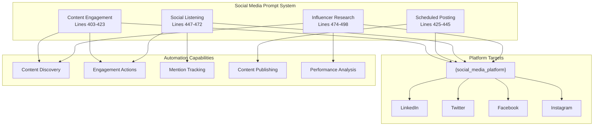
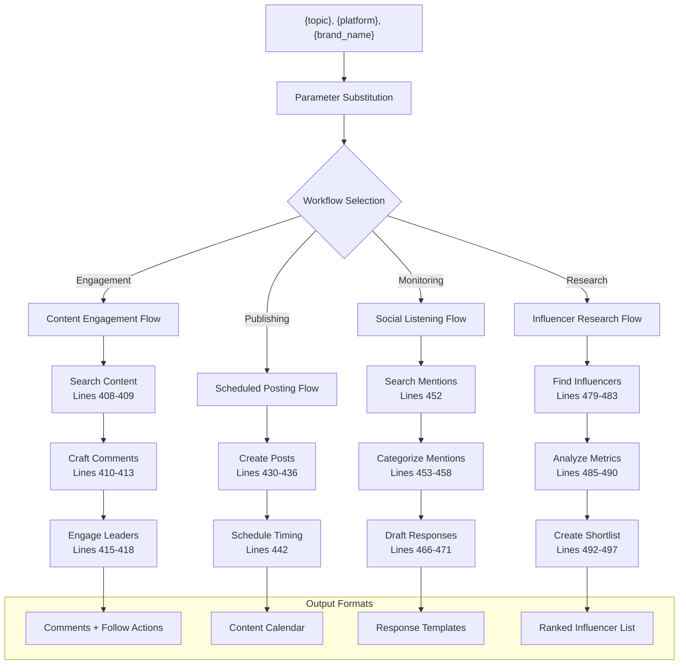
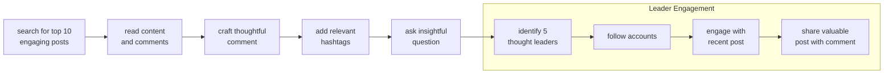
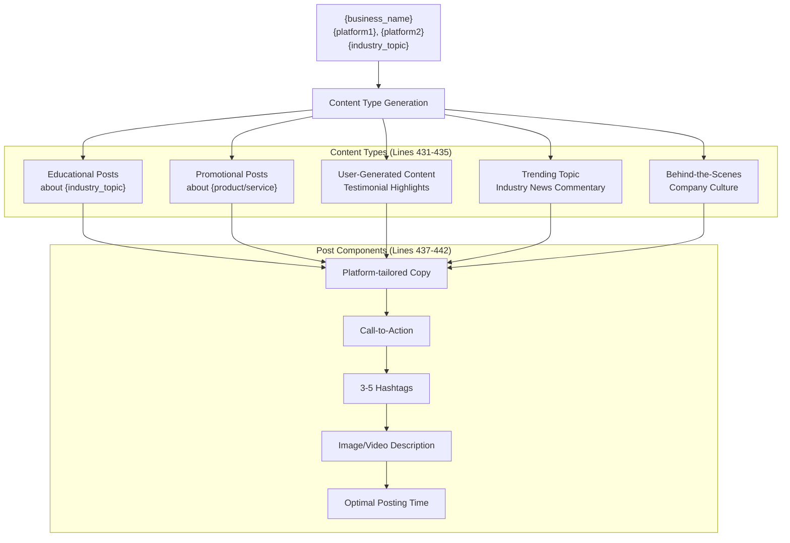
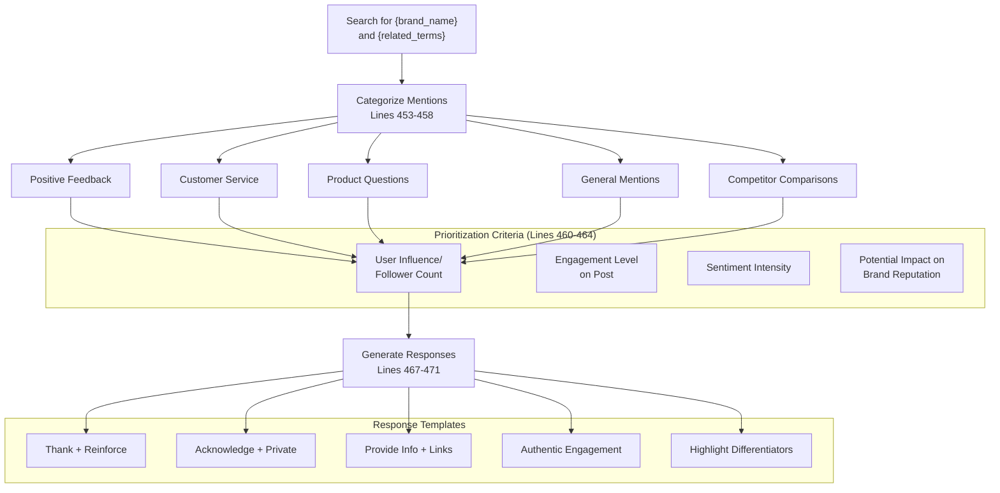
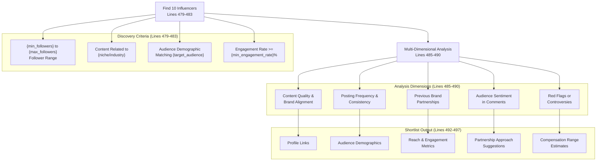
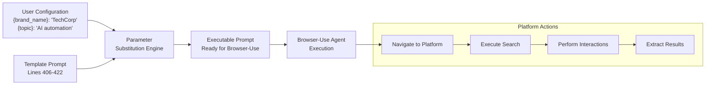

<!-- source: DeepWiki mcp.deepwiki.com · repo browser-use/awesome-prompts · page 2.6 Social Media Prompts · fetched 2026-10-30 -->

# Social Media Prompts

Relevant source files

The following files were used as context for generating this wiki page:

- [README.md](README.md)

This document covers the social media automation prompts available in the Browser-Use Awesome Prompts repository. These prompts enable automated interactions with social media platforms for content engagement, posting schedules, social listening, and influencer research.

The prompts documented here focus specifically on social media platform interactions and engagement strategies. For broader content creation workflows that may include social media components, see [Content Creation Prompts](#2.3). For productivity aspects of social media management, see [Productivity Prompts](#2.7).

## Social Media Prompt Categories Overview

The social media automation system provides four primary categories of prompts, each targeting specific aspects of social media management:

Sources: [README.md:401-498]()

## Social Media Workflow Architecture

The execution model for social media prompts follows a structured workflow that maps user intentions to platform-specific actions:

Sources: [README.md:403-498]()

## Content Engagement Prompts

The content engagement system automates interaction with existing social media content to build visibility and thought leadership in specific topic areas.

### Core Engagement Parameters

| Parameter | Purpose | Example Values |
|-----------|---------|----------------|
| `{social_media_platform}` | Target platform | `LinkedIn`, `Twitter`, `Instagram` |
| `{topic}` | Content focus area | `AI automation`, `digital marketing` |
| `{personal_brand_description}` | Brand voice alignment | `thought leader in tech innovation` |

### Engagement Workflow Steps

The engagement process follows a systematic approach defined in lines 408-421:

1. **Content Discovery**: Search for top 10 most engaging recent posts
2. **Context Analysis**: Read content and comments to understand discussions
3. **Response Crafting**: Create thoughtful, value-adding comments
4. **Leader Identification**: Find and engage with 5 thought leaders
5. **Community Joining**: Join 2-3 relevant groups or communities

Sources: [README.md:403-423]()

## Scheduled Posting Prompts

The scheduled posting system creates and plans content publication across multiple platforms with platform-specific optimization.

### Platform-Specific Content Structure

The system generates content tailored to each platform's characteristics:

| Content Type | Frequency | Platform Optimization |
|--------------|-----------|----------------------|
| Educational posts | 3 per week | Platform-specific length limits |
| Promotional posts | 2 per week | CTA optimization |
| UGC/Testimonial shares | 1 per week | Engagement-focused |
| Trending/News commentary | 1 per week | Real-time relevance |
| Behind-the-scenes | 1 per week | Brand humanization |

### Content Generation Parameters

The posting workflow uses these key parameter patterns from lines 430-444:

Sources: [README.md:425-445]()

## Social Listening and Response Management

The social listening system monitors brand mentions across platforms and generates appropriate response strategies based on conversation categorization.

### Mention Categorization System

The system categorizes mentions into five distinct types with specific response strategies:

| Category | Response Strategy | Examples |
|----------|------------------|----------|
| Positive feedback | Thank + reinforce relationship | Customer praise, testimonials |
| Customer service issues | Acknowledge + move private | Complaints, support requests |
| Product questions | Provide info + resources | Feature inquiries, comparisons |
| General mentions | Authentic engagement | Industry discussions, tags |
| Competitor comparisons | Highlight differentiators | Feature comparisons, reviews |

### Response Generation Workflow

Sources: [README.md:447-472]()

## Influencer Research and Analysis

The influencer research system identifies, evaluates, and ranks potential brand partnership candidates based on multiple criteria including audience alignment and engagement metrics.

### Influencer Discovery Parameters

| Parameter | Constraint Type | Purpose |
|-----------|----------------|---------|
| `{min_followers}` / `{max_followers}` | Audience size | Target micro/macro influencers |
| `{niche/industry}` | Content relevance | Ensure topic alignment |
| `{target_audience}` | Demographic match | Audience compatibility |
| `{min_engagement_rate}` | Performance threshold | Quality validation |

### Analysis and Ranking System

The research process evaluates candidates across multiple dimensions before creating a ranked shortlist:

Sources: [README.md:474-498]()

## Parameter Substitution System

All social media prompts use a consistent parameter substitution pattern with curly braces `{}` to enable customization and reuse across different campaigns and contexts.

### Common Parameter Categories

| Category | Parameter Pattern | Usage Context |
|----------|-------------------|---------------|
| Platform targeting | `{social_media_platform}`, `{platform1}` | Multi-platform automation |
| Brand identity | `{brand_name}`, `{business_name}` | Consistent brand representation |
| Content focus | `{topic}`, `{industry_topic}` | Topic-specific engagement |
| Audience targeting | `{target_audience}`, `{niche/industry}` | Demographic alignment |
| Performance metrics | `{min_engagement_rate}`, `{min_followers}` | Quality thresholds |

### Integration with Browser-Use Agent

The parameter system integrates directly with Browser-Use agent execution, allowing for dynamic prompt customization without requiring prompt modification:

Sources: [README.md:401-498]()

---

