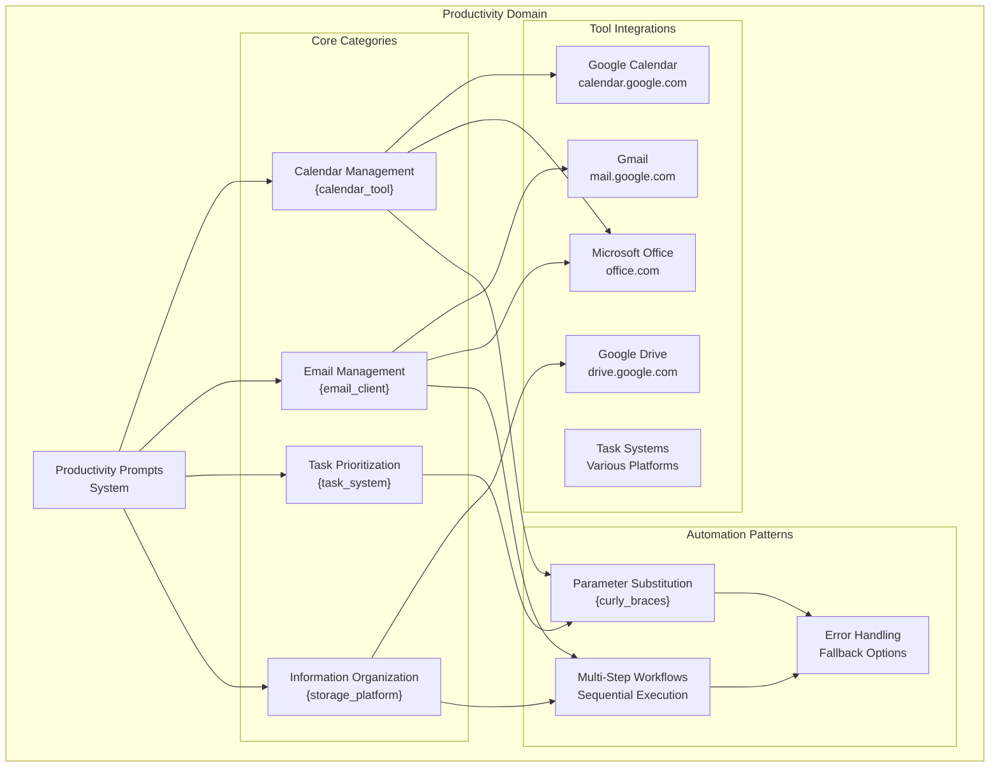
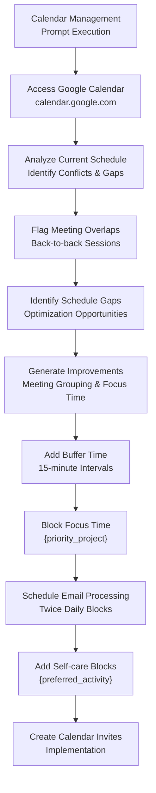
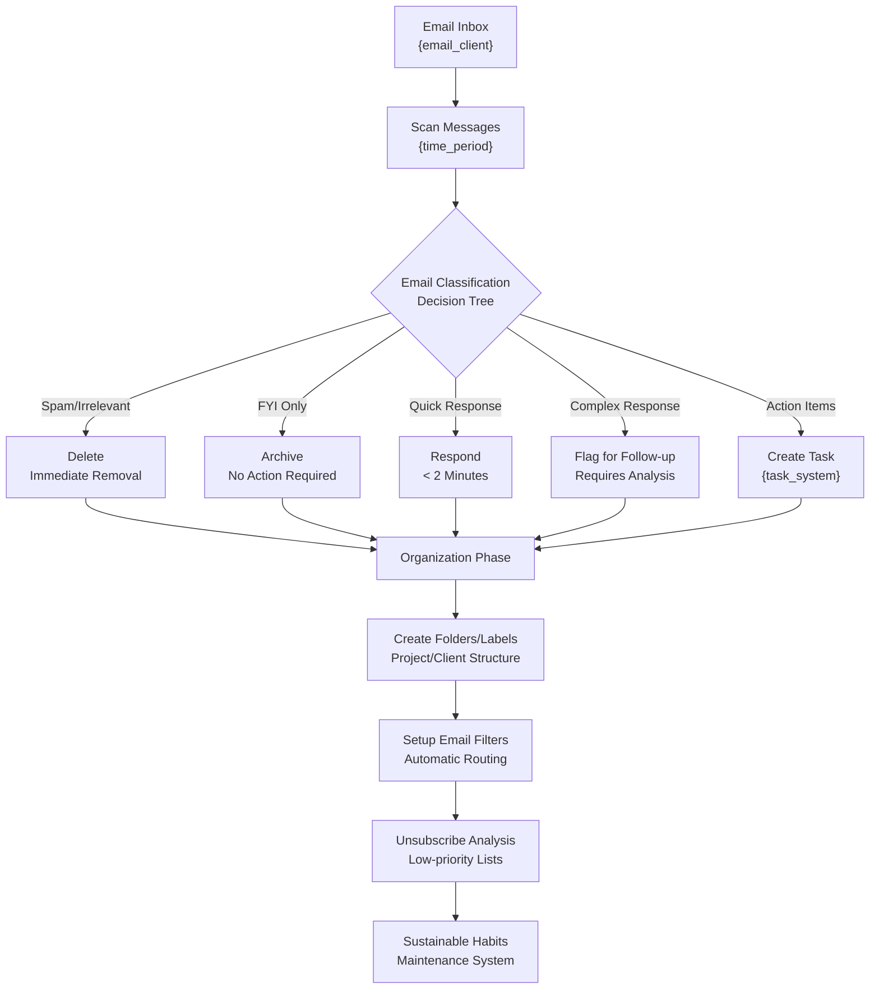
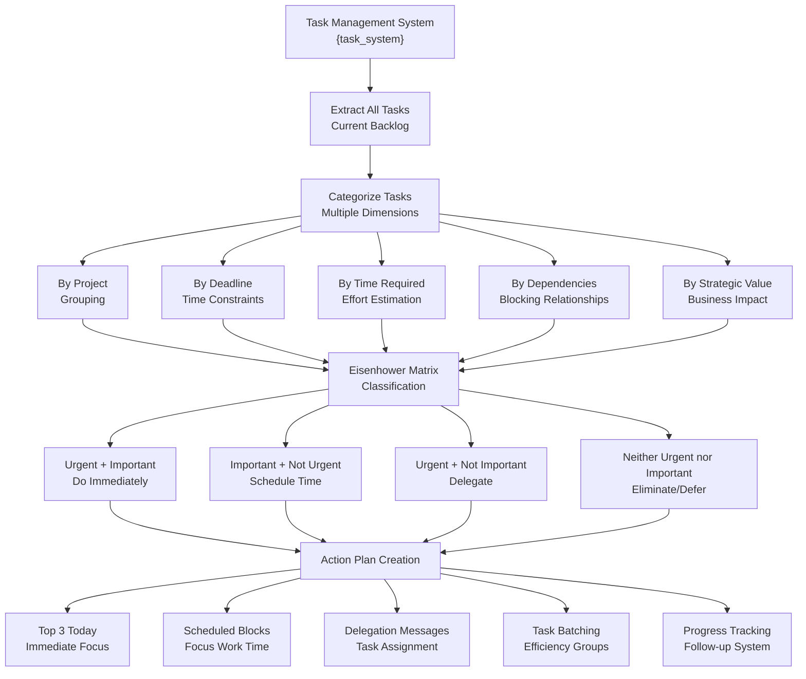
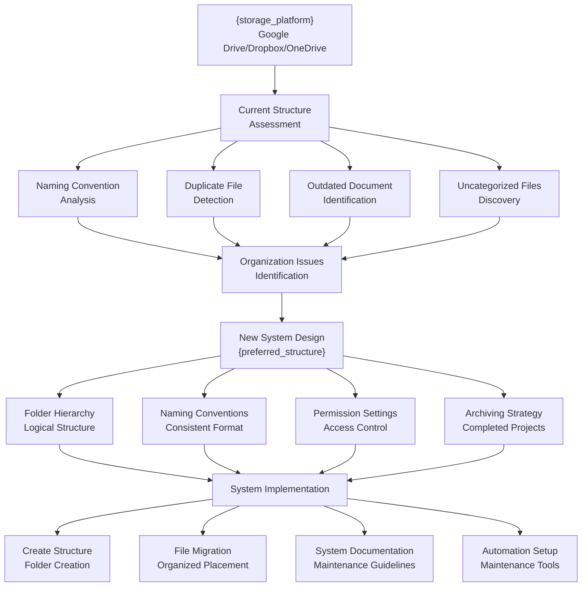
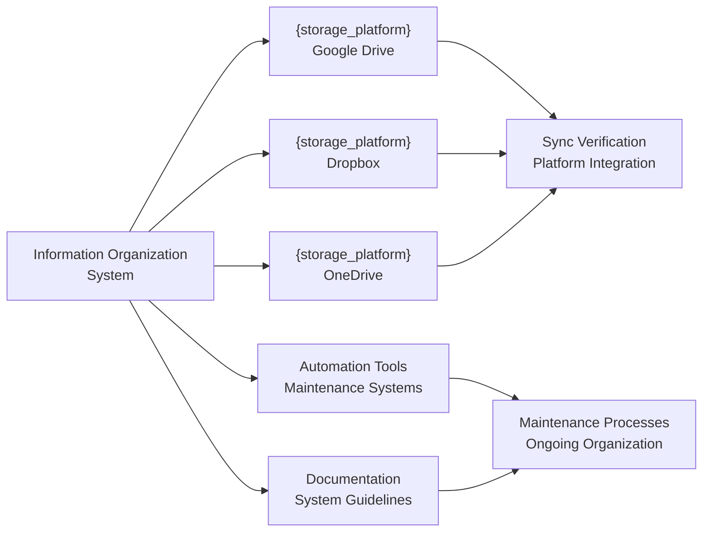

<!-- source: DeepWiki mcp.deepwiki.com · repo browser-use/awesome-prompts · page 2.7 Productivity Prompts · fetched 2026-10-30 -->

# Productivity Prompts

Relevant source files

The following files were used as context for generating this wiki page:

- [README.md](README.md)

## Purpose and Scope

This document covers productivity automation prompts that enhance personal and professional efficiency through browser-based task automation. These prompts target four core productivity domains: calendar management, email processing, task prioritization, and information organization. Each prompt category integrates with common productivity platforms and tools through Browser-Use agent execution.

For content creation workflows, see [Content Creation Prompts](#2.3). For social media management automation, see [Social Media Prompts](#2.6). For multi-step workflow orchestration, see [Multi-Step Workflows](#4).

## Productivity Prompt Categories

The productivity prompt system encompasses four specialized automation categories, each designed to integrate with specific productivity tools and platforms through structured parameter substitution and multi-step execution workflows.

### Category Overview

| Category | Tool Integration | Primary Use Cases | Automation Complexity |
|----------|-----------------|-------------------|----------------------|
| Calendar Management | Google Calendar, Outlook | Meeting optimization, scheduling | Medium |
| Email Management | Gmail, Outlook, Yahoo | Inbox processing, response automation | High |
| Task Prioritization | Task management systems | Priority matrix application, planning | Medium |
| Information Organization | Google Drive, Dropbox, OneDrive | File structure optimization, cleanup | High |

Sources: [README.md:500-602]()

## Productivity Prompt Architecture

Sources: [README.md:500-602]()

## Calendar Management Prompts

Calendar management automation focuses on schedule optimization, meeting conflict resolution, and productivity-focused time blocking. The system integrates primarily with Google Calendar and Microsoft Outlook through web interface automation.

### Core Functionality

The calendar management prompt implements a comprehensive schedule analysis and optimization workflow:

### Parameter Integration

The calendar management system uses structured parameter substitution for personalization:

| Parameter | Purpose | Example Values |
|-----------|---------|----------------|
| `{priority_project}` | Focus time allocation | "Q4 planning", "Product development" |
| `{preferred_activity}` | Self-care scheduling | "Gym", "Walking", "Meditation" |
| `{time_period}` | Scope definition | "upcoming week", "next month" |

### Implementation Details

The prompt executes through a systematic workflow that processes existing calendar data and applies optimization rules. The system identifies meeting conflicts, suggests grouping strategies for similar meeting types, and automatically creates buffer time between sessions.

Sources: [README.md:502-522]()

## Email Management Prompts

Email management automation implements an "inbox zero" methodology through systematic email processing, categorization, and response automation. The system processes email backlogs using a decision-tree approach for efficient message handling.

### Email Processing Workflow

### Email Response Automation

The system generates appropriate responses based on email categorization and maintains template libraries for common scenarios:

- **Quick replies**: Standard acknowledgments and confirmations
- **Decline templates**: Polite rejection of low-priority requests  
- **Follow-up scheduling**: Conversion of complex emails to calendar events
- **Task creation**: Integration with task management systems for action items

### System Integration

Email management prompts integrate with multiple productivity platforms:

| Integration | Purpose | Implementation |
|-------------|---------|----------------|
| `{task_system}` | Action item tracking | Automatic task creation from emails |
| Folder/Label creation | Email organization | Dynamic structure based on projects |
| Filter automation | Inbox maintenance | Rule-based message routing |

Sources: [README.md:524-548]()

## Task Prioritization Prompts

Task prioritization automation applies the Eisenhower Matrix methodology to existing task lists, creating structured work plans with time-based scheduling and dependency management.

### Eisenhower Matrix Implementation

### Task Analysis Dimensions

The prioritization system analyzes tasks across multiple dimensions:

| Dimension | Analysis Criteria | Output |
|-----------|------------------|---------|
| Project grouping | Related task identification | Batch processing opportunities |
| Deadline proximity | Time constraint analysis | Urgency classification |
| Effort estimation | Time requirement assessment | Resource allocation planning |
| Dependency mapping | Blocking relationship identification | Execution sequence optimization |
| Strategic importance | Business impact evaluation | Priority ranking |

### Action Plan Generation

The system creates specific, time-bound action plans with:
- **Daily top 3**: Highest priority tasks for immediate execution
- **Focus time blocks**: Scheduled periods for important work
- **Delegation templates**: Pre-drafted messages for task assignment
- **Batch processing groups**: Related tasks grouped for efficiency
- **Progress tracking**: Follow-up systems for key deliverables

Sources: [README.md:550-577]()

## Information Organization Prompts

Information organization automation addresses digital file management through systematic structure analysis, cleanup processes, and organizational system implementation across cloud storage platforms.

### File Organization Architecture

### Organization Structure Types

The system supports multiple organizational methodologies based on the `{preferred_structure}` parameter:

| Structure Type | Use Case | Implementation |
|----------------|----------|----------------|
| Project-based | Temporary initiatives | Folders per project with lifecycle management |
| Client-based | Service businesses | Client folders with service type substructure |
| Department-based | Large organizations | Functional area segregation |
| Date-based | Document archives | Chronological filing system |
| Hybrid | Complex organizations | Multiple taxonomy combination |

### File Management Operations

The automation system performs comprehensive file management operations:

1. **Structure Analysis**: Evaluates existing folder hierarchies and naming patterns
2. **Duplicate Detection**: Identifies and consolidates duplicate files
3. **Archive Processing**: Moves completed project files to archive structure
4. **Permission Optimization**: Configures appropriate access controls for shared files
5. **Maintenance Automation**: Establishes ongoing organizational processes

### Integration Patterns

Information organization prompts integrate with multiple storage platforms and productivity tools:

Sources: [README.md:579-602]()

## Parameter Substitution System

Productivity prompts utilize a comprehensive parameter substitution system using curly brace notation for dynamic customization and tool integration.

### Common Parameters

| Parameter Category | Examples | Usage Context |
|-------------------|----------|---------------|
| Tool Integration | `{task_system}`, `{email_client}`, `{storage_platform}` | Platform-specific automation |
| Time Scoping | `{time_period}`, `{date}`, `{deadline}` | Temporal constraints |
| Personalization | `{preferred_activity}`, `{priority_project}`, `{brand_voice}` | User customization |
| Content Specification | `{topic}`, `{goal}`, `{preferences}` | Context-specific execution |

### Implementation Patterns

The parameter system enables flexible automation across different productivity contexts while maintaining consistent execution patterns and error handling mechanisms.

Sources: [README.md:500-602]()

---

