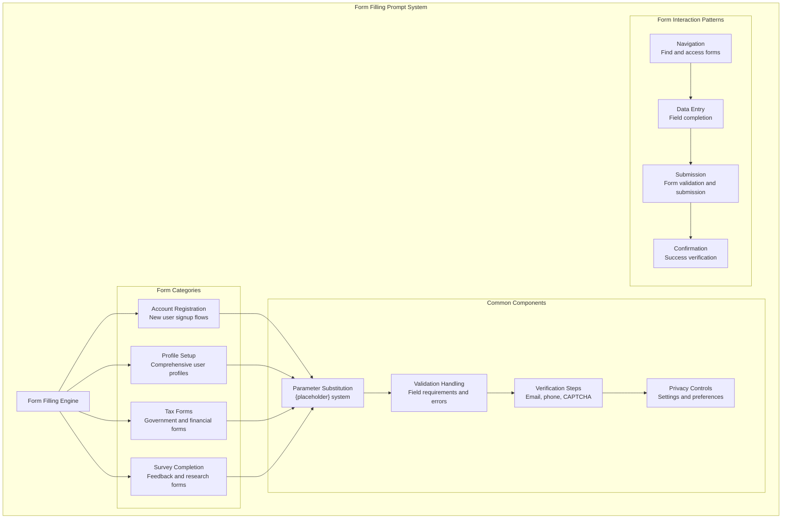
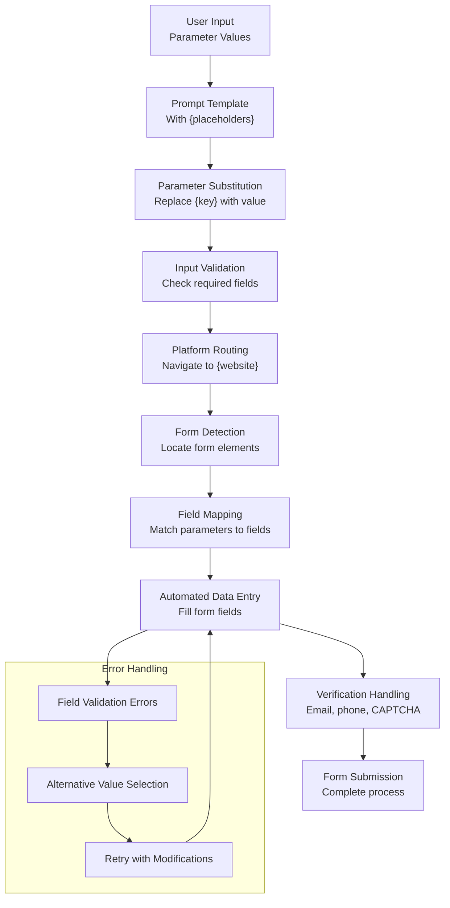
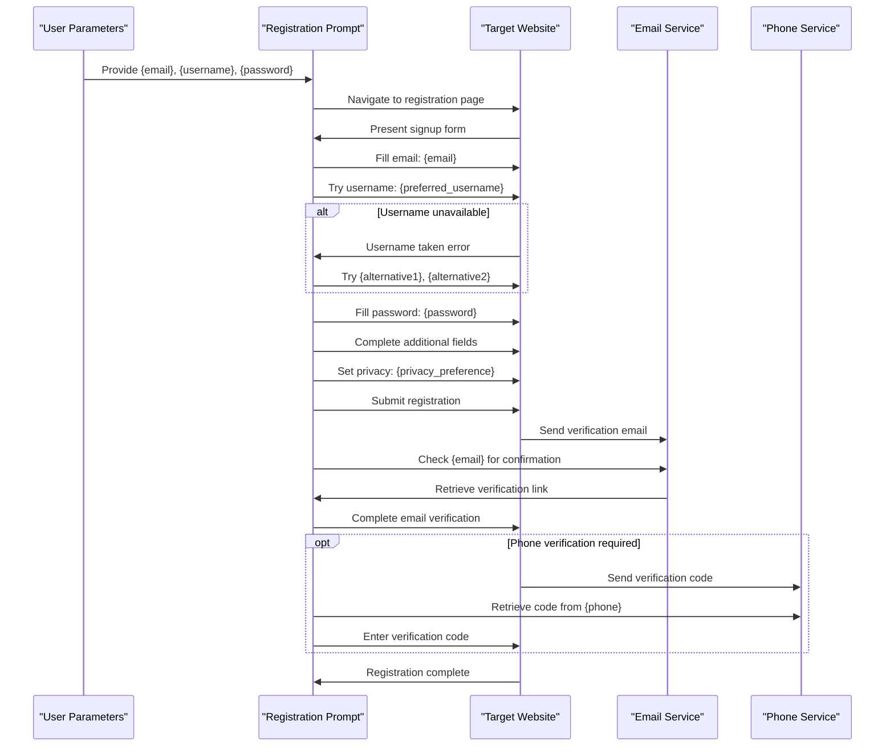
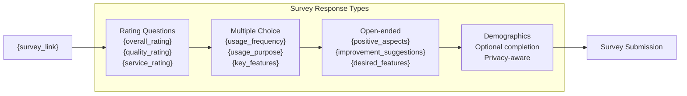
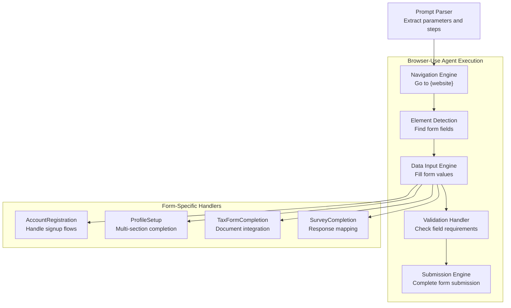

<!-- source: DeepWiki mcp.deepwiki.com · repo browser-use/awesome-prompts · page 2.8 Form Filling Prompts · fetched 2026-10-30 -->

# Form Filling Prompts

<details>
<summary>Relevant source files</summary>

The following files were used as context for generating this wiki page:

- [README.md](README.md)

</details>


This document covers the Browser-Use prompt collection for automated form completion across various web platforms and applications. These prompts handle structured data entry, form validation, multi-step registration processes, and complex form workflows.

For information about general web interactions and data extraction, see [Data Extraction Prompts](#2.4). For productivity-focused automation workflows, see [Productivity Prompts](#2.7).

## Form Filling Categories and Architecture

The form filling prompt system provides automation for four primary categories of web form interactions, each with specialized handling for different validation requirements and completion flows.



Sources: [README.md:604-715]()

## Parameter Substitution System

Form filling prompts utilize a standardized parameter substitution system using curly brace notation to enable template reusability across different websites and form types.

### Core Parameter Categories

| Parameter Type | Examples | Usage Context |
|---|---|---|
| Authentication | `{email}`, `{password}`, `{username}` | Login and registration forms |
| Personal Information | `{name}`, `{address}`, `{phone}` | Profile and contact forms |
| Preferences | `{privacy_preference}`, `{preferences}` | Settings and configuration |
| Platform-specific | `{website}`, `{platform}`, `{tax_website}` | Target destination routing |
| Content Data | `{bio_text}`, `{experience_details}` | Rich content completion |

### Parameter Flow Architecture



Sources: [README.md:608-632](), [README.md:642-657]()

## Form Interaction Patterns

### Account Registration Pattern

The account registration pattern handles new user signup flows with comprehensive validation and verification handling.

**Core Components:**
- Navigation to signup pages
- Form field completion with fallback options
- Email and phone verification
- Privacy setting configuration
- Terms of service review



Sources: [README.md:604-632]()

### Profile Setup Pattern

The comprehensive profile setup pattern handles detailed user profile completion across professional and social platforms.

**Key Features:**
- Multi-section profile completion
- Media upload handling
- Platform-specific field mapping
- Privacy configuration
- Profile optimization verification

**Profile Completion Flow:**
1. Authentication and navigation
2. Sequential section completion
3. Media and content upload
4. Privacy and visibility settings
5. Profile validation and optimization

Sources: [README.md:634-657]()

### Tax Form Pattern

The tax form completion pattern provides structured handling of government and financial forms with enhanced accuracy verification.

**Specialized Components:**
- Document reference system
- Multi-document data correlation
- Accuracy verification steps
- Draft saving without submission
- Error flagging for manual review

**Document Integration:**
- `{personal_doc}` for personal information
- `{w2_docs}`, `{1099_docs}` for income data
- `{deduction_docs}` for deduction claims
- `{investment_docs}` for investment information

Sources: [README.md:659-685]()

### Survey Completion Pattern

The survey completion pattern handles structured feedback collection with rating scales, multiple choice, and open-ended responses.

**Response Categories:**
- Numeric rating scales (1-5, 1-10)
- Multiple choice selection
- Open-ended feedback
- Demographic information (optional)



Sources: [README.md:687-715]()

## Form Validation and Error Handling

Form filling prompts implement comprehensive validation and error handling strategies to ensure successful form completion across diverse platforms and requirements.

### Validation Strategies

| Validation Type | Implementation | Error Recovery |
|---|---|---|
| Field Requirements | Check mandatory field completion | Flag missing information for user |
| Format Validation | Verify email, phone, date formats | Suggest corrections or alternatives |
| Security Requirements | Password complexity compliance | Generate compliant alternatives |
| Platform Constraints | Username availability, character limits | Try alternative values systematically |
| Document Verification | Cross-reference tax document data | Flag discrepancies for review |

### Error Recovery Mechanisms

**Username Conflict Resolution:**
```
Username: {preferred_username} (if unavailable, try variations like {alternative1}, {alternative2})
```

**Password Security Compliance:**
```
Password: {password} (ensure it meets the site's security requirements)
```

**Missing Information Handling:**
```
For any sections where information is unclear:
- Flag the section for my review
- Explain what additional information is needed
- Suggest potential sources for the information
```

Sources: [README.md:612-614](), [README.md:673-677]()

## Integration with Browser-Use Execution

Form filling prompts integrate with the Browser-Use agent execution system through standardized navigation, element detection, and interaction patterns.

### Browser Interaction Sequence



Sources: [README.md:604-715]()

## Quality Standards and Best Practices

Form filling prompts adhere to specific quality standards to ensure reliability, security, and user safety across automated form completion workflows.

### Security Considerations

**Privacy Protection:**
- Opt out of marketing communications unless specifically requested
- Review privacy settings according to user preferences
- Skip optional demographic questions unless instructed
- Set appropriate privacy controls for profile visibility

**Sensitive Data Handling:**
- Never submit tax returns without user verification
- Save forms as drafts for final user review
- Flag unclear information rather than guessing
- Maintain document references for verification

**Authentication Safety:**
- Use provided credentials only for intended purposes
- Complete verification steps as required
- Respect platform security requirements
- Handle multi-factor authentication appropriately

Sources: [README.md:621-631](), [README.md:679-684](), [README.md:710-713]()

---

