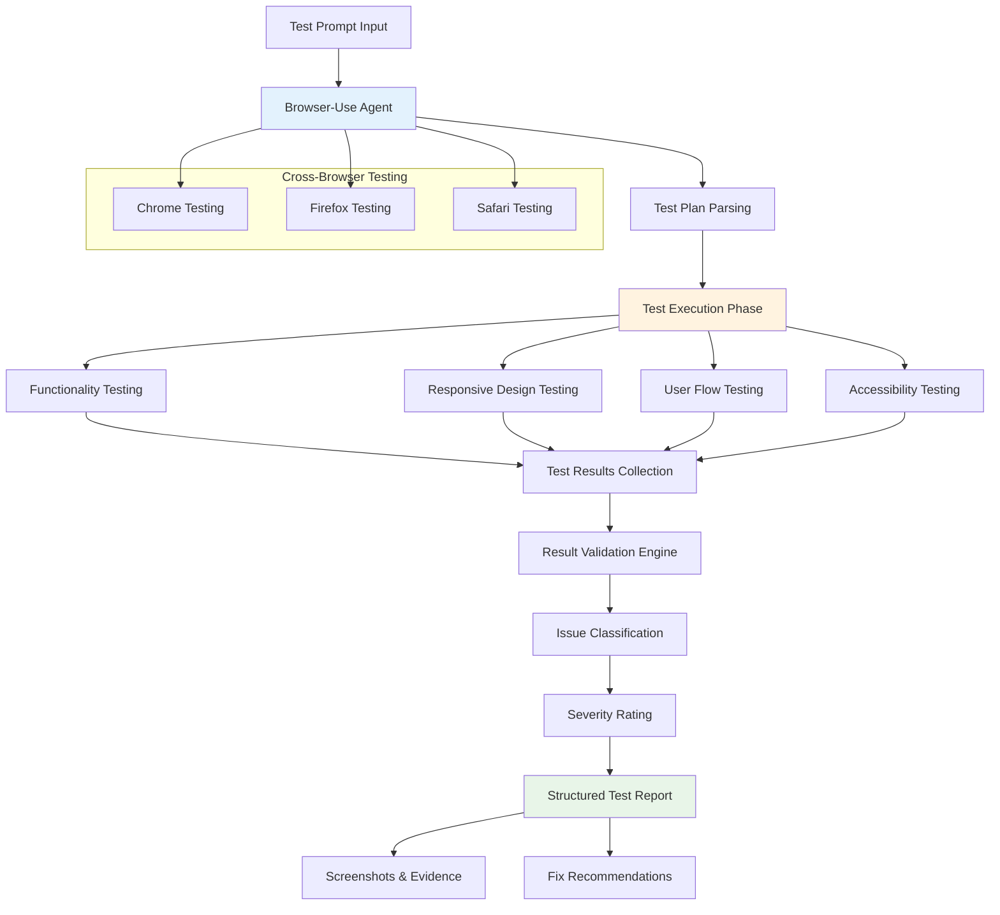
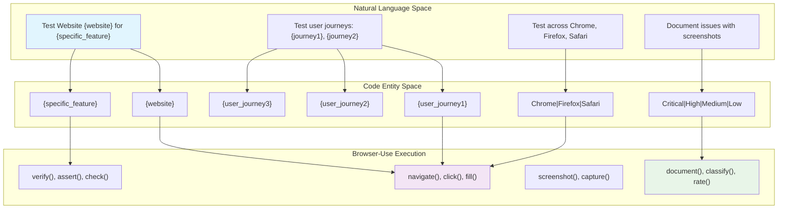
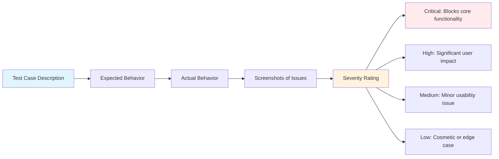
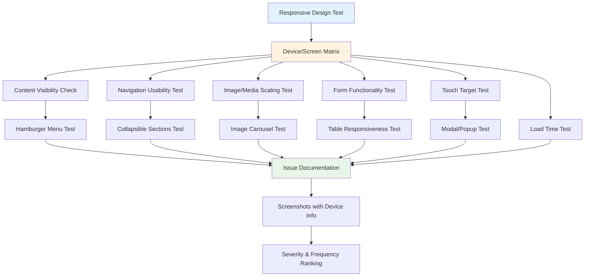
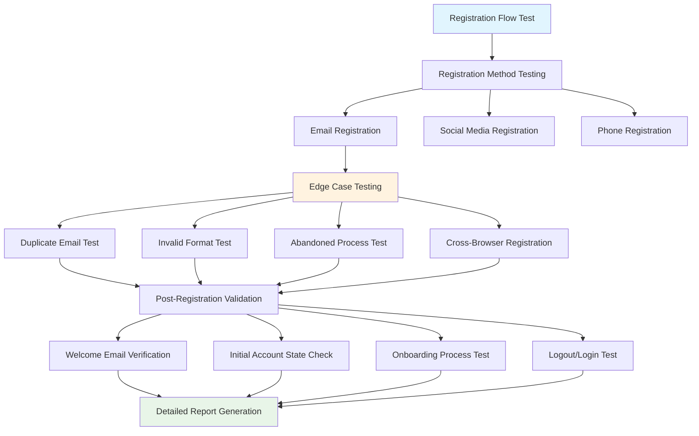

<!-- source: DeepWiki mcp.deepwiki.com · repo browser-use/awesome-prompts · page 2.9 Testing and QA Prompts · fetched 2026-10-30 -->

# Testing and QA Prompts

Relevant source files

The following files were used as context for generating this wiki page:

- [README.md](README.md)

## Purpose and Scope

This page documents the testing and quality assurance prompts designed for Browser-Use agents to perform comprehensive website testing across multiple dimensions. These prompts enable automated testing of web applications including functionality verification, responsive design validation, user flow testing, and accessibility compliance checking.

For general prompt engineering principles that apply to testing prompts, see [Prompt Engineering](#3). For complex multi-step testing workflows, see [Multi-Step Workflows](#4).

## Testing Categories Overview

The testing and QA prompt collection encompasses four primary categories of automated web testing:

| Testing Category | Primary Focus | Key Capabilities |
|-----------------|---------------|------------------|
| **Functionality Testing** | Core feature verification | User flows, form validation, error handling |
| **Responsive Design Testing** | Cross-device compatibility | Screen size adaptation, touch targets, performance |
| **Registration Flow Testing** | User onboarding processes | Account creation, verification, edge cases |
| **Accessibility Testing** | WCAG compliance | Keyboard navigation, screen readers, color contrast |

## Testing Workflow Architecture

### Core Testing Process Flow

Sources: [README.md:717-864]()

### Testing Prompt Structure Integration

Sources: [README.md:717-864]()

## Website Functionality Testing

### Core Functionality Testing Framework

The website functionality testing prompt provides comprehensive validation of core user journeys and feature sets. The testing framework covers three primary areas:

#### User Registration and Authentication Flow
- Account creation with test credentials
- Email confirmation process validation  
- Login/logout cycle testing
- Password reset functionality verification

#### Feature-Specific Testing
- UI element interaction testing (`buttons`, `forms`, `dropdowns`)
- Data entry and validation testing
- Error handling and messaging verification
- Performance testing under various conditions

#### Critical User Journey Testing
The prompt structure accommodates three configurable user journeys:
- `{user_journey1}` - Primary conversion path (e.g., product search to checkout)
- `{user_journey2}` - Account management flow (e.g., settings update)  
- `{user_journey3}` - Content interaction flow (e.g., content submission)

### Cross-Browser Compatibility Testing

Each functionality test executes across multiple browser environments:

| Browser | Testing Focus | Validation Points |
|---------|---------------|-------------------|
| **Chrome** | Primary functionality | Full feature set validation |
| **Firefox** | Rendering differences | CSS/JS compatibility |
| **Safari** | WebKit-specific issues | Mobile Safari considerations |

### Test Documentation Structure

Sources: [README.md:719-752]()

## Responsive Design Testing

### Multi-Device Testing Matrix

The responsive design testing prompt systematically validates website behavior across device categories and screen orientations:

#### Screen Size Testing Coverage

| Device Category | Screen Widths | Orientations | Key Validation Points |
|----------------|---------------|--------------|----------------------|
| **Mobile** | `320px`, `375px`, `414px` | Portrait, Landscape | Touch targets, readability |
| **Tablet** | `768px`, `1024px` | Portrait, Landscape | Navigation adaptation |
| **Desktop** | `1366px`, `1920px` | Landscape | Content scaling, layout |

#### Page-Specific Testing Scope

The testing framework validates five key page types:
- Homepage - Primary entry point validation
- `{page1}` - Product listing pages
- `{page2}` - Product detail pages  
- `{page3}` - Checkout process pages
- `{page4}` - Account settings pages

### Responsive Feature Validation

Sources: [README.md:754-787]()

## User Registration Flow Testing

### Registration Method Testing Coverage

The user registration flow testing prompt comprehensively validates all available registration pathways:

#### Registration Method Validation
- **Email Registration** - Primary registration flow
- **Google/Social Media Registration** - OAuth integration testing  
- **Phone Number Registration** - SMS verification testing

#### Email Registration Testing Framework

The testing process validates each registration component:

| Component | Validation Focus | Error Handling |
|-----------|-----------------|----------------|
| **Form Validation** | Field requirement checking | Clear error messaging |
| **Password Requirements** | Strength validation | Real-time feedback |
| **Email Verification** | Confirmation process | Resend functionality |
| **Duplicate Handling** | "Already registered" flow | Helpful guidance |

### Edge Case Testing Matrix

### Registration Testing Documentation

The testing process generates comprehensive documentation including:
- **Field Requirements** - Validation rules and constraints
- **Error Message Analysis** - Clarity and helpfulness assessment
- **Process Timing** - Step completion time measurement
- **Cross-Device Validation** - Multi-browser/device testing results

Sources: [README.md:789-825]()

## Accessibility Testing

### WCAG 2.1 AA Compliance Framework

The accessibility testing prompt implements comprehensive WCAG 2.1 AA standard validation across five key areas:

#### Keyboard Navigation Testing
- **Tab Navigation** - Sequential navigation through interactive elements
- **Focus Indicators** - Visual focus indicator verification  
- **Mouse-Free Operation** - Complete functionality without mouse input
- **Keyboard Traps** - Detection of inaccessible element sequences

#### Screen Reader Compatibility Testing

| Screen Reader | Platform | Testing Focus |
|---------------|----------|---------------|
| **VoiceOver** | macOS | Content announcement accuracy |
| **NVDA** | Windows | Dynamic content updates |
| **Generic Testing** | Cross-platform | Alt text and form labels |

### Accessibility Testing Architecture

```mermaid
flowchart TD
    AccessibilityTest["Accessibility Testing"] --> KeyboardNav["Keyboard Navigation Test"]
    AccessibilityTest --> ScreenReader["Screen Reader Test"]
    AccessibilityTest --> VisualTest["Visual Presentation Test"]
    AccessibilityTest --> FormTest["Form Accessibility Test"]
    AccessibilityTest --> WCAGCompliance["WCAG 2.1 AA Validation"]
    
    KeyboardNav --> TabSequence["Tab Sequence Testing"]
    KeyboardNav --> FocusIndicators["Focus Indicator Testing"]
    KeyboardNav --> MouseFreeOp["Mouse-Free Operation"]
    KeyboardNav --> KeyboardTraps["Keyboard Trap Detection"]
    
    ScreenReader --> VoiceOver["VoiceOver Testing"]
    ScreenReader --> NVDA["NVDA Testing"]
    ScreenReader --> ContentAnnouncement["Content Announcement"]
    ScreenReader --> AltTextValidation["Alt Text Validation"]
    ScreenReader --> FormLabels["Form Label Testing"]
    ScreenReader --> DynamicContent["Dynamic Content Updates"]
    
    VisualTest --> ColorContrast["Color Contrast Testing"]
    VisualTest --> ColorBlindness["Color-Only Information Test"]
    VisualTest --> ZoomTest["200% Zoom Test"]
    VisualTest --> HighContrast["High Contrast Mode Test"]
    
    FormTest --> ErrorMessages["Clear Error Messages"]
    FormTest --> InputValidation["Input Validation Testing"]
    FormTest --> TimeoutWarnings["Timeout Warning Test"]
    FormTest --> MediaCaptions["Multimedia Caption Test"]
    
    WCAGCompliance --> SemanticHTML["Semantic HTML Structure"]
    WCAGCompliance --> HeadingHierarchy["Heading Hierarchy Test"]
    WCAGCompliance --> ARIAImplementation["ARIA Implementation Test"]
    WCAGCompliance --> LandmarkRegions["Landmark Region Test"]
    
    TabSequence --> DocumentationOutput["Accessibility Report"]
    VoiceOver --> DocumentationOutput
    ColorContrast --> DocumentationOutput
    ErrorMessages --> DocumentationOutput
    SemanticHTML --> DocumentationOutput
    
    style AccessibilityTest fill:#e1f5fe
    style WCAGCompliance fill:#fff3e0
    style DocumentationOutput fill:#e8f5e8
```

### Visual and Interactive Element Testing

#### Color and Contrast Validation
- **Text Contrast** - Background/foreground contrast ratio measurement
- **Color Independence** - Information conveyance without color dependency
- **Zoom Functionality** - 200% zoom level usability testing
- **High Contrast Mode** - System high contrast mode compatibility

#### Form and Interactive Elements
- **Error Message Clarity** - Meaningful error communication
- **Input Validation** - Appropriate validation feedback
- **Session Management** - Timeout warnings and session handling
- **Multimedia Accessibility** - Caption and transcript availability

### WCAG Documentation Output

The accessibility testing generates detailed reports with:
- **Issue Screenshots** - Visual documentation of accessibility barriers
- **Reproduction Steps** - Clear steps to reproduce identified issues  
- **WCAG Criteria References** - Specific WCAG 2.1 AA guideline citations
- **Remediation Recommendations** - Actionable fix suggestions

Sources: [README.md:827-864]()

## Testing Integration with Browser-Use

### Parameter Substitution in Testing Prompts

All testing prompts utilize the Browser-Use parameter substitution system with curly brace notation:

| Parameter | Purpose | Example Values |
|-----------|---------|----------------|
| `{website}` | Target website URL | `https://example.com` |
| `{specific_feature}` | Feature under test | `shopping cart`, `user profile` |
| `{user_journey1}` | Primary user flow | `product search to checkout` |
| `{page1}`, `{page2}`, etc. | Specific pages to test | `product listing`, `account settings` |

### Quality Assurance Integration

Testing prompts align with the repository's quality standards framework:

- **Format Consistency** - Structured test case documentation
- **Actionable Content** - Clear test steps and validation criteria  
- **Well-Structured Design** - Logical test flow organization
- **Browser-Use Compatibility** - Native agent action integration
- **Business Value** - Focus on user-impacting functionality

For detailed quality standards, see [Quality Standards](#5.2).

Sources: [README.md:717-864]()

---

