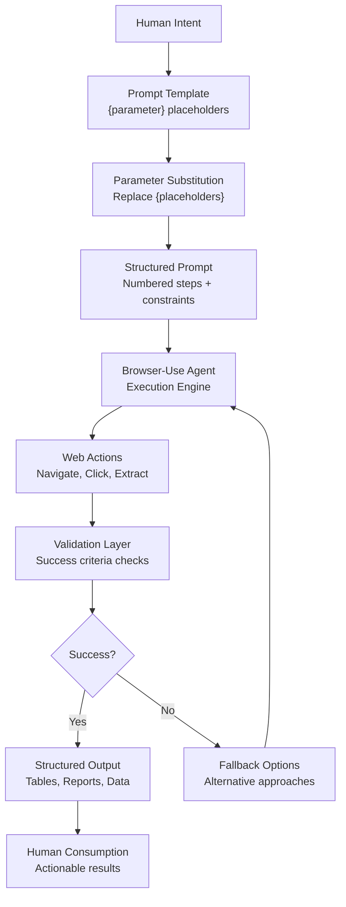
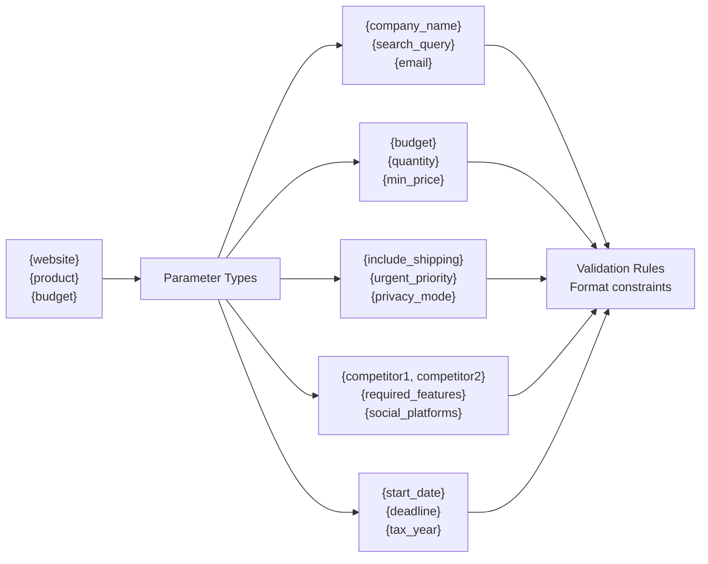
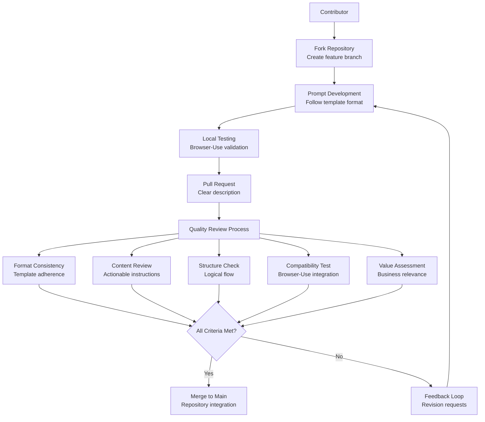
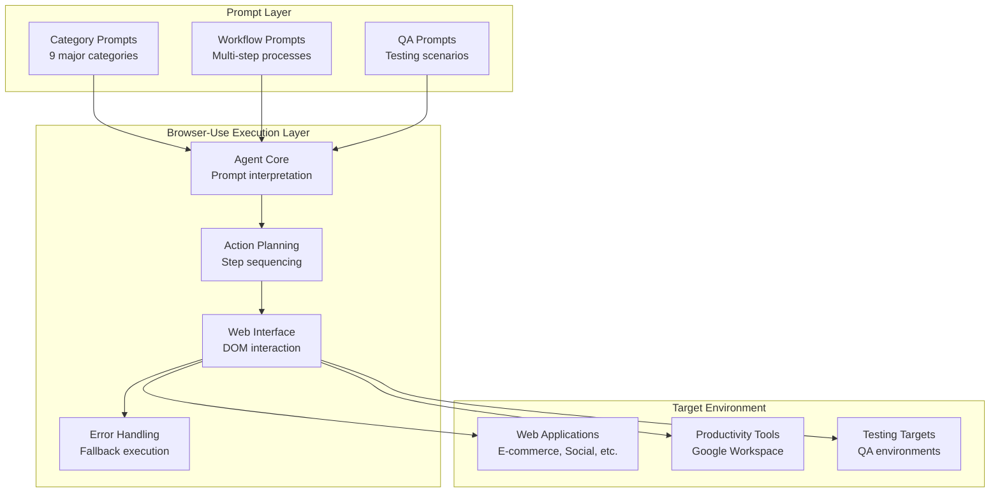

<!-- source: DeepWiki mcp.deepwiki.com · repo browser-use/awesome-prompts · page 3 Prompt Engineering · fetched 2026-10-30 -->

# Prompt Engineering

<details>
<summary>Relevant source files</summary>

The following files were used as context for generating this wiki page:

- [README.md](README.md)

</details>


This document covers the systematic approach to designing and structuring effective prompts for Browser-Use automation agents. It establishes the engineering principles, structural patterns, and quality frameworks that govern how prompts are crafted to maximize agent performance and reliability.

For detailed implementation guidelines of the four-pillar framework, see [Best Practices Framework](#3.1). For technical formatting specifications and parameter systems, see [Prompt Structure Guidelines](#3.2).

## Core Engineering Philosophy

Prompt engineering in the Browser-Use ecosystem treats prompts as structured interfaces rather than natural language instructions. Each prompt functions as a contract between human intent and agent execution, requiring precise specification of inputs, outputs, and behavioral constraints.

The engineering approach emphasizes:
- **Deterministic execution** through structured step-by-step instructions
- **Parameter substitution** using `{placeholder}` syntax for reusability
- **Error handling** with explicit fallback behaviors
- **Quality assurance** through standardized formatting and validation

**Prompt-to-Agent Communication Architecture**



Sources: [README.md:1054-1087]()

## Four-Pillar Framework

The prompt engineering framework consists of four interconnected pillars that ensure prompt effectiveness across different automation scenarios.

**Framework Component Hierarchy**

```mermaid
graph TB
    subgraph PromptEngineering["Prompt Engineering Framework"]
        Structure["Structure Pillar<br/>README.md:1056-1062"]
        Clarity["Clarity Pillar<br/>README.md:1064-1070"] 
        Adaptability["Adaptability Pillar<br/>README.md:1072-1078"]
        Efficiency["Efficiency Pillar<br/>README.md:1080-1086"]
    end
    
    subgraph StructureComponents["Structure Components"]
        GoalSpecification["Goal Specification<br/>Specific objectives"]
        StepBreakdown["Step Breakdown<br/>Numbered lists"]
        FormatSpecs["Format Specifications<br/>Output structures"]
        ContextProvision["Context Provision<br/>Background info"]
        ConstraintSetting["Constraint Setting<br/>Limitations"]
    end
    
    subgraph ClarityComponents["Clarity Components"] 
        PreciseLanguage["Precise Language<br/>Avoid ambiguity"]
        ParameterSpecs["Parameter Specifications<br/>{placeholder} values"]
        ExpectationClarification["Expectation Clarification<br/>Success criteria"]
        ExampleInclusion["Example Inclusion<br/>Desired outputs"]
        TerminologyDefinition["Terminology Definition<br/>Technical terms"]
    end
    
    Structure --> StructureComponents
    Clarity --> ClarityComponents
```

Sources: [README.md:1054-1087]()

## Prompt Architecture Patterns

Browser-Use prompts follow consistent architectural patterns that enable reliable execution across different web environments and automation tasks.

### Single-Step vs Multi-Step Pattern Classification

| Pattern Type | Characteristics | Use Cases | Examples |
|--------------|----------------|-----------|----------|
| **Single-Step** | Direct action, immediate result | Simple data extraction, form filling | Account registration, price lookup |
| **Multi-Step** | Sequential phases, intermediate validation | Complex workflows, research tasks | Market analysis, event planning |
| **Conditional** | Decision trees, branching logic | Error handling, alternative paths | Fallback options, inventory checks |
| **Iterative** | Loop-based processing | Bulk operations, pagination | Multi-page scraping, batch processing |

### Parameter Substitution System

The `{parameter}` substitution system enables prompt reusability and customization. Parameters follow specific naming conventions and type specifications:

**Parameter Type System**



Sources: [README.md:36-44](), [README.md:98-107](), [README.md:113-128]()

## Quality Assurance Framework

The repository implements a systematic quality framework for prompt validation and acceptance. This framework ensures consistency and effectiveness across all contributed prompts.

### Quality Criteria Matrix

| Criteria | Requirements | Validation Method |
|----------|-------------|-------------------|
| **Format Consistency** | Standard template structure, parameter syntax | Automated format checking |
| **Actionable Content** | Clear, executable instructions | Manual review process |
| **Well-Structured Design** | Logical flow, proper segmentation | Structural analysis |
| **Browser-Use Compatibility** | Platform-specific optimizations | Integration testing |
| **Business Value** | Practical use cases, measurable outcomes | Community evaluation |

### Contribution Workflow

**Quality Assurance Pipeline**



Sources: [README.md:1088-1105]()

## Integration with Browser-Use Ecosystem

Prompts serve as the primary interface between human requirements and the Browser-Use agent execution environment. The integration architecture ensures seamless communication and execution.

### Execution Context Mapping

**Agent Execution Architecture**



Sources: [README.md:31-1053]()

## Prompt Category System

The repository organizes prompts into nine specialized categories, each optimized for specific automation domains and use cases.

### Category Architecture

| Category | Purpose | Key Patterns | Parameter Types |
|----------|---------|--------------|-----------------|
| **Web Research** | Information gathering, analysis | Multi-source validation, synthesis | `{topic}`, `{competitor1-3}`, `{date}` |
| **E-commerce** | Shopping automation, price comparison | Product matching, cart operations | `{product}`, `{budget}`, `{retailer}` |
| **Content Creation** | Document generation, media planning | Template-based creation, platform optimization | `{brand}`, `{platform}`, `{audience}` |
| **Data Extraction** | Structured data retrieval | Table processing, contact extraction | `{website}`, `{data_category}`, `{filter}` |
| **Job Applications** | Career automation, profile optimization | Application workflows, profile enhancement | `{job_title}`, `{company}`, `{industry}` |
| **Social Media** | Platform engagement, content scheduling | Multi-platform coordination, engagement tracking | `{platform}`, `{brand}`, `{campaign}` |
| **Productivity** | Task management, information organization | Workflow optimization, system integration | `{task_system}`, `{calendar}`, `{priority}` |
| **Form Filling** | Automated form completion | Field mapping, validation handling | `{website}`, `{form_data}`, `{preferences}` |
| **Testing & QA** | Quality assurance automation | Test case execution, issue reporting | `{test_scope}`, `{device_type}`, `{criteria}` |

Sources: [README.md:31-864]()

This engineering approach ensures that each prompt functions as a reliable, reusable component in the broader Browser-Use automation ecosystem, with clear interfaces, predictable behavior, and measurable outcomes.

---

