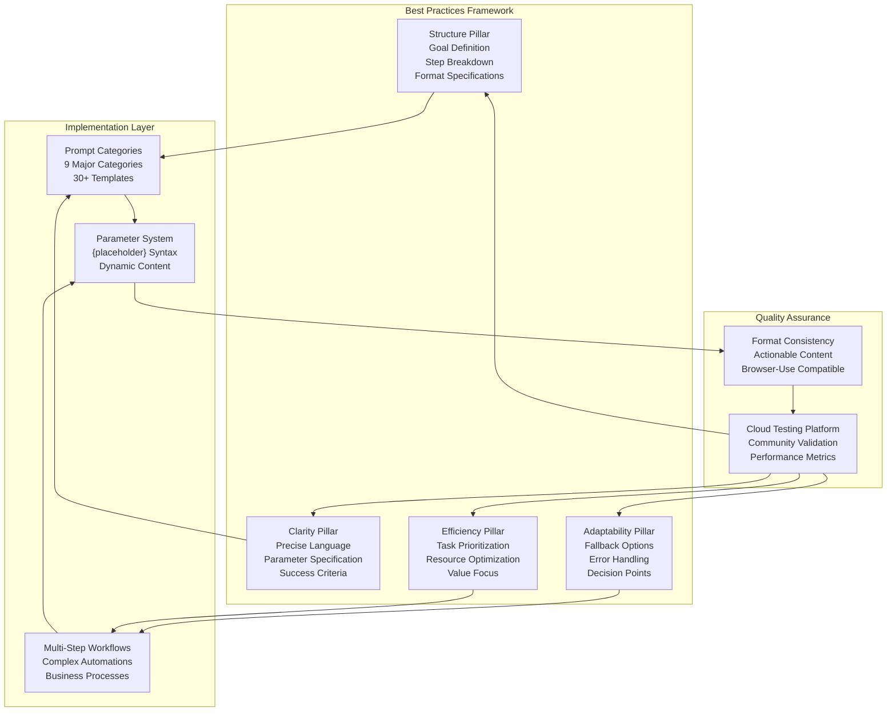
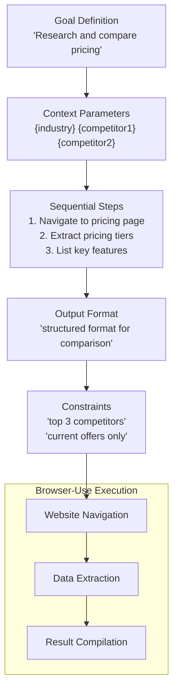
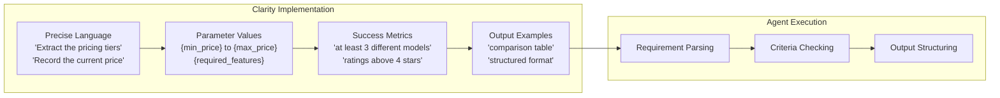
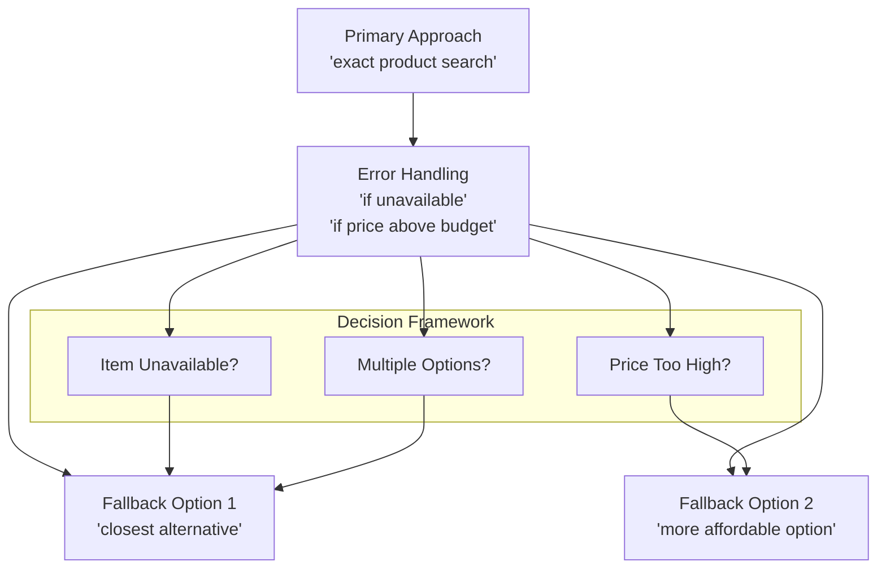
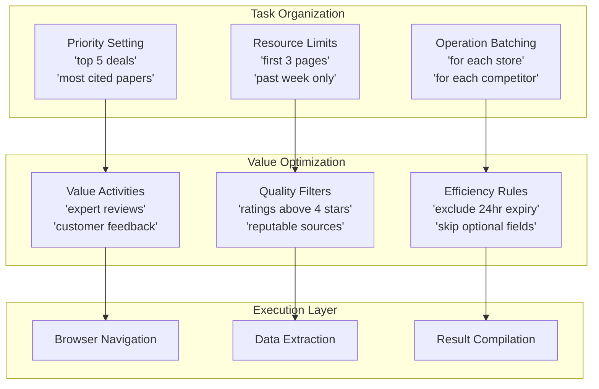
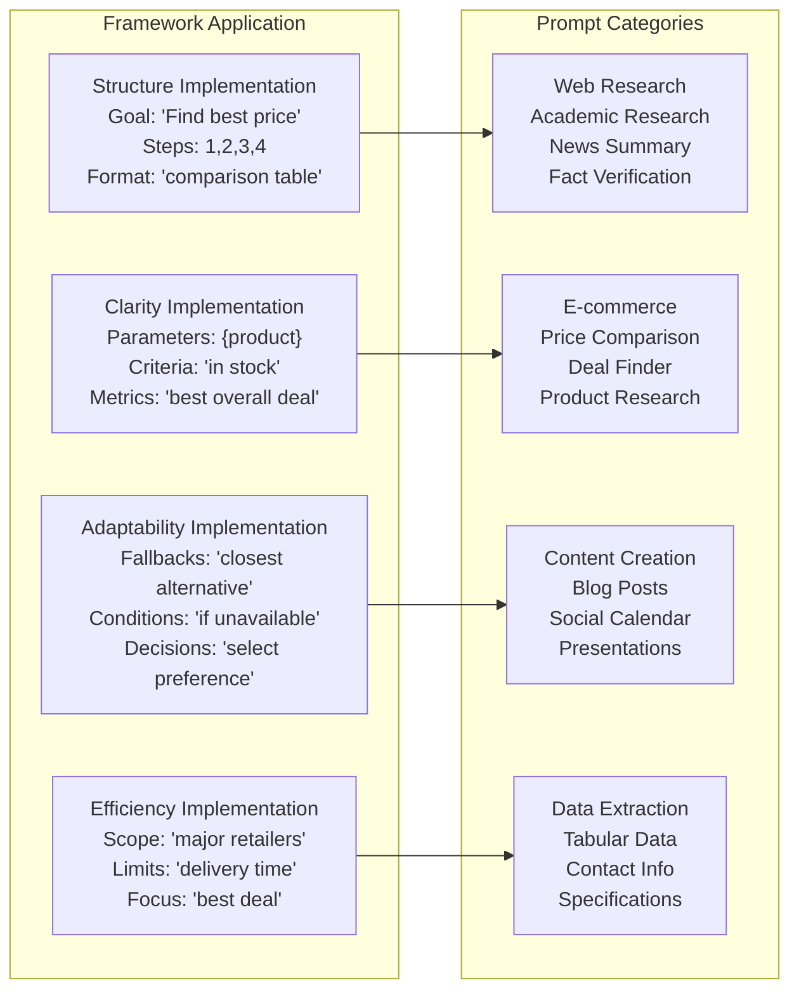
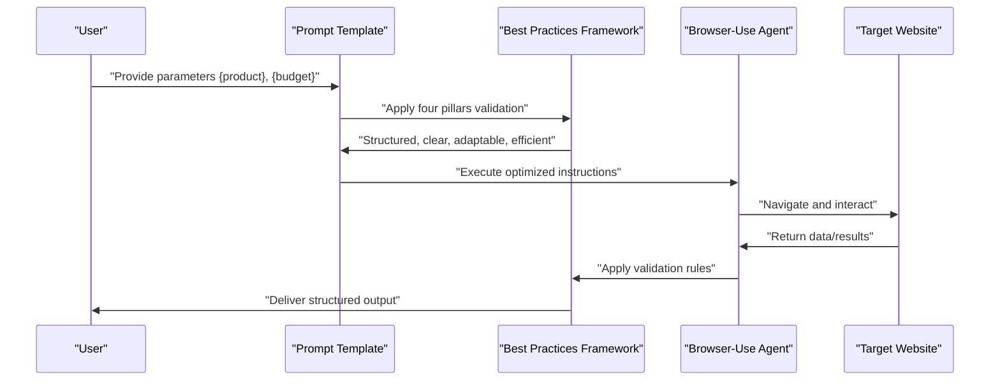

<!-- source: DeepWiki mcp.deepwiki.com · repo browser-use/awesome-prompts · page 3.1 Best Practices Framework · fetched 2026-10-30 -->

# Best Practices Framework

Relevant source files

The following files were used as context for generating this wiki page:

- [README.md](README.md)

## Purpose and Scope

This document defines the comprehensive framework for creating effective Browser-Use prompts, establishing four core pillars that ensure prompt quality, consistency, and performance across the repository. The framework provides systematic guidelines for structuring prompts that maximize Browser-Use agent capabilities while maintaining reliability and user value.

For technical implementation details of prompt formatting and parameter substitution, see [Prompt Structure Guidelines](#3.2). For community contribution standards and quality criteria, see [Quality Standards](#5.2).

## Framework Architecture

The Best Practices Framework operates on four foundational pillars that work synergistically to create optimal Browser-Use prompts:

**Sources:** [README.md:1054-1086]()

## Structure Pillar

The Structure pillar establishes the foundational architecture for prompt construction, ensuring systematic organization and clear execution pathways.

### Core Components

| Component | Implementation | Example Reference |
|-----------|----------------|-------------------|
| **Goal Specification** | Clear statement of desired outcome | [README.md:35-44]() - Comparative Research |
| **Step Breakdown** | Numbered sequential instructions | [README.md:37-43]() - Multi-step navigation |
| **Format Specifications** | Output structure requirements | [README.md:44]() - "structured format" |
| **Context Provision** | Background information and parameters | [README.md:36]() - {industry}, {competitor1} |
| **Constraint Setting** | Limitations and boundaries | [README.md:146]() - "ratings above 4 stars" |

### Implementation Pattern

**Sources:** [README.md:1056-1062](), [README.md:35-44]()

## Clarity Pillar

The Clarity pillar ensures precise communication between prompt authors and Browser-Use agents, minimizing ambiguity and maximizing execution accuracy.

### Precision Mechanisms

#### Parameter Specification
Prompts utilize the `{parameter}` syntax for dynamic content substitution:

- **Target Specification**: `{website}`, `{product}`, `{company_name}`
- **Preference Definition**: `{preference}`, `{budget}`, `{filter_criteria}`
- **Content Variables**: `{topic}`, `{industry}`, `{date_range}`

#### Success Criteria Definition
Clear expectations prevent execution drift:

**Sources:** [README.md:1064-1070](), [README.md:154-157](), [README.md:99-107]()

## Adaptability Pillar

The Adaptability pillar builds resilience into prompts, enabling graceful handling of edge cases and dynamic web environments.

### Resilience Strategies

#### Fallback Options
Prompts include alternative pathways when primary approaches fail:

#### Verification Protocols
Critical information requires validation steps:

- **Cross-reference validation**: "cross-reference with LinkedIn and Google Business profiles"
- **Multi-source verification**: "at least 3 different authoritative sources"
- **Accuracy checking**: "verify customer ratings are above 4 stars"

**Sources:** [README.md:1072-1078](), [README.md:119-122](), [README.md:267]()

## Efficiency Pillar

The Efficiency pillar optimizes resource utilization and maximizes value delivery through strategic task organization and prioritization.

### Optimization Strategies

| Strategy | Implementation | Code Reference |
|----------|----------------|----------------|
| **Task Prioritization** | Importance-based ordering | [README.md:139]() - "Sort by discount percentage" |
| **Resource Limits** | Scope boundaries | [README.md:52]() - "top 5 most cited papers" |
| **Batching Operations** | Similar task grouping | [README.md:137-144]() - Store comparison loop |
| **Value Focus** | High-impact activities | [README.md:146]() - Quality thresholds |

### Efficiency Implementation

**Sources:** [README.md:1080-1086](), [README.md:133-146](), [README.md:52]()

## Implementation Guidelines

### Template Structure Mapping

The framework maps directly to prompt template construction patterns found throughout the repository:

### Quality Assessment Matrix

| Pillar | Assessment Criteria | Validation Method |
|--------|-------------------|-------------------|
| **Structure** | Goal clarity, step sequence, format specification | Template compliance check |
| **Clarity** | Parameter definition, success metrics, terminology | Execution accuracy testing |
| **Adaptability** | Fallback coverage, error handling, decision logic | Edge case simulation |
| **Efficiency** | Priority alignment, resource optimization, value focus | Performance measurement |

**Sources:** [README.md:1054-1086](), [README.md:1090-1105]()

## Integration with Browser-Use Architecture

### Execution Flow Alignment

The framework aligns with Browser-Use agent capabilities to ensure optimal performance:

### Performance Optimization

The framework ensures prompts leverage Browser-Use capabilities effectively:

- **Navigation Efficiency**: Structured steps minimize unnecessary page loads
- **Data Extraction Precision**: Clear specifications reduce parsing errors  
- **Error Recovery**: Adaptability features handle dynamic web content
- **Resource Management**: Efficiency guidelines prevent timeout issues

**Sources:** [README.md:7](), [README.md:11](), [README.md:1054-1086]()

---

