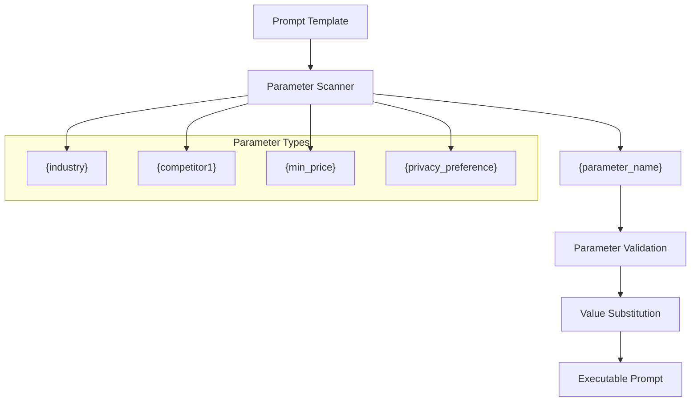
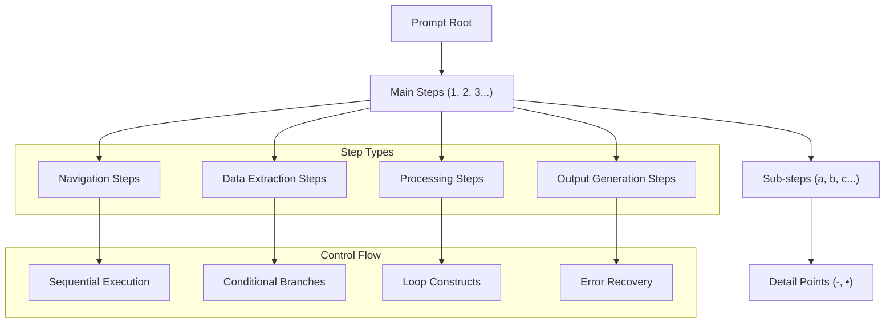
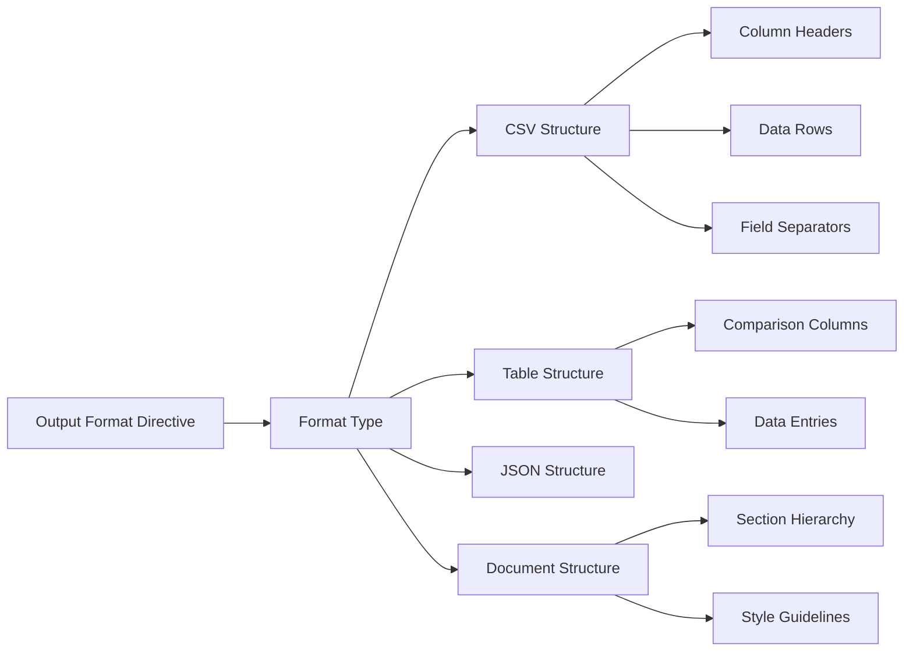
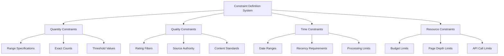
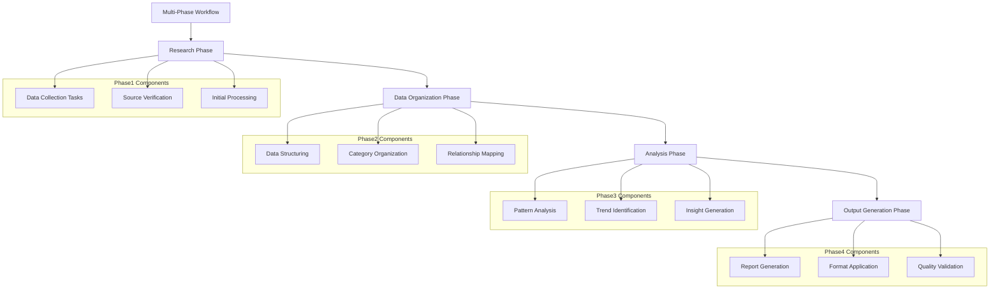

<!-- source: DeepWiki mcp.deepwiki.com · repo browser-use/awesome-prompts · page 3.2 Prompt Structure Guidelines · fetched 2026-10-30 -->

# Prompt Structure Guidelines

<details>
<summary>Relevant source files</summary>

The following files were used as context for generating this wiki page:

- [README.md](README.md)

</details>


This document provides technical guidelines for structuring effective Browser-Use prompts, focusing on syntax, formatting conventions, parameter substitution patterns, and structural elements. For broader prompt engineering principles and best practices philosophy, see [Best Practices Framework](#3.1). For implementation examples of complex multi-phase automations, see [Workflow Architecture](#4.1).

## Purpose and Scope

This guide covers the technical specifications for prompt formatting, including parameter substitution syntax, step organization patterns, output format specifications, and constraint definition methods used throughout the Browser-Use prompt collection system.

## Parameter Substitution Patterns

Browser-Use prompts utilize curly brace notation for dynamic parameter substitution, enabling template reusability across different contexts and use cases.

### Parameter Syntax Structure



**Sources:** [README.md:36-45](), [README.md:98-108](), [README.md:174-185]()

### Common Parameter Categories

| Category | Pattern | Example Usage | Context |
|----------|---------|---------------|---------|
| **Entity Identifiers** | `{company_name}` | Research target specification | [README.md:257-267]() |
| **Indexed Collections** | `{competitor1}`, `{competitor2}` | Multiple related entities | [README.md:36-45]() |
| **Constraint Values** | `{min_price}`, `{max_price}` | Range specifications | [README.md:154-167]() |
| **Configuration Options** | `{privacy_preference}` | Behavioral settings | [README.md:622-631]() |
| **Content Placeholders** | `{bio_text}`, `{experience_details}` | User-provided content | [README.md:642-656]() |

**Sources:** [README.md:36-45](), [README.md:154-167](), [README.md:622-631](), [README.md:642-656]()

## Multi-Step Structure Architecture

Browser-Use prompts employ hierarchical numbering systems to organize complex automation workflows into discrete, executable phases.

### Step Hierarchy Patterns



**Sources:** [README.md:38-44](), [README.md:101-107](), [README.md:245-251]()

### Step Organization Patterns

**Sequential Processing Pattern:**
```
1. Navigate to {website} and locate the search function
2. Extract the top 5 results including:
   - Product name
   - Current price
   - Availability status
3. Compile information into comparison format
```

**Conditional Logic Pattern:**
```
- If the exact item is unavailable, find the closest alternative
- If there are multiple options (size, color, etc.), select {preference}
- If the price is above {budget} for any item, look for alternatives
```

**Sources:** [README.md:119-127](), [README.md:243-251]()

## Output Format Specifications

Structured output directives ensure consistent, parseable results from Browser-Use automation tasks.

### Format Specification Syntax



**Sources:** [README.md:44](), [README.md:107](), [README.md:251]()

### Output Format Categories

| Format Type | Directive Pattern | Implementation Example |
|-------------|------------------|----------------------|
| **Structured Tables** | "Compile into comparison table" | Price comparison grids | 
| **CSV Data** | "Format in CSV-compatible format with headers" | Tabular data extraction |
| **Document Templates** | "Create structured document with sections" | Reports and presentations |
| **List Formats** | "Present as numbered/bulleted list" | Research summaries |

**Sources:** [README.md:107](), [README.md:251](), [README.md:894-904]()

## Constraint Definition Patterns

Constraints establish operational boundaries and success criteria for Browser-Use automation tasks.

### Constraint Categories and Implementation



**Sources:** [README.md:78-91](), [README.md:136-146](), [README.md:154-167]()

### Constraint Specification Syntax

**Quantity Constraints:**
- `"at least 3 different reputable news sources"` - Minimum thresholds
- `"top 5 most cited papers"` - Maximum result sets  
- `"first 3 pages"` - Processing limits

**Quality Constraints:**
- `"customer ratings are above 4 stars"` - Quality filters
- `"published after {date}"` - Temporal restrictions
- `"reputable news sources"` - Authority requirements

**Sources:** [README.md:64-71](), [README.md:136-146](), [README.md:50-58]()

## Multi-Phase Workflow Structure

Complex Browser-Use automations utilize phase-based organization for sophisticated business process automation.

### Workflow Phase Architecture



**Sources:** [README.md:870-904](), [README.md:910-952](), [README.md:957-1008]()

### Phase Transition Patterns

**Sequential Phase Structure:**
```
1. Research Phase:
   - Search for industry reports from sources like Statista, IBISWorld
   - Find recent news articles about {industry} from past 6 months
   - Identify top 5 companies and gather key metrics

2. Data Organization Phase:
   - Create Google Sheet to compile numerical data
   - Organize company profiles with strengths and weaknesses
   - Track market share percentages and changes
```

**Phase Dependencies:**
- Each phase builds upon outputs from previous phases
- Success criteria defined for phase completion
- Fallback options for phase failures

**Sources:** [README.md:873-884](), [README.md:880-890]()

## Error Handling and Fallback Patterns

Robust Browser-Use prompts incorporate error recovery mechanisms and alternative execution paths.

### Fallback Strategy Implementation

| Scenario Type | Detection Pattern | Fallback Action |
|---------------|------------------|-----------------|
| **Content Unavailable** | `"If the exact item is unavailable"` | `"find the closest alternative"` |
| **Access Restrictions** | `"If you find papers behind paywalls"` | `"look for open-access alternatives"` |
| **Parameter Constraints** | `"If the price is above {budget}"` | `"look for more affordable alternative"` |
| **Processing Limits** | `"If pagination exists"` | `"navigate through at least first 3 pages"` |

**Sources:** [README.md:120-122](), [README.md:58](), [README.md:248-249]()

## Validation and Quality Checkpoints

Browser-Use prompts incorporate verification steps to ensure output accuracy and completeness.

### Validation Patterns

**Cross-Reference Validation:**
- `"cross-reference with their LinkedIn and Google Business profiles"`
- `"verify customer ratings are above 4 stars if available"`
- `"compare key figures with last year's return for discrepancies"`

**Completeness Verification:**
- `"Review profile completeness indicators"`
- `"Address any suggestions for improvement"`
- `"Verify all entries for accuracy"`

**Sources:** [README.md:267](), [README.md:146](), [README.md:679-681](), [README.md:652-654]()

---

