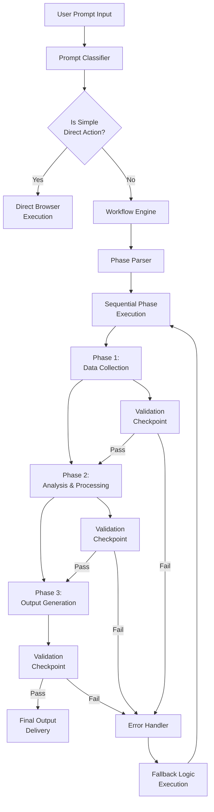
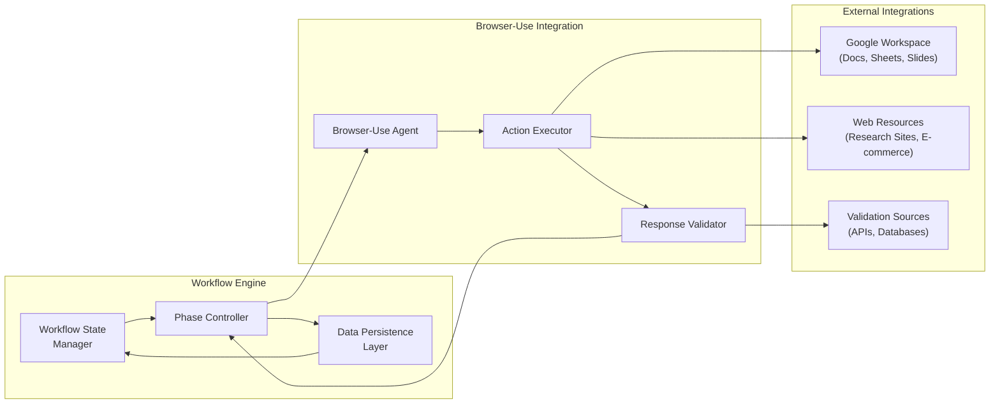
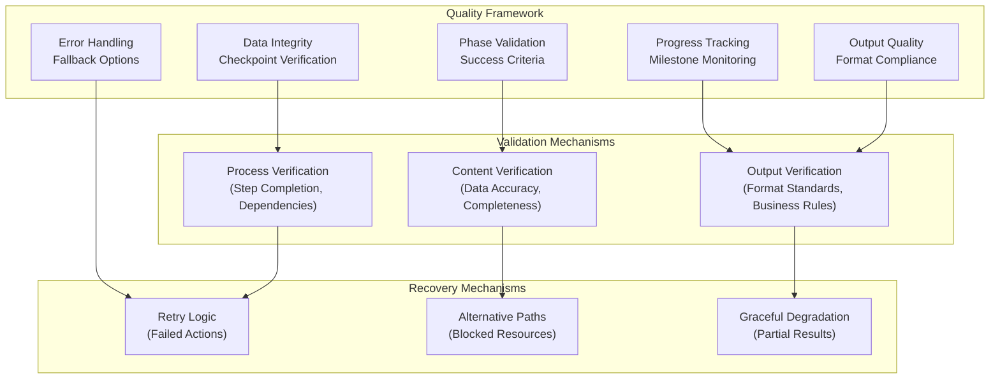

<!-- source: DeepWiki mcp.deepwiki.com · repo browser-use/awesome-prompts · page 4 Multi-Step Workflows · fetched 2026-10-30 -->

# Multi-Step Workflows

Relevant source files

The following files were used as context for generating this wiki page:

- [README.md](README.md)

This document covers the multi-step workflow capability within the Browser-Use Awesome Prompts system, which enables complex automation processes that span multiple phases and decision points. Multi-step workflows orchestrate sequences of browser automation tasks to accomplish sophisticated business processes that would be impractical to execute in a single prompt.

For detailed technical implementation of workflow structures, see [Workflow Architecture](#4.1). For specific examples of complex automation scenarios, see [Complex Process Examples](#4.2). For general prompt engineering principles, see [Prompt Engineering](#3).

## Overview

Multi-step workflows represent the most sophisticated automation capability in the Browser-Use system, designed to handle complex business processes that require multiple phases of execution, data collection, analysis, and output generation. Unlike simple prompts that execute direct browser actions, multi-step workflows implement a structured approach to process automation with built-in checkpoints, error handling, and adaptive decision-making.

## Workflow Execution Model

The Browser-Use system distinguishes between simple prompts and multi-step workflows through a classification engine that analyzes prompt complexity and execution requirements.

### Workflow Classification and Routing

Sources: [README.md:866-1052]()

## Workflow Categories

The system implements four primary categories of multi-step workflows, each designed for specific automation scenarios:

| Category | Purpose | Typical Phases | Duration |
|----------|---------|----------------|----------|
| Research & Analysis | Data gathering and synthesis | Research → Organization → Analysis → Reporting | 2-4 hours |
| Event Management | Complex planning and coordination | Venue Research → Vendor Selection → Budget Allocation → Timeline Creation | 1-3 days |
| System Migration | Technical process automation | Content Audit → Technical Planning → Testing → Launch | 1-2 weeks |
| Campaign Management | Marketing and launch coordination | Market Research → Strategy Development → Content Creation → Execution | 2-4 weeks |

### Workflow Phase Structure

```mermaid
graph TB
    subgraph "Research and Report Generation Workflow"
        R1["Research Phase<br/>(Industry Reports, News, Metrics)"]
        R2["Data Organization Phase<br/>(Google Sheets, Company Profiles)"]  
        R3["Analysis Phase<br/>(Trend Identification, Positioning)"]
        R4["Report Creation Phase<br/>(Google Docs, Formatting)"]
        
        R1 --> R2
        R2 --> R3  
        R3 --> R4
    end
    
    subgraph "Event Planning Workflow"
        E1["Venue Research Phase<br/>(Location Search, Comparison)"]
        E2["Vendor Selection Phase<br/>(Catering, Entertainment, Services)"]
        E3["Budget Allocation Phase<br/>(Spreadsheet Creation, Cost Analysis)"]
        E4["Timeline Creation Phase<br/>(Milestones, Task Assignment)"]
        E5["Communication Plan<br/>(Invitations, RSVP System)"]
        
        E1 --> E2
        E2 --> E3
        E3 --> E4
        E4 --> E5
    end
    
    subgraph "Migration Workflow"  
        M1["Content Audit Phase<br/>(Site Crawl, Asset Inventory)"]
        M2["Technical Planning Phase<br/>(Database Transfer, URL Structure)"]
        M3["Timeline Assignment Phase<br/>(Dependencies, Critical Path)"]
        M4["Testing Plan Development<br/>(QA Checklist, Test Cases)"]
        M5["Launch Strategy<br/>(Rollback Plan, Monitoring)"]
        
        M1 --> M2
        M2 --> M3
        M3 --> M4
        M4 --> M5
    end
```

Sources: [README.md:868-905](), [README.md:907-953](), [README.md:955-1009]()

## Integration with Browser-Use System

Multi-step workflows integrate with the Browser-Use agent system through a structured execution framework that manages phase transitions, data persistence, and error recovery.

### Workflow-to-Browser Integration Architecture

Sources: [README.md:866-1052]()

## Workflow Quality Framework

Multi-step workflows implement a comprehensive quality framework that ensures reliable execution across complex automation scenarios:

### Quality Assurance Components

Sources: [README.md:1054-1087]()

## Parameter Management

Multi-step workflows utilize sophisticated parameter substitution and state management to maintain context across phases:

- **Template Variables**: Using `{parameter}` syntax for dynamic content insertion
- **State Persistence**: Maintaining data continuity between workflow phases  
- **Conditional Logic**: Implementing decision trees based on intermediate results
- **Resource Management**: Coordinating access to shared resources like spreadsheets and documents

## Best Practices Integration

Multi-step workflows implement the four pillars of effective prompt engineering identified in the system's best practices framework:

1. **Structure**: Clear phase definitions with numbered steps and decision points
2. **Clarity**: Specific success criteria and output format specifications for each phase
3. **Adaptability**: Built-in fallback options and alternative execution paths
4. **Efficiency**: Batched operations and prioritized task execution

Sources: [README.md:1054-1087]()

## Workflow Execution Lifecycle

Each multi-step workflow follows a standardized execution lifecycle that ensures consistent behavior and reliable results:

1. **Initialization**: Parameter validation and resource preparation
2. **Phase Execution**: Sequential execution with checkpoint validation
3. **State Management**: Persistent storage of intermediate results
4. **Error Recovery**: Automated fallback and retry mechanisms
5. **Output Generation**: Structured result compilation and delivery
6. **Cleanup**: Resource deallocation and state reset

Multi-step workflows represent the pinnacle of Browser-Use automation capability, enabling sophisticated business process automation that would otherwise require manual coordination of multiple systems and data sources.

---

