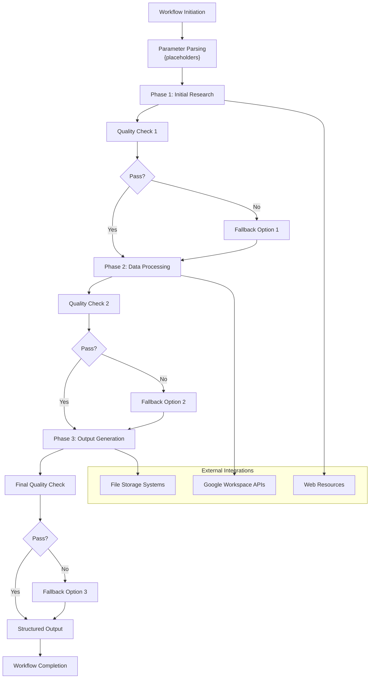
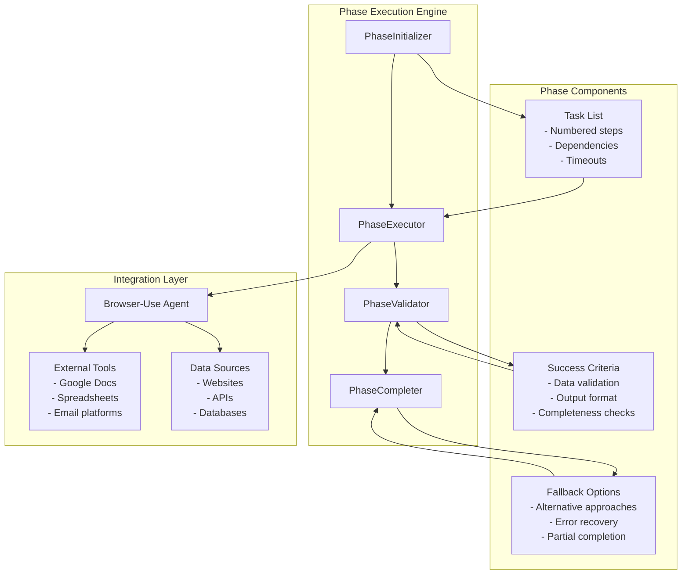
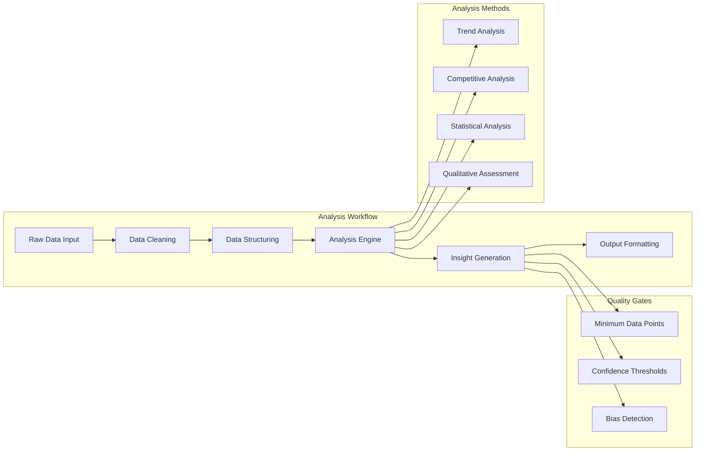
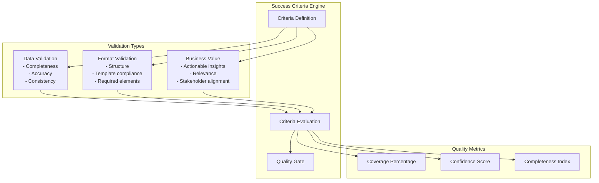
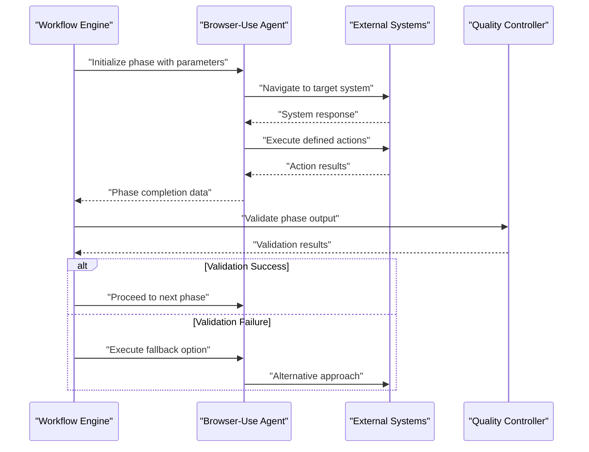
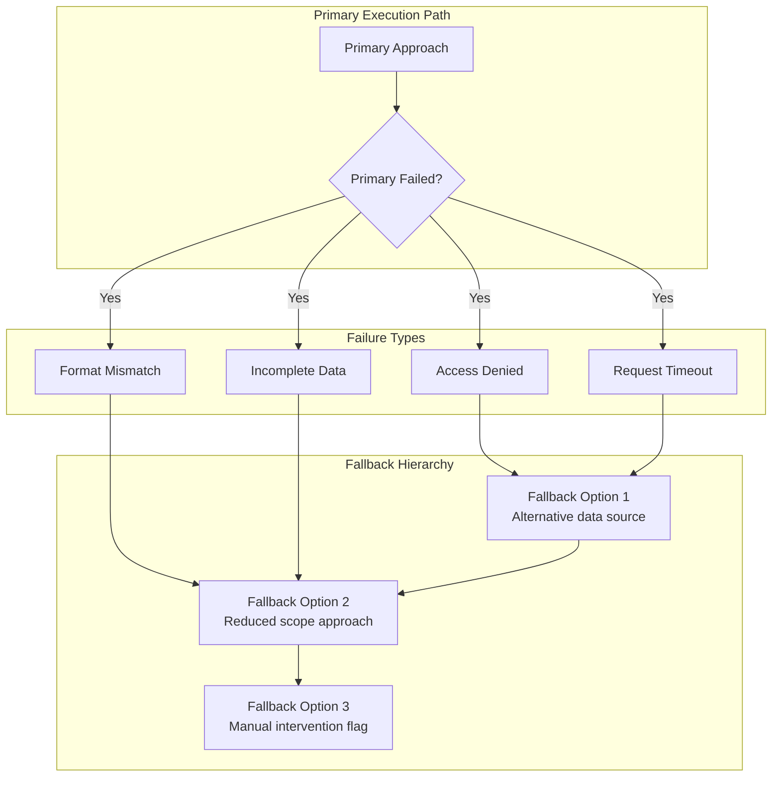

<!-- source: DeepWiki mcp.deepwiki.com · repo browser-use/awesome-prompts · page 4.1 Workflow Architecture · fetched 2026-10-30 -->

# Workflow Architecture

Relevant source files

The following files were used as context for generating this wiki page:

- [README.md](README.md)

## Purpose and Scope

This document provides technical documentation of how multi-step workflows are structured within the Browser-Use Awesome Prompts system. It covers the architectural patterns for phase management, success criteria validation, fallback option handling, and quality checkpoints that enable complex automation processes.

For information about specific workflow examples and use cases, see [Complex Process Examples](#4.2). For general prompt engineering principles, see [Best Practices Framework](#3.1).

## Workflow Architecture Overview

Multi-step workflows in the Browser-Use system follow a structured architecture that breaks complex automation tasks into manageable phases, each with defined inputs, outputs, and validation criteria.

### Core Workflow Structure

**Sources:** [README.md:866-1052]()

### Phase Management Architecture

Each workflow phase follows a consistent structural pattern that enables reliable execution and error recovery:

**Sources:** [README.md:870-904](), [README.md:908-952](), [README.md:956-1008]()

## Phase Management System

### Research Phase Pattern

The research phase implements a systematic data gathering approach with built-in validation and source diversity requirements:

| Component | Implementation | Example |
|-----------|----------------|---------|
| **Data Sources** | Multiple authoritative sources | `Statista, IBISWorld, Gartner` |
| **Search Strategy** | Structured queries with filters | `{industry} trends past 6 months` |
| **Validation** | Cross-reference minimum 3 sources | Source credibility assessment |
| **Output Format** | Structured data collection | Google Sheets with categorized data |

### Analysis Phase Pattern

The analysis phase processes collected data through standardized analytical frameworks:

**Sources:** [README.md:886-892](), [README.md:1016-1022]()

### Output Generation Phase

The final phase implements structured document creation with consistent formatting and quality validation:

| Element | Specification | Quality Criteria |
|---------|---------------|------------------|
| **Document Structure** | Professional templates with sections | Executive summary, methodology, references |
| **Data Integration** | Charts, tables, supporting evidence | Proper citations, visual clarity |
| **Format Consistency** | Standardized styling | Headers, fonts, spacing consistency |
| **Length Requirements** | Specified page counts | 10-15 pages for comprehensive reports |

## Quality Control Framework

### Success Criteria Implementation

Each workflow phase implements specific success criteria that must be met before progression:

**Sources:** [README.md:894-904](), [README.md:942-952]()

### Quality Checkpoints

Quality checkpoints are implemented at specific workflow junctions to ensure output integrity:

| Checkpoint Type | Validation Method | Failure Response |
|----------------|-------------------|------------------|
| **Data Integrity** | Cross-source verification | Request additional sources |
| **Format Compliance** | Template matching | Auto-format correction |
| **Completeness** | Required element check | Flag missing components |
| **Business Value** | Stakeholder criteria | Suggest improvements |

## Integration Patterns

### Browser-Use Agent Integration

Workflows integrate with Browser-Use agents through standardized interaction patterns:

**Sources:** [README.md:871-878](), [README.md:914-921]()

### External Tool Integration

Workflows integrate with productivity tools through standardized APIs and interfaces:

| Integration Type | Tools | Implementation Pattern |
|------------------|-------|----------------------|
| **Document Creation** | Google Docs, Sheets | Template instantiation, content population |
| **Data Storage** | Google Drive, Dropbox | Structured folder creation, file organization |
| **Communication** | Email platforms | Template-based messaging, recipient management |
| **Scheduling** | Calendar systems | Event creation, reminder setup |

## Error Handling and Fallbacks

### Fallback Option Architecture

Each workflow phase implements multiple fallback strategies to handle various failure scenarios:

**Sources:** [README.md:1002-1008](), [README.md:1044-1051]()

### Error Recovery Patterns

| Error Type | Detection Method | Recovery Strategy |
|------------|------------------|-------------------|
| **Data Source Unavailable** | HTTP status codes, timeouts | Switch to alternative sources |
| **Format Incompatibility** | Schema validation failures | Apply format transformation |
| **Incomplete Results** | Completeness threshold checks | Extend search parameters |
| **Quality Threshold Unmet** | Confidence score evaluation | Request human review |

**Sources:** [README.md:1074-1078](), [README.md:1054-1087]()

---

