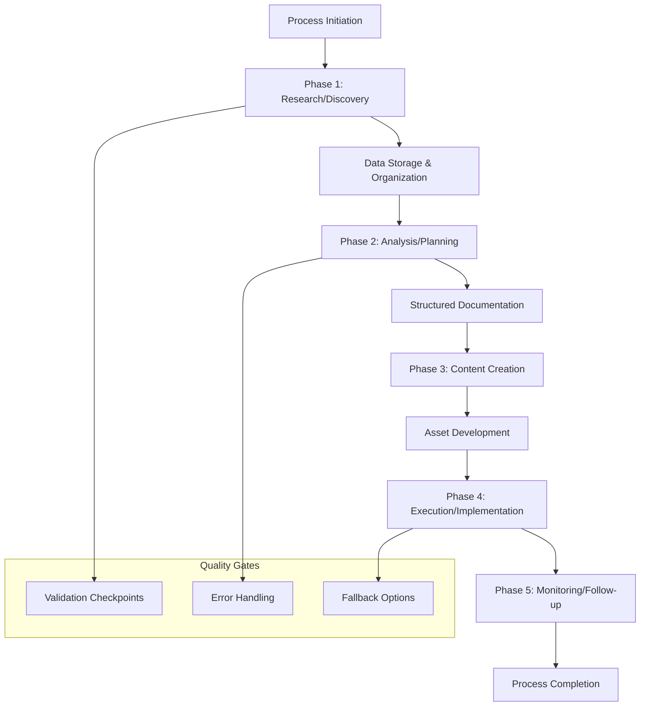
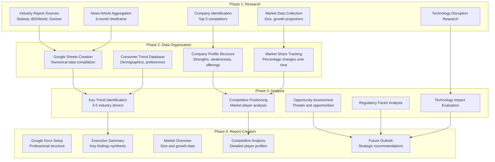
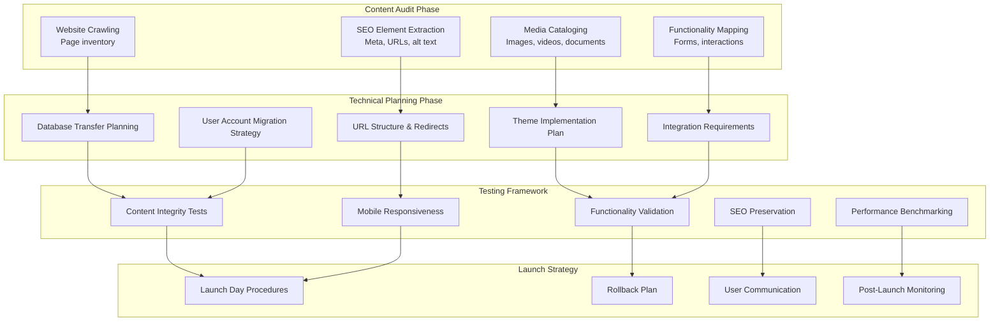
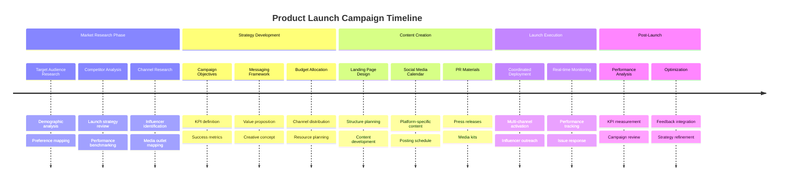
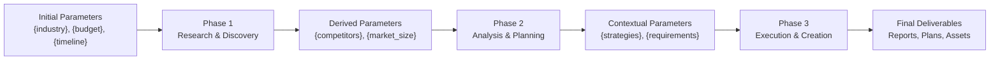

<!-- source: DeepWiki mcp.deepwiki.com · repo browser-use/awesome-prompts · page 4.2 Complex Process Examples · fetched 2026-10-30 -->

# Complex Process Examples

Relevant source files

The following files were used as context for generating this wiki page:

- [README.md](README.md)

This document provides detailed examples of sophisticated multi-step workflows that demonstrate the full capabilities of Browser-Use automation for complex business processes. These examples show how multiple prompts and phases can be orchestrated to accomplish comprehensive tasks that would typically require significant manual coordination and multiple software tools.

For information about the underlying workflow architecture and technical implementation, see [Workflow Architecture](#4.1). For general prompt structure guidelines, see [Prompt Structure Guidelines](#3.2).

## Overview of Complex Process Characteristics

Complex process examples in the Browser-Use ecosystem differ from simple prompts by incorporating multiple interconnected phases, extensive external tool integration, and sophisticated decision-making logic. These workflows typically span multiple applications, require intermediate data storage and processing, and include built-in quality assurance and error handling mechanisms.

### Multi-Phase Execution Model

Sources: [README.md:866-1052]()

## Research and Report Generation Workflow

The research and report generation workflow demonstrates a comprehensive 4-phase process for creating market intelligence reports. This example showcases data aggregation from multiple sources, structured analysis, and professional document creation.

### Phase Structure Analysis

Sources: [README.md:870-905]()

The workflow includes specific parameter substitution points for `{industry}`, document targeting 10-15 pages with executive stakeholder focus, and integration with multiple external data sources and Google Workspace applications.

## Event Planning Workflow

The event planning workflow exemplifies complex resource coordination and budget management across multiple vendor relationships. This 5-phase process demonstrates parallel task execution and constraint-based decision making.

### Resource Coordination Matrix

| Phase | Primary Tools | Decision Criteria | Output Deliverables |
|-------|--------------|-------------------|-------------------|
| Venue Research | Comparison spreadsheets | Capacity, cost, amenities, reviews | Venue options matrix |
| Vendor Selection | Quote management | Price, availability, quality ratings | Vendor recommendation grid |
| Budget Allocation | Budget spreadsheets | Cost categories, contingency planning | Detailed budget breakdown |
| Timeline Creation | Project management | Dependencies, milestones | Planning timeline, day-of schedule |
| Communication Plan | RSVP tracking | Attendance management | Invitation templates, tracking system |

The workflow incorporates parameters for `{event_type}`, `{number_of_attendees}`, `{date}`, `{budget}`, `{location}`, `{food_preferences}`, and `{entertainment_preferences}`, demonstrating sophisticated parameter passing between phases.

Sources: [README.md:907-953]()

## Website Migration Workflow

The website migration workflow represents the most technically complex example, involving content auditing, technical architecture planning, and risk management protocols. This process showcases the integration of web crawling, database management, and deployment strategies.

### Technical Integration Flow

Sources: [README.md:956-1009]()

The migration workflow includes parameters for `{website}`, `{current_platform}`, and `{new_platform}`, with detailed technical requirements documentation and comprehensive testing protocols.

## Product Launch Campaign Workflow

The product launch campaign demonstrates sophisticated marketing coordination across multiple channels with real-time performance monitoring and feedback loops. This workflow integrates market research, content creation, and multi-channel execution.

### Campaign Execution Architecture

Sources: [README.md:1012-1052]()

The campaign workflow utilizes parameters for `{product_name}` and `{target_audience}`, with integrated analytics tracking and rapid response mechanisms for campaign optimization.

## Common Architectural Patterns

### Parameter Propagation System

Complex workflows utilize a cascading parameter system where initial inputs are propagated through multiple phases:

Sources: [README.md:870-1052]()

### Quality Assurance Integration

Each complex workflow incorporates multiple quality checkpoints, error handling mechanisms, and fallback strategies to ensure reliable execution across diverse web environments and external service dependencies.

### External Tool Integration

The workflows demonstrate extensive integration with productivity platforms including Google Workspace (Docs, Sheets, Slides), project management systems, and various web-based services, showcasing the Browser-Use agent's capability to orchestrate complex multi-application processes.

Sources: [README.md:866-1052]()

---

