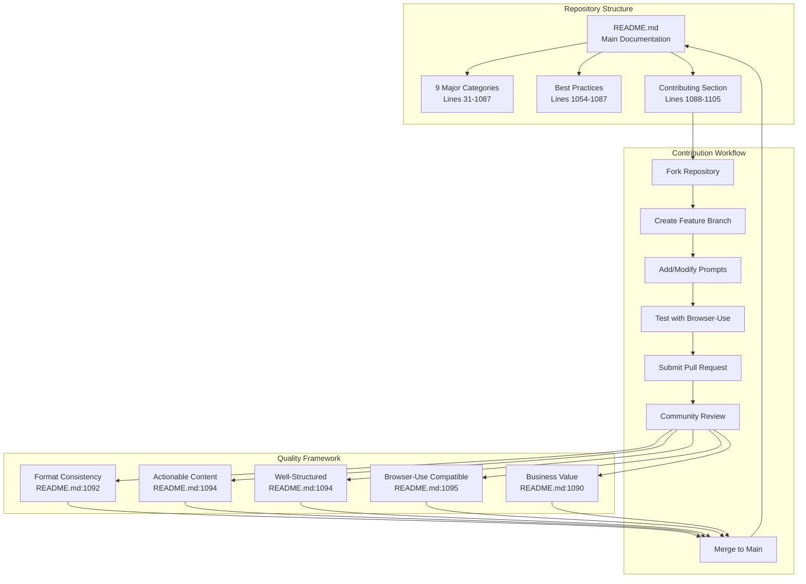
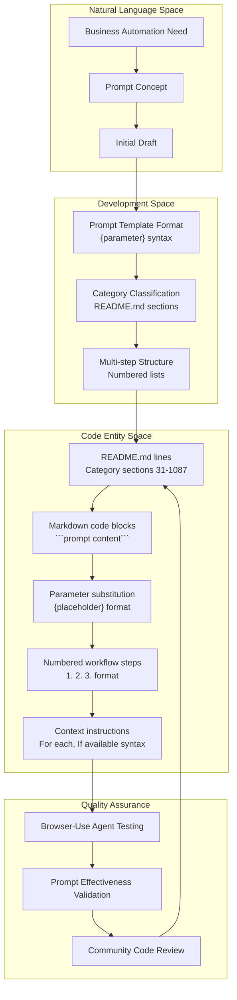
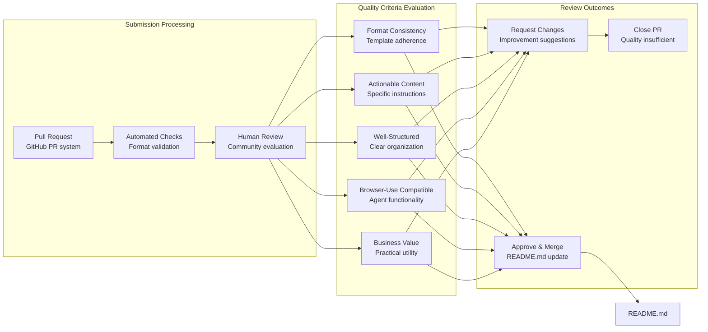

<!-- source: DeepWiki mcp.deepwiki.com · repo browser-use/awesome-prompts · page 5 Community and Contribution · fetched 2026-10-30 -->

# Community and Contribution

Relevant source files

The following files were used as context for generating this wiki page:

- [README.md](README.md)

This document provides an overview of the open-source community model for the Browser-Use Awesome Prompts repository and the contribution process for expanding the prompt collection. It covers the GitHub-based collaboration framework, community resources, and quality standards that ensure prompt effectiveness and consistency.

For detailed step-by-step contribution procedures, see [Contribution Guidelines](#5.1). For specific quality criteria and evaluation standards, see [Quality Standards](#5.2). For information about available community support channels, see [Community Resources](#5.3).

## Community Model

The Browser-Use Awesome Prompts repository operates as an open-source community project hosted on GitHub, designed to systematically expand and improve the collection of browser automation prompts. The community follows a collaborative model where contributors from diverse backgrounds can submit, review, and refine prompts that provide business value for Browser-Use agents.

The community structure centers around three core pillars: **contribution accessibility**, **quality assurance**, and **collaborative improvement**. Contributors range from individual developers testing automation workflows to enterprise teams sharing complex multi-step processes that have proven effective in production environments.

### Repository Structure and Organization

The repository maintains a structured approach to prompt organization, with nine major categories defined in the main [README.md:15-30]() table of contents. Each category represents a distinct automation domain, from web research and e-commerce to testing and QA workflows.

**Sources:** [README.md:15-30](), [README.md:1088-1105]()

## Contribution Process

### GitHub-Based Collaboration Framework

The contribution process follows standard open-source practices built around GitHub's pull request workflow. Contributors begin by forking the repository, creating feature branches for their additions, and submitting pull requests for community review.

The process emphasizes **testing and validation** before submission. Contributors must verify that their prompts work effectively with Browser-Use agents, ensuring that submitted content provides practical automation value rather than theoretical concepts.

### Prompt Development Workflow

**Community Contribution to Code Entity Mapping**

**Sources:** [README.md:1088-1105](), [README.md:31-1087]()

### Quality Standards Framework

The repository maintains five core quality criteria that all contributions must meet. These standards ensure consistency, effectiveness, and practical utility across the prompt collection.

**Quality Evaluation Process**

**Sources:** [README.md:1090-1096]()

## Community Resources

The community provides multiple support channels and resources to facilitate effective contribution and prompt development. These resources serve both new contributors learning the system and experienced developers refining complex automation workflows.

| Resource Type | Platform | Purpose | Reference |
|---------------|----------|---------|-----------|
| Discussion & Support | Discord Community | Real-time collaboration, troubleshooting | [README.md:9]() |
| Testing Environment | Cloud Platform | Prompt validation, experimentation | [README.md:11]() |  
| Documentation | GitHub Wiki | Detailed guides, best practices | Repository structure |
| Code Repository | GitHub | Version control, collaboration | Main repository |

### Integration with Browser-Use Ecosystem

The community resources integrate directly with the broader Browser-Use ecosystem, providing seamless access to testing and validation tools. The cloud platform referenced in [README.md:11]() enables contributors to test prompts without local Browser-Use setup requirements, reducing barriers to contribution.

The Discord community serves as the primary channel for real-time support, where contributors can discuss prompt engineering techniques, share automation challenges, and collaborate on complex multi-step workflows before formal submission through the GitHub process.

### Contributor Recognition

The repository acknowledges community contributions through commit attribution and specific recognition in the main documentation. Initial collection contributors like `@metehan777` are explicitly credited in [README.md:13](), establishing a pattern of community appreciation that encourages ongoing participation.

**Sources:** [README.md:9-13](), [README.md:1088-1105]()

---

