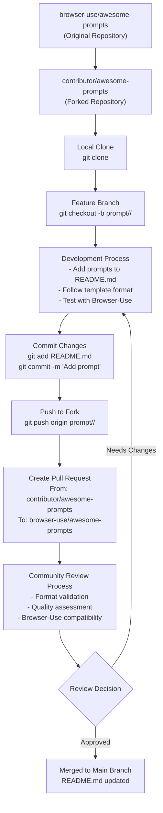
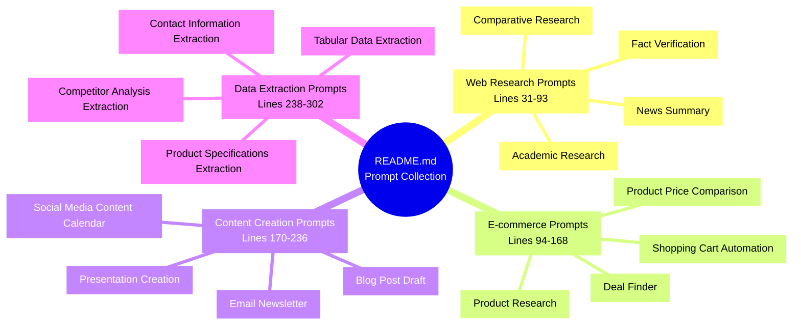
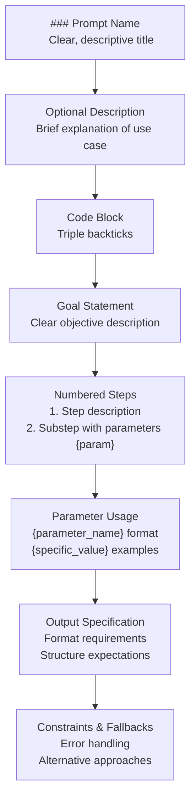
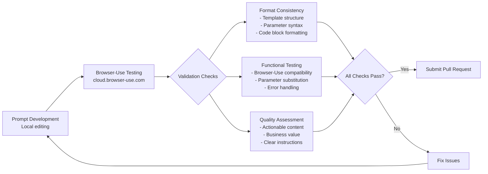
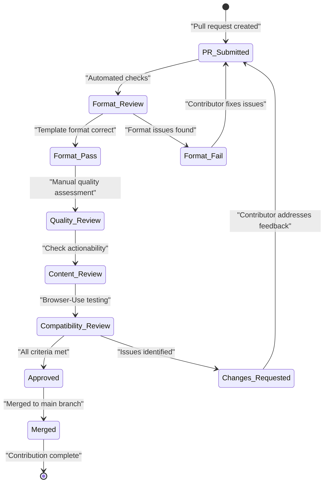

<!-- source: DeepWiki mcp.deepwiki.com · repo browser-use/awesome-prompts · page 5.1 Contribution Guidelines · fetched 2026-10-30 -->

# Contribution Guidelines

<details>
<summary>Relevant source files</summary>

The following files were used as context for generating this wiki page:

- [README.md](README.md)

</details>


This document provides a comprehensive step-by-step guide for contributing new prompts to the Browser-Use Awesome Prompts repository. It covers the technical workflow from repository forking through pull request submission, including branch management, testing requirements, and documentation standards.

For information about the quality criteria that submissions must meet, see [Quality Standards](#5.2). For details about community support resources during the contribution process, see [Community Resources](#5.3).

## Contribution Workflow Overview

The contribution process follows a standard open-source workflow with specific requirements for prompt testing and quality validation.

### Repository Fork and Branch Management Process



Sources: [README.md:1098-1104]()

### Contribution Categories and Structure

The repository organizes prompts into nine major categories within the main `README.md` file. Contributors must place new prompts in appropriate existing categories or propose new categories with sufficient examples.



Sources: [README.md:15-29](), [README.md:31-302]()

## Technical Requirements

### Repository File Structure

All prompts are consolidated in a single `README.md` file with a specific organizational structure that contributors must follow.

| Component | Location | Format Requirements |
|-----------|----------|-------------------|
| Table of Contents | [README.md:15-29]() | Numbered list with anchor links |
| Category Headers | Throughout file | `## Category Name Prompts` |
| Prompt Headers | Within categories | `### Specific Prompt Name` |
| Prompt Content | Below headers | Code block with template format |
| Parameters | Within prompts | `{parameter_name}` curly brace syntax |

Sources: [README.md:15-29](), [README.md:31-1105]()

### Prompt Template Format

Each prompt must follow the established template structure with specific formatting requirements:



Sources: [README.md:35-91](), [README.md:1090-1096]()

### Testing and Validation Requirements

Before submitting contributions, prompts must be tested with the Browser-Use system to ensure functionality and compatibility.



Sources: [README.md:1094](), [README.md:11]()

## Submission Process

### Branch Naming Convention

Contributors should use descriptive branch names that follow the pattern:
- `prompt/<category>/<prompt-name>`
- Example: `prompt/web-research/competitive-analysis`
- Example: `prompt/ecommerce/price-tracker`

### Pull Request Requirements

Pull requests must include specific information to facilitate review:

| Requirement | Description | Example |
|------------|-------------|---------|
| Clear Title | Descriptive PR title | "Add LinkedIn automation prompt to Social Media category" |
| Category | Specify target category | Web Research, E-commerce, etc. |
| Description | Explain prompt purpose | "Automates LinkedIn profile optimization for job seekers" |
| Testing Evidence | Proof of Browser-Use testing | Screenshot or test results |
| Documentation | Any additional context | Use cases, limitations, alternatives |

Sources: [README.md:1104]()

### Review and Approval Process

The community review process evaluates submissions against established criteria before merging to the main branch.



Sources: [README.md:1090-1096]()

## Documentation Standards

### Parameter Documentation

All prompts must clearly document parameters using the established curly brace syntax and provide context for their usage.

### Example Documentation Pattern

```
Research {topic} and compare solutions from {source1}, {source2}, and {source3}.

Parameters:
- {topic}: Subject area for research
- {source1}, {source2}, {source3}: Specific websites or platforms to search
```

### Output Format Specifications

Prompts should specify expected output formats to ensure consistent results across different Browser-Use implementations.

Sources: [README.md:35-45](), [README.md:1058-1086]()

---

