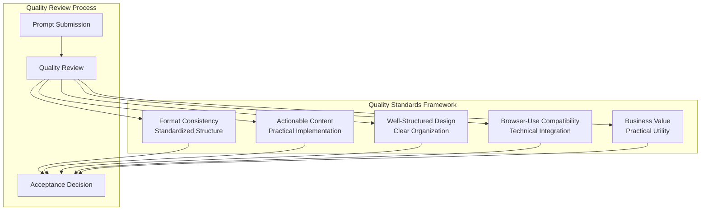
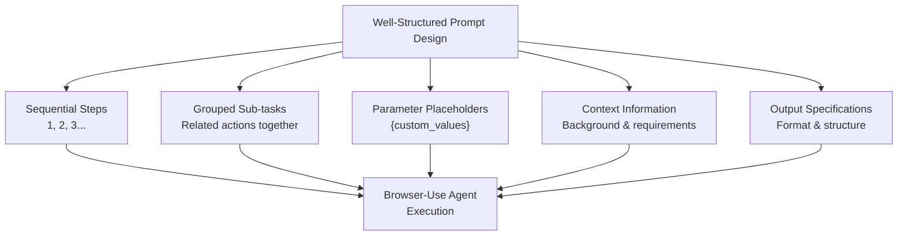
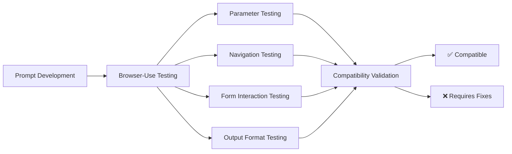
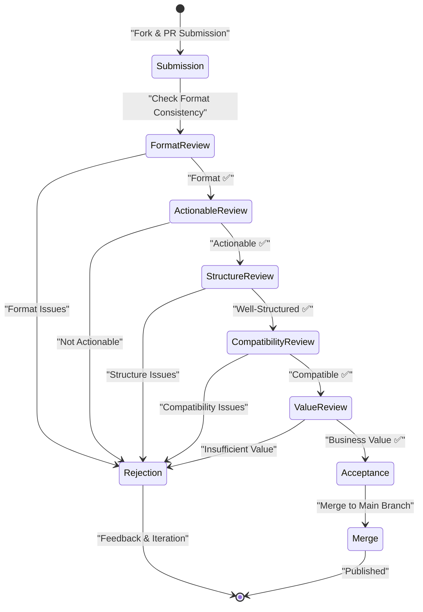

<!-- source: DeepWiki mcp.deepwiki.com · repo browser-use/awesome-prompts · page 5.2 Quality Standards · fetched 2026-10-30 -->

# Quality Standards

<details>
<summary>Relevant source files</summary>

The following files were used as context for generating this wiki page:

- [README.md](README.md)

</details>


## Purpose and Scope

This document defines the quality criteria and standards used to evaluate prompt submissions to the Browser-Use awesome prompts repository. It establishes the five core quality pillars that ensure all accepted prompts provide consistent value to the Browser-Use community while maintaining technical compatibility and usability standards.

For information about the contribution process workflow, see [Contribution Guidelines](#5.1). For details about available community support during prompt development, see [Community Resources](#5.3).

## Quality Framework Overview

The quality standards framework consists of five essential criteria that all prompt submissions must meet for acceptance into the repository. These standards ensure that prompts are not only technically functional but also provide genuine business value to users.



**Quality Framework Architecture**

Sources: [README.md:1088-1105]()

## Core Quality Criteria

### Format Consistency

All prompts must adhere to the established template format to ensure uniformity across the repository. This includes standardized structure, parameter notation, and output specifications.

**Requirements:**
- Use consistent markdown formatting with triple backticks for prompt blocks
- Follow established parameter substitution syntax with curly braces `{parameter}`
- Include clear step-by-step instructions using numbered lists
- Maintain consistent indentation and spacing patterns
- Use standardized section headers and organization

**Template Structure:**
```
### Prompt Name

```
Brief description of what the prompt accomplishes.

1. Primary action step
2. Secondary processing with parameters
   - Sub-requirements using {parameter1}
   - Additional specifications for {parameter2}
3. Output formatting instructions

Final instructions for completion and verification.
```
```

Sources: [README.md:1091]()

### Actionable Content

Prompts must provide specific, executable instructions that Browser-Use agents can interpret and act upon effectively. Vague or abstract guidance that cannot be translated into concrete browser actions will not be accepted.

**Requirements:**
- Specify exact websites, URLs, or platform names where applicable
- Include precise navigation instructions and element identification
- Define clear success criteria and expected outcomes  
- Provide specific data extraction or interaction requirements
- Include error handling and fallback scenarios

**Example of Actionable vs Non-Actionable:**
- ✅ Actionable: `Navigate to Amazon.com and search for "wireless headphones"`
- ❌ Non-Actionable: `Find some headphones online`

Sources: [README.md:1093]()

### Well-Structured Design

Prompts must demonstrate logical organization, clear flow, and proper breakdown of complex tasks into manageable steps. This ensures Browser-Use agents can execute them reliably and users can understand the process.

**Requirements:**
- Break complex workflows into numbered sequential steps
- Group related sub-tasks under appropriate main sections
- Include parameter placeholders for customization
- Provide context and background information where necessary
- Structure output requirements and format specifications clearly



**Prompt Structure Translation to Browser-Use Actions**

Sources: [README.md:1093]()

### Browser-Use Compatibility

All prompts must be technically compatible with Browser-Use agents and demonstrate successful execution during testing. This ensures that accepted prompts will function reliably in the Browser-Use environment.

**Compatibility Requirements:**
- Test prompts using Browser-Use before submission
- Verify navigation commands work across target websites
- Ensure parameter substitution functions correctly
- Validate form filling and data extraction capabilities
- Confirm multi-step workflows execute in sequence

**Testing Protocol:**
1. Execute prompt in Browser-Use development environment
2. Test with various parameter combinations
3. Verify successful completion of all steps
4. Document any platform-specific limitations or requirements
5. Confirm output format matches specifications



**Browser-Use Compatibility Testing Flow**

Sources: [README.md:1094-1095]()

### Business Value

Prompts must provide practical utility and solve real-world automation challenges. Academic exercises or prompts without clear business applications will not be accepted.

**Value Assessment Criteria:**
- Addresses common automation needs in business or personal workflows
- Saves significant time compared to manual execution
- Reduces human error in repetitive tasks
- Enables complex multi-step processes that would be difficult manually
- Provides measurable productivity improvements

**Business Value Categories:**

| Category | Examples | Value Proposition |
|----------|----------|-------------------|
| **Productivity** | Calendar management, email processing | Time savings, organization |
| **Research** | Market analysis, competitor research | Data gathering, insights |
| **E-commerce** | Price comparison, product research | Cost savings, informed decisions |
| **Content** | Blog creation, social media management | Content generation, engagement |
| **Data** | Web scraping, contact extraction | Information consolidation |

Sources: [README.md:7](), [README.md:1095]()

## Quality Review Process

The quality review process ensures that all submitted prompts meet the established standards before acceptance into the repository.



**Quality Review State Machine**

### Review Checklist

Reviewers use the following checklist to evaluate submissions:

**Format Consistency:**
- [ ] Uses established markdown template structure
- [ ] Includes proper parameter substitution syntax `{parameter}`
- [ ] Contains numbered step instructions
- [ ] Maintains consistent formatting throughout

**Actionable Content:**
- [ ] Specifies exact websites/platforms
- [ ] Includes precise navigation instructions
- [ ] Defines clear success criteria
- [ ] Provides error handling guidance

**Well-Structured Design:**
- [ ] Breaks complex tasks into logical steps
- [ ] Groups related sub-tasks appropriately
- [ ] Includes necessary context information
- [ ] Specifies output format requirements

**Browser-Use Compatibility:**
- [ ] Successfully tested in Browser-Use environment
- [ ] Parameter substitution functions correctly
- [ ] Navigation commands work on target websites
- [ ] Multi-step workflows execute properly

**Business Value:**
- [ ] Addresses real automation needs
- [ ] Provides measurable time/effort savings
- [ ] Solves practical business problems
- [ ] Demonstrates clear utility

Sources: [README.md:1088-1105]()

## Implementation Guidelines

### For Contributors

When developing prompts that meet quality standards:

1. **Start with the template**: Use existing high-quality prompts as structural references
2. **Test thoroughly**: Verify Browser-Use compatibility before submission
3. **Document parameters**: Clearly explain all customizable elements
4. **Provide context**: Include sufficient background for effective execution
5. **Verify value**: Ensure the prompt solves genuine automation challenges

### For Reviewers

Quality review focus areas:

1. **Technical validation**: Confirm Browser-Use execution success
2. **Structural assessment**: Evaluate logical flow and organization
3. **Value verification**: Assess practical utility and business relevance
4. **Consistency check**: Ensure adherence to formatting standards
5. **Completeness review**: Verify all required elements are present

### Quality Metrics

The repository maintains quality through measurable standards:

| Metric | Target | Measurement |
|--------|---------|-------------|
| **Browser-Use Success Rate** | >95% | Automated testing execution |
| **Parameter Substitution** | 100% | Template validation |
| **Format Compliance** | 100% | Style guide adherence |
| **Community Value Rating** | >4.0/5 | User feedback scoring |

Sources: [README.md:1096-1105]()

## Continuous Quality Improvement

The quality standards evolve based on community feedback and Browser-Use platform updates. Regular reviews ensure standards remain relevant and effective for maintaining repository quality while enabling innovation in prompt engineering approaches.

Quality standard updates follow the same review process as prompt submissions, ensuring community input and consensus on changes that affect the entire ecosystem.

Sources: [README.md:1088-1105]()

---

