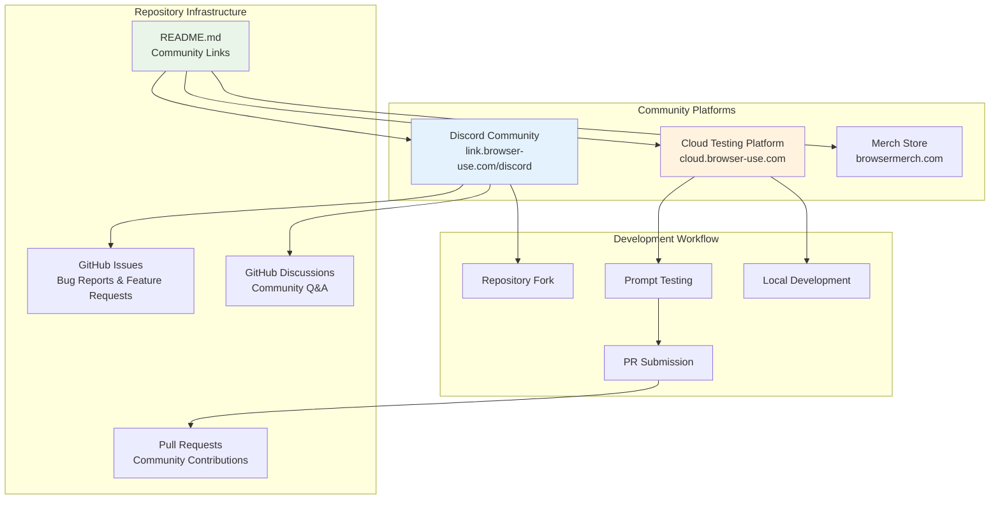
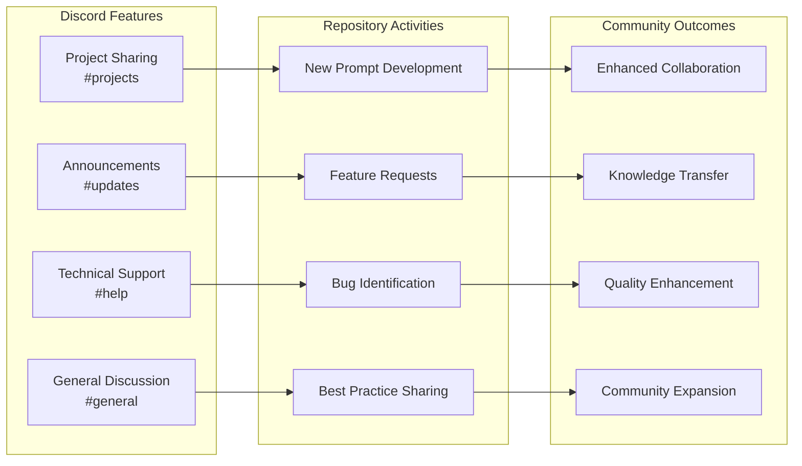
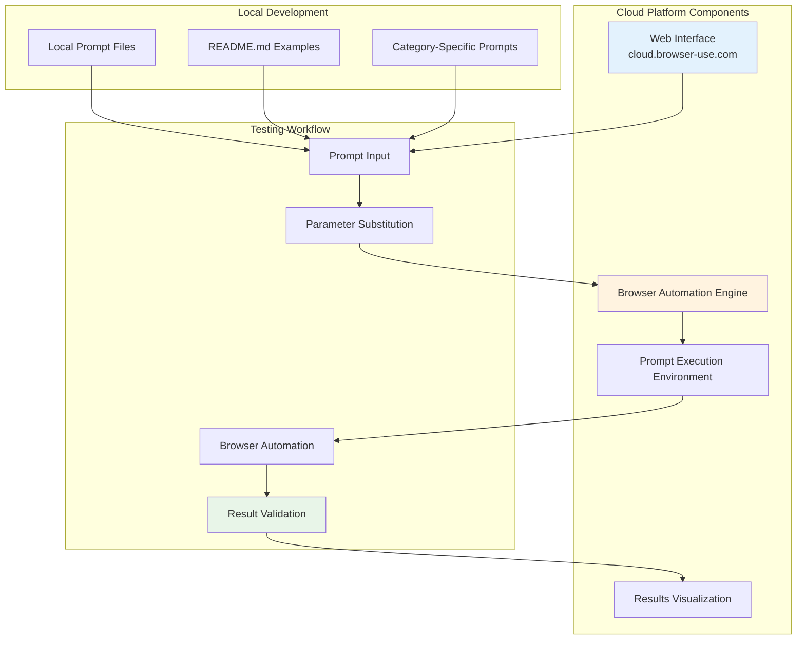
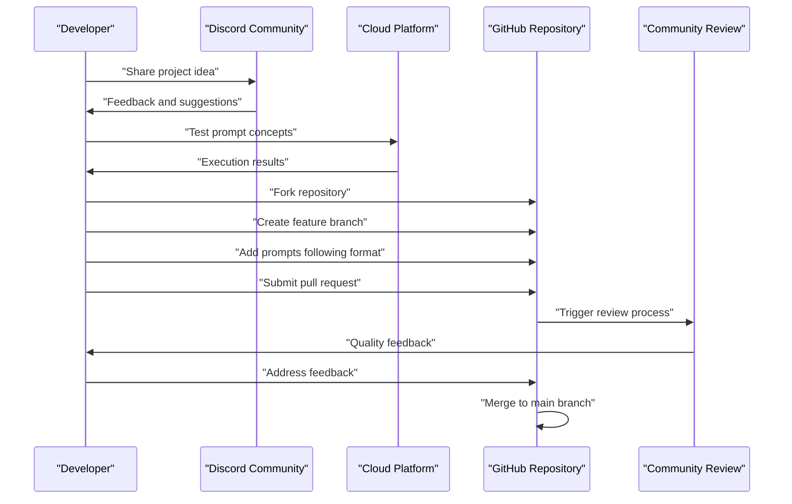
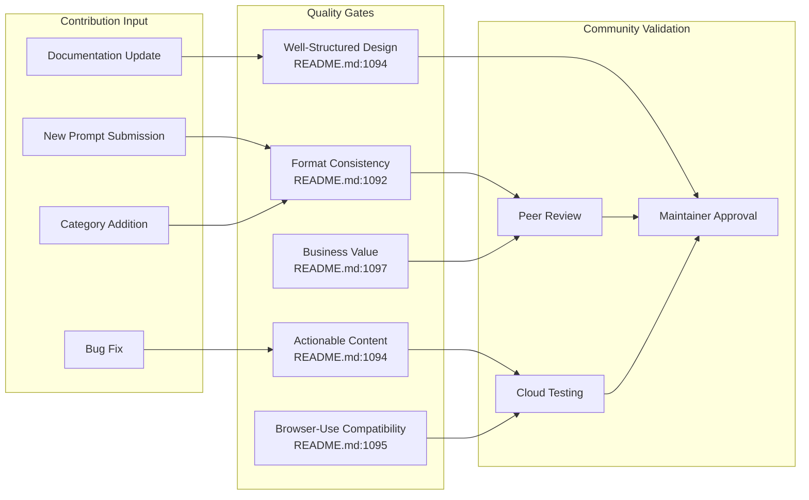

<!-- source: DeepWiki mcp.deepwiki.com · repo browser-use/awesome-prompts · page 5.3 Community Resources · fetched 2026-10-30 -->

# Community Resources

Relevant source files

The following files were used as context for generating this wiki page:

- [README.md](README.md)

This document provides a comprehensive guide to the community support infrastructure available for Browser-Use prompt developers. It covers the technical channels, testing platforms, and contribution mechanisms that enable collaborative development of effective browser automation prompts.

For information about the contribution process itself, see [Contribution Guidelines](#5.1). For quality standards and acceptance criteria, see [Quality Standards](#5.2).

## Community Support Infrastructure

The Browser-Use awesome-prompts repository leverages multiple community platforms to provide comprehensive support for prompt developers and users.

### Community Support Architecture

Sources: [README.md:9-11]()

### Discord Community Platform

The Discord community serves as the primary real-time communication channel for Browser-Use prompt developers. The platform facilitates project sharing, technical discussions, and collaborative problem-solving.

#### Discord Integration Points

Sources: [README.md:9]()

### Cloud Testing Platform

The cloud testing platform at `cloud.browser-use.com` provides a browser-based environment for testing prompts without requiring local Browser-Use installation.

#### Cloud Platform Architecture

Sources: [README.md:11]()

## Community Resource Integration

### Repository-Community Bridge

The following table shows how community resources map to repository components:

| Community Resource | Repository Component | Technical Integration |
|-------------------|---------------------|---------------------|
| Discord Community | `README.md` links | Direct hyperlink reference |
| Cloud Testing | Prompt examples | Real-time execution validation |
| GitHub Issues | Bug tracking | Automated issue templates |
| Pull Requests | Contribution workflow | Branch-based development |
| GitHub Discussions | Q&A platform | Repository-integrated forums |

### Prompt Development Lifecycle

Sources: [README.md:1098-1104]()

## Available Support Channels

### Technical Support Matrix

| Support Type | Primary Channel | Response Time | Technical Focus |
|-------------|----------------|---------------|-----------------|
| Prompt Development | Discord `#help` | Real-time | Syntax, structure, best practices |
| Bug Reports | GitHub Issues | 1-3 days | Repository functionality, prompt errors |
| Feature Requests | GitHub Discussions | 1-7 days | New categories, workflow improvements |
| Community Projects | Discord `#projects` | Real-time | Collaboration, showcasing |
| Cloud Platform Issues | Discord `#cloud-support` | Real-time | Testing environment problems |

### Contribution Support Infrastructure

The repository provides structured support for community contributions through multiple mechanisms:

#### Quality Assurance Framework

Sources: [README.md:1092-1097]()

## Community Engagement Workflows

### Project Sharing Protocol

The Discord community encourages project sharing to foster collaboration and knowledge transfer:

1. **Project Announcement**: Share new prompt developments in `#projects`
2. **Technical Discussion**: Move detailed technical discussions to `#help`
3. **Testing Collaboration**: Use cloud platform for collaborative testing
4. **Documentation**: Update repository documentation for successful projects

### Contribution Recognition System

| Contribution Type | Recognition Method | Community Benefit |
|------------------|-------------------|-------------------|
| New Prompt Category | Author attribution in README | Expanded prompt library |
| Quality Improvements | GitHub contributor badge | Enhanced prompt effectiveness |
| Bug Fixes | Issue resolution credit | Improved repository stability |
| Documentation | Commit history recognition | Better developer experience |

### Community Growth Metrics

The community tracks growth through several key indicators:

- **Discord Member Count**: Active community size
- **Repository Stars**: Community interest level  
- **Pull Request Volume**: Contribution activity
- **Cloud Platform Usage**: Testing engagement
- **Issue Resolution Rate**: Support effectiveness

Sources: [README.md:9-13](), [README.md:1088-1105]()

## Resource Access and Authentication

### Platform Access Requirements

| Platform | Access Method | Authentication | Prerequisites |
|----------|--------------|----------------|---------------|
| Discord Community | Invite link | Discord account | None |
| Cloud Testing | Web browser | Optional GitHub login | Modern browser |
| GitHub Repository | Public access | GitHub account for contributions | Git knowledge |
| Merch Store | Direct access | Standard e-commerce | None |

### Integration Guidelines

For optimal community engagement, developers should:

1. **Join Discord**: Primary communication channel for real-time support
2. **Test in Cloud**: Validate prompts before local development
3. **Follow Repository Standards**: Ensure compatibility with existing structure
4. **Engage Constructively**: Contribute to community knowledge base

The community resources form an integrated ecosystem designed to support prompt developers at every stage of the development lifecycle, from initial concept through testing, contribution, and ongoing maintenance.

Sources: [README.md:9-11](), [README.md:1088-1105]()