# Page: Overview

# Overview

<details>
<summary>Relevant source files</summary>

The following files were used as context for generating this wiki page:

- [README.md](README.md)
- [static/awesome-prompts.png](static/awesome-prompts.png)

</details>


This document provides a comprehensive overview of the Browser-Use Awesome Prompts repository, which serves as a curated collection of effective prompts designed for Browser-Use automation agents. The repository contains over 30 specialized prompts organized into 9 major categories, along with engineering best practices and multi-step workflow capabilities for complex business process automation.

For detailed information about individual prompt categories, see [Prompt Categories](#2). For prompt engineering principles and implementation guidelines, see [Prompt Engineering](#3). For complex automation workflows, see [Multi-Step Workflows](#4). For community contribution processes, see [Community and Contribution](#5).

## System Architecture

The Browser-Use Awesome Prompts system operates as a structured prompt library that interfaces with Browser-Use agents to automate web-based tasks across multiple domains.

### Core System Components

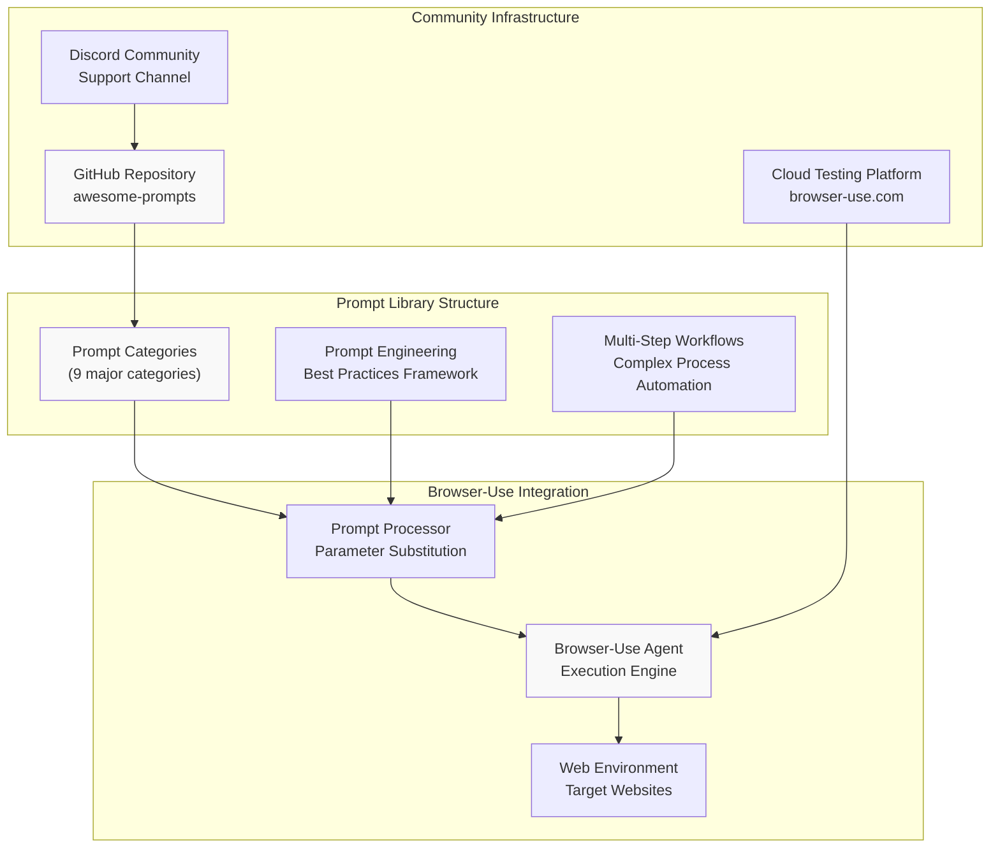

**Core System Components Architecture**

Sources: [README.md:1-30]()

### Prompt Category Taxonomy

The system organizes prompts into a structured taxonomy that covers major automation use cases:

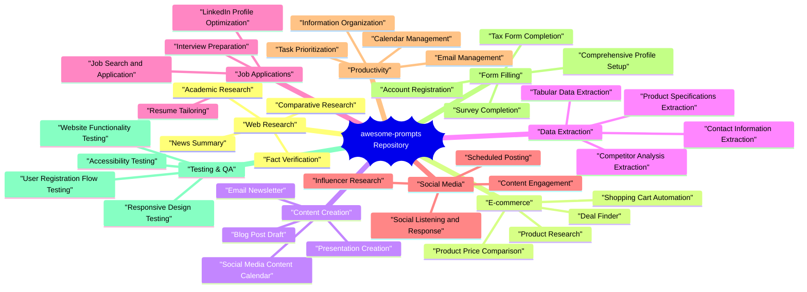

**Prompt Category Taxonomy and Organization**

Sources: [README.md:15-30](), [README.md:31-864]()

## Prompt Structure and Processing

### Prompt Format Specification

Each prompt in the repository follows a standardized structure that enables consistent processing by Browser-Use agents:

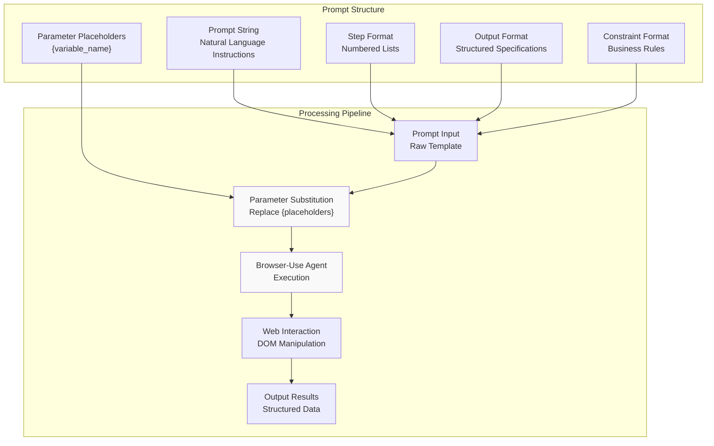

**Prompt Structure and Processing Pipeline**

Sources: [README.md:35-45](), [README.md:1054-1087]()

### Parameter Substitution System

The prompt system uses curly brace notation for parameter substitution, enabling dynamic customization:

| Parameter Type | Example | Usage Context |
|---|---|---|
| Industry/Domain | `{industry}` | Market research, competitive analysis |
| Target Entities | `{competitor1}`, `{product}` | Specific business targets |
| User Preferences | `{preference}`, `{budget}` | Customization options |
| Temporal Constraints | `{date}`, `{time_period}` | Time-bounded operations |
| Output Specifications | `{format}`, `{tone}` | Result formatting |

Sources: [README.md:36](), [README.md:113-128]()

## Integration with Browser-Use Agents

### Agent Execution Model

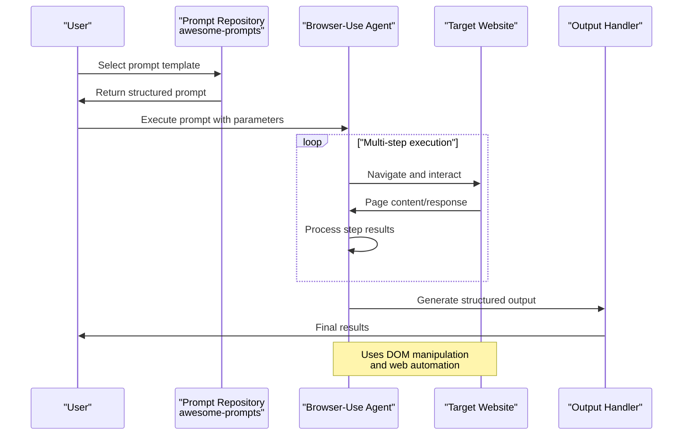

**Browser-Use Agent Integration Sequence**

Sources: [README.md:7-12](), [README.md:867-1053]()

### Multi-Step Workflow Architecture

Complex prompts implement multi-phase execution patterns:

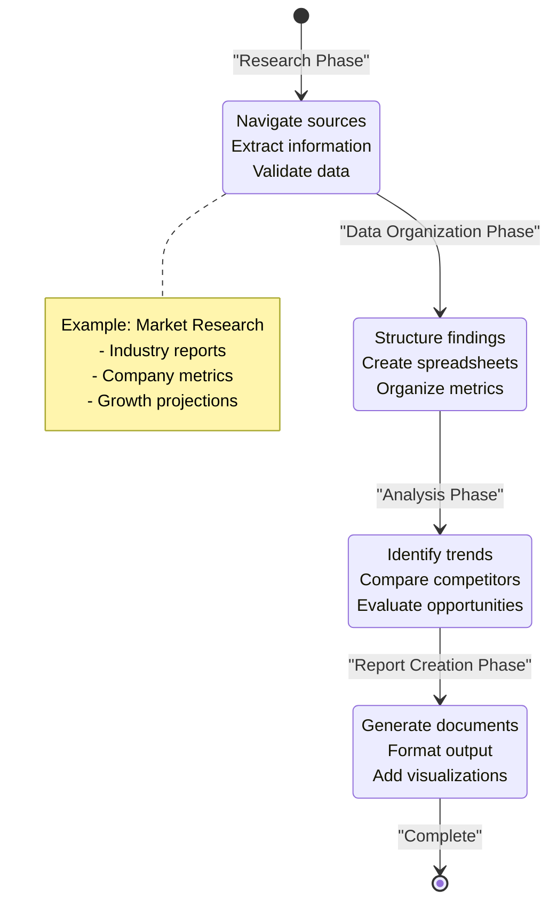

**Multi-Step Workflow State Machine**

Sources: [README.md:866-904](), [README.md:909-1008]()

## Community and Quality Framework

### Contribution Quality Standards

The repository implements a five-pillar quality framework for prompt acceptance:

| Quality Criterion | Description | Implementation |
|---|---|---|
| Format Consistency | Standardized template structure | Established template format in contributions |
| Actionable Content | Clear, executable instructions | Specific steps and measurable outcomes |
| Well-Structured Design | Logical flow and organization | Numbered lists and clear hierarchies |
| Browser-Use Compatible | Integration with automation agents | Tested with Browser-Use platform |
| Business Value | Practical utility for users | Real-world use cases and ROI |

Sources: [README.md:1088-1105]()

### Community Resources Integration

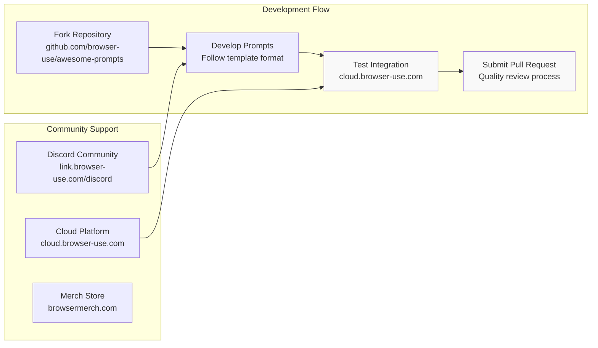

**Community Development and Support Ecosystem**

Sources: [README.md:9-12](), [README.md:1088-1105]()

The Browser-Use Awesome Prompts repository serves as the central hub for browser automation prompt engineering, providing a structured approach to web task automation through carefully crafted natural language instructions that integrate seamlessly with Browser-Use agents.

---

# Page: Prompt Categories

# Prompt Categories

<details>
<summary>Relevant source files</summary>

The following files were used as context for generating this wiki page:

- [README.md](README.md)

</details>


## Purpose and Scope

This document provides a comprehensive overview of the nine major prompt categories in the Browser-Use Awesome Prompts repository and their role in the browser automation ecosystem. It explains how prompts are organized, structured, and categorized to facilitate effective browser automation tasks across different business domains.

For detailed information about individual category implementations, see the respective category pages ([Web Research](#2.1), [E-commerce](#2.2), [Content Creation](#2.3), [Data Extraction](#2.4), [Job Application](#2.5), [Social Media](#2.6), [Productivity](#2.7), [Form Filling](#2.8), [Testing and QA](#2.9)). For information about prompt engineering principles and best practices, see [Prompt Engineering](#3). For complex automation workflows, see [Multi-Step Workflows](#4).

## Category Taxonomy and Organization

The prompt collection is organized into a hierarchical taxonomy designed to cover the primary use cases for browser automation. Each category addresses specific business functions while maintaining consistent structural patterns.

### Primary Category Structure

```mermaid
graph TB
    subgraph "Browser-Use Prompt Categories"
        WR[WebResearch<br/>"Web Research Prompts"]
        EC[ECommerce<br/>"E-commerce Prompts"] 
        CC[ContentCreation<br/>"Content Creation Prompts"]
        DE[DataExtraction<br/>"Data Extraction Prompts"]
        JA[JobApplication<br/>"Job Application Prompts"]
        SM[SocialMedia<br/>"Social Media Prompts"]
        PR[Productivity<br/>"Productivity Prompts"]
        FF[FormFilling<br/>"Form Filling Prompts"]
        QA[TestingQA<br/>"Testing and QA Prompts"]
        MW[MultiStep<br/>"Multi-Step Workflows"]
    end
    
    WR --> WR1["comparative_research"]
    WR --> WR2["academic_research"] 
    WR --> WR3["news_summary"]
    WR --> WR4["fact_verification"]
    
    EC --> EC1["price_comparison"]
    EC --> EC2["cart_automation"]
    EC --> EC3["deal_finder"]
    EC --> EC4["product_research"]
    
    CC --> CC1["blog_post_draft"]
    CC --> CC2["social_calendar"]
    CC --> CC3["email_newsletter"]
    CC --> CC4["presentation_creation"]
    
    DE --> DE1["tabular_extraction"]
    DE --> DE2["contact_extraction"]
    DE --> DE3["spec_extraction"]
    DE --> DE4["competitor_analysis"]
```

Sources: [README.md:15-29](), [README.md:31-302]()

### Category-to-Platform Mapping

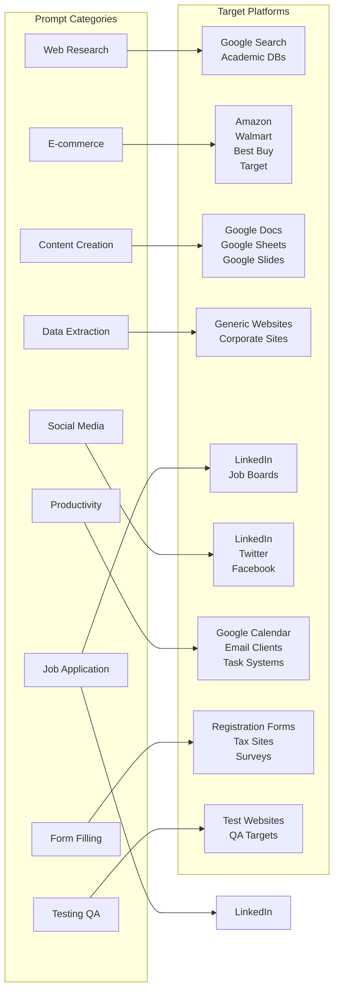

Sources: [README.md:96-169](), [README.md:304-399](), [README.md:401-498]()

## Prompt Structure Architecture

All prompts follow a consistent structural pattern that enables reliable browser automation while maintaining flexibility for parameter substitution.

### Parameter Substitution System

The prompt system uses curly brace notation `{parameter}` for dynamic value insertion. This pattern is consistent across all categories:

| Parameter Type | Example | Usage Pattern |
|---------------|---------|---------------|
| Target Entities | `{company_name}`, `{product}`, `{website}` | Primary automation targets |
| Behavioral Modifiers | `{industry}`, `{topic}`, `{preferences}` | Context-specific parameters |
| Output Specifications | `{format}`, `{tone}`, `{brand_voice}` | Result formatting controls |
| Constraint Parameters | `{budget}`, `{time_period}`, `{max_results}` | Operational boundaries |
| Fallback Options | `{alternative1}`, `{preferred_retailer}` | Error handling paths |

Sources: [README.md:36-44](), [README.md:113-127](), [README.md:175-185]()

### Prompt Component Architecture

```mermaid
graph TD
    PROMPT[PromptTemplate] --> HEADER[TaskDescription<br/>"Research and compare..."]
    PROMPT --> PARAMS[ParameterList<br/>"{industry}, {competitor1}"]
    PROMPT --> STEPS[ExecutionSteps<br/>"1. Navigate to...<br/>2. Extract..."]
    PROMPT --> OUTPUT[OutputFormat<br/>"Present in structured format"]
    PROMPT --> CONSTRAINTS[Constraints<br/>"at least 3 sources"]
    PROMPT --> FALLBACKS[FallbackOptions<br/>"if unavailable, find alternatives"]
    
    STEPS --> STEP1[NavigationStep<br/>"Navigate to pricing page"]
    STEPS --> STEP2[ExtractionStep<br/>"Extract pricing tiers"]  
    STEPS --> STEP3[ValidationStep<br/>"Note special offers"]
    STEPS --> STEP4[FormattingStep<br/>"Present in comparison table"]
    
    OUTPUT --> FORMAT1[StructuredData<br/>"comparison table"]
    OUTPUT --> FORMAT2[ListFormat<br/>"numbered lists"]
    OUTPUT --> FORMAT3[DocumentFormat<br/>"CSV-compatible format"]
```

Sources: [README.md:35-45](), [README.md:243-251](), [README.md:556-576]()

## Category Functional Mapping

Each category is designed to address specific business automation needs with distinct operational patterns and target platforms.

### Information Processing Categories

| Category | Primary Function | Input Types | Output Types |
|----------|-----------------|-------------|--------------|
| Web Research | Information gathering and synthesis | Search terms, topics, claims | Reports, summaries, fact-checks |
| Data Extraction | Structured data retrieval | Websites, databases | CSV files, contact lists, specifications |
| Testing QA | Functionality verification | Websites, user flows | Test reports, bug documentation |

### Transaction and Interaction Categories

| Category | Primary Function | Input Types | Output Types |
|----------|-----------------|-------------|--------------|
| E-commerce | Shopping automation | Product names, retailers, budgets | Price comparisons, cart states |
| Form Filling | Data entry automation | Personal info, preferences | Completed registrations, profiles |
| Job Application | Career process automation | Job criteria, resume data | Applications, optimized profiles |

### Content and Communication Categories  

| Category | Primary Function | Input Types | Output Types |
|----------|-----------------|-------------|--------------|
| Content Creation | Document and media generation | Topics, brand guidelines | Blog posts, presentations, calendars |
| Social Media | Social platform automation | Brand voice, engagement targets | Posts, responses, analytics |
| Productivity | Workflow optimization | Calendar data, tasks, emails | Organized schedules, processed inboxes |

Sources: [README.md:31-302](), [README.md:500-602](), [README.md:604-715]()

## Multi-Step Workflow Integration

Complex prompts can be composed from multiple categories to create sophisticated automation workflows.

### Workflow Composition Pattern

```mermaid
flowchart TD
    START[WorkflowInitiation] --> PHASE1[ResearchPhase]
    PHASE1 --> PHASE2[DataOrganization] 
    PHASE2 --> PHASE3[AnalysisPhase]
    PHASE3 --> PHASE4[OutputGeneration]
    
    subgraph "Category Integration"
        PHASE1 --> WR[WebResearch<br/>"market_research"]
        PHASE1 --> DE[DataExtraction<br/>"competitor_data"]
        
        PHASE2 --> PR[Productivity<br/>"information_organization"]
        
        PHASE3 --> DE2[DataExtraction<br/>"tabular_analysis"]
        
        PHASE4 --> CC[ContentCreation<br/>"report_generation"]
    end
    
    PHASE4 --> COMPLETE[WorkflowComplete<br/>"10-15 page report"]
    
    subgraph "Quality Checkpoints"
        QC1[DataValidation]
        QC2[FormatVerification] 
        QC3[OutputQuality]
    end
    
    PHASE1 --> QC1
    PHASE2 --> QC2  
    PHASE4 --> QC3
```

Sources: [README.md:866-905](), [README.md:909-1052]()

## Parameter Standardization Patterns

Across all categories, certain parameter patterns provide consistency and interoperability between prompts.

### Common Parameter Schemas

```mermaid
graph TB
    subgraph "Parameter Categories"
        TARGETS[TargetEntities<br/>"{website}, {company_name}, {product}"]
        CONTEXT[ContextModifiers<br/>"{industry}, {topic}, {audience_type}"]
        BEHAVIOR[BehaviorControls<br/>"{preferences}, {tone}, {format}"]
        LIMITS[ConstraintParams<br/>"{budget}, {time_period}, {max_results}"]
        FALLBACK[FallbackOptions<br/>"{alternative1}, {preferred_option}"]
    end
    
    subgraph "Category Usage"
        WR_PARAMS["{topic}, {date}, {competitor1}"]
        EC_PARAMS["{product}, {budget}, {preferred_retailer}"]
        CC_PARAMS["{brand_voice}, {audience_type}, {format}"]
        JA_PARAMS["{job_title}, {company_name}, {experience_level}"]
    end
    
    TARGETS --> WR_PARAMS
    CONTEXT --> WR_PARAMS
    TARGETS --> EC_PARAMS
    LIMITS --> EC_PARAMS
    CONTEXT --> CC_PARAMS
    BEHAVIOR --> CC_PARAMS
    TARGETS --> JA_PARAMS
    CONTEXT --> JA_PARAMS
```

Sources: [README.md:309-328](), [README.md:376-398](), [README.md:428-444]()

## Category Implementation Standards

Each category implements consistent quality standards and structural requirements as defined in the best practices framework.

### Quality Criteria by Category

| Category | Structure Requirements | Actionable Content | Browser Compatibility | Business Value |
|----------|----------------------|-------------------|---------------------|----------------|
| Web Research | Multi-step navigation, source verification | Specific search terms, extraction targets | Search engine optimization | Market intelligence, fact verification |
| E-commerce | Cart manipulation, price comparison | Product specifications, retailer targeting | E-commerce platform APIs | Purchase optimization, cost savings |
| Content Creation | Document templates, format specifications | Brand guidelines, content requirements | Google Workspace integration | Marketing automation, content scaling |
| Data Extraction | Table parsing, structured output | Field specifications, validation rules | Generic web scraping patterns | Data collection, competitor analysis |

Sources: [README.md:1054-1087](), [README.md:1089-1105]()

The prompt categories system provides a comprehensive framework for browser automation across business domains while maintaining consistency in structure, parameter handling, and quality standards. Each category serves specific automation needs while integrating seamlessly with others for complex workflow composition.

---

# Page: Web Research Prompts

# Web Research Prompts

<details>
<summary>Relevant source files</summary>

The following files were used as context for generating this wiki page:

- [README.md](README.md)

</details>


This page documents prompts designed for automated information gathering, competitive analysis, academic research, news synthesis, and fact verification tasks using Browser-Use agents. These prompts enable structured data collection from web sources through automated browser interactions.

For general prompt engineering principles, see [Best Practices Framework](#3.1). For multi-step research workflows, see [Complex Process Examples](#4.2).

## Overview

Web research prompts form the foundation of information gathering automation within the Browser-Use ecosystem. These prompts are structured to extract, analyze, and synthesize information from multiple web sources while maintaining accuracy and providing verifiable results.

### Prompt Categories Architecture

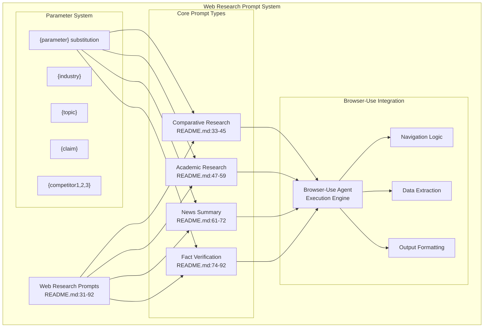

Sources: [README.md:31-92]()

### Execution Flow Architecture

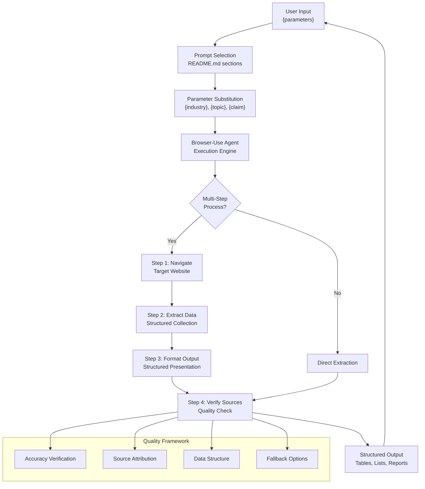

Sources: [README.md:31-92](), [README.md:1054-1087]()

## Comparative Research Prompts

Comparative research prompts automate the process of gathering and comparing information across multiple competitors or options within a specific industry or market segment.

### Structure and Parameters

The comparative research prompt uses the following parameter structure:

| Parameter | Purpose | Example Value |
|-----------|---------|---------------|
| `{industry}` | Target market or industry | "SaaS project management" |
| `{competitor1}` | First comparison target | "Asana" |
| `{competitor2}` | Second comparison target | "Monday.com" |
| `{competitor3}` | Third comparison target | "Trello" |

### Implementation Details

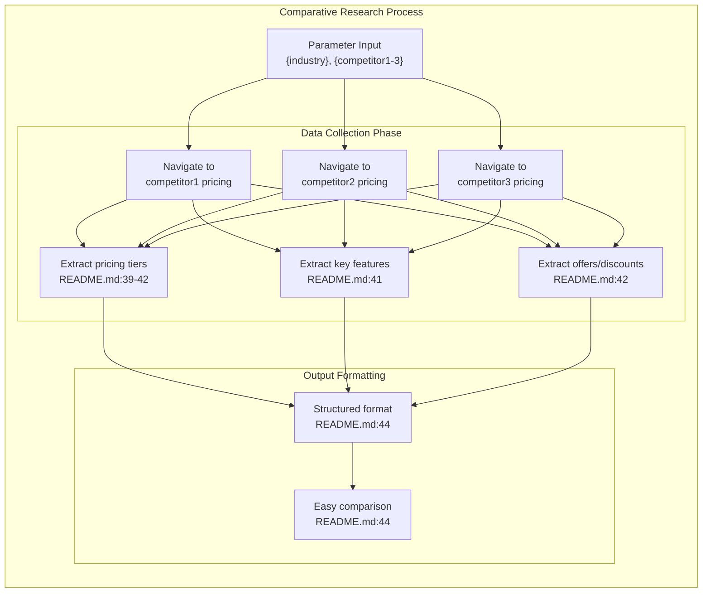

Sources: [README.md:33-45]()

The prompt follows a systematic 4-step process:
1. **Navigation**: Direct browser to each competitor's pricing page
2. **Pricing Extraction**: Capture pricing tiers and costs
3. **Feature Extraction**: List key features in each tier
4. **Offer Detection**: Note special offers or discounts

## Academic Research Prompts

Academic research prompts facilitate automated discovery and analysis of scholarly publications, focusing on citation metrics and open-access availability.

### Research Parameters

| Parameter | Purpose | Validation |
|-----------|---------|------------|
| `{topic}` | Research subject | Must be specific enough for targeted search |
| `{date}` | Publication threshold | ISO date format (YYYY-MM-DD) |

### Data Extraction Schema

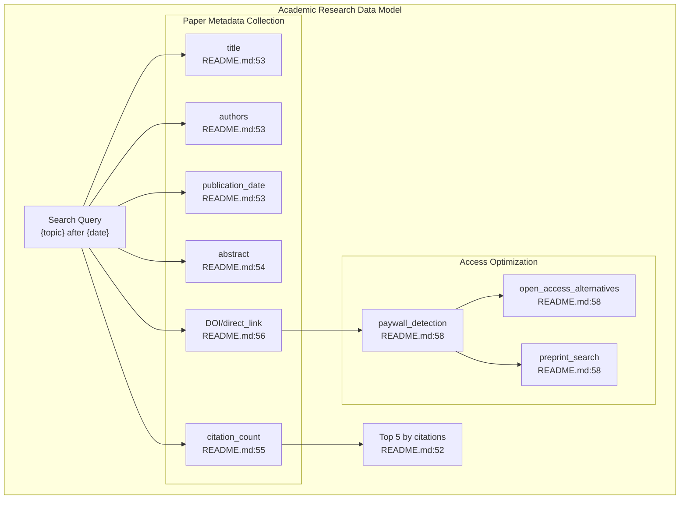

Sources: [README.md:47-59]()

The academic research process prioritizes papers by citation count and implements fallback mechanisms for accessing paywalled content through open-access alternatives or preprint repositories.

## News Summary Prompts

News summary prompts aggregate and synthesize information from multiple reputable news sources, providing comparative analysis of different reporting perspectives.

### Source Diversification Strategy

The prompt enforces source diversity through a minimum threshold requirement:

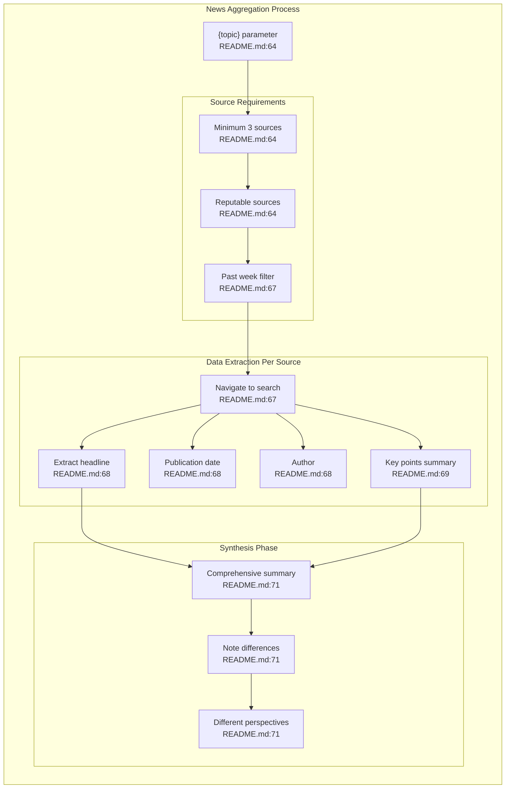

Sources: [README.md:61-72]()

The synthesis phase specifically identifies reporting differences and perspective variations between sources, providing users with a balanced view of the topic coverage.

## Fact Verification Prompts

Fact verification prompts implement a systematic approach to claim validation using multiple authoritative sources and evidence-based assessment.

### Verification Framework

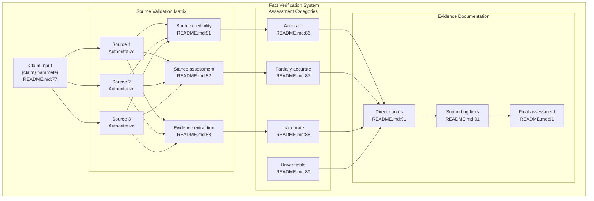

Sources: [README.md:74-92]()

### Verification Decision Matrix

| Source Consensus | Evidence Quality | Final Assessment |
|------------------|------------------|------------------|
| All sources confirm | Strong evidence | Accurate |
| Majority confirm | Mixed evidence | Partially accurate |
| Sources contradict | Weak evidence | Inaccurate |
| No sources found | No evidence | Unverifiable |

The verification process requires documentation of supporting quotes and links for transparency and further investigation.

## Integration with Browser-Use Framework

Web research prompts integrate with the Browser-Use execution engine through standardized parameter substitution and multi-step workflow management.

### Parameter Substitution System

All web research prompts use curly brace notation for parameter injection:

```
{industry} → "fintech"
{topic} → "machine learning ethics"
{claim} → "AI will replace 50% of jobs by 2030"
{competitor1} → "Stripe"
```

### Quality Assurance Framework

Web research prompts implement built-in quality controls:

1. **Source Attribution**: All extracted information includes source URLs
2. **Verification Steps**: Multiple source cross-referencing
3. **Structured Output**: Consistent formatting for easy consumption
4. **Error Handling**: Fallback options for inaccessible content
5. **Time Constraints**: Reasonable scope limitations

Sources: [README.md:31-92](), [README.md:1054-1087]()

## Best Practices for Web Research Prompts

### Structure Guidelines

- **Specify exact parameter requirements**: Use descriptive parameter names with clear validation criteria
- **Include source diversity requirements**: Minimum source counts and quality thresholds
- **Define output format explicitly**: Tables, lists, or structured reports
- **Implement verification steps**: Cross-reference information across sources

### Adaptability Patterns

- **Paywall handling**: Alternative source identification for academic content
- **Search result variation**: Flexible extraction for different website structures
- **Source unavailability**: Fallback options when primary sources are inaccessible
- **Content format diversity**: Adaptation to different information presentation formats

Sources: [README.md:1054-1087]()

---

# Page: E-commerce Prompts

# E-commerce Prompts

<details>
<summary>Relevant source files</summary>

The following files were used as context for generating this wiki page:

- [README.md](README.md)

</details>


This document covers the e-commerce automation prompts available in the Browser-Use Awesome Prompts collection. These prompts enable automated interactions with e-commerce platforms including price comparison, shopping cart management, deal discovery, and product research across major retailers like Amazon, Walmart, Best Buy, and Target.

For web research automation, see [Web Research Prompts](#2.1). For general productivity automation, see [Productivity Prompts](#2.7).

## E-commerce Automation Architecture

The e-commerce prompts operate through a structured automation framework that interfaces with multiple retailer websites:

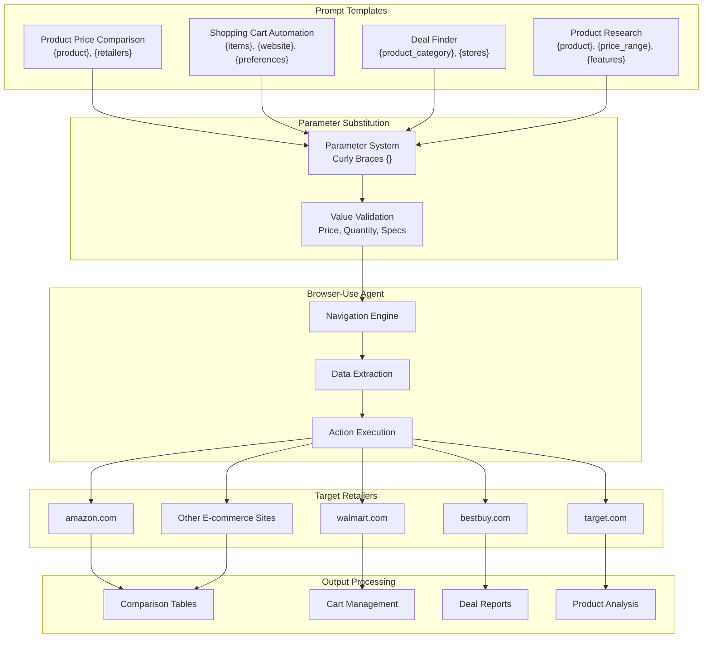

Sources: [README.md:94-168]()

## E-commerce Prompt Execution Flow

The execution model for e-commerce prompts follows a systematic approach to ensure reliable automation across different retailer interfaces:

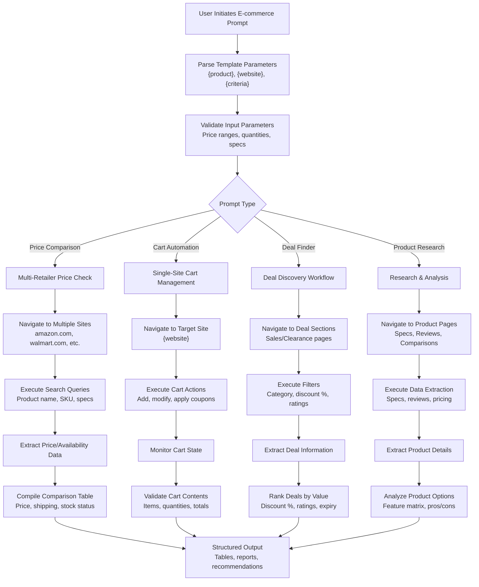

Sources: [README.md:94-168]()

## Product Price Comparison

The `Product Price Comparison` prompt automates price discovery across major retailers with structured data extraction and comparison analysis.

### Template Structure

```
Find the best price for {product} across major retailers including Amazon, Walmart, Best Buy, and Target.

For each retailer:
1. Navigate to their website and search for the exact product
2. Record the current price, original price if on sale, and any available discounts
3. Note shipping costs and estimated delivery time
4. Check if the product is in stock

Compile the information into a comparison table and identify the best overall deal considering price, shipping, and delivery time.
```

### Parameters

| Parameter | Type | Description | Example |
|-----------|------|-------------|---------|
| `{product}` | String | Exact product name or model | `"iPhone 15 Pro 256GB"` |

### Data Extraction Points

- **Current Price**: Active selling price
- **Original Price**: Pre-discount price if applicable  
- **Available Discounts**: Coupons, promotions, member pricing
- **Shipping Costs**: Standard and expedited options
- **Delivery Time**: Estimated arrival dates
- **Stock Status**: In stock, limited quantity, out of stock

Sources: [README.md:96-108]()

## Shopping Cart Automation

The `Shopping Cart Automation` prompt handles multi-item cart management with preference-based selection and budget constraints.

### Template Structure

```
Add the following items to my shopping cart on {website}:

1. {item1} - {specifications1} - quantity: {quantity1}
2. {item2} - {specifications2} - quantity: {quantity2}
3. {item3} - {specifications3} - quantity: {quantity3}

For each item:
- If the exact item is unavailable, find the closest alternative
- If there are multiple options (size, color, etc.), select {preference}
- If the price is above {budget} for any item, look for a more affordable alternative

Once all items are in the cart:
- Apply coupon code: {coupon_code} if available
- Select the standard shipping option
- Proceed to checkout but stop before payment
```

### Parameters

| Parameter | Type | Description | Example |
|-----------|------|-------------|---------|
| `{website}` | String | Target e-commerce site | `"amazon.com"` |
| `{item1}`, `{item2}`, `{item3}` | String | Product names | `"Wireless headphones"` |
| `{specifications1}`, etc. | String | Product specifications | `"Black, over-ear, noise cancelling"` |
| `{quantity1}`, etc. | Integer | Item quantities | `2` |
| `{preference}` | String | Selection criteria | `"lowest price"` or `"highest rated"` |
| `{budget}` | Number | Price threshold per item | `150.00` |
| `{coupon_code}` | String | Promotional code | `"SAVE20"` |

### Automation Logic

- **Exact Match Priority**: Search for exact product specifications first
- **Alternative Selection**: Use closest match algorithm when exact item unavailable
- **Budget Enforcement**: Automatic filtering by price constraints
- **Coupon Application**: Validation and application of discount codes
- **Checkout Boundary**: Stop execution before payment processing

Sources: [README.md:110-128]()

## Deal Finder

The `Deal Finder` prompt discovers and ranks current promotions across multiple retailer sale sections.

### Template Structure

```
Find the best current deals on {product_category} from {store1}, {store2}, and {store3}.

For each store:
1. Navigate to their deals/sale section
2. Filter for {product_category} items
3. Sort by discount percentage (highest first) if possible
4. Record the top 5 deals, including:
   - Product name
   - Original price
   - Current price
   - Discount percentage
   - Link to the product

For each product, verify customer ratings are above 4 stars if available. Exclude any deals that expire within 24 hours.
```

### Parameters

| Parameter | Type | Description | Example |
|-----------|------|-------------|---------|
| `{product_category}` | String | Product category filter | `"laptops"` or `"kitchen appliances"` |
| `{store1}`, `{store2}`, `{store3}` | String | Target retailer websites | `"bestbuy.com"`, `"target.com"`, `"walmart.com"` |

### Quality Filters

- **Rating Threshold**: Minimum 4-star customer rating
- **Expiry Filter**: Exclude deals expiring within 24 hours
- **Discount Ranking**: Sort by highest discount percentage
- **Top N Selection**: Extract top 5 deals per store

### Output Schema

```
Deal Record:
- Product Name: String
- Original Price: Currency
- Current Price: Currency  
- Discount Percentage: Number
- Product Link: URL
- Customer Rating: Number (1-5)
- Deal Expiry: Date
```

Sources: [README.md:130-147]()

## Product Research

The `Product Research` prompt performs comprehensive product analysis with feature comparison and expert review synthesis.

### Template Structure

```
Research {product} and help me make an informed purchase decision.

1. Find at least 3 different models/brands that match these criteria:
   - Price range: {min_price} to {max_price}
   - Must have features: {required_features}
   - Preferred but optional: {optional_features}

2. For each product, find:
   - Detailed specifications
   - At least 2 expert reviews
   - Summary of customer reviews (pros and cons)
   - Warranty information

3. Check availability at {preferred_retailer} and {alternate_retailer}

4. Create a comparison highlighting the key differences in features, performance, and value.
```

### Parameters

| Parameter | Type | Description | Example |
|-----------|------|-------------|---------|
| `{product}` | String | Product category or specific item | `"gaming laptop"` |
| `{min_price}` | Currency | Minimum price threshold | `$800` |
| `{max_price}` | Currency | Maximum price threshold | `$2000` |
| `{required_features}` | Array | Must-have features | `"RTX 4060, 16GB RAM, SSD"` |
| `{optional_features}` | Array | Nice-to-have features | `"RGB keyboard, high refresh display"` |
| `{preferred_retailer}` | String | Primary retailer choice | `"bestbuy.com"` |
| `{alternate_retailer}` | String | Fallback retailer | `"amazon.com"` |

### Research Methodology

1. **Product Discovery**: Match products to criteria using feature filtering
2. **Specification Extraction**: Parse technical specifications from product pages
3. **Expert Review Aggregation**: Collect and summarize professional reviews
4. **Customer Sentiment Analysis**: Analyze customer review patterns for pros/cons
5. **Warranty Documentation**: Extract warranty terms and coverage details
6. **Availability Verification**: Check stock status across retailers
7. **Comparison Matrix**: Generate feature/performance/value comparison table

Sources: [README.md:149-168]()

## Parameter Substitution System

All e-commerce prompts use the curly braces `{}` parameter substitution system for dynamic content injection:

### Syntax Rules

- **Parameter Format**: `{parameter_name}`
- **Case Sensitivity**: Parameters are case-sensitive
- **Nesting**: Parameters cannot be nested
- **Required vs Optional**: All parameters in template are required unless specified

### Validation Types

| Parameter Type | Validation Rules | Example |
|----------------|------------------|---------|
| Currency | Numeric with currency symbol | `$99.99`, `€150.00` |
| URL | Valid domain format | `amazon.com`, `bestbuy.com` |
| Product Name | Non-empty string | `"MacBook Pro M3"` |
| Quantity | Positive integer | `1`, `5`, `10` |
| Features | Comma-separated list | `"WiFi 6, USB-C, 1TB SSD"` |

### Error Handling

- **Missing Parameters**: Prompt execution fails with parameter list
- **Invalid Format**: Type conversion attempted with fallback defaults
- **Out of Range**: Numeric parameters clamped to reasonable bounds

Sources: [README.md:94-168]()

---

# Page: Content Creation Prompts

# Content Creation Prompts

<details>
<summary>Relevant source files</summary>

The following files were used as context for generating this wiki page:

- [README.md](README.md)

</details>


This document covers the content creation prompt category within the Browser-Use awesome-prompts system. Content creation prompts are designed to automate the generation of various content types including blog posts, social media calendars, email newsletters, and presentations through Google Workspace integration and structured content development workflows.

For information about social media engagement and interaction prompts, see [Social Media Prompts](#2.6). For general productivity automation beyond content creation, see [Productivity Prompts](#2.7).

## Content Creation System Architecture

The content creation prompt system integrates with Google Workspace tools and follows a research-driven, multi-phase content development approach.

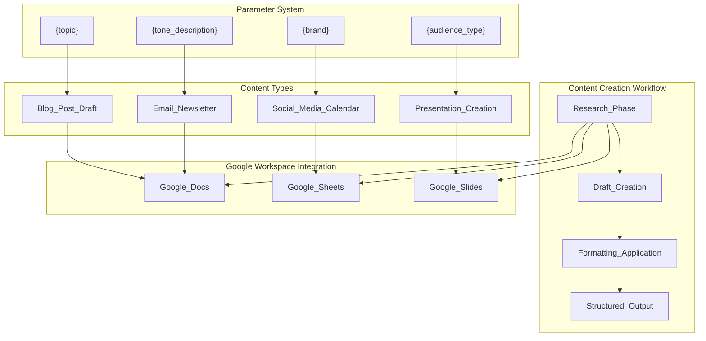

**Sources:** [README.md:170-236]()

## Content Creation Prompt Categories and Workflows

Each content creation prompt type follows specific structural patterns and integrates with designated Google Workspace applications.

```mermaid
flowchart TD
    subgraph "Blog_Post_Draft_Workflow"
        BP1["Google_Search_Research"]
        BP2["Google_Docs_Creation"]
        BP3["Headline_Generation"]
        BP4["Section_Structure"]
        BP5["Content_Writing"]
        BP6["CTA_Addition"]
        
        BP1 --> BP2 --> BP3 --> BP4 --> BP5 --> BP6
    end
    
    subgraph "Social_Media_Calendar_Workflow"
        SM1["Google_Sheets_Setup"]
        SM2["Theme_Generation"]
        SM3["Platform_Optimization"]
        SM4["Hashtag_Research"]
        SM5["Scheduling_Logic"]
        
        SM1 --> SM2 --> SM3 --> SM4 --> SM5
    end
    
    subgraph "Email_Newsletter_Workflow"
        EN1["Email_Platform_Access"]
        EN2["Subject_Line_Creation"]
        EN3["Section_Assembly"]
        EN4["Brand_Voice_Application"]
        EN5["CTA_Integration"]
        
        EN1 --> EN2 --> EN3 --> EN4 --> EN5
    end
    
    subgraph "Presentation_Workflow"
        PR1["Google_Slides_Setup"]
        PR2["Template_Application"]
        PR3["Slide_Structure"]
        PR4["Speaker_Notes"]
        PR5["6x6_Rule_Application"]
        
        PR1 --> PR2 --> PR3 --> PR4 --> PR5
    end
    
    subgraph "Parameter_Substitution"
        PARAMS["{topic} {brand} {audience_type} {tone_description}"]
    end
    
    PARAMS --> BP1
    PARAMS --> SM1
    PARAMS --> EN1
    PARAMS --> PR1
```

**Sources:** [README.md:172-236]()

## Blog Post Draft Creation

The blog post draft prompt creates structured content in Google Docs through a research-driven approach with specific formatting requirements.

### Structure and Components

| Component | Description | Implementation |
|-----------|-------------|----------------|
| Research Phase | Google search for top 5 articles | `Research the top 5 articles on Google about {topic}` |
| Document Creation | New Google Docs document | `Go to Google Docs and create a new document` |
| Content Structure | 3-5 main sections with subheadings | Structured section generation |
| Word Count Target | 1000-1200 words | Length specification |
| Tone Application | Configurable voice | `{formal/conversational/educational} tone` |
| Visual Integration | Image placeholder descriptions | 2-3 relevant image suggestions |

### Parameter Structure

The blog post prompt uses the following parameter substitution pattern:

- `{topic}` - Primary subject matter
- `{formal/conversational/educational}` - Tone selection
- Image placeholder descriptions for visual content planning

### Workflow Phases

1. **Research Phase**: Google search analysis for current perspectives
2. **Headline Generation**: SEO-optimized title with primary keyword
3. **Structure Creation**: Introduction, 3-5 main sections, conclusion
4. **Content Development**: Bullet points, numbered lists, structured content
5. **CTA Integration**: Clear call-to-action in conclusion

**Sources:** [README.md:172-186]()

## Social Media Content Calendar

The social media calendar prompt generates structured posting schedules in Google Sheets with platform-specific optimization.

### Calendar Structure

```mermaid
graph LR
    subgraph "Google_Sheets_Calendar"
        DAYS["Daily_Entries"]
        THEMES["Theme_Generation"]
        PLATFORMS["Platform_Optimization"]
        HASHTAGS["Hashtag_Strategy"]
        TIMING["Optimal_Posting_Times"]
    end
    
    subgraph "Content_Categories"
        INDUSTRY["Industry_Topics"]
        TRENDING["Trending_Topics"]
        EVENTS["Upcoming_Events"]
    end
    
    subgraph "Platform_Specifications"
        P1["social_media_platform1"]
        P2["social_media_platform2"]
    end
    
    THEMES --> DAYS
    PLATFORMS --> P1
    PLATFORMS --> P2
    HASHTAGS --> DAYS
    TIMING --> DAYS
    
    INDUSTRY --> THEMES
    TRENDING --> THEMES
    EVENTS --> THEMES
```

### Parameter Configuration

- `{brand}` - Brand identity for content alignment
- `{social_media_platform1}` - Primary platform specification
- `{social_media_platform2}` - Secondary platform specification
- `{industry}` - Industry context for theme generation
- `{upcoming_event/holiday}` - Specific event integration

### Content Generation Rules

- Daily posts for each specified platform
- Platform-appropriate content length
- 3-5 hashtags per post
- Industry trend incorporation
- Event-specific content inclusion

**Sources:** [README.md:188-201]()

## Email Newsletter Creation

The email newsletter prompt structures multi-section newsletters with brand voice consistency and engagement optimization.

### Newsletter Architecture

| Section | Word Count | Purpose | Parameters |
|---------|------------|---------|------------|
| Subject Line | Variable | 25%+ open rate target | Personalization elements |
| Main Article | 250-300 words | Primary content focus | `{current_topic}` |
| Secondary Content | 150 words | Product/service highlight | `{product/service/news}` |
| What's New | 100 words | Recent developments | `{recent_development}` |
| Call-to-Action | Variable | Conversion focus | `{offer/event}` |
| Footer | Standard | Compliance and social links | Unsubscribe + social media |

### Brand Voice Integration

- `{business}` - Business identity parameter
- `{brand_voice_description}` - Voice specification
- `{email_platform}` - Platform integration target
- Consistent voice application across all sections

### Technical Implementation

- Direct integration with specified email platform
- Structured section assembly
- Visual content planning with image placements
- Footer compliance with unsubscribe requirements

**Sources:** [README.md:203-217]()

## Presentation Creation

The presentation prompt generates professional slide decks in Google Slides with structured information architecture.

### Slide Structure Framework

```mermaid
graph TD
    subgraph "Presentation_Structure"
        TITLE["Title_Slide"]
        AGENDA["Agenda_Overview"]
        PROBLEM["Problem_Statement"]
        DATA["Key_Data_Points"]
        SOLUTION["Solution_Insights"]
        IMPLEMENTATION["Implementation_Steps"]
        CONCLUSION["Conclusion_Takeaways"]
        QA["Q&A_Placeholder"]
        CONTACT["Contact_Information"]
    end
    
    subgraph "Design_Rules"
        SIXBYSIX["6x6_Rule"]
        TEMPLATE["Professional_Template"]
        COLORS["Brand_Colors"]
        NOTES["Speaker_Notes"]
    end
    
    subgraph "Content_Parameters"
        TOPIC["{topic}"]
        AUDIENCE["{audience_type}"]
        BRAND_COLORS["{brand_colors}"]
    end
    
    TITLE --> AGENDA --> PROBLEM --> DATA --> SOLUTION --> IMPLEMENTATION --> CONCLUSION --> QA --> CONTACT
    
    SIXBYSIX --> DATA
    SIXBYSIX --> SOLUTION
    SIXBYSIX --> IMPLEMENTATION
    
    TEMPLATE --> TITLE
    COLORS --> TEMPLATE
    NOTES --> SOLUTION
    
    TOPIC --> PROBLEM
    AUDIENCE --> SOLUTION
    BRAND_COLORS --> COLORS
```

### 6x6 Rule Implementation

The presentation prompt enforces the 6x6 rule for content density:
- Maximum 6 bullet points per slide
- Maximum 6 words per bullet point
- Applied to data, solution, and implementation slides

### Speaker Notes Integration

Each slide includes expanded speaker notes with detailed information beyond the visual content, supporting presentation delivery.

### Template and Branding

- Professional template selection
- `{brand_colors}` parameter for visual consistency
- Structured slide progression for audience engagement

**Sources:** [README.md:219-236]()

## Parameter Substitution System

All content creation prompts utilize curly brace parameter substitution for customization and reusability.

### Common Parameters

| Parameter | Usage Context | Example Values |
|-----------|---------------|----------------|
| `{topic}` | Content subject matter | "Content Marketing Strategies" |
| `{brand}` | Brand identity | "TechCorp" |
| `{audience_type}` | Target audience | "executives", "developers" |
| `{tone_description}` | Content voice | "professional", "conversational" |
| `{brand_colors}` | Visual branding | "#0066CC, #FF6600" |

### Platform-Specific Parameters

- `{social_media_platform1}` - Primary social platform
- `{email_platform}` - Email service provider
- `{current_topic}` - Timely subject matter
- `{upcoming_event/holiday}` - Calendar-based content

The parameter system enables prompt reusability across different brands, topics, and contexts while maintaining structural consistency.

**Sources:** [README.md:170-236]()

---

# Page: Data Extraction Prompts

# Data Extraction Prompts

<details>
<summary>Relevant source files</summary>

The following files were used as context for generating this wiki page:

- [README.md](README.md)

</details>


## Purpose and Scope

Data extraction prompts are specialized automation templates designed to systematically extract structured and unstructured information from web pages, applications, and online databases using Browser-Use agents. These prompts handle complex data collection scenarios including tabular data, contact information, product specifications, and competitive intelligence gathering.

This document covers the four primary data extraction prompt categories and their implementation patterns. For web research and information gathering tasks, see [Web Research Prompts](#2.1). For automation of e-commerce data collection, see [E-commerce Prompts](#2.2).

## Data Extraction Prompt Categories

### Core Extraction Types

The data extraction prompt system provides four specialized prompt templates, each optimized for different data collection scenarios:

| Prompt Type | Target Data | Output Format | Use Cases |
|-------------|-------------|---------------|-----------|
| Tabular Data Extraction | Structured tables, lists | CSV-compatible format | Price lists, inventory, metrics |
| Contact Information | Business contact details | Structured contact records | Lead generation, verification |
| Product Specifications | Technical specifications | Organized spec sheets | Product comparison, research |
| Competitor Analysis | Business intelligence | Comparative analysis reports | Market research, positioning |

**Tabular Data Extraction Architecture**

```mermaid
flowchart TD
    INPUT[Input: "website, data_category, specific_page_or_search_query"] --> NAVIGATE["Navigate to target page"]
    NAVIGATE --> IDENTIFY["Identify table/structured data"]
    IDENTIFY --> EXTRACT["Extract rows/columns"]
    EXTRACT --> PAGINATE{"Pagination exists?"}
    PAGINATE -->|Yes| NEXTPAGE["Navigate through pages 1-3"]
    PAGINATE -->|No| FILTER["Apply filter_criteria if available"]
    NEXTPAGE --> FILTER
    FILTER --> FORMAT["Format as CSV-compatible"]
    FORMAT --> OUTPUT["Structured data with headers"]
    
    EXTRACT --> PRESERVE["Preserve data relationships"]
    PRESERVE --> MISSING["Mark missing data as 'N/A'"]
```

Sources: [README.md:240-252]()

### Parameter Substitution Patterns

Data extraction prompts utilize curly brace parameter substitution to enable flexible, reusable automation templates:

**Contact Information Extraction Parameters**

```mermaid
graph TD
    PROMPT["Contact Information Extraction Prompt"] --> PARAMS["Parameter Placeholders"]
    PARAMS --> COMPANY["{company_name}"]
    PARAMS --> SOURCES["Multiple source verification"]
    
    COMPANY --> WEBSITE["Official website navigation"]
    COMPANY --> LINKEDIN["LinkedIn profile cross-reference"]
    COMPANY --> GOOGLE["Google Business profile check"]
    
    WEBSITE --> EXTRACT_FIELDS["Extract contact fields"]
    EXTRACT_FIELDS --> ADDRESS["Main office address(es)"]
    EXTRACT_FIELDS --> PHONE["Phone number(s) with departments"]
    EXTRACT_FIELDS --> EMAIL["Email address(es) with departments"]
    EXTRACT_FIELDS --> EXECUTIVES["Key executives/leadership"]
    EXTRACT_FIELDS --> SOCIAL["Social media profiles"]
    EXTRACT_FIELDS --> SUPPORT["Customer support methods/hours"]
    
    LINKEDIN --> VERIFY["Cross-reference verification"]
    GOOGLE --> VERIFY
    VERIFY --> OUTPUT["Verified contact record"]
```

Sources: [README.md:254-268]()

## Data Extraction Workflow Architecture

### Multi-Step Extraction Process

Data extraction prompts follow a standardized workflow pattern that ensures comprehensive data collection and verification:

**Product Specifications Extraction Workflow**

```mermaid
sequenceDiagram
    participant User
    participant BrowserAgent as "Browser-Use Agent"
    participant ManufacturerSite as "Manufacturer Website"
    participant RetailerSite1 as "Retailer Website 1" 
    participant RetailerSite2 as "Retailer Website 2"
    participant OutputSystem as "Structured Output"
    
    User->>BrowserAgent: "Extract specs for {product}"
    BrowserAgent->>ManufacturerSite: "Navigate to {manufacturer_website}"
    ManufacturerSite-->>BrowserAgent: "Technical specifications"
    BrowserAgent->>RetailerSite1: "Navigate to retailer 1"
    RetailerSite1-->>BrowserAgent: "Product specifications"
    BrowserAgent->>RetailerSite2: "Navigate to retailer 2"
    RetailerSite2-->>BrowserAgent: "Product specifications"
    
    Note over BrowserAgent: "Compare specifications across sources"
    Note over BrowserAgent: "Identify discrepancies"
    
    BrowserAgent->>OutputSystem: "Structured specification report"
    OutputSystem-->>User: "Formatted specifications with variance notes"
```

Sources: [README.md:270-285]()

### Competitive Intelligence Automation

The competitor analysis extraction prompt implements a comprehensive business intelligence workflow:

**Competitor Analysis Data Flow**

```mermaid
flowchart LR
    subgraph "Input Parameters"
        COMPANY["{company_name}"]
        COMPETITORS["Top 5 competitors identification"]
    end
    
    subgraph "Data Collection Phase"
        WEBSITE["Official website navigation"]
        MISSION["Mission statement extraction"]
        PRODUCTS["Products/services identification"] 
        PRICING["Pricing information extraction"]
        TARGET["Target audience analysis"]
        NEWS["Recent news/press releases"]
        MARKETING["Marketing strategy analysis"]
    end
    
    subgraph "Output Generation"
        STRUCTURE["Structured comparison format"]
        ANALYSIS["Competitive positioning"]
        INSIGHTS["Strategic insights"]
    end
    
    COMPANY --> COMPETITORS
    COMPETITORS --> WEBSITE
    WEBSITE --> MISSION
    WEBSITE --> PRODUCTS
    WEBSITE --> PRICING
    WEBSITE --> TARGET
    WEBSITE --> NEWS
    WEBSITE --> MARKETING
    
    MISSION --> STRUCTURE
    PRODUCTS --> STRUCTURE
    PRICING --> STRUCTURE
    TARGET --> ANALYSIS
    NEWS --> ANALYSIS
    MARKETING --> INSIGHTS
    
    STRUCTURE --> OUTPUT["Comparative analysis report"]
    ANALYSIS --> OUTPUT
    INSIGHTS --> OUTPUT
```

Sources: [README.md:287-302]()

## Integration with Browser-Use Ecosystem

### Prompt Engineering Framework Integration

Data extraction prompts implement the four pillars of effective prompt engineering established in the Browser-Use framework:

**Data Extraction Prompt Structure Analysis**

```mermaid
mindmap
  root((Data Extraction Prompts))
    Structure
      "Numbered step sequences"
      "Clear goal definition"
      "Output format specifications"
      "Parameter placeholders"
    Clarity
      "Precise field definitions"
      "Exact navigation instructions"
      "Specific data point requirements"
      "Verification criteria"
    Adaptability  
      "Alternative source options"
      "Fallback extraction methods"
      "Error handling for missing data"
      "Cross-reference validation"
    Efficiency
      "Batch data collection"
      "Pagination optimization"
      "Priority field identification"
      "Resource constraint handling"
```

Sources: [README.md:1054-1087]()

### Multi-Step Workflow Integration

Data extraction prompts serve as building blocks for complex multi-step workflows in research and analysis scenarios:

| Workflow Type | Data Extraction Role | Integration Points |
|---------------|---------------------|-------------------|
| Market Research Reports | Competitor data collection | Research Phase → Data Organization |
| Product Launch Campaigns | Market intelligence gathering | Research Phase → Strategy Development |
| Website Migration | Content and asset inventory | Content Audit → Technical Planning |

Sources: [README.md:866-1052]()

## Quality Assurance and Validation

### Data Integrity Mechanisms

Data extraction prompts include built-in quality assurance patterns:

- **Cross-source verification**: Multiple website validation for contact information
- **Discrepancy identification**: Specification variance detection across retailer sites  
- **Completeness validation**: "N/A" marking for missing data points rather than blank fields
- **Format standardization**: CSV-compatible output formatting for tabular data

### Error Handling Patterns

Each data extraction prompt type implements specific error handling strategies:

- **Pagination handling**: Automatic navigation through multiple pages with defined limits
- **Filter application**: Conditional filtering based on available website functionality
- **Alternative source fallback**: Secondary extraction methods when primary sources fail
- **Data relationship preservation**: Maintaining structural relationships during extraction

Sources: [README.md:238-302]()

---

# Page: Job Application Prompts

# Job Application Prompts

<details>
<summary>Relevant source files</summary>

The following files were used as context for generating this wiki page:

- [README.md](README.md)

</details>


## Purpose and Scope

This document covers the job application automation prompts within the Browser-Use Awesome Prompts collection. These prompts enable automated job searching, application submission, LinkedIn profile optimization, interview preparation, and resume customization through browser automation agents.

The job application prompts focus on streamlining the job search process by automating repetitive tasks while maintaining personalization and quality. For broader productivity automation, see [Productivity Prompts](#2.7). For social media engagement beyond LinkedIn, see [Social Media Prompts](#2.6).

## Job Application Workflow Architecture

The job application automation system follows a structured multi-phase approach that coordinates between different platforms and data sources.

**Job Application Automation Flow**
```mermaid
flowchart TD
    USER["User Input<br/>{job_title, location, experience_level}"] --> SEARCH["Job Search Phase"]
    SEARCH --> BOARDS["Job Boards<br/>{job_board1, job_board2, job_board3}"]
    BOARDS --> EXTRACT["Data Extraction<br/>job_title, company, requirements"]
    EXTRACT --> FILTER["Filtering & Ranking<br/>salary_range, location matching"]
    
    FILTER --> PROFILE["Profile Optimization"]
    PROFILE --> LINKEDIN["LinkedIn Profile<br/>headline, about, skills sections"]
    LINKEDIN --> RESEARCH["Company Research<br/>mission, values, recent_news"]
    
    RESEARCH --> PREP["Application Preparation"]
    PREP --> RESUME["Resume Tailoring<br/>{resume_filename} modification"]
    PREP --> COVER["Cover Letter Generation<br/>role-specific content"]
    
    RESUME --> APPLY["Application Submission"]
    COVER --> APPLY
    APPLY --> TRACK["Progress Tracking<br/>application links and deadlines"]
    
    subgraph "Interview Phase"
        INTERVIEW["Interview Preparation<br/>{company_name} research"]
        QUESTIONS["Question Preparation<br/>STAR method responses"]
        SALARY["Compensation Research<br/>market rate analysis"]
    end
    
    TRACK --> INTERVIEW
    INTERVIEW --> QUESTIONS
    QUESTIONS --> SALARY
```

Sources: [README.md:304-399]()

## Core Prompt Components

### Job Search and Application Prompt

The job search prompt orchestrates multi-platform job discovery and application preparation through structured browser automation.

**Job Search Data Flow**
```mermaid
graph LR
    subgraph "Input Parameters"
        JT["{job_title}"]
        IND["{industry}"]
        LOC["{location}"]
        EXP["{experience_level}"]
        SAL["{salary_range}"]
    end
    
    subgraph "Job Board Integration"
        JB1["{job_board1}<br/>search interface"]
        JB2["{job_board2}<br/>filter system"]  
        JB3["{job_board3}<br/>application tracking"]
    end
    
    subgraph "Data Extraction Pipeline"
        TITLE["job_title extraction"]
        COMP["company identification"]
        DATE["posting_date capture"]
        REQ["requirements parsing"]
        LINK["application_link storage"]
    end
    
    subgraph "Application Preparation"
        RESUME["{resume_filename}<br/>document analysis"]
        COVER["cover_letter generation"]
        TAILOR["resume_adjustments"]
    end
    
    JT --> JB1
    IND --> JB1
    LOC --> JB2
    EXP --> JB2
    SAL --> JB3
    
    JB1 --> TITLE
    JB2 --> COMP
    JB3 --> DATE
    
    TITLE --> REQ
    COMP --> LINK
    DATE --> LINK
    
    REQ --> RESUME
    LINK --> COVER
    RESUME --> TAILOR
```

The prompt implements a comprehensive job search workflow that processes multiple job boards simultaneously, extracts structured data, and prepares customized application materials.

Sources: [README.md:307-328]()

### LinkedIn Profile Optimization System

The LinkedIn optimization prompt automates profile enhancement through systematic section-by-section improvements aligned with target job requirements.

| Profile Section | Automation Focus | Parameter Dependencies |
|-----------------|-------------------|----------------------|
| `headline` | Keyword integration | `{target_job_title}` |
| `about` | Skills highlighting | `{target_job_title}`, `{industry}` |
| `experience` | Accomplishment metrics | Job history analysis |
| `skills` | Top 10 skill curation | `{target_job_title}` requirements |
| `groups` | Industry networking | `{industry}` related communities |

**LinkedIn Profile Enhancement Pipeline**
```mermaid
sequenceDiagram
    participant USER as "User Input"
    participant LINKEDIN as "LinkedIn Platform"
    participant PROFILE as "Profile Analysis"
    participant RESEARCH as "Competitor Research"
    participant UPDATE as "Profile Updates"
    
    USER->>LINKEDIN: Navigate and authenticate
    LINKEDIN->>PROFILE: Extract current profile sections
    PROFILE->>RESEARCH: Analyze 3 successful profiles
    RESEARCH->>PROFILE: Identify improvement patterns
    PROFILE->>UPDATE: Generate section enhancements
    UPDATE->>LINKEDIN: Apply headline optimization
    UPDATE->>LINKEDIN: Update about section
    UPDATE->>LINKEDIN: Enhance experience descriptions
    UPDATE->>LINKEDIN: Curate skills list
    UPDATE->>USER: Provide posting recommendations
```

Sources: [README.md:331-349]()

### Interview Preparation Framework

The interview preparation prompt creates a comprehensive research and response preparation system tailored to specific companies and roles.

**Interview Preparation Data Architecture**
```mermaid
graph TB
    subgraph "Company Research Phase"
        WEBSITE["company website<br/>mission, values extraction"]
        LINKEDIN_COMP["company LinkedIn<br/>recent developments"]
        GLASSDOOR["Glassdoor reviews<br/>culture insights"]
        NEWS["recent news analysis<br/>achievements, challenges"]
    end
    
    subgraph "Question Preparation System"
        GENERAL["5 general questions<br/>standard responses"]
        TECHNICAL["7 role-specific questions<br/>{job_title} expertise"]
        BEHAVIORAL["3 STAR method responses<br/>{key_skill1}, {key_skill2}"]
        STORIES["2 experience stories<br/>quantified achievements"]
    end
    
    subgraph "Salary Research Module"
        MARKET["market rate analysis<br/>location + industry"]
        RANGE["compensation range<br/>negotiation preparation"]
    end
    
    subgraph "Question Development"
        COMPANY_Q["5 company questions<br/>role and culture inquiry"]
    end
    
    WEBSITE --> GENERAL
    LINKEDIN_COMP --> TECHNICAL
    GLASSDOOR --> BEHAVIORAL
    NEWS --> STORIES
    
    GENERAL --> COMPANY_Q
    TECHNICAL --> MARKET
    BEHAVIORAL --> RANGE
```

The system integrates multiple data sources to create comprehensive interview preparation materials, emphasizing the STAR (Situation, Task, Action, Result) methodology for behavioral questions.

Sources: [README.md:352-371]()

### Resume Tailoring Engine

The resume tailoring prompt implements an ATS (Applicant Tracking System) optimization strategy that aligns resume content with specific job requirements.

**Resume Optimization Workflow**
```mermaid
flowchart TD
    JOB_DESC["Job Description Analysis<br/>{company_name} posting"] --> EXTRACT["Requirement Extraction<br/>skills, qualifications, keywords"]
    RESUME_INPUT["{resume_filename}<br/>current document"] --> PARSE["Resume Parsing<br/>sections identification"]
    
    EXTRACT --> KEYWORDS["Keyword Mapping<br/>ATS optimization terms"]
    PARSE --> SECTIONS["Section Analysis<br/>summary, experience, skills"]
    
    KEYWORDS --> SUMMARY["Summary Tailoring<br/>objective statement alignment"]
    SECTIONS --> EXPERIENCE["Experience Optimization<br/>accomplishment highlighting"]
    
    SUMMARY --> ATS["ATS Compatibility Check<br/>formatting validation"]
    EXPERIENCE --> SKILLS_OPT["Skills Prioritization<br/>matching requirements"]
    
    SKILLS_OPT --> ATS
    ATS --> OUTPUT["Optimized Resume<br/>role-specific version"]
    
    subgraph "Optimization Strategies"
        TERMS["Industry Terminology<br/>domain-specific language"]
        METRICS["Quantified Results<br/>measurable achievements"]
        FORMAT["ATS-Friendly Format<br/>parsing compatibility"]
    end
    
    KEYWORDS --> TERMS
    EXPERIENCE --> METRICS
    ATS --> FORMAT
```

The resume tailoring system analyzes job descriptions to extract key requirements and systematically modifies resume content to maximize ATS compatibility and recruiter engagement.

Sources: [README.md:374-399]()

## Parameter Substitution System

The job application prompts utilize a comprehensive parameter substitution system using curly brace notation to enable customization and reusability.

| Parameter Category | Examples | Usage Context |
|-------------------|----------|---------------|
| Job Targeting | `{job_title}`, `{industry}`, `{experience_level}` | Search filtering and content alignment |
| Location | `{location}`, `{preferred_retailer}`, `{central_location}` | Geographic constraints and preferences |
| Personal Data | `{resume_filename}`, `{key_skill1}`, `{key_skill2}` | Document references and skill highlighting |
| Company Data | `{company_name}`, `{target_job_title}` | Company-specific customization |
| Platform Integration | `{job_board1}`, `{job_board2}`, `{job_board3}` | Multi-platform coordination |

**Parameter Processing Pipeline**
```mermaid
graph LR
    INPUT["User Parameters<br/>{job_title}, {location}"] --> VALIDATION["Parameter Validation<br/>format checking"]
    VALIDATION --> SUBSTITUTION["String Substitution<br/>curly brace replacement"]
    SUBSTITUTION --> EXECUTION["Browser Automation<br/>parameterized actions"]
    EXECUTION --> RESULTS["Customized Output<br/>personalized content"]
    
    subgraph "Validation Rules"
        REQUIRED["Required Parameters<br/>job_title, location"]
        OPTIONAL["Optional Parameters<br/>salary_range, preferences"]
        FALLBACKS["Default Values<br/>standard configurations"]
    end
    
    VALIDATION --> REQUIRED
    VALIDATION --> OPTIONAL
    VALIDATION --> FALLBACKS
```

Sources: [README.md:307-399]()

## Multi-Step Workflow Integration

The job application prompts demonstrate sophisticated multi-step workflow patterns that coordinate multiple browser sessions and data sources.

**Cross-Platform Workflow Coordination**
```mermaid
stateDiagram-v2
    [*] --> JobSearch
    JobSearch --> DataExtraction: "Multiple job boards processed"
    DataExtraction --> ProfileOptimization: "5+ suitable positions found"
    ProfileOptimization --> CompanyResearch: "LinkedIn profile updated"
    CompanyResearch --> ApplicationPrep: "Target companies researched"
    ApplicationPrep --> DocumentTailoring: "Application materials ready"
    DocumentTailoring --> Submission: "Customized documents created"
    Submission --> InterviewPrep: "Applications submitted"
    InterviewPrep --> [*]: "Interview materials prepared"
    
    JobSearch: Job Board Navigation
    DataExtraction: Requirements Analysis
    ProfileOptimization: LinkedIn Enhancement
    CompanyResearch: Company Intelligence
    ApplicationPrep: Material Preparation
    DocumentTailoring: Resume Customization
    Submission: Application Filing
    InterviewPrep: Interview Preparation
```

The workflow system maintains state across multiple platforms and coordinates dependencies between different phases of the job application process. Each phase validates success criteria before proceeding to subsequent steps.

Sources: [README.md:304-399]()

## Browser Automation Integration Points

The job application prompts integrate with Browser-Use agents through specific automation patterns and interaction models.

| Automation Pattern | Implementation | Browser Actions |
|-------------------|----------------|-----------------|
| Form Filling | Credential entry, search parameters | Input field population, dropdown selection |
| Data Scraping | Job listing extraction, company research | Element selection, text extraction, link capture |
| Navigation | Multi-platform workflow | URL navigation, pagination, filter application |
| Document Management | Resume upload, profile updates | File handling, content editing, format preservation |

The prompts leverage Browser-Use's capability to maintain context across multiple browser sessions while processing job applications, enabling seamless transitions between job boards, LinkedIn, company websites, and document editing platforms.

Sources: [README.md:304-399]()

---

# Page: Social Media Prompts

# Social Media Prompts

<details>
<summary>Relevant source files</summary>

The following files were used as context for generating this wiki page:

- [README.md](README.md)

</details>


This document covers the social media automation prompts available in the Browser-Use Awesome Prompts repository. These prompts enable automated interactions with social media platforms for content engagement, posting schedules, social listening, and influencer research.

The prompts documented here focus specifically on social media platform interactions and engagement strategies. For broader content creation workflows that may include social media components, see [Content Creation Prompts](#2.3). For productivity aspects of social media management, see [Productivity Prompts](#2.7).

## Social Media Prompt Categories Overview

The social media automation system provides four primary categories of prompts, each targeting specific aspects of social media management:

```mermaid
graph TB
    subgraph "Social Media Prompt System"
        CONTENT_ENG["Content Engagement<br/>Lines 403-423"]
        SCHEDULED["Scheduled Posting<br/>Lines 425-445"]
        LISTENING["Social Listening<br/>Lines 447-472"]
        INFLUENCER["Influencer Research<br/>Lines 474-498"]
    end
    
    subgraph "Platform Targets"
        LINKEDIN["LinkedIn"]
        TWITTER["Twitter"]
        FACEBOOK["Facebook"]
        INSTAGRAM["Instagram"]
        PLATFORM_VAR["{social_media_platform}"]
    end
    
    subgraph "Automation Capabilities"
        SEARCH["Content Discovery"]
        ENGAGE["Engagement Actions"]
        MONITOR["Mention Tracking"]
        SCHEDULE["Content Publishing"]
        ANALYZE["Performance Analysis"]
    end
    
    CONTENT_ENG --> SEARCH
    CONTENT_ENG --> ENGAGE
    SCHEDULED --> SCHEDULE
    LISTENING --> MONITOR
    LISTENING --> ENGAGE
    INFLUENCER --> SEARCH
    INFLUENCER --> ANALYZE
    
    CONTENT_ENG --> PLATFORM_VAR
    SCHEDULED --> PLATFORM_VAR
    LISTENING --> PLATFORM_VAR
    INFLUENCER --> PLATFORM_VAR
    
    PLATFORM_VAR --> LINKEDIN
    PLATFORM_VAR --> TWITTER
    PLATFORM_VAR --> FACEBOOK
    PLATFORM_VAR --> INSTAGRAM
```

Sources: [README.md:401-498]()

## Social Media Workflow Architecture

The execution model for social media prompts follows a structured workflow that maps user intentions to platform-specific actions:

```mermaid
flowchart TD
    USER_INPUT["{topic}, {platform}, {brand_name}"] --> PARAM_SUB["Parameter Substitution"]
    PARAM_SUB --> WORKFLOW_SELECT{"Workflow Selection"}
    
    WORKFLOW_SELECT -->|"Engagement"| CONTENT_FLOW["Content Engagement Flow"]
    WORKFLOW_SELECT -->|"Publishing"| POSTING_FLOW["Scheduled Posting Flow"]
    WORKFLOW_SELECT -->|"Monitoring"| LISTENING_FLOW["Social Listening Flow"]
    WORKFLOW_SELECT -->|"Research"| RESEARCH_FLOW["Influencer Research Flow"]
    
    CONTENT_FLOW --> SEARCH_CONTENT["Search Content<br/>Lines 408-409"]
    SEARCH_CONTENT --> CRAFT_COMMENTS["Craft Comments<br/>Lines 410-413"]
    CRAFT_COMMENTS --> ENGAGE_LEADERS["Engage Leaders<br/>Lines 415-418"]
    
    POSTING_FLOW --> CREATE_POSTS["Create Posts<br/>Lines 430-436"]
    CREATE_POSTS --> SCHEDULE_TIMING["Schedule Timing<br/>Lines 442"]
    
    LISTENING_FLOW --> SEARCH_MENTIONS["Search Mentions<br/>Lines 452"]
    SEARCH_MENTIONS --> CATEGORIZE["Categorize Mentions<br/>Lines 453-458"]
    CATEGORIZE --> DRAFT_RESPONSES["Draft Responses<br/>Lines 466-471"]
    
    RESEARCH_FLOW --> FIND_INFLUENCERS["Find Influencers<br/>Lines 479-483"]
    FIND_INFLUENCERS --> ANALYZE_METRICS["Analyze Metrics<br/>Lines 485-490"]
    ANALYZE_METRICS --> CREATE_SHORTLIST["Create Shortlist<br/>Lines 492-497"]
    
    subgraph "Output Formats"
        ENGAGEMENT_RESULT["Comments + Follow Actions"]
        CONTENT_CALENDAR["Content Calendar"]
        RESPONSE_DRAFTS["Response Templates"]
        INFLUENCER_LIST["Ranked Influencer List"]
    end
    
    ENGAGE_LEADERS --> ENGAGEMENT_RESULT
    SCHEDULE_TIMING --> CONTENT_CALENDAR
    DRAFT_RESPONSES --> RESPONSE_DRAFTS
    CREATE_SHORTLIST --> INFLUENCER_LIST
```

Sources: [README.md:403-498]()

## Content Engagement Prompts

The content engagement system automates interaction with existing social media content to build visibility and thought leadership in specific topic areas.

### Core Engagement Parameters

| Parameter | Purpose | Example Values |
|-----------|---------|----------------|
| `{social_media_platform}` | Target platform | `LinkedIn`, `Twitter`, `Instagram` |
| `{topic}` | Content focus area | `AI automation`, `digital marketing` |
| `{personal_brand_description}` | Brand voice alignment | `thought leader in tech innovation` |

### Engagement Workflow Steps

The engagement process follows a systematic approach defined in lines 408-421:

1. **Content Discovery**: Search for top 10 most engaging recent posts
2. **Context Analysis**: Read content and comments to understand discussions
3. **Response Crafting**: Create thoughtful, value-adding comments
4. **Leader Identification**: Find and engage with 5 thought leaders
5. **Community Joining**: Join 2-3 relevant groups or communities

```mermaid
graph LR
    SEARCH["search for top 10<br/>engaging posts"] --> READ_CONTEXT["read content<br/>and comments"]
    READ_CONTEXT --> CRAFT["craft thoughtful<br/>comment"]
    CRAFT --> ADD_HASHTAGS["add relevant<br/>hashtags"]
    ADD_HASHTAGS --> ASK_QUESTION["ask insightful<br/>question"]
    
    subgraph "Leader Engagement"
        IDENTIFY["identify 5<br/>thought leaders"]
        FOLLOW["follow accounts"]
        ENGAGE_POST["engage with<br/>recent post"]
        SHARE["share valuable<br/>post with comment"]
    end
    
    ASK_QUESTION --> IDENTIFY
    IDENTIFY --> FOLLOW
    FOLLOW --> ENGAGE_POST
    ENGAGE_POST --> SHARE
```

Sources: [README.md:403-423]()

## Scheduled Posting Prompts

The scheduled posting system creates and plans content publication across multiple platforms with platform-specific optimization.

### Platform-Specific Content Structure

The system generates content tailored to each platform's characteristics:

| Content Type | Frequency | Platform Optimization |
|--------------|-----------|----------------------|
| Educational posts | 3 per week | Platform-specific length limits |
| Promotional posts | 2 per week | CTA optimization |
| UGC/Testimonial shares | 1 per week | Engagement-focused |
| Trending/News commentary | 1 per week | Real-time relevance |
| Behind-the-scenes | 1 per week | Brand humanization |

### Content Generation Parameters

The posting workflow uses these key parameter patterns from lines 430-444:

```mermaid
graph TB
    BUSINESS_PARAMS["{business_name}<br/>{platform1}, {platform2}<br/>{industry_topic}"] 
    
    BUSINESS_PARAMS --> CONTENT_TYPES["Content Type Generation"]
    
    subgraph "Content Types (Lines 431-435)"
        EDU["Educational Posts<br/>about {industry_topic}"]
        PROMO["Promotional Posts<br/>about {product/service}"]
        UGC["User-Generated Content<br/>Testimonial Highlights"]
        TREND["Trending Topic<br/>Industry News Commentary"]
        BTS["Behind-the-Scenes<br/>Company Culture"]
    end
    
    CONTENT_TYPES --> EDU
    CONTENT_TYPES --> PROMO
    CONTENT_TYPES --> UGC
    CONTENT_TYPES --> TREND
    CONTENT_TYPES --> BTS
    
    subgraph "Post Components (Lines 437-442)"
        COPY["Platform-tailored Copy"]
        CTA["Call-to-Action"]
        HASHTAGS["3-5 Hashtags"]
        MEDIA["Image/Video Description"]
        TIMING["Optimal Posting Time"]
    end
    
    EDU --> COPY
    PROMO --> COPY
    UGC --> COPY
    TREND --> COPY
    BTS --> COPY
    
    COPY --> CTA
    CTA --> HASHTAGS
    HASHTAGS --> MEDIA
    MEDIA --> TIMING
```

Sources: [README.md:425-445]()

## Social Listening and Response Management

The social listening system monitors brand mentions across platforms and generates appropriate response strategies based on conversation categorization.

### Mention Categorization System

The system categorizes mentions into five distinct types with specific response strategies:

| Category | Response Strategy | Examples |
|----------|------------------|----------|
| Positive feedback | Thank + reinforce relationship | Customer praise, testimonials |
| Customer service issues | Acknowledge + move private | Complaints, support requests |
| Product questions | Provide info + resources | Feature inquiries, comparisons |
| General mentions | Authentic engagement | Industry discussions, tags |
| Competitor comparisons | Highlight differentiators | Feature comparisons, reviews |

### Response Generation Workflow

```mermaid
flowchart TD
    SEARCH_MENTIONS["Search for {brand_name}<br/>and {related_terms}"] --> CATEGORIZE["Categorize Mentions<br/>Lines 453-458"]
    
    CATEGORIZE --> POSITIVE["Positive Feedback"]
    CATEGORIZE --> SUPPORT["Customer Service"]
    CATEGORIZE --> QUESTIONS["Product Questions"]  
    CATEGORIZE --> GENERAL["General Mentions"]
    CATEGORIZE --> COMPETITOR["Competitor Comparisons"]
    
    subgraph "Prioritization Criteria (Lines 460-464)"
        INFLUENCE["User Influence/<br/>Follower Count"]
        ENGAGEMENT["Engagement Level<br/>on Post"]
        SENTIMENT["Sentiment Intensity"]
        REPUTATION["Potential Impact on<br/>Brand Reputation"]
    end
    
    POSITIVE --> INFLUENCE
    SUPPORT --> INFLUENCE  
    QUESTIONS --> INFLUENCE
    GENERAL --> INFLUENCE
    COMPETITOR --> INFLUENCE
    
    INFLUENCE --> RESPONSE_GEN["Generate Responses<br/>Lines 467-471"]
    
    subgraph "Response Templates"
        THANK_RESP["Thank + Reinforce"]
        SUPPORT_RESP["Acknowledge + Private"]
        INFO_RESP["Provide Info + Links"]
        ENGAGE_RESP["Authentic Engagement"]
        DIFF_RESP["Highlight Differentiators"]
    end
    
    RESPONSE_GEN --> THANK_RESP
    RESPONSE_GEN --> SUPPORT_RESP
    RESPONSE_GEN --> INFO_RESP
    RESPONSE_GEN --> ENGAGE_RESP
    RESPONSE_GEN --> DIFF_RESP
```

Sources: [README.md:447-472]()

## Influencer Research and Analysis

The influencer research system identifies, evaluates, and ranks potential brand partnership candidates based on multiple criteria including audience alignment and engagement metrics.

### Influencer Discovery Parameters

| Parameter | Constraint Type | Purpose |
|-----------|----------------|---------|
| `{min_followers}` / `{max_followers}` | Audience size | Target micro/macro influencers |
| `{niche/industry}` | Content relevance | Ensure topic alignment |
| `{target_audience}` | Demographic match | Audience compatibility |
| `{min_engagement_rate}` | Performance threshold | Quality validation |

### Analysis and Ranking System

The research process evaluates candidates across multiple dimensions before creating a ranked shortlist:

```mermaid
graph TB
    SEARCH_PHASE["Find 10 Influencers<br/>Lines 479-483"] --> ANALYSIS_PHASE["Multi-Dimensional Analysis<br/>Lines 485-490"]
    
    subgraph "Discovery Criteria (Lines 479-483)"
        FOLLOWERS["{min_followers} to {max_followers}<br/>Follower Range"]
        CONTENT_MATCH["Content Related to<br/>{niche/industry}"]
        AUDIENCE_DEMO["Audience Demographic<br/>Matching {target_audience}"]
        ENGAGEMENT_MIN["Engagement Rate >=<br/>{min_engagement_rate}%"]
    end
    
    SEARCH_PHASE --> FOLLOWERS
    SEARCH_PHASE --> CONTENT_MATCH
    SEARCH_PHASE --> AUDIENCE_DEMO
    SEARCH_PHASE --> ENGAGEMENT_MIN
    
    subgraph "Analysis Dimensions (Lines 485-490)"
        CONTENT_QUALITY["Content Quality &<br/>Brand Alignment"]
        POST_FREQUENCY["Posting Frequency &<br/>Consistency"]
        BRAND_PARTNERSHIPS["Previous Brand<br/>Partnerships"]
        AUDIENCE_SENTIMENT["Audience Sentiment<br/>in Comments"]
        RED_FLAGS["Red Flags or<br/>Controversies"]
    end
    
    ANALYSIS_PHASE --> CONTENT_QUALITY
    ANALYSIS_PHASE --> POST_FREQUENCY
    ANALYSIS_PHASE --> BRAND_PARTNERSHIPS
    ANALYSIS_PHASE --> AUDIENCE_SENTIMENT
    ANALYSIS_PHASE --> RED_FLAGS
    
    subgraph "Shortlist Output (Lines 492-497)"
        PROFILES["Profile Links"]
        DEMOGRAPHICS["Audience Demographics"]
        METRICS["Reach & Engagement<br/>Metrics"]
        APPROACH["Partnership Approach<br/>Suggestions"]
        COMPENSATION["Compensation Range<br/>Estimates"]
    end
    
    CONTENT_QUALITY --> PROFILES
    POST_FREQUENCY --> DEMOGRAPHICS
    BRAND_PARTNERSHIPS --> METRICS
    AUDIENCE_SENTIMENT --> APPROACH
    RED_FLAGS --> COMPENSATION
```

Sources: [README.md:474-498]()

## Parameter Substitution System

All social media prompts use a consistent parameter substitution pattern with curly braces `{}` to enable customization and reuse across different campaigns and contexts.

### Common Parameter Categories

| Category | Parameter Pattern | Usage Context |
|----------|-------------------|---------------|
| Platform targeting | `{social_media_platform}`, `{platform1}` | Multi-platform automation |
| Brand identity | `{brand_name}`, `{business_name}` | Consistent brand representation |
| Content focus | `{topic}`, `{industry_topic}` | Topic-specific engagement |
| Audience targeting | `{target_audience}`, `{niche/industry}` | Demographic alignment |
| Performance metrics | `{min_engagement_rate}`, `{min_followers}` | Quality thresholds |

### Integration with Browser-Use Agent

The parameter system integrates directly with Browser-Use agent execution, allowing for dynamic prompt customization without requiring prompt modification:

```mermaid
graph LR
    USER_CONFIG["User Configuration<br/>{brand_name}: 'TechCorp'<br/>{topic}: 'AI automation'"] --> PARAM_ENGINE["Parameter<br/>Substitution Engine"]
    
    PROMPT_TEMPLATE["Template Prompt<br/>Lines 406-422"] --> PARAM_ENGINE
    
    PARAM_ENGINE --> EXECUTABLE_PROMPT["Executable Prompt<br/>Ready for Browser-Use"]
    
    EXECUTABLE_PROMPT --> BROWSER_USE["Browser-Use Agent<br/>Execution"]
    
    subgraph "Platform Actions"
        NAVIGATE["Navigate to Platform"]
        SEARCH["Execute Search"]
        INTERACT["Perform Interactions"]
        EXTRACT["Extract Results"]
    end
    
    BROWSER_USE --> NAVIGATE
    NAVIGATE --> SEARCH
    SEARCH --> INTERACT
    INTERACT --> EXTRACT
```

Sources: [README.md:401-498]()

---

# Page: Productivity Prompts

# Productivity Prompts

<details>
<summary>Relevant source files</summary>

The following files were used as context for generating this wiki page:

- [README.md](README.md)

</details>


## Purpose and Scope

This document covers productivity automation prompts that enhance personal and professional efficiency through browser-based task automation. These prompts target four core productivity domains: calendar management, email processing, task prioritization, and information organization. Each prompt category integrates with common productivity platforms and tools through Browser-Use agent execution.

For content creation workflows, see [Content Creation Prompts](#2.3). For social media management automation, see [Social Media Prompts](#2.6). For multi-step workflow orchestration, see [Multi-Step Workflows](#4).

## Productivity Prompt Categories

The productivity prompt system encompasses four specialized automation categories, each designed to integrate with specific productivity tools and platforms through structured parameter substitution and multi-step execution workflows.

### Category Overview

| Category | Tool Integration | Primary Use Cases | Automation Complexity |
|----------|-----------------|-------------------|----------------------|
| Calendar Management | Google Calendar, Outlook | Meeting optimization, scheduling | Medium |
| Email Management | Gmail, Outlook, Yahoo | Inbox processing, response automation | High |
| Task Prioritization | Task management systems | Priority matrix application, planning | Medium |
| Information Organization | Google Drive, Dropbox, OneDrive | File structure optimization, cleanup | High |

Sources: [README.md:500-602]()

## Productivity Prompt Architecture

```mermaid
graph TB
    subgraph "Productivity Domain"
        PM["Productivity Prompts<br/>System"]
        
        subgraph "Core Categories"
            CM["Calendar Management<br/>{calendar_tool}"]
            EM["Email Management<br/>{email_client}"]
            TP["Task Prioritization<br/>{task_system}"]
            IO["Information Organization<br/>{storage_platform}"]
        end
        
        subgraph "Tool Integrations"
            GC["Google Calendar<br/>calendar.google.com"]
            GM["Gmail<br/>mail.google.com"]  
            GD["Google Drive<br/>drive.google.com"]
            MS["Microsoft Office<br/>office.com"]
            TS["Task Systems<br/>Various Platforms"]
        end
        
        subgraph "Automation Patterns"
            PS["Parameter Substitution<br/>{curly_braces}"]
            MS_FLOW["Multi-Step Workflows<br/>Sequential Execution"]
            ERROR["Error Handling<br/>Fallback Options"]
        end
    end
    
    PM --> CM
    PM --> EM  
    PM --> TP
    PM --> IO
    
    CM --> GC
    EM --> GM
    IO --> GD
    CM --> MS
    EM --> MS
    
    CM --> PS
    EM --> MS_FLOW
    TP --> PS
    IO --> MS_FLOW
    
    PS --> ERROR
    MS_FLOW --> ERROR
```

Sources: [README.md:500-602]()

## Calendar Management Prompts

Calendar management automation focuses on schedule optimization, meeting conflict resolution, and productivity-focused time blocking. The system integrates primarily with Google Calendar and Microsoft Outlook through web interface automation.

### Core Functionality

The calendar management prompt implements a comprehensive schedule analysis and optimization workflow:

```mermaid
flowchart TD
    START["Calendar Management<br/>Prompt Execution"] --> ACCESS["Access Google Calendar<br/>calendar.google.com"]
    ACCESS --> ANALYZE["Analyze Current Schedule<br/>Identify Conflicts & Gaps"]
    ANALYZE --> CONFLICTS["Flag Meeting Overlaps<br/>Back-to-back Sessions"]
    CONFLICTS --> GAPS["Identify Schedule Gaps<br/>Optimization Opportunities"]
    GAPS --> SUGGEST["Generate Improvements<br/>Meeting Grouping & Focus Time"]
    SUGGEST --> BUFFER["Add Buffer Time<br/>15-minute Intervals"]
    BUFFER --> FOCUS["Block Focus Time<br/>{priority_project}"]
    FOCUS --> EMAIL["Schedule Email Processing<br/>Twice Daily Blocks"]
    EMAIL --> SELFCARE["Add Self-care Blocks<br/>{preferred_activity}"]
    SELFCARE --> INVITES["Create Calendar Invites<br/>Implementation"]
```

### Parameter Integration

The calendar management system uses structured parameter substitution for personalization:

| Parameter | Purpose | Example Values |
|-----------|---------|----------------|
| `{priority_project}` | Focus time allocation | "Q4 planning", "Product development" |
| `{preferred_activity}` | Self-care scheduling | "Gym", "Walking", "Meditation" |
| `{time_period}` | Scope definition | "upcoming week", "next month" |

### Implementation Details

The prompt executes through a systematic workflow that processes existing calendar data and applies optimization rules. The system identifies meeting conflicts, suggests grouping strategies for similar meeting types, and automatically creates buffer time between sessions.

Sources: [README.md:502-522]()

## Email Management Prompts

Email management automation implements an "inbox zero" methodology through systematic email processing, categorization, and response automation. The system processes email backlogs using a decision-tree approach for efficient message handling.

### Email Processing Workflow

```mermaid
graph TD
    INBOX["Email Inbox<br/>{email_client}"] --> SCAN["Scan Messages<br/>{time_period}"]
    SCAN --> DECISION{"Email Classification<br/>Decision Tree"}
    
    DECISION -->|"Spam/Irrelevant"| DELETE["Delete<br/>Immediate Removal"]
    DECISION -->|"FYI Only"| ARCHIVE["Archive<br/>No Action Required"] 
    DECISION -->|"Quick Response"| RESPOND["Respond<br/>< 2 Minutes"]
    DECISION -->|"Complex Response"| FLAG["Flag for Follow-up<br/>Requires Analysis"]
    DECISION -->|"Action Items"| TASK["Create Task<br/>{task_system}"]
    
    DELETE --> ORGANIZE["Organization Phase"]
    ARCHIVE --> ORGANIZE
    RESPOND --> ORGANIZE
    FLAG --> ORGANIZE
    TASK --> ORGANIZE
    
    ORGANIZE --> FOLDERS["Create Folders/Labels<br/>Project/Client Structure"]
    FOLDERS --> FILTERS["Setup Email Filters<br/>Automatic Routing"]
    FILTERS --> UNSUB["Unsubscribe Analysis<br/>Low-priority Lists"]
    UNSUB --> HABITS["Sustainable Habits<br/>Maintenance System"]
```

### Email Response Automation

The system generates appropriate responses based on email categorization and maintains template libraries for common scenarios:

- **Quick replies**: Standard acknowledgments and confirmations
- **Decline templates**: Polite rejection of low-priority requests  
- **Follow-up scheduling**: Conversion of complex emails to calendar events
- **Task creation**: Integration with task management systems for action items

### System Integration

Email management prompts integrate with multiple productivity platforms:

| Integration | Purpose | Implementation |
|-------------|---------|----------------|
| `{task_system}` | Action item tracking | Automatic task creation from emails |
| Folder/Label creation | Email organization | Dynamic structure based on projects |
| Filter automation | Inbox maintenance | Rule-based message routing |

Sources: [README.md:524-548]()

## Task Prioritization Prompts

Task prioritization automation applies the Eisenhower Matrix methodology to existing task lists, creating structured work plans with time-based scheduling and dependency management.

### Eisenhower Matrix Implementation

```mermaid
graph TD
    TASKS["Task Management System<br/>{task_system}"] --> EXTRACT["Extract All Tasks<br/>Current Backlog"]
    EXTRACT --> CATEGORIZE["Categorize Tasks<br/>Multiple Dimensions"]
    
    CATEGORIZE --> PROJECT["By Project<br/>Grouping"]
    CATEGORIZE --> DEADLINE["By Deadline<br/>Time Constraints"]  
    CATEGORIZE --> TIME["By Time Required<br/>Effort Estimation"]
    CATEGORIZE --> DEPENDENCY["By Dependencies<br/>Blocking Relationships"]
    CATEGORIZE --> IMPORTANCE["By Strategic Value<br/>Business Impact"]
    
    PROJECT --> MATRIX["Eisenhower Matrix<br/>Classification"]
    DEADLINE --> MATRIX
    TIME --> MATRIX
    DEPENDENCY --> MATRIX
    IMPORTANCE --> MATRIX
    
    MATRIX --> URGENT_IMP["Urgent + Important<br/>Do Immediately"]
    MATRIX --> IMP_NOT_URGENT["Important + Not Urgent<br/>Schedule Time"]
    MATRIX --> URGENT_NOT_IMP["Urgent + Not Important<br/>Delegate"]
    MATRIX --> NEITHER["Neither Urgent nor Important<br/>Eliminate/Defer"]
    
    URGENT_IMP --> PLAN["Action Plan Creation"]
    IMP_NOT_URGENT --> PLAN
    URGENT_NOT_IMP --> PLAN
    NEITHER --> PLAN
    
    PLAN --> TODAY["Top 3 Today<br/>Immediate Focus"]
    PLAN --> SCHEDULE["Scheduled Blocks<br/>Focus Work Time"]
    PLAN --> DELEGATE_MSG["Delegation Messages<br/>Task Assignment"]
    PLAN --> BATCH["Task Batching<br/>Efficiency Groups"]
    PLAN --> TRACKING["Progress Tracking<br/>Follow-up System"]
```

### Task Analysis Dimensions

The prioritization system analyzes tasks across multiple dimensions:

| Dimension | Analysis Criteria | Output |
|-----------|------------------|---------|
| Project grouping | Related task identification | Batch processing opportunities |
| Deadline proximity | Time constraint analysis | Urgency classification |
| Effort estimation | Time requirement assessment | Resource allocation planning |
| Dependency mapping | Blocking relationship identification | Execution sequence optimization |
| Strategic importance | Business impact evaluation | Priority ranking |

### Action Plan Generation

The system creates specific, time-bound action plans with:
- **Daily top 3**: Highest priority tasks for immediate execution
- **Focus time blocks**: Scheduled periods for important work
- **Delegation templates**: Pre-drafted messages for task assignment
- **Batch processing groups**: Related tasks grouped for efficiency
- **Progress tracking**: Follow-up systems for key deliverables

Sources: [README.md:550-577]()

## Information Organization Prompts

Information organization automation addresses digital file management through systematic structure analysis, cleanup processes, and organizational system implementation across cloud storage platforms.

### File Organization Architecture

```mermaid
graph TB
    STORAGE["{storage_platform}<br/>Google Drive/Dropbox/OneDrive"] --> ASSESS["Current Structure<br/>Assessment"]
    
    ASSESS --> NAMING["Naming Convention<br/>Analysis"]
    ASSESS --> DUPLICATES["Duplicate File<br/>Detection"]
    ASSESS --> OUTDATED["Outdated Document<br/>Identification"]
    ASSESS --> UNCATEGORIZED["Uncategorized Files<br/>Discovery"]
    
    NAMING --> ISSUES["Organization Issues<br/>Identification"]
    DUPLICATES --> ISSUES
    OUTDATED --> ISSUES
    UNCATEGORIZED --> ISSUES
    
    ISSUES --> DESIGN["New System Design<br/>{preferred_structure}"]
    
    DESIGN --> HIERARCHY["Folder Hierarchy<br/>Logical Structure"]
    DESIGN --> CONVENTIONS["Naming Conventions<br/>Consistent Format"]
    DESIGN --> PERMISSIONS["Permission Settings<br/>Access Control"]
    DESIGN --> ARCHIVE["Archiving Strategy<br/>Completed Projects"]
    
    HIERARCHY --> IMPLEMENT["System Implementation"]
    CONVENTIONS --> IMPLEMENT
    PERMISSIONS --> IMPLEMENT
    ARCHIVE --> IMPLEMENT
    
    IMPLEMENT --> CREATE["Create Structure<br/>Folder Creation"]
    IMPLEMENT --> MOVE["File Migration<br/>Organized Placement"]
    IMPLEMENT --> DOCUMENT["System Documentation<br/>Maintenance Guidelines"]
    IMPLEMENT --> AUTOMATION["Automation Setup<br/>Maintenance Tools"]
```

### Organization Structure Types

The system supports multiple organizational methodologies based on the `{preferred_structure}` parameter:

| Structure Type | Use Case | Implementation |
|----------------|----------|----------------|
| Project-based | Temporary initiatives | Folders per project with lifecycle management |
| Client-based | Service businesses | Client folders with service type substructure |
| Department-based | Large organizations | Functional area segregation |
| Date-based | Document archives | Chronological filing system |
| Hybrid | Complex organizations | Multiple taxonomy combination |

### File Management Operations

The automation system performs comprehensive file management operations:

1. **Structure Analysis**: Evaluates existing folder hierarchies and naming patterns
2. **Duplicate Detection**: Identifies and consolidates duplicate files
3. **Archive Processing**: Moves completed project files to archive structure
4. **Permission Optimization**: Configures appropriate access controls for shared files
5. **Maintenance Automation**: Establishes ongoing organizational processes

### Integration Patterns

Information organization prompts integrate with multiple storage platforms and productivity tools:

```mermaid
graph LR
    ORG["Information Organization<br/>System"] --> GDRIVE["{storage_platform}<br/>Google Drive"]
    ORG --> DROPBOX["{storage_platform}<br/>Dropbox"]
    ORG --> ONEDRIVE["{storage_platform}<br/>OneDrive"]
    
    ORG --> TOOLS["Automation Tools<br/>Maintenance Systems"]
    ORG --> DOC["Documentation<br/>System Guidelines"]
    
    GDRIVE --> SYNC["Sync Verification<br/>Platform Integration"]
    DROPBOX --> SYNC
    ONEDRIVE --> SYNC
    
    TOOLS --> MAINTAIN["Maintenance Processes<br/>Ongoing Organization"]
    DOC --> MAINTAIN
```

Sources: [README.md:579-602]()

## Parameter Substitution System

Productivity prompts utilize a comprehensive parameter substitution system using curly brace notation for dynamic customization and tool integration.

### Common Parameters

| Parameter Category | Examples | Usage Context |
|-------------------|----------|---------------|
| Tool Integration | `{task_system}`, `{email_client}`, `{storage_platform}` | Platform-specific automation |
| Time Scoping | `{time_period}`, `{date}`, `{deadline}` | Temporal constraints |
| Personalization | `{preferred_activity}`, `{priority_project}`, `{brand_voice}` | User customization |
| Content Specification | `{topic}`, `{goal}`, `{preferences}` | Context-specific execution |

### Implementation Patterns

The parameter system enables flexible automation across different productivity contexts while maintaining consistent execution patterns and error handling mechanisms.

Sources: [README.md:500-602]()

---

# Page: Form Filling Prompts

# Form Filling Prompts

<details>
<summary>Relevant source files</summary>

The following files were used as context for generating this wiki page:

- [README.md](README.md)

</details>


This document covers the Browser-Use prompt collection for automated form completion across various web platforms and applications. These prompts handle structured data entry, form validation, multi-step registration processes, and complex form workflows.

For information about general web interactions and data extraction, see [Data Extraction Prompts](#2.4). For productivity-focused automation workflows, see [Productivity Prompts](#2.7).

## Form Filling Categories and Architecture

The form filling prompt system provides automation for four primary categories of web form interactions, each with specialized handling for different validation requirements and completion flows.

```mermaid
graph TB
    subgraph "Form Filling Prompt System"
        CORE["Form Filling Engine"]
        
        subgraph "Form Categories"
            ACCT["Account Registration<br/>New user signup flows"]
            PROF["Profile Setup<br/>Comprehensive user profiles"]
            TAX["Tax Forms<br/>Government and financial forms"]
            SURV["Survey Completion<br/>Feedback and research forms"]
        end
        
        subgraph "Common Components"
            PARAM["Parameter Substitution<br/>{placeholder} system"]
            VALID["Validation Handling<br/>Field requirements and errors"]
            VERIFY["Verification Steps<br/>Email, phone, CAPTCHA"]
            PRIV["Privacy Controls<br/>Settings and preferences"]
        end
        
        subgraph "Form Interaction Patterns"
            NAV["Navigation<br/>Find and access forms"]
            FILL["Data Entry<br/>Field completion"]
            SUBMIT["Submission<br/>Form validation and submission"]
            CONFIRM["Confirmation<br/>Success verification"]
        end
    end
    
    CORE --> ACCT
    CORE --> PROF
    CORE --> TAX
    CORE --> SURV
    
    ACCT --> PARAM
    PROF --> PARAM
    TAX --> PARAM
    SURV --> PARAM
    
    PARAM --> VALID
    VALID --> VERIFY
    VERIFY --> PRIV
    
    NAV --> FILL
    FILL --> SUBMIT
    SUBMIT --> CONFIRM
```

Sources: [README.md:604-715]()

## Parameter Substitution System

Form filling prompts utilize a standardized parameter substitution system using curly brace notation to enable template reusability across different websites and form types.

### Core Parameter Categories

| Parameter Type | Examples | Usage Context |
|---|---|---|
| Authentication | `{email}`, `{password}`, `{username}` | Login and registration forms |
| Personal Information | `{name}`, `{address}`, `{phone}` | Profile and contact forms |
| Preferences | `{privacy_preference}`, `{preferences}` | Settings and configuration |
| Platform-specific | `{website}`, `{platform}`, `{tax_website}` | Target destination routing |
| Content Data | `{bio_text}`, `{experience_details}` | Rich content completion |

### Parameter Flow Architecture

```mermaid
flowchart TD
    USER["User Input<br/>Parameter Values"] --> TEMPLATE["Prompt Template<br/>With {placeholders}"]
    
    TEMPLATE --> SUBSTITUTION["Parameter Substitution<br/>Replace {key} with value"]
    
    SUBSTITUTION --> VALIDATION["Input Validation<br/>Check required fields"]
    
    VALIDATION --> ROUTING["Platform Routing<br/>Navigate to {website}"]
    
    ROUTING --> FORM_DETECTION["Form Detection<br/>Locate form elements"]
    
    FORM_DETECTION --> FIELD_MAPPING["Field Mapping<br/>Match parameters to fields"]
    
    FIELD_MAPPING --> DATA_ENTRY["Automated Data Entry<br/>Fill form fields"]
    
    DATA_ENTRY --> VERIFICATION["Verification Handling<br/>Email, phone, CAPTCHA"]
    
    VERIFICATION --> SUBMISSION["Form Submission<br/>Complete process"]
    
    subgraph "Error Handling"
        ERROR_DETECTION["Field Validation Errors"]
        ALTERNATIVE_HANDLING["Alternative Value Selection"]
        RETRY_LOGIC["Retry with Modifications"]
    end
    
    DATA_ENTRY --> ERROR_DETECTION
    ERROR_DETECTION --> ALTERNATIVE_HANDLING
    ALTERNATIVE_HANDLING --> RETRY_LOGIC
    RETRY_LOGIC --> DATA_ENTRY
```

Sources: [README.md:608-632](), [README.md:642-657]()

## Form Interaction Patterns

### Account Registration Pattern

The account registration pattern handles new user signup flows with comprehensive validation and verification handling.

**Core Components:**
- Navigation to signup pages
- Form field completion with fallback options
- Email and phone verification
- Privacy setting configuration
- Terms of service review

```mermaid
sequenceDiagram
    participant USER as "User Parameters"
    participant PROMPT as "Registration Prompt"
    participant WEBSITE as "Target Website"
    participant EMAIL as "Email Service"
    participant PHONE as "Phone Service"
    
    USER->>PROMPT: Provide {email}, {username}, {password}
    PROMPT->>WEBSITE: Navigate to registration page
    WEBSITE->>PROMPT: Present signup form
    
    PROMPT->>WEBSITE: Fill email: {email}
    PROMPT->>WEBSITE: Try username: {preferred_username}
    
    alt Username unavailable
        WEBSITE->>PROMPT: Username taken error
        PROMPT->>WEBSITE: Try {alternative1}, {alternative2}
    end
    
    PROMPT->>WEBSITE: Fill password: {password}
    PROMPT->>WEBSITE: Complete additional fields
    PROMPT->>WEBSITE: Set privacy: {privacy_preference}
    PROMPT->>WEBSITE: Submit registration
    
    WEBSITE->>EMAIL: Send verification email
    PROMPT->>EMAIL: Check {email} for confirmation
    EMAIL->>PROMPT: Retrieve verification link
    PROMPT->>WEBSITE: Complete email verification
    
    opt Phone verification required
        WEBSITE->>PHONE: Send verification code
        PROMPT->>PHONE: Retrieve code from {phone}
        PROMPT->>WEBSITE: Enter verification code
    end
    
    WEBSITE->>PROMPT: Registration complete
```

Sources: [README.md:604-632]()

### Profile Setup Pattern

The comprehensive profile setup pattern handles detailed user profile completion across professional and social platforms.

**Key Features:**
- Multi-section profile completion
- Media upload handling
- Platform-specific field mapping
- Privacy configuration
- Profile optimization verification

**Profile Completion Flow:**
1. Authentication and navigation
2. Sequential section completion
3. Media and content upload
4. Privacy and visibility settings
5. Profile validation and optimization

Sources: [README.md:634-657]()

### Tax Form Pattern

The tax form completion pattern provides structured handling of government and financial forms with enhanced accuracy verification.

**Specialized Components:**
- Document reference system
- Multi-document data correlation
- Accuracy verification steps
- Draft saving without submission
- Error flagging for manual review

**Document Integration:**
- `{personal_doc}` for personal information
- `{w2_docs}`, `{1099_docs}` for income data
- `{deduction_docs}` for deduction claims
- `{investment_docs}` for investment information

Sources: [README.md:659-685]()

### Survey Completion Pattern

The survey completion pattern handles structured feedback collection with rating scales, multiple choice, and open-ended responses.

**Response Categories:**
- Numeric rating scales (1-5, 1-10)
- Multiple choice selection
- Open-ended feedback
- Demographic information (optional)

```mermaid
graph LR
    subgraph "Survey Response Types"
        RATING["Rating Questions<br/>{overall_rating}<br/>{quality_rating}<br/>{service_rating}"]
        CHOICE["Multiple Choice<br/>{usage_frequency}<br/>{usage_purpose}<br/>{key_features}"]
        TEXT["Open-ended<br/>{positive_aspects}<br/>{improvement_suggestions}<br/>{desired_features}"]
        DEMO["Demographics<br/>Optional completion<br/>Privacy-aware"]
    end
    
    SURVEY_LINK["{survey_link}"] --> RATING
    RATING --> CHOICE
    CHOICE --> TEXT
    TEXT --> DEMO
    DEMO --> COMPLETION["Survey Submission"]
```

Sources: [README.md:687-715]()

## Form Validation and Error Handling

Form filling prompts implement comprehensive validation and error handling strategies to ensure successful form completion across diverse platforms and requirements.

### Validation Strategies

| Validation Type | Implementation | Error Recovery |
|---|---|---|
| Field Requirements | Check mandatory field completion | Flag missing information for user |
| Format Validation | Verify email, phone, date formats | Suggest corrections or alternatives |
| Security Requirements | Password complexity compliance | Generate compliant alternatives |
| Platform Constraints | Username availability, character limits | Try alternative values systematically |
| Document Verification | Cross-reference tax document data | Flag discrepancies for review |

### Error Recovery Mechanisms

**Username Conflict Resolution:**
```
Username: {preferred_username} (if unavailable, try variations like {alternative1}, {alternative2})
```

**Password Security Compliance:**
```
Password: {password} (ensure it meets the site's security requirements)
```

**Missing Information Handling:**
```
For any sections where information is unclear:
- Flag the section for my review
- Explain what additional information is needed
- Suggest potential sources for the information
```

Sources: [README.md:612-614](), [README.md:673-677]()

## Integration with Browser-Use Execution

Form filling prompts integrate with the Browser-Use agent execution system through standardized navigation, element detection, and interaction patterns.

### Browser Interaction Sequence

```mermaid
flowchart TD
    PROMPT_PARSE["Prompt Parser<br/>Extract parameters and steps"]
    
    subgraph "Browser-Use Agent Execution"
        NAV_ENGINE["Navigation Engine<br/>Go to {website}"]
        ELEMENT_DETECT["Element Detection<br/>Find form fields"]
        DATA_INPUT["Data Input Engine<br/>Fill form values"]
        VALIDATION_CHECK["Validation Handler<br/>Check field requirements"]
        SUBMIT_ENGINE["Submission Engine<br/>Complete form submission"]
    end
    
    subgraph "Form-Specific Handlers"
        REGISTRATION_HANDLER["AccountRegistration<br/>Handle signup flows"]
        PROFILE_HANDLER["ProfileSetup<br/>Multi-section completion"]
        TAX_HANDLER["TaxFormCompletion<br/>Document integration"]
        SURVEY_HANDLER["SurveyCompletion<br/>Response mapping"]
    end
    
    PROMPT_PARSE --> NAV_ENGINE
    NAV_ENGINE --> ELEMENT_DETECT
    ELEMENT_DETECT --> DATA_INPUT
    DATA_INPUT --> VALIDATION_CHECK
    VALIDATION_CHECK --> SUBMIT_ENGINE
    
    DATA_INPUT --> REGISTRATION_HANDLER
    DATA_INPUT --> PROFILE_HANDLER
    DATA_INPUT --> TAX_HANDLER
    DATA_INPUT --> SURVEY_HANDLER
```

Sources: [README.md:604-715]()

## Quality Standards and Best Practices

Form filling prompts adhere to specific quality standards to ensure reliability, security, and user safety across automated form completion workflows.

### Security Considerations

**Privacy Protection:**
- Opt out of marketing communications unless specifically requested
- Review privacy settings according to user preferences
- Skip optional demographic questions unless instructed
- Set appropriate privacy controls for profile visibility

**Sensitive Data Handling:**
- Never submit tax returns without user verification
- Save forms as drafts for final user review
- Flag unclear information rather than guessing
- Maintain document references for verification

**Authentication Safety:**
- Use provided credentials only for intended purposes
- Complete verification steps as required
- Respect platform security requirements
- Handle multi-factor authentication appropriately

Sources: [README.md:621-631](), [README.md:679-684](), [README.md:710-713]()

---

# Page: Testing and QA Prompts

# Testing and QA Prompts

<details>
<summary>Relevant source files</summary>

The following files were used as context for generating this wiki page:

- [README.md](README.md)

</details>


## Purpose and Scope

This page documents the testing and quality assurance prompts designed for Browser-Use agents to perform comprehensive website testing across multiple dimensions. These prompts enable automated testing of web applications including functionality verification, responsive design validation, user flow testing, and accessibility compliance checking.

For general prompt engineering principles that apply to testing prompts, see [Prompt Engineering](#3). For complex multi-step testing workflows, see [Multi-Step Workflows](#4).

## Testing Categories Overview

The testing and QA prompt collection encompasses four primary categories of automated web testing:

| Testing Category | Primary Focus | Key Capabilities |
|-----------------|---------------|------------------|
| **Functionality Testing** | Core feature verification | User flows, form validation, error handling |
| **Responsive Design Testing** | Cross-device compatibility | Screen size adaptation, touch targets, performance |
| **Registration Flow Testing** | User onboarding processes | Account creation, verification, edge cases |
| **Accessibility Testing** | WCAG compliance | Keyboard navigation, screen readers, color contrast |

## Testing Workflow Architecture

### Core Testing Process Flow

```mermaid
flowchart TD
    TestPrompt["Test Prompt Input"] --> BrowserAgent["Browser-Use Agent"]
    BrowserAgent --> TestPlan["Test Plan Parsing"]
    TestPlan --> TestExecution["Test Execution Phase"]
    
    TestExecution --> FunctionalTests["Functionality Testing"]
    TestExecution --> ResponsiveTests["Responsive Design Testing"] 
    TestExecution --> FlowTests["User Flow Testing"]
    TestExecution --> AccessibilityTests["Accessibility Testing"]
    
    FunctionalTests --> TestResults["Test Results Collection"]
    ResponsiveTests --> TestResults
    FlowTests --> TestResults
    AccessibilityTests --> TestResults
    
    TestResults --> ValidationEngine["Result Validation Engine"]
    ValidationEngine --> IssueClassification["Issue Classification"]
    IssueClassification --> SeverityRating["Severity Rating"]
    SeverityRating --> TestReport["Structured Test Report"]
    
    TestReport --> Screenshots["Screenshots & Evidence"]
    TestReport --> Recommendations["Fix Recommendations"]
    
    subgraph "Cross-Browser Testing"
        ChromeTest["Chrome Testing"]
        FirefoxTest["Firefox Testing"] 
        SafariTest["Safari Testing"]
    end
    
    BrowserAgent --> ChromeTest
    BrowserAgent --> FirefoxTest
    BrowserAgent --> SafariTest
    
    style BrowserAgent fill:#e3f2fd
    style TestExecution fill:#fff3e0
    style TestReport fill:#e8f5e8
```

Sources: [README.md:717-864]()

### Testing Prompt Structure Integration

```mermaid
graph TB
    subgraph "Natural Language Space"
        TestPrompt["Test Website {website} for {specific_feature}"]
        UserJourneys["Test user journeys: {journey1}, {journey2}"]
        CrossBrowser["Test across Chrome, Firefox, Safari"]
        Documentation["Document issues with screenshots"]
    end
    
    subgraph "Code Entity Space"
        WebsiteURL["{website}"]
        SpecificFeature["{specific_feature}"]
        UserJourney1["{user_journey1}"]
        UserJourney2["{user_journey2}"]
        UserJourney3["{user_journey3}"]
        BrowserTypes["Chrome|Firefox|Safari"]
        SeverityRatings["Critical|High|Medium|Low"]
    end
    
    subgraph "Browser-Use Execution"
        NavigationActions["navigate(), click(), fill()"]
        ValidationActions["verify(), assert(), check()"]
        ScreenshotActions["screenshot(), capture()"]
        ReportActions["document(), classify(), rate()"]
    end
    
    TestPrompt --> WebsiteURL
    TestPrompt --> SpecificFeature
    UserJourneys --> UserJourney1
    UserJourneys --> UserJourney2
    UserJourneys --> UserJourney3
    CrossBrowser --> BrowserTypes
    Documentation --> SeverityRatings
    
    WebsiteURL --> NavigationActions
    SpecificFeature --> ValidationActions
    UserJourney1 --> NavigationActions
    BrowserTypes --> NavigationActions
    SeverityRatings --> ReportActions
    
    style TestPrompt fill:#e1f5fe
    style NavigationActions fill:#f3e5f5
    style ReportActions fill:#e8f5e8
```

Sources: [README.md:717-864]()

## Website Functionality Testing

### Core Functionality Testing Framework

The website functionality testing prompt provides comprehensive validation of core user journeys and feature sets. The testing framework covers three primary areas:

#### User Registration and Authentication Flow
- Account creation with test credentials
- Email confirmation process validation  
- Login/logout cycle testing
- Password reset functionality verification

#### Feature-Specific Testing
- UI element interaction testing (`buttons`, `forms`, `dropdowns`)
- Data entry and validation testing
- Error handling and messaging verification
- Performance testing under various conditions

#### Critical User Journey Testing
The prompt structure accommodates three configurable user journeys:
- `{user_journey1}` - Primary conversion path (e.g., product search to checkout)
- `{user_journey2}` - Account management flow (e.g., settings update)  
- `{user_journey3}` - Content interaction flow (e.g., content submission)

### Cross-Browser Compatibility Testing

Each functionality test executes across multiple browser environments:

| Browser | Testing Focus | Validation Points |
|---------|---------------|-------------------|
| **Chrome** | Primary functionality | Full feature set validation |
| **Firefox** | Rendering differences | CSS/JS compatibility |
| **Safari** | WebKit-specific issues | Mobile Safari considerations |

### Test Documentation Structure

```mermaid
graph LR
    TestCase["Test Case Description"] --> ExpectedBehavior["Expected Behavior"]
    ExpectedBehavior --> ActualBehavior["Actual Behavior"] 
    ActualBehavior --> Screenshots["Screenshots of Issues"]
    Screenshots --> SeverityRating["Severity Rating"]
    
    SeverityRating --> Critical["Critical: Blocks core functionality"]
    SeverityRating --> High["High: Significant user impact"]
    SeverityRating --> Medium["Medium: Minor usability issue"]
    SeverityRating --> Low["Low: Cosmetic or edge case"]
    
    style TestCase fill:#e1f5fe
    style SeverityRating fill:#fff3e0
    style Critical fill:#ffebee
```

Sources: [README.md:719-752]()

## Responsive Design Testing

### Multi-Device Testing Matrix

The responsive design testing prompt systematically validates website behavior across device categories and screen orientations:

#### Screen Size Testing Coverage

| Device Category | Screen Widths | Orientations | Key Validation Points |
|----------------|---------------|--------------|----------------------|
| **Mobile** | `320px`, `375px`, `414px` | Portrait, Landscape | Touch targets, readability |
| **Tablet** | `768px`, `1024px` | Portrait, Landscape | Navigation adaptation |
| **Desktop** | `1366px`, `1920px` | Landscape | Content scaling, layout |

#### Page-Specific Testing Scope

The testing framework validates five key page types:
- Homepage - Primary entry point validation
- `{page1}` - Product listing pages
- `{page2}` - Product detail pages  
- `{page3}` - Checkout process pages
- `{page4}` - Account settings pages

### Responsive Feature Validation

```mermaid
flowchart TD
    ResponsiveTest["Responsive Design Test"] --> DeviceMatrix["Device/Screen Matrix"]
    DeviceMatrix --> ContentValidation["Content Visibility Check"]
    DeviceMatrix --> NavigationTest["Navigation Usability Test"]
    DeviceMatrix --> MediaTest["Image/Media Scaling Test"]
    DeviceMatrix --> FormTest["Form Functionality Test"]
    DeviceMatrix --> TouchTest["Touch Target Test"]
    DeviceMatrix --> PerformanceTest["Load Time Test"]
    
    ContentValidation --> HamburgerMenu["Hamburger Menu Test"]
    NavigationTest --> CollapsibleSections["Collapsible Sections Test"]
    MediaTest --> ImageCarousels["Image Carousel Test"]
    FormTest --> ComplexTables["Table Responsiveness Test"]
    TouchTest --> ModalWindows["Modal/Popup Test"]
    
    HamburgerMenu --> IssueDocumentation["Issue Documentation"]
    CollapsibleSections --> IssueDocumentation
    ImageCarousels --> IssueDocumentation
    ComplexTables --> IssueDocumentation
    ModalWindows --> IssueDocumentation
    PerformanceTest --> IssueDocumentation
    
    IssueDocumentation --> Screenshots["Screenshots with Device Info"]
    Screenshots --> PriorityRanking["Severity & Frequency Ranking"]
    
    style ResponsiveTest fill:#e3f2fd
    style DeviceMatrix fill:#fff3e0
    style IssueDocumentation fill:#e8f5e8
```

Sources: [README.md:754-787]()

## User Registration Flow Testing

### Registration Method Testing Coverage

The user registration flow testing prompt comprehensively validates all available registration pathways:

#### Registration Method Validation
- **Email Registration** - Primary registration flow
- **Google/Social Media Registration** - OAuth integration testing  
- **Phone Number Registration** - SMS verification testing

#### Email Registration Testing Framework

The testing process validates each registration component:

| Component | Validation Focus | Error Handling |
|-----------|-----------------|----------------|
| **Form Validation** | Field requirement checking | Clear error messaging |
| **Password Requirements** | Strength validation | Real-time feedback |
| **Email Verification** | Confirmation process | Resend functionality |
| **Duplicate Handling** | "Already registered" flow | Helpful guidance |

### Edge Case Testing Matrix

```mermaid
graph TB
    RegistrationTest["Registration Flow Test"] --> MethodTesting["Registration Method Testing"]
    MethodTesting --> EmailReg["Email Registration"]
    MethodTesting --> SocialReg["Social Media Registration"] 
    MethodTesting --> PhoneReg["Phone Registration"]
    
    EmailReg --> EdgeCases["Edge Case Testing"]
    EdgeCases --> DuplicateEmail["Duplicate Email Test"]
    EdgeCases --> InvalidFormats["Invalid Format Test"]
    EdgeCases --> AbandonedFlow["Abandoned Process Test"]
    EdgeCases --> CrossBrowser["Cross-Browser Registration"]
    
    DuplicateEmail --> PostRegValidation["Post-Registration Validation"]
    InvalidFormats --> PostRegValidation
    AbandonedFlow --> PostRegValidation
    CrossBrowser --> PostRegValidation
    
    PostRegValidation --> WelcomeEmail["Welcome Email Verification"]
    PostRegValidation --> AccountState["Initial Account State Check"]
    PostRegValidation --> OnboardingFlow["Onboarding Process Test"]
    PostRegValidation --> LoginCycle["Logout/Login Test"]
    
    WelcomeEmail --> DetailedReport["Detailed Report Generation"]
    AccountState --> DetailedReport
    OnboardingFlow --> DetailedReport
    LoginCycle --> DetailedReport
    
    style RegistrationTest fill:#e1f5fe
    style EdgeCases fill:#fff3e0
    style DetailedReport fill:#e8f5e8
```

### Registration Testing Documentation

The testing process generates comprehensive documentation including:
- **Field Requirements** - Validation rules and constraints
- **Error Message Analysis** - Clarity and helpfulness assessment
- **Process Timing** - Step completion time measurement
- **Cross-Device Validation** - Multi-browser/device testing results

Sources: [README.md:789-825]()

## Accessibility Testing

### WCAG 2.1 AA Compliance Framework

The accessibility testing prompt implements comprehensive WCAG 2.1 AA standard validation across five key areas:

#### Keyboard Navigation Testing
- **Tab Navigation** - Sequential navigation through interactive elements
- **Focus Indicators** - Visual focus indicator verification  
- **Mouse-Free Operation** - Complete functionality without mouse input
- **Keyboard Traps** - Detection of inaccessible element sequences

#### Screen Reader Compatibility Testing

| Screen Reader | Platform | Testing Focus |
|---------------|----------|---------------|
| **VoiceOver** | macOS | Content announcement accuracy |
| **NVDA** | Windows | Dynamic content updates |
| **Generic Testing** | Cross-platform | Alt text and form labels |

### Accessibility Testing Architecture

```mermaid
flowchart TD
    AccessibilityTest["Accessibility Testing"] --> KeyboardNav["Keyboard Navigation Test"]
    AccessibilityTest --> ScreenReader["Screen Reader Test"]
    AccessibilityTest --> VisualTest["Visual Presentation Test"]
    AccessibilityTest --> FormTest["Form Accessibility Test"]
    AccessibilityTest --> WCAGCompliance["WCAG 2.1 AA Validation"]
    
    KeyboardNav --> TabSequence["Tab Sequence Testing"]
    KeyboardNav --> FocusIndicators["Focus Indicator Testing"]
    KeyboardNav --> MouseFreeOp["Mouse-Free Operation"]
    KeyboardNav --> KeyboardTraps["Keyboard Trap Detection"]
    
    ScreenReader --> VoiceOver["VoiceOver Testing"]
    ScreenReader --> NVDA["NVDA Testing"]
    ScreenReader --> ContentAnnouncement["Content Announcement"]
    ScreenReader --> AltTextValidation["Alt Text Validation"]
    ScreenReader --> FormLabels["Form Label Testing"]
    ScreenReader --> DynamicContent["Dynamic Content Updates"]
    
    VisualTest --> ColorContrast["Color Contrast Testing"]
    VisualTest --> ColorBlindness["Color-Only Information Test"]
    VisualTest --> ZoomTest["200% Zoom Test"]
    VisualTest --> HighContrast["High Contrast Mode Test"]
    
    FormTest --> ErrorMessages["Clear Error Messages"]
    FormTest --> InputValidation["Input Validation Testing"]
    FormTest --> TimeoutWarnings["Timeout Warning Test"]
    FormTest --> MediaCaptions["Multimedia Caption Test"]
    
    WCAGCompliance --> SemanticHTML["Semantic HTML Structure"]
    WCAGCompliance --> HeadingHierarchy["Heading Hierarchy Test"]
    WCAGCompliance --> ARIAImplementation["ARIA Implementation Test"]
    WCAGCompliance --> LandmarkRegions["Landmark Region Test"]
    
    TabSequence --> DocumentationOutput["Accessibility Report"]
    VoiceOver --> DocumentationOutput
    ColorContrast --> DocumentationOutput
    ErrorMessages --> DocumentationOutput
    SemanticHTML --> DocumentationOutput
    
    style AccessibilityTest fill:#e1f5fe
    style WCAGCompliance fill:#fff3e0
    style DocumentationOutput fill:#e8f5e8
```

### Visual and Interactive Element Testing

#### Color and Contrast Validation
- **Text Contrast** - Background/foreground contrast ratio measurement
- **Color Independence** - Information conveyance without color dependency
- **Zoom Functionality** - 200% zoom level usability testing
- **High Contrast Mode** - System high contrast mode compatibility

#### Form and Interactive Elements
- **Error Message Clarity** - Meaningful error communication
- **Input Validation** - Appropriate validation feedback
- **Session Management** - Timeout warnings and session handling
- **Multimedia Accessibility** - Caption and transcript availability

### WCAG Documentation Output

The accessibility testing generates detailed reports with:
- **Issue Screenshots** - Visual documentation of accessibility barriers
- **Reproduction Steps** - Clear steps to reproduce identified issues  
- **WCAG Criteria References** - Specific WCAG 2.1 AA guideline citations
- **Remediation Recommendations** - Actionable fix suggestions

Sources: [README.md:827-864]()

## Testing Integration with Browser-Use

### Parameter Substitution in Testing Prompts

All testing prompts utilize the Browser-Use parameter substitution system with curly brace notation:

| Parameter | Purpose | Example Values |
|-----------|---------|----------------|
| `{website}` | Target website URL | `https://example.com` |
| `{specific_feature}` | Feature under test | `shopping cart`, `user profile` |
| `{user_journey1}` | Primary user flow | `product search to checkout` |
| `{page1}`, `{page2}`, etc. | Specific pages to test | `product listing`, `account settings` |

### Quality Assurance Integration

Testing prompts align with the repository's quality standards framework:

- **Format Consistency** - Structured test case documentation
- **Actionable Content** - Clear test steps and validation criteria  
- **Well-Structured Design** - Logical test flow organization
- **Browser-Use Compatibility** - Native agent action integration
- **Business Value** - Focus on user-impacting functionality

For detailed quality standards, see [Quality Standards](#5.2).

Sources: [README.md:717-864]()

---

# Page: Prompt Engineering

# Prompt Engineering

<details>
<summary>Relevant source files</summary>

The following files were used as context for generating this wiki page:

- [README.md](README.md)

</details>


This document covers the systematic approach to designing and structuring effective prompts for Browser-Use automation agents. It establishes the engineering principles, structural patterns, and quality frameworks that govern how prompts are crafted to maximize agent performance and reliability.

For detailed implementation guidelines of the four-pillar framework, see [Best Practices Framework](#3.1). For technical formatting specifications and parameter systems, see [Prompt Structure Guidelines](#3.2).

## Core Engineering Philosophy

Prompt engineering in the Browser-Use ecosystem treats prompts as structured interfaces rather than natural language instructions. Each prompt functions as a contract between human intent and agent execution, requiring precise specification of inputs, outputs, and behavioral constraints.

The engineering approach emphasizes:
- **Deterministic execution** through structured step-by-step instructions
- **Parameter substitution** using `{placeholder}` syntax for reusability
- **Error handling** with explicit fallback behaviors
- **Quality assurance** through standardized formatting and validation

**Prompt-to-Agent Communication Architecture**

```mermaid
flowchart TD
    HumanIntent["Human Intent"] --> PromptTemplate["Prompt Template<br/>{parameter} placeholders"]
    PromptTemplate --> ParameterSub["Parameter Substitution<br/>Replace {placeholders}"]
    ParameterSub --> StructuredPrompt["Structured Prompt<br/>Numbered steps + constraints"]
    
    StructuredPrompt --> BrowserUseAgent["Browser-Use Agent<br/>Execution Engine"]
    BrowserUseAgent --> WebAction["Web Actions<br/>Navigate, Click, Extract"]
    WebAction --> ValidationLayer["Validation Layer<br/>Success criteria checks"]
    
    ValidationLayer --> Success{Success?}
    Success -->|Yes| OutputFormat["Structured Output<br/>Tables, Reports, Data"]
    Success -->|No| FallbackOption["Fallback Options<br/>Alternative approaches"]
    FallbackOption --> BrowserUseAgent
    
    OutputFormat --> HumanConsumption["Human Consumption<br/>Actionable results"]
```

Sources: [README.md:1054-1087]()

## Four-Pillar Framework

The prompt engineering framework consists of four interconnected pillars that ensure prompt effectiveness across different automation scenarios.

**Framework Component Hierarchy**

```mermaid
graph TB
    subgraph PromptEngineering["Prompt Engineering Framework"]
        Structure["Structure Pillar<br/>README.md:1056-1062"]
        Clarity["Clarity Pillar<br/>README.md:1064-1070"] 
        Adaptability["Adaptability Pillar<br/>README.md:1072-1078"]
        Efficiency["Efficiency Pillar<br/>README.md:1080-1086"]
    end
    
    subgraph StructureComponents["Structure Components"]
        GoalSpecification["Goal Specification<br/>Specific objectives"]
        StepBreakdown["Step Breakdown<br/>Numbered lists"]
        FormatSpecs["Format Specifications<br/>Output structures"]
        ContextProvision["Context Provision<br/>Background info"]
        ConstraintSetting["Constraint Setting<br/>Limitations"]
    end
    
    subgraph ClarityComponents["Clarity Components"] 
        PreciseLanguage["Precise Language<br/>Avoid ambiguity"]
        ParameterSpecs["Parameter Specifications<br/>{placeholder} values"]
        ExpectationClarification["Expectation Clarification<br/>Success criteria"]
        ExampleInclusion["Example Inclusion<br/>Desired outputs"]
        TerminologyDefinition["Terminology Definition<br/>Technical terms"]
    end
    
    Structure --> StructureComponents
    Clarity --> ClarityComponents
```

Sources: [README.md:1054-1087]()

## Prompt Architecture Patterns

Browser-Use prompts follow consistent architectural patterns that enable reliable execution across different web environments and automation tasks.

### Single-Step vs Multi-Step Pattern Classification

| Pattern Type | Characteristics | Use Cases | Examples |
|--------------|----------------|-----------|----------|
| **Single-Step** | Direct action, immediate result | Simple data extraction, form filling | Account registration, price lookup |
| **Multi-Step** | Sequential phases, intermediate validation | Complex workflows, research tasks | Market analysis, event planning |
| **Conditional** | Decision trees, branching logic | Error handling, alternative paths | Fallback options, inventory checks |
| **Iterative** | Loop-based processing | Bulk operations, pagination | Multi-page scraping, batch processing |

### Parameter Substitution System

The `{parameter}` substitution system enables prompt reusability and customization. Parameters follow specific naming conventions and type specifications:

**Parameter Type System**

```mermaid
flowchart LR
    PromptTemplate["{website}<br/>{product}<br/>{budget}"] --> ParameterTypes["Parameter Types"]
    
    ParameterTypes --> StringParams["`{company_name}<br/>{search_query}<br/>{email}`"]
    ParameterTypes --> NumericParams["`{budget}<br/>{quantity}<br/>{min_price}`"]
    ParameterTypes --> BooleanParams["`{include_shipping}<br/>{urgent_priority}<br/>{privacy_mode}`"]
    ParameterTypes --> ListParams["`{competitor1, competitor2}<br/>{required_features}<br/>{social_platforms}`"]
    ParameterTypes --> DateParams["`{start_date}<br/>{deadline}<br/>{tax_year}`"]
    
    StringParams --> ValidationRules["Validation Rules<br/>Format constraints"]
    NumericParams --> ValidationRules
    BooleanParams --> ValidationRules
    ListParams --> ValidationRules
    DateParams --> ValidationRules
```

Sources: [README.md:36-44](), [README.md:98-107](), [README.md:113-128]()

## Quality Assurance Framework

The repository implements a systematic quality framework for prompt validation and acceptance. This framework ensures consistency and effectiveness across all contributed prompts.

### Quality Criteria Matrix

| Criteria | Requirements | Validation Method |
|----------|-------------|-------------------|
| **Format Consistency** | Standard template structure, parameter syntax | Automated format checking |
| **Actionable Content** | Clear, executable instructions | Manual review process |
| **Well-Structured Design** | Logical flow, proper segmentation | Structural analysis |
| **Browser-Use Compatibility** | Platform-specific optimizations | Integration testing |
| **Business Value** | Practical use cases, measurable outcomes | Community evaluation |

### Contribution Workflow

**Quality Assurance Pipeline**

```mermaid
flowchart TD
    Contributor["Contributor"] --> Fork["Fork Repository<br/>Create feature branch"]
    Fork --> PromptDevelopment["Prompt Development<br/>Follow template format"]
    PromptDevelopment --> LocalTesting["Local Testing<br/>Browser-Use validation"]
    LocalTesting --> PullRequest["Pull Request<br/>Clear description"]
    
    PullRequest --> QualityReview["Quality Review Process"]
    QualityReview --> FormatCheck["Format Consistency<br/>Template adherence"]
    QualityReview --> ContentReview["Content Review<br/>Actionable instructions"]
    QualityReview --> StructureCheck["Structure Check<br/>Logical flow"]
    QualityReview --> CompatibilityTest["Compatibility Test<br/>Browser-Use integration"]
    QualityReview --> ValueAssessment["Value Assessment<br/>Business relevance"]
    
    FormatCheck --> ApprovalGate{"All Criteria Met?"}
    ContentReview --> ApprovalGate
    StructureCheck --> ApprovalGate
    CompatibilityTest --> ApprovalGate
    ValueAssessment --> ApprovalGate
    
    ApprovalGate -->|Yes| Merge["Merge to Main<br/>Repository integration"]
    ApprovalGate -->|No| Feedback["Feedback Loop<br/>Revision requests"]
    Feedback --> PromptDevelopment
```

Sources: [README.md:1088-1105]()

## Integration with Browser-Use Ecosystem

Prompts serve as the primary interface between human requirements and the Browser-Use agent execution environment. The integration architecture ensures seamless communication and execution.

### Execution Context Mapping

**Agent Execution Architecture**

```mermaid
graph TB
    subgraph PromptLayer["Prompt Layer"]
        CategoryPrompts["Category Prompts<br/>9 major categories"]
        WorkflowPrompts["Workflow Prompts<br/>Multi-step processes"]
        QAPrompts["QA Prompts<br/>Testing scenarios"]
    end
    
    subgraph ExecutionLayer["Browser-Use Execution Layer"]
        AgentCore["Agent Core<br/>Prompt interpretation"]
        ActionPlanning["Action Planning<br/>Step sequencing"]
        WebInterface["Web Interface<br/>DOM interaction"]
        ErrorHandling["Error Handling<br/>Fallback execution"]
    end
    
    subgraph TargetEnvironment["Target Environment"]
        WebApplications["Web Applications<br/>E-commerce, Social, etc."]
        ProductivityTools["Productivity Tools<br/>Google Workspace"]
        TestingTargets["Testing Targets<br/>QA environments"]
    end
    
    CategoryPrompts --> AgentCore
    WorkflowPrompts --> AgentCore
    QAPrompts --> AgentCore
    
    AgentCore --> ActionPlanning
    ActionPlanning --> WebInterface
    WebInterface --> ErrorHandling
    
    WebInterface --> WebApplications
    WebInterface --> ProductivityTools  
    WebInterface --> TestingTargets
```

Sources: [README.md:31-1053]()

## Prompt Category System

The repository organizes prompts into nine specialized categories, each optimized for specific automation domains and use cases.

### Category Architecture

| Category | Purpose | Key Patterns | Parameter Types |
|----------|---------|--------------|-----------------|
| **Web Research** | Information gathering, analysis | Multi-source validation, synthesis | `{topic}`, `{competitor1-3}`, `{date}` |
| **E-commerce** | Shopping automation, price comparison | Product matching, cart operations | `{product}`, `{budget}`, `{retailer}` |
| **Content Creation** | Document generation, media planning | Template-based creation, platform optimization | `{brand}`, `{platform}`, `{audience}` |
| **Data Extraction** | Structured data retrieval | Table processing, contact extraction | `{website}`, `{data_category}`, `{filter}` |
| **Job Applications** | Career automation, profile optimization | Application workflows, profile enhancement | `{job_title}`, `{company}`, `{industry}` |
| **Social Media** | Platform engagement, content scheduling | Multi-platform coordination, engagement tracking | `{platform}`, `{brand}`, `{campaign}` |
| **Productivity** | Task management, information organization | Workflow optimization, system integration | `{task_system}`, `{calendar}`, `{priority}` |
| **Form Filling** | Automated form completion | Field mapping, validation handling | `{website}`, `{form_data}`, `{preferences}` |
| **Testing & QA** | Quality assurance automation | Test case execution, issue reporting | `{test_scope}`, `{device_type}`, `{criteria}` |

Sources: [README.md:31-864]()

This engineering approach ensures that each prompt functions as a reliable, reusable component in the broader Browser-Use automation ecosystem, with clear interfaces, predictable behavior, and measurable outcomes.

---

# Page: Best Practices Framework

# Best Practices Framework

<details>
<summary>Relevant source files</summary>

The following files were used as context for generating this wiki page:

- [README.md](README.md)

</details>


## Purpose and Scope

This document defines the comprehensive framework for creating effective Browser-Use prompts, establishing four core pillars that ensure prompt quality, consistency, and performance across the repository. The framework provides systematic guidelines for structuring prompts that maximize Browser-Use agent capabilities while maintaining reliability and user value.

For technical implementation details of prompt formatting and parameter substitution, see [Prompt Structure Guidelines](#3.2). For community contribution standards and quality criteria, see [Quality Standards](#5.2).

## Framework Architecture

The Best Practices Framework operates on four foundational pillars that work synergistically to create optimal Browser-Use prompts:

```mermaid
graph TB
    subgraph "Best Practices Framework"
        STRUCTURE["Structure Pillar<br/>Goal Definition<br/>Step Breakdown<br/>Format Specifications"]
        CLARITY["Clarity Pillar<br/>Precise Language<br/>Parameter Specification<br/>Success Criteria"]
        ADAPTABILITY["Adaptability Pillar<br/>Fallback Options<br/>Error Handling<br/>Decision Points"]
        EFFICIENCY["Efficiency Pillar<br/>Task Prioritization<br/>Resource Optimization<br/>Value Focus"]
    end
    
    subgraph "Implementation Layer"
        PROMPTS["Prompt Categories<br/>9 Major Categories<br/>30+ Templates"]
        WORKFLOWS["Multi-Step Workflows<br/>Complex Automations<br/>Business Processes"]
        PARAMS["Parameter System<br/>{placeholder} Syntax<br/>Dynamic Content"]
    end
    
    subgraph "Quality Assurance"
        VALIDATION["Format Consistency<br/>Actionable Content<br/>Browser-Use Compatible"]
        TESTING["Cloud Testing Platform<br/>Community Validation<br/>Performance Metrics"]
    end
    
    STRUCTURE --> PROMPTS
    CLARITY --> PROMPTS
    ADAPTABILITY --> WORKFLOWS
    EFFICIENCY --> WORKFLOWS
    
    PROMPTS --> PARAMS
    WORKFLOWS --> PARAMS
    
    PARAMS --> VALIDATION
    VALIDATION --> TESTING
    
    TESTING --> STRUCTURE
    TESTING --> CLARITY
    TESTING --> ADAPTABILITY
    TESTING --> EFFICIENCY
```

**Sources:** [README.md:1054-1086]()

## Structure Pillar

The Structure pillar establishes the foundational architecture for prompt construction, ensuring systematic organization and clear execution pathways.

### Core Components

| Component | Implementation | Example Reference |
|-----------|----------------|-------------------|
| **Goal Specification** | Clear statement of desired outcome | [README.md:35-44]() - Comparative Research |
| **Step Breakdown** | Numbered sequential instructions | [README.md:37-43]() - Multi-step navigation |
| **Format Specifications** | Output structure requirements | [README.md:44]() - "structured format" |
| **Context Provision** | Background information and parameters | [README.md:36]() - {industry}, {competitor1} |
| **Constraint Setting** | Limitations and boundaries | [README.md:146]() - "ratings above 4 stars" |

### Implementation Pattern

```mermaid
flowchart TD
    GOAL["Goal Definition<br/>'Research and compare pricing'"]
    CONTEXT["Context Parameters<br/>{industry} {competitor1} {competitor2}"]
    STEPS["Sequential Steps<br/>1. Navigate to pricing page<br/>2. Extract pricing tiers<br/>3. List key features"]
    FORMAT["Output Format<br/>'structured format for comparison'"]
    CONSTRAINTS["Constraints<br/>'top 3 competitors'<br/>'current offers only'"]
    
    GOAL --> CONTEXT
    CONTEXT --> STEPS
    STEPS --> FORMAT
    FORMAT --> CONSTRAINTS
    
    subgraph "Browser-Use Execution"
        NAVIGATION["Website Navigation"]
        EXTRACTION["Data Extraction"]
        COMPILATION["Result Compilation"]
    end
    
    CONSTRAINTS --> NAVIGATION
    NAVIGATION --> EXTRACTION
    EXTRACTION --> COMPILATION
```

**Sources:** [README.md:1056-1062](), [README.md:35-44]()

## Clarity Pillar

The Clarity pillar ensures precise communication between prompt authors and Browser-Use agents, minimizing ambiguity and maximizing execution accuracy.

### Precision Mechanisms

#### Parameter Specification
Prompts utilize the `{parameter}` syntax for dynamic content substitution:

- **Target Specification**: `{website}`, `{product}`, `{company_name}`
- **Preference Definition**: `{preference}`, `{budget}`, `{filter_criteria}`
- **Content Variables**: `{topic}`, `{industry}`, `{date_range}`

#### Success Criteria Definition
Clear expectations prevent execution drift:

```mermaid
graph LR
    subgraph "Clarity Implementation"
        PRECISE["Precise Language<br/>'Extract the pricing tiers'<br/>'Record the current price'"]
        PARAMETERS["Parameter Values<br/>{min_price} to {max_price}<br/>{required_features}"]
        EXPECTATIONS["Success Metrics<br/>'at least 3 different models'<br/>'ratings above 4 stars'"]
        EXAMPLES["Output Examples<br/>'comparison table'<br/>'structured format'"]
    end
    
    PRECISE --> PARAMETERS
    PARAMETERS --> EXPECTATIONS
    EXPECTATIONS --> EXAMPLES
    
    subgraph "Agent Execution"
        INTERPRETATION["Requirement Parsing"]
        VALIDATION["Criteria Checking"]
        FORMATTING["Output Structuring"]
    end
    
    EXAMPLES --> INTERPRETATION
    INTERPRETATION --> VALIDATION
    VALIDATION --> FORMATTING
```

**Sources:** [README.md:1064-1070](), [README.md:154-157](), [README.md:99-107]()

## Adaptability Pillar

The Adaptability pillar builds resilience into prompts, enabling graceful handling of edge cases and dynamic web environments.

### Resilience Strategies

#### Fallback Options
Prompts include alternative pathways when primary approaches fail:

```mermaid
flowchart TD
    PRIMARY["Primary Approach<br/>'exact product search'"]
    FALLBACK1["Fallback Option 1<br/>'closest alternative'"]
    FALLBACK2["Fallback Option 2<br/>'more affordable option'"]
    ERROR_HANDLING["Error Handling<br/>'if unavailable'<br/>'if price above budget'"]
    
    PRIMARY --> ERROR_HANDLING
    ERROR_HANDLING --> FALLBACK1
    ERROR_HANDLING --> FALLBACK2
    
    subgraph "Decision Framework"
        CONDITION1["Item Unavailable?"]
        CONDITION2["Price Too High?"]
        CONDITION3["Multiple Options?"]
    end
    
    ERROR_HANDLING --> CONDITION1
    ERROR_HANDLING --> CONDITION2
    ERROR_HANDLING --> CONDITION3
    
    CONDITION1 --> FALLBACK1
    CONDITION2 --> FALLBACK2
    CONDITION3 --> FALLBACK1
```

#### Verification Protocols
Critical information requires validation steps:

- **Cross-reference validation**: "cross-reference with LinkedIn and Google Business profiles"
- **Multi-source verification**: "at least 3 different authoritative sources"
- **Accuracy checking**: "verify customer ratings are above 4 stars"

**Sources:** [README.md:1072-1078](), [README.md:119-122](), [README.md:267]()

## Efficiency Pillar

The Efficiency pillar optimizes resource utilization and maximizes value delivery through strategic task organization and prioritization.

### Optimization Strategies

| Strategy | Implementation | Code Reference |
|----------|----------------|----------------|
| **Task Prioritization** | Importance-based ordering | [README.md:139]() - "Sort by discount percentage" |
| **Resource Limits** | Scope boundaries | [README.md:52]() - "top 5 most cited papers" |
| **Batching Operations** | Similar task grouping | [README.md:137-144]() - Store comparison loop |
| **Value Focus** | High-impact activities | [README.md:146]() - Quality thresholds |

### Efficiency Implementation

```mermaid
graph TB
    subgraph "Task Organization"
        PRIORITY["Priority Setting<br/>'top 5 deals'<br/>'most cited papers'"]
        LIMITS["Resource Limits<br/>'first 3 pages'<br/>'past week only'"]
        BATCHING["Operation Batching<br/>'for each store'<br/>'for each competitor'"]
    end
    
    subgraph "Value Optimization"
        FOCUS["Value Activities<br/>'expert reviews'<br/>'customer feedback'"]
        FILTERING["Quality Filters<br/>'ratings above 4 stars'<br/>'reputable sources'"]
        EXCLUSIONS["Efficiency Rules<br/>'exclude 24hr expiry'<br/>'skip optional fields'"]
    end
    
    PRIORITY --> FOCUS
    LIMITS --> FILTERING
    BATCHING --> EXCLUSIONS
    
    subgraph "Execution Layer"
        BROWSER_NAV["Browser Navigation"]
        DATA_EXTRACT["Data Extraction"]
        RESULT_COMP["Result Compilation"]
    end
    
    FOCUS --> BROWSER_NAV
    FILTERING --> DATA_EXTRACT
    EXCLUSIONS --> RESULT_COMP
```

**Sources:** [README.md:1080-1086](), [README.md:133-146](), [README.md:52]()

## Implementation Guidelines

### Template Structure Mapping

The framework maps directly to prompt template construction patterns found throughout the repository:

```mermaid
graph LR
    subgraph "Framework Application"
        STRUCT_IMPL["Structure Implementation<br/>Goal: 'Find best price'<br/>Steps: 1,2,3,4<br/>Format: 'comparison table'"]
        CLARITY_IMPL["Clarity Implementation<br/>Parameters: {product}<br/>Criteria: 'in stock'<br/>Metrics: 'best overall deal'"]
        ADAPT_IMPL["Adaptability Implementation<br/>Fallbacks: 'closest alternative'<br/>Conditions: 'if unavailable'<br/>Decisions: 'select preference'"]
        EFFIC_IMPL["Efficiency Implementation<br/>Scope: 'major retailers'<br/>Limits: 'delivery time'<br/>Focus: 'best deal'"]
    end
    
    subgraph "Prompt Categories"
        WEB_RESEARCH["Web Research<br/>Academic Research<br/>News Summary<br/>Fact Verification"]
        ECOMMERCE["E-commerce<br/>Price Comparison<br/>Deal Finder<br/>Product Research"]
        CONTENT["Content Creation<br/>Blog Posts<br/>Social Calendar<br/>Presentations"]
        DATA_EXTRACT["Data Extraction<br/>Tabular Data<br/>Contact Info<br/>Specifications"]
    end
    
    STRUCT_IMPL --> WEB_RESEARCH
    CLARITY_IMPL --> ECOMMERCE
    ADAPT_IMPL --> CONTENT
    EFFIC_IMPL --> DATA_EXTRACT
```

### Quality Assessment Matrix

| Pillar | Assessment Criteria | Validation Method |
|--------|-------------------|-------------------|
| **Structure** | Goal clarity, step sequence, format specification | Template compliance check |
| **Clarity** | Parameter definition, success metrics, terminology | Execution accuracy testing |
| **Adaptability** | Fallback coverage, error handling, decision logic | Edge case simulation |
| **Efficiency** | Priority alignment, resource optimization, value focus | Performance measurement |

**Sources:** [README.md:1054-1086](), [README.md:1090-1105]()

## Integration with Browser-Use Architecture

### Execution Flow Alignment

The framework aligns with Browser-Use agent capabilities to ensure optimal performance:

```mermaid
sequenceDiagram
    participant USER as "User"
    participant PROMPT as "Prompt Template"
    participant FRAMEWORK as "Best Practices Framework"
    participant AGENT as "Browser-Use Agent"
    participant TARGET as "Target Website"
    
    USER->>PROMPT: "Provide parameters {product}, {budget}"
    PROMPT->>FRAMEWORK: "Apply four pillars validation"
    FRAMEWORK->>PROMPT: "Structured, clear, adaptable, efficient"
    PROMPT->>AGENT: "Execute optimized instructions"
    AGENT->>TARGET: "Navigate and interact"
    TARGET->>AGENT: "Return data/results"
    AGENT->>FRAMEWORK: "Apply validation rules"
    FRAMEWORK->>USER: "Deliver structured output"
```

### Performance Optimization

The framework ensures prompts leverage Browser-Use capabilities effectively:

- **Navigation Efficiency**: Structured steps minimize unnecessary page loads
- **Data Extraction Precision**: Clear specifications reduce parsing errors  
- **Error Recovery**: Adaptability features handle dynamic web content
- **Resource Management**: Efficiency guidelines prevent timeout issues

**Sources:** [README.md:7](), [README.md:11](), [README.md:1054-1086]()

---

# Page: Prompt Structure Guidelines

# Prompt Structure Guidelines

<details>
<summary>Relevant source files</summary>

The following files were used as context for generating this wiki page:

- [README.md](README.md)

</details>


This document provides technical guidelines for structuring effective Browser-Use prompts, focusing on syntax, formatting conventions, parameter substitution patterns, and structural elements. For broader prompt engineering principles and best practices philosophy, see [Best Practices Framework](#3.1). For implementation examples of complex multi-phase automations, see [Workflow Architecture](#4.1).

## Purpose and Scope

This guide covers the technical specifications for prompt formatting, including parameter substitution syntax, step organization patterns, output format specifications, and constraint definition methods used throughout the Browser-Use prompt collection system.

## Parameter Substitution Patterns

Browser-Use prompts utilize curly brace notation for dynamic parameter substitution, enabling template reusability across different contexts and use cases.

### Parameter Syntax Structure

```mermaid
graph TD
    PromptTemplate["Prompt Template"] --> ParamScan["Parameter Scanner"]
    ParamScan --> CurlyBrace["{parameter_name}"]
    CurlyBrace --> Validation["Parameter Validation"]
    Validation --> Substitution["Value Substitution"]
    Substitution --> ExecutablePrompt["Executable Prompt"]
    
    subgraph "Parameter Types"
        Basic["{industry}"]
        Indexed["{competitor1}"]
        Nested["{min_price}"]
        Boolean["{privacy_preference}"]
    end
    
    ParamScan --> Basic
    ParamScan --> Indexed
    ParamScan --> Nested
    ParamScan --> Boolean
```

**Sources:** [README.md:36-45](), [README.md:98-108](), [README.md:174-185]()

### Common Parameter Categories

| Category | Pattern | Example Usage | Context |
|----------|---------|---------------|---------|
| **Entity Identifiers** | `{company_name}` | Research target specification | [README.md:257-267]() |
| **Indexed Collections** | `{competitor1}`, `{competitor2}` | Multiple related entities | [README.md:36-45]() |
| **Constraint Values** | `{min_price}`, `{max_price}` | Range specifications | [README.md:154-167]() |
| **Configuration Options** | `{privacy_preference}` | Behavioral settings | [README.md:622-631]() |
| **Content Placeholders** | `{bio_text}`, `{experience_details}` | User-provided content | [README.md:642-656]() |

**Sources:** [README.md:36-45](), [README.md:154-167](), [README.md:622-631](), [README.md:642-656]()

## Multi-Step Structure Architecture

Browser-Use prompts employ hierarchical numbering systems to organize complex automation workflows into discrete, executable phases.

### Step Hierarchy Patterns

```mermaid
graph TD
    PromptRoot["Prompt Root"] --> MainSteps["Main Steps (1, 2, 3...)"]
    MainSteps --> SubSteps["Sub-steps (a, b, c...)"]
    SubSteps --> BulletPoints["Detail Points (-, •)"]
    
    subgraph "Step Types"
        Navigation["Navigation Steps"]
        DataExtraction["Data Extraction Steps"]
        Processing["Processing Steps"]
        Output["Output Generation Steps"]
    end
    
    MainSteps --> Navigation
    MainSteps --> DataExtraction
    MainSteps --> Processing
    MainSteps --> Output
    
    subgraph "Control Flow"
        Sequential["Sequential Execution"]
        Conditional["Conditional Branches"]
        Iteration["Loop Constructs"]
        ErrorHandling["Error Recovery"]
    end
    
    Navigation --> Sequential
    DataExtraction --> Conditional
    Processing --> Iteration
    Output --> ErrorHandling
```

**Sources:** [README.md:38-44](), [README.md:101-107](), [README.md:245-251]()

### Step Organization Patterns

**Sequential Processing Pattern:**
```
1. Navigate to {website} and locate the search function
2. Extract the top 5 results including:
   - Product name
   - Current price
   - Availability status
3. Compile information into comparison format
```

**Conditional Logic Pattern:**
```
- If the exact item is unavailable, find the closest alternative
- If there are multiple options (size, color, etc.), select {preference}
- If the price is above {budget} for any item, look for alternatives
```

**Sources:** [README.md:119-127](), [README.md:243-251]()

## Output Format Specifications

Structured output directives ensure consistent, parseable results from Browser-Use automation tasks.

### Format Specification Syntax

```mermaid
graph LR
    OutputDirective["Output Format Directive"] --> FormatType["Format Type"]
    FormatType --> CSVFormat["CSV Structure"]
    FormatType --> TableFormat["Table Structure"] 
    FormatType --> JsonFormat["JSON Structure"]
    FormatType --> DocumentFormat["Document Structure"]
    
    CSVFormat --> CSVHeaders["Column Headers"]
    CSVFormat --> CSVRows["Data Rows"]
    CSVFormat --> CSVDelimiters["Field Separators"]
    
    TableFormat --> TableColumns["Comparison Columns"]
    TableFormat --> TableRows["Data Entries"]
    
    DocumentFormat --> DocumentSections["Section Hierarchy"]
    DocumentFormat --> DocumentFormatting["Style Guidelines"]
```

**Sources:** [README.md:44](), [README.md:107](), [README.md:251]()

### Output Format Categories

| Format Type | Directive Pattern | Implementation Example |
|-------------|------------------|----------------------|
| **Structured Tables** | "Compile into comparison table" | Price comparison grids | 
| **CSV Data** | "Format in CSV-compatible format with headers" | Tabular data extraction |
| **Document Templates** | "Create structured document with sections" | Reports and presentations |
| **List Formats** | "Present as numbered/bulleted list" | Research summaries |

**Sources:** [README.md:107](), [README.md:251](), [README.md:894-904]()

## Constraint Definition Patterns

Constraints establish operational boundaries and success criteria for Browser-Use automation tasks.

### Constraint Categories and Implementation

```mermaid
graph TB
    ConstraintSystem["Constraint Definition System"] --> QuantityConstraints["Quantity Constraints"]
    ConstraintSystem --> QualityConstraints["Quality Constraints"]
    ConstraintSystem --> TimeConstraints["Time Constraints"]
    ConstraintSystem --> ResourceConstraints["Resource Constraints"]
    
    QuantityConstraints --> MinMax["Range Specifications"]
    QuantityConstraints --> ExactCount["Exact Counts"]
    QuantityConstraints --> Threshold["Threshold Values"]
    
    QualityConstraints --> RatingFilter["Rating Filters"]
    QualityConstraints --> SourceCredibility["Source Authority"]
    QualityConstraints --> ContentQuality["Content Standards"]
    
    TimeConstraints --> DateRanges["Date Ranges"]
    TimeConstraints --> RecentContent["Recency Requirements"]
    TimeConstraints --> Deadlines["Processing Limits"]
    
    ResourceConstraints --> BudgetLimits["Budget Limits"]
    ResourceConstraints --> PageLimits["Page Depth Limits"]
    ResourceConstraints --> APILimits["API Call Limits"]
```

**Sources:** [README.md:78-91](), [README.md:136-146](), [README.md:154-167]()

### Constraint Specification Syntax

**Quantity Constraints:**
- `"at least 3 different reputable news sources"` - Minimum thresholds
- `"top 5 most cited papers"` - Maximum result sets  
- `"first 3 pages"` - Processing limits

**Quality Constraints:**
- `"customer ratings are above 4 stars"` - Quality filters
- `"published after {date}"` - Temporal restrictions
- `"reputable news sources"` - Authority requirements

**Sources:** [README.md:64-71](), [README.md:136-146](), [README.md:50-58]()

## Multi-Phase Workflow Structure

Complex Browser-Use automations utilize phase-based organization for sophisticated business process automation.

### Workflow Phase Architecture

```mermaid
graph TD
    WorkflowStart["Multi-Phase Workflow"] --> Phase1["Research Phase"]
    Phase1 --> Phase2["Data Organization Phase"]
    Phase2 --> Phase3["Analysis Phase"]
    Phase3 --> Phase4["Output Generation Phase"]
    
    subgraph "Phase1 Components"
        P1Task1["Data Collection Tasks"]
        P1Task2["Source Verification"]
        P1Task3["Initial Processing"]
    end
    
    subgraph "Phase2 Components"
        P2Task1["Data Structuring"]
        P2Task2["Category Organization"]
        P2Task3["Relationship Mapping"]
    end
    
    subgraph "Phase3 Components"
        P3Task1["Pattern Analysis"]
        P3Task2["Trend Identification"]
        P3Task3["Insight Generation"]
    end
    
    subgraph "Phase4 Components"
        P4Task1["Report Generation"]
        P4Task2["Format Application"]
        P4Task3["Quality Validation"]
    end
    
    Phase1 --> P1Task1
    Phase1 --> P1Task2
    Phase1 --> P1Task3
    
    Phase2 --> P2Task1
    Phase2 --> P2Task2
    Phase2 --> P2Task3
    
    Phase3 --> P3Task1
    Phase3 --> P3Task2
    Phase3 --> P3Task3
    
    Phase4 --> P4Task1
    Phase4 --> P4Task2
    Phase4 --> P4Task3
```

**Sources:** [README.md:870-904](), [README.md:910-952](), [README.md:957-1008]()

### Phase Transition Patterns

**Sequential Phase Structure:**
```
1. Research Phase:
   - Search for industry reports from sources like Statista, IBISWorld
   - Find recent news articles about {industry} from past 6 months
   - Identify top 5 companies and gather key metrics

2. Data Organization Phase:
   - Create Google Sheet to compile numerical data
   - Organize company profiles with strengths and weaknesses
   - Track market share percentages and changes
```

**Phase Dependencies:**
- Each phase builds upon outputs from previous phases
- Success criteria defined for phase completion
- Fallback options for phase failures

**Sources:** [README.md:873-884](), [README.md:880-890]()

## Error Handling and Fallback Patterns

Robust Browser-Use prompts incorporate error recovery mechanisms and alternative execution paths.

### Fallback Strategy Implementation

| Scenario Type | Detection Pattern | Fallback Action |
|---------------|------------------|-----------------|
| **Content Unavailable** | `"If the exact item is unavailable"` | `"find the closest alternative"` |
| **Access Restrictions** | `"If you find papers behind paywalls"` | `"look for open-access alternatives"` |
| **Parameter Constraints** | `"If the price is above {budget}"` | `"look for more affordable alternative"` |
| **Processing Limits** | `"If pagination exists"` | `"navigate through at least first 3 pages"` |

**Sources:** [README.md:120-122](), [README.md:58](), [README.md:248-249]()

## Validation and Quality Checkpoints

Browser-Use prompts incorporate verification steps to ensure output accuracy and completeness.

### Validation Patterns

**Cross-Reference Validation:**
- `"cross-reference with their LinkedIn and Google Business profiles"`
- `"verify customer ratings are above 4 stars if available"`
- `"compare key figures with last year's return for discrepancies"`

**Completeness Verification:**
- `"Review profile completeness indicators"`
- `"Address any suggestions for improvement"`
- `"Verify all entries for accuracy"`

**Sources:** [README.md:267](), [README.md:146](), [README.md:679-681](), [README.md:652-654]()

---

# Page: Multi-Step Workflows

# Multi-Step Workflows

<details>
<summary>Relevant source files</summary>

The following files were used as context for generating this wiki page:

- [README.md](README.md)

</details>


This document covers the multi-step workflow capability within the Browser-Use Awesome Prompts system, which enables complex automation processes that span multiple phases and decision points. Multi-step workflows orchestrate sequences of browser automation tasks to accomplish sophisticated business processes that would be impractical to execute in a single prompt.

For detailed technical implementation of workflow structures, see [Workflow Architecture](#4.1). For specific examples of complex automation scenarios, see [Complex Process Examples](#4.2). For general prompt engineering principles, see [Prompt Engineering](#3).

## Overview

Multi-step workflows represent the most sophisticated automation capability in the Browser-Use system, designed to handle complex business processes that require multiple phases of execution, data collection, analysis, and output generation. Unlike simple prompts that execute direct browser actions, multi-step workflows implement a structured approach to process automation with built-in checkpoints, error handling, and adaptive decision-making.

## Workflow Execution Model

The Browser-Use system distinguishes between simple prompts and multi-step workflows through a classification engine that analyzes prompt complexity and execution requirements.

### Workflow Classification and Routing

```mermaid
flowchart TD
    UserPrompt["User Prompt Input"] --> Classifier["Prompt Classifier"]
    
    Classifier --> SimpleCheck{Is Simple<br/>Direct Action?}
    SimpleCheck -->|Yes| DirectExec["Direct Browser<br/>Execution"]
    SimpleCheck -->|No| WorkflowEngine["Workflow Engine"]
    
    WorkflowEngine --> PhaseParser["Phase Parser"]
    PhaseParser --> PhaseExecution["Sequential Phase<br/>Execution"]
    
    PhaseExecution --> Phase1["Phase 1:<br/>Data Collection"]
    Phase1 --> Phase2["Phase 2:<br/>Analysis & Processing"]  
    Phase2 --> Phase3["Phase 3:<br/>Output Generation"]
    
    Phase1 --> ValidationCheck1["Validation<br/>Checkpoint"]
    Phase2 --> ValidationCheck2["Validation<br/>Checkpoint"]
    Phase3 --> ValidationCheck3["Validation<br/>Checkpoint"]
    
    ValidationCheck1 -->|Pass| Phase2
    ValidationCheck1 -->|Fail| ErrorHandler["Error Handler"]
    ValidationCheck2 -->|Pass| Phase3
    ValidationCheck2 -->|Fail| ErrorHandler
    ValidationCheck3 -->|Pass| FinalOutput["Final Output<br/>Delivery"]
    ValidationCheck3 -->|Fail| ErrorHandler
    
    ErrorHandler --> FallbackLogic["Fallback Logic<br/>Execution"]
    FallbackLogic --> PhaseExecution
```

Sources: [README.md:866-1052]()

## Workflow Categories

The system implements four primary categories of multi-step workflows, each designed for specific automation scenarios:

| Category | Purpose | Typical Phases | Duration |
|----------|---------|----------------|----------|
| Research & Analysis | Data gathering and synthesis | Research → Organization → Analysis → Reporting | 2-4 hours |
| Event Management | Complex planning and coordination | Venue Research → Vendor Selection → Budget Allocation → Timeline Creation | 1-3 days |
| System Migration | Technical process automation | Content Audit → Technical Planning → Testing → Launch | 1-2 weeks |
| Campaign Management | Marketing and launch coordination | Market Research → Strategy Development → Content Creation → Execution | 2-4 weeks |

### Workflow Phase Structure

```mermaid
graph TB
    subgraph "Research and Report Generation Workflow"
        R1["Research Phase<br/>(Industry Reports, News, Metrics)"]
        R2["Data Organization Phase<br/>(Google Sheets, Company Profiles)"]  
        R3["Analysis Phase<br/>(Trend Identification, Positioning)"]
        R4["Report Creation Phase<br/>(Google Docs, Formatting)"]
        
        R1 --> R2
        R2 --> R3  
        R3 --> R4
    end
    
    subgraph "Event Planning Workflow"
        E1["Venue Research Phase<br/>(Location Search, Comparison)"]
        E2["Vendor Selection Phase<br/>(Catering, Entertainment, Services)"]
        E3["Budget Allocation Phase<br/>(Spreadsheet Creation, Cost Analysis)"]
        E4["Timeline Creation Phase<br/>(Milestones, Task Assignment)"]
        E5["Communication Plan<br/>(Invitations, RSVP System)"]
        
        E1 --> E2
        E2 --> E3
        E3 --> E4
        E4 --> E5
    end
    
    subgraph "Migration Workflow"  
        M1["Content Audit Phase<br/>(Site Crawl, Asset Inventory)"]
        M2["Technical Planning Phase<br/>(Database Transfer, URL Structure)"]
        M3["Timeline Assignment Phase<br/>(Dependencies, Critical Path)"]
        M4["Testing Plan Development<br/>(QA Checklist, Test Cases)"]
        M5["Launch Strategy<br/>(Rollback Plan, Monitoring)"]
        
        M1 --> M2
        M2 --> M3
        M3 --> M4
        M4 --> M5
    end
```

Sources: [README.md:868-905](), [README.md:907-953](), [README.md:955-1009]()

## Integration with Browser-Use System

Multi-step workflows integrate with the Browser-Use agent system through a structured execution framework that manages phase transitions, data persistence, and error recovery.

### Workflow-to-Browser Integration Architecture

```mermaid
graph LR
    subgraph "Workflow Engine"
        WorkflowState["Workflow State<br/>Manager"]
        PhaseController["Phase Controller"]
        DataPersistence["Data Persistence<br/>Layer"]
    end
    
    subgraph "Browser-Use Integration"
        BrowserAgent["Browser-Use Agent"]
        ActionExecutor["Action Executor"]  
        ResponseValidator["Response Validator"]
    end
    
    subgraph "External Integrations"
        GoogleWorkspace["Google Workspace<br/>(Docs, Sheets, Slides)"]
        WebResources["Web Resources<br/>(Research Sites, E-commerce)"]
        ValidationSources["Validation Sources<br/>(APIs, Databases)"]
    end
    
    WorkflowState --> PhaseController
    PhaseController --> DataPersistence
    
    PhaseController --> BrowserAgent
    BrowserAgent --> ActionExecutor
    ActionExecutor --> ResponseValidator
    ResponseValidator --> PhaseController
    
    ActionExecutor --> GoogleWorkspace
    ActionExecutor --> WebResources
    ResponseValidator --> ValidationSources
    
    DataPersistence --> WorkflowState
```

Sources: [README.md:866-1052]()

## Workflow Quality Framework

Multi-step workflows implement a comprehensive quality framework that ensures reliable execution across complex automation scenarios:

### Quality Assurance Components

```mermaid
flowchart TD
    subgraph "Quality Framework"
        QF1["Phase Validation<br/>Success Criteria"]
        QF2["Error Handling<br/>Fallback Options"]
        QF3["Data Integrity<br/>Checkpoint Verification"]
        QF4["Progress Tracking<br/>Milestone Monitoring"]
        QF5["Output Quality<br/>Format Compliance"]
    end
    
    subgraph "Validation Mechanisms"
        V1["Content Verification<br/>(Data Accuracy, Completeness)"]
        V2["Process Verification<br/>(Step Completion, Dependencies)"]
        V3["Output Verification<br/>(Format Standards, Business Rules)"]
    end
    
    subgraph "Recovery Mechanisms"
        R1["Retry Logic<br/>(Failed Actions)"]
        R2["Alternative Paths<br/>(Blocked Resources)"]
        R3["Graceful Degradation<br/>(Partial Results)"]
    end
    
    QF1 --> V1
    QF2 --> R1
    QF3 --> V2
    QF4 --> V3
    QF5 --> V3
    
    V1 --> R2
    V2 --> R1
    V3 --> R3
```

Sources: [README.md:1054-1087]()

## Parameter Management

Multi-step workflows utilize sophisticated parameter substitution and state management to maintain context across phases:

- **Template Variables**: Using `{parameter}` syntax for dynamic content insertion
- **State Persistence**: Maintaining data continuity between workflow phases  
- **Conditional Logic**: Implementing decision trees based on intermediate results
- **Resource Management**: Coordinating access to shared resources like spreadsheets and documents

## Best Practices Integration

Multi-step workflows implement the four pillars of effective prompt engineering identified in the system's best practices framework:

1. **Structure**: Clear phase definitions with numbered steps and decision points
2. **Clarity**: Specific success criteria and output format specifications for each phase
3. **Adaptability**: Built-in fallback options and alternative execution paths
4. **Efficiency**: Batched operations and prioritized task execution

Sources: [README.md:1054-1087]()

## Workflow Execution Lifecycle

Each multi-step workflow follows a standardized execution lifecycle that ensures consistent behavior and reliable results:

1. **Initialization**: Parameter validation and resource preparation
2. **Phase Execution**: Sequential execution with checkpoint validation
3. **State Management**: Persistent storage of intermediate results
4. **Error Recovery**: Automated fallback and retry mechanisms
5. **Output Generation**: Structured result compilation and delivery
6. **Cleanup**: Resource deallocation and state reset

Multi-step workflows represent the pinnacle of Browser-Use automation capability, enabling sophisticated business process automation that would otherwise require manual coordination of multiple systems and data sources.

---

# Page: Workflow Architecture

# Workflow Architecture

<details>
<summary>Relevant source files</summary>

The following files were used as context for generating this wiki page:

- [README.md](README.md)

</details>


## Purpose and Scope

This document provides technical documentation of how multi-step workflows are structured within the Browser-Use Awesome Prompts system. It covers the architectural patterns for phase management, success criteria validation, fallback option handling, and quality checkpoints that enable complex automation processes.

For information about specific workflow examples and use cases, see [Complex Process Examples](#4.2). For general prompt engineering principles, see [Best Practices Framework](#3.1).

## Workflow Architecture Overview

Multi-step workflows in the Browser-Use system follow a structured architecture that breaks complex automation tasks into manageable phases, each with defined inputs, outputs, and validation criteria.

### Core Workflow Structure

```mermaid
flowchart TD
    START["Workflow Initiation"] --> PARSE["Parameter Parsing<br/>{placeholders}"]
    PARSE --> PHASE1["Phase 1: Initial Research"]
    PHASE1 --> QC1["Quality Check 1"]
    
    QC1 --> PASS1{Pass?}
    PASS1 -->|Yes| PHASE2["Phase 2: Data Processing"]
    PASS1 -->|No| FALLBACK1["Fallback Option 1"]
    FALLBACK1 --> PHASE2
    
    PHASE2 --> QC2["Quality Check 2"]
    QC2 --> PASS2{Pass?}
    PASS2 -->|Yes| PHASE3["Phase 3: Output Generation"]
    PASS2 -->|No| FALLBACK2["Fallback Option 2"]
    FALLBACK2 --> PHASE3
    
    PHASE3 --> QC3["Final Quality Check"]
    QC3 --> PASS3{Pass?}
    PASS3 -->|Yes| OUTPUT["Structured Output"]
    PASS3 -->|No| FALLBACK3["Fallback Option 3"]
    FALLBACK3 --> OUTPUT
    
    OUTPUT --> END["Workflow Completion"]
    
    subgraph "External Integrations"
        GOOGLE["Google Workspace APIs"]
        WEB["Web Resources"]
        STORAGE["File Storage Systems"]
    end
    
    PHASE1 --> WEB
    PHASE2 --> GOOGLE
    PHASE3 --> STORAGE
```

**Sources:** [README.md:866-1052]()

### Phase Management Architecture

Each workflow phase follows a consistent structural pattern that enables reliable execution and error recovery:

```mermaid
graph TB
    subgraph "Phase Execution Engine"
        INIT[PhaseInitializer] --> EXEC[PhaseExecutor]
        EXEC --> VAL[PhaseValidator]
        VAL --> COMP[PhaseCompleter]
    end
    
    subgraph "Phase Components"
        TASKS["Task List<br/>- Numbered steps<br/>- Dependencies<br/>- Timeouts"]
        CRIT["Success Criteria<br/>- Data validation<br/>- Output format<br/>- Completeness checks"]
        FALL["Fallback Options<br/>- Alternative approaches<br/>- Error recovery<br/>- Partial completion"]
    end
    
    subgraph "Integration Layer"
        BUA["Browser-Use Agent"]
        TOOLS["External Tools<br/>- Google Docs<br/>- Spreadsheets<br/>- Email platforms"]
        DATA["Data Sources<br/>- Websites<br/>- APIs<br/>- Databases"]
    end
    
    INIT --> TASKS
    EXEC --> BUA
    VAL --> CRIT
    COMP --> FALL
    
    BUA --> TOOLS
    BUA --> DATA
    
    TASKS --> EXEC
    CRIT --> VAL
    FALL --> COMP
```

**Sources:** [README.md:870-904](), [README.md:908-952](), [README.md:956-1008]()

## Phase Management System

### Research Phase Pattern

The research phase implements a systematic data gathering approach with built-in validation and source diversity requirements:

| Component | Implementation | Example |
|-----------|----------------|---------|
| **Data Sources** | Multiple authoritative sources | `Statista, IBISWorld, Gartner` |
| **Search Strategy** | Structured queries with filters | `{industry} trends past 6 months` |
| **Validation** | Cross-reference minimum 3 sources | Source credibility assessment |
| **Output Format** | Structured data collection | Google Sheets with categorized data |

### Analysis Phase Pattern

The analysis phase processes collected data through standardized analytical frameworks:

```mermaid
flowchart LR
    subgraph "Analysis Workflow"
        RAW["Raw Data Input"] --> CLEAN["Data Cleaning"]
        CLEAN --> STRUCT["Data Structuring"]
        STRUCT --> ANALYZE["Analysis Engine"]
        ANALYZE --> INSIGHTS["Insight Generation"]
        INSIGHTS --> FORMAT["Output Formatting"]
    end
    
    subgraph "Analysis Methods"
        TREND["Trend Analysis"]
        COMP["Competitive Analysis"] 
        STAT["Statistical Analysis"]
        QUAL["Qualitative Assessment"]
    end
    
    ANALYZE --> TREND
    ANALYZE --> COMP
    ANALYZE --> STAT
    ANALYZE --> QUAL
    
    subgraph "Quality Gates"
        MIN_DATA["Minimum Data Points"]
        CONF_LEVEL["Confidence Thresholds"]
        BIAS_CHECK["Bias Detection"]
    end
    
    INSIGHTS --> MIN_DATA
    INSIGHTS --> CONF_LEVEL
    INSIGHTS --> BIAS_CHECK
```

**Sources:** [README.md:886-892](), [README.md:1016-1022]()

### Output Generation Phase

The final phase implements structured document creation with consistent formatting and quality validation:

| Element | Specification | Quality Criteria |
|---------|---------------|------------------|
| **Document Structure** | Professional templates with sections | Executive summary, methodology, references |
| **Data Integration** | Charts, tables, supporting evidence | Proper citations, visual clarity |
| **Format Consistency** | Standardized styling | Headers, fonts, spacing consistency |
| **Length Requirements** | Specified page counts | 10-15 pages for comprehensive reports |

## Quality Control Framework

### Success Criteria Implementation

Each workflow phase implements specific success criteria that must be met before progression:

```mermaid
graph TD
    subgraph "Success Criteria Engine"
        CRIT_DEF["Criteria Definition"]
        CRIT_EVAL["Criteria Evaluation"]
        CRIT_GATE["Quality Gate"]
    end
    
    subgraph "Validation Types"
        DATA_VAL["Data Validation<br/>- Completeness<br/>- Accuracy<br/>- Consistency"]
        FORMAT_VAL["Format Validation<br/>- Structure<br/>- Template compliance<br/>- Required elements"]
        BIZ_VAL["Business Value<br/>- Actionable insights<br/>- Relevance<br/>- Stakeholder alignment"]
    end
    
    subgraph "Quality Metrics"
        COVERAGE["Coverage Percentage"]
        CONFIDENCE["Confidence Score"]
        COMPLETENESS["Completeness Index"]
    end
    
    CRIT_DEF --> DATA_VAL
    CRIT_DEF --> FORMAT_VAL
    CRIT_DEF --> BIZ_VAL
    
    CRIT_EVAL --> COVERAGE
    CRIT_EVAL --> CONFIDENCE
    CRIT_EVAL --> COMPLETENESS
    
    DATA_VAL --> CRIT_EVAL
    FORMAT_VAL --> CRIT_EVAL
    BIZ_VAL --> CRIT_EVAL
    
    CRIT_EVAL --> CRIT_GATE
```

**Sources:** [README.md:894-904](), [README.md:942-952]()

### Quality Checkpoints

Quality checkpoints are implemented at specific workflow junctions to ensure output integrity:

| Checkpoint Type | Validation Method | Failure Response |
|----------------|-------------------|------------------|
| **Data Integrity** | Cross-source verification | Request additional sources |
| **Format Compliance** | Template matching | Auto-format correction |
| **Completeness** | Required element check | Flag missing components |
| **Business Value** | Stakeholder criteria | Suggest improvements |

## Integration Patterns

### Browser-Use Agent Integration

Workflows integrate with Browser-Use agents through standardized interaction patterns:

```mermaid
sequenceDiagram
    participant WF as "Workflow Engine"
    participant BUA as "Browser-Use Agent"
    participant EXT as "External Systems"
    participant QC as "Quality Controller"
    
    WF->>BUA: "Initialize phase with parameters"
    BUA->>EXT: "Navigate to target system"
    EXT-->>BUA: "System response"
    BUA->>EXT: "Execute defined actions"
    EXT-->>BUA: "Action results"
    BUA-->>WF: "Phase completion data"
    WF->>QC: "Validate phase output"
    QC-->>WF: "Validation results"
    
    alt Validation Success
        WF->>BUA: "Proceed to next phase"
    else Validation Failure
        WF->>BUA: "Execute fallback option"
        BUA->>EXT: "Alternative approach"
    end
```

**Sources:** [README.md:871-878](), [README.md:914-921]()

### External Tool Integration

Workflows integrate with productivity tools through standardized APIs and interfaces:

| Integration Type | Tools | Implementation Pattern |
|------------------|-------|----------------------|
| **Document Creation** | Google Docs, Sheets | Template instantiation, content population |
| **Data Storage** | Google Drive, Dropbox | Structured folder creation, file organization |
| **Communication** | Email platforms | Template-based messaging, recipient management |
| **Scheduling** | Calendar systems | Event creation, reminder setup |

## Error Handling and Fallbacks

### Fallback Option Architecture

Each workflow phase implements multiple fallback strategies to handle various failure scenarios:

```mermaid
flowchart TD
    subgraph "Primary Execution Path"
        PRIM["Primary Approach"]
        PRIM_FAIL{Primary Failed?}
    end
    
    subgraph "Fallback Hierarchy"
        FALL1["Fallback Option 1<br/>Alternative data source"]
        FALL2["Fallback Option 2<br/>Reduced scope approach"]
        FALL3["Fallback Option 3<br/>Manual intervention flag"]
    end
    
    subgraph "Failure Types"
        ACCESS["Access Denied"]
        TIMEOUT["Request Timeout"]
        FORMAT["Format Mismatch"]
        INCOMPLETE["Incomplete Data"]
    end
    
    PRIM --> PRIM_FAIL
    PRIM_FAIL -->|Yes| ACCESS
    PRIM_FAIL -->|Yes| TIMEOUT
    PRIM_FAIL -->|Yes| FORMAT
    PRIM_FAIL -->|Yes| INCOMPLETE
    
    ACCESS --> FALL1
    TIMEOUT --> FALL1
    FORMAT --> FALL2
    INCOMPLETE --> FALL2
    
    FALL1 --> FALL2
    FALL2 --> FALL3
```

**Sources:** [README.md:1002-1008](), [README.md:1044-1051]()

### Error Recovery Patterns

| Error Type | Detection Method | Recovery Strategy |
|------------|------------------|-------------------|
| **Data Source Unavailable** | HTTP status codes, timeouts | Switch to alternative sources |
| **Format Incompatibility** | Schema validation failures | Apply format transformation |
| **Incomplete Results** | Completeness threshold checks | Extend search parameters |
| **Quality Threshold Unmet** | Confidence score evaluation | Request human review |

**Sources:** [README.md:1074-1078](), [README.md:1054-1087]()

---

# Page: Complex Process Examples

# Complex Process Examples

<details>
<summary>Relevant source files</summary>

The following files were used as context for generating this wiki page:

- [README.md](README.md)

</details>


This document provides detailed examples of sophisticated multi-step workflows that demonstrate the full capabilities of Browser-Use automation for complex business processes. These examples show how multiple prompts and phases can be orchestrated to accomplish comprehensive tasks that would typically require significant manual coordination and multiple software tools.

For information about the underlying workflow architecture and technical implementation, see [Workflow Architecture](#4.1). For general prompt structure guidelines, see [Prompt Structure Guidelines](#3.2).

## Overview of Complex Process Characteristics

Complex process examples in the Browser-Use ecosystem differ from simple prompts by incorporating multiple interconnected phases, extensive external tool integration, and sophisticated decision-making logic. These workflows typically span multiple applications, require intermediate data storage and processing, and include built-in quality assurance and error handling mechanisms.

### Multi-Phase Execution Model

```mermaid
graph TB
    START["Process Initiation"] --> PHASE1["Phase 1: Research/Discovery"]
    PHASE1 --> STORE1["Data Storage & Organization"]
    STORE1 --> PHASE2["Phase 2: Analysis/Planning"]
    PHASE2 --> STORE2["Structured Documentation"]
    STORE2 --> PHASE3["Phase 3: Content Creation"]
    PHASE3 --> STORE3["Asset Development"]
    STORE3 --> PHASE4["Phase 4: Execution/Implementation"]
    PHASE4 --> PHASE5["Phase 5: Monitoring/Follow-up"]
    PHASE5 --> COMPLETE["Process Completion"]
    
    subgraph "Quality Gates"
        QG1["Validation Checkpoints"]
        QG2["Error Handling"]
        QG3["Fallback Options"]
    end
    
    PHASE1 --> QG1
    PHASE2 --> QG2
    PHASE4 --> QG3
```

Sources: [README.md:866-1052]()

## Research and Report Generation Workflow

The research and report generation workflow demonstrates a comprehensive 4-phase process for creating market intelligence reports. This example showcases data aggregation from multiple sources, structured analysis, and professional document creation.

### Phase Structure Analysis

```mermaid
flowchart TD
    subgraph "Phase 1: Research"
        R1["Industry Report Sources<br/>Statista, IBISWorld, Gartner"]
        R2["News Article Aggregation<br/>6-month timeframe"]
        R3["Company Identification<br/>Top 5 competitors"]
        R4["Market Data Collection<br/>Size, growth projections"]
        R5["Technology Disruption Research"]
    end
    
    subgraph "Phase 2: Data Organization"
        D1["Google Sheets Creation<br/>Numerical data compilation"]
        D2["Company Profile Structure<br/>Strengths, weaknesses, offerings"]
        D3["Market Share Tracking<br/>Percentage changes over time"]
        D4["Consumer Trend Database<br/>Demographics, preferences"]
    end
    
    subgraph "Phase 3: Analysis"
        A1["Key Trend Identification<br/>3-5 industry drivers"]
        A2["Competitive Positioning<br/>Market player analysis"]
        A3["Opportunity Assessment<br/>Threats and opportunities"]
        A4["Regulatory Factor Analysis"]
        A5["Technology Impact Evaluation"]
    end
    
    subgraph "Phase 4: Report Creation"
        RC1["Google Docs Setup<br/>Professional structure"]
        RC2["Executive Summary<br/>Key findings synthesis"]
        RC3["Market Overview<br/>Size and growth data"]
        RC4["Competitive Analysis<br/>Detailed player profiles"]
        RC5["Future Outlook<br/>Strategic recommendations"]
    end
    
    R1 --> D1
    R2 --> D1
    R3 --> D2
    R4 --> D3
    R5 --> A5
    
    D1 --> A1
    D2 --> A2
    D3 --> A2
    D4 --> A1
    
    A1 --> RC2
    A2 --> RC4
    A3 --> RC5
    A4 --> RC5
    A5 --> RC5
```

Sources: [README.md:870-905]()

The workflow includes specific parameter substitution points for `{industry}`, document targeting 10-15 pages with executive stakeholder focus, and integration with multiple external data sources and Google Workspace applications.

## Event Planning Workflow

The event planning workflow exemplifies complex resource coordination and budget management across multiple vendor relationships. This 5-phase process demonstrates parallel task execution and constraint-based decision making.

### Resource Coordination Matrix

| Phase | Primary Tools | Decision Criteria | Output Deliverables |
|-------|--------------|-------------------|-------------------|
| Venue Research | Comparison spreadsheets | Capacity, cost, amenities, reviews | Venue options matrix |
| Vendor Selection | Quote management | Price, availability, quality ratings | Vendor recommendation grid |
| Budget Allocation | Budget spreadsheets | Cost categories, contingency planning | Detailed budget breakdown |
| Timeline Creation | Project management | Dependencies, milestones | Planning timeline, day-of schedule |
| Communication Plan | RSVP tracking | Attendance management | Invitation templates, tracking system |

The workflow incorporates parameters for `{event_type}`, `{number_of_attendees}`, `{date}`, `{budget}`, `{location}`, `{food_preferences}`, and `{entertainment_preferences}`, demonstrating sophisticated parameter passing between phases.

Sources: [README.md:907-953]()

## Website Migration Workflow

The website migration workflow represents the most technically complex example, involving content auditing, technical architecture planning, and risk management protocols. This process showcases the integration of web crawling, database management, and deployment strategies.

### Technical Integration Flow

```mermaid
graph TB
    subgraph "Content Audit Phase"
        CA1["Website Crawling<br/>Page inventory"]
        CA2["Media Cataloging<br/>Images, videos, documents"]
        CA3["Functionality Mapping<br/>Forms, interactions"]
        CA4["SEO Element Extraction<br/>Meta, URLs, alt text"]
    end
    
    subgraph "Technical Planning Phase"
        TP1["Database Transfer Planning"]
        TP2["User Account Migration Strategy"]
        TP3["URL Structure & Redirects"]
        TP4["Theme Implementation Plan"]
        TP5["Integration Requirements"]
    end
    
    subgraph "Testing Framework"
        TF1["Content Integrity Tests"]
        TF2["Functionality Validation"]
        TF3["Performance Benchmarking"]
        TF4["Mobile Responsiveness"]
        TF5["SEO Preservation"]
    end
    
    subgraph "Launch Strategy"
        LS1["Launch Day Procedures"]
        LS2["Rollback Plan"]
        LS3["User Communication"]
        LS4["Post-Launch Monitoring"]
    end
    
    CA1 --> TP1
    CA2 --> TP4
    CA3 --> TP5
    CA4 --> TP3
    
    TP1 --> TF1
    TP2 --> TF1
    TP3 --> TF4
    TP4 --> TF2
    TP5 --> TF2
    
    TF1 --> LS1
    TF2 --> LS2
    TF3 --> LS4
    TF4 --> LS1
    TF5 --> LS3
```

Sources: [README.md:956-1009]()

The migration workflow includes parameters for `{website}`, `{current_platform}`, and `{new_platform}`, with detailed technical requirements documentation and comprehensive testing protocols.

## Product Launch Campaign Workflow

The product launch campaign demonstrates sophisticated marketing coordination across multiple channels with real-time performance monitoring and feedback loops. This workflow integrates market research, content creation, and multi-channel execution.

### Campaign Execution Architecture

```mermaid
timeline
    title Product Launch Campaign Timeline
    
    section Market Research Phase
        Target Audience Research    : Demographic analysis
                                   : Preference mapping
        Competitor Analysis        : Launch strategy review
                                   : Performance benchmarking
        Channel Research          : Influencer identification
                                   : Media outlet mapping
    
    section Strategy Development
        Campaign Objectives       : KPI definition
                                   : Success metrics
        Messaging Framework       : Value proposition
                                   : Creative concept
        Budget Allocation         : Channel distribution
                                   : Resource planning
    
    section Content Creation
        Landing Page Design       : Structure planning
                                   : Content development
        Social Media Calendar     : Platform-specific content
                                   : Posting schedule
        PR Materials             : Press releases
                                   : Media kits
    
    section Launch Execution
        Coordinated Deployment    : Multi-channel activation
                                   : Influencer outreach
        Real-time Monitoring      : Performance tracking
                                   : Issue response
    
    section Post-Launch
        Performance Analysis      : KPI measurement
                                   : Campaign review
        Optimization             : Feedback integration
                                   : Strategy refinement
```

Sources: [README.md:1012-1052]()

The campaign workflow utilizes parameters for `{product_name}` and `{target_audience}`, with integrated analytics tracking and rapid response mechanisms for campaign optimization.

## Common Architectural Patterns

### Parameter Propagation System

Complex workflows utilize a cascading parameter system where initial inputs are propagated through multiple phases:

```mermaid
graph LR
    INPUT["Initial Parameters<br/>{industry}, {budget}, {timeline}"] 
    PHASE1["Phase 1<br/>Research & Discovery"]
    DERIVED1["Derived Parameters<br/>{competitors}, {market_size}"]
    PHASE2["Phase 2<br/>Analysis & Planning"] 
    DERIVED2["Contextual Parameters<br/>{strategies}, {requirements}"]
    PHASE3["Phase 3<br/>Execution & Creation"]
    OUTPUT["Final Deliverables<br/>Reports, Plans, Assets"]
    
    INPUT --> PHASE1
    PHASE1 --> DERIVED1
    DERIVED1 --> PHASE2
    PHASE2 --> DERIVED2
    DERIVED2 --> PHASE3
    PHASE3 --> OUTPUT
```

Sources: [README.md:870-1052]()

### Quality Assurance Integration

Each complex workflow incorporates multiple quality checkpoints, error handling mechanisms, and fallback strategies to ensure reliable execution across diverse web environments and external service dependencies.

### External Tool Integration

The workflows demonstrate extensive integration with productivity platforms including Google Workspace (Docs, Sheets, Slides), project management systems, and various web-based services, showcasing the Browser-Use agent's capability to orchestrate complex multi-application processes.

Sources: [README.md:866-1052]()

---

# Page: Community and Contribution

# Community and Contribution

<details>
<summary>Relevant source files</summary>

The following files were used as context for generating this wiki page:

- [README.md](README.md)

</details>


This document provides an overview of the open-source community model for the Browser-Use Awesome Prompts repository and the contribution process for expanding the prompt collection. It covers the GitHub-based collaboration framework, community resources, and quality standards that ensure prompt effectiveness and consistency.

For detailed step-by-step contribution procedures, see [Contribution Guidelines](#5.1). For specific quality criteria and evaluation standards, see [Quality Standards](#5.2). For information about available community support channels, see [Community Resources](#5.3).

## Community Model

The Browser-Use Awesome Prompts repository operates as an open-source community project hosted on GitHub, designed to systematically expand and improve the collection of browser automation prompts. The community follows a collaborative model where contributors from diverse backgrounds can submit, review, and refine prompts that provide business value for Browser-Use agents.

The community structure centers around three core pillars: **contribution accessibility**, **quality assurance**, and **collaborative improvement**. Contributors range from individual developers testing automation workflows to enterprise teams sharing complex multi-step processes that have proven effective in production environments.

### Repository Structure and Organization

The repository maintains a structured approach to prompt organization, with nine major categories defined in the main [README.md:15-30]() table of contents. Each category represents a distinct automation domain, from web research and e-commerce to testing and QA workflows.

```mermaid
graph TB
    subgraph "Repository Structure"
        README["README.md<br/>Main Documentation"]
        CATEGORIES["9 Major Categories<br/>Lines 31-1087"]
        PRACTICES["Best Practices<br/>Lines 1054-1087"]
        CONTRIB["Contributing Section<br/>Lines 1088-1105"]
    end
    
    subgraph "Contribution Workflow" 
        FORK["Fork Repository"]
        BRANCH["Create Feature Branch"]
        DEVELOP["Add/Modify Prompts"]
        TEST["Test with Browser-Use"]
        PR["Submit Pull Request"]
        REVIEW["Community Review"]
        MERGE["Merge to Main"]
    end
    
    subgraph "Quality Framework"
        FORMAT["Format Consistency<br/>README.md:1092"]
        ACTIONABLE["Actionable Content<br/>README.md:1094"]
        STRUCTURE["Well-Structured<br/>README.md:1094"]
        TESTING["Browser-Use Compatible<br/>README.md:1095"]
        VALUE["Business Value<br/>README.md:1090"]
    end
    
    README --> CATEGORIES
    README --> PRACTICES  
    README --> CONTRIB
    
    CONTRIB --> FORK
    FORK --> BRANCH
    BRANCH --> DEVELOP
    DEVELOP --> TEST
    TEST --> PR
    PR --> REVIEW
    
    REVIEW --> FORMAT
    REVIEW --> ACTIONABLE
    REVIEW --> STRUCTURE
    REVIEW --> TESTING
    REVIEW --> VALUE
    
    FORMAT --> MERGE
    ACTIONABLE --> MERGE
    STRUCTURE --> MERGE
    TESTING --> MERGE
    VALUE --> MERGE
    
    MERGE --> README
```

**Sources:** [README.md:15-30](), [README.md:1088-1105]()

## Contribution Process

### GitHub-Based Collaboration Framework

The contribution process follows standard open-source practices built around GitHub's pull request workflow. Contributors begin by forking the repository, creating feature branches for their additions, and submitting pull requests for community review.

The process emphasizes **testing and validation** before submission. Contributors must verify that their prompts work effectively with Browser-Use agents, ensuring that submitted content provides practical automation value rather than theoretical concepts.

### Prompt Development Workflow

**Community Contribution to Code Entity Mapping**

```mermaid
flowchart TD
    subgraph "Natural Language Space"
        IDEA["Business Automation Need"]
        CONCEPT["Prompt Concept"]
        DRAFT["Initial Draft"]
    end
    
    subgraph "Development Space"
        TEMPLATE["Prompt Template Format<br/>{parameter} syntax"]
        CATEGORY["Category Classification<br/>README.md sections"]
        STRUCTURE["Multi-step Structure<br/>Numbered lists"]
    end
    
    subgraph "Code Entity Space"
        MARKDOWN["README.md lines<br/>Category sections 31-1087"]
        CODEBLOCK["Markdown code blocks<br/>```prompt content```"]
        PARAMS["Parameter substitution<br/>{placeholder} format"]
        STEPS["Numbered workflow steps<br/>1. 2. 3. format"]
        CONTEXT["Context instructions<br/>For each, If available syntax"]
    end
    
    subgraph "Quality Assurance"
        BROWSERUSE["Browser-Use Agent Testing"]
        VALIDATION["Prompt Effectiveness Validation"]
        REVIEW["Community Code Review"]
    end
    
    IDEA --> CONCEPT
    CONCEPT --> DRAFT
    
    DRAFT --> TEMPLATE
    TEMPLATE --> CATEGORY
    CATEGORY --> STRUCTURE
    
    STRUCTURE --> MARKDOWN
    MARKDOWN --> CODEBLOCK
    CODEBLOCK --> PARAMS
    PARAMS --> STEPS
    STEPS --> CONTEXT
    
    CONTEXT --> BROWSERUSE
    BROWSERUSE --> VALIDATION
    VALIDATION --> REVIEW
    
    REVIEW --> MARKDOWN
```

**Sources:** [README.md:1088-1105](), [README.md:31-1087]()

### Quality Standards Framework

The repository maintains five core quality criteria that all contributions must meet. These standards ensure consistency, effectiveness, and practical utility across the prompt collection.

**Quality Evaluation Process**

```mermaid
graph LR
    subgraph "Submission Processing"
        PR["Pull Request<br/>GitHub PR system"]
        AUTO["Automated Checks<br/>Format validation"]
        HUMAN["Human Review<br/>Community evaluation"]
    end
    
    subgraph "Quality Criteria Evaluation"
        C1["Format Consistency<br/>Template adherence"]
        C2["Actionable Content<br/>Specific instructions"]  
        C3["Well-Structured<br/>Clear organization"]
        C4["Browser-Use Compatible<br/>Agent functionality"]
        C5["Business Value<br/>Practical utility"]
    end
    
    subgraph "Review Outcomes"
        APPROVE["Approve & Merge<br/>README.md update"]
        FEEDBACK["Request Changes<br/>Improvement suggestions"]
        REJECT["Close PR<br/>Quality insufficient"]
    end
    
    PR --> AUTO
    AUTO --> HUMAN
    
    HUMAN --> C1
    HUMAN --> C2
    HUMAN --> C3
    HUMAN --> C4
    HUMAN --> C5
    
    C1 --> APPROVE
    C2 --> APPROVE
    C3 --> APPROVE
    C4 --> APPROVE
    C5 --> APPROVE
    
    C1 --> FEEDBACK
    C2 --> FEEDBACK
    C3 --> FEEDBACK
    C4 --> FEEDBACK
    C5 --> FEEDBACK
    
    FEEDBACK --> REJECT
    APPROVE --> README.md
```

**Sources:** [README.md:1090-1096]()

## Community Resources

The community provides multiple support channels and resources to facilitate effective contribution and prompt development. These resources serve both new contributors learning the system and experienced developers refining complex automation workflows.

| Resource Type | Platform | Purpose | Reference |
|---------------|----------|---------|-----------|
| Discussion & Support | Discord Community | Real-time collaboration, troubleshooting | [README.md:9]() |
| Testing Environment | Cloud Platform | Prompt validation, experimentation | [README.md:11]() |  
| Documentation | GitHub Wiki | Detailed guides, best practices | Repository structure |
| Code Repository | GitHub | Version control, collaboration | Main repository |

### Integration with Browser-Use Ecosystem

The community resources integrate directly with the broader Browser-Use ecosystem, providing seamless access to testing and validation tools. The cloud platform referenced in [README.md:11]() enables contributors to test prompts without local Browser-Use setup requirements, reducing barriers to contribution.

The Discord community serves as the primary channel for real-time support, where contributors can discuss prompt engineering techniques, share automation challenges, and collaborate on complex multi-step workflows before formal submission through the GitHub process.

### Contributor Recognition

The repository acknowledges community contributions through commit attribution and specific recognition in the main documentation. Initial collection contributors like `@metehan777` are explicitly credited in [README.md:13](), establishing a pattern of community appreciation that encourages ongoing participation.

**Sources:** [README.md:9-13](), [README.md:1088-1105]()

---

# Page: Contribution Guidelines

# Contribution Guidelines

<details>
<summary>Relevant source files</summary>

The following files were used as context for generating this wiki page:

- [README.md](README.md)

</details>


This document provides a comprehensive step-by-step guide for contributing new prompts to the Browser-Use Awesome Prompts repository. It covers the technical workflow from repository forking through pull request submission, including branch management, testing requirements, and documentation standards.

For information about the quality criteria that submissions must meet, see [Quality Standards](#5.2). For details about community support resources during the contribution process, see [Community Resources](#5.3).

## Contribution Workflow Overview

The contribution process follows a standard open-source workflow with specific requirements for prompt testing and quality validation.

### Repository Fork and Branch Management Process

```mermaid
flowchart TD
    ORIG["`browser-use/awesome-prompts
    (Original Repository)`"] --> FORK["`contributor/awesome-prompts
    (Forked Repository)`"]
    
    FORK --> CLONE["`Local Clone
    git clone <fork-url>`"]
    
    CLONE --> BRANCH["`Feature Branch
    git checkout -b prompt/<category>/<name>`"]
    
    BRANCH --> DEV["`Development Process
    - Add prompts to README.md
    - Follow template format
    - Test with Browser-Use`"]
    
    DEV --> COMMIT["`Commit Changes
    git add README.md
    git commit -m 'Add <prompt-name> prompt'`"]
    
    COMMIT --> PUSH["`Push to Fork
    git push origin prompt/<category>/<name>`"]
    
    PUSH --> PR["`Create Pull Request
    From: contributor/awesome-prompts
    To: browser-use/awesome-prompts`"]
    
    PR --> REVIEW["`Community Review Process
    - Format validation
    - Quality assessment
    - Browser-Use compatibility`"]
    
    REVIEW --> MERGE{"`Review Decision`"}
    MERGE -->|"`Approved`"| MAIN["`Merged to Main Branch
    README.md updated`"]
    MERGE -->|"`Needs Changes`"| DEV
```

Sources: [README.md:1098-1104]()

### Contribution Categories and Structure

The repository organizes prompts into nine major categories within the main `README.md` file. Contributors must place new prompts in appropriate existing categories or propose new categories with sufficient examples.

```mermaid
mindmap
  root(("`README.md
  Prompt Collection`"))
    Web_Research["`Web Research Prompts
    Lines 31-93`"]
      Comparative["`Comparative Research`"]
      Academic["`Academic Research`"] 
      News["`News Summary`"]
      Fact["`Fact Verification`"]
    Ecommerce["`E-commerce Prompts
    Lines 94-168`"]
      Price["`Product Price Comparison`"]
      Cart["`Shopping Cart Automation`"]
      Deal["`Deal Finder`"]
      Product["`Product Research`"]
    Content["`Content Creation Prompts
    Lines 170-236`"]
      Blog["`Blog Post Draft`"]
      Social["`Social Media Content Calendar`"]
      Email["`Email Newsletter`"]
      Presentation["`Presentation Creation`"]
    Data["`Data Extraction Prompts
    Lines 238-302`"]
      Tabular["`Tabular Data Extraction`"]
      Contact["`Contact Information Extraction`"]
      Specs["`Product Specifications Extraction`"]
      Competitor["`Competitor Analysis Extraction`"]
```

Sources: [README.md:15-29](), [README.md:31-302]()

## Technical Requirements

### Repository File Structure

All prompts are consolidated in a single `README.md` file with a specific organizational structure that contributors must follow.

| Component | Location | Format Requirements |
|-----------|----------|-------------------|
| Table of Contents | [README.md:15-29]() | Numbered list with anchor links |
| Category Headers | Throughout file | `## Category Name Prompts` |
| Prompt Headers | Within categories | `### Specific Prompt Name` |
| Prompt Content | Below headers | Code block with template format |
| Parameters | Within prompts | `{parameter_name}` curly brace syntax |

Sources: [README.md:15-29](), [README.md:31-1105]()

### Prompt Template Format

Each prompt must follow the established template structure with specific formatting requirements:

```mermaid
flowchart TD
    HEADER["`### Prompt Name
    Clear, descriptive title`"] --> DESC["`Optional Description
    Brief explanation of use case`"]
    
    DESC --> CODEBLOCK["`Code Block
    Triple backticks`"]
    
    CODEBLOCK --> GOAL["`Goal Statement
    Clear objective description`"]
    
    GOAL --> STEPS["`Numbered Steps
    1. Step description
    2. Substep with parameters {param}`"]
    
    STEPS --> PARAMS["`Parameter Usage
    {parameter_name} format
    {specific_value} examples`"]
    
    PARAMS --> OUTPUT["`Output Specification
    Format requirements
    Structure expectations`"]
    
    OUTPUT --> CONSTRAINTS["`Constraints & Fallbacks
    Error handling
    Alternative approaches`"]
```

Sources: [README.md:35-91](), [README.md:1090-1096]()

### Testing and Validation Requirements

Before submitting contributions, prompts must be tested with the Browser-Use system to ensure functionality and compatibility.

```mermaid
flowchart LR
    DEV["`Prompt Development
    Local editing`"] --> TEST["`Browser-Use Testing
    cloud.browser-use.com`"]
    
    TEST --> VALIDATE{"`Validation Checks`"}
    
    VALIDATE --> FORMAT["`Format Consistency
    - Template structure
    - Parameter syntax
    - Code block formatting`"]
    
    VALIDATE --> FUNCTION["`Functional Testing
    - Browser-Use compatibility
    - Parameter substitution
    - Error handling`"]
    
    VALIDATE --> QUALITY["`Quality Assessment
    - Actionable content
    - Business value
    - Clear instructions`"]
    
    FORMAT --> PASS{"`All Checks Pass?`"}
    FUNCTION --> PASS
    QUALITY --> PASS
    
    PASS -->|"`Yes`"| SUBMIT["`Submit Pull Request`"]
    PASS -->|"`No`"| FIX["`Fix Issues`"]
    FIX --> DEV
```

Sources: [README.md:1094](), [README.md:11]()

## Submission Process

### Branch Naming Convention

Contributors should use descriptive branch names that follow the pattern:
- `prompt/<category>/<prompt-name>`
- Example: `prompt/web-research/competitive-analysis`
- Example: `prompt/ecommerce/price-tracker`

### Pull Request Requirements

Pull requests must include specific information to facilitate review:

| Requirement | Description | Example |
|------------|-------------|---------|
| Clear Title | Descriptive PR title | "Add LinkedIn automation prompt to Social Media category" |
| Category | Specify target category | Web Research, E-commerce, etc. |
| Description | Explain prompt purpose | "Automates LinkedIn profile optimization for job seekers" |
| Testing Evidence | Proof of Browser-Use testing | Screenshot or test results |
| Documentation | Any additional context | Use cases, limitations, alternatives |

Sources: [README.md:1104]()

### Review and Approval Process

The community review process evaluates submissions against established criteria before merging to the main branch.

```mermaid
stateDiagram-v2
    [*] --> PR_Submitted: "Pull request created"
    
    PR_Submitted --> Format_Review: "Automated checks"
    Format_Review --> Format_Pass: "Template format correct"
    Format_Review --> Format_Fail: "Format issues found"
    Format_Fail --> PR_Submitted: "Contributor fixes issues"
    
    Format_Pass --> Quality_Review: "Manual quality assessment"
    Quality_Review --> Content_Review: "Check actionability"
    Content_Review --> Compatibility_Review: "Browser-Use testing"
    
    Compatibility_Review --> Approved: "All criteria met"
    Compatibility_Review --> Changes_Requested: "Issues identified"
    Changes_Requested --> PR_Submitted: "Contributor addresses feedback"
    
    Approved --> Merged: "Merged to main branch"
    Merged --> [*]: "Contribution complete"
```

Sources: [README.md:1090-1096]()

## Documentation Standards

### Parameter Documentation

All prompts must clearly document parameters using the established curly brace syntax and provide context for their usage.

### Example Documentation Pattern

```
Research {topic} and compare solutions from {source1}, {source2}, and {source3}.

Parameters:
- {topic}: Subject area for research
- {source1}, {source2}, {source3}: Specific websites or platforms to search
```

### Output Format Specifications

Prompts should specify expected output formats to ensure consistent results across different Browser-Use implementations.

Sources: [README.md:35-45](), [README.md:1058-1086]()

---

# Page: Quality Standards

# Quality Standards

<details>
<summary>Relevant source files</summary>

The following files were used as context for generating this wiki page:

- [README.md](README.md)

</details>


## Purpose and Scope

This document defines the quality criteria and standards used to evaluate prompt submissions to the Browser-Use awesome prompts repository. It establishes the five core quality pillars that ensure all accepted prompts provide consistent value to the Browser-Use community while maintaining technical compatibility and usability standards.

For information about the contribution process workflow, see [Contribution Guidelines](#5.1). For details about available community support during prompt development, see [Community Resources](#5.3).

## Quality Framework Overview

The quality standards framework consists of five essential criteria that all prompt submissions must meet for acceptance into the repository. These standards ensure that prompts are not only technically functional but also provide genuine business value to users.

```mermaid
graph TB
    subgraph QualityFramework["Quality Standards Framework"]
        FC["Format Consistency<br/>Standardized Structure"]
        AC["Actionable Content<br/>Practical Implementation"]
        WS["Well-Structured Design<br/>Clear Organization"]
        BC["Browser-Use Compatibility<br/>Technical Integration"]
        BV["Business Value<br/>Practical Utility"]
    end
    
    subgraph ReviewProcess["Quality Review Process"]
        SUB["Prompt Submission"]
        REV["Quality Review"]
        ACC["Acceptance Decision"]
    end
    
    SUB --> REV
    REV --> FC
    REV --> AC
    REV --> WS
    REV --> BC
    REV --> BV
    
    FC --> ACC
    AC --> ACC
    WS --> ACC
    BC --> ACC
    BV --> ACC
```

**Quality Framework Architecture**

Sources: [README.md:1088-1105]()

## Core Quality Criteria

### Format Consistency

All prompts must adhere to the established template format to ensure uniformity across the repository. This includes standardized structure, parameter notation, and output specifications.

**Requirements:**
- Use consistent markdown formatting with triple backticks for prompt blocks
- Follow established parameter substitution syntax with curly braces `{parameter}`
- Include clear step-by-step instructions using numbered lists
- Maintain consistent indentation and spacing patterns
- Use standardized section headers and organization

**Template Structure:**
```
### Prompt Name

```
Brief description of what the prompt accomplishes.

1. Primary action step
2. Secondary processing with parameters
   - Sub-requirements using {parameter1}
   - Additional specifications for {parameter2}
3. Output formatting instructions

Final instructions for completion and verification.
```
```

Sources: [README.md:1091]()

### Actionable Content

Prompts must provide specific, executable instructions that Browser-Use agents can interpret and act upon effectively. Vague or abstract guidance that cannot be translated into concrete browser actions will not be accepted.

**Requirements:**
- Specify exact websites, URLs, or platform names where applicable
- Include precise navigation instructions and element identification
- Define clear success criteria and expected outcomes  
- Provide specific data extraction or interaction requirements
- Include error handling and fallback scenarios

**Example of Actionable vs Non-Actionable:**
- ✅ Actionable: `Navigate to Amazon.com and search for "wireless headphones"`
- ❌ Non-Actionable: `Find some headphones online`

Sources: [README.md:1093]()

### Well-Structured Design

Prompts must demonstrate logical organization, clear flow, and proper breakdown of complex tasks into manageable steps. This ensures Browser-Use agents can execute them reliably and users can understand the process.

**Requirements:**
- Break complex workflows into numbered sequential steps
- Group related sub-tasks under appropriate main sections
- Include parameter placeholders for customization
- Provide context and background information where necessary
- Structure output requirements and format specifications clearly

```mermaid
graph TD
    WellStructured["Well-Structured Prompt Design"]
    
    WellStructured --> Sequential["Sequential Steps<br/>1, 2, 3..."]
    WellStructured --> Grouped["Grouped Sub-tasks<br/>Related actions together"]
    WellStructured --> Parameterized["Parameter Placeholders<br/>{custom_values}"]
    WellStructured --> Contextual["Context Information<br/>Background & requirements"]
    WellStructured --> OutputSpec["Output Specifications<br/>Format & structure"]
    
    Sequential --> Execution["Browser-Use Agent<br/>Execution"]
    Grouped --> Execution
    Parameterized --> Execution
    Contextual --> Execution
    OutputSpec --> Execution
```

**Prompt Structure Translation to Browser-Use Actions**

Sources: [README.md:1093]()

### Browser-Use Compatibility

All prompts must be technically compatible with Browser-Use agents and demonstrate successful execution during testing. This ensures that accepted prompts will function reliably in the Browser-Use environment.

**Compatibility Requirements:**
- Test prompts using Browser-Use before submission
- Verify navigation commands work across target websites
- Ensure parameter substitution functions correctly
- Validate form filling and data extraction capabilities
- Confirm multi-step workflows execute in sequence

**Testing Protocol:**
1. Execute prompt in Browser-Use development environment
2. Test with various parameter combinations
3. Verify successful completion of all steps
4. Document any platform-specific limitations or requirements
5. Confirm output format matches specifications

```mermaid
flowchart LR
    PromptDev["Prompt Development"]
    Testing["Browser-Use Testing"]
    Validation["Compatibility Validation"]
    
    PromptDev --> Testing
    Testing --> ParamTest["Parameter Testing"]
    Testing --> NavTest["Navigation Testing"] 
    Testing --> FormTest["Form Interaction Testing"]
    Testing --> OutputTest["Output Format Testing"]
    
    ParamTest --> Validation
    NavTest --> Validation
    FormTest --> Validation
    OutputTest --> Validation
    
    Validation --> Pass["✅ Compatible"]
    Validation --> Fail["❌ Requires Fixes"]
```

**Browser-Use Compatibility Testing Flow**

Sources: [README.md:1094-1095]()

### Business Value

Prompts must provide practical utility and solve real-world automation challenges. Academic exercises or prompts without clear business applications will not be accepted.

**Value Assessment Criteria:**
- Addresses common automation needs in business or personal workflows
- Saves significant time compared to manual execution
- Reduces human error in repetitive tasks
- Enables complex multi-step processes that would be difficult manually
- Provides measurable productivity improvements

**Business Value Categories:**

| Category | Examples | Value Proposition |
|----------|----------|-------------------|
| **Productivity** | Calendar management, email processing | Time savings, organization |
| **Research** | Market analysis, competitor research | Data gathering, insights |
| **E-commerce** | Price comparison, product research | Cost savings, informed decisions |
| **Content** | Blog creation, social media management | Content generation, engagement |
| **Data** | Web scraping, contact extraction | Information consolidation |

Sources: [README.md:7](), [README.md:1095]()

## Quality Review Process

The quality review process ensures that all submitted prompts meet the established standards before acceptance into the repository.

```mermaid
stateDiagram-v2
    [*] --> Submission: "Fork & PR Submission"
    
    Submission --> FormatReview: "Check Format Consistency"
    FormatReview --> ActionableReview: "Format ✅"
    FormatReview --> Rejection: "Format Issues"
    
    ActionableReview --> StructureReview: "Actionable ✅"
    ActionableReview --> Rejection: "Not Actionable"
    
    StructureReview --> CompatibilityReview: "Well-Structured ✅"
    StructureReview --> Rejection: "Structure Issues"
    
    CompatibilityReview --> ValueReview: "Compatible ✅"
    CompatibilityReview --> Rejection: "Compatibility Issues"
    
    ValueReview --> Acceptance: "Business Value ✅"
    ValueReview --> Rejection: "Insufficient Value"
    
    Rejection --> [*]: "Feedback & Iteration"
    Acceptance --> Merge: "Merge to Main Branch"
    Merge --> [*]: "Published"
```

**Quality Review State Machine**

### Review Checklist

Reviewers use the following checklist to evaluate submissions:

**Format Consistency:**
- [ ] Uses established markdown template structure
- [ ] Includes proper parameter substitution syntax `{parameter}`
- [ ] Contains numbered step instructions
- [ ] Maintains consistent formatting throughout

**Actionable Content:**
- [ ] Specifies exact websites/platforms
- [ ] Includes precise navigation instructions
- [ ] Defines clear success criteria
- [ ] Provides error handling guidance

**Well-Structured Design:**
- [ ] Breaks complex tasks into logical steps
- [ ] Groups related sub-tasks appropriately
- [ ] Includes necessary context information
- [ ] Specifies output format requirements

**Browser-Use Compatibility:**
- [ ] Successfully tested in Browser-Use environment
- [ ] Parameter substitution functions correctly
- [ ] Navigation commands work on target websites
- [ ] Multi-step workflows execute properly

**Business Value:**
- [ ] Addresses real automation needs
- [ ] Provides measurable time/effort savings
- [ ] Solves practical business problems
- [ ] Demonstrates clear utility

Sources: [README.md:1088-1105]()

## Implementation Guidelines

### For Contributors

When developing prompts that meet quality standards:

1. **Start with the template**: Use existing high-quality prompts as structural references
2. **Test thoroughly**: Verify Browser-Use compatibility before submission
3. **Document parameters**: Clearly explain all customizable elements
4. **Provide context**: Include sufficient background for effective execution
5. **Verify value**: Ensure the prompt solves genuine automation challenges

### For Reviewers

Quality review focus areas:

1. **Technical validation**: Confirm Browser-Use execution success
2. **Structural assessment**: Evaluate logical flow and organization
3. **Value verification**: Assess practical utility and business relevance
4. **Consistency check**: Ensure adherence to formatting standards
5. **Completeness review**: Verify all required elements are present

### Quality Metrics

The repository maintains quality through measurable standards:

| Metric | Target | Measurement |
|--------|---------|-------------|
| **Browser-Use Success Rate** | >95% | Automated testing execution |
| **Parameter Substitution** | 100% | Template validation |
| **Format Compliance** | 100% | Style guide adherence |
| **Community Value Rating** | >4.0/5 | User feedback scoring |

Sources: [README.md:1096-1105]()

## Continuous Quality Improvement

The quality standards evolve based on community feedback and Browser-Use platform updates. Regular reviews ensure standards remain relevant and effective for maintaining repository quality while enabling innovation in prompt engineering approaches.

Quality standard updates follow the same review process as prompt submissions, ensuring community input and consensus on changes that affect the entire ecosystem.

Sources: [README.md:1088-1105]()

---

# Page: Community Resources

# Community Resources

<details>
<summary>Relevant source files</summary>

The following files were used as context for generating this wiki page:

- [README.md](README.md)

</details>


This document provides a comprehensive guide to the community support infrastructure available for Browser-Use prompt developers. It covers the technical channels, testing platforms, and contribution mechanisms that enable collaborative development of effective browser automation prompts.

For information about the contribution process itself, see [Contribution Guidelines](#5.1). For quality standards and acceptance criteria, see [Quality Standards](#5.2).

## Community Support Infrastructure

The Browser-Use awesome-prompts repository leverages multiple community platforms to provide comprehensive support for prompt developers and users.

### Community Support Architecture

```mermaid
graph TB
    subgraph "Community Platforms"
        Discord["Discord Community<br/>link.browser-use.com/discord"]
        Cloud["Cloud Testing Platform<br/>cloud.browser-use.com"]
        Merch["Merch Store<br/>browsermerch.com"]
    end
    
    subgraph "Repository Infrastructure"
        README["README.md<br/>Community Links"]
        Issues["GitHub Issues<br/>Bug Reports & Feature Requests"]
        PRs["Pull Requests<br/>Community Contributions"]
        Discussions["GitHub Discussions<br/>Community Q&A"]
    end
    
    subgraph "Development Workflow"
        Fork["Repository Fork"]
        LocalDev["Local Development"]
        Testing["Prompt Testing"]
        Submission["PR Submission"]
    end
    
    Discord --> Issues
    Discord --> Discussions
    Cloud --> Testing
    README --> Discord
    README --> Cloud
    README --> Merch
    
    Discord --> Fork
    Cloud --> LocalDev
    Testing --> Submission
    Submission --> PRs
    
    style Discord fill:#e3f2fd
    style Cloud fill:#fff3e0
    style README fill:#e8f5e8
```

Sources: [README.md:9-11]()

### Discord Community Platform

The Discord community serves as the primary real-time communication channel for Browser-Use prompt developers. The platform facilitates project sharing, technical discussions, and collaborative problem-solving.

#### Discord Integration Points

```mermaid
flowchart LR
    subgraph "Discord Features"
        ProjectShare["Project Sharing<br/>#projects"]
        TechSupport["Technical Support<br/>#help"]
        General["General Discussion<br/>#general"]
        Updates["Announcements<br/>#updates"]
    end
    
    subgraph "Repository Activities"
        NewPrompts["New Prompt Development"]
        BugReports["Bug Identification"]
        FeatureRequests["Feature Requests"]
        BestPractices["Best Practice Sharing"]
    end
    
    subgraph "Community Outcomes"
        Collaboration["Enhanced Collaboration"]
        KnowledgeShare["Knowledge Transfer"]
        QualityImprovement["Quality Enhancement"]
        CommunityGrowth["Community Expansion"]
    end
    
    ProjectShare --> NewPrompts
    TechSupport --> BugReports
    General --> BestPractices
    Updates --> FeatureRequests
    
    NewPrompts --> Collaboration
    BugReports --> QualityImprovement
    FeatureRequests --> KnowledgeShare
    BestPractices --> CommunityGrowth
```

Sources: [README.md:9]()

### Cloud Testing Platform

The cloud testing platform at `cloud.browser-use.com` provides a browser-based environment for testing prompts without requiring local Browser-Use installation.

#### Cloud Platform Architecture

```mermaid
graph TB
    subgraph "Cloud Platform Components"
        WebInterface["Web Interface<br/>cloud.browser-use.com"]
        BrowserEngine["Browser Automation Engine"]
        PromptExecutor["Prompt Execution Environment"]
        ResultsViewer["Results Visualization"]
    end
    
    subgraph "Local Development"
        LocalPrompts["Local Prompt Files"]
        README_Examples["README.md Examples"]
        CategoryPrompts["Category-Specific Prompts"]
    end
    
    subgraph "Testing Workflow"
        PromptInput["Prompt Input"]
        ParameterSub["Parameter Substitution"]
        Execution["Browser Automation"]
        Validation["Result Validation"]
    end
    
    LocalPrompts --> PromptInput
    README_Examples --> PromptInput
    CategoryPrompts --> PromptInput
    
    WebInterface --> PromptInput
    PromptInput --> ParameterSub
    ParameterSub --> BrowserEngine
    BrowserEngine --> PromptExecutor
    PromptExecutor --> Execution
    Execution --> Validation
    Validation --> ResultsViewer
    
    style WebInterface fill:#e3f2fd
    style BrowserEngine fill:#fff3e0
    style Validation fill:#e8f5e8
```

Sources: [README.md:11]()

## Community Resource Integration

### Repository-Community Bridge

The following table shows how community resources map to repository components:

| Community Resource | Repository Component | Technical Integration |
|-------------------|---------------------|---------------------|
| Discord Community | `README.md` links | Direct hyperlink reference |
| Cloud Testing | Prompt examples | Real-time execution validation |
| GitHub Issues | Bug tracking | Automated issue templates |
| Pull Requests | Contribution workflow | Branch-based development |
| GitHub Discussions | Q&A platform | Repository-integrated forums |

### Prompt Development Lifecycle

```mermaid
sequenceDiagram
    participant Dev as "Developer"
    participant Discord as "Discord Community"
    participant Cloud as "Cloud Platform"
    participant Repo as "GitHub Repository"
    participant Review as "Community Review"
    
    Dev->>Discord: "Share project idea"
    Discord->>Dev: "Feedback and suggestions"
    Dev->>Cloud: "Test prompt concepts"
    Cloud->>Dev: "Execution results"
    Dev->>Repo: "Fork repository"
    Dev->>Repo: "Create feature branch"
    Dev->>Repo: "Add prompts following format"
    Dev->>Repo: "Submit pull request"
    Repo->>Review: "Trigger review process"
    Review->>Dev: "Quality feedback"
    Dev->>Repo: "Address feedback"
    Repo->>Repo: "Merge to main branch"
```

Sources: [README.md:1098-1104]()

## Available Support Channels

### Technical Support Matrix

| Support Type | Primary Channel | Response Time | Technical Focus |
|-------------|----------------|---------------|-----------------|
| Prompt Development | Discord `#help` | Real-time | Syntax, structure, best practices |
| Bug Reports | GitHub Issues | 1-3 days | Repository functionality, prompt errors |
| Feature Requests | GitHub Discussions | 1-7 days | New categories, workflow improvements |
| Community Projects | Discord `#projects` | Real-time | Collaboration, showcasing |
| Cloud Platform Issues | Discord `#cloud-support` | Real-time | Testing environment problems |

### Contribution Support Infrastructure

The repository provides structured support for community contributions through multiple mechanisms:

#### Quality Assurance Framework

```mermaid
graph LR
    subgraph "Contribution Input"
        NewPrompt["New Prompt Submission"]
        CategoryAdd["Category Addition"]
        BugFix["Bug Fix"]
        Documentation["Documentation Update"]
    end
    
    subgraph "Quality Gates"
        FormatCheck["Format Consistency<br/>README.md:1092"]
        ActionableCheck["Actionable Content<br/>README.md:1094"]
        StructureCheck["Well-Structured Design<br/>README.md:1094"]
        CompatCheck["Browser-Use Compatibility<br/>README.md:1095"]
        ValueCheck["Business Value<br/>README.md:1097"]
    end
    
    subgraph "Community Validation"
        PeerReview["Peer Review"]
        TestingValidation["Cloud Testing"]
        MaintainerApproval["Maintainer Approval"]
    end
    
    NewPrompt --> FormatCheck
    CategoryAdd --> FormatCheck  
    BugFix --> ActionableCheck
    Documentation --> StructureCheck
    
    FormatCheck --> PeerReview
    ActionableCheck --> TestingValidation
    StructureCheck --> MaintainerApproval
    CompatCheck --> TestingValidation
    ValueCheck --> PeerReview
    
    PeerReview --> MaintainerApproval
    TestingValidation --> MaintainerApproval
```

Sources: [README.md:1092-1097]()

## Community Engagement Workflows

### Project Sharing Protocol

The Discord community encourages project sharing to foster collaboration and knowledge transfer:

1. **Project Announcement**: Share new prompt developments in `#projects`
2. **Technical Discussion**: Move detailed technical discussions to `#help`
3. **Testing Collaboration**: Use cloud platform for collaborative testing
4. **Documentation**: Update repository documentation for successful projects

### Contribution Recognition System

| Contribution Type | Recognition Method | Community Benefit |
|------------------|-------------------|-------------------|
| New Prompt Category | Author attribution in README | Expanded prompt library |
| Quality Improvements | GitHub contributor badge | Enhanced prompt effectiveness |
| Bug Fixes | Issue resolution credit | Improved repository stability |
| Documentation | Commit history recognition | Better developer experience |

### Community Growth Metrics

The community tracks growth through several key indicators:

- **Discord Member Count**: Active community size
- **Repository Stars**: Community interest level  
- **Pull Request Volume**: Contribution activity
- **Cloud Platform Usage**: Testing engagement
- **Issue Resolution Rate**: Support effectiveness

Sources: [README.md:9-13](), [README.md:1088-1105]()

## Resource Access and Authentication

### Platform Access Requirements

| Platform | Access Method | Authentication | Prerequisites |
|----------|--------------|----------------|---------------|
| Discord Community | Invite link | Discord account | None |
| Cloud Testing | Web browser | Optional GitHub login | Modern browser |
| GitHub Repository | Public access | GitHub account for contributions | Git knowledge |
| Merch Store | Direct access | Standard e-commerce | None |

### Integration Guidelines

For optimal community engagement, developers should:

1. **Join Discord**: Primary communication channel for real-time support
2. **Test in Cloud**: Validate prompts before local development
3. **Follow Repository Standards**: Ensure compatibility with existing structure
4. **Engage Constructively**: Contribute to community knowledge base

The community resources form an integrated ecosystem designed to support prompt developers at every stage of the development lifecycle, from initial concept through testing, contribution, and ongoing maintenance.

Sources: [README.md:9-11](), [README.md:1088-1105]()