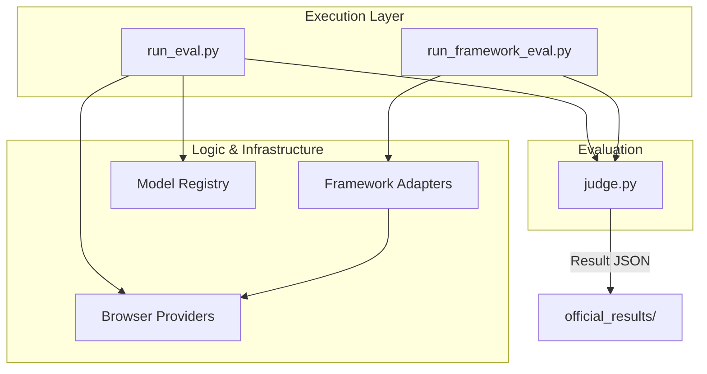
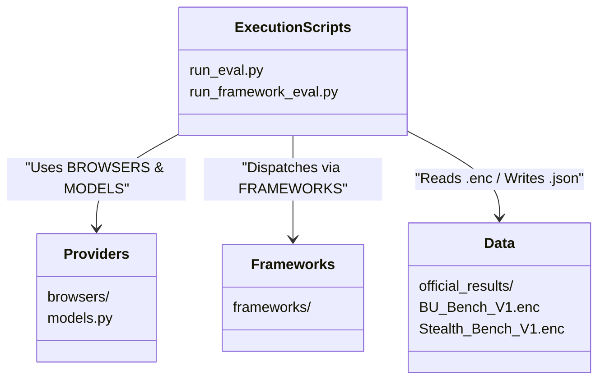

<!-- source: DeepWiki mcp.deepwiki.com · repo browser-use/benchmark · page 1 Overview · fetched 2026-10-30 -->

# Overview

Relevant source files

The following files were used as context for generating this wiki page:

- [.env.example](.env.example)
- [.gitignore](.gitignore)
- [BU_Bench_V1.enc](BU_Bench_V1.enc)
- [README.md](README.md)
- [browsers/__init__.py](browsers/__init__.py)
- [browsers/driver.py](browsers/driver.py)
- [fonts/GeistMono-Medium.otf](fonts/GeistMono-Medium.otf)
- [pyproject.toml](pyproject.toml)
- [uv.lock](uv.lock)

The `browser-use-benchmark` repository is a specialized evaluation framework designed to measure the performance, reliability, and stealth capabilities of browser-based AI agents. It provides a standardized environment to test various agent frameworks (e.g., `browser-use`, `Claude Code`) against different Large Language Models (LLMs) and browser infrastructure providers.

The project is divided into two primary benchmark suites:
1.  **BU Bench V1**: Focused on task completion, reasoning, and multi-step web navigation.
2.  **Stealth Bench V1**: Focused on the ability of browser configurations to bypass anti-bot protections.

## Core Architecture

The system is built as a modular pipeline that connects three major components: **Framework Adapters**, **LLM Models**, and **Browser Providers**.

### System Relationship Diagram
This diagram illustrates how the core evaluation scripts orchestrate the flow between the agent logic and the infrastructure.

**Sources:** [run_eval.py:1-20](), [run_framework_eval.py:1-30](), [browsers/__init__.py:33-45](), [judge.py:1-15]()

---

## Benchmark Suites

### BU Bench V1
A collection of 100 hand-selected tasks categorized into five areas: Custom challenges, WebBench, Mind2Web, GAIA, and AssistantBench [README.md:183-195](). These tasks are stored in an encrypted format (`BU_Bench_V1.enc`) to prevent model contamination during training [README.md:148-150]().
*   **Purpose**: Evaluate general-purpose web automation capabilities.
*   **Evaluation**: Uses a "Judge LLM" (typically `gemini-2.0-flash`) to grade performance based on screenshots and execution traces [README.md:135-136]().
*   **For details, see [BU Bench V1 — Task Evaluation](#2)**.

### Stealth Bench V1
Consists of 71 tasks specifically designed to test browser stealth across various anti-bot protections [README.md:37]().
*   **Purpose**: Measure how well a browser provider can mimic human behavior and avoid detection.
*   **Evaluation**: Focuses on success rates across categories like Cloudflare, Akamai, and Datadome.
*   **For details, see [Stealth Bench V1](#6)**.

---

## Major Subsystems

### Framework Adapters
The repository includes adapters to run multiple agent frameworks. These adapters normalize the output of different systems into a common `ExecutionResult` format for the judge.
*   **Key Entities**: `frameworks/browser_use/`, `frameworks/claude_code/`, and various JS-based harnesses.
*   **For details, see [Framework Adapters](#3)**.

### Browser Providers
A unified interface (`connect()` / `disconnect()`) allows the benchmark to swap between local browsers and cloud-based CDP providers [browsers/__init__.py:33-45]().
*   **Supported Providers**: `browser-use-cloud`, `anchor`, `browserbase`, `steel`, `local_headful`, and more [browsers/__init__.py:20-31]().
*   **For details, see [Browser Providers](#4)**.

### Model Registry
The `models.py` file serves as a central factory for LLM instances, supporting OpenAI, Anthropic, Google, and OpenRouter [README.md:165-180]().
*   **For details, see [LLM Model Registry](#5)**.

---

## Getting Started & Repository Layout

To begin using the benchmark, you must set up a Python environment using `uv`, configure API keys in a `.env` file, and decrypt the task sets.

*   **Quick Start**: See [Getting Started](#1.1) for installation and your first run.
*   **Project Map**: See [Repository Structure](#1.2) for a detailed breakdown of file locations and result storage.

### Code Entity Mapping
This diagram maps the conceptual components to their specific locations in the codebase.

**Sources:** [browsers/__init__.py:33-45](), [pyproject.toml:1-12](), [README.md:138-154]()

---

