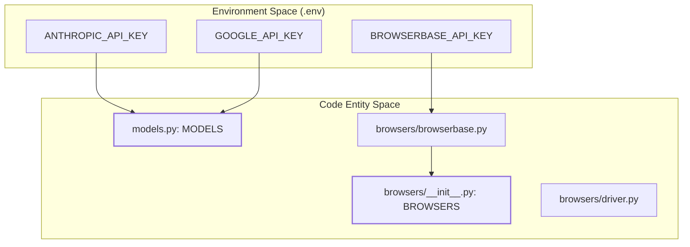
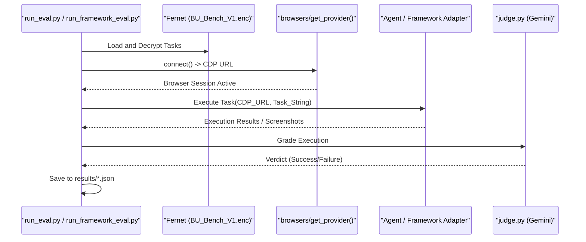

<!-- source: DeepWiki mcp.deepwiki.com · repo browser-use/benchmark · page 1.1 Getting Started · fetched 2026-10-30 -->

# Getting Started

<details>
<summary>Relevant source files</summary>

The following files were used as context for generating this wiki page:

- [.env.example](.env.example)
- [.gitignore](.gitignore)
- [BU_Bench_V1.enc](BU_Bench_V1.enc)
- [browsers/__init__.py](browsers/__init__.py)
- [browsers/driver.py](browsers/driver.py)
- [fonts/GeistMono-Medium.otf](fonts/GeistMono-Medium.otf)
- [pyproject.toml](pyproject.toml)
- [uv.lock](uv.lock)

</details>


This page provides a comprehensive guide for setting up the `browser-use-benchmark` repository. It covers environment configuration, dependency management with `uv`, and the execution of initial evaluations.

The benchmark suite is designed to evaluate browser automation agents across two primary dimensions: functional task completion (BU Bench V1) and anti-bot bypass capabilities (Stealth Bench V1).

## Prerequisites

The project utilizes `uv` for extremely fast Python package management and deterministic builds via `uv.lock`.

*   **Python**: Version 3.11 or higher is required [pyproject.toml:5-5]().
*   **uv**: It is recommended to have `uv` installed to manage the virtual environment and dependencies [uv.lock:1-7]().

## Installation

1.  **Clone the Repository**:
    ```bash
    git clone https://github.com/browser-use/benchmark
    cd benchmark
    ```

2.  **Install Dependencies**:
    The project defines its core requirements in `pyproject.toml`, including `browser-use`, `cryptography` (for task decryption), and `httpx` [pyproject.toml:6-12]().
    ```bash
    # Install main dependencies
    uv sync

    # Install optional dependencies for generating plots
    uv sync --group plots
    ```

3.  **Playwright Setup**:
    If you plan to use local browser providers (`local_headful` or `local_headless`), you must install the Playwright browser binaries [browsers/__init__.py:40-41]().
    ```bash
    uv run playwright install chromium
    ```

## Environment Configuration

The system relies on a `.env` file for API keys. A template is provided in `.env.example` [.env.example:1-24]().

### Required Keys
To run a standard evaluation with the default Judge LLM, you need:
*   `ANTHROPIC_API_KEY`: For running Claude-based agents.
*   `GOOGLE_API_KEY`: Required for the **Judge LLM** (typically `gemini-2.0-flash`), which grades the task outcomes [.env.example:2-4]().

### Provider Keys
If using managed browser clouds instead of local Chromium, you must provide the corresponding key:
*   `BROWSER_USE_API_KEY`: For `browser-use-cloud` [.env.example:1-1]().
*   `STEEL_API_KEY`, `BROWSERBASE_API_KEY`, `HYPERBROWSER_API_KEY`, etc. [.env.example:15-22]().

### Data Flow: Environment to Code
The following diagram illustrates how environment variables are consumed by the browser registry and model factory.

**Configuration Mapping (NL to Code Space)**

Sources: [.env.example:1-24](), [browsers/__init__.py:33-45](), [browsers/driver.py:9-11]()

## System Architecture Overview

The benchmark bridges high-level task descriptions with low-level browser control.

**Execution Flow: Task to Result**

Sources: [browsers/__init__.py:48-52](), [browsers/driver.py:14-28](), [pyproject.toml:9-9]()

## Running Your First Evaluation

### 1. BU Bench V1 (Functional)
To run the standard 100-task functional benchmark using the native `browser-use` agent:

```bash
# Run with local headless browser and Claude 3.5 Sonnet
python run_eval.py --model anthropic/claude-3-5-sonnet-20241022 --browser local_headless
```

### 2. Stealth Bench V1 (Anti-bot)
To evaluate how well a browser provider bypasses bot detection:

```bash
# Run stealth tests against a specific provider
python stealth_bench/run_stealth_eval.py --browser driver
```

## Key Files Summary

| File | Purpose |
| :--- | :--- |
| `pyproject.toml` | Defines project metadata and core dependencies (`browser-use`, `httpx`) [pyproject.toml:1-12](). |
| `uv.lock` | Ensures deterministic dependency resolution across all environments [uv.lock:1-7](). |
| `.env.example` | Template for required API keys for LLMs and Browser Providers [.env.example:1-24](). |
| `BU_Bench_V1.enc` | Encrypted task definitions for the functional benchmark [BU_Bench_V1.enc:1-1](). |
| `browsers/` | Registry of all supported browser connection logic (Local, Steel, Browserbase, etc.) [browsers/__init__.py:33-45](). |

## Troubleshooting

*   **Missing API Keys**: If an evaluation fails immediately, verify that `GOOGLE_API_KEY` is set; the Judge LLM cannot function without it.
*   **429 Rate Limits**: The benchmark includes a `retry_on_429` utility in the browser providers to handle concurrency bottlenecks [browsers/util.py:5-5]().
*   **Dependency Conflicts**: If using `pip` instead of `uv`, ensure your environment matches the versions in `uv.lock` to avoid regressions in `browser-use` behavior [uv.lock:9-39]().

Sources: [pyproject.toml:1-23](), [uv.lock:1-50](), [.env.example:1-24](), [browsers/__init__.py:1-53](), [browsers/driver.py:1-44]()

---

