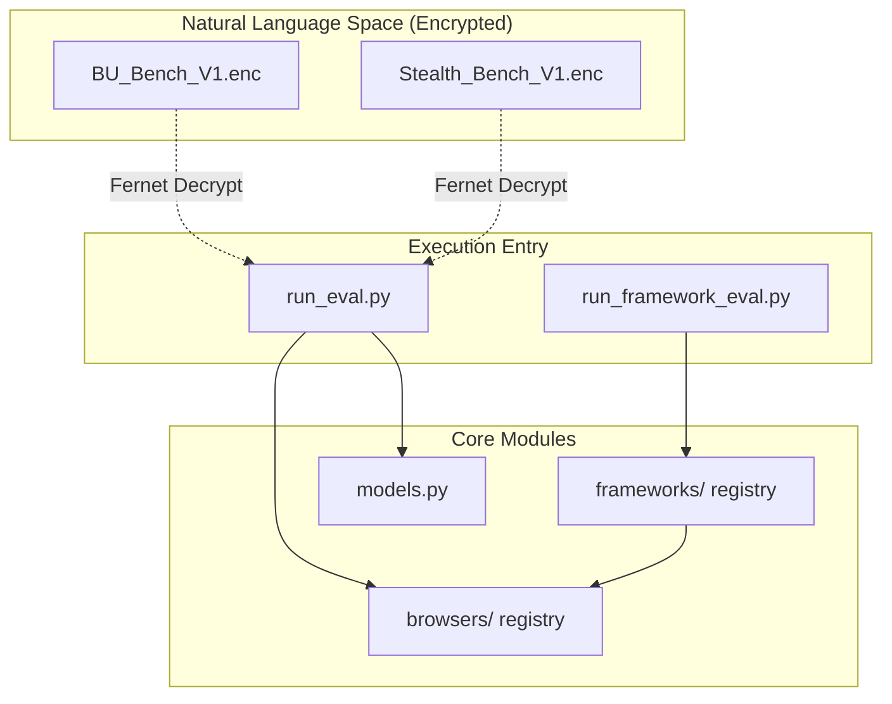
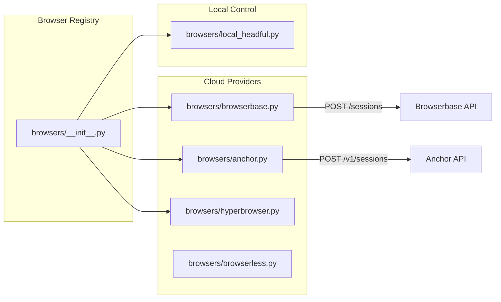

<!-- source: DeepWiki mcp.deepwiki.com · repo browser-use/benchmark · page 1.2 Repository Structure · fetched 2026-10-30 -->

# Repository Structure

Relevant source files

The following files were used as context for generating this wiki page:

- [BU_Bench_V1.enc](BU_Bench_V1.enc)
- [README.md](README.md)
- [Stealth_Bench_V1.enc](Stealth_Bench_V1.enc)
- [browsers/anchor.py](browsers/anchor.py)
- [browsers/browserbase.py](browsers/browserbase.py)
- [browsers/browserless.py](browsers/browserless.py)
- [browsers/hyperbrowser.py](browsers/hyperbrowser.py)
- [browsers/local_headful.py](browsers/local_headful.py)
- [fonts/GeistMono-Medium.otf](fonts/GeistMono-Medium.otf)
- [pyproject.toml](pyproject.toml)
- [uv.lock](uv.lock)

This page provides a technical map of the `browser-use/benchmark` repository. The codebase is structured to support multi-framework evaluation across two distinct benchmark suites: **BU Bench V1** (agentic task completion) and **Stealth Bench V1** (anti-bot bypass).

## Top-Level Directory Layout

The repository follows a modular structure where evaluation logic is separated from framework-specific adapters and browser provisioning logic.

| Directory / File | Description |
| :--- | :--- |
| `frameworks/` | Contains adapters for various agent frameworks (e.g., `browser-use`, `claude-code`, `stagehand`). |
| `browsers/` | Provider-specific modules for connecting to cloud and local browsers. |
| `stealth_bench/` | Sub-project containing task definitions and specialized plotting logic for the Stealth benchmark. |
| `official_results/` | Source of truth for benchmark results used in public comparisons. |
| `results/` | Local directory for storing summary JSON files from evaluation runs (gitignored). |
| `run_data/` | Local directory for detailed execution traces, including screenshots and decrypted task text (gitignored). |
| `run_eval.py` | The primary entry point for running native `browser-use` evaluations [run_eval.py:1-10](). |
| `run_framework_eval.py`| Orchestrator for running benchmarks across different framework adapters [README.md:145-149](). |

### Code Entity Mapping: Evaluation Flow

The following diagram illustrates how the top-level scripts interact with the internal modules to execute a benchmark task.

**Evaluation Component Interconnect**

Sources: [README.md:68-83](), [README.md:145-154](), [run_eval.py:1-20]()

---

## Task Definitions and Security

Benchmark tasks are stored in encrypted `.enc` files to prevent data contamination in LLM training sets. 

*   **Encryption Mechanism**: Tasks are encrypted using `cryptography.fernet` [README.md:72-74](). 
*   **BU Bench V1**: 100 tasks covering custom interaction challenges, WebBench, Mind2Web, and GAIA [README.md:181-190]().
*   **Stealth Bench V1**: 71 tasks specifically targeting anti-bot protections like Cloudflare, Akamai, and Datadome [README.md:35-37]().

The `run_eval.py` and `run_framework_eval.py` scripts decrypt these tasks in-memory during the execution loop [README.md:147-149]().

Sources: [README.md:68-78](), [README.md:145-150]()

---

## Frameworks and Adapters

The `frameworks/` directory implements a registry pattern. Each sub-directory (e.g., `frameworks/browser_use/`) contains a `run_task.py` or similar adapter that maps the benchmark's standardized `task` input to the framework's specific API.

*   **Dispatch Logic**: `run_framework_eval.py` uses the `--framework` argument to look up the corresponding adapter in the `FRAMEWORKS` registry.
*   **Isolation**: Many adapters shell out to external processes (like Node.js for `stagehand` or Rust for `but-rust`) to ensure environment isolation.

Sources: [README.md:151-157]()

---

## Browser Provisioning (`browsers/`)

The `browsers/` module provides a unified interface for managing browser lifecycles. Each provider implements a `connect()` and `disconnect()` function.

| Provider Module | Service | Key Implementation Detail |
| :--- | :--- | :--- |
| `anchor.py` | Anchor Browser | Uses `anchor_residential` proxy and enables `extra_stealth` [browsers/anchor.py:27-33](). |
| `browserbase.py` | Browserbase | Manages session IDs via `/v1/sessions` and enables `solveCaptchas` [browsers/browserbase.py:22-35](). |
| `hyperbrowser.py` | Hyperbrowser | Connects via `wsEndpoint` with `useStealth` enabled [browsers/hyperbrowser.py:24-32](). |
| `local_headful.py`| Local Playwright | Returns `None` to signal native local launch [browsers/local_headful.py:6-7](). |

**Browser Connection Entity Map**

Sources: [browsers/anchor.py:16-44](), [browsers/browserbase.py:16-36](), [browsers/hyperbrowser.py:16-32](), [browsers/local_headful.py:1-11]()

---

## Results and Naming Conventions

The benchmark produces two types of output stored in `results/` and `official_results/`.

### Result File Naming
Files follow a strict naming convention to facilitate automated plotting:
`{Framework}_{version}_browser_{browser}_model_{model}.json`

### Data Flow
1.  **Execution**: `run_eval.py` or `run_framework_eval.py` executes tasks.
2.  **Persistence**: Summary statistics (success rate, duration, cost) are saved to a JSON file. Detailed logs and screenshots are saved to `run_data/{run_id}/`.
3.  **Aggregation**: The `official_results/` directory stores finalized runs that have been verified.
4.  **Visualization**: `generate_plots.py` reads these JSON files to produce the comparison charts seen in the README.

Sources: [README.md:143-144](), [README.md:159-161]()

---

