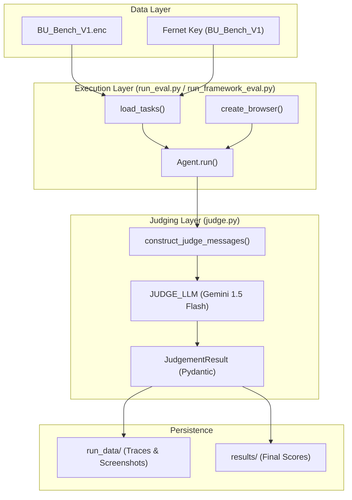

<!-- source: DeepWiki mcp.deepwiki.com · repo browser-use/benchmark · page 2 BU Bench V1 — Task Evaluation · fetched 2026-10-30 -->

# BU Bench V1 — Task Evaluation

Relevant source files

The following files were used as context for generating this wiki page:

- [README.md](README.md)
- [judge.py](judge.py)
- [run_eval.py](run_eval.py)

BU Bench V1 is a comprehensive benchmark consisting of **100 hand-selected tasks** designed to evaluate the performance of browser automation agents. The benchmark tests agents across diverse scenarios, ranging from simple information retrieval to complex multi-step web navigation and page interaction challenges.

### Task Composition
The 100 tasks are drawn from both established datasets and custom-built challenges:

| Source | Tasks | Description |
| :--- | :--- | :--- |
| **Custom** | 20 | Specific page interaction and edge-case challenges |
| **WebBench** | 20 | Standard web browsing and search tasks |
| **Mind2Web 2** | 20 | Complex, multi-step web navigation trajectories |
| **GAIA** | 20 | General AI assistant tasks requiring browser access |
| **VisualWebBench** | 20 | Tasks emphasizing visual understanding of web UI |

Sources: [README.md:181-190]()

---

## Evaluation Architecture

The evaluation system is built to be framework-agnostic, allowing for the comparison of different agent architectures (e.g., `browser-use` native, `Claude Code`, `Stagehand`) using a unified judge and browser provisioning layer.

### System Data Flow
The following diagram illustrates how a task moves from the encrypted dataset through the execution and judging phases.

**Task Lifecycle and Code Entities**

Sources: [run_eval.py:42-46](), [run_eval.py:63-67](), [run_eval.py:103-116](), [run_eval.py:151-161](), [judge.py:14-21]()

---

## Core Components

### 1. Evaluation Scripts
The primary entry point for running the benchmark is `run_eval.py`. It manages the lifecycle of an evaluation run, including:
*   **Decryption**: Loading tasks from `BU_Bench_V1.enc` using a Fernet key derived from the suite name.
*   **Concurrency**: Managing task execution via an `asyncio.Semaphore` (default `MAX_CONCURRENT = 3`).
*   **Browser Provisioning**: Utilizing the `browsers/` module to connect to local or cloud-based browser instances.

For details, see [run_eval.py — Native Evaluation Script](#2.1).

Sources: [run_eval.py:44-46](), [run_eval.py:63-67](), [run_eval.py:98-103]()

### 2. The Judge System
Consistency in evaluation is maintained by a centralized "Judge LLM" (Gemini 1.5 Flash). The judge evaluates the agent's execution trace, including the final text output and a sequence of screenshots. It produces a `JudgementResult` containing a boolean `verdict`, detailed `reasoning`, and flags for `impossible_task` or `reached_captcha`.

For details, see [judge.py — Automated Grading](#2.2).

Sources: [run_eval.py:42-43](), [judge.py:14-21](), [judge.py:79-89]()

### 3. Distributed Runner
To handle large-scale evaluations across many models and frameworks, the repository includes a distributed runner system optimized for GitHub Actions.
*   **`orcheator.py`**: Acts as the leader, dispatching batches of tasks and aggregating results.
*   **`run_batch.py`**: Acts as the worker, executing a specific subset of tasks assigned by the orchestrator.

For details, see [Distributed Runner — orchestrator.py and run_batch.py](#2.3).

---

## Result Storage and Traces

Evaluation outputs are stored in two distinct locations to balance data privacy and analysis needs:

| Directory | Content | Description |
| :--- | :--- | :--- |
| `results/` | JSON Summary | Contains high-level metrics: `tasks_completed`, `tasks_successful`, `total_duration`, and `total_cost`. |
| `run_data/` | Detailed Traces | Includes decrypted task text, ground truth, full step-by-step agent logs, and base64 screenshots. |

**Important**: `run_data/` contains sensitive decrypted task information and is gitignored. It is intended for local verification and debugging only.

Sources: [README.md:143-144](), [README.md:159-161](), [run_eval.py:168-187]()

---

