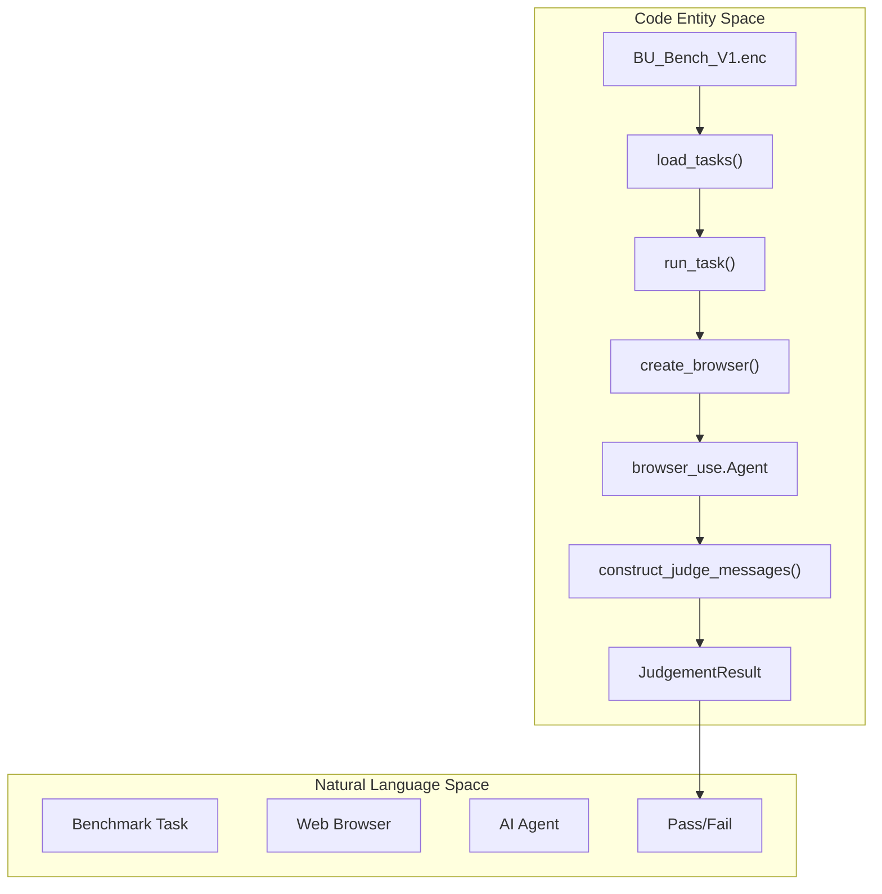
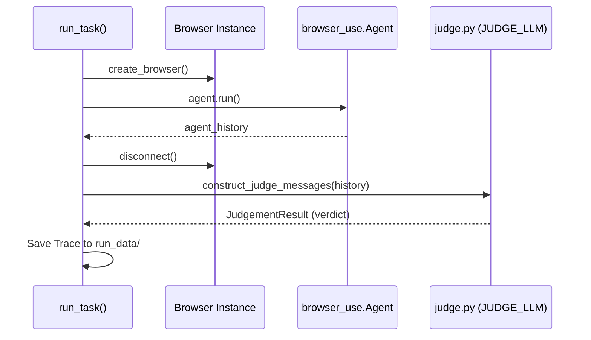

<!-- source: DeepWiki mcp.deepwiki.com · repo browser-use/benchmark · page 2.1 run_eval.py — Native Evaluation Script · fetched 2026-10-30 -->

# run_eval.py — Native Evaluation Script

Relevant source files

The following files were used as context for generating this wiki page:

- [README.md](README.md)
- [judge.py](judge.py)
- [run_eval.py](run_eval.py)

`run_eval.py` is the primary entry point for executing the **BU Bench V1** benchmark suite. It orchestrates the end-to-end evaluation lifecycle, including task decryption, browser provisioning, agent execution, and automated judging. The script is designed for high-concurrency evaluation while maintaining strict isolation between tasks and providing detailed telemetry for each run.

### Implementation Overview

The script follows a structured flow: it initializes the environment, loads encrypted tasks, and enters an asynchronous execution loop managed by a semaphore to control resource usage.

#### Core Logic Flow
1.  **Environment Setup**: Loads `.env` variables and configures logging levels to suppress noise [run_eval.py:15-40]().
2.  **Task Loading**: Decrypts `BU_Bench_V1.enc` using a Fernet key derived from a SHA-256 hash of the benchmark name [run_eval.py:63-66]().
3.  **Concurrency Management**: Uses `asyncio.Semaphore(MAX_CONCURRENT)` to limit the number of active browser sessions [run_eval.py:45, 98]().
4.  **Execution Loop**: For each task, it provisions a browser, runs the `browser_use.Agent`, and invokes the `JUDGE_LLM` (Gemini 2.5 Flash) to determine success [run_eval.py:107-161]().
5.  **Persistence**: Saves granular traces to `run_data/` and summary statistics to `results/` [run_eval.py:168-204]().

### Data Flow and Code Entity Mapping

The following diagram illustrates how the natural language concept of "Evaluating a Task" maps to specific code entities and data structures within the script.

**Task Evaluation Data Flow**

**Sources:** [run_eval.py:63-66](), [run_eval.py:69-81](), [run_eval.py:84-161](), [judge.py:28-49]()

### Task Loading and Decryption

Benchmark tasks are stored in `BU_Bench_V1.enc` to prevent accidental exposure of ground truth and task descriptions to web crawlers or LLM training sets. The decryption process uses the `cryptography.fernet` library.

*   **Key Generation**: A deterministic key is generated by taking the SHA-256 hash of the string `"BU_Bench_V1"` and base64 encoding it [run_eval.py:64]().
*   **Decryption**: The `load_tasks` function reads the file, decodes the base64 content, and decrypts it using the generated key before parsing the resulting JSON [run_eval.py:65-66]().

**Sources:** [run_eval.py:63-67]()

### Browser Provisioning

The `create_browser()` function serves as a factory for browser instances, supporting both local and cloud-based providers.

| Provider Type | Implementation Logic |
| :--- | :--- |
| **Native Cloud** | Uses `Browser(use_cloud=True)` for `browser-use-cloud` [run_eval.py:76-77](). |
| **CDP Proxy** | Connects via `Browser(cdp_url=...)` for providers like Anchor or Steel [run_eval.py:78-81](). |
| **Local** | Launches built-in Chromium via Playwright (headless or headful) [run_eval.py:79-80](). |

**Sources:** [run_eval.py:69-81](), [browsers/__init__.py:1-15]()

### Agent Execution and Timeout

The agent execution is wrapped in a timeout mechanism to prevent hung processes from exhausting resources.

*   **TASK_TIMEOUT**: Each task is capped at 1800 seconds (30 minutes) [run_eval.py:46]().
*   **Execution**: `asyncio.wait_for(agent.run(), timeout=TASK_TIMEOUT)` manages the lifecycle [run_eval.py:114-116]().
*   **Cleanup**: On timeout, the script explicitly calls `browser.stop()` and `browser_provider.disconnect()` to ensure no orphaned processes remain [run_eval.py:118-120]().

**Sources:** [run_eval.py:46](), [run_eval.py:114-132]()

### The Evaluation Loop

The core logic of `run_task()` bridges the execution of the agent with the automated judging system.

**Agent Execution to Judge Workflow**

**Sources:** [run_eval.py:84-187](), [judge.py:28-49]()

### Persistence and Results

The script generates two types of output for every evaluation run:

1.  **Run Data (`run_data/{task_id}.json`)**: A detailed trace containing the task description, final result, individual steps, ground truth, and base64-encoded screenshots [run_eval.py:170-187]().
2.  **Summary Results (`results/{filename}.json`)**: A summary file named using the pattern `{Framework}_{Version}_browser_{Browser}_model_{Model}.json`. It aggregates metrics including:
    *   `tasks_completed`: Total tasks attempted.
    *   `tasks_successful`: Count of tasks where the judge gave a `true` verdict.
    *   `total_steps`: Sum of steps across all tasks.
    *   `total_duration`: Total execution time in seconds.
    *   `total_cost`: Aggregated API costs [run_eval.py:189-204, 252-273]().

**Sources:** [run_eval.py:168-204](), [run_eval.py:252-273]()

---

