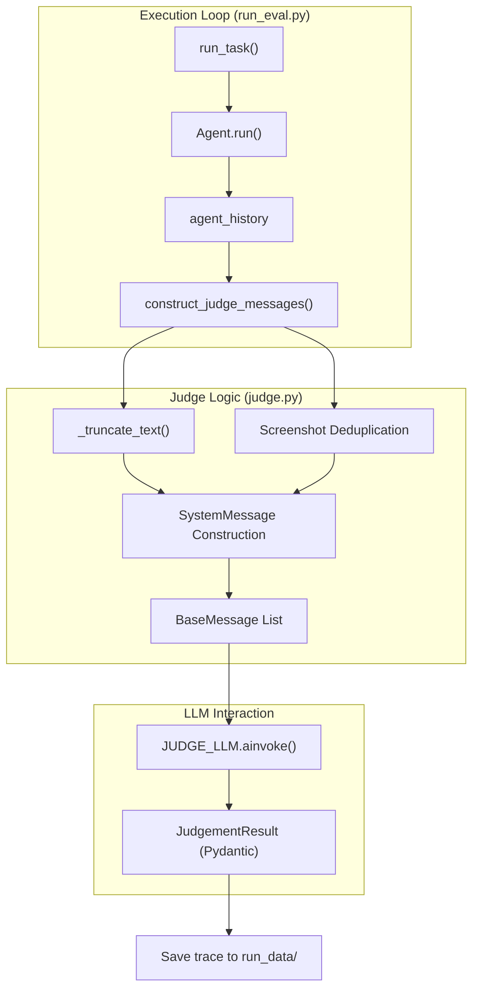
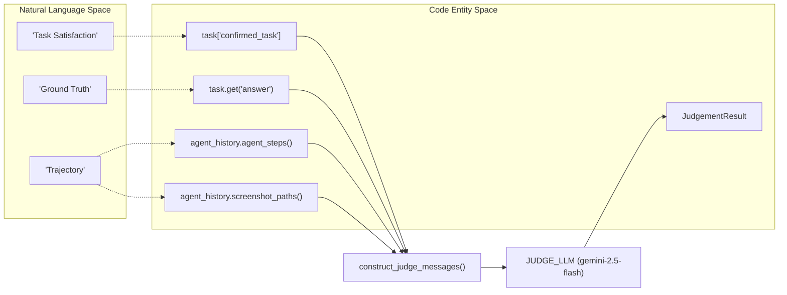

<!-- source: DeepWiki mcp.deepwiki.com · repo browser-use/benchmark · page 2.2 judge.py — Automated Grading · fetched 2026-10-30 -->

# judge.py — Automated Grading

<details>
<summary>Relevant source files</summary>

The following files were used as context for generating this wiki page:

- [judge.py](judge.py)
- [run_eval.py](run_eval.py)

</details>


The `judge.py` module provides the automated evaluation logic for the browser-use benchmark. It leverages a high-performance LLM (specifically `gemini-2.5-flash`) to act as a "Judge" that inspects agent execution traces, screenshots, and final outputs to determine if a task was successfully completed according to the user's intent and any provided ground truth.

### Judgement Schema

The system uses a structured Pydantic model to ensure consistent evaluation output. This model captures not just a binary success/failure verdict, but also the reasoning and specific failure modes encountered during the browser session.

#### The JudgementResult Model
Defined in `[judge.py:14-20]()`, the `JudgementResult` class contains:

| Field | Type | Description |
| :--- | :--- | :--- |
| `reasoning` | `str \| None` | A detailed explanation of why the judge reached its conclusion. |
| `verdict` | `bool` | The final pass/fail grade for the task. |
| `failure_reason` | `str \| None` | Specific description of what went wrong if `verdict` is `False`. |
| `impossible_task` | `bool` | Flagged if the task could not be completed due to external factors (e.g., missing credentials). |
| `reached_captcha` | `bool` | Flagged if the agent was blocked by anti-bot measures. |

**Sources:** `[judge.py:14-20]()`

---

### Data Flow and Processing

The judge does not process the raw browser stream. Instead, it operates on an execution trace collected after the agent completes its run.

#### 1. Input Preparation
The `run_task` function in `run_eval.py` collects several inputs from the `agent_history` before calling the judge:
*   **Task Description**: The original prompt.
*   **Final Result**: The text the agent returned as its "done" message.
*   **Agent Steps**: A list of formatted descriptions for every action taken.
*   **Screenshots**: Base64 encoded images of the browser state at various steps.
*   **Ground Truth**: (Optional) Expected factual answers or specific evaluation criteria.

#### 2. Screenshot Deduplication and Selection
To stay within LLM context limits and focus on relevant state changes, `construct_judge_messages` performs deduplication. It selects the last $N$ (default 10) unique screenshots by iterating through the history in reverse order `[judge.py:55-58]()`.

#### 3. Text Truncation
To prevent context overflow, the task description, final result, and step history are truncated to 40,000 characters each using the `_truncate_text` utility `[judge.py:23-25]()`.

#### 4. Message Construction
The `construct_judge_messages` function assembles these components into a list of `BaseMessage` objects (System, User, and Image parts) compatible with the `browser-use` LLM interface `[judge.py:28-64]()`.

**Sources:** `[run_eval.py:134-161]()`, `[judge.py:23-64]()`

---

### Evaluation Criteria

The Judge LLM is governed by a rigorous system prompt that defines five primary evaluation criteria and strict failure conditions.

#### Primary Evaluation Criteria
The judge evaluates the trajectory based on the following hierarchy:
1.  **Task Satisfaction**: Did the agent accomplish the core intent? `[judge.py:84-84]()`
2.  **Output Quality**: Is the final result complete and in the requested format? `[judge.py:85-85]()`
3.  **Tool Effectiveness**: Were browser interactions appropriate and successful? `[judge.py:86-86]()`
4.  **Agent Reasoning**: Quality of planning and decision-making. `[judge.py:87-87]()`
5.  **Browser Handling**: Stability, recovery, and technical execution. `[judge.py:88-88]()`

#### Ground Truth Precedence
If a `ground_truth` is provided in the task definition, it takes **absolute precedence** over all other criteria. If the agent's output contradicts the ground truth, the verdict must be `False` `[judge.py:76-77]()`.

#### Automatic Failure Conditions
The verdict is automatically set to `False` if any of the following occur:
*   Blocked by CAPTCHA or missing authentication `[judge.py:109-109]()`.
*   Agent makes up information not present in screenshots (hallucination) `[judge.py:117-117]()`.
*   The agent calls the "done" action before completing all key points of the task `[judge.py:118-118]()`.
*   Infinite loops or browser crashes `[judge.py:111-114]()`.

**Sources:** `[judge.py:66-119]()`

---

### Technical Architecture Diagrams

#### Judge Integration Flow
This diagram shows how the `run_task` function orchestrates the agent and the judge.


**Sources:** `[run_eval.py:107-161]()`, `[judge.py:28-64]()`

#### Code Entity Mapping: From Trace to Verdict
This diagram bridges the natural language concepts used in the judge's prompt to the specific code entities in the system.


**Sources:** `[run_eval.py:43-44]()`, `[run_eval.py:140-157]()`, `[judge.py:14-20]()`

---

### Implementation Details: Screenshot Selection
The judge deduplicates screenshots to avoid showing the LLM identical frames (e.g., while waiting for a page to load).

```python
# From judge.py:55-58
seen = set()
unique = [s for s in reversed(screenshots_b64) if s not in seen and not seen.add(s)]
selected = list(reversed(unique[:max_images]))
```
This logic ensures that the **most recent** unique states of the browser are prioritized for the judge's evaluation context.

**Sources:** `[judge.py:55-58]()`

---

