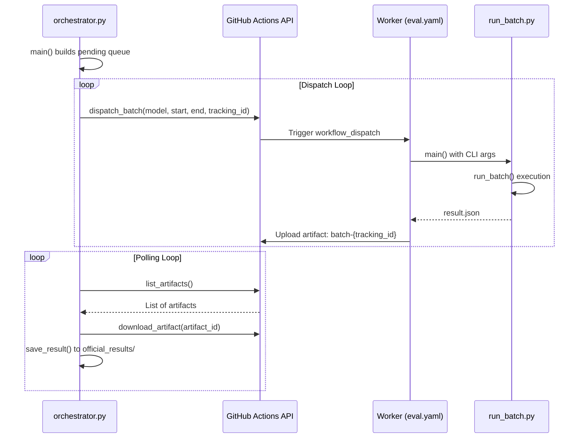
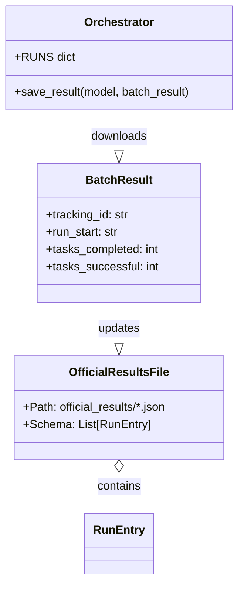

<!-- source: DeepWiki mcp.deepwiki.com · repo browser-use/benchmark · page 2.3 Distributed Runner — orchestrator.py and run_batch.py · fetched 2026-10-30 -->

# Distributed Runner — orchestrator.py and run_batch.py

<details>
<summary>Relevant source files</summary>

The following files were used as context for generating this wiki page:

- [.github/workflows/eval.yaml](.github/workflows/eval.yaml)
- [orchestrator.py](orchestrator.py)
- [results/BrowserUse_0.11.5_browser_BrowserUseCloud_model_ChatBrowserUse-2.json](results/BrowserUse_0.11.5_browser_BrowserUseCloud_model_ChatBrowserUse-2.json)
- [run_batch.py](run_batch.py)

</details>


The distributed runner system enables large-scale benchmarking by parallelizing evaluation tasks across multiple GitHub Actions runners. It follows a leader-worker architecture where `orchestrator.py` acts as the central controller (leader) and `run_batch.py` executes specific task subsets on ephemeral workers.

### System Architecture

The system is designed to handle the full BU Bench V1 suite (100 tasks) across multiple models and multiple iterations per model. To prevent individual runner timeouts and maximize throughput, tasks are partitioned into batches.

#### Distributed Runner Logic Flow
"The following diagram illustrates the interaction between the local Orchestrator, GitHub Actions API, and the Batch Workers."


Sources: [orchestrator.py:118-171](), [run_batch.py:70-84](), [.github/workflows/eval.yaml:33-74]()

---

### Orchestrator Logic (`orchestrator.py`)

The orchestrator is responsible for lifecycle management of the entire evaluation run. It maintains a queue of batches and manages concurrency limits to avoid hitting GitHub API rate limits or runner exhaustion.

#### Key Components:
- **Batching**: The 100 tasks in BU Bench V1 are split into batches of 10 (`BATCH_SIZE = 10`) [[orchestrator.py:22-22]()].
- **Tracking**: Each batch is assigned a unique `tracking_id` (UUID) and a `run_start` identifier (timestamp) [[orchestrator.py:123-126]()].
- **Concurrency**: It limits active batches via `MAX_CONCURRENT_BATCHES` (default: 25) [[orchestrator.py:23-23]()].
- **Polling**: Every 30 seconds, it checks for new artifacts using `list_artifacts()` and matches them to dispatched batches using the `batch-{tracking_id}` naming convention [[orchestrator.py:24-24](), [orchestrator.py:153-162]()].

#### Core Functions:
| Function | Description |
| :--- | :--- |
| `dispatch_batch` | Sends a `POST` request to the GitHub `dispatches` endpoint with task indices and model info [[orchestrator.py:43-48]()]. |
| `list_artifacts` | Fetches the latest 100 artifacts from the repository [[orchestrator.py:51-69]()]. |
| `download_artifact` | Downloads the ZIP from GitHub, extracts the JSON, and parses it [[orchestrator.py:72-89]()]. |
| `save_result` | Aggregates metrics (steps, cost, success) into the model's file in `official_results/` [[orchestrator.py:92-115]()]. |

Sources: [orchestrator.py:16-41](), [orchestrator.py:43-115]()

---

### Worker Execution (`run_batch.py`)

The worker script runs within the GitHub Action environment defined in `.github/workflows/eval.yaml`. It is optimized for high-concurrency execution of a specific task slice.

#### Task Interleaving
To ensure that every batch contains a representative mix of task difficulties (ranging from easy to hard), `run_batch.py` uses an `interleave` function. This reorders the 100 tasks (5 categories of 20 tasks each) so that a batch of 10 contains 2 tasks from each category [[run_batch.py:17-23]()].

#### Execution Loop
The `run_batch()` function initializes the requested LLM from the `MODELS` registry and uses an `asyncio.Semaphore` to control local concurrency (default: 3 parallel tasks) [[run_batch.py:46-52]()]. It calls the core `run_task` function from the native evaluation script to perform the actual work [[run_batch.py:13-13](), [run_batch.py:52-52]()].

#### Model Registry (`MODELS`)
The script maintains its own mapping of model strings to `browser_use` LLM factories:
- **Browser-Use**: `ChatBrowserUse(model="bu-1-0")` [[run_batch.py:27-28]()].
- **OpenAI**: `ChatOpenAI` with `gpt-5` variants [[run_batch.py:30-32]()].
- **Anthropic**: `ChatAnthropic` for Claude 3.5 and 4.5 models [[run_batch.py:34-37]()].
- **Google**: `ChatGoogle` for Gemini flash and pro models [[run_batch.py:39-42]()].

Sources: [run_batch.py:17-43](), [run_batch.py:46-67]()

---

### Workflow Definition (`eval.yaml`)

The GitHub Actions workflow serves as the infrastructure provider. It is triggered via `workflow_dispatch` by the orchestrator.

#### Workflow Inputs and Environment
The workflow accepts several inputs that are passed directly to `run_batch.py`:
- `model`, `start`, `end`, `parallel`, `tracking_id`, and `run_start` [[.github/workflows/eval.yaml:5-30]()].

It provides the necessary API keys via GitHub Secrets:
- `OPENAI_API_KEY`, `ANTHROPIC_API_KEY`, `GOOGLE_API_KEY`, and `BROWSER_USE_API_KEY` [[.github/workflows/eval.yaml:54-57]()].

#### Artifact Persistence
After `run_batch.py` completes, the workflow uploads `result.json` as a GitHub artifact named `batch-${{ inputs.tracking_id }}`. This artifact is kept for 30 days [[.github/workflows/eval.yaml:68-73]()].

Sources: [.github/workflows/eval.yaml:4-74]()

---

### Data Aggregation and Schema

The results are aggregated into `official_results/` using a specific naming convention: `BrowserUse_{version}_browser_{provider}_model_{model}.json` [[orchestrator.py:95-95]()].

#### Result Schema (`official_results/`)
Each file contains a list of run objects, keyed by `run_start`.

```json
[
  {
    "run_start": "20260128_200943_0",
    "tasks_completed": 100,
    "tasks_successful": 85,
    "total_steps": 1240,
    "total_duration": 4500.5,
    "total_cost": 0.15
  }
]
```
Sources: [orchestrator.py:105-113](), [results/BrowserUse_0.11.5_browser_BrowserUseCloud_model_ChatBrowserUse-2.json:1-10]()

#### Aggregation Entity Map
"This diagram maps the logical data aggregation concepts to the code variables and files that handle them."


Sources: [orchestrator.py:27-36](), [orchestrator.py:92-115](), [run_batch.py:55-67]()

---

