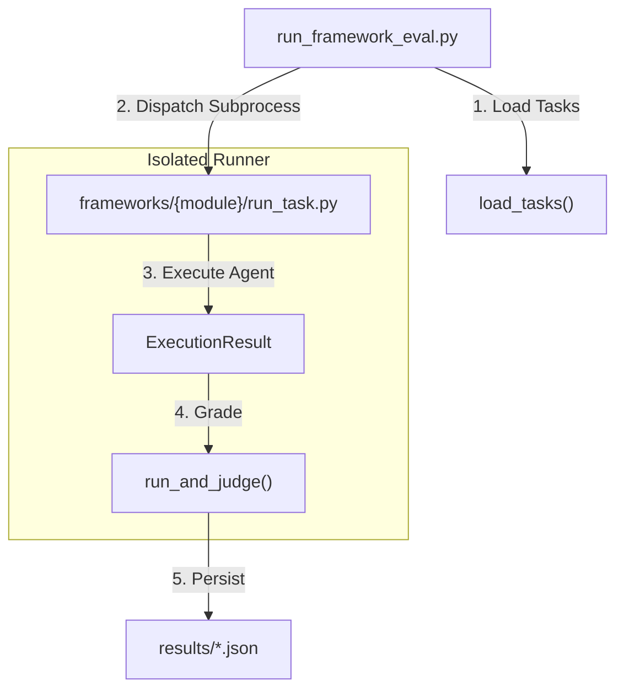
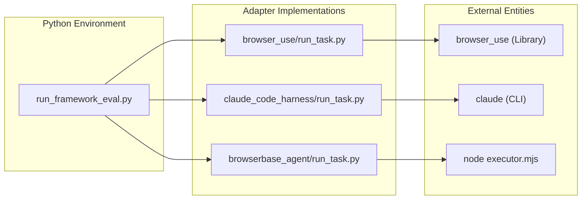

<!-- source: DeepWiki mcp.deepwiki.com · repo browser-use/benchmark · page 3 Framework Adapters · fetched 2026-10-30 -->

# Framework Adapters

Relevant source files

The following files were used as context for generating this wiki page:

- [frameworks/__init__.py](frameworks/__init__.py)
- [frameworks/browser_use_cloud_api_v2/run_task.py](frameworks/browser_use_cloud_api_v2/run_task.py)
- [frameworks/browser_use_cloud_api_v3/run_task.py](frameworks/browser_use_cloud_api_v3/run_task.py)
- [frameworks/browserbase_agent/package.json](frameworks/browserbase_agent/package.json)
- [frameworks/browserbase_agent/run_task.py](frameworks/browserbase_agent/run_task.py)
- [frameworks/claude_code_harness/run_task.py](frameworks/claude_code_harness/run_task.py)
- [frameworks/claude_code_harness/system_prompt.md](frameworks/claude_code_harness/system_prompt.md)
- [frameworks/claude_code_harness_ab/system_prompt.md](frameworks/claude_code_harness_ab/system_prompt.md)
- [frameworks/claude_code_harness_bu_cli/system_prompt.md](frameworks/claude_code_harness_bu_cli/system_prompt.md)
- [run_framework_eval.py](run_framework_eval.py)

The framework adapter system allows the benchmark to evaluate any agentic web-browsing framework using a unified interface. While `run_eval.py` is dedicated to the native `browser-use` library, `run_framework_eval.py` serves as a generic orchestrator that dispatches tasks to isolated runners for different frameworks (e.g., Claude Code, Stagehand, or Cloud APIs).

### Framework Dispatch Logic

The `run_framework_eval.py` script manages the high-level evaluation loop. It loads tasks from the encrypted benchmark file and, for each task, spawns a separate subprocess to execute the specific framework's adapter [run_framework_eval.py:1-53](). This isolation ensures that dependency conflicts between different frameworks (like varying Playwright or Pydantic versions) do not interfere with the benchmark orchestrator.

The orchestrator uses a `FRAMEWORKS` registry to validate supported adapters and their compatible browser providers [frameworks/__init__.py:81-143]().

#### Framework Orchestration Flow
"Framework Evaluation Flow"

Sources: [run_framework_eval.py:87-157](), [frameworks/__init__.py:63-71](), [frameworks/__init__.py:228-275]()

### The Framework Registry

All supported adapters are registered in `frameworks/__init__.py`. This registry defines which browser providers are valid for a given framework and points to the relevant source repository for version tracking.

| Framework Key | Module Name | Compatible Browsers | Primary Role |
| :--- | :--- | :--- | :--- |
| `browser-use` | `browser_use` | Cloud, Local, etc. | Native library adapter |
| `browser-use-cloud-api-v3` | `browser_use_cloud_api_v3` | `integrated` | Server-side Agent API |
| `claude-code-harness` | `claude_code_harness` | `browser-use-cloud` | Claude Code CLI wrapper |
| `browserbase-agent` | `browserbase_agent` | `integrated` | Stagehand SDK + Cloud |
| `bcode` | `bcode` | `browser-use-cloud` | Browsercode CLI adapter |

Sources: [frameworks/__init__.py:81-143](), [frameworks/__init__.py:146-150]()

### Shared Evaluation Interface

To ensure consistency across frameworks, every adapter must return an `ExecutionResult` dataclass and utilize the `run_and_judge()` helper.

#### ExecutionResult Dataclass
This structure standardizes the output of disparate agents into a format the benchmark judge can process [frameworks/__init__.py:63-71]().
* `final_result`: The text answer provided by the agent.
* `steps`: A list of strings describing actions taken.
* `screenshots_b64`: Base64 encoded images for visual verification.
* `num_steps`: Total count of actions.
* `duration_seconds`: Wall-clock time taken.

#### run_and_judge()
This shared flow performs the following:
1.  **Execution**: Calls the framework-specific `execute_fn`.
2.  **Grading**: Sends the `ExecutionResult` to the `JudgeLLM` (Gemini 2.5 Flash) [frameworks/__init__.py:191-206]().
3.  **Persistence**: Saves detailed traces (including decrypted task text and screenshots) to `run_data/` and summary results to `results/` [frameworks/__init__.py:228-275]().

Sources: [frameworks/__init__.py:63-71](), [frameworks/__init__.py:191-206](), [frameworks/__init__.py:228-275]()

### Adapter Categories

The benchmark supports several categories of adapters, each with unique execution requirements:

*   **Native & Cloud API Adapters**: Python-based adapters that call the `browser-use` library or interact with the Browser Use Cloud REST APIs. See [browser-use and Cloud API Adapters](#3.1).
*   **Claude Code Harnesses**: A family of adapters that wrap the Claude Code CLI. They utilize a `system_prompt.md` to instruct the CLI to use a specific browser-harness for interactions. See [Claude Code Harness Adapters](#3.2).
*   **External & Cross-Language Adapters**: Adapters for frameworks like Stagehand (Node.js) or Browserbase. These often shell out to non-Python executors (e.g., `executor.mjs`) and capture JSON output. See [Other Framework Adapters](#3.3).

"Adapter Execution Mapping"

Sources: [frameworks/browser_use_cloud_api_v3/run_task.py:1-10](), [frameworks/claude_code_harness/run_task.py:1-9](), [frameworks/browserbase_agent/run_task.py:11-30]()

---

