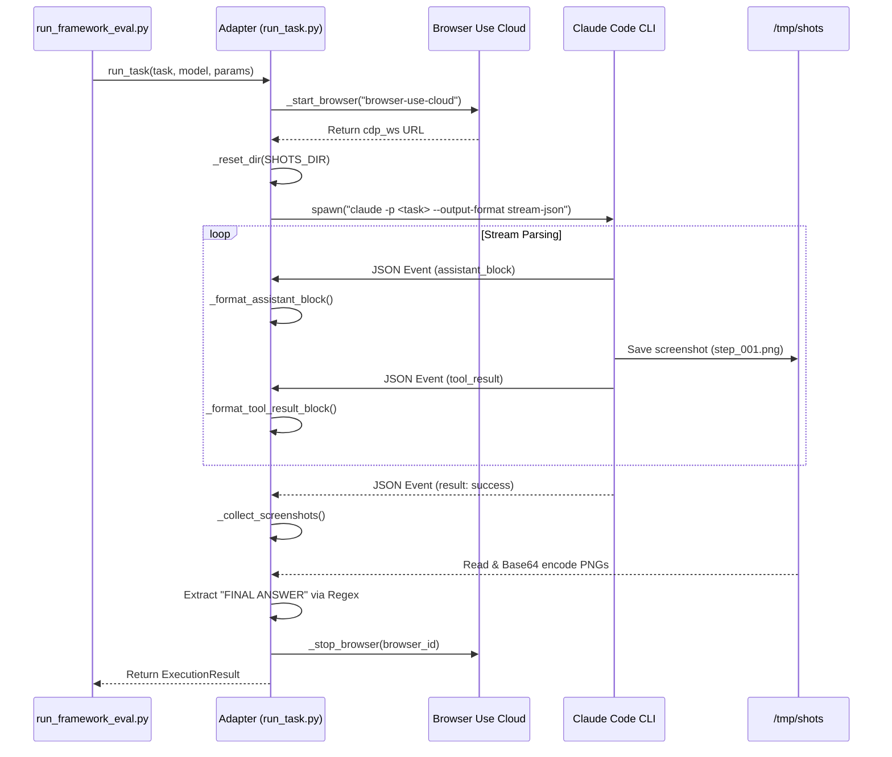

<!-- source: DeepWiki mcp.deepwiki.com · repo browser-use/benchmark · page 3.2 Claude Code Harness Adapters · fetched 2026-10-30 -->

# Claude Code Harness Adapters

<details>
<summary>Relevant source files</summary>

The following files were used as context for generating this wiki page:

- [frameworks/__init__.py](frameworks/__init__.py)
- [frameworks/browserbase_agent/package.json](frameworks/browserbase_agent/package.json)
- [frameworks/claude_code_harness/system_prompt.md](frameworks/claude_code_harness/system_prompt.md)
- [frameworks/claude_code_harness_ab/run_task.py](frameworks/claude_code_harness_ab/run_task.py)
- [frameworks/claude_code_harness_ab/system_prompt.md](frameworks/claude_code_harness_ab/system_prompt.md)
- [frameworks/claude_code_harness_bu_cli/run_task.py](frameworks/claude_code_harness_bu_cli/run_task.py)
- [frameworks/claude_code_harness_bu_cli/system_prompt.md](frameworks/claude_code_harness_bu_cli/system_prompt.md)
- [frameworks/claude_code_harness_js/run_task.py](frameworks/claude_code_harness_js/run_task.py)
- [frameworks/claude_code_harness_js/system_prompt.md](frameworks/claude_code_harness_js/system_prompt.md)
- [frameworks/codex_harness/run_task.py](frameworks/codex_harness/run_task.py)
- [frameworks/codex_harness/system_prompt.md](frameworks/codex_harness/system_prompt.md)

</details>


The **Claude Code Harness** family of adapters facilitates benchmarking the Claude Code agent (and OpenAI Codex) by wrapping their CLI loops. In these adapters, the agent (Claude Code or Codex) owns the execution loop, while the benchmark runner manages the browser lifecycle, provides a specialized system prompt, and parses the agent's structured output to extract steps, costs, and final answers.

## Architecture Overview

These adapters follow a "Harness" pattern where the benchmark runner provisions a remote browser session (typically via `browser-use-cloud`) and then shells out to a CLI agent. The agent is instructed via a `system_prompt.md` to use specific tools (like `browser-harness`, `agent-browser`, or the `browser-use` CLI) to interact with that browser.

### Data Flow and Execution Loop

The execution flow follows a consistent pattern across the family:
1. **Provisioning**: The adapter calls `_start_browser` to allocate a `browser-use-cloud` session and retrieve a CDP WebSocket URL [frameworks/claude_code_harness_ab/run_task.py:115-126]().
2. **Environment Setup**: The CDP URL is passed to the agent via environment variables (e.g., `BU_CDP_WS`) [frameworks/claude_code_harness_ab/run_task.py:6-7]().
3. **Agent Invocation**: The adapter launches the agent CLI (e.g., `claude` or `codex`) with `--output-format stream-json` [frameworks/claude_code_harness_ab/run_task.py:157-158]().
4. **Stream Parsing**: The adapter reads `stdout` line-by-line, parsing JSON events to reconstruct the agent's "steps" (thinking, tool calls, and results) [frameworks/claude_code_harness_ab/run_task.py:270-320]().
5. **Artifact Collection**: Screenshots written by the agent to `/tmp/shots` are collected [frameworks/claude_code_harness_ab/run_task.py:85-90]().
6. **Final Answer Extraction**: The adapter uses `FINAL_ANSWER_RE` to find the required "FINAL ANSWER" string in the agent's terminal message [frameworks/claude_code_harness_ab/run_task.py:55]().

### Component Mapping: Natural Language to Code

| Concept | Code Entity | File |
| :--- | :--- | :--- |
| **Agent CLI** | `claude` or `codex` | `_build_claude_cmd` / `_build_codex_cmd` |
| **Output Parser** | `stream-json` parsing loop | `run_task()` in adapter modules |
| **Browser Interface** | `browser-harness`, `agent-browser`, or `browser-use` CLI | `system_prompt.md` instructions |
| **Task Completion** | `FINAL ANSWER: <text>` | `FINAL_ANSWER_RE` |
| **Screenshot Sink** | `/tmp/shots/` | `SHOTS_DIR` |

Sources: [frameworks/claude_code_harness_ab/run_task.py:52-55](), [frameworks/claude_code_harness_js/run_task.py:50-53](), [frameworks/codex_harness/run_task.py:70-72]()

## Adapter Variants

The repository supports several variants of the harness, differing primarily by the CLI tool the agent uses to drive the browser.

### 1. claude-code-harness (Python)
The agent drives a browser using the Python-based `browser-harness`. It uses `browser-harness <<'PY' ... PY` heredocs to execute Python scripts against the browser [frameworks/claude_code_harness/system_prompt.md:4-5]().

### 2. claude-code-harness-js (TypeScript)
The agent drives the browser via `browser-harness-js`, a Bun-based REPL. It interacts by calling `session.connect({ wsUrl: process.env.BU_CDP_WS })` and executing JavaScript snippets [frameworks/claude_code_harness_js/run_task.py:4-7]().

### 3. claude-code-harness-ab (Agent Browser)
The agent uses the `vercel-labs/agent-browser` Rust-based CLI. It connects using `agent-browser --session "$AB_SESSION" --cdp "$BU_CDP_WS" open <url>` and uses accessibility-tree snapshots for interaction [frameworks/claude_code_harness_ab/system_prompt.md:4-9]().

### 4. claude-code-harness-bu-cli (Browser-Use CLI)
The agent uses the native `browser-use` Python CLI. It attaches via `browser-use --session "$BU_SESSION" --cdp-url "$BU_CDP_WS" open <url>` and uses indexed element interaction (e.g., `click <idx>`) [frameworks/claude_code_harness_bu_cli/system_prompt.md:4-9]().

### 5. codex-harness
A variant for OpenAI's Codex CLI. It mirrors the Python `claude-code-harness` but parses Codex-specific JSONL events like `thread.started`, `turn.completed`, and `item.completed` [frameworks/codex_harness/run_task.py:16-27]().

## Implementation Details

### JSON Stream Parsing
Claude Code emits structured events when run with `--output-format stream-json`. The adapters process these in a `while` loop, focusing on specific event types:
- `assistant_block`: Captured via `_format_assistant_block` to log thinking and tool calls [frameworks/claude_code_harness_ab/run_task.py:173-197]().
- `tool_result`: Captured via `_format_tool_result_block` to log the outcome of browser actions [frameworks/claude_code_harness_ab/run_task.py:200-220]().
- `result`: Indicates the end of the agent's loop. A subtype of `success` is required for a valid completion [frameworks/claude_code_harness_ab/run_task.py:59-66]().

### Screenshot Collection
Unlike native `browser-use` adapters which receive screenshots via API objects, these harness adapters rely on the agent writing files to a local directory.
- **Requirement**: The agent must save PNGs to `/tmp/shots/step_NNN.png` [frameworks/claude_code_harness/system_prompt.md:6]().
- **Extraction**: The function `_collect_screenshots()` reads all PNGs in the directory, sorts them by filename, and encodes them to base64 for the `ExecutionResult` [frameworks/claude_code_harness_ab/run_task.py:85-90]().

### System Prompts
Each adapter provides a specific `system_prompt.md` that acts as the "manual" for the agent. These prompts define:
- **Hard Rules**: Constraints like "Do not ask clarifying questions" and "Do not spawn browser processes" [frameworks/claude_code_harness_ab/system_prompt.md:3-24]().
- **Tool Usage**: Instructions on how to initialize the connection using environment variables like `BU_CDP_WS` [frameworks/claude_code_harness_js/system_prompt.md:5]().
- **Termination**: The mandatory `FINAL ANSWER:` format [frameworks/claude_code_harness_ab/system_prompt.md:25-29]().

### Sequence Diagram: Claude Code Harness Execution

Title: Claude Code Harness Execution Flow

Sources: [frameworks/claude_code_harness_ab/run_task.py:245-340](), [frameworks/claude_code_harness_ab/run_task.py:85-90](), [frameworks/claude_code_harness_ab/run_task.py:115-139]()

### Class/Entity Diagram: Adapter Structure

Title: Claude Code Adapter Logic
```mermaid
classDiagram
    class ExecutionResult {
        +str final_result
        +list steps
        +list screenshots_b64
        +int num_steps
        +float duration_seconds
        +float cost
    }

    class ClaudeCodeHarnessAdapter {
        +ACCEPTED_PARAMS
        +SYSTEM_PROMPT_FILE
        +FINAL_ANSWER_RE
        +_start_browser(browser_name)
        +_build_claude_cmd(task, model, ...)
        +_collect_screenshots()
        +_format_assistant_block(block)
        +run_task(task, model, ...)
    }

    ClaudeCodeHarnessAdapter ..> ExecutionResult : creates
    ClaudeCodeHarnessAdapter --> "/tmp/shots" : reads screenshots
    ClaudeCodeHarnessAdapter --> "system_prompt.md" : appends to agent
```
Sources: [frameworks/__init__.py:63-70](), [frameworks/claude_code_harness_ab/run_task.py:42-55](), [frameworks/claude_code_harness_ab/run_task.py:173-197]()

---

