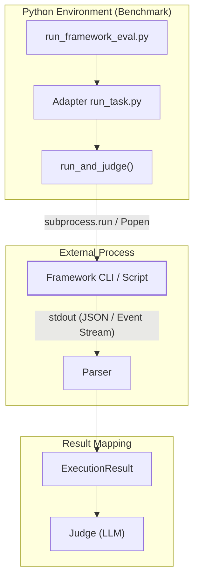
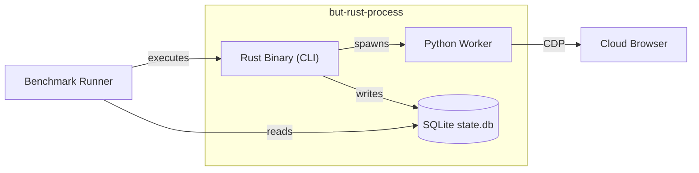

<!-- source: DeepWiki mcp.deepwiki.com · repo browser-use/benchmark · page 3.3 Other Framework Adapters · fetched 2026-10-30 -->

# Other Framework Adapters

Relevant source files

The following files were used as context for generating this wiki page:

- [frameworks/browserbase_agent/executor.mjs](frameworks/browserbase_agent/executor.mjs)
- [frameworks/but/run_task.py](frameworks/but/run_task.py)
- [frameworks/but/system_prompt.md](frameworks/but/system_prompt.md)
- [frameworks/but_rust/run_task.py](frameworks/but_rust/run_task.py)
- [frameworks/but_rust/system_prompt.md](frameworks/but_rust/system_prompt.md)
- [frameworks/claude_cua/run_task.py](frameworks/claude_cua/run_task.py)
- [frameworks/pi_harness/run_task.py](frameworks/pi_harness/run_task.py)
- [frameworks/pi_harness/system_prompt.md](frameworks/pi_harness/system_prompt.md)
- [frameworks/pibt/run_task.py](frameworks/pibt/run_task.py)
- [frameworks/pibt/system_prompt.md](frameworks/pibt/system_prompt.md)
- [frameworks/stagehand/executor.js](frameworks/stagehand/executor.js)
- [frameworks/stagehand/run_task.py](frameworks/stagehand/run_task.py)

This page covers the remaining framework adapters in the benchmark suite: `pi-harness`, `pibt`, `but` (Python), `but-rust`, `stagehand`, `browserbase-agent`, and `claude-cua`. Unlike the native `browser-use` adapter, these frameworks often operate in different runtimes (Node.js, Rust) or use distinct agent loop architectures.

## Architecture Overview

Most adapters in this category follow a "shell-out" pattern. The benchmark's Python runner (`run_framework_eval.py`) invokes these adapters, which then execute the agent loop and return a standardized `ExecutionResult` [frameworks/stagehand/run_task.py:56-63]().

### Browser Wiring Patterns

These adapters generally use one of two methods to connect to browsers:
1.  **Pre-provisioned Cloud Browser**: The adapter calls the Browser-Use Cloud V3 API to create a session, then passes the `webSocketDebuggerUrl` (CDP URL) to the underlying agent [frameworks/but/run_task.py:125-134](), [frameworks/pibt/run_task.py:96-105]().
2.  **Harness Daemon**: A `browser-harness` daemon is started, and the agent interacts with it via shell commands or `heredocs` [frameworks/pi_harness/run_task.py:88-95]().

### Data Flow: Shelling Out to Non-Python Frameworks

The following diagram illustrates how the Python evaluation environment communicates with external framework binaries and scripts.

**Framework Execution Flow**

Sources: [frameworks/stagehand/run_task.py:38-63](), [frameworks/but/run_task.py:210-235](), [frameworks/pi_harness/run_task.py:228-255]()

---

## Pi-based Adapters (`pi-harness` & `pibt`)

These adapters use the `@earendil-works/pi-coding-agent` CLI.

### pi-harness
This adapter mirrors the `claude-code-harness`. It uses `pi` to drive a pre-provisioned `browser-harness` daemon via Python heredocs [frameworks/pi_harness/run_task.py:1-7]().
*   **Event Parsing**: It uses `pi --mode json` to capture `tool_execution_start/end` and `message_end` events [frameworks/pi_harness/run_task.py:13-21]().
*   **Screenshot Logic**: Screenshots are saved to `/tmp/shots/` and collected in step order [frameworks/pi_harness/run_task.py:80-86]().

### pibt (Pi Browser Terminal)
Unlike `pi-harness`, `pibt` uses the `pi-agent-extensions` package. The agent calls `cdp_*` tools directly within its own process rather than using an external Python harness [frameworks/pibt/run_task.py:1-6]().
*   **Connection**: The system prompt instructs the agent to use `cdp_connect({ wsUrl: process.env.BU_CDP_WS })` [frameworks/pibt/run_task.py:11-14]().

Sources: [frameworks/pi_harness/run_task.py:1-21](), [frameworks/pibt/run_task.py:1-18]()

---

## Browser-Use-Terminal (`but` & `but-rust`)

These adapters benchmark the `browser-use-terminal` project, which provides a REPL-based agent loop.

| Feature | `but` (Python) | `but-rust` (Rust) |
| :--- | :--- | :--- |
| **Core Runtime** | Python (uv managed) [frameworks/but/run_task.py:68-72]() | Rust Binary [frameworks/but_rust/run_task.py:65-67]() |
| **Browser Ops** | Native Python CDP helpers [frameworks/but/run_task.py:3-7]() | Python worker (`llm_browser_worker`) [frameworks/but_rust/run_task.py:14-18]() |
| **State Storage** | JSONL event log [frameworks/but/run_task.py:24-28]() | SQLite (`state.db`) [frameworks/but_rust/run_task.py:19-20]() |
| **Invocation** | `browser-use-terminal run` [frameworks/but/run_task.py:16-21]() | `run-openai`, `run-anthropic`, etc. [frameworks/but_rust/run_task.py:12-13]() |

**But-Rust Component Mapping**

Sources: [frameworks/but_rust/run_task.py:1-31]()

---

## TypeScript Adapters (`stagehand` & `browserbase-agent`)

These adapters execute via Node.js.

### stagehand
A wrapper around the Stagehand agent framework. The Python side shells out to `executor.js` [frameworks/stagehand/run_task.py:34-35]().
*   **Execution**: It reads `TASK_DESCRIPTION` and `BROWSER` from environment variables [frameworks/stagehand/executor.js:21-23]().
*   **Result**: Expects a JSON object on stdout containing `final_result`, `steps`, and `screenshots_b64` [frameworks/stagehand/executor.js:7-16]().

### browserbase-agent
This adapter uses the Stagehand SDK locally but points it at Browserbase cloud browsers and the Browserbase Model Gateway [frameworks/browserbase_agent/executor.mjs:18-21]().
*   **Model Routing**: Defaults to `anthropic/claude-sonnet-4-6` via the gateway [frameworks/browserbase_agent/executor.mjs:42]().
*   **Step Formatting**: Maps Stagehand 3.x agent actions (type, instruction, reasoning) into the `ExecutionResult` schema [frameworks/browserbase_agent/executor.mjs:72-84]().

Sources: [frameworks/stagehand/run_task.py:38-63](), [frameworks/browserbase_agent/executor.mjs:1-38]()

---

## Claude Computer Use Agent (`claude-cua`)

The `claude-cua` adapter is designed to control a full desktop environment (Xvfb + browser) [frameworks/claude_cua/run_task.py:3-4](). 

*   **Status**: Currently a placeholder in the public verifier; it raises `NotImplementedError` until the full agent loop (handling `computer_20251124` tool blocks) is integrated [frameworks/claude_cua/run_task.py:62-65]().

Sources: [frameworks/claude_cua/run_task.py:1-11]()

---

## Result Mapping to `ExecutionResult`

Regardless of the framework's internal language or format, all adapters must return an `ExecutionResult` object to the `run_and_judge` function [frameworks/stagehand/run_task.py:77]().

| Field | Description | Mapping Source (Example: `but`) |
| :--- | :--- | :--- |
| `final_result` | The agent's terminal answer. | Extracted from `done` tool call in `events.jsonl` [frameworks/but/run_task.py:166-168](). |
| `steps` | List of actions taken. | Parsed from `tool.started` and `assistant.message` events [frameworks/but/run_task.py:153-175](). |
| `screenshots_b64` | Base64 encoded images. | Read from the framework's artifact/state directory [frameworks/but/run_task.py:218-223](). |
| `cost` | Total USD cost. | Aggregated from model usage metadata in events [frameworks/but/run_task.py:228-232](). |

Sources: [frameworks/__init__.py](), [frameworks/but/run_task.py:210-235]()

---

