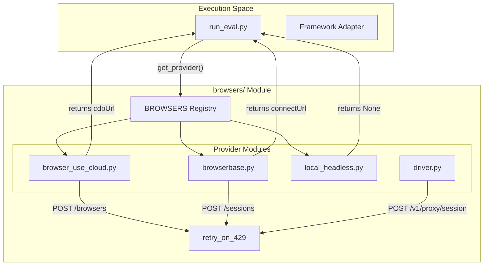

<!-- source: DeepWiki mcp.deepwiki.com · repo browser-use/benchmark · page 4 Browser Providers · fetched 2026-10-30 -->

# Browser Providers

Relevant source files

The following files were used as context for generating this wiki page:

- [.env.example](.env.example)
- [Stealth_Bench_V1.enc](Stealth_Bench_V1.enc)
- [browsers/__init__.py](browsers/__init__.py)
- [browsers/anchor.py](browsers/anchor.py)
- [browsers/browser_use_cloud.py](browsers/browser_use_cloud.py)
- [browsers/browserbase.py](browsers/browserbase.py)
- [browsers/browserless.py](browsers/browserless.py)
- [browsers/driver.py](browsers/driver.py)
- [browsers/hyperbrowser.py](browsers/hyperbrowser.py)
- [browsers/local_headful.py](browsers/local_headful.py)
- [browsers/util.py](browsers/util.py)
- [frameworks/browser_use/__init__.py](frameworks/browser_use/__init__.py)

The `browsers/` module provides a standardized interface for provisioning browser instances across various environments, including local Playwright-managed browsers and third-party cloud browser providers. This abstraction allows the benchmark suites to execute tasks against different browser configurations by simply changing an environment variable or CLI argument.

### Browser Registry

The core of the provider system is the `BROWSERS` registry defined in `browsers/__init__.py`. This dictionary maps provider names to their respective modules, each implementing a common interface for lifecycle management.

*   **Registry Definition**: The `BROWSERS` dictionary lists all supported providers [browsers/__init__.py:33-45]().
*   **Dynamic Loading**: The `get_provider(name)` function facilitates importing provider modules at runtime [browsers/__init__.py:48-53]().
*   **Provider List**: A separate `PROVIDERS` list tracks available options such as `anchor`, `browserbase`, `hyperbrowser`, and `steel` [browsers/__init__.py:20-31]().

### Interface Contract

Every provider module must implement two primary asynchronous functions to be compatible with the benchmark runner:

| Function | Return Value | Purpose |
| :--- | :--- | :--- |
| `connect()` | `str` or `None` | Provisions a new browser session. Returns a CDP (Chrome DevTools Protocol) or WebSocket URL for remote browsers, or `None` for local Playwright instances. |
| `disconnect()` | `None` | Cleans up the session, stops the remote browser, or releases resources. |

#### Rate Limit Handling
Most cloud providers utilize the `retry_on_429` utility located in `browsers/util.py`. This helper wraps API calls in a retry loop with capped exponential backoff (defaulting to 10 retries and a 30s max wait) to handle provider-side rate limiting [browsers/util.py:6-17]().

### Provider Architecture

The following diagram illustrates how the benchmark system interacts with the `browsers/` module to obtain browser access.

**Browser Provisioning Flow**

*Sources: [browsers/__init__.py:33-53](), [browsers/util.py:6-17](), [browsers/browser_use_cloud.py:24-40](), [browsers/browserbase.py:16-36]()*

### Cloud Browser Providers

Cloud providers are used for large-scale evaluations or when specific features like residential proxies and automated CAPTCHA solving are required. These modules typically manage a `_session_id` to ensure that `disconnect()` can properly terminate the specific instance created by `connect()`.

*   **Browser-use Cloud**: Connects to `api.browser-use.com` (v2) and returns a `cdpUrl` [browsers/browser_use_cloud.py:14-40]().
*   **CDP Proxies**: Modules like `driver.py` interact with proxy services (e.g., `bu-compat.driver.dev`) to provide hosted browser sessions [browsers/driver.py:9-28]().
*   **Third-Party Services**: Includes dedicated modules for Anchor, Browserbase, Hyperbrowser, Rebrowser, and Steel.

For detailed configuration, API keys, and specific capabilities of each cloud provider, see **[Cloud Browser Providers](#4.1)**.

### Local Browser Providers

Local providers utilize the host machine's resources to launch Chromium via Playwright. These are primarily used for development, debugging, or cost-effective local testing.

*   **Headless vs. Headful**: Controlled via the `HEADLESS` boolean flag within the provider module [browsers/local_headful.py:3]().
*   **Connection Logic**: Unlike cloud providers, local `connect()` implementations typically return `None`, signaling the framework adapter to initialize a local Playwright instance rather than connecting to a remote WebSocket [browsers/local_headful.py:6-7]().

For details on local setup and the `HEADLESS` flag, see **[Local Browser Providers](#4.2)**.

### Configuration

Browser providers require specific API keys defined in the `.env` file. If a key is missing when a provider is requested, the module will raise a `KeyError` during the `connect()` call.

**Key Mapping Examples:**
*   `browser-use-cloud`: Uses `BROWSER_USE_API_KEY` [browsers/browser_use_cloud.py:21]().
*   `browserbase`: Requires `BROWSERBASE_API_KEY` and `BROWSERBASE_PROJECT_ID` [browsers/browserbase.py:4-5]().
*   `anchor`: Requires `ANCHORBROWSER_API_KEY` [browsers/anchor.py:4-5]().

*Sources: [.env.example:1-23](), [browsers/anchor.py:18](), [browsers/browserbase.py:23-25]()*

---

**Sub-pages:**
*   [Cloud Browser Providers](#4.1)
*   [Local Browser Providers](#4.2)

---

