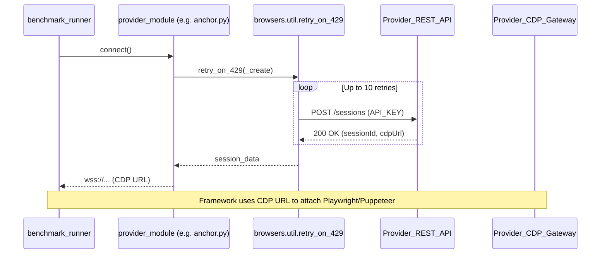
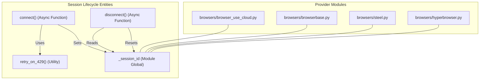

<!-- source: DeepWiki mcp.deepwiki.com · repo browser-use/benchmark · page 4.1 Cloud Browser Providers · fetched 2026-10-30 -->

# Cloud Browser Providers

Relevant source files

The following files were used as context for generating this wiki page:

- [Stealth_Bench_V1.enc](Stealth_Bench_V1.enc)
- [browsers/anchor.py](browsers/anchor.py)
- [browsers/browser_use_cloud.py](browsers/browser_use_cloud.py)
- [browsers/browserbase.py](browsers/browserbase.py)
- [browsers/browserless.py](browsers/browserless.py)
- [browsers/hyperbrowser.py](browsers/hyperbrowser.py)
- [browsers/local_headful.py](browsers/local_headful.py)
- [browsers/onkernel.py](browsers/onkernel.py)
- [browsers/rebrowser.py](browsers/rebrowser.py)
- [browsers/steel.py](browsers/steel.py)
- [browsers/util.py](browsers/util.py)
- [frameworks/browser_use/__init__.py](frameworks/browser_use/__init__.py)

This page details the implementation of cloud browser provider modules within the `browsers/` directory. These modules abstract the complexities of provisioning remote Chromium instances, handling authentication, and managing session lifecycles across various vendors.

The primary interface for any provider is a pair of asynchronous functions: `connect()` and `disconnect()`. The `connect()` function typically returns a Chrome DevTools Protocol (CDP) WebSocket URL, which is then used by the framework adapters to control the remote browser [browsers/browser_use_cloud.py:24-40]().

### Session Lifecycle and Reliability

Most cloud providers require an explicit session creation step via a REST API before providing a WebSocket endpoint. To ensure stability during high-concurrency benchmarks, the system utilizes a retry mechanism for rate-limited requests.

#### Rate Limit Handling
The `retry_on_429` utility is used across most provider implementations. It implements a capped exponential backoff strategy when encountering HTTP 429 status codes from provider APIs [browsers/util.py:6-16]().

| Parameter | Value | Description |
| :--- | :--- | :--- |
| `max_retries` | 10 | Maximum number of attempts before failing [browsers/util.py:8]() |
| `max_wait` | 30s | Maximum sleep time between retries [browsers/util.py:14]() |
| `backoff` | 2^attempt | Exponential growth of wait time [browsers/util.py:14]() |

**Sources:** [browsers/util.py:1-17]()

---

### Provider Implementation Details

#### Browser-Use Cloud (`browser_use_cloud.py`)
This is the native cloud provider for the `browser-use` platform. It supports configurable API versions and base URLs via environment variables [browsers/browser_use_cloud.py:14-17]().

*   **API Key:** `BU_CLOUD_API_KEY` or `BROWSER_USE_API_KEY` [browsers/browser_use_cloud.py:21]().
*   **Connection:** POSTs to `/browsers` to retrieve a `cdpUrl` and `id` [browsers/browser_use_cloud.py:27-40]().
*   **Disconnection:** PATCHes the session with `{"action": "stop"}` to release resources [browsers/browser_use_cloud.py:48-53]().

#### Browserbase (`browserbase.py`)
Provides built-in captcha solving and proxy support [browsers/browserbase.py:1-5]().
*   **API Key:** `BROWSERBASE_API_KEY` and `BROWSERBASE_PROJECT_ID`.
*   **Session:** Creates a session with `proxies: True` and `solveCaptchas: True` [browsers/browserbase.py:24-28]().
*   **Disconnection:** Status is updated to `REQUEST_RELEASE` [browsers/browserbase.py:47]().

#### Anchor Browser (`anchor.py`)
Configures an extensive suite of stealth and utility features during session creation [browsers/anchor.py:1-5]().
*   **Features:** Adblock, popup blocker, extra stealth, and residential proxies [browsers/anchor.py:29-35]().
*   **Connection:** Returns a WSS URL formatted with the API key and session ID [browsers/anchor.py:44]().

#### Steel (`steel.py`)
Steel requires a specific monkey-patch for the `socket` library because its WebSocket host does not support IPv6, which can lead to 502 errors in certain environments [browsers/steel.py:6-8]().
*   **Implementation:** The `_getaddrinfo_ipv4_for_steel` function forces `socket.AF_INET` for the host `connect.steel.dev` [browsers/steel.py:22-28]().

**Sources:** [browsers/browser_use_cloud.py:1-56](), [browsers/browserbase.py:1-51](), [browsers/anchor.py:1-58](), [browsers/steel.py:1-62]()

---

### Technical Architecture Diagrams

#### Browser Provider Connection Flow
The following diagram illustrates the relationship between the internal utility functions and the external Cloud Provider APIs during a `connect()` call.

**Sources:** [browsers/util.py:6-16](), [browsers/anchor.py:16-44](), [browsers/browser_use_cloud.py:24-40]()

#### Code Entity Mapping: Cloud Session Management
This diagram maps the natural language concept of "Session Management" to the specific code entities responsible for the lifecycle.

**Sources:** [browsers/browser_use_cloud.py:11,25,44](), [browsers/browserbase.py:13,17,40](), [browsers/steel.py:17,32,52](), [browsers/util.py:6]()

---

### Provider Comparison Table

The following table summarizes the configuration and return values for the various cloud modules.

| Provider | File | API Key Env Var | Session ID Return Key | CDP URL Format |
| :--- | :--- | :--- | :--- | :--- |
| **BU Cloud** | `browser_use_cloud.py` | `BU_CLOUD_API_KEY` | `id` | `data["cdpUrl"]` |
| **Anchor** | `anchor.py` | `ANCHORBROWSER_API_KEY` | `data["data"]["id"]` | `wss://connect.anchorbrowser.io?...` |
| **Browserbase** | `browserbase.py` | `BROWSERBASE_API_KEY` | `id` | `data["connectUrl"]` |
| **Hyperbrowser**| `hyperbrowser.py` | `HYPERBROWSER_API_KEY` | `sessionId` / `id` | `data["wsEndpoint"]` |
| **OnKernel** | `onkernel.py` | `ONKERNEL_API_KEY` | `id` | `data["cdp_ws_url"]` |
| **Steel** | `steel.py` | `STEEL_API_KEY` | `id` | `data["websocketUrl"] + apiKey` |
| **Browserless** | `browserless.py` | `BROWSERLESS_API_KEY` | N/A (Static) | `wss://.../stealth?token=...` |
| **Rebrowser** | `rebrowser.py` | `REBROWSER_API_KEY` | N/A (Static) | `wss://ws.rebrowser.net/?apiKey=...` |

**Sources:** [browsers/browser_use_cloud.py:39-40](), [browsers/anchor.py:43-44](), [browsers/browserbase.py:35-36](), [browsers/hyperbrowser.py:31-32](), [browsers/onkernel.py:31-32](), [browsers/steel.py:47-48](), [browsers/browserless.py:11-14](), [browsers/rebrowser.py:11]()

### Local Fallbacks
While the primary focus is cloud providers, the `browsers/` module includes `local_headful.py` and `local_headless.py`. These return `None` for the connection string, signaling to the evaluation runner to launch a local Playwright instance instead of connecting to a remote CDP endpoint [browsers/local_headful.py:6-7]().

**Sources:** [browsers/local_headful.py:1-11]()

---

