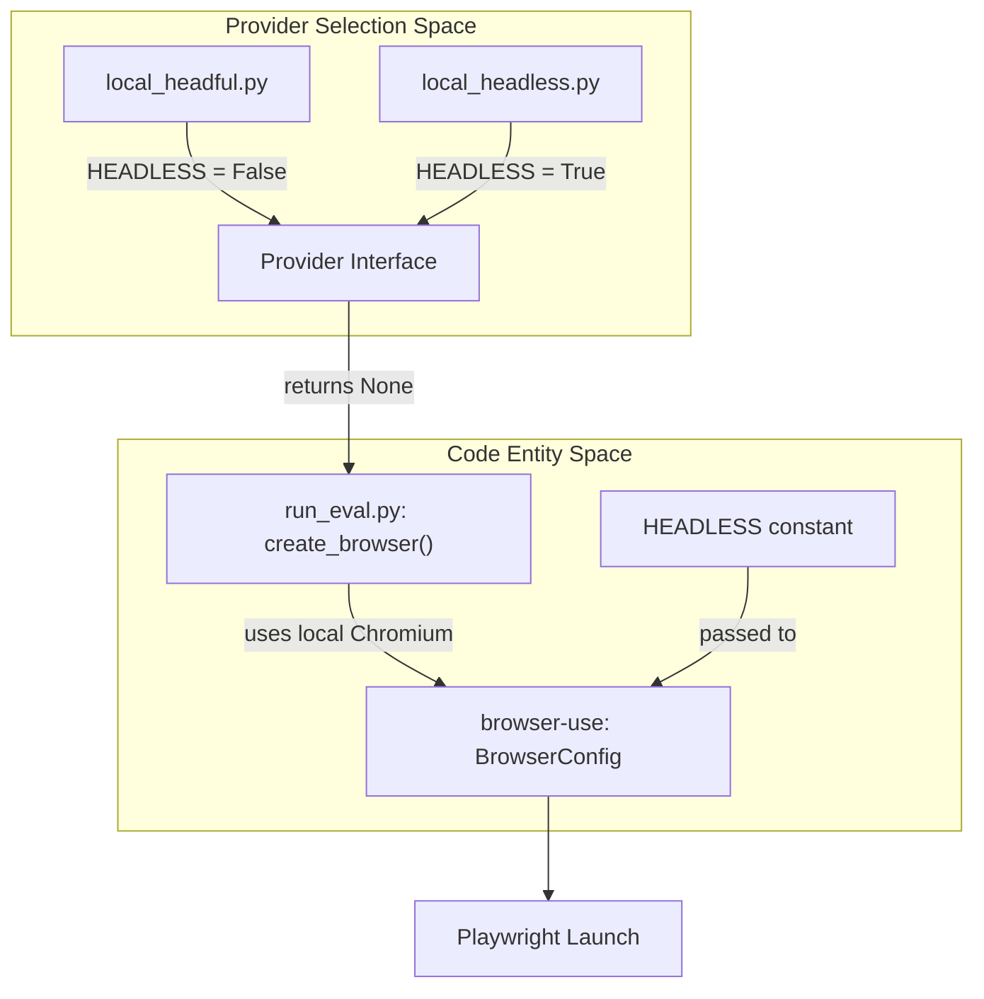

<!-- source: DeepWiki mcp.deepwiki.com · repo browser-use/benchmark · page 4.2 Local Browser Providers · fetched 2026-10-30 -->

# Local Browser Providers

<details>
<summary>Relevant source files</summary>

The following files were used as context for generating this wiki page:

- [Stealth_Bench_V1.enc](Stealth_Bench_V1.enc)
- [browsers/anchor.py](browsers/anchor.py)
- [browsers/browserbase.py](browsers/browserbase.py)
- [browsers/browserless.py](browsers/browserless.py)
- [browsers/hyperbrowser.py](browsers/hyperbrowser.py)
- [browsers/local_headful.py](browsers/local_headful.py)
- [browsers/local_headless.py](browsers/local_headless.py)

</details>


Local browser providers allow the benchmark suite to execute tasks using a locally installed Chromium instance via Playwright. Unlike cloud providers that return a WebSocket URL (CDP), local providers signal the system to use the native `browser-use` browser management logic.

### Overview

The local provider implementation is split into two modules: `local_headful.py` and `local_headless.py`. These modules serve as configuration flags for the `create_browser()` factory function used during task evaluation. They are primarily used for development, debugging agent behavior visually, or running benchmarks without incurring cloud browser costs.

| Provider | File | HEADLESS Flag | Use Case |
| :--- | :--- | :--- | :--- |
| **Local Headful** | `browsers/local_headful.py` | `False` | Visual debugging, watching the agent interact with the UI. |
| **Local Headless** | `browsers/local_headless.py` | `True` | Local automated runs, CI environments, or performance testing. |

**Sources:**
- [browsers/local_headful.py:1-12]()
- [browsers/local_headless.py:1-12]()

---

### Implementation Details

Both local providers implement the standard browser provider interface but return `None` for the connection string. This informs the calling framework that no remote CDP connection is required, and it should instead initialize a local Playwright instance.

#### Configuration Constants
The primary differentiator between the two providers is the `HEADLESS` boolean constant:
- **local_headful.py**: Sets `HEADLESS = False` [browsers/local_headful.py:3-3]().
- **local_headless.py**: Sets `HEADLESS = True` [browsers/local_headless.py:3-3]().

#### Interface Contract
Both modules provide `connect()` and `disconnect()` functions to satisfy the `BROWSERS` registry requirements in the `browsers/` module:
- `connect()`: Returns `None` [browsers/local_headful.py:6-7](), [browsers/local_headless.py:6-7]().
- `disconnect()`: Performs no operation (pass) [browsers/local_headful.py:10-11](), [browsers/local_headless.py:10-11]().

### Data Flow: Local Initialization

The following diagram illustrates how the `HEADLESS` flag from the local providers propagates through the system to configure the browser.

**Local Browser Configuration Flow**

**Sources:**
- [browsers/local_headful.py:3-7]()
- [browsers/local_headless.py:3-7]()

---

### Integration with Frameworks

When a local provider is selected (e.g., via the `BROWSER` environment variable), the benchmark orchestrator imports the corresponding module. Because `connect()` returns `None`, the system falls back to its internal browser management.

**Code Entity Association**
```mermaid
graph LR
    subgraph "Natural Language Space"
        "Local Browser Mode"
        "Headless Toggle"
        "Cleanup Phase"
    end

    subgraph "Code Entity Space"
        "Local Browser Mode" <--> L1["connect() -> None"]
        "Headless Toggle" <--> L2["HEADLESS: bool"]
        "Cleanup Phase" <--> L3["disconnect() -> None"]
    end

    L1 -.-> F1["browsers/local_headful.py"]
    L2 -.-> F1
    L1 -.-> F2["browsers/local_headless.py"]
    L2 -.-> F2
```

**Sources:**
- [browsers/local_headful.py:3-11]()
- [browsers/local_headless.py:3-11]()

### Usage for Development

Local providers are the recommended way to debug failing tasks in the BU Bench V1 or Stealth Bench V1 suites.

1.  **Headful Debugging**: By setting the provider to `local_headful`, developers can observe the agent's real-time decisions, which is useful for identifying issues in the `judge.py` logic or framework-specific failures.
2.  **Resource Efficiency**: Local providers do not require external API keys (like `BROWSERBASE_API_KEY` or `STEEL_API_KEY`) and are not subject to the rate limits handled by `retry_on_429`.

**Sources:**
- [browsers/local_headful.py:1-3]()
- [browsers/local_headless.py:1-3]()

---

