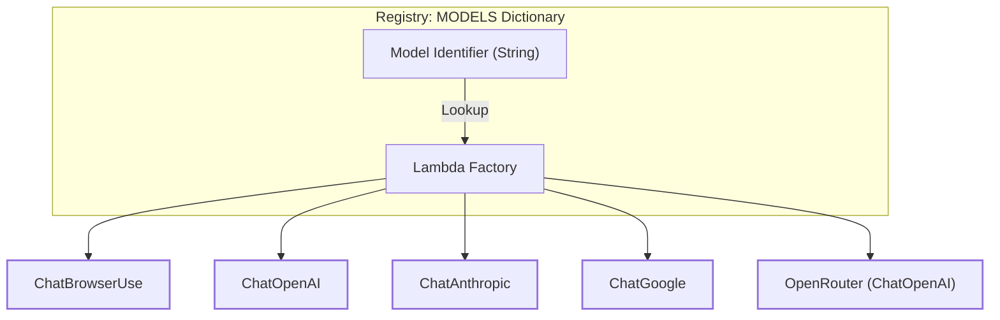
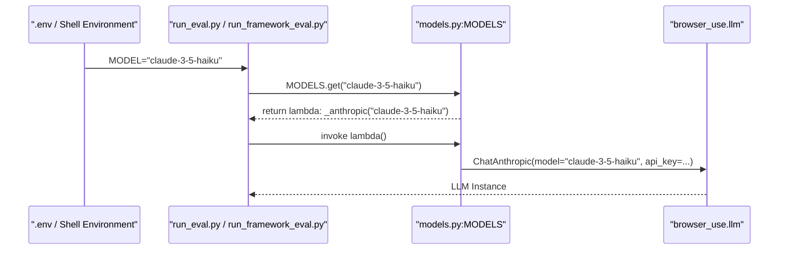

<!-- source: DeepWiki mcp.deepwiki.com · repo browser-use/benchmark · page 5 LLM Model Registry · fetched 2026-10-30 -->

# LLM Model Registry

Relevant source files

The following files were used as context for generating this wiki page:

- [BU_Bench_V1.enc](BU_Bench_V1.enc)
- [fonts/GeistMono-Medium.otf](fonts/GeistMono-Medium.otf)
- [models.py](models.py)
- [pyproject.toml](pyproject.toml)
- [uv.lock](uv.lock)

The `models.py` file serves as the central registry for Large Language Model (LLM) configurations used across the benchmark suite. It provides a mapping between standardized model identifiers and factory functions that instantiate the appropriate LLM provider classes from the `browser-use` library.

## Implementation Overview

The registry is implemented using a dictionary named `MODELS` that maps string identifiers to lambda functions. These lambdas encapsulate the logic for initializing provider-specific classes with the correct model names and environment-based API keys.

### Provider Factory Functions
To maintain clean code and handle API key injection, `models.py` defines several private helper functions for major providers:

| Function | Provider Class | Environment Variable | Purpose |
| :--- | :--- | :--- | :--- |
| `_openai` | `ChatOpenAI` | `OPENAI_API_KEY` | Standard OpenAI models [models.py:9-10]() |
| `_anthropic` | `ChatAnthropic` | `ANTHROPIC_API_KEY` | Anthropic Claude models [models.py:13-14]() |
| `_google` | `ChatGoogle` | `GOOGLE_API_KEY` | Google Gemini models [models.py:17-18]() |
| `_openrouter` | `ChatOpenAI` | `OPENROUTER_API_KEY` | Models accessed via OpenRouter API [models.py:21-26]() |

**Sources:** [models.py:1-27]()

## The MODELS Dictionary

The `MODELS` dictionary is the primary entry point for the evaluation pipeline to resolve a model string into an executable LLM object.

### Model Mapping Logic
The registry supports a variety of models, including native `browser-use` models and third-party providers.

**Key Registry Entries:**
*   **Browser-Use Native:** `bu-1-0`, `bu-2-0` using `ChatBrowserUse` [models.py:30-31]().
*   **OpenAI:** `gpt-4.1`, `gpt-5`, `gpt-5-mini` [models.py:32-34]().
*   **Anthropic:** Various Claude 3.5 and 4.x variants (Haiku, Sonnet, Opus) [models.py:36-42]().
*   **Google:** Gemini 2.5 and 3.x Flash/Pro variants [models.py:43-48]().
*   **OpenRouter:** Integrated via `_openrouter` helper, e.g., `kimi-k2.5` [models.py:49]().

**Sources:** [models.py:29-50]()

## Data Flow: Environment to Execution

Model selection is driven by the `MODEL` environment variable. The evaluation pipeline reads this variable and uses it as a key for the `MODELS` dictionary.

### Model Resolution Pipeline
The following diagram illustrates how a system name (the `MODEL` env var) is translated into a functional code entity (`ChatProvider` instance).

**Implementation Details:**
1.  **Environment Variable:** The user sets `MODEL` in the `.env` file or shell.
2.  **Factory Invocation:** The evaluation scripts (e.g., `run_eval.py`) import `MODELS` and call the lambda associated with the chosen identifier.
3.  **Authentication:** The factory functions automatically pull the required API key (e.g., `ANTHROPIC_API_KEY`) from `os.getenv` [models.py:14]().
4.  **Instantiation:** The specific `browser-use` LLM wrapper is instantiated and returned to the agent runner.

**Sources:** [models.py:1-50](), [pyproject.toml:7]()

## OpenRouter Integration
OpenRouter is handled by repurposing the `ChatOpenAI` class but overriding the `base_url` to `https://openrouter.ai/api/v1` [models.py:24](). This allows the benchmark to leverage the OpenAI-compatible API structure for a wider range of models like Moonshot's `kimi-k2.5` [models.py:49]().

**Sources:** [models.py:21-26](), [models.py:49]()

---

