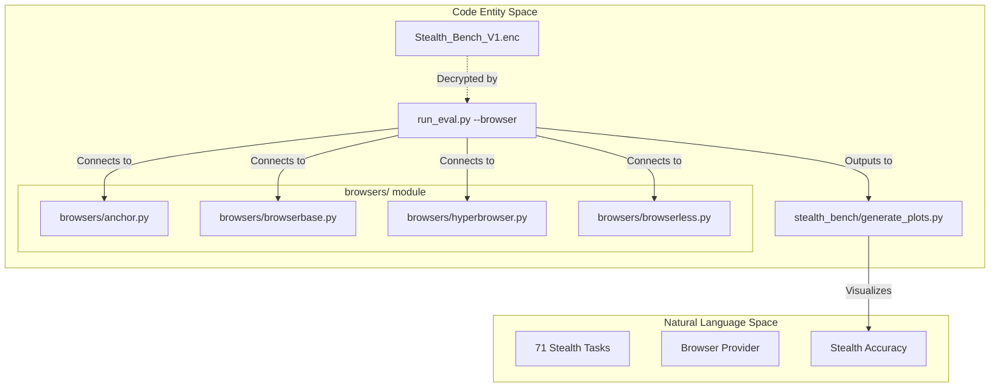

<!-- source: DeepWiki mcp.deepwiki.com · repo browser-use/benchmark · page 6 Stealth Bench V1 · fetched 2026-10-30 -->

# Stealth Bench V1

Relevant source files

The following files were used as context for generating this wiki page:

- [README.md](README.md)
- [Stealth_Bench_V1.enc](Stealth_Bench_V1.enc)
- [browsers/anchor.py](browsers/anchor.py)
- [browsers/browserbase.py](browsers/browserbase.py)
- [browsers/browserless.py](browsers/browserless.py)
- [browsers/hyperbrowser.py](browsers/hyperbrowser.py)
- [browsers/local_headful.py](browsers/local_headful.py)
- [stealth_bench/official_plots/category_heatmap_dark.png](stealth_bench/official_plots/category_heatmap_dark.png)
- [stealth_bench/official_plots/category_heatmap_light.png](stealth_bench/official_plots/category_heatmap_light.png)

Stealth Bench V1 is a specialized sub-project within the browser-use benchmark repository designed to evaluate the anti-bot bypass capabilities of different browser providers [README.md:35-37](). While the primary BU Bench V1 focuses on agent reasoning and task completion, Stealth Bench V1 specifically targets the "stealth" layer of the stack, testing whether browsers can successfully navigate past sophisticated protection mechanisms like Cloudflare, Akamai, and Datadome.

## Project Purpose and Scope

The benchmark consists of 71 tasks [README.md:37]() (validated against a threshold of 80 expected total task entries in some configurations) that probe various dimensions of browser fingerprinting and bot detection. 

### Key Differences from BU Bench V1
*   **Target:** Stealth Bench evaluates the **Browser Provider** (e.g., Anchor, Browserbase, Steel) rather than the LLM or the Agent Framework [README.md:82-85]().
*   **Metric:** The primary metric is "Stealth Accuracy"—the ability to access a page and perform a basic interaction without being blocked by anti-bot software [README.md:37-49]().
*   **Structure:** Tasks are categorized by the specific anti-bot protection they employ (e.g., Cloudflare, Datadome, Akamai, Fingerprinting) [stealth_bench/official_plots/category_heatmap_light.png:8]().

### Repository Structure
The project is contained within the `stealth_bench/` directory, which houses official results and visualization tools [README.md:87]().

| Path | Description |
|:---|:---|
| `Stealth_Bench_V1.enc` | The encrypted task definitions [README.md:74](). |
| `stealth_bench/official_results/` | JSON files containing success/failure data for various browser providers. |
| `stealth_bench/official_plots/` | Generated visualizations (heatmaps, bar charts) [README.md:40-49](). |
| `stealth_bench/generate_plots.py` | The logic for processing results into visual reports. |

Sources: [README.md:35-87](), [stealth_bench/official_plots/category_heatmap_light.png:1-24]()

## System Architecture

The Stealth Bench utilizes the same core execution engine as the main benchmark but shifts the variable from the `Agent` framework to the `Browser` connector.

### Stealth Bench Entity Map
The following diagram illustrates how the Stealth Bench concepts map to specific code entities and browser provider modules.

Sources: [README.md:68-85](), [browsers/anchor.py:1-10](), [browsers/browserbase.py:1-5](), [browsers/hyperbrowser.py:1-5](), [browsers/browserless.py:1-5]()

## Evaluation and Plotting Systems

The Stealth Bench lifecycle is divided into execution and visualization, each handled by specific scripts and data schemas.

### Task Evaluation
Evaluation is triggered via `run_eval.py` by specifying a browser provider [README.md:82](). The system decrypts `Stealth_Bench_V1.enc` using a Fernet key derived from the string "Stealth_Bench_V1" [README.md:70-77](). Results are recorded per category to identify specific weaknesses in a provider's stealth implementation.

For details, see [Stealth Bench Evaluation and Results](#6.1).

### Visualization and Plotting
The visualization system in `stealth_bench/generate_plots.py` produces high-fidelity reports, including:
*   **Accuracy by Browser:** A bar chart comparing overall success rates across providers [README.md:42]().
*   **Category Heatmap:** A matrix showing performance against specific anti-bot vendors (Cloudflare, etc.) [README.md:48]().
*   **Data Normalization:** Logic to reclassify custom anti-bot detections and merge niche categories for cleaner reporting.

For details, see [Stealth Bench Plot Generation](#6.2).

### Browser Provider Integration
The bench tests both cloud-based providers and local configurations. Cloud providers often include built-in residential proxies and captcha solvers.

| Provider | File | Key Features |
|:---|:---|:---|
| **Anchor** | [browsers/anchor.py]() | Residential proxy, extra stealth, adblock [browsers/anchor.py:1-5](). |
| **Browserbase** | [browsers/browserbase.py]() | Proxies and captcha solving enabled [browsers/browserbase.py:1-5](). |
| **Hyperbrowser** | [browsers/hyperbrowser.py]() | Stealth mode with residential proxy [browsers/hyperbrowser.py:1-5](). |
| **Browserless** | [browsers/browserless.py]() | Stealth route with residential proxy [browsers/browserless.py:1-5](). |
| **Local** | [browsers/local_headful.py]() | Standard Chromium with GUI [browsers/local_headful.py:1-3](). |

Sources: [README.md:35-85](), [browsers/anchor.py:1-44](), [browsers/browserbase.py:1-36](), [browsers/hyperbrowser.py:1-32](), [browsers/browserless.py:1-14](), [browsers/local_headful.py:1-11]()

---

